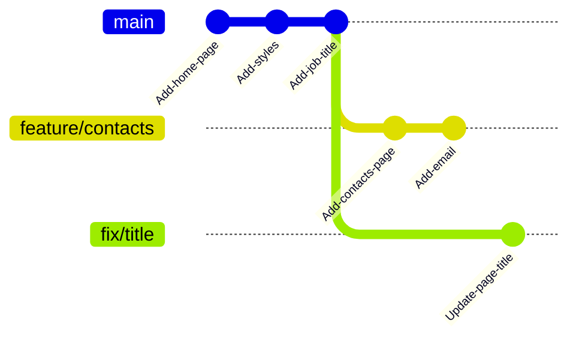
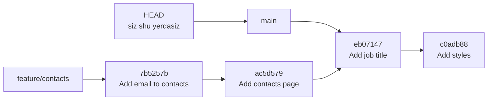
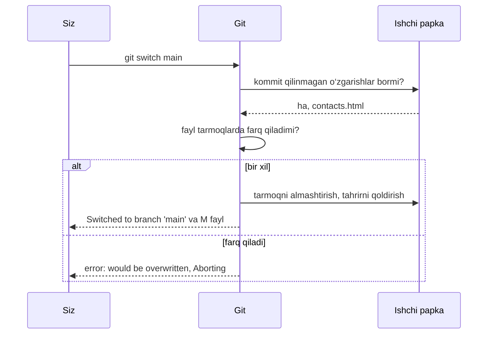

# Tarmoqlar

[Mundarija](../../README.md) · [← Orqaga](../../Lesson-5/uz/Fayllarni%20e'tiborsiz%20qoldirish%20va%20loyihada%20tartib.md) · [Keyingi →](../../Lesson-7/uz/Birlashtirish%20va%20konfliktlar.md) · [RU](../ru/%D0%92%D0%B5%D1%82%D0%BA%D0%B8.md) · [EN](../en/Branches.md) · [UZ](Tarmoqlar.md)

> **5-dars bilan bog‘liqlik:** loyihada tartib: `.gitignore` keraksiz fayllar va sirlarni yashiradi, `README.md` saytni tavsiflaydi, tarix esa kommitlarning tartibli zanjiri. Lekin bu zanjir bitta: har bir yangi kommit darhol saytning asosiy versiyasiga tushadi. Bugun siz bir nechta ish yo‘nalishini parallel olib borishni o‘rganasiz - **tarmoqlar (branch)** yordamida.

---

## Bu sizga nima uchun kerak

Siz portfolio saytida kontaktlar sahifasini yasay boshladingiz. Yarmini qildingiz: forma bor, lekin tugma ishlamaydi, maket esa buzilib ketgan. Shu payt do‘stingiz yozadi: «Bosh sahifada isming xato yozilgan, tuzatib qo‘y, men havolani ish beruvchiga yuborib bo‘ldim».

Tarmoqlarsiz yo buzilgan sahifani tuzatish bilan birga kommit qilishga, yo chala ishni qo‘lda yashirishga to‘g‘ri keladi. Tarmoqlar bilan esa kontaktlar sahifasi o‘zining `feature/contacts` tarmog‘ida yashaydi: siz ishlaydigan `main` ga o‘tasiz, xatoni `fix/title` tarmog‘ida tuzatasiz va kontaktlarga qaytasiz.

Barcha dasturchilar jamoalari shunday ishlaydi: `main` - doim ishlaydigan versiya, har bir vazifa esa o‘z tarmog‘ida. GitHub’da (8-dars) va jamoada ishlashda (9-dars) tarmoqlarsiz ish bitmaydi.

---

## Nimani o‘rganasiz

- Tarmoq nima ekanini va u nima uchun «hech narsaga tushmasligini» tushuntirish.
- `HEAD` ni «siz shu yerdasiz» belgisi deb tushunish va `HEAD -> main` yozuvini o‘qish.
- Tarmoqlarni ko‘rish, yaratish va ular orasida o‘tish: `git branch`, `git switch`, `git switch -c`.
- Tarmoq almashtirilganda papkadagi fayllar bilan nima bo‘lishini oldindan aytish.
- Tarix grafini o‘qish: `git log --oneline --graph --all`.
- Tarmoqlarni qayta nomlash va o‘chirish: `git branch -m`, `-d`, `-D` - va `-D` qachon xavfli ekanini tushunish.
- Kommit qilinmagan o‘zgarishlar bilan tarmoq almashtirish va «ajratilgan HEAD» holatidan chiqish.
- Tarmoqlarga tushunarli nom berish: `feature/...`, `fix/...`.

---

## Takrorlash: 5-darsdan 3 savol

1. Siz `config.env` ni `.gitignore` ga qo‘shdingiz, lekin `git status` baribir `modified: config.env` ni ko‘rsatyapti. Nima uchun va nima qilish kerak?
2. `git rm style.css` buyrug‘i `git rm --cached style.css` dan nimasi bilan farq qiladi?
3. Bo‘sh papkaga `.gitkeep` fayli nima uchun qo‘yiladi?

Javoblar - dars oxirida.

---

## Reja

| Bo‘lim | Nima qilamiz |
| --- | --- |
| Tarmoq va `HEAD` | Tarixdagi xatcho‘p, «siz shu yerdasiz» belgisi |
| Yaratish va o‘tish | `git branch`, `git switch -c`; fayllar bilan nima bo‘ladi |
| Mini-topshiriq 1 | O‘zingizning birinchi tarmog‘ingiz |
| Tarix grafi | `git log --oneline --graph --all` |
| Qayta nomlash va o‘chirish | `-m`, `-d`, `-D` |
| Tahrirlar va ajratilgan HEAD | O‘zgarishlar bilan tarmoq almashtirish, eski kommitlar bo‘ylab sayr |
| Tarmoq nomlari va `git checkout` | Qoidalar va buyruqlarning eski shakli |
| Mini-topshiriq 2 | Tarmoqlarning to‘liq hayot sikli |
| Mustaqil ish | O‘quv terminalidagi va kompyuterdagi topshiriq |

---

## Tarmoq nima

**Oddiy so‘z bilan:** xatcho‘plari bor kitobni tasavvur qiling. Kitob - kommitlar tarixi, xatcho‘p esa - tarmoq. Xatcho‘p sahifalardan nusxa olmaydi, u shunchaki «men shu yerda o‘qiyapman» deb ko‘rsatadi. Xatcho‘plar xohlagancha bo‘lishi mumkin va har birini boshqa joyga ko‘chirish mumkin.

Boshqa o‘xshatish - **parallel qoralamalar**. Siz insho yozyapsiz: asosiy matn stol ustida turibdi, dadil g‘oya uchun esa oxirgi sahifaning nusxasini olib, davomini o‘sha nusxada yozasiz. Chiqdi - asosiy matnga ko‘chirasiz. Chiqmadi - qoralamani tashlab yuborasiz, asosiy matnga zarar yetmaydi.

Git’da **tarmoq** - kommitga ishora qiluvchi, nomga ega harakatlanuvchi ko‘rsatkich. Siz 2-darsdan beri ishlab kelayotgan `main` tarmog‘i - eng oddiy tarmoq: uni shunchaki `git init` yaratgan.



**Sxemani qanday o‘qish kerak.** Vaqt chapdan o‘ngga o‘tadi. Dastlabki uchta kommit - umumiy tarix. `Add-job-title` kommitidan ikkita chiziq ajraladi: `feature/contacts` da - kontaktlar sahifasining ikkita kommiti, `fix/title` da - sarlavha tuzatilgan bitta kommit. `main` tarmog‘i `Add-job-title` da qoldi: tarmoqlardagi ish unga tegmaydi. Bu darsda aynan shunday tarixni qurasiz.

---

## `HEAD`: «siz shu yerdasiz»

3-darsda siz `HEAD` ni «joriy kommit» deb bildingiz. Endi aniqlashtiramiz: odatda `HEAD` **kommitga emas, tarmoqqa** ishora qiladi, tarmoq esa - kommitga.

**Oddiy so‘z bilan:** `HEAD` - savdo markazi xaritasidagi «Siz shu yerdasiz» belgisi, tarmoqlar esa - do‘konlar nomlari. Belgi `main` do‘koni yonida turibdi va do‘kon «ko‘chganda» (yangi kommit) belgi ham u bilan birga ko‘chadi.



**Sxemani qanday o‘qish kerak.** `HEAD` `main` tarmog‘iga, `main` esa `eb07147` kommitiga ishora qiladi. `feature/contacts` tarmog‘i o‘zining oxirgi kommiti `7b5257b` ga ishora qiladi. Kommitlar orasidagi strelkalar 3-darsdagidek ota-kommitga olib boradi. Hozir kommit qilsangiz, u `main` ning yangi kommiti bo‘ladi, `feature/contacts` esa joyidan siljimaydi. `git log` dagi `HEAD -> main` yozuvini siz 2-darsdan beri ko‘rgansiz. Endi uni o‘qiy olasiz: «`HEAD` `main` tarmog‘iga ishora qiladi».

---

## Tarmoqlarni yaratish va ular orasida o‘tish

### `git branch`: tarmoqlar ro‘yxati va yaratish

Portfolioda ishlaymiz: `main` da uchta kommit bor - `Add home page`, `Add styles`, `Add job title`. Parametrsiz `git branch` tarmoqlar ro‘yxatini ko‘rsatadi, nom bilan esa tarmoq yaratadi:

```bash
git branch
git branch feature/contacts
git branch
git log --oneline
```

```text
* main
  feature/contacts
* main
eb07147 (HEAD -> main, feature/contacts) Add job title
c0adb88 Add styles
33b7941 Add home page
```

| Qator | Tarjimasi va ma’nosi |
| --- | --- |
| `* main` (birinchi javob) | Hozircha tarmoq bitta. `*` joriy tarmoqni - `HEAD` ishora qilayotganini belgilaydi |
| `  feature/contacts` | Yangi tarmoq paydo bo‘ldi. Yulduzcha yo‘q - siz unda emassiz |
| `* main` | Siz hamon `main` dasiz |
| `(HEAD -> main, feature/contacts)` | Ikkala tarmoq bitta `eb07147` kommitiga, `HEAD` esa `main` ga ishora qiladi |

E’tibor bering: tarmoq yaratilganda `git branch` hech narsa demadi - Git’da sukut muvaffaqiyatni bildiradi. Eng muhimi: **`git branch` tarmoqni yaratadi, lekin unga o‘tkazmaydi**.

### `git switch`: tarmoqqa o‘tish

```bash
git switch feature/contacts
git status
```

```text
Switched to branch 'feature/contacts'
On branch feature/contacts
nothing to commit, working tree clean
```

| Qator | Tarjimasi va ma’nosi |
| --- | --- |
| `Switched to branch 'feature/contacts'` | «feature/contacts tarmog‘iga o‘tildi»: endi `HEAD` unga ishora qiladi |
| `On branch feature/contacts` | `git status` tasdiqlaydi: siz yangi tarmoqdasiz |

Tarmoqda ikkita kommit qilamiz:

```bash
echo "<h1>Contacts</h1>" > contacts.html
git add contacts.html
git commit -m "Add contacts page"
echo "<p>Email: anna@example.com</p>" >> contacts.html
git commit -am "Add email to contacts"
git log --oneline
```

```text
[feature/contacts ac5d579] Add contacts page
 1 file changed, 1 insertion(+)
 create mode 100644 contacts.html
[feature/contacts 7b5257b] Add email to contacts
 1 file changed, 1 insertion(+)
7b5257b (HEAD -> feature/contacts) Add email to contacts
ac5d579 Add contacts page
eb07147 (main) Add job title
c0adb88 Add styles
33b7941 Add home page
```

Kvadrat qavslarda endi `main` emas, `feature/contacts`: Git kommit qaysi tarmoqqa tushganini aytadi. `feature/contacts` tarmog‘i ikki kommit oldinga ketdi, `main` esa `eb07147` da qoldi.

### `git switch -c`: yaratish va darhol o‘tish

`git branch nom` + `git switch nom` - bu ikki buyruq shunchalik tez-tez kerak bo‘ladiki, ular uchun bitta buyruq bor:

```bash
git switch main
git switch -c fix/titel
```

```text
Switched to branch 'main'
Switched to a new branch 'fix/titel'
```

`-c` - inglizcha create, «yaratish» so‘zidan. `Switched to a new branch` - «**yangi** tarmoqqa o‘tildi». Tarmoq siz turgan kommitdan yaratiladi, shuning uchun `git switch -c` dan oldin avval `main` ga qayting. Boshlanish nuqtasini aniq ko‘rsatish ham mumkin: `git switch -c fix/titel main` qayerda bo‘lishingizdan qat’i nazar tarmoqni `main` dan yaratadi. Yana bir qulay shakl - `git switch -` (minus): terminaldagi `cd -` kabi oldingi tarmoqqa qaytish.

### Qadamma-qadam: `HEAD` qayerga ishora qiladi

| Qadam | Buyruq | Nima o‘zgardi / HEAD qayerga ishora qiladi |
| --- | --- | --- |
| 1 | (boshlanish) | `HEAD` → `main` → `eb07147` |
| 2 | `git branch feature/contacts` | Tarmoq paydo bo‘ldi → `eb07147`. `HEAD` hamon → `main` |
| 3 | `git switch feature/contacts` | `HEAD` → `feature/contacts` → `eb07147` |
| 4 | `git commit -m "Add contacts page"` | `feature/contacts` `ac5d579` ga siljidi, `main` `eb07147` da qoldi |
| 5 | `git commit -am "Add email to contacts"` | `feature/contacts` → `7b5257b` |
| 6 | `git switch main` | `HEAD` → `main` → `eb07147` |
| 7 | `git switch -c fix/titel` | Yangi tarmoq → `eb07147`, `HEAD` → `fix/titel` |

> **Muhim:** yangi o‘rganuvchining eng ko‘p uchraydigan xatosi - tarmoqni `git branch nom` orqali yaratib, darhol kommit qila boshlash. Kommitlar siz turgan tarmoqqa - masalan, `main` ga ketadi. Kommitdan oldin `git status` ning birinchi qatorini ko‘ring: `On branch ...`.

---

## Tarmoq almashtirilganda fayllar bilan nima bo‘ladi

Tarmoq kommitga ishora qiladi, kommit esa - barcha fayllarning surati. Shuning uchun tarmoq almashtirilganda Git **ishchi papkani yangi tarmoq suratiga moslaydi**: fayllarni qo‘shadi, o‘zgartiradi va o‘chiradi.

```bash
git switch feature/contacts
ls
git switch main
ls
cat contacts.html
```

```text
Switched to branch 'feature/contacts'
contacts.html  index.html  style.css
Switched to branch 'main'
index.html  style.css
cat: contacts.html: No such file or directory
```

`contacts.html` fayli `main` da «g‘oyib bo‘ldi». U o‘chirilmagan: u `feature/contacts` tarmog‘ining kommitlarida saqlanadi va siz shu tarmoqqa o‘tishingiz bilan qaytib keladi.

| Qadam | Buyruq | Ishchi papka | Indeks | Repozitoriy |
| --- | --- | --- | --- | --- |
| 1 | `git switch feature/contacts` | `contacts.html`, `index.html`, `style.css` | `7b5257b` dagidek | `HEAD` → `feature/contacts` |
| 2 | `git switch main` | `index.html`, `style.css` - `contacts.html` olib tashlandi | `eb07147` dagidek | `HEAD` → `main`, tarmoq kommitlari butun |
| 3 | `git switch fix/titel` | `main` dagi fayllarning o‘zi: tarmoq hozircha o‘sha kommitda turibdi | `eb07147` dagidek | `HEAD` → `fix/titel` |
| 4 | `git switch feature/contacts` | `contacts.html` yana joyida | `7b5257b` dagidek | `HEAD` → `feature/contacts` |

**Oddiy so‘z bilan:** ishchi papka - stol, tarmoqlar esa - javondagi qoralamali jildlar. Tarmoq almashtirganda siz stoldan bitta qoralamani olib, boshqasini qo‘yasiz. Stolda saqlanmagan tahrirlar bo‘lmasa, Git ularni jimgina almashtiradi.

---

## Mini-topshiriq 1

O‘quv terminalida:

1. `recipes` papkasini yarating, unga o‘ting va repozitoriy yarating.
2. `# My recipes` matnli `README.md` ni yarating va kommit qiling: `Add README`.
3. `feature/soup` tarmog‘ini yarating va darhol unga o‘ting.
4. `Tomato soup` matnli `soup.txt` ni yarating va kommit qiling: `Add soup recipe`.
5. `main` ga qayting va `ls` ni ko‘ring. `soup.txt` qayerda?
6. `git branch -v` ni ko‘ring: tarmoqlar qaysi kommitlarga ishora qilyapti?

---

## Tarix grafi: `git log --oneline --graph --all`

Oddiy `git log` faqat **joriy** tarmoq tarixini ko‘rsatadi: `main` da `feature/contacts` kommitlarini ko‘rmaysiz. `--all` parametri barcha tarmoqlarning kommitlarini ko‘rsatadi, `--graph` esa chap tomonda tarmoq chiziqlarini `*`, `|` va `/` belgilari bilan chizadi.

`fix/titel` ga qaytamiz, sarlavhani tuzatamiz va grafni ko‘ramiz:

```bash
git switch fix/titel
echo "<h1>Anna Karimova - Frontend Developer</h1>" > index.html
echo "<p>Frontend developer</p>" >> index.html
git commit -am "Update page title"
git log --oneline --graph --all
```

```text
Switched to branch 'fix/titel'
[fix/titel d17b541] Update page title
 1 file changed, 1 insertion(+), 1 deletion(-)
* d17b541 (HEAD -> fix/titel) Update page title
| * 7b5257b (feature/contacts) Add email to contacts
| * ac5d579 Add contacts page
|/
* eb07147 (main) Add job title
* c0adb88 Add styles
* 33b7941 Add home page
```

| Qator | Tarjimasi va ma’nosi |
| --- | --- |
| `* d17b541 (HEAD -> fix/titel)` | `fix/titel` tarmog‘ining kommiti, siz unda turibsiz |
| `\| * 7b5257b (feature/contacts)` | Ikkinchi chiziq: `feature/contacts` tarmog‘ining kommitlari |
| `\|/` | Bu yerda ikki chiziq tutashadi: ikkala tarmoq bitta kommitdan o‘sib chiqqan |
| `* eb07147 (main)` | Umumiy kommit - `main` shu kommitda turibdi |

Darsning birinchi sxemasi bilan solishtiring - bu o‘sha tarix, faqat terminalda yangi kommitlar tepada. Agar barcha `*` bitta ustunda tursa, tarmoqlar hali ajralmagan.

---

## Tarmoqlarni qayta nomlash va o‘chirish

### `git branch -m`: qayta nomlash

Tarmoq nomi xato bilan yozildi: `fix/titel`. Joriy tarmoqni qayta nomlaymiz (`-m` - inglizcha move so‘zidan):

```bash
git branch -m fix/title
git branch -v
```

```text
  feature/contacts 7b5257b Add email to contacts
* fix/title        d17b541 Update page title
  main             eb07147 Add job title
```

`git branch -v` har bir tarmoq yonida uning oxirgi kommiti xeshi va xabarini ko‘rsatadi. Qayta nomlashda kommitlar o‘zgarmaydi - faqat xatcho‘p nomi o‘zgaradi. `git branch -m eski yangi` shakli qayerda bo‘lishingizdan qat’i nazar istalgan tarmoqni qayta nomlaydi.

> **Muhim:** `main` da bajarilgan `git branch -m fix/title` `main` ning o‘zini qayta nomlaydi. Bitta nomli `-m` dan oldin qaysi tarmoqda ekaningizni tekshiring.

### `git branch -d` va `-D`: tarmoqni o‘chirish

Endi kerak bo‘lmagan tarmoq `git branch -d` (delete) buyrug‘i bilan o‘chiriladi. Faqat siz **turmagan** tarmoqni o‘chirish mumkin. Agar tarmoqning barcha kommitlari joriy tarmoqda allaqachon bo‘lsa, Git `Deleted branch nom (was xesh).` deb javob beradi.

Qorong‘i mavzu g‘oyasini `experiment` tarmog‘ida sinab ko‘ramiz:

```bash
git switch main
git switch -c experiment
echo "body { background: black; }" > style.css
git commit -am "Try dark theme"
git switch main
git branch -d experiment
```

```text
Switched to branch 'main'
Switched to a new branch 'experiment'
[experiment bcc7b97] Try dark theme
 1 file changed, 1 insertion(+), 1 deletion(-)
Switched to branch 'main'
error: the branch 'experiment' is not fully merged
hint: If you are sure you want to delete it, run 'git branch -D experiment'
hint: Disable this message with "git config set advice.forceDeleteBranch false"
```

| Qator | Tarjimasi va ma’nosi |
| --- | --- |
| `the branch 'experiment' is not fully merged` | «Tarmoq to‘liq birlashtirilmagan»: unda joriy tarmoqda yo‘q kommitlar bor |
| `If you are sure ... run 'git branch -D experiment'` | Ishonchingiz komil bo‘lsa - katta harfli `-D` bilan majburan o‘chiring |

`-d` - xavfsiz o‘chirish: Git sizni ishni yo‘qotishdan himoya qiladi. Qorong‘i mavzu yoqmadi, shuning uchun majburan o‘chiramiz:

```bash
git branch -D experiment
```

```text
Deleted branch experiment (was bcc7b97).
```

> **Muhim:** `git branch -D` tarmoqni uning kommitlariga kirish yo‘li bilan birga o‘chiradi. `-D` ni faqat tarmoq kommitlari **aniq** kerak bo‘lmaganda ishlating: muvaffaqiyatsiz tajriba, qoralama. Kerakli ish bor tarmoqdagi xatoni «o‘chirib qo‘yish» uchun `-D` ni ishlatish **mumkin emas** - avval uni birlashtirish kerak (7-dars). Agar xato bilan o‘chirib qo‘ysangiz, xeshni `git reflog` da (4-dars) yoki `(was bcc7b97)` qatorida toping va tarmoqni qayta yarating: `git branch experiment bcc7b97`.
>
> Tarmoqlarni birlashtirish - `git merge` - 7-darsning mavzusi. O‘shanda `git branch -d` ishi allaqachon `main` ga tushgan tarmoqlarni bemalol o‘chiradi.

---

## Tarmoq almashtirilganda kommit qilinmagan o‘zgarishlar

Agar stolda saqlanmagan tahrirlar bo‘lsa-yu, siz tarmoq almashtirsangiz nima bo‘ladi? Ikki holat bor.

### 1-holat: o‘zgarishlar siz bilan ko‘chadi

Siz `main` da `style.css` ga qator qo‘shdingiz va kommit qilmadingiz. `main` va `feature/contacts` da `style.css` fayli bir xil:

```bash
echo "footer { color: gray; }" >> style.css
git switch feature/contacts
git status -s
```

```text
Switched to branch 'feature/contacts'
M	style.css
 M style.css
```

`Switched` dan keyingi `M	style.css` qatori - Git ogohlantirishi: o‘zgargan fayl siz bilan birga ko‘chdi; `git status -s` buni tasdiqlaydi: ` M style.css` - o‘zgargan, indeksda emas.

Kommit qilinmagan o‘zgarishlar tarmoqqa emas, **ishchi papkaga** tegishli. Fayl ikkala tarmoqda bir xil ekan, Git tahrirni bemalol ko‘chira oladi. Agar ishni noto‘g‘ri tarmoqda boshlab qo‘ygan bo‘lsangiz, bu qulay: keraklisiga o‘ting va o‘sha yerda kommit qiling.

### 2-holat: «would be overwritten» xatosi

Avval 1-holatdagi tahrirni bekor qilamiz: `git restore style.css` (4-dars). Endi siz `feature/contacts` da `contacts.html` ga telefon raqamini qo‘shdingiz va bu fayl umuman yo‘q bo‘lgan `main` ga o‘tmoqchisiz:

```bash
echo "<p>Phone: +998 90 123 45 67</p>" >> contacts.html
git switch main
```

```text
error: Your local changes to the following files would be overwritten by checkout:
	contacts.html
Please commit your changes or stash them before you switch branches.
Aborting
```

| Qator | Tarjimasi va ma’nosi |
| --- | --- |
| `Your local changes ... would be overwritten by checkout` | «Lokal o‘zgarishlaringiz tarmoq almashtirilganda ustidan yozib yuboriladi» |
| `Please commit your changes or stash them` | O‘zgarishlarni kommit qiling yoki yashirib qo‘ying (`git stash` - 9-dars) |
| `Aborting` | O‘tish bekor qilindi: siz avvalgi tarmoqda qoldingiz, hech narsa yo‘qolmadi |

O‘tish uchun fayl tarmoqlar o‘rtasida o‘zgarishi kerak bo‘lardi, demak, tahrirlaringiz o‘chib ketardi. Git rad etadi. Uchta yo‘l bor: tahrirni joriy tarmoqda kommit qilish, uni `git restore contacts.html` bilan bekor qilish (4-dars) yoki `git stash` orqali yashirib qo‘yish (9-dars).



**Sxemani qanday o‘qish kerak.** Tarmoq almashtirishdan oldin Git ishchi papkani tekshiradi. Agar o‘zgargan fayl ikkala tarmoqda bir xil bo‘lsa, tahrir siz bilan birga «ko‘chadi». Agar farq qilsa, Git to‘xtaydi va hech narsaga tegmaydi. Ikkala holatdan qochishning eng ishonchli yo‘li: tarmoq almashtirishdan oldin `git status` `working tree clean` deb javob berishi kerak.

Yangi **kuzatilmaydigan** fayllar (`Untracked files`) ham siz bilan tarmoqdan tarmoqqa ko‘chadi: Git ularni kuzatmaydi, shuning uchun olib tashlamaydi ham. Telefon tahririni bekor qilamiz va `main` ga qaytamiz: `git restore contacts.html`, `git switch main`.

---

## Ajratilgan HEAD

Ba’zan sayt bir necha kommit oldin qanday bo‘lganini ko‘rgingiz keladi - `git show` (3-dars) orqali bitta faylni emas, balki brauzerda ochib, butunlay. Buning uchun `HEAD` ni to‘g‘ridan-to‘g‘ri kommitga qo‘yish mumkin:

```bash
git switch --detach c0adb88
git status
cat index.html
```

```text
HEAD is now at c0adb88 Add styles
HEAD detached at c0adb88
nothing to commit, working tree clean
<h1>Anna Karimova</h1>
```

| Qator | Tarjimasi va ma’nosi |
| --- | --- |
| `HEAD is now at c0adb88 Add styles` | Endi `HEAD` shu kommitga ishora qiladi |
| `HEAD detached at c0adb88` | «HEAD ajratilgan»: siz tarmoqda emas, to‘g‘ridan-to‘g‘ri kommitdasiz |
| `<h1>Anna Karimova</h1>` | Papkadagi fayllar o‘sha kommitdagidek: `Frontend developer` qatori hali yo‘q |

**Oddiy so‘z bilan:** odatda siz do‘kon ichida turasiz va «siz shu yerdasiz» belgisi do‘kon bilan birga ko‘chadi. Ajratilgan `HEAD` da siz yo‘lakka chiqib, aniq bir eshik oldida turibsiz: ko‘rish mumkin, lekin yangi kommitlar hech bir tarmoqqa biriktirilmaydi. `git log --oneline --all` da bunday kommit strelkasiz `(HEAD)` bilan belgilanadi: `HEAD` tarmoqqa emas, kommitga ishora qiladi.

### Qanday chiqish kerak

| Vaziyat | Buyruq |
| --- | --- |
| Ko‘rib bo‘ldingiz va qaytmoqchisiz | `git switch main` (yoki `git switch -`) |
| Kommitlar qildingiz va ularni saqlamoqchisiz | `git switch -c yangi-tarmoq` - tarmoq kommitlarni «ilib oladi» |

`git switch main` dan keyin simulyator `Switched to branch 'main'` deb javob beradi, haqiqiy Git esa bu qatordan oldin `Previous HEAD position was c0adb88 Add styles` - «HEAD’ning oldingi o‘rni» qatorini qo‘shadi. Agar ajratilgan `HEAD` da kommit qilib, tarmoqqa o‘tsangiz, Git ogohlantiradi: `Warning: you are leaving 1 commit behind, not connected to any of your branches` - «siz hech bir tarmog‘ingizga bog‘lanmagan 1 ta kommitni qoldiryapsiz». Bunday kommitni faqat xesh bo‘yicha (`git branch nom xesh`) yoki `git reflog` orqali qutqarish mumkin.

> **Muhim:** ajratilgan `HEAD` ga tasodifan ham tushib qolishadi - begona yo‘riqnomadagi `git checkout <xesh>` buyrug‘i bilan. Agar `git status` `HEAD detached` deb yozsa, vahimaga tushmang: hech narsa buzilmagan, shunchaki tarmoqqa qayting.

---

## Tarmoq nomlari va eski `git checkout` buyrug‘i

### Tarmoqlarni qanday nomlash kerak

| Qoida | Yaxshi | Yomon |
| --- | --- | --- |
| Vazifa turi bo‘yicha prefiks | `feature/contacts`, `fix/title` | `contacts2`, `vasya` |
| Lotin harflari, kichik harflar | `feature/dark-theme` | `Feature/ҚоронғиМавзу` |
| Probel o‘rniga defis | `fix/header-typo` | `fix header typo` |
| Qisqa va mazmunli | `feature/contact-form` | `feature/new-page-that-i-made-today` |

Keng tarqalgan prefikslar: `feature/` - yangi imkoniyat, `fix/` - xatoni tuzatish, `docs/` - hujjatlar, `experiment/` - sinov. Probellar va ba’zi belgilarni Git umuman qabul qilmaydi: `git branch "my branch"` `fatal: 'my branch' is not a valid branch name` deb javob beradi. Harflarning katta-kichikligi muhim: `Feature/Contacts` va `feature/contacts` - turli tarmoqlar. Shuning uchun nomlarni kichik harflar bilan yozishga kelishib oling.

### `git checkout`: eski universal buyruq

2019-yilgacha (Git 2.23) tarmoqlar uchun ham, fayllar uchun ham bitta `git checkout` buyrug‘i bor edi. Shu sababli uni adashtirib yuborish oson edi: bitta buyruqning o‘zi ham tarmoqni almashtirar, ham fayldagi tahrirlarni o‘chirib yuborardi. Shuning uchun u `git switch` (tarmoqlar) va `git restore` (fayllar, 4-dars) ga ajratildi. Begona yo‘riqnomalar va eski maqolalarda siz `checkout` ni doim uchratasiz.

| Eski shakl | Zamonaviy |
| --- | --- |
| `git checkout main` | `git switch main` |
| `git checkout -b feature/x` | `git switch -c feature/x` |
| `git checkout c0adb88` | `git switch --detach c0adb88` |
| `git checkout -- index.html` | `git restore index.html` |

E’tibor bering: `--detach` siz `git switch` kommitga o‘tmaydi - shu tarzda u tasodifiy ajratilgan `HEAD` dan himoya qiladi:

```bash
git switch c0adb88
```

```text
fatal: a branch is expected, got commit 'c0adb88'
hint: If you want to detach HEAD at the commit, try again with the --detach option.
hint: Disable this message with "git config set advice.suggestDetachingHead false"
```

Tarjimasi: «Tarmoq kutilgan edi, lekin kommit olindi. Agar shu kommitda HEAD’ni ajratmoqchi bo‘lsangiz, `--detach` bilan takrorlang». `git checkout c0adb88` esa `HEAD` ni so‘roqsiz ajratadi va uzun `You are in 'detached HEAD' state...` izohini chiqaradi - «siz ajratilgan HEAD holatidasiz: atrofni ko‘zdan kechirish va tajriba qilish mumkin». Izoh oxirida Git chiqish yo‘llarini o‘zi aytadi: `git switch -c <new-branch-name>` va `git switch -`.

### Buzib ko‘ring

1. Allaqachon bor tarmoqni yarating: `git switch -c feature/contacts`. Git nima deb javob beradi?
2. Nomda xato qiling: `git switch feature/contact`. Qanday xabar chiqadi?
3. O‘zingiz turgan tarmoqni o‘chiring: `git branch -d main`.
4. `would be overwritten` xatosiga yeting: tarmoqda `main` da yo‘q faylni o‘zgartiring va `main` ga o‘ting.
5. `git checkout <xesh>` orqali eski kommitga o‘ting, kommit qiling va `git switch main` bilan qayting. Endi bu kommit `git log --oneline --all` da qayerda?

### Yangi o‘rganuvchilarning tipik xatolari

| Xato | Nima bo‘ladi | Qanday tuzatish |
| --- | --- | --- |
| `git branch nom` va darhol kommit | Kommit joriy tarmoqqa (ko‘pincha `main` ga) tushdi | Darhol `git switch -c nom` |
| Yangi tarmoq `main` dan yaratilmagan | Tarmoq o‘zi bilan begona kommitlarni olib keladi | `git switch -c` dan oldin - `git switch main` yoki `git switch -c nom main` |
| O‘tishda tarmoq nomida xato | `fatal: invalid reference: feature/contact` | Tarmoqlar ro‘yxati: `git branch` |
| Allaqachon bor tarmoqni yaratish | `fatal: a branch named 'feature/contacts' already exists` | `-c` siz o‘tish: `git switch feature/contacts` |
| Joriy tarmoqni o‘chirish | `error: cannot delete branch 'main' used by worktree at ...` | Avval boshqa tarmoqqa o‘tish |
| Birlashtirilmagan tarmoqda `-d` | `error: the branch 'experiment' is not fully merged` | Birlashtirish (7-dars) yoki, agar ish kerak bo‘lmasa, `-D` |
| Tarmoqlarda farq qiladigan fayldagi tahrirlar bilan tarmoq almashtirish | `error: Your local changes ... would be overwritten by checkout` | Kommit qilish, `git restore` yoki `git stash` (9-dars) |
| Noto‘g‘ri tarmoqda `git branch -m yangi` | Boshqa tarmoq, masalan `main` qayta nomlandi | `git branch -m yangi main` - nomni qaytarish |
| Yo‘riqnomadagi `git checkout <xesh>` | `HEAD detached at ...`, kommitlar «osilib qoladi» | `git switch main`, kerakli kommitlar - `git switch -c nom` |

---

## Mini-topshiriq 2

1-mini-topshiriqdagi `recipes` repozitoriysida davom eting (siz `main` dasiz):

1. `feature/desert` tarmog‘ini (xato bilan) yarating va unga o‘ting.
2. `Apple pie` matnli `dessert.txt` ni yarating va kommit qiling: `Add dessert recipe`.
3. Tarmoqni `feature/dessert` deb qayta nomlang.
4. `main` ga qayting, `experiment` tarmog‘ini yarating, `README.md` ga `Draft` qatorini qo‘shing va `commit -am` orqali kommit qiling.
5. `main` ga qayting va `experiment` ni `-d` orqali o‘chirib ko‘ring. Xatoni o‘qing va `-D` orqali o‘chiring.
6. Grafni ko‘ring: `git log --oneline --graph --all`.
7. Ajratilgan `HEAD` da birinchi kommitga o‘ting (`git switch --detach` va `Add README` xeshi), `git status` ni ko‘ring va `main` ga qayting.

---

## Dars yakuni: shpargalka

| Vazifa | Buyruq |
| --- | --- |
| Tarmoqlar ro‘yxati / oxirgi kommitlari bilan | `git branch`, `git branch -v` |
| Tarmoq yaratish (o‘tmasdan) | `git branch nom` |
| Tarmoqqa o‘tish | `git switch nom` |
| Yaratish va o‘tish | `git switch -c nom` |
| Boshqa tarmoqdan yaratish | `git switch -c nom main` |
| Oldingi tarmoqqa qaytish | `git switch -` |
| Barcha tarmoqlar grafi | `git log --oneline --graph --all` |
| Joriy / istalgan tarmoqni qayta nomlash | `git branch -m yangi`, `git branch -m eski yangi` |
| Birlashtirilgan tarmoqni o‘chirish | `git branch -d nom` |
| Tarmoqni majburan o‘chirish (ehtiyot bo‘ling!) | `git branch -D nom` |
| Eski kommitni butunlay ko‘rish | `git switch --detach xesh` |
| Ajratilgan HEAD’dan chiqish | `git switch main` yoki `git switch -c yangi-tarmoq` |
| Eski shakl (begona yo‘riqnomalarda) | `git checkout nom`, `git checkout -b nom` |

---

## Mustaqil ish

### 1-qism. IDE topshirig‘i (platforma hisoblaydi)

Siz `~/portfolio` papkasida, `main` tarmog‘idasiz, tarixda 3 ta kommit bor, `index.html` sarlavhasida xato: `Anna` o‘rniga `Ana`. Buyruqlarni har qatorga bittadan yozing:

1. Tarmoqlar ro‘yxatini ko‘ring.
2. Bitta buyruq bilan `main` dan `feature/contacts` tarmog‘ini yarating va unga o‘ting.
3. `<h1>Contacts</h1>` matnli `contacts.html` faylini yarating va uni kommit qiling.
4. `contacts.html` ga `<p>Email: anna@example.com</p>` qatorini qo‘shing va ikkinchi kommitni qiling.
5. `main` ga qayting va `fix/titel` tarmog‘ini (aynan nomdagi xato bilan) yaratib, unga o‘ting.
6. `index.html` ni ikki qator bilan qayta yozing: `<h1>Anna Karimova</h1>` va `<p>Frontend developer</p>` - va kommit qiling.
7. `fix/titel` tarmog‘ini `fix/title` deb qayta nomlang.
8. `main` ga qayting, `experiment` tarmog‘ini yarating, `style.css` ni `body { background: black; }` qatori bilan qayta yozing va kommit qiling.
9. `main` ga qayting va `experiment` tarmog‘ini o‘chiring (u birlashtirilmagan - majburan o‘chirish kerak bo‘ladi).
10. Barcha tarmoqlar grafini (`git log --oneline --graph --all`) va `git status` ni ko‘ring.

Oxirida siz `main` dasiz, repozitoriyda roppa-rosa uchta tarmoq bor: `main`, `feature/contacts`, `fix/title`, ishchi papka toza, `main` ning o‘zi esa o‘zgarmagan.

Platforma nimani tekshiradi: `feature/contacts` da `main` ustidan roppa-rosa ikkita yangi kommit borligini va ikkalasi ham `contacts.html` ni o‘zgartirishini; `fix/title` to‘g‘ridan-to‘g‘ri `main` dan o‘sib chiqqani va tuzatilgan sarlavhani saqlashini; tarmoq `fix/titel` sifatida yaratilib, qayta nomlanganini va `fix/titel` endi yo‘qligini; `main` da boshqa tarmoqlarning kommitlari yo‘qligini; `experiment` da kommit bo‘lganini, tarmoqning o‘zi esa o‘chirilganini; tarmoqlar roppa-rosa uchta ekanini; siz `main` da ekaningizni, ishchi papka tozaligini va unda `contacts.html` yo‘qligini; `--graph --all` grafini ko‘rganingizni; yechim `main` tarixi boshqacha bo‘lgan boshqa loyiha uchun ham ishlashini; ssenariy xatosiz bajarilishini.

### 2-qism. Kompyuterdagi loyiha

1. Saytingiz repozitoriysida `git branch` va `git log --oneline --graph --all` ni ko‘ring.
2. `feature/<nimadir-yangi>` tarmog‘ini (masalan, `feature/footer`) yarating va unda saytga haqiqiy tahrir bilan 1–2 ta kommit qiling. `main` ga o‘ting va saytni brauzerda oching: tahrir yo‘q. Qaytib o‘ting - tahrir qaytdi.
3. `experiment/colors` tarmog‘ini yarating, CSS’da ranglarni o‘zgartiring, kommit qiling, `main` ga qayting va tarmoqni `-D` orqali o‘chiring - avval `-d` xatosini o‘qib.
4. `git switch --detach` orqali saytning eng birinchi kommitiga o‘ting, saytni brauzerda oching, `main` ga qayting.
5. `feature/...` tarmog‘ini o‘chirmang: 7-darsda uni `main` ga birlashtirasiz.

### Tayyorlik mezonlari

- [ ] IDE topshirig‘i qabul qilindi.
- [ ] Sayt repozitoriysida o‘z kommitlariga ega `feature/...` tarmog‘i bor, `main` da esa ular yo‘q.
- [ ] `git log --oneline --graph --all` ayrilishni ko‘rsatadi va siz har bir qatorni tushuntira olasiz.
- [ ] Siz `not fully merged` xatosini ko‘rdingiz va `-d` `-D` dan nimasi bilan farq qilishini tushunasiz.
- [ ] Siz `HEAD detached` holatidan chiqa olasiz va kommitlarni qanday yo‘qotmaslikni tushuntira olasiz.

---

## O‘zini tekshirish uchun savollar

1. Git’da tarmoq nima va nima uchun tarmoq bir zumda yaratiladi?
2. `HEAD` odatda nimaga ishora qiladi va `HEAD -> main` yozuvi nimani bildiradi?
3. `git branch feature/x` buyrug‘i `git switch -c feature/x` dan nimasi bilan farq qiladi?
4. `git switch` da ishchi papkadagi fayllar bilan nima bo‘ladi? Boshqa tarmoqda yo‘q fayl qayerga «g‘oyib bo‘ladi»?
5. `--graph` va `--all` parametrlari `git log` ga nima qo‘shadi? `|/` qatori nimani bildiradi?
6. `git branch -d` buyrug‘i `git branch -D` dan nimasi bilan farq qiladi? `-D` ni qachon ishlatish mumkin emas?
7. Tarmoqni qanday qayta nomlash mumkin? Noto‘g‘ri tarmoqda bajarilgan `git branch -m yangi` nimasi bilan xavfli?
8. Qaysi holatda kommit qilinmagan o‘zgarishlar tarmoq almashtirilganda siz bilan ko‘chadi, qaysi holatda esa Git `would be overwritten` xatosini beradi?
9. Ajratilgan `HEAD` nima, unga qanday tushiladi va kommitlarni yo‘qotmasdan qanday chiqiladi?
10. `git checkout` o‘rniga qaysi buyruqlar keldi va nima uchun? Tarmoqlarni qanday to‘g‘ri nomlash kerak?

Savollardan keyin platformada **dars testini** topshiring: 12 ta savol, o‘tish chegarasi 70%.

---

## Keyin nima

Hozir sizda foydali ishga ega ikkita tarmoq bor - `feature/contacts` va `fix/title`, - lekin `main` da bu ish ko‘rinmaydi. 7-darsda tarmoqlarni `git merge` buyrug‘i bilan birlashtirishni o‘rganasiz: oldinga o‘tkazish (fast-forward) va birlashtirish kommiti nima ekanini, ikki tarmoq bitta qatorni o‘zgartirganda yuzaga keladigan **konflikt**da nima qilishni va allaqachon birlashtirilgan tarmoqlarni qanday o‘chirishni bilib olasiz.

---

## Javoblar

**Takrorlash**

1. `.gitignore` faqat kuzatilmaydigan fayllarga ta’sir qiladi, `config.env` esa allaqachon repozitoriyda. Uni kuzatuvdan olib tashlash kerak: `git rm --cached config.env` va kommit.
2. `git rm style.css` faylni diskdan ham, indeksdan ham o‘chiradi. `git rm --cached style.css` uni faqat indeksdan olib tashlaydi - fayl diskda qoladi va kommitdan keyin kuzatilmay qo‘yadi.
3. Git faqat fayllarni saqlaydi, bo‘sh papkani u ko‘rmaydi. Bo‘sh `.gitkeep` fayli papkani repozitoriyda saqlab qolish imkonini beradi.

**Mini-topshiriq 1**

```bash
mkdir recipes
cd recipes
git init
echo "# My recipes" > README.md
git add README.md
git commit -m "Add README"
git switch -c feature/soup
echo "Tomato soup" > soup.txt
git add soup.txt
git commit -m "Add soup recipe"
git switch main
ls
git branch -v
```

`main` da `soup.txt` yo‘q: u `feature/soup` tarmog‘ida saqlanadi. `git branch -v` `feature/soup` `Add soup recipe` ga, `main` esa `Add README` ga ishora qilishini ko‘rsatadi.

**Mini-topshiriq 2**

```bash
git switch -c feature/desert
echo "Apple pie" > dessert.txt
git add dessert.txt
git commit -m "Add dessert recipe"
git branch -m feature/dessert
git switch main
git switch -c experiment
echo "Draft" >> README.md
git commit -am "Add draft note"
git switch main
git branch -d experiment
git branch -D experiment
git log --oneline --graph --all
git log --oneline
git switch --detach f841aa3
git status
git switch main
```

`f841aa3` xeshi o‘quv terminalidagi `git log --oneline` dan olingan; sizda u boshqacha bo‘lishi mumkin, o‘zingiznikini qo‘ying.

**O‘zini tekshirish uchun savollar**

1. Kommitga ishora qiluvchi, nomga ega harakatlanuvchi ko‘rsatkich. Git fayllardan nusxa olmaydi, faqat yangi «xatcho‘p» yozib qo‘yadi, shuning uchun bu bir zumda bo‘ladi.
2. Odatda joriy tarmoqqa, tarmoq esa - kommitga. `HEAD -> main` - «siz `main` tarmog‘idasiz, bu uning oxirgi kommiti».
3. `git branch feature/x` faqat tarmoq yaratadi, siz avvalgi tarmoqda qolasiz. `git switch -c feature/x` yaratadi va darhol unga o‘tkazadi.
4. Git papkani yangi tarmoq oxirgi kommitining suratiga moslaydi: fayllarni qo‘shadi, o‘zgartiradi va olib tashlaydi. «G‘oyib bo‘lgan» fayl o‘z tarmog‘ining kommitlarida saqlanadi va shu tarmoqqa o‘tganda qaytadi.
5. `--all` - barcha tarmoqlarning kommitlari, `--graph` - chap tomonda tarmoq chiziqlari. `|/` - ikki chiziq tutashgan joy: tarmoqlar bitta kommitdan o‘sib chiqqan.
6. `-d` faqat kommitlari joriy tarmoqda allaqachon bor tarmoqni o‘chiradi, aks holda `not fully merged` deb javob beradi. `-D` majburan o‘chiradi. Kerakli, hali birlashtirilmagan ishga ega tarmoqqa `-D` ni qo‘llash mumkin emas.
7. `git branch -m yangi` - joriy tarmoqni, `git branch -m eski yangi` - istalganini. Noto‘g‘ri tarmoqda bajarilsa, birinchi shakl masalan `main` ni qayta nomlaydi.
8. Agar o‘zgargan fayl ikkala tarmoqda bir xil bo‘lsa, ko‘chadi. Agar fayl tarmoqlarda turlicha bo‘lsa va tarmoq almashtirish tahrirlarni o‘chirib yuborsa - xato.
9. `HEAD` tarmoqqa emas, to‘g‘ridan-to‘g‘ri kommitga ishora qiladigan holat. Tushish: `git switch --detach xesh` yoki `git checkout xesh`. Chiqish: `git switch main`; qilingan kommitlarni saqlash: `git switch -c yangi-tarmoq`.
10. `git switch` (tarmoqlar) va `git restore` (fayllar): bitta `checkout` buyrug‘i bir-biridan juda farq qiladigan ishlarni bajarardi. Nomlar - lotin harflarida, kichik harflar bilan, defis orqali, `feature/`, `fix/` prefikslari bilan.

---

[Mundarija](../../README.md) · [← Orqaga](../../Lesson-5/uz/Fayllarni%20e'tiborsiz%20qoldirish%20va%20loyihada%20tartib.md) · [Keyingi →](../../Lesson-7/uz/Birlashtirish%20va%20konfliktlar.md) · [RU](../ru/%D0%92%D0%B5%D1%82%D0%BA%D0%B8.md) · [EN](../en/Branches.md) · [UZ](Tarmoqlar.md)
