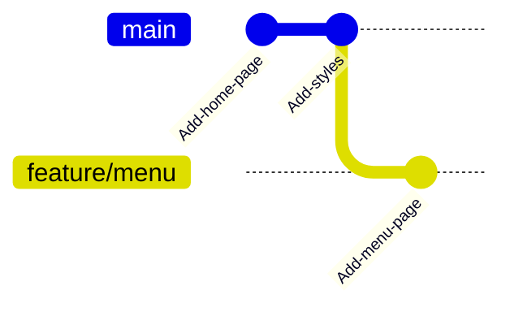
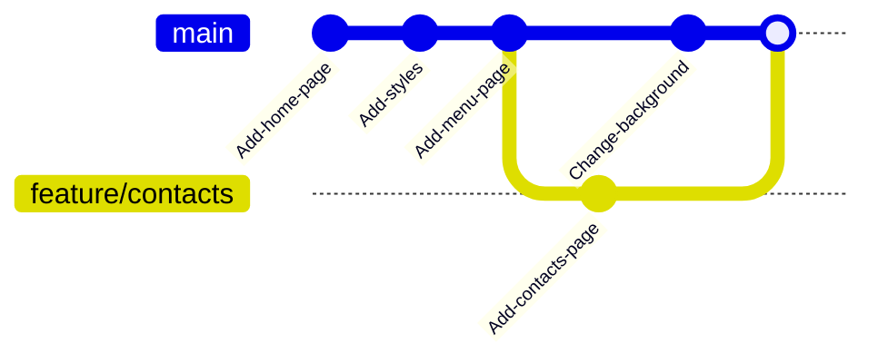
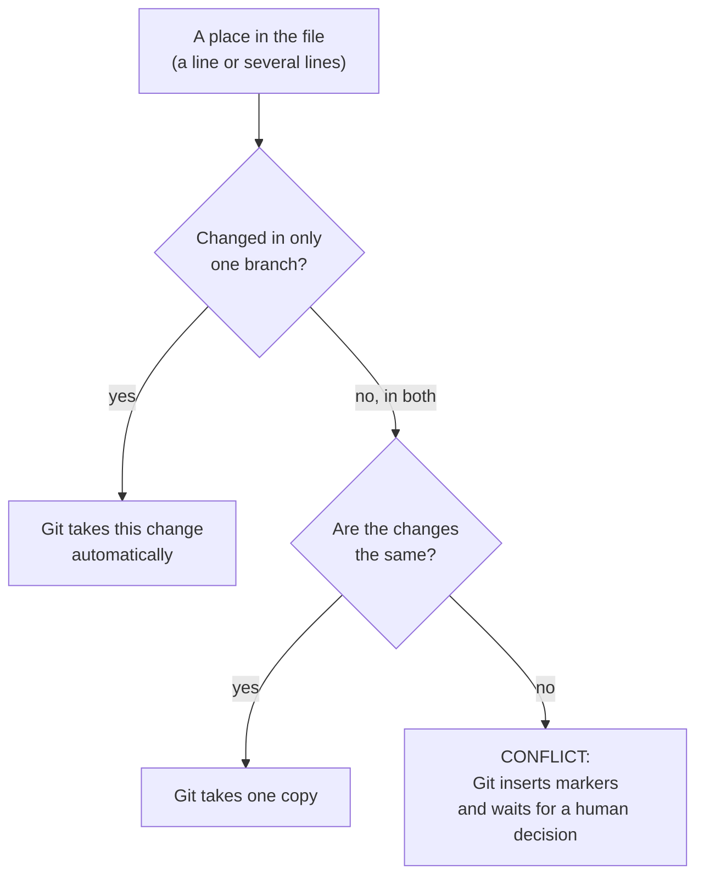
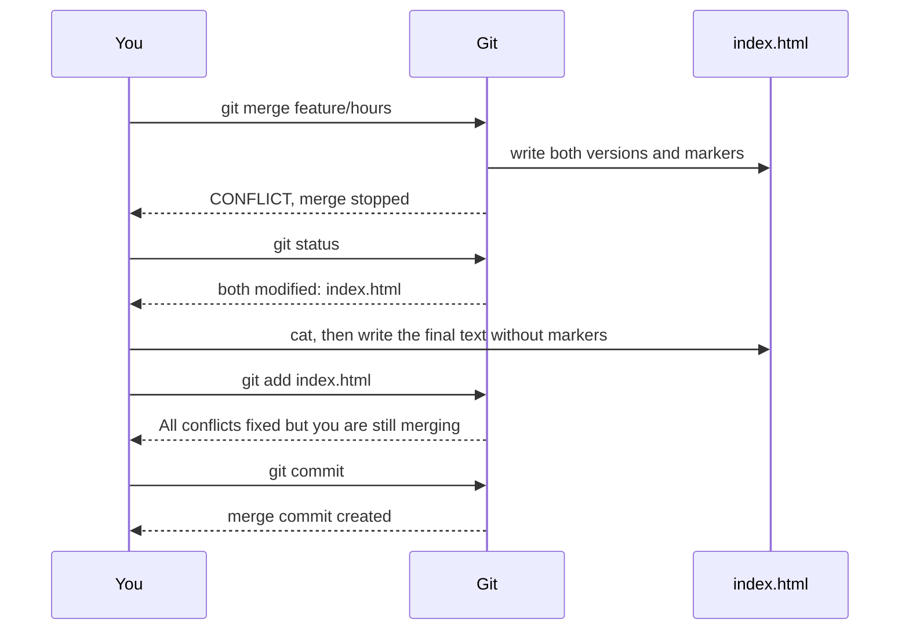

# Merging and conflicts

[Contents](../../README.md) · [← Back](../../Lesson-6/en/Branches.md) · [Next →](../../Lesson-8/en/GitHub%20and%20remote%20repositories.md) · [RU](../ru/%D0%A1%D0%BB%D0%B8%D1%8F%D0%BD%D0%B8%D0%B5%20%D0%B8%20%D0%BA%D0%BE%D0%BD%D1%84%D0%BB%D0%B8%D0%BA%D1%82%D1%8B.md) · [EN](Merging%20and%20conflicts.md) · [UZ](../uz/Birlashtirish%20va%20konfliktlar.md)

> **Link to lesson 6:** you learned to create branches (`git switch -c`), switch between them, read the graph `git log --oneline --graph --all` and delete branches with `-d` and `-D`. But the work from branches does not get into `main` yet: `git branch -d` answers `not fully merged`. Today you will join branches with the `git merge` command, look at two kinds of merge and learn to resolve **conflicts** calmly.

---

## Why you need this

You are building a cafe website. The `feature/menu` branch has a new menu page, and the `feature/hours` branch has updated opening hours. Meanwhile, on `main`, the cafe owner asked you to change the opening hours urgently. Now all of this has to come together in one working version of the website.

Without Git, you would open two files side by side and copy lines by hand, at the risk of losing something. With Git, it is one command: `git merge`. If both branches changed the same line, Git will not guess - it will show both versions and ask you to choose. This is a conflict. All developers run into conflicts every week, and being able to resolve them without panic is a must-have skill for teamwork (lessons 8 and 9).

---

## What you will learn

- Merge one branch into another with `git merge` and understand **where** the changes go.
- Tell a fast-forward (`Fast-forward`) from a merge commit (`Merge made by the 'ort' strategy.`).
- Always create a merge commit with the `--no-ff` option and understand why people do it.
- Explain why a conflict happens and read the markers `<<<<<<<`, `=======`, `>>>>>>>`.
- Resolve a conflict step by step: `git status` → file → choice → `git add` → `git commit`.
- Cancel a failed merge with `git merge --abort`.
- Use the VS Code buttons Accept Current / Incoming / Both.
- Delete merged branches and read the history graph after a merge.

---

## Review: 3 questions from lesson 6

1. What is `HEAD`, and where does it point after `git switch feature/menu`?
2. Which command shows the history of all branches as a graph?
3. How is `git branch -d` different from `git branch -D`? When will `-d` refuse to delete a branch?

Answers are at the end of the lesson.

---

## Lesson plan

| Section | What we do |
| --- | --- |
| What a merge is | Two drafts - one document |
| Fast-forward | When `main` has not changed |
| Merge commit | When the histories have split; `--no-ff` |
| Mini-task 1 | Two branches in a recipe project |
| Conflict | Why it happens and what it looks like |
| Conflict markers | `<<<<<<<`, `=======`, `>>>>>>>` |
| Resolving a conflict | Step by step, `git merge --abort`, VS Code |
| After the merge | Deleting branches, the graph, how to avoid conflicts |
| Mini-task 2 | A conflict in README |
| Independent work | A task in the learning terminal and on your computer |

---

## What a merge is

**In simple words:** a merge is bringing together two drafts of one document. You and a classmate each took a copy of an essay. You wrote chapter 3, and your classmate fixed the introduction. To get the final essay, you need to take both edits. If the edits are in different places, it is easy. If you both rewrote the same paragraph in different ways, you have to sit down and decide which version to keep. Git does the same with project files.

> **Important:** `git merge branch` merges the given branch **into the current one** - the one you are on. That is why you first switch to the receiving branch (usually `main`): `git switch main`, and only then run `git merge feature/menu`. The source branch `feature/menu` does not change.

Let us take the practice project `cafe`: `main` has two commits - `Add home page` (the file `index.html`) and `Add styles` (the file `css/style.css`). Next, we will look at two kinds of merge.

---

## Fast-forward

Let us create a `feature/menu` branch with a menu page and go back to `main`. Nothing has changed in `main` in the meantime.

```bash
git log --oneline --graph --all
```

```text
* 44aa7a3 (feature/menu) Add menu page
* ee01ea3 (HEAD -> main) Add styles
* f751bb7 Add home page
```



**How to read the diagram.** The `feature/menu` branch started from the `Add-styles` commit and moved one commit ahead. `main` still stays on `Add-styles`. There is no fork: the whole history of `main` is part of the history of `feature/menu`. To "merge" the branch, Git only needs to move the `main` label forward to `Add-menu-page` - like fast-forwarding a video to the right place.

```bash
git merge feature/menu
```

```text
Updating ee01ea3..44aa7a3
Fast-forward
 menu.html | 1 +
 1 file changed, 1 insertion(+)
 create mode 100644 menu.html
```

| Line | Translation and meaning |
| --- | --- |
| `Updating ee01ea3..44aa7a3` | "Updating": `main` moves from commit `ee01ea3` to `44aa7a3` |
| `Fast-forward` | **Fast-forward**: no new commit is created, the branch label is simply moved |
| `menu.html \| 1 +` | What changed in the working directory: the file `menu.html`, one new line |
| `create mode 100644 menu.html` | The file has appeared in `main` |

Now `git log --oneline --graph --all` will show `44aa7a3 (HEAD -> main, feature/menu) Add menu page` on the first line: `main` and `feature/menu` point to the same commit, and the history is still a straight line.

**In simple words:** a fast-forward is when you come back to the essay, and your classmate has simply added a continuation to **your latest version**. There is nothing to bring together: their version is yours plus a new chapter.

---

## Merge commit

Now let us do it differently. The `feature/contacts` branch (commit `2c473f8 Add contacts page`) has a contacts page, and `main` got its own commit after the split, `c437020 Change background color`: the background color was changed.

The histories have **split**: `main` has a commit that the branch does not have, and the branch has a commit that `main` does not have. A fast-forward is impossible - `Change background color` would be lost. Git does a **three-way merge**: it compares the common ancestor (`44aa7a3`), the `main` version and the branch version, puts both edits together and writes the result into a new **merge commit**.

```bash
git merge feature/contacts
```

```text
Merge made by the 'ort' strategy.
 contacts.html | 1 +
 1 file changed, 1 insertion(+)
 create mode 100644 contacts.html
```

| Line | Translation and meaning |
| --- | --- |
| `Merge made by the 'ort' strategy.` | "The merge was made with the ort strategy" - a merge commit was created. `ort` is the name of Git's default merge algorithm; you do not need to remember it |
| `contacts.html \| 1 +` | What came into `main` from the branch |

**In real Git,** for a merge commit the `git merge` command opens a text editor with a ready message `Merge branch 'feature/contacts'`. Do not change anything, just save and close it (in Vim - `:wq` and Enter). To keep the editor from opening, write `git merge --no-edit feature/contacts` or give the message yourself: `git merge -m "Merge contacts page" feature/contacts`. The learning terminal has no editor: the ready message is accepted at once.

```bash
git log --oneline --graph
```

```text
*   1cecaa1 (HEAD -> main) Merge branch 'feature/contacts'
|\
| * 2c473f8 (feature/contacts) Add contacts page
* | c437020 Change background color
|/
* 44aa7a3 (feature/menu) Add menu page
* ee01ea3 Add styles
* f751bb7 Add home page
```



**How to read the diagram.** After `Add-menu-page`, the history split in two: `Add-contacts-page` appeared in the branch, and `Change-background` appeared in `main`. The last circle on the `main` line is the merge commit: both lines meet in it. Its snapshot has both the new background and the contacts page. Git's text graph shows the same picture: `|\` means the lines split, `|/` means they meet at the common ancestor.

You can see how a merge commit differs from a normal one in `git show`:

```bash
git show HEAD
```

```text
commit 1cecaa18549de5f8a044fb6709dc2f2b59d3f5aa (HEAD -> main)
Merge: c437020 2c473f8
Author: Anna Karimova <anna@example.com>
Date:   Tue Sep 1 10:06:00 2026 +0500

    Merge branch 'feature/contacts'
```

| Line | Translation and meaning |
| --- | --- |
| `Merge: c437020 2c473f8` | The commit has **two parents**: the first is the previous tip of `main`, the second is the tip of the merged branch. A normal commit has one parent |
| `Merge branch 'feature/contacts'` | The default message: which branch was merged |

### Step by step: where the branches point

| Step | Command | What changed / where HEAD points |
| --- | --- | --- |
| 1 | `git switch main` | `HEAD -> main`, `main` on `ee01ea3`, `feature/menu` on `44aa7a3` |
| 2 | `git merge feature/menu` | Fast-forward: `main` moved from `ee01ea3` to `44aa7a3`; no new commits |
| 3 | `git switch -c feature/contacts`, a commit | `HEAD -> feature/contacts`, the branch on `2c473f8` |
| 4 | `git switch main`, a commit | `HEAD -> main`, `main` on `c437020` - the histories have split |
| 5 | `git merge feature/contacts` | Commit `1cecaa1` with two parents is created, `main` is on it |

### `--no-ff`: always a merge commit

Sometimes a team agrees: "every task is merged with its own merge commit", even when a fast-forward is possible. This way the history shows which commits belonged to one task and when it was merged. For this there is the `--no-ff` option (no fast-forward).

The `feature/about` branch has one commit, `Add about page`, and `main` has not changed since the split - a plain `git merge` would do a fast-forward. But with `--no-ff`, Git answers `Merge made by the 'ort' strategy.` (in real Git the message editor opens first - or add `--no-edit`):

```bash
git merge --no-ff feature/about
git log --oneline --graph -n 3
```

```text
Merge made by the 'ort' strategy.
 about.html | 1 +
 1 file changed, 1 insertion(+)
 create mode 100644 about.html
*   89a5990 (HEAD -> main) Merge branch 'feature/about'
|\
| * 76cf371 (feature/about) Add about page
|/
*   1cecaa1 Merge branch 'feature/contacts'
|\
```

`main` had not changed, but Git still created a merge commit: the graph shows a "side loop" with the task commit.

| | Fast-forward | Merge commit |
| --- | --- | --- |
| When | `main` has not changed since the split | The histories have split, or `--no-ff` is given |
| Git's output | `Fast-forward` | `Merge made by the 'ort' strategy.` |
| New commit | No | Yes, with two parents |
| Graph | A straight line | Lines split and meet |

---

## Mini-task 1

In the learning terminal:

1. Create a `recipes` folder, a repository in it and a `README.md` file with the text `# My recipes`. Commit it.
2. Create a `feature/soup` branch, add a `soup.html` file with the text `<h1>Tomato soup</h1>` and commit it. Go back to `main` and merge the branch. Which word in Git's output shows the kind of merge?
3. Create a `feature/salad` branch with a `salad.html` file (`<h1>Greek salad</h1>`) and a commit. Go back to `main`, add the line `Soups and salads for every day` to `README.md` and commit with `-am`.
4. Merge `feature/salad` with the `--no-edit` option. Look at `git log --oneline --graph` and find the merge commit.
5. Delete both merged branches with one `git branch -d` command.

---

## Merge conflict

Git brings changes together by itself if they are in **different** places: different files or different lines of one file. A conflict happens only when both branches changed **the same place** in one file in different ways after the split. Git does not know whose edit matters more, so it stops to ask you.

**In simple words:** you and your classmate rewrote the same paragraph of the essay. They cannot be glued together automatically: a person has to read both versions and decide. A conflict is not an error or a breakdown, it is a **question** from Git.



**How to read the diagram.** For each piece of a file, Git compares three versions: the common ancestor, the current branch and the merged branch. If a piece was changed in only one branch, Git calmly takes that edit. If it was changed in both in the same way, that is not a problem either. A conflict happens only in the bottom right case: both branches changed one place **in different ways**.

Let us create a conflict in the `cafe` project. The second line of `index.html` is `<p>Open 9:00-18:00</p>`. In the `feature/hours` branch it was changed to `<p>Open daily 9:00-18:00</p>`, and in `main` after the split it was changed to `<p>Open 9:00-20:00</p>`.

```bash
git merge feature/hours
```

```text
Auto-merging index.html
CONFLICT (content): Merge conflict in index.html
Automatic merge failed; fix conflicts and then commit the result.
```

| Line | Translation and meaning |
| --- | --- |
| `Auto-merging index.html` | Git tried to merge the file by itself |
| `CONFLICT (content): Merge conflict in index.html` | "A content conflict in index.html": one place was changed in both branches |
| `Automatic merge failed; fix conflicts and then commit the result.` | "The automatic merge failed: fix the conflicts and commit the result" |

The merge has **stopped halfway**: the merge commit has not been created yet. Let us see what is going on:

```bash
git status
```

```text
On branch main
You have unmerged paths.
  (fix conflicts and run "git commit")
  (use "git merge --abort" to abort the merge)

Unmerged paths:
  (use "git add <file>..." to mark resolution)
	both modified:   index.html
```

| Line | Translation and meaning |
| --- | --- |
| `You have unmerged paths.` | "You have files that are not merged" - you are in the middle of a merge |
| `(fix conflicts and run "git commit")` / `(use "git merge --abort" ...)` | Hints: fix the conflicts and run `git commit` - or cancel the whole merge |
| `Unmerged paths:` | The list of files with a conflict |
| `(use "git add <file>..." to mark resolution)` | After fixing, you mark the file as resolved with `git add` |
| `both modified:   index.html` | "Changed in both branches" - this file needs fixing |

---

## Conflict markers

Let us open the file:

```bash
cat index.html
```

```text
<h1>Coffee House</h1>
<<<<<<< HEAD
<p>Open 9:00-20:00</p>
=======
<p>Open daily 9:00-18:00</p>
>>>>>>> feature/hours
```

Git wrote **both** versions of the disputed place into the file and separated them with markers. The first line, `<h1>Coffee House</h1>`, did not change in either branch - it stayed as it was, without markers.

| Line | Translation and meaning |
| --- | --- |
| `<<<<<<< HEAD` | The start of the conflict. Below it is the version of the **current branch** (`HEAD` is the one you are on, here `main`) |
| `<p>Open 9:00-20:00</p>` | What this place looks like in `main` |
| `=======` | The border between the two versions |
| `<p>Open daily 9:00-18:00</p>` | What this place looks like in the merged branch |
| `>>>>>>> feature/hours` | The end of the conflict and the name of the merged branch |

**In simple words:** markers are bookmarks that Git put into the document: "here is your version, here is your classmate's version, decide for yourself". While the bookmarks are in the text, the document is not ready.

> **Important:** markers are plain text inside the file. If you leave them and commit, the browser will show the lines `<<<<<<< HEAD` and `=======` on the website, and JavaScript or CSS with markers will simply stop working. Git **does not check** whether you removed the markers: for Git, `git add` means "I have fixed everything".

---

## Resolving a conflict

### Three ways to resolve it

| Solution | Final line | When |
| --- | --- | --- |
| Keep your version (`HEAD`) | `<p>Open 9:00-20:00</p>` | The edit in the branch is no longer needed |
| Keep the branch version | `<p>Open daily 9:00-18:00</p>` | The edit in `main` is out of date |
| Combine both | `<p>Open daily 9:00-20:00</p>` | Both edits are needed - the most common case |

Here both edits are right: the cafe is now open every day **and** until 20:00. We combine them.

### Step by step



**How to read the diagram.** Git stops by itself and writes in the markers. Then it is your move: see which files are in conflict, fix each one, mark it with `git add` and finish the merge with a commit. Until there is a commit, the merge is "hanging" - you can see it in `git status`.

**Steps 1–2. Find out where the conflict is and open the file:** `git status` → `both modified: index.html`, then `cat index.html` (or an editor) - find all the markers. There may be several groups of them: look for `<<<<<<<`.

**Step 3. Write the final text without markers.** The learning terminal has no editor, so we will overwrite the whole file with the command from lesson 2:

```bash
cat > index.html << 'EOF'
<h1>Coffee House</h1>
<p>Open daily 9:00-20:00</p>
EOF
cat index.html
```

```text
<h1>Coffee House</h1>
<p>Open daily 9:00-20:00</p>
```

Be careful: **all** the needed lines must stay in the file (including the `<h1>` that had no conflict), and there must be no markers at all.

**Step 4. Mark the conflict as resolved:**

```bash
git add index.html
git status
```

```text
On branch main
All conflicts fixed but you are still merging.
  (use "git commit" to conclude merge)

Changes to be committed:
	modified:   index.html
```

Translation: "All conflicts are fixed, but you are still in the middle of a merge. To finish, run `git commit`". The fixed `index.html` will go into the merge commit.

**Step 5. Finish the merge with a commit:**

```bash
git commit --no-edit
```

```text
[main 391dfd2] Merge branch 'feature/hours'
```

`--no-edit` means "take the ready message `Merge branch 'feature/hours'` without an editor". You can also write `git commit -m "Merge opening hours"`. A plain `git commit` in real Git opens an editor with the same message, and in the learning terminal it accepts it at once. In the `git log --oneline --graph` graph, the new commit `391dfd2` looks the same as the `feature/contacts` merge above: two lines meet.

### Step by step: the three areas during a conflict

| Step | Command | Working directory | Index | Repository |
| --- | --- | --- | --- | --- |
| 1 | `git merge feature/hours` | `index.html` with markers | `index.html` - "unmerged" | `main` on `0ca55ae`, a merge is in progress |
| 2 | `git status`, `cat index.html` | No changes | No changes | No changes |
| 3 | `cat > index.html << 'EOF'` | The final text without markers | Still "unmerged" | No changes |
| 4 | `git add index.html` | The final text | The final text, the conflict is resolved | No changes |
| 5 | `git commit --no-edit` | The final text | Matches the commit | New commit `391dfd2` with two parents, the merge is finished |

### `git merge --abort`: put everything back

If there are too many conflicts or you realize you are merging the wrong branch, you can cancel the merge - as long as the merge commit has not been made:

```bash
git merge --abort
git status
```

```text
On branch main
nothing to commit, working tree clean
```

The working directory and the index are back to the state before `git merge`: `index.html` has `<p>Open 9:00-20:00</p>` again, with no markers. The `feature/hours` branch has not gone anywhere - you can merge it later, for example after talking to a colleague.

> **Important:** before `git merge`, commit your current edits so that `git status` is clean. Then `git merge --abort` will surely put everything back. With uncommitted changes in the same files, Git will simply refuse to start the merge: `Your local changes to the following files would be overwritten by merge`.

### A conflict in VS Code

In a real project, it is easier to open a file with a conflict in VS Code. Above each conflict, the editor shows a row of buttons and highlights the versions in different colors:

| Button | What it does |
| --- | --- |
| Accept Current Change | Keep the version of the current branch (`HEAD`, the top part) |
| Accept Incoming Change | Keep the version of the merged branch (the bottom part) |
| Accept Both Changes | Keep both versions, one under the other - usually you then need to fix them by hand |
| Compare Changes | Show the two versions side by side |

The buttons remove the markers themselves. For the "combine" option, click Accept Both Changes and edit the lines by hand. There is also a Resolve in Merge Editor button - a three-panel merge editor. After any of these ways: save the file, `git add`, `git commit`. WebStorm, Cursor and other editors have similar buttons.

---

## After the merge

### Deleting merged branches

When a branch's work has got into `main`, the branch is no longer needed. The safe deletion from lesson 6 is `-d`: now it will work.

```bash
git branch -d feature/hours
git branch
```

```text
Deleted branch feature/hours (was 6d69cce).
* main
```

Commit `6d69cce` is not deleted - it is part of the history of `main`; only the label is deleted. But if you try to delete a branch **before** merging, Git will protect the work:

```text
error: the branch 'feature/hours' is not fully merged
hint: If you are sure you want to delete it, run 'git branch -D feature/hours'
hint: Disable this message with "git config set advice.forceDeleteBranch false"
```

> **Important:** do not use `-D` to "quickly get rid of" a branch that you forgot to merge: its commits will disappear from the branch list. `-D` is only for branches whose work is surely not needed. To delete several at once: `git branch -d feature/menu feature/contacts`.

### How to avoid conflicts

You cannot avoid conflicts completely, but you can make them rare and small.

| Habit | Why it helps |
| --- | --- |
| Small branches: one branch - one task | Fewer changed lines - fewer places to collide |
| Merge often: a branch lives for hours or days, not weeks | The histories do not have time to split far apart |
| From time to time, merge `main` into your branch: `git switch feature/x`, `git merge main` | Conflicts are resolved bit by bit and in your branch, not in `main` |
| Do not reformat a file without need; agree on who changes what | Changing the indentation in the whole file or two people in one place is a sure conflict |

Besides `git merge`, branches are joined with the `git rebase` command - it moves a branch's commits onto the tip of another branch, and the history stays straight. We will look at it in lesson 9, when we work in a team.

---

### Try to break it

1. Stand on a `feature/...` branch and run `git merge main`, thinking that you are merging the branch into `main`. Look at `git log --oneline --graph --all`: which branch got the commits?
2. Create a conflict and right away, without fixing anything, run `git commit -m "Merge"`. What will Git answer?
3. Create a conflict, run `git add` with the markers in the file and `git commit`. Did it work? Look at `cat` - what would a website visitor see?
4. During a conflict, try to merge one more branch: `git merge feature/other`.
5. Run `git merge --abort` when there is no merge at all, and merge one branch twice in a row. What does Git answer in each case?

### Typical beginner mistakes

| Mistake | What you get | How to fix |
| --- | --- | --- |
| `git merge` on the wrong branch | The commits of `main` got into the branch, and `main` did not change | Before merging, run `git switch main` and check `git branch` |
| A commit with an unresolved conflict | `error: Committing is not possible because you have unmerged files.` | Fix the file, `git add`, then `git commit` |
| `git add` with markers in the file | The commit is created, and the website shows `<<<<<<< HEAD` and `=======` | Check the file before `git add` (`cat`, search for `<<<<<<<`); fix it and make a new commit |
| A new merge before the old one is finished | `error: Merging is not possible because you have unmerged files.` | Finish the current one (`git add`, `git commit`) or run `git merge --abort` |
| Merging with uncommitted edits | `error: Your local changes to the following files would be overwritten by merge:` | Commit the edits (or remove them with `git restore`) and try again |
| A typo in the branch name | `merge: feature/nope - not something we can merge` | Look up the exact name in `git branch` |
| You deleted an unmerged branch with `-D` | The branch's work disappeared from the branch list | First `git merge`, then `git branch -d`; `git reflog` will help you find the commit (lesson 4) |

---

## Mini-task 2

Continue in the `recipes` repository:

1. Create a `feature/title` branch and overwrite `README.md` (with `cat > README.md << 'EOF'`): the first line is `# Family recipes`, the second is `Soups and salads for every day`. Commit with `-am`.
2. Go back to `main` and do the same, but with the first line `# My favourite recipes`. Commit it.
3. Merge `feature/title`. Look at `git status` and `cat README.md`: which lines are between the markers?
4. Cancel the merge with `git merge --abort` and make sure with `git status` that everything is clean.
5. Merge the branch again and resolve the conflict: the first line is `# My favourite family recipes`, the second is unchanged. Finish the merge (`git add`, `git commit --no-edit`).
6. Look at the graph of all branches and delete `feature/title`.

---

## Lesson summary: cheat sheet

| Task | Command |
| --- | --- |
| Merge a branch into the current one | `git switch main`, then `git merge branch` |
| Merge without the message editor | `git merge --no-edit branch` |
| Always create a merge commit | `git merge --no-ff branch` |
| See where the conflict is | `git status` → `both modified:` |
| Look at the file with markers | `cat file` |
| Write the resolved file | an editor or `cat > file << 'EOF'` |
| Mark the conflict as resolved | `git add file` |
| Finish the merge | `git commit --no-edit` or `git commit -m "..."` |
| Cancel a merge with a conflict | `git merge --abort` |
| See the parents of a merge commit | `git show HEAD` → the `Merge:` line |
| History with forks | `git log --oneline --graph --all` |
| Delete merged branches | `git branch -d branch1 branch2` |

---

## Independent work

### Part 1. IDE task (graded by the platform)

You are in the `~/portfolio` folder on the `main` branch. There are two branches: `feature/footer` adds `footer.html` (`main` has not changed since it was created), and `feature/title` changes the heading in `index.html` - the same line that was also changed in `main` after the split. Write the commands one per line:

1. Look at the history of all branches as a graph.
2. Merge `feature/footer` into `main` - it must be a fast-forward (without `--no-ff`).
3. Merge `feature/title` - there will be a conflict in `index.html`.
4. Look at `git status` and the content of `index.html`.
5. Resolve the conflict by combining both versions: write `index.html` with the command `cat > index.html << 'EOF'` - the first line is `<h1>Anna Karimova, web developer - Portfolio</h1>`, the second line is `<p>Junior web developer</p>`, with no conflict markers.
6. Mark the conflict as resolved and finish the merge with a commit (`git commit` without `-m` takes the ready message `Merge branch 'feature/title'`; you can also use `-m`).
7. Delete both merged branches with the safe command `git branch -d`.
8. Look at the history graph and make sure that the working directory is clean.

What the platform checks: that you are on `main`; that the latest commit is a merge commit with two parents, and the second parent is the commit of the `feature/title` branch; that `feature/footer` was merged with a fast-forward (there is exactly one merge commit in the history); that the merge is finished; that `index.html` has no `<<<<<<<`, `=======`, `>>>>>>>` markers and its text matches the task; that `footer.html` is in place and the history of `main` contains the commits of both branches; that both branches are deleted with `-d`, without `-D`; that the working directory is clean; that the solution also works for a different `feature/footer` branch with two commits; that the script runs without errors.

### Part 2. Project on your computer

1. In your website's repository, merge the `feature/...` branch from lesson 6 into `main`. See what kind of merge you got, and open the website in the browser: the edit is now on `main`.
2. Create a conflict on purpose: the `fix/heading` branch changes the `<h1>` text on the home page, and on `main` (after the split) the same `<h1>` is changed in a different way. Commit in both branches.
3. Merge `fix/heading` and resolve the conflict in VS Code: try the Accept Current / Incoming / Both buttons and choose the final version. Save, `git add`, `git commit --no-edit`.
4. Try `--no-ff`: take a small branch with one commit, merge it with `git merge --no-ff --no-edit branch` and compare the graph with a fast-forward.
5. Delete all merged branches with `git branch -d` and look at `git log --oneline --graph --all`.

### Acceptance criteria

- [ ] The IDE task is accepted.
- [ ] The history of your website has at least one merge commit, and `git show` shows the `Merge:` line with two hashes for it.
- [ ] You resolved at least one conflict and checked that no markers are left in the files.
- [ ] You can explain from the graph where there was a fast-forward and where there was a merge commit.
- [ ] `git branch` shows only `main` and branches with work that is not merged yet.

---

## Self-check questions

1. Which branch do the changes go into with `git merge feature/menu`? What happens to `feature/menu` itself?
2. When does Git do a fast-forward, and when does it make a merge commit?
3. How is a merge commit different from a normal commit? Where can you see this?
4. Why do you need the `--no-ff` option?
5. Why does a conflict happen? Will there be a conflict if the branches changed different lines of one file?
6. What do the markers `<<<<<<< HEAD`, `=======` and `>>>>>>> branch` mean?
7. List the steps for resolving a conflict.
8. What does `git merge --abort` do, and when can you use it?
9. What happens if you run `git add` and `git commit` without removing the markers?
10. Name three habits that reduce the number of conflicts.

After the questions, take the **lesson test** on the platform: 12 questions, pass mark 70%.

---

## What's next

Now you can do work in branches and bring it together in `main` - even when the branches disagree. But the whole history still lives only on your computer. In lesson 8 you will create a repository on GitHub, send the project to it with `git push`, learn to download other people's repositories with `git clone` and get changes with `git fetch` and `git pull` - and, as you will see, `git pull` also does a merge inside.

---

## Answers

**Review**

1. `HEAD` is the "you are here" pointer. After `git switch feature/menu` it points to the `feature/menu` branch (`HEAD -> feature/menu`), and through it to its latest commit.
2. `git log --oneline --graph --all`.
3. `-d` deletes only a branch whose commits are already in the current branch; otherwise it refuses with the error `not fully merged`. `-D` deletes by force, even with unmerged work.

**Mini-task 1**

```bash
mkdir recipes && cd recipes && git init
echo "# My recipes" > README.md
git add README.md && git commit -m "Add README"
git switch -c feature/soup
echo "<h1>Tomato soup</h1>" > soup.html
git add soup.html && git commit -m "Add soup recipe"
git switch main
git merge feature/soup
git switch -c feature/salad
echo "<h1>Greek salad</h1>" > salad.html
git add salad.html && git commit -m "Add salad recipe"
git switch main
echo "Soups and salads for every day" >> README.md
git commit -am "Describe recipes"
git merge --no-edit feature/salad
git log --oneline --graph
git branch -d feature/soup feature/salad
```

The kind of merge in step 2 is `Fast-forward`, in step 4 it is `Merge made by the 'ort' strategy.`

**Mini-task 2**

```bash
git switch -c feature/title
cat > README.md << 'EOF'
# Family recipes
Soups and salads for every day
EOF
git commit -am "Rename to family recipes"
git switch main
cat > README.md << 'EOF'
# My favourite recipes
Soups and salads for every day
EOF
git commit -am "Rename to favourite recipes"
git merge feature/title
git status
cat README.md
git merge --abort
git merge feature/title
cat > README.md << 'EOF'
# My favourite family recipes
Soups and salads for every day
EOF
git add README.md
git commit --no-edit
git log --oneline --graph --all
git branch -d feature/title
```

Between `<<<<<<< HEAD` and `=======` there is `# My favourite recipes`, and between `=======` and `>>>>>>> feature/title` there is `# Family recipes`. The line `Soups and salads for every day` has no conflict.

**Self-check questions**

1. Into the current branch (the one you are on). The `feature/menu` branch does not change.
2. A fast-forward - if the current branch has not changed since the split: Git simply moves its label forward. A merge commit - if both branches have new commits (the histories have split) or `--no-ff` is given.
3. It has two parents. You can see it in `git show` (the line `Merge: hash1 hash2`) and in the `git log --graph` graph, where two lines meet.
4. To create a merge commit even where a fast-forward is possible: the history shows which commits belonged to one task, and the whole task can be undone at once.
5. Both branches changed the same place in the file in different ways after the split, and Git does not know which version is right. If different lines were changed, there is no conflict: Git puts both edits together.
6. `<<<<<<< HEAD` is the start of the current branch's version, `=======` is the border, `>>>>>>> branch` is the end of the merged branch's version.
7. `git status` → open the file → choose or combine the versions → remove all the markers → `git add file` → `git commit`.
8. It cancels a merge in progress and puts the working directory and the index back to the state before `git merge`. You can use it as long as the merge commit has not been created.
9. The commit will be created with the markers inside the file: Git does not check them. The website will show `<<<<<<<` and `=======`, and the code may break.
10. Small branches for one task, frequent merges (including merging `main` into your branch), agreeing on who changes what, not reformatting whole files, committing before a merge.

---

[Contents](../../README.md) · [← Back](../../Lesson-6/en/Branches.md) · [Next →](../../Lesson-8/en/GitHub%20and%20remote%20repositories.md) · [RU](../ru/%D0%A1%D0%BB%D0%B8%D1%8F%D0%BD%D0%B8%D0%B5%20%D0%B8%20%D0%BA%D0%BE%D0%BD%D1%84%D0%BB%D0%B8%D0%BA%D1%82%D1%8B.md) · [EN](Merging%20and%20conflicts.md) · [UZ](../uz/Birlashtirish%20va%20konfliktlar.md)
