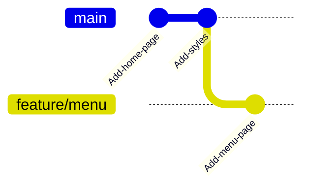
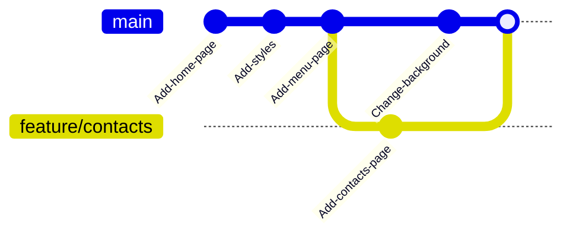
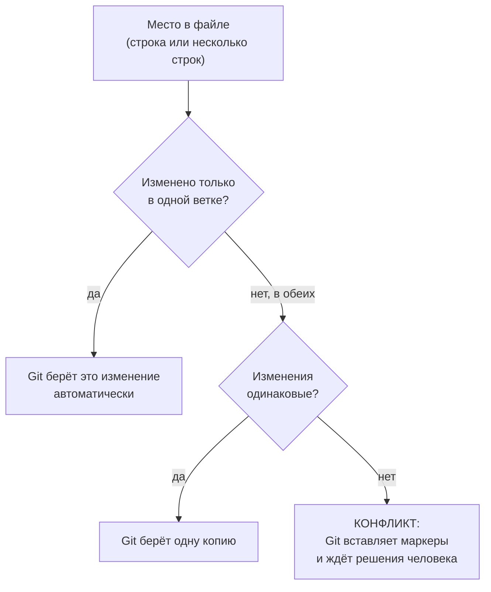
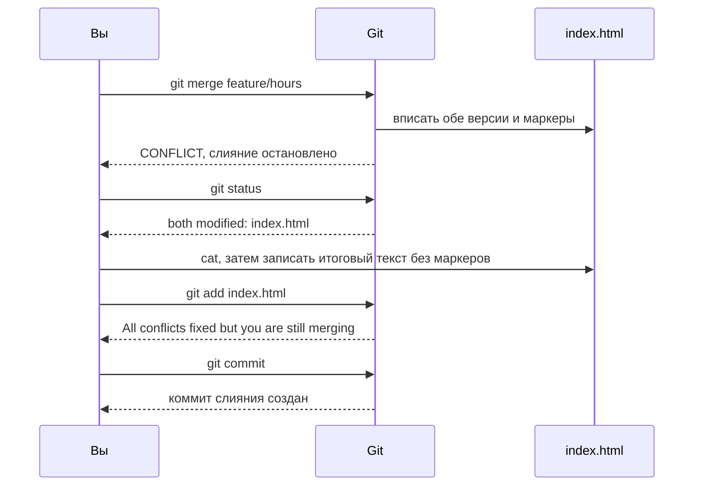

# Слияние и конфликты

[Содержание](../../README.md) · [← Назад](../../Lesson-6/ru/%D0%92%D0%B5%D1%82%D0%BA%D0%B8.md) · [Вперёд →](../../Lesson-8/ru/GitHub%20%D0%B8%20%D1%83%D0%B4%D0%B0%D0%BB%D1%91%D0%BD%D0%BD%D1%8B%D0%B5%20%D1%80%D0%B5%D0%BF%D0%BE%D0%B7%D0%B8%D1%82%D0%BE%D1%80%D0%B8%D0%B8.md) · [RU](%D0%A1%D0%BB%D0%B8%D1%8F%D0%BD%D0%B8%D0%B5%20%D0%B8%20%D0%BA%D0%BE%D0%BD%D1%84%D0%BB%D0%B8%D0%BA%D1%82%D1%8B.md) · [EN](../en/Merging%20and%20conflicts.md) · [UZ](../uz/Birlashtirish%20va%20konfliktlar.md)

> **Связь с уроком 6:** вы научились создавать ветки (`git switch -c`), переключаться между ними, читать граф `git log --oneline --graph --all` и удалять ветки через `-d` и `-D`. Но работа из веток пока не попадает в `main`: `git branch -d` отвечает `not fully merged`. Сегодня вы соедините ветки командой `git merge`, разберёте два вида слияния и научитесь спокойно решать **конфликты**.

---

## Зачем это вам

Вы делаете сайт кафе. В ветке `feature/menu` - новая страница меню, в ветке `feature/hours` - уточнённое время работы. А на `main` хозяин кафе тем временем попросил срочно поменять часы работы. Теперь всё это нужно собрать в одну рабочую версию сайта.

Без Git вы бы открывали два файла рядом и переносили строки руками, рискуя что-то потерять. С Git это одна команда `git merge`. Если обе ветки поменяли одну и ту же строку, Git не будет гадать - он покажет оба варианта и попросит выбрать. Это и есть конфликт. Конфликты случаются у всех разработчиков каждую неделю, и умение их решать без паники - обязательный навык для работы в команде (уроки 8 и 9).

---

## Чему вы научитесь

- Вливать одну ветку в другую командой `git merge` и понимать, **куда** идут изменения.
- Отличать перемотку вперёд (`Fast-forward`) от коммита слияния (`Merge made by the 'ort' strategy.`).
- Создавать коммит слияния всегда, ключом `--no-ff`, и понимать, зачем это делают.
- Объяснять, почему возникает конфликт, и читать маркеры `<<<<<<<`, `=======`, `>>>>>>>`.
- Разрешать конфликт по шагам: `git status` → файл → выбор → `git add` → `git commit`.
- Отменять неудачное слияние командой `git merge --abort`.
- Пользоваться кнопками VS Code Accept Current / Incoming / Both.
- Удалять влитые ветки и читать граф истории после слияния.

---

## Повторение: 3 вопроса из урока 6

1. Что такое `HEAD` и куда он указывает после `git switch feature/menu`?
2. Какая команда показывает историю всех веток в виде графа?
3. Чем `git branch -d` отличается от `git branch -D`? Когда `-d` откажется удалять ветку?

Ответы - в конце урока.

---

## План урока

| Раздел | Что делаем |
| --- | --- |
| Что такое слияние | Два черновика - один документ |
| Перемотка вперёд | Когда `main` не менялась |
| Коммит слияния | Когда истории разошлись; `--no-ff` |
| Мини-задание 1 | Две ветки в проекте рецептов |
| Конфликт | Почему возникает и как выглядит |
| Маркеры конфликта | `<<<<<<<`, `=======`, `>>>>>>>` |
| Разрешение конфликта | Пошагово, `git merge --abort`, VS Code |
| После слияния | Удаление веток, граф, как избегать конфликтов |
| Мини-задание 2 | Конфликт в README |
| Самостоятельная работа | Задание в учебном терминале и на компьютере |

---

## Что такое слияние

**Простыми словами:** слияние - это сведение двух черновиков одного документа. Вы и коллега взяли копию реферата. Вы дописали главу 3, коллега исправил введение. Чтобы получить итоговый реферат, нужно взять обе правки. Если правки в разных местах - это просто. Если оба переписали один и тот же абзац по-разному - нужно сесть и решить, какой вариант оставить. Git делает то же самое с файлами проекта.

> **Важно:** `git merge ветка` вливает указанную ветку **в текущую** - ту, на которой вы стоите. Поэтому сначала переходят на ветку-получатель (обычно `main`): `git switch main`, и только потом `git merge feature/menu`. Ветка-источник `feature/menu` при этом не меняется.

Возьмём учебный проект `cafe`: в `main` два коммита - `Add home page` (файл `index.html`) и `Add styles` (файл `css/style.css`). Дальше разберём два вида слияния.

---

## Перемотка вперёд (fast-forward)

Создадим ветку `feature/menu` со страницей меню и вернёмся на `main`. В `main` за это время ничего не изменилось.

```bash
git log --oneline --graph --all
```

```text
* 44aa7a3 (feature/menu) Add menu page
* ee01ea3 (HEAD -> main) Add styles
* f751bb7 Add home page
```



**Как читать схему.** Ветка `feature/menu` отошла от коммита `Add-styles` и ушла на один коммит вперёд. `main` всё ещё стоит на `Add-styles`. Развилки нет: история `main` целиком входит в историю `feature/menu`. Чтобы «влить» ветку, Git достаточно передвинуть ярлык `main` вперёд на `Add-menu-page` - как перемотать видео вперёд до нужного места.

```bash
git merge feature/menu
```

```text
Updating ee01ea3..44aa7a3
Fast-forward
 menu.html | 1 +
 1 file changed, 1 insertion(+)
 create mode 100644 menu.html
```

| Строка | Перевод и смысл |
| --- | --- |
| `Updating ee01ea3..44aa7a3` | «Обновляю»: `main` переезжает с коммита `ee01ea3` на `44aa7a3` |
| `Fast-forward` | **Перемотка вперёд**: новый коммит не создан, ярлык ветки просто передвинут |
| `menu.html \| 1 +` | Что изменилось в рабочей папке: файл `menu.html`, одна новая строка |
| `create mode 100644 menu.html` | Файл появился в `main` |

Теперь `git log --oneline --graph --all` покажет в первой строке `44aa7a3 (HEAD -> main, feature/menu) Add menu page`: `main` и `feature/menu` указывают на один и тот же коммит, история осталась прямой линией.

**Простыми словами:** перемотка - это когда вы вернулись к реферату, а коллега просто дописал продолжение к **вашей последней версии**. Сводить нечего: его версия - это ваша плюс новая глава.

---

## Коммит слияния

Теперь сделаем по-другому. В ветке `feature/contacts` (коммит `2c473f8 Add contacts page`) - страница контактов, а на `main` после ответвления появился свой коммит `c437020 Change background color`: поменяли цвет фона.

Истории **разошлись**: у `main` есть коммит, которого нет в ветке, а у ветки - коммит, которого нет в `main`. Перемотать нельзя - потеряется `Change background color`. Git делает **трёхстороннее слияние**: сравнивает общего предка (`44aa7a3`), версию `main` и версию ветки, собирает обе правки и записывает результат в новый **коммит слияния**.

```bash
git merge feature/contacts
```

```text
Merge made by the 'ort' strategy.
 contacts.html | 1 +
 1 file changed, 1 insertion(+)
 create mode 100644 contacts.html
```

| Строка | Перевод и смысл |
| --- | --- |
| `Merge made by the 'ort' strategy.` | «Слияние выполнено стратегией ort» - создан коммит слияния. `ort` - имя алгоритма слияния Git по умолчанию, запоминать не нужно |
| `contacts.html \| 1 +` | Что пришло в `main` из ветки |

**В настоящем Git** команда `git merge` при коммите слияния открывает текстовый редактор с готовым сообщением `Merge branch 'feature/contacts'`. Ничего не меняйте, сохраните и закройте его (в Vim - `:wq` и Enter). Чтобы редактор не открывался, пишите `git merge --no-edit feature/contacts` или задайте сообщение сами: `git merge -m "Merge contacts page" feature/contacts`. В учебном терминале редактора нет: готовое сообщение принимается сразу.

```bash
git log --oneline --graph
```

```text
*   1cecaa1 (HEAD -> main) Merge branch 'feature/contacts'
|\
| * 2c473f8 (feature/contacts) Add contacts page
* | c437020 Change background color
|/
* 44aa7a3 (feature/menu) Add menu page
* ee01ea3 Add styles
* f751bb7 Add home page
```



**Как читать схему.** После `Add-menu-page` история раздвоилась: в ветке появился `Add-contacts-page`, в `main` - `Change-background`. Последний кружок на линии `main` - коммит слияния: к нему сходятся обе линии. В его снимке есть и новый фон, и страница контактов. В текстовом графе Git это та же картинка: `|\` - линии расходятся, `|/` - сходятся к общему предку.

Чем коммит слияния отличается от обычного - видно в `git show`:

```bash
git show HEAD
```

```text
commit 1cecaa18549de5f8a044fb6709dc2f2b59d3f5aa (HEAD -> main)
Merge: c437020 2c473f8
Author: Anna Karimova <anna@example.com>
Date:   Tue Sep 1 10:06:00 2026 +0500

    Merge branch 'feature/contacts'
```

| Строка | Перевод и смысл |
| --- | --- |
| `Merge: c437020 2c473f8` | У коммита **два родителя**: первый - прошлая вершина `main`, второй - вершина вливаемой ветки. У обычного коммита родитель один |
| `Merge branch 'feature/contacts'` | Сообщение по умолчанию: какую ветку влили |

### Пошагово: куда указывают ветки

| Шаг | Команда | Что изменилось / куда указывает HEAD |
| --- | --- | --- |
| 1 | `git switch main` | `HEAD -> main`, `main` на `ee01ea3`, `feature/menu` на `44aa7a3` |
| 2 | `git merge feature/menu` | Перемотка: `main` переехала с `ee01ea3` на `44aa7a3`; новых коммитов нет |
| 3 | `git switch -c feature/contacts`, коммит | `HEAD -> feature/contacts`, ветка на `2c473f8` |
| 4 | `git switch main`, коммит | `HEAD -> main`, `main` на `c437020` - истории разошлись |
| 5 | `git merge feature/contacts` | Создан коммит `1cecaa1` с двумя родителями, `main` на нём |

### `--no-ff`: коммит слияния всегда

Иногда команда договаривается: «каждая задача вливается отдельным коммитом слияния», даже если возможна перемотка. Так в истории видно, какие коммиты были одной задачей и когда её влили. Для этого ключ `--no-ff` (no fast-forward - «без перемотки»).

Ветка `feature/about` с одним коммитом `Add about page`, `main` после ответвления не менялась - обычный `git merge` сделал бы перемотку. Но с `--no-ff` Git ответит `Merge made by the 'ort' strategy.` (в настоящем Git сначала откроется редактор сообщения - или добавьте `--no-edit`):

```bash
git merge --no-ff feature/about
git log --oneline --graph -n 3
```

```text
Merge made by the 'ort' strategy.
 about.html | 1 +
 1 file changed, 1 insertion(+)
 create mode 100644 about.html
*   89a5990 (HEAD -> main) Merge branch 'feature/about'
|\
| * 76cf371 (feature/about) Add about page
|/
*   1cecaa1 Merge branch 'feature/contacts'
|\
```

`main` не менялась, но Git всё равно создал коммит слияния: в графе видно «ответвление-петлю» с коммитом задачи.

| | Перемотка вперёд | Коммит слияния |
| --- | --- | --- |
| Когда | `main` не менялась после ответвления | Истории разошлись, или указан `--no-ff` |
| Ответ Git | `Fast-forward` | `Merge made by the 'ort' strategy.` |
| Новый коммит | Нет | Да, с двумя родителями |
| Граф | Прямая линия | Линии расходятся и сходятся |

---

## Мини-задание 1

В учебном терминале:

1. Создайте папку `recipes`, репозиторий в ней и файл `README.md` с текстом `# My recipes`. Закоммитьте.
2. Создайте ветку `feature/soup`, добавьте файл `soup.html` с текстом `<h1>Tomato soup</h1>`, закоммитьте. Вернитесь на `main` и влейте ветку. Какое слово в ответе Git показывает вид слияния?
3. Создайте ветку `feature/salad` с файлом `salad.html` (`<h1>Greek salad</h1>`) и коммитом. Вернитесь на `main`, допишите в `README.md` строку `Soups and salads for every day` и закоммитьте через `-am`.
4. Влейте `feature/salad` с ключом `--no-edit`. Посмотрите `git log --oneline --graph` и найдите коммит слияния.
5. Удалите обе влитые ветки одной командой `git branch -d`.

---

## Конфликт слияния

Git сам сводит изменения, если они в **разных** местах: разные файлы или разные строки одного файла. Конфликт возникает, только когда обе ветки после ответвления изменили **одно и то же место** одного файла по-разному. Git не знает, чья правка важнее, и останавливается, чтобы спросить вас.

**Простыми словами:** вы и коллега переписали один и тот же абзац реферата. Автоматически их не склеить: нужен человек, который прочитает оба варианта и решит. Конфликт - это не ошибка и не поломка, а **вопрос** от Git.



**Как читать схему.** Для каждого куска файла Git сравнивает три версии: общего предка, текущую ветку и вливаемую. Если кусок поменяли только в одной ветке - Git спокойно берёт эту правку. Если в обеих и одинаково - тоже не проблема. Конфликт - только в правом нижнем случае: обе ветки поменяли одно место **по-разному**.

Сделаем конфликт в проекте `cafe`. В `index.html` вторая строка - `<p>Open 9:00-18:00</p>`. В ветке `feature/hours` её поменяли на `<p>Open daily 9:00-18:00</p>`, а в `main` после ответвления - на `<p>Open 9:00-20:00</p>`.

```bash
git merge feature/hours
```

```text
Auto-merging index.html
CONFLICT (content): Merge conflict in index.html
Automatic merge failed; fix conflicts and then commit the result.
```

| Строка | Перевод и смысл |
| --- | --- |
| `Auto-merging index.html` | «Автоматически сливаю index.html» - Git попробовал свести файл сам |
| `CONFLICT (content): Merge conflict in index.html` | «Конфликт содержимого в index.html»: одно место изменено в обеих ветках |
| `Automatic merge failed; fix conflicts and then commit the result.` | «Автоматическое слияние не удалось: исправьте конфликты и закоммитьте результат» |

Слияние **остановилось на середине**: коммит слияния ещё не создан. Посмотрим, что происходит:

```bash
git status
```

```text
On branch main
You have unmerged paths.
  (fix conflicts and run "git commit")
  (use "git merge --abort" to abort the merge)

Unmerged paths:
  (use "git add <file>..." to mark resolution)
	both modified:   index.html
```

| Строка | Перевод и смысл |
| --- | --- |
| `You have unmerged paths.` | «У вас есть неслитые файлы» - вы в процессе слияния |
| `(fix conflicts and run "git commit")` / `(use "git merge --abort" ...)` | Подсказки: исправьте конфликты и выполните `git commit` - или отмените слияние целиком |
| `Unmerged paths:` | Список файлов с конфликтом |
| `(use "git add <file>..." to mark resolution)` | После исправления файл отмечают решённым через `git add` |
| `both modified:   index.html` | «Изменён в обеих ветках» - этот файл надо исправить |

---

## Маркеры конфликта

Откроем файл:

```bash
cat index.html
```

```text
<h1>Coffee House</h1>
<<<<<<< HEAD
<p>Open 9:00-20:00</p>
=======
<p>Open daily 9:00-18:00</p>
>>>>>>> feature/hours
```

Git вписал в файл **обе** версии спорного места и отделил их маркерами. Первая строка `<h1>Coffee House</h1>` не менялась ни в одной ветке - она осталась как есть, без маркеров.

| Строка | Перевод и смысл |
| --- | --- |
| `<<<<<<< HEAD` | Начало конфликта. Ниже - версия **текущей ветки** (`HEAD` - та, на которой вы стоите, здесь `main`) |
| `<p>Open 9:00-20:00</p>` | Как это место выглядит в `main` |
| `=======` | Граница между двумя версиями |
| `<p>Open daily 9:00-18:00</p>` | Как это место выглядит во вливаемой ветке |
| `>>>>>>> feature/hours` | Конец конфликта и имя вливаемой ветки |

**Простыми словами:** маркеры - это закладки, которые Git вложил в документ: «вот ваш вариант, вот вариант коллеги, решите сами». Пока закладки в тексте, документ не готов.

> **Важно:** маркеры - это обычный текст внутри файла. Если оставить их и закоммитить, браузер покажет на сайте строки `<<<<<<< HEAD` и `=======`, а JavaScript или CSS с маркерами просто перестанут работать. Git **не проверяет**, удалили ли вы маркеры: `git add` для него значит «я всё исправил».

---

## Разрешение конфликта

### Три варианта решения

| Решение | Итоговая строка | Когда |
| --- | --- | --- |
| Оставить свою версию (`HEAD`) | `<p>Open 9:00-20:00</p>` | Правка в ветке больше не нужна |
| Оставить версию ветки | `<p>Open daily 9:00-18:00</p>` | Правка в `main` устарела |
| Объединить обе | `<p>Open daily 9:00-20:00</p>` | Обе правки нужны - самый частый случай |

Здесь обе правки верные: кафе теперь работает ежедневно **и** до 20:00. Объединяем.

### Шаг за шагом



**Как читать схему.** Git сам останавливается и вписывает маркеры. Дальше ход за вами: посмотреть, какие файлы в конфликте, исправить каждый, отметить его через `git add` и закончить слияние коммитом. Пока коммита нет, слияние «висит» - его видно в `git status`.

**Шаги 1–2. Узнать, где конфликт, и открыть файл:** `git status` → `both modified: index.html`, затем `cat index.html` (или редактор) - найти все маркеры. Их может быть несколько групп: ищите `<<<<<<<`.

**Шаг 3. Записать итоговый текст без маркеров.** В учебном терминале нет редактора, поэтому перезапишем файл целиком командой из урока 2:

```bash
cat > index.html << 'EOF'
<h1>Coffee House</h1>
<p>Open daily 9:00-20:00</p>
EOF
cat index.html
```

```text
<h1>Coffee House</h1>
<p>Open daily 9:00-20:00</p>
```

Внимательно: в файле должны остаться **все** нужные строки (и `<h1>`, которая не конфликтовала), а маркеров не должно быть ни одного.

**Шаг 4. Отметить конфликт решённым:**

```bash
git add index.html
git status
```

```text
On branch main
All conflicts fixed but you are still merging.
  (use "git commit" to conclude merge)

Changes to be committed:
	modified:   index.html
```

Перевод: «Все конфликты исправлены, но вы всё ещё в процессе слияния. Чтобы закончить, сделайте `git commit`». Исправленный `index.html` попадёт в коммит слияния.

**Шаг 5. Завершить слияние коммитом:**

```bash
git commit --no-edit
```

```text
[main 391dfd2] Merge branch 'feature/hours'
```

`--no-edit` - взять готовое сообщение `Merge branch 'feature/hours'` без редактора. Можно и `git commit -m "Merge opening hours"`. Просто `git commit` в настоящем Git откроет редактор с этим же сообщением, а в учебном терминале сразу примет его. В графе `git log --oneline --graph` новый коммит `391dfd2` выглядит так же, как слияние `feature/contacts` выше: две линии сходятся.

### Пошагово: три зоны во время конфликта

| Шаг | Команда | Рабочая папка | Индекс | Репозиторий |
| --- | --- | --- | --- | --- |
| 1 | `git merge feature/hours` | `index.html` с маркерами | `index.html` - «не слит» | `main` на `0ca55ae`, идёт слияние |
| 2 | `git status`, `cat index.html` | Без изменений | Без изменений | Без изменений |
| 3 | `cat > index.html << 'EOF'` | Итоговый текст без маркеров | Всё ещё «не слит» | Без изменений |
| 4 | `git add index.html` | Итоговый текст | Итоговый текст, конфликт решён | Без изменений |
| 5 | `git commit --no-edit` | Итоговый текст | Совпадает с коммитом | Новый коммит `391dfd2` с двумя родителями, слияние закончено |

### `git merge --abort`: вернуть всё как было

Если конфликтов слишком много или вы поняли, что сливаете не ту ветку, слияние можно отменить - пока не сделан коммит слияния:

```bash
git merge --abort
git status
```

```text
On branch main
nothing to commit, working tree clean
```

Рабочая папка и индекс вернулись к состоянию до `git merge`: в `index.html` снова `<p>Open 9:00-20:00</p>`, маркеров нет. Ветка `feature/hours` никуда не делась - слить её можно позже, например после разговора с коллегой.

> **Важно:** перед `git merge` закоммитьте свои текущие правки, чтобы `git status` был чистым. Тогда `git merge --abort` точно вернёт всё как было. С незакоммиченными изменениями в тех же файлах Git просто откажется начинать слияние: `Your local changes to the following files would be overwritten by merge`.

### Конфликт в VS Code

В настоящем проекте файл с конфликтом удобнее открыть в VS Code. Над каждым конфликтом редактор показывает строку кнопок, а версии подсвечивает разными цветами:

| Кнопка | Что сделает |
| --- | --- |
| Accept Current Change | Оставить версию текущей ветки (`HEAD`, верхняя часть) |
| Accept Incoming Change | Оставить версию вливаемой ветки (нижняя часть) |
| Accept Both Changes | Оставить обе версии одну под другой - потом обычно нужно поправить вручную |
| Compare Changes | Показать две версии рядом |

Кнопки сами удаляют маркеры. Для варианта «объединить» нажмите Accept Both Changes и отредактируйте строки руками. Есть и кнопка Resolve in Merge Editor - трёхпанельный редактор слияния. После любого способа: сохранить файл, `git add`, `git commit`. Похожие кнопки есть в WebStorm, Cursor и других редакторах.

---

## После слияния

### Удаление влитых веток

Когда работа ветки попала в `main`, ветка больше не нужна. Безопасное удаление из урока 6 - `-d`: теперь оно сработает.

```bash
git branch -d feature/hours
git branch
```

```text
Deleted branch feature/hours (was 6d69cce).
* main
```

Коммит `6d69cce` не удалён - он часть истории `main`, удалён только ярлык. А вот если попробовать удалить ветку **до** слияния, Git защитит работу:

```text
error: the branch 'feature/hours' is not fully merged
hint: If you are sure you want to delete it, run 'git branch -D feature/hours'
hint: Disable this message with "git config set advice.forceDeleteBranch false"
```

> **Важно:** не используйте `-D`, чтобы «быстро убрать» ветку, которую забыли слить: её коммиты пропадут из списка веток. `-D` - только для веток, работа в которых точно не нужна. Удалять сразу несколько: `git branch -d feature/menu feature/contacts`.

### Как избегать конфликтов

Полностью избежать конфликтов нельзя, но можно сделать их редкими и маленькими.

| Привычка | Почему помогает |
| --- | --- |
| Маленькие ветки: одна ветка - одна задача | Меньше изменённых строк - меньше мест для столкновения |
| Сливать часто: ветка живёт часы или дни, а не недели | Истории не успевают далеко разойтись |
| Периодически вливать `main` в свою ветку: `git switch feature/x`, `git merge main` | Конфликты решаются понемногу и у вас в ветке, а не в `main` |
| Не переформатировать файл без нужды, договариваться, кто что меняет | Смена отступов во всём файле или двое в одном месте - верный конфликт |

Кроме `git merge`, ветки соединяют командой `git rebase` - она переносит коммиты ветки на вершину другой ветки, и история остаётся прямой. Её разберём в уроке 9, когда будем работать в команде.

---

### Попробуйте сломать

1. Встаньте на ветку `feature/...` и выполните `git merge main`, думая, что вливаете ветку в `main`. Посмотрите `git log --oneline --graph --all`: какая ветка получила коммиты?
2. Создайте конфликт и сразу, ничего не исправляя, выполните `git commit -m "Merge"`. Что ответит Git?
3. Создайте конфликт, выполните `git add` с маркерами в файле и `git commit`. Получилось? Посмотрите `cat` - что увидел бы посетитель сайта?
4. Во время конфликта попробуйте влить ещё одну ветку: `git merge feature/other`.
5. Выполните `git merge --abort`, когда никакого слияния нет, и влейте одну ветку дважды подряд. Что Git ответит в каждом случае?

### Частые ошибки новичков

| Ошибка | Что получится | Как исправить |
| --- | --- | --- |
| `git merge` не на той ветке | Коммиты `main` попали в ветку, а `main` не изменилась | Перед слиянием `git switch main`, проверить `git branch` |
| Коммит при неисправленном конфликте | `error: Committing is not possible because you have unmerged files.` | Исправить файл, `git add`, затем `git commit` |
| `git add` с маркерами в файле | Коммит создан, на сайте видны `<<<<<<< HEAD` и `=======` | Перед `git add` проверить файл (`cat`, поиск `<<<<<<<`); исправить и сделать новый коммит |
| Новое слияние до окончания старого | `error: Merging is not possible because you have unmerged files.` | Закончить текущее (`git add`, `git commit`) или `git merge --abort` |
| Слияние с незакоммиченными правками | `error: Your local changes to the following files would be overwritten by merge:` | Закоммитить правки (или убрать их `git restore`) и повторить |
| Опечатка в имени ветки | `merge: feature/nope - not something we can merge` | Посмотреть точное имя в `git branch` |
| Удалили невлитую ветку через `-D` | Работа ветки пропала из списка веток | Сначала `git merge`, потом `git branch -d`; найти коммит поможет `git reflog` (урок 4) |

---

## Мини-задание 2

Продолжите в репозитории `recipes`:

1. Создайте ветку `feature/title` и перезапишите `README.md` (через `cat > README.md << 'EOF'`): первая строка `# Family recipes`, вторая - `Soups and salads for every day`. Закоммитьте через `-am`.
2. Вернитесь на `main` и сделайте то же, но с первой строкой `# My favourite recipes`. Закоммитьте.
3. Влейте `feature/title`. Посмотрите `git status` и `cat README.md`: какие строки между маркерами?
4. Отмените слияние командой `git merge --abort` и убедитесь через `git status`, что всё чисто.
5. Влейте ветку ещё раз и разрешите конфликт: первая строка `# My favourite family recipes`, вторая без изменений. Завершите слияние (`git add`, `git commit --no-edit`).
6. Посмотрите граф всех веток и удалите `feature/title`.

---

## Итоги урока: шпаргалка

| Задача | Команда |
| --- | --- |
| Влить ветку в текущую | `git switch main`, затем `git merge ветка` |
| Влить без редактора сообщения | `git merge --no-edit ветка` |
| Всегда создавать коммит слияния | `git merge --no-ff ветка` |
| Посмотреть, где конфликт | `git status` → `both modified:` |
| Посмотреть файл с маркерами | `cat файл` |
| Записать решённый файл | редактор или `cat > файл << 'EOF'` |
| Отметить конфликт решённым | `git add файл` |
| Закончить слияние | `git commit --no-edit` или `git commit -m "..."` |
| Отменить слияние с конфликтом | `git merge --abort` |
| Посмотреть родителей коммита слияния | `git show HEAD` → строка `Merge:` |
| История с развилками | `git log --oneline --graph --all` |
| Удалить влитые ветки | `git branch -d ветка1 ветка2` |

---

## Самостоятельная работа

### Часть 1. Задание в IDE (засчитывается платформой)

Вы в папке `~/portfolio` на ветке `main`. Есть две ветки: `feature/footer` добавляет `footer.html` (`main` после её создания не менялась), а `feature/title` меняет заголовок в `index.html` - ту же строку, которую после ответвления изменили и в `main`. Напишите команды по одной на строке:

1. Посмотрите историю всех веток в виде графа.
2. Влейте `feature/footer` в `main` - должна произойти перемотка вперёд (без `--no-ff`).
3. Влейте `feature/title` - возникнет конфликт в `index.html`.
4. Посмотрите `git status` и содержимое `index.html`.
5. Разрешите конфликт, объединив оба варианта: запишите `index.html` командой `cat > index.html << 'EOF'` - первая строка `<h1>Anna Karimova, web developer - Portfolio</h1>`, вторая строка `<p>Junior web developer</p>`, без маркеров конфликта.
6. Отметьте конфликт решённым и завершите слияние коммитом (`git commit` без `-m` возьмёт готовое сообщение `Merge branch 'feature/title'`, можно и с `-m`).
7. Удалите обе влитые ветки безопасной командой `git branch -d`.
8. Посмотрите граф истории и убедитесь, что рабочая папка чистая.

Что проверяет платформа: что вы на `main`; что последний коммит - коммит слияния с двумя родителями, а второй родитель - коммит ветки `feature/title`; что `feature/footer` влита перемоткой (в истории ровно один коммит слияния); что слияние завершено; что в `index.html` нет маркеров `<<<<<<<`, `=======`, `>>>>>>>`, а его текст совпадает с условием; что `footer.html` на месте и история `main` содержит коммиты обеих веток; что обе ветки удалены через `-d`, без `-D`; что рабочая папка чистая; что решение работает и для другой ветки `feature/footer` из двух коммитов; что сценарий выполняется без ошибок.

### Часть 2. Проект на компьютере

1. В репозитории своего сайта влейте в `main` ветку `feature/...` из урока 6. Посмотрите, какой вид слияния получился, и откройте сайт в браузере: правка теперь на `main`.
2. Специально создайте конфликт: ветка `fix/heading` меняет текст `<h1>` на главной странице, а на `main` (после ответвления) тот же `<h1>` меняется по-другому. Закоммитьте в обеих ветках.
3. Влейте `fix/heading` и разрешите конфликт в VS Code: попробуйте кнопки Accept Current / Incoming / Both и выберите итоговый вариант. Сохраните, `git add`, `git commit --no-edit`.
4. Попробуйте `--no-ff`: небольшая ветка с одним коммитом, влейте её `git merge --no-ff --no-edit ветка` и сравните граф с перемоткой.
5. Удалите все влитые ветки через `git branch -d` и посмотрите `git log --oneline --graph --all`.

### Критерии готовности

- [ ] Задание в IDE засчитано.
- [ ] В истории вашего сайта есть хотя бы один коммит слияния, и `git show` показывает у него строку `Merge:` с двумя хешами.
- [ ] Вы разрешили хотя бы один конфликт и проверили, что в файлах не осталось маркеров.
- [ ] Вы можете объяснить по графу, где была перемотка, а где коммит слияния.
- [ ] `git branch` показывает только `main` и ветки с ещё невлитой работой.

---

## Вопросы для самопроверки

1. В какую ветку вливаются изменения при `git merge feature/menu`? Что происходит с самой `feature/menu`?
2. Когда Git делает перемотку вперёд, а когда коммит слияния?
3. Чем коммит слияния отличается от обычного коммита? Где это видно?
4. Зачем ключ `--no-ff`?
5. Почему возникает конфликт? Будет ли конфликт, если ветки изменили разные строки одного файла?
6. Что означают маркеры `<<<<<<< HEAD`, `=======` и `>>>>>>> ветка`?
7. Перечислите шаги разрешения конфликта.
8. Что делает `git merge --abort` и когда её можно использовать?
9. Что будет, если выполнить `git add` и `git commit`, не убрав маркеры?
10. Назовите три привычки, которые уменьшают число конфликтов.

После вопросов пройдите **тест урока** на платформе: 12 вопросов, порог 70%.

---

## Что дальше

Теперь вы умеете вести работу в ветках и собирать её в `main` - даже когда ветки поспорили. Но вся история пока живёт только на вашем компьютере. В уроке 8 вы создадите репозиторий на GitHub, отправите в него проект командой `git push`, научитесь скачивать чужие репозитории через `git clone` и получать изменения через `git fetch` и `git pull` - а `git pull`, как вы увидите, внутри тоже делает слияние.

---

## Ответы

**Повторение**

1. `HEAD` - указатель «вы здесь». После `git switch feature/menu` он указывает на ветку `feature/menu` (`HEAD -> feature/menu`), а через неё - на её последний коммит.
2. `git log --oneline --graph --all`.
3. `-d` удаляет только ветку, коммиты которой уже есть в текущей ветке; иначе отказывается с ошибкой `not fully merged`. `-D` удаляет принудительно, даже с невлитой работой.

**Мини-задание 1**

```bash
mkdir recipes && cd recipes && git init
echo "# My recipes" > README.md
git add README.md && git commit -m "Add README"
git switch -c feature/soup
echo "<h1>Tomato soup</h1>" > soup.html
git add soup.html && git commit -m "Add soup recipe"
git switch main
git merge feature/soup
git switch -c feature/salad
echo "<h1>Greek salad</h1>" > salad.html
git add salad.html && git commit -m "Add salad recipe"
git switch main
echo "Soups and salads for every day" >> README.md
git commit -am "Describe recipes"
git merge --no-edit feature/salad
git log --oneline --graph
git branch -d feature/soup feature/salad
```

Вид слияния в шаге 2 - `Fast-forward`, в шаге 4 - `Merge made by the 'ort' strategy.`

**Мини-задание 2**

```bash
git switch -c feature/title
cat > README.md << 'EOF'
# Family recipes
Soups and salads for every day
EOF
git commit -am "Rename to family recipes"
git switch main
cat > README.md << 'EOF'
# My favourite recipes
Soups and salads for every day
EOF
git commit -am "Rename to favourite recipes"
git merge feature/title
git status
cat README.md
git merge --abort
git merge feature/title
cat > README.md << 'EOF'
# My favourite family recipes
Soups and salads for every day
EOF
git add README.md
git commit --no-edit
git log --oneline --graph --all
git branch -d feature/title
```

Между `<<<<<<< HEAD` и `=======` - `# My favourite recipes`, между `=======` и `>>>>>>> feature/title` - `# Family recipes`. Строка `Soups and salads for every day` не конфликтует.

**Вопросы для самопроверки**

1. В текущую ветку (на которой вы стоите). Ветка `feature/menu` не меняется.
2. Перемотка - если текущая ветка не менялась после ответвления: Git просто передвигает её ярлык вперёд. Коммит слияния - если в обеих ветках есть новые коммиты (истории разошлись) или указан `--no-ff`.
3. У него два родителя. Видно в `git show` (строка `Merge: хеш1 хеш2`) и в графе `git log --graph`, где сходятся две линии.
4. Чтобы создать коммит слияния даже там, где возможна перемотка: в истории видно, какие коммиты были одной задачей, и её можно отменить целиком.
5. Обе ветки после ответвления изменили одно и то же место файла по-разному, и Git не знает, какой вариант верный. Если изменены разные строки - конфликта нет, Git соберёт обе правки.
6. `<<<<<<< HEAD` - начало версии текущей ветки, `=======` - граница, `>>>>>>> ветка` - конец версии вливаемой ветки.
7. `git status` → открыть файл → выбрать или объединить версии → удалить все маркеры → `git add файл` → `git commit`.
8. Отменяет начатое слияние и возвращает рабочую папку и индекс к состоянию до `git merge`. Можно, пока коммит слияния не создан.
9. Коммит создастся с маркерами внутри файла: Git их не проверяет. На сайте будут видны `<<<<<<<` и `=======`, код может сломаться.
10. Маленькие ветки под одну задачу, частые слияния (в том числе `main` в свою ветку), договорённость о том, кто что меняет, отказ от массового переформатирования файлов, коммит перед слиянием.

---

[Содержание](../../README.md) · [← Назад](../../Lesson-6/ru/%D0%92%D0%B5%D1%82%D0%BA%D0%B8.md) · [Вперёд →](../../Lesson-8/ru/GitHub%20%D0%B8%20%D1%83%D0%B4%D0%B0%D0%BB%D1%91%D0%BD%D0%BD%D1%8B%D0%B5%20%D1%80%D0%B5%D0%BF%D0%BE%D0%B7%D0%B8%D1%82%D0%BE%D1%80%D0%B8%D0%B8.md) · [RU](%D0%A1%D0%BB%D0%B8%D1%8F%D0%BD%D0%B8%D0%B5%20%D0%B8%20%D0%BA%D0%BE%D0%BD%D1%84%D0%BB%D0%B8%D0%BA%D1%82%D1%8B.md) · [EN](../en/Merging%20and%20conflicts.md) · [UZ](../uz/Birlashtirish%20va%20konfliktlar.md)
