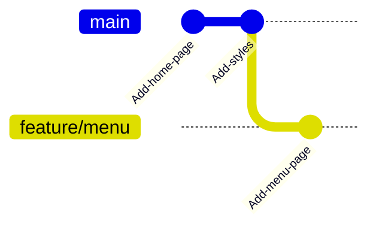
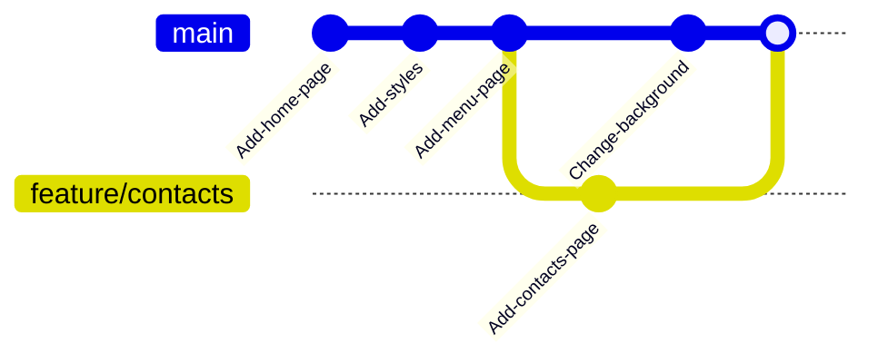
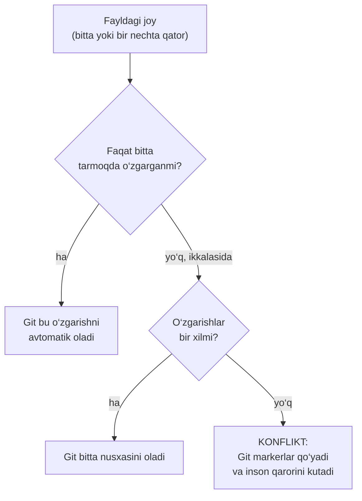
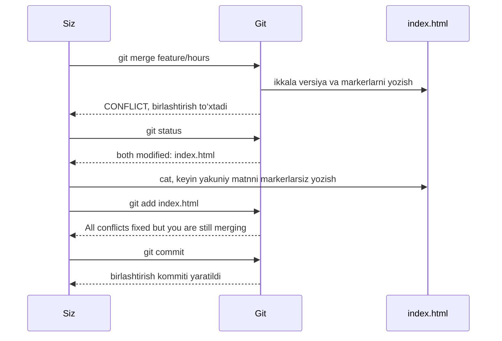

# Birlashtirish va konfliktlar

[Mundarija](../../README.md) · [← Orqaga](../../Lesson-6/uz/Tarmoqlar.md) · [Keyingi →](../../Lesson-8/uz/GitHub%20va%20masofaviy%20repozitoriylar.md) · [RU](../ru/%D0%A1%D0%BB%D0%B8%D1%8F%D0%BD%D0%B8%D0%B5%20%D0%B8%20%D0%BA%D0%BE%D0%BD%D1%84%D0%BB%D0%B8%D0%BA%D1%82%D1%8B.md) · [EN](../en/Merging%20and%20conflicts.md) · [UZ](Birlashtirish%20va%20konfliktlar.md)

> **6-dars bilan bog‘liqlik:** siz tarmoqlar yaratishni (`git switch -c`), ular orasida o‘tishni, `git log --oneline --graph --all` grafini o‘qishni va tarmoqlarni `-d` hamda `-D` bilan o‘chirishni o‘rgandingiz. Lekin tarmoqlardagi ish hozircha `main` ga tushmaydi: `git branch -d` `not fully merged` deb javob beradi. Bugun siz tarmoqlarni `git merge` buyrug‘i bilan birlashtirasiz, birlashtirishning ikki turini ko‘rib chiqasiz va **konfliktlarni** xotirjam hal qilishni o‘rganasiz.

---

## Bu sizga nima uchun kerak

Siz kafe sayti ustida ishlayapsiz. `feature/menu` tarmog‘ida - yangi menyu sahifasi, `feature/hours` tarmog‘ida - aniqlashtirilgan ish vaqti. `main` da esa shu payt kafe egasi ish vaqtini zudlik bilan o‘zgartirishni so‘radi. Endi bularning hammasini saytning bitta ishlaydigan versiyasiga yig‘ish kerak.

Git’siz siz ikki faylni yonma-yon ochib, qatorlarni qo‘lda ko‘chirgan bo‘lardingiz va nimanidir yo‘qotib qo‘yish xavfi bo‘lardi. Git bilan bu bitta buyruq - `git merge`. Agar ikkala tarmoq bitta qatorni o‘zgartirgan bo‘lsa, Git taxmin qilib o‘tirmaydi - u ikkala variantni ko‘rsatadi va tanlashni so‘raydi. Mana shu konflikt. Konfliktlar har bir dasturchida har hafta bo‘lib turadi va ularni vahimasiz hal qila olish jamoada ishlash uchun majburiy ko‘nikma (8- va 9-darslar).

---

## Nimani o‘rganasiz

- Bir tarmoqni boshqasiga `git merge` buyrug‘i bilan birlashtirish va o‘zgarishlar **qayerga** borishini tushunish.
- Oldinga o‘tkazishni (`Fast-forward`) birlashtirish kommitidan (`Merge made by the 'ort' strategy.`) farqlash.
- `--no-ff` kaliti bilan har doim birlashtirish kommitini yaratish va bu nima uchun qilinishini tushunish.
- Konflikt nima uchun yuzaga kelishini tushuntirish va `<<<<<<<`, `=======`, `>>>>>>>` markerlarini o‘qish.
- Konfliktni qadamma-qadam hal qilish: `git status` → fayl → tanlov → `git add` → `git commit`.
- Muvaffaqiyatsiz birlashtirishni `git merge --abort` buyrug‘i bilan bekor qilish.
- VS Code’ning Accept Current / Incoming / Both tugmalaridan foydalanish.
- Birlashtirilgan tarmoqlarni o‘chirish va birlashtirishdan keyingi tarix grafini o‘qish.

---

## Takrorlash: 6-darsdan 3 savol

1. `HEAD` nima va `git switch feature/menu` dan keyin u nimaga ishora qiladi?
2. Qaysi buyruq barcha tarmoqlar tarixini graf ko‘rinishida ko‘rsatadi?
3. `git branch -d` `git branch -D` dan nimasi bilan farq qiladi? `-d` qachon tarmoqni o‘chirishdan bosh tortadi?

Javoblar - dars oxirida.

---

## Reja

| Bo‘lim | Nima qilamiz |
| --- | --- |
| Birlashtirish nima | Ikki qoralama - bitta hujjat |
| Oldinga o‘tkazish | `main` o‘zgarmagan bo‘lsa |
| Birlashtirish kommiti | Tarixlar ajralib ketganda; `--no-ff` |
| Mini-topshiriq 1 | Retseptlar loyihasidagi ikki tarmoq |
| Konflikt | Nima uchun yuzaga keladi va qanday ko‘rinadi |
| Konflikt markerlari | `<<<<<<<`, `=======`, `>>>>>>>` |
| Konfliktni hal qilish | Qadamma-qadam, `git merge --abort`, VS Code |
| Birlashtirishdan keyin | Tarmoqlarni o‘chirish, graf, konfliktlardan qanday qochish |
| Mini-topshiriq 2 | README dagi konflikt |
| Mustaqil ish | O‘quv terminalidagi va kompyuterdagi topshiriq |

---

## Birlashtirish nima

**Oddiy so‘z bilan:** birlashtirish - bitta hujjatning ikki qoralamasini jamlash. Siz va kursdoshingiz referatning nusxasini oldingiz. Siz 3-bobni yozib qo‘shdingiz, kursdoshingiz esa kirishni tuzatdi. Yakuniy referatni olish uchun ikkala tahrirni ham olish kerak. Agar tahrirlar turli joylarda bo‘lsa - bu oson. Agar ikkalangiz bitta xatboshini turlicha qayta yozgan bo‘lsangiz - o‘tirib, qaysi variantni qoldirishni hal qilish kerak. Git loyiha fayllari bilan xuddi shunday ishlaydi.

> **Muhim:** `git merge tarmoq` ko‘rsatilgan tarmoqni **joriy tarmoqqa** - siz turgan tarmoqqa birlashtiradi. Shuning uchun avval qabul qiluvchi tarmoqqa (odatda `main`) o‘tiladi: `git switch main`, va faqat keyin `git merge feature/menu`. Manba tarmoq `feature/menu` bunda o‘zgarmaydi.

O‘quv loyihasi `cafe` ni olamiz: `main` da ikkita kommit bor - `Add home page` (`index.html` fayli) va `Add styles` (`css/style.css` fayli). Keyin birlashtirishning ikki turini ko‘rib chiqamiz.

---

## Oldinga o‘tkazish (fast-forward)

Menyu sahifasi bilan `feature/menu` tarmog‘ini yaratamiz va `main` ga qaytamiz. Bu vaqt ichida `main` da hech narsa o‘zgarmadi.

```bash
git log --oneline --graph --all
```

```text
* 44aa7a3 (feature/menu) Add menu page
* ee01ea3 (HEAD -> main) Add styles
* f751bb7 Add home page
```



**Sxemani qanday o‘qish kerak.** `feature/menu` tarmog‘i `Add-styles` kommitidan ajralib chiqdi va bitta kommit oldinga ketdi. `main` hamon `Add-styles` da turibdi. Ayrilish yo‘q: `main` ning butun tarixi `feature/menu` tarixiga to‘liq kiradi. Tarmoqni «birlashtirish» uchun Git’ga `main` yorlig‘ini `Add-menu-page` ga oldinga surish kifoya - videoni kerakli joygacha oldinga o‘tkazgandek.

```bash
git merge feature/menu
```

```text
Updating ee01ea3..44aa7a3
Fast-forward
 menu.html | 1 +
 1 file changed, 1 insertion(+)
 create mode 100644 menu.html
```

| Qator | Tarjimasi va ma’nosi |
| --- | --- |
| `Updating ee01ea3..44aa7a3` | «Yangilayapman»: `main` `ee01ea3` kommitidan `44aa7a3` ga ko‘chadi |
| `Fast-forward` | **Oldinga o‘tkazish**: yangi kommit yaratilmadi, tarmoq yorlig‘i shunchaki surildi |
| `menu.html \| 1 +` | Ishchi papkada nima o‘zgardi: `menu.html` fayli, bitta yangi qator |
| `create mode 100644 menu.html` | Fayl `main` da paydo bo‘ldi |

Endi `git log --oneline --graph --all` birinchi qatorda `44aa7a3 (HEAD -> main, feature/menu) Add menu page` ni ko‘rsatadi: `main` va `feature/menu` bitta kommitga ishora qiladi, tarix esa to‘g‘ri chiziqligicha qoldi.

**Oddiy so‘z bilan:** oldinga o‘tkazish - bu siz referatga qaytganingizda kursdoshingiz shunchaki **sizning oxirgi versiyangizga** davomini yozib qo‘ygan holat. Jamlaydigan narsa yo‘q: uning versiyasi - sizniki plyus yangi bob.

---

## Birlashtirish kommiti

Endi boshqacha qilamiz. `feature/contacts` tarmog‘ida (`2c473f8 Add contacts page` kommiti) - kontaktlar sahifasi, `main` da esa ajralishdan keyin o‘zining `c437020 Change background color` kommiti paydo bo‘ldi: fon rangi o‘zgartirildi.

Tarixlar **ajralib ketdi**: `main` da tarmoqda yo‘q kommit bor, tarmoqda esa `main` da yo‘q kommit bor. Oldinga o‘tkazib bo‘lmaydi - `Change background color` yo‘qolib qoladi. Git **uch tomonlama birlashtirish** qiladi: umumiy ajdodni (`44aa7a3`), `main` versiyasini va tarmoq versiyasini solishtiradi, ikkala tahrirni jamlaydi va natijani yangi **birlashtirish kommitiga** yozadi.

```bash
git merge feature/contacts
```

```text
Merge made by the 'ort' strategy.
 contacts.html | 1 +
 1 file changed, 1 insertion(+)
 create mode 100644 contacts.html
```

| Qator | Tarjimasi va ma’nosi |
| --- | --- |
| `Merge made by the 'ort' strategy.` | «Birlashtirish ort strategiyasi bilan bajarildi» - birlashtirish kommiti yaratildi. `ort` - Git’ning sukut bo‘yicha birlashtirish algoritmi nomi, uni yodlash shart emas |
| `contacts.html \| 1 +` | Tarmoqdan `main` ga nima keldi |

**Haqiqiy Git’da** birlashtirish kommitida `git merge` buyrug‘i tayyor `Merge branch 'feature/contacts'` xabari bilan matn muharririni ochadi. Hech narsani o‘zgartirmang, saqlang va yoping (Vim’da - `:wq` va Enter). Muharrir ochilmasligi uchun `git merge --no-edit feature/contacts` deb yozing yoki xabarni o‘zingiz bering: `git merge -m "Merge contacts page" feature/contacts`. O‘quv terminalida muharrir yo‘q: tayyor xabar darhol qabul qilinadi.

```bash
git log --oneline --graph
```

```text
*   1cecaa1 (HEAD -> main) Merge branch 'feature/contacts'
|\
| * 2c473f8 (feature/contacts) Add contacts page
* | c437020 Change background color
|/
* 44aa7a3 (feature/menu) Add menu page
* ee01ea3 Add styles
* f751bb7 Add home page
```



**Sxemani qanday o‘qish kerak.** `Add-menu-page` dan keyin tarix ikkiga ayrildi: tarmoqda `Add-contacts-page`, `main` da esa `Change-background` paydo bo‘ldi. `main` chizig‘idagi oxirgi doiracha - birlashtirish kommiti: unga ikkala chiziq kelib qo‘shiladi. Uning suratida yangi fon ham, kontaktlar sahifasi ham bor. Git’ning matnli grafida ham xuddi shu rasm: `|\` - chiziqlar ajraladi, `|/` - umumiy ajdodga qarab qo‘shiladi.

Birlashtirish kommiti oddiy kommitdan nimasi bilan farq qilishi `git show` da ko‘rinadi:

```bash
git show HEAD
```

```text
commit 1cecaa18549de5f8a044fb6709dc2f2b59d3f5aa (HEAD -> main)
Merge: c437020 2c473f8
Author: Anna Karimova <anna@example.com>
Date:   Tue Sep 1 10:06:00 2026 +0500

    Merge branch 'feature/contacts'
```

| Qator | Tarjimasi va ma’nosi |
| --- | --- |
| `Merge: c437020 2c473f8` | Kommitning **ikkita ota kommiti** bor: birinchisi - `main` ning oldingi uchi, ikkinchisi - birlashtirilayotgan tarmoqning uchi. Oddiy kommitning ota kommiti bitta |
| `Merge branch 'feature/contacts'` | Sukut bo‘yicha xabar: qaysi tarmoq birlashtirilgani |

### Qadamma-qadam: tarmoqlar nimaga ishora qiladi

| Qadam | Buyruq | Nima o‘zgardi / HEAD nimaga ishora qiladi |
| --- | --- | --- |
| 1 | `git switch main` | `HEAD -> main`, `main` `ee01ea3` da, `feature/menu` `44aa7a3` da |
| 2 | `git merge feature/menu` | Oldinga o‘tkazish: `main` `ee01ea3` dan `44aa7a3` ga ko‘chdi; yangi kommitlar yo‘q |
| 3 | `git switch -c feature/contacts`, kommit | `HEAD -> feature/contacts`, tarmoq `2c473f8` da |
| 4 | `git switch main`, kommit | `HEAD -> main`, `main` `c437020` da - tarixlar ajralib ketdi |
| 5 | `git merge feature/contacts` | Ikki ota kommitli `1cecaa1` kommiti yaratildi, `main` unda |

### `--no-ff`: har doim birlashtirish kommiti

Ba’zan jamoa kelishib oladi: «har bir vazifa alohida birlashtirish kommiti bilan qo‘shiladi», hatto oldinga o‘tkazish mumkin bo‘lsa ham. Shunda tarixda qaysi kommitlar bitta vazifaga tegishli bo‘lgani va u qachon birlashtirilgani ko‘rinadi. Buning uchun `--no-ff` kaliti bor (no fast-forward - «oldinga o‘tkazmasdan»).

`feature/about` tarmog‘ida bitta `Add about page` kommiti bor, `main` esa ajralishdan keyin o‘zgarmagan - oddiy `git merge` oldinga o‘tkazgan bo‘lardi. Lekin `--no-ff` bilan Git `Merge made by the 'ort' strategy.` deb javob beradi (haqiqiy Git’da avval xabar muharriri ochiladi - yoki `--no-edit` ni qo‘shing):

```bash
git merge --no-ff feature/about
git log --oneline --graph -n 3
```

```text
Merge made by the 'ort' strategy.
 about.html | 1 +
 1 file changed, 1 insertion(+)
 create mode 100644 about.html
*   89a5990 (HEAD -> main) Merge branch 'feature/about'
|\
| * 76cf371 (feature/about) Add about page
|/
*   1cecaa1 Merge branch 'feature/contacts'
|\
```

`main` o‘zgarmagan edi, lekin Git baribir birlashtirish kommitini yaratdi: grafda vazifa kommiti bilan «aylanma tarmoqcha» ko‘rinadi.

| | Oldinga o‘tkazish | Birlashtirish kommiti |
| --- | --- | --- |
| Qachon | `main` ajralishdan keyin o‘zgarmagan | Tarixlar ajralib ketgan yoki `--no-ff` ko‘rsatilgan |
| Git javobi | `Fast-forward` | `Merge made by the 'ort' strategy.` |
| Yangi kommit | Yo‘q | Ha, ikkita ota kommiti bilan |
| Graf | To‘g‘ri chiziq | Chiziqlar ajraladi va qo‘shiladi |

---

## Mini-topshiriq 1

O‘quv terminalida:

1. `recipes` papkasini, unda repozitoriy va `# My recipes` matnli `README.md` faylini yarating. Kommit qiling.
2. `feature/soup` tarmog‘ini yarating, `<h1>Tomato soup</h1>` matnli `soup.html` faylini qo‘shing va kommit qiling. `main` ga qayting va tarmoqni birlashtiring. Git javobidagi qaysi so‘z birlashtirish turini ko‘rsatadi?
3. `salad.html` fayli (`<h1>Greek salad</h1>`) va kommit bilan `feature/salad` tarmog‘ini yarating. `main` ga qayting, `README.md` ga `Soups and salads for every day` qatorini qo‘shing va `-am` bilan kommit qiling.
4. `feature/salad` ni `--no-edit` kaliti bilan birlashtiring. `git log --oneline --graph` ni ko‘ring va birlashtirish kommitini toping.
5. Ikkala birlashtirilgan tarmoqni bitta `git branch -d` buyrug‘i bilan o‘chiring.

---

## Birlashtirish konflikti

Agar o‘zgarishlar **turli** joylarda bo‘lsa - turli fayllar yoki bitta faylning turli qatorlari - Git ularni o‘zi jamlaydi. Konflikt faqat ikkala tarmoq ajralishdan keyin bitta faylning **bir xil joyini** turlicha o‘zgartirganda yuzaga keladi. Git kimning tahriri muhimroq ekanini bilmaydi va sizdan so‘rash uchun to‘xtaydi.

**Oddiy so‘z bilan:** siz va kursdoshingiz referatning bitta xatboshisini qayta yozdingiz. Ularni avtomatik tarzda yopishtirib bo‘lmaydi: ikkala variantni o‘qib, qaror qiladigan odam kerak. Konflikt - bu xato ham, buzilish ham emas, balki Git’ning **savoli**.



**Sxemani qanday o‘qish kerak.** Faylning har bir bo‘lagi uchun Git uchta versiyani solishtiradi: umumiy ajdod, joriy tarmoq va birlashtirilayotgan tarmoq. Agar bo‘lak faqat bitta tarmoqda o‘zgargan bo‘lsa - Git bu tahrirni bemalol oladi. Agar ikkalasida va bir xil o‘zgargan bo‘lsa - bu ham muammo emas. Konflikt faqat o‘ng pastki holatda: ikkala tarmoq bitta joyni **turlicha** o‘zgartirgan.

`cafe` loyihasida konflikt yaratamiz. `index.html` da ikkinchi qator - `<p>Open 9:00-18:00</p>`. `feature/hours` tarmog‘ida u `<p>Open daily 9:00-18:00</p>` ga, `main` da esa ajralishdan keyin `<p>Open 9:00-20:00</p>` ga o‘zgartirildi.

```bash
git merge feature/hours
```

```text
Auto-merging index.html
CONFLICT (content): Merge conflict in index.html
Automatic merge failed; fix conflicts and then commit the result.
```

| Qator | Tarjimasi va ma’nosi |
| --- | --- |
| `Auto-merging index.html` | «index.html ni avtomatik birlashtiryapman» - Git faylni o‘zi jamlashga urinib ko‘rdi |
| `CONFLICT (content): Merge conflict in index.html` | «index.html da mazmun konflikti»: bitta joy ikkala tarmoqda o‘zgartirilgan |
| `Automatic merge failed; fix conflicts and then commit the result.` | «Avtomatik birlashtirish amalga oshmadi: konfliktlarni tuzating va natijani kommit qiling» |

Birlashtirish **yarim yo‘lda to‘xtadi**: birlashtirish kommiti hali yaratilmagan. Nima bo‘layotganini ko‘ramiz:

```bash
git status
```

```text
On branch main
You have unmerged paths.
  (fix conflicts and run "git commit")
  (use "git merge --abort" to abort the merge)

Unmerged paths:
  (use "git add <file>..." to mark resolution)
	both modified:   index.html
```

| Qator | Tarjimasi va ma’nosi |
| --- | --- |
| `You have unmerged paths.` | «Sizda birlashtirilmagan fayllar bor» - siz birlashtirish jarayonidasiz |
| `(fix conflicts and run "git commit")` / `(use "git merge --abort" ...)` | Maslahatlar: konfliktlarni tuzating va `git commit` ni bajaring - yoki birlashtirishni butunlay bekor qiling |
| `Unmerged paths:` | Konfliktli fayllar ro‘yxati |
| `(use "git add <file>..." to mark resolution)` | Tuzatgandan keyin fayl `git add` orqali hal qilingan deb belgilanadi |
| `both modified:   index.html` | «Ikkala tarmoqda o‘zgartirilgan» - bu faylni tuzatish kerak |

---

## Konflikt markerlari

Faylni ochamiz:

```bash
cat index.html
```

```text
<h1>Coffee House</h1>
<<<<<<< HEAD
<p>Open 9:00-20:00</p>
=======
<p>Open daily 9:00-18:00</p>
>>>>>>> feature/hours
```

Git faylga bahsli joyning **ikkala** versiyasini yozdi va ularni markerlar bilan ajratdi. Birinchi qator `<h1>Coffee House</h1>` hech qaysi tarmoqda o‘zgarmagan - u markerlarsiz, o‘z holicha qoldi.

| Qator | Tarjimasi va ma’nosi |
| --- | --- |
| `<<<<<<< HEAD` | Konflikt boshlanishi. Pastda - **joriy tarmoq** versiyasi (`HEAD` - siz turgan tarmoq, bu yerda `main`) |
| `<p>Open 9:00-20:00</p>` | Bu joy `main` da qanday ko‘rinadi |
| `=======` | Ikki versiya orasidagi chegara |
| `<p>Open daily 9:00-18:00</p>` | Bu joy birlashtirilayotgan tarmoqda qanday ko‘rinadi |
| `>>>>>>> feature/hours` | Konflikt oxiri va birlashtirilayotgan tarmoq nomi |

**Oddiy so‘z bilan:** markerlar - Git hujjatga solib qo‘ygan xatcho‘plar: «mana sizning variantingiz, mana kursdoshingizniki, o‘zingiz hal qiling». Xatcho‘plar matnda turgan ekan, hujjat tayyor emas.

> **Muhim:** markerlar - fayl ichidagi oddiy matn. Agar ularni qoldirib kommit qilsangiz, brauzer saytda `<<<<<<< HEAD` va `=======` qatorlarini ko‘rsatadi, markerli JavaScript yoki CSS esa shunchaki ishlamay qoladi. Git markerlarni o‘chirganingizni **tekshirmaydi**: uning uchun `git add` «men hammasini tuzatdim» degani.

---

## Konfliktni hal qilish

### Hal qilishning uch varianti

| Yechim | Yakuniy qator | Qachon |
| --- | --- | --- |
| O‘z versiyangizni qoldirish (`HEAD`) | `<p>Open 9:00-20:00</p>` | Tarmoqdagi tahrir endi kerak emas |
| Tarmoq versiyasini qoldirish | `<p>Open daily 9:00-18:00</p>` | `main` dagi tahrir eskirgan |
| Ikkalasini birlashtirish | `<p>Open daily 9:00-20:00</p>` | Ikkala tahrir ham kerak - eng ko‘p uchraydigan holat |

Bu yerda ikkala tahrir ham to‘g‘ri: kafe endi har kuni **va** 20:00 gacha ishlaydi. Birlashtiramiz.

### Qadamma-qadam



**Sxemani qanday o‘qish kerak.** Git o‘zi to‘xtaydi va markerlarni yozib qo‘yadi. Keyin navbat sizda: qaysi fayllar konfliktda ekanini ko‘rish, har birini tuzatish, uni `git add` bilan belgilash va birlashtirishni kommit bilan tugatish. Kommit bo‘lmaguncha birlashtirish «osilib turadi» - bu `git status` da ko‘rinadi.

**1–2-qadamlar. Konflikt qayerdaligini bilish va faylni ochish:** `git status` → `both modified: index.html`, keyin `cat index.html` (yoki muharrir) - barcha markerlarni toping. Ular bir nechta guruh bo‘lishi mumkin: `<<<<<<<` ni qidiring.

**3-qadam. Yakuniy matnni markerlarsiz yozish.** O‘quv terminalida muharrir yo‘q, shuning uchun faylni 2-darsdagi buyruq bilan butunlay qayta yozamiz:

```bash
cat > index.html << 'EOF'
<h1>Coffee House</h1>
<p>Open daily 9:00-20:00</p>
EOF
cat index.html
```

```text
<h1>Coffee House</h1>
<p>Open daily 9:00-20:00</p>
```

E’tibor bering: faylda **barcha** kerakli qatorlar qolishi kerak (konfliktga kirmagan `<h1>` ham), markerlar esa bittasi ham bo‘lmasligi kerak.

**4-qadam. Konfliktni hal qilingan deb belgilash:**

```bash
git add index.html
git status
```

```text
On branch main
All conflicts fixed but you are still merging.
  (use "git commit" to conclude merge)

Changes to be committed:
	modified:   index.html
```

Tarjimasi: «Barcha konfliktlar tuzatildi, lekin siz hali ham birlashtirish jarayonidasiz. Tugatish uchun `git commit` ni bajaring». Tuzatilgan `index.html` birlashtirish kommitiga tushadi.

**5-qadam. Birlashtirishni kommit bilan tugatish:**

```bash
git commit --no-edit
```

```text
[main 391dfd2] Merge branch 'feature/hours'
```

`--no-edit` - tayyor `Merge branch 'feature/hours'` xabarini muharrirsiz olish. `git commit -m "Merge opening hours"` ham mumkin. Haqiqiy Git’da oddiy `git commit` xuddi shu xabar bilan muharrirni ochadi, o‘quv terminalida esa uni darhol qabul qiladi. `git log --oneline --graph` grafida yangi `391dfd2` kommiti yuqoridagi `feature/contacts` birlashtirishi kabi ko‘rinadi: ikki chiziq qo‘shiladi.

### Qadamma-qadam: konflikt paytidagi uch zona

| Qadam | Buyruq | Ishchi papka | Indeks | Repozitoriy |
| --- | --- | --- | --- | --- |
| 1 | `git merge feature/hours` | Markerli `index.html` | `index.html` - «birlashtirilmagan» | `main` `0ca55ae` da, birlashtirish davom etmoqda |
| 2 | `git status`, `cat index.html` | O‘zgarishsiz | O‘zgarishsiz | O‘zgarishsiz |
| 3 | `cat > index.html << 'EOF'` | Markerlarsiz yakuniy matn | Hamon «birlashtirilmagan» | O‘zgarishsiz |
| 4 | `git add index.html` | Yakuniy matn | Yakuniy matn, konflikt hal qilingan | O‘zgarishsiz |
| 5 | `git commit --no-edit` | Yakuniy matn | Kommit bilan mos keladi | Ikki ota kommitli yangi `391dfd2` kommiti, birlashtirish tugadi |

### `git merge --abort`: hammasini avvalgi holiga qaytarish

Agar konfliktlar juda ko‘p bo‘lsa yoki noto‘g‘ri tarmoqni birlashtirayotganingizni tushunib qolsangiz, birlashtirishni bekor qilish mumkin - birlashtirish kommiti qilinmaguncha:

```bash
git merge --abort
git status
```

```text
On branch main
nothing to commit, working tree clean
```

Ishchi papka va indeks `git merge` dan oldingi holatga qaytdi: `index.html` da yana `<p>Open 9:00-20:00</p>`, markerlar yo‘q. `feature/hours` tarmog‘i hech qayerga yo‘qolmadi - uni keyinroq, masalan hamkasbingiz bilan gaplashib olgandan keyin birlashtirish mumkin.

> **Muhim:** `git merge` dan oldin joriy tahrirlaringizni kommit qiling, shunda `git status` toza bo‘ladi. Shunda `git merge --abort` hammasini aniq avvalgi holiga qaytaradi. Xuddi shu fayllarda kommit qilinmagan o‘zgarishlar bo‘lsa, Git birlashtirishni boshlashdan shunchaki bosh tortadi: `Your local changes to the following files would be overwritten by merge`.

### VS Code’da konflikt

Haqiqiy loyihada konfliktli faylni VS Code’da ochish qulayroq. Har bir konflikt ustida muharrir tugmalar qatorini ko‘rsatadi, versiyalarni esa turli ranglar bilan ajratib ko‘rsatadi:

| Tugma | Nima qiladi |
| --- | --- |
| Accept Current Change | Joriy tarmoq versiyasini qoldirish (`HEAD`, yuqori qism) |
| Accept Incoming Change | Birlashtirilayotgan tarmoq versiyasini qoldirish (pastki qism) |
| Accept Both Changes | Ikkala versiyani birining ostiga ikkinchisini qoldirish - keyin odatda qo‘lda tuzatish kerak |
| Compare Changes | Ikki versiyani yonma-yon ko‘rsatish |

Tugmalar markerlarni o‘zi o‘chiradi. «Birlashtirish» varianti uchun Accept Both Changes ni bosing va qatorlarni qo‘lda tahrirlang. Resolve in Merge Editor tugmasi ham bor - uch panelli birlashtirish muharriri. Qaysi usulni tanlasangiz ham, keyin: faylni saqlash, `git add`, `git commit`. Shunga o‘xshash tugmalar WebStorm, Cursor va boshqa muharrirlarda ham bor.

---

## Birlashtirishdan keyin

### Birlashtirilgan tarmoqlarni o‘chirish

Tarmoqdagi ish `main` ga tushgach, tarmoq endi kerak emas. 6-darsdagi xavfsiz o‘chirish - `-d`: endi u ishlaydi.

```bash
git branch -d feature/hours
git branch
```

```text
Deleted branch feature/hours (was 6d69cce).
* main
```

`6d69cce` kommiti o‘chirilmadi - u `main` tarixining bir qismi, faqat yorliq o‘chirildi. Agar esa tarmoqni birlashtirishdan **oldin** o‘chirishga urinsangiz, Git ishni himoya qiladi:

```text
error: the branch 'feature/hours' is not fully merged
hint: If you are sure you want to delete it, run 'git branch -D feature/hours'
hint: Disable this message with "git config set advice.forceDeleteBranch false"
```

> **Muhim:** birlashtirishni unutgan tarmoqni «tezda olib tashlash» uchun `-D` dan foydalanmang: uning kommitlari tarmoqlar ro‘yxatidan yo‘qoladi. `-D` - faqat ishi aniq kerak bo‘lmagan tarmoqlar uchun. Bir nechtasini birdaniga o‘chirish: `git branch -d feature/menu feature/contacts`.

### Konfliktlardan qanday qochish mumkin

Konfliktlardan butunlay qochib bo‘lmaydi, lekin ularni kam va kichik qilish mumkin.

| Odat | Nima uchun yordam beradi |
| --- | --- |
| Kichik tarmoqlar: bitta tarmoq - bitta vazifa | O‘zgargan qatorlar kamroq - to‘qnashuv joylari kamroq |
| Tez-tez birlashtirish: tarmoq haftalar emas, soatlar yoki kunlar yashaydi | Tarixlar uzoqqa ajralib ketishga ulgurmaydi |
| Vaqti-vaqti bilan `main` ni o‘z tarmog‘ingizga birlashtirish: `git switch feature/x`, `git merge main` | Konfliktlar oz-ozdan va `main` da emas, sizning tarmog‘ingizda hal qilinadi |
| Faylni keraksiz qayta formatlamaslik, kim nimani o‘zgartirishini kelishib olish | Butun fayldagi chekinishlarni o‘zgartirish yoki bitta joyda ikki kishi - aniq konflikt |

`git merge` dan tashqari tarmoqlar `git rebase` buyrug‘i bilan ham qo‘shiladi - u tarmoq kommitlarini boshqa tarmoqning uchiga ko‘chiradi va tarix to‘g‘ri chiziqligicha qoladi. Uni 9-darsda, jamoada ishlaganimizda ko‘rib chiqamiz.

---

### Buzib ko‘ring

1. `feature/...` tarmog‘iga o‘ting va tarmoqni `main` ga birlashtiryapman deb o‘ylab, `git merge main` ni bajaring. `git log --oneline --graph --all` ni ko‘ring: kommitlarni qaysi tarmoq oldi?
2. Konflikt yarating va hech narsani tuzatmasdan darhol `git commit -m "Merge"` ni bajaring. Git nima deb javob beradi?
3. Konflikt yarating, faylda markerlar turgan holda `git add` va `git commit` ni bajaring. Chiqdimi? `cat` ni ko‘ring - sayt tashrifchisi nimani ko‘rgan bo‘lardi?
4. Konflikt paytida yana bitta tarmoqni birlashtirib ko‘ring: `git merge feature/other`.
5. Hech qanday birlashtirish bo‘lmaganda `git merge --abort` ni bajaring va bitta tarmoqni ketma-ket ikki marta birlashtiring. Git har bir holatda nima deb javob beradi?

### Yangi o‘rganuvchilarning tipik xatolari

| Xato | Nima bo‘ladi | Qanday tuzatish |
| --- | --- | --- |
| `git merge` noto‘g‘ri tarmoqda | `main` kommitlari tarmoqqa tushdi, `main` esa o‘zgarmadi | Birlashtirishdan oldin `git switch main`, `git branch` ni tekshirish |
| Konflikt tuzatilmagan holda kommit | `error: Committing is not possible because you have unmerged files.` | Faylni tuzatish, `git add`, keyin `git commit` |
| Faylda markerlar bilan `git add` | Kommit yaratildi, saytda `<<<<<<< HEAD` va `=======` ko‘rinadi | `git add` dan oldin faylni tekshirish (`cat`, `<<<<<<<` ni qidirish); tuzatish va yangi kommit qilish |
| Eskisi tugamasdan yangi birlashtirish | `error: Merging is not possible because you have unmerged files.` | Joriysini tugatish (`git add`, `git commit`) yoki `git merge --abort` |
| Kommit qilinmagan tahrirlar bilan birlashtirish | `error: Your local changes to the following files would be overwritten by merge:` | Tahrirlarni kommit qilish (yoki ularni `git restore` bilan olib tashlash) va takrorlash |
| Tarmoq nomida xato | `merge: feature/nope - not something we can merge` | Aniq nomni `git branch` da ko‘rish |
| Birlashtirilmagan tarmoq `-D` bilan o‘chirildi | Tarmoqdagi ish tarmoqlar ro‘yxatidan yo‘qoldi | Avval `git merge`, keyin `git branch -d`; kommitni topishga `git reflog` yordam beradi (4-dars) |

---

## Mini-topshiriq 2

`recipes` repozitoriysida davom eting:

1. `feature/title` tarmog‘ini yarating va `README.md` ni qayta yozing (`cat > README.md << 'EOF'` orqali): birinchi qator `# Family recipes`, ikkinchisi - `Soups and salads for every day`. `-am` bilan kommit qiling.
2. `main` ga qayting va xuddi shuni qiling, lekin birinchi qator `# My favourite recipes` bo‘lsin. Kommit qiling.
3. `feature/title` ni birlashtiring. `git status` va `cat README.md` ni ko‘ring: markerlar orasida qaysi qatorlar bor?
4. Birlashtirishni `git merge --abort` buyrug‘i bilan bekor qiling va `git status` orqali hammasi toza ekaniga ishonch hosil qiling.
5. Tarmoqni yana birlashtiring va konfliktni hal qiling: birinchi qator `# My favourite family recipes`, ikkinchisi o‘zgarishsiz. Birlashtirishni tugating (`git add`, `git commit --no-edit`).
6. Barcha tarmoqlar grafini ko‘ring va `feature/title` ni o‘chiring.

---

## Dars yakuni: shpargalka

| Vazifa | Buyruq |
| --- | --- |
| Tarmoqni joriy tarmoqqa birlashtirish | `git switch main`, keyin `git merge tarmoq` |
| Xabar muharririsiz birlashtirish | `git merge --no-edit tarmoq` |
| Har doim birlashtirish kommitini yaratish | `git merge --no-ff tarmoq` |
| Konflikt qayerdaligini ko‘rish | `git status` → `both modified:` |
| Markerli faylni ko‘rish | `cat fayl` |
| Hal qilingan faylni yozish | muharrir yoki `cat > fayl << 'EOF'` |
| Konfliktni hal qilingan deb belgilash | `git add fayl` |
| Birlashtirishni tugatish | `git commit --no-edit` yoki `git commit -m "..."` |
| Konfliktli birlashtirishni bekor qilish | `git merge --abort` |
| Birlashtirish kommitining ota kommitlarini ko‘rish | `git show HEAD` → `Merge:` qatori |
| Ayrilishli tarix | `git log --oneline --graph --all` |
| Birlashtirilgan tarmoqlarni o‘chirish | `git branch -d tarmoq1 tarmoq2` |

---

## Mustaqil ish

### 1-qism. IDE topshirig‘i (platforma hisoblaydi)

Siz `~/portfolio` papkasida, `main` tarmog‘idasiz. Ikkita tarmoq bor: `feature/footer` `footer.html` ni qo‘shadi (u yaratilgandan keyin `main` o‘zgarmagan), `feature/title` esa `index.html` dagi sarlavhani o‘zgartiradi - ajralishdan keyin `main` da ham o‘zgartirilgan o‘sha qatorni. Buyruqlarni har qatorga bittadan yozing:

1. Barcha tarmoqlar tarixini graf ko‘rinishida ko‘ring.
2. `feature/footer` ni `main` ga birlashtiring - oldinga o‘tkazish bo‘lishi kerak (`--no-ff` siz).
3. `feature/title` ni birlashtiring - `index.html` da konflikt yuzaga keladi.
4. `git status` ni va `index.html` mazmunini ko‘ring.
5. Ikkala variantni birlashtirib, konfliktni hal qiling: `index.html` ni `cat > index.html << 'EOF'` buyrug‘i bilan yozing - birinchi qator `<h1>Anna Karimova, web developer - Portfolio</h1>`, ikkinchi qator `<p>Junior web developer</p>`, konflikt markerlarisiz.
6. Konfliktni hal qilingan deb belgilang va birlashtirishni kommit bilan tugating (`-m` siz `git commit` tayyor `Merge branch 'feature/title'` xabarini oladi, `-m` bilan ham mumkin).
7. Ikkala birlashtirilgan tarmoqni xavfsiz `git branch -d` buyrug‘i bilan o‘chiring.
8. Tarix grafini ko‘ring va ishchi papka toza ekaniga ishonch hosil qiling.

Platforma nimani tekshiradi: siz `main` da ekaningizni; oxirgi kommit ikki ota kommitli birlashtirish kommiti ekanini, ikkinchi ota kommiti esa `feature/title` tarmog‘ining kommiti ekanini; `feature/footer` oldinga o‘tkazish bilan birlashtirilganini (tarixda roppa-rosa bitta birlashtirish kommiti bor); birlashtirish tugaganini; `index.html` da `<<<<<<<`, `=======`, `>>>>>>>` markerlari yo‘qligini, matni esa shartdagi bilan mos kelishini; `footer.html` joyida ekanini va `main` tarixida ikkala tarmoq kommitlari borligini; ikkala tarmoq `-D` siz, `-d` bilan o‘chirilganini; ishchi papka tozaligini; yechim ikki kommitli boshqa `feature/footer` tarmog‘i uchun ham ishlashini; ssenariy xatolarsiz bajarilishini.

### 2-qism. Kompyuterdagi loyiha

1. Saytingiz repozitoriysida 6-darsdagi `feature/...` tarmog‘ini `main` ga birlashtiring. Birlashtirishning qaysi turi chiqqanini ko‘ring va saytni brauzerda oching: tahrir endi `main` da.
2. Ataylab konflikt yarating: `fix/heading` tarmog‘i bosh sahifadagi `<h1>` matnini o‘zgartiradi, `main` da esa (ajralishdan keyin) o‘sha `<h1>` boshqacha o‘zgartiriladi. Ikkala tarmoqda kommit qiling.
3. `fix/heading` ni birlashtiring va konfliktni VS Code’da hal qiling: Accept Current / Incoming / Both tugmalarini sinab ko‘ring va yakuniy variantni tanlang. Saqlang, `git add`, `git commit --no-edit`.
4. `--no-ff` ni sinab ko‘ring: bitta kommitli kichik tarmoqni `git merge --no-ff --no-edit tarmoq` bilan birlashtiring va grafni oldinga o‘tkazish bilan solishtiring.
5. Barcha birlashtirilgan tarmoqlarni `git branch -d` bilan o‘chiring va `git log --oneline --graph --all` ni ko‘ring.

### Tayyorlik mezonlari

- [ ] IDE topshirig‘i qabul qilindi.
- [ ] Saytingiz tarixida kamida bitta birlashtirish kommiti bor va `git show` unda ikkita xeshli `Merge:` qatorini ko‘rsatadi.
- [ ] Siz kamida bitta konfliktni hal qildingiz va fayllarda markerlar qolmaganini tekshirdingiz.
- [ ] Siz grafga qarab qayerda oldinga o‘tkazish, qayerda birlashtirish kommiti bo‘lganini tushuntira olasiz.
- [ ] `git branch` faqat `main` ni va hali birlashtirilmagan ishga ega tarmoqlarni ko‘rsatadi.

---

## O‘zini tekshirish uchun savollar

1. `git merge feature/menu` da o‘zgarishlar qaysi tarmoqqa birlashtiriladi? `feature/menu` ning o‘zi bilan nima bo‘ladi?
2. Git qachon oldinga o‘tkazadi, qachon esa birlashtirish kommitini yaratadi?
3. Birlashtirish kommiti oddiy kommitdan nimasi bilan farq qiladi? Bu qayerda ko‘rinadi?
4. `--no-ff` kaliti nima uchun kerak?
5. Konflikt nima uchun yuzaga keladi? Agar tarmoqlar bitta faylning turli qatorlarini o‘zgartirgan bo‘lsa, konflikt bo‘ladimi?
6. `<<<<<<< HEAD`, `=======` va `>>>>>>> tarmoq` markerlari nimani bildiradi?
7. Konfliktni hal qilish qadamlarini sanab bering.
8. `git merge --abort` nima qiladi va undan qachon foydalanish mumkin?
9. Agar markerlarni olib tashlamasdan `git add` va `git commit` ni bajarsangiz, nima bo‘ladi?
10. Konfliktlar sonini kamaytiradigan uchta odatni ayting.

Savollardan keyin platformada **dars testini** topshiring: 12 ta savol, o‘tish chegarasi 70%.

---

## Keyin nima

Endi siz tarmoqlarda ishlay olasiz va uni `main` ga yig‘a olasiz - hatto tarmoqlar «bahslashib qolganda» ham. Lekin butun tarix hozircha faqat sizning kompyuteringizda yashaydi. 8-darsda siz GitHub’da repozitoriy yaratasiz, loyihani unga `git push` buyrug‘i bilan yuborasiz, boshqalarning repozitoriylarini `git clone` orqali yuklab olishni va o‘zgarishlarni `git fetch` hamda `git pull` orqali olishni o‘rganasiz - `git pull` esa, ko‘rib turganingizdek, ichida ham birlashtirish qiladi.

---

## Javoblar

**Takrorlash**

1. `HEAD` - «siz shu yerdasiz» ko‘rsatkichi. `git switch feature/menu` dan keyin u `feature/menu` tarmog‘iga (`HEAD -> feature/menu`), u orqali esa uning oxirgi kommitiga ishora qiladi.
2. `git log --oneline --graph --all`.
3. `-d` faqat kommitlari joriy tarmoqda allaqachon bor tarmoqni o‘chiradi; aks holda `not fully merged` xatosi bilan bosh tortadi. `-D` majburan o‘chiradi, hatto birlashtirilmagan ish bo‘lsa ham.

**Mini-topshiriq 1**

```bash
mkdir recipes && cd recipes && git init
echo "# My recipes" > README.md
git add README.md && git commit -m "Add README"
git switch -c feature/soup
echo "<h1>Tomato soup</h1>" > soup.html
git add soup.html && git commit -m "Add soup recipe"
git switch main
git merge feature/soup
git switch -c feature/salad
echo "<h1>Greek salad</h1>" > salad.html
git add salad.html && git commit -m "Add salad recipe"
git switch main
echo "Soups and salads for every day" >> README.md
git commit -am "Describe recipes"
git merge --no-edit feature/salad
git log --oneline --graph
git branch -d feature/soup feature/salad
```

2-qadamdagi birlashtirish turi - `Fast-forward`, 4-qadamda - `Merge made by the 'ort' strategy.`

**Mini-topshiriq 2**

```bash
git switch -c feature/title
cat > README.md << 'EOF'
# Family recipes
Soups and salads for every day
EOF
git commit -am "Rename to family recipes"
git switch main
cat > README.md << 'EOF'
# My favourite recipes
Soups and salads for every day
EOF
git commit -am "Rename to favourite recipes"
git merge feature/title
git status
cat README.md
git merge --abort
git merge feature/title
cat > README.md << 'EOF'
# My favourite family recipes
Soups and salads for every day
EOF
git add README.md
git commit --no-edit
git log --oneline --graph --all
git branch -d feature/title
```

`<<<<<<< HEAD` va `=======` orasida - `# My favourite recipes`, `=======` va `>>>>>>> feature/title` orasida - `# Family recipes`. `Soups and salads for every day` qatori konfliktga kirmaydi.

**O‘zini tekshirish uchun savollar**

1. Joriy tarmoqqa (siz turgan tarmoqqa). `feature/menu` tarmog‘i o‘zgarmaydi.
2. Oldinga o‘tkazish - agar joriy tarmoq ajralishdan keyin o‘zgarmagan bo‘lsa: Git shunchaki uning yorlig‘ini oldinga suradi. Birlashtirish kommiti - agar ikkala tarmoqda yangi kommitlar bo‘lsa (tarixlar ajralib ketgan) yoki `--no-ff` ko‘rsatilgan bo‘lsa.
3. Uning ikkita ota kommiti bor. Bu `git show` da (`Merge: xesh1 xesh2` qatori) va `git log --graph` grafida, ikki chiziq qo‘shiladigan joyda ko‘rinadi.
4. Oldinga o‘tkazish mumkin bo‘lgan joyda ham birlashtirish kommitini yaratish uchun: tarixda qaysi kommitlar bitta vazifaga tegishli bo‘lgani ko‘rinadi va uni butunlay bekor qilish mumkin.
5. Ikkala tarmoq ajralishdan keyin faylning bir xil joyini turlicha o‘zgartirgan va Git qaysi variant to‘g‘riligini bilmaydi. Agar turli qatorlar o‘zgartirilgan bo‘lsa - konflikt bo‘lmaydi, Git ikkala tahrirni jamlaydi.
6. `<<<<<<< HEAD` - joriy tarmoq versiyasining boshlanishi, `=======` - chegara, `>>>>>>> tarmoq` - birlashtirilayotgan tarmoq versiyasining oxiri.
7. `git status` → faylni ochish → versiyalarni tanlash yoki birlashtirish → barcha markerlarni o‘chirish → `git add fayl` → `git commit`.
8. Boshlangan birlashtirishni bekor qiladi va ishchi papka hamda indeksni `git merge` dan oldingi holatga qaytaradi. Birlashtirish kommiti yaratilmaguncha foydalanish mumkin.
9. Kommit fayl ichidagi markerlar bilan yaratiladi: Git ularni tekshirmaydi. Saytda `<<<<<<<` va `=======` ko‘rinadi, kod buzilishi mumkin.
10. Bitta vazifaga mo‘ljallangan kichik tarmoqlar, tez-tez birlashtirish (jumladan `main` ni o‘z tarmog‘ingizga), kim nimani o‘zgartirishini kelishib olish, fayllarni ommaviy qayta formatlashdan voz kechish, birlashtirishdan oldin kommit qilish.

---

[Mundarija](../../README.md) · [← Orqaga](../../Lesson-6/uz/Tarmoqlar.md) · [Keyingi →](../../Lesson-8/uz/GitHub%20va%20masofaviy%20repozitoriylar.md) · [RU](../ru/%D0%A1%D0%BB%D0%B8%D1%8F%D0%BD%D0%B8%D0%B5%20%D0%B8%20%D0%BA%D0%BE%D0%BD%D1%84%D0%BB%D0%B8%D0%BA%D1%82%D1%8B.md) · [EN](../en/Merging%20and%20conflicts.md) · [UZ](Birlashtirish%20va%20konfliktlar.md)
