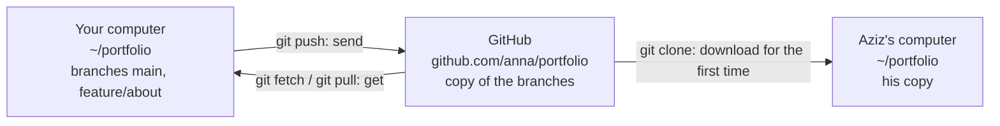
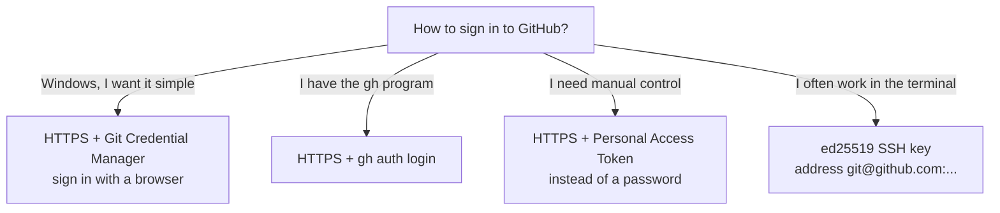
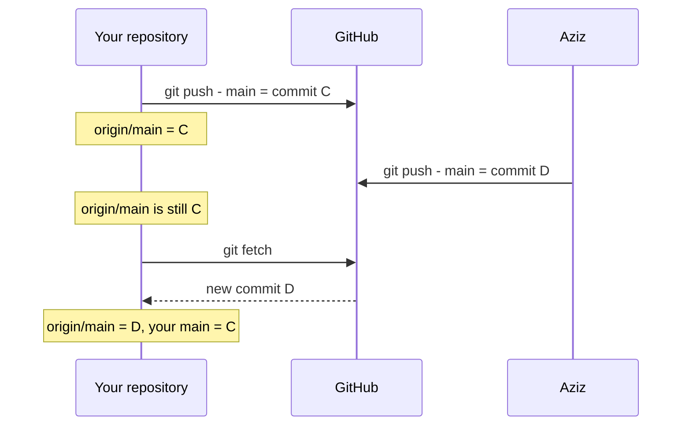
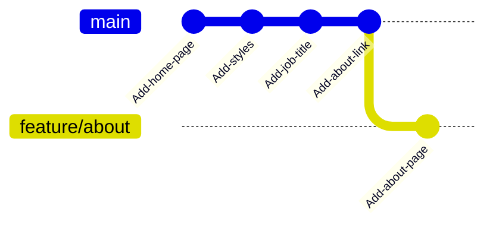

# GitHub and remote repositories

[Contents](../../README.md) · [← Back](../../Lesson-7/en/Merging%20and%20conflicts.md) · [Next →](../../Lesson-9/en/Teamwork.md) · [RU](../ru/GitHub%20%D0%B8%20%D1%83%D0%B4%D0%B0%D0%BB%D1%91%D0%BD%D0%BD%D1%8B%D0%B5%20%D1%80%D0%B5%D0%BF%D0%BE%D0%B7%D0%B8%D1%82%D0%BE%D1%80%D0%B8%D0%B8.md) · [EN](GitHub%20and%20remote%20repositories.md) · [UZ](../uz/GitHub%20va%20masofaviy%20repozitoriylar.md)

> **Link to lesson 7:** you learned to merge branches with `git merge`, resolve conflicts and delete merged branches. But the whole history lived only on your computer. Today your project goes online: you will create a repository on GitHub, send your branches there, download someone else's project and learn to get new commits from the server.

---

## Why you need this

A student finished her portfolio website, and a week later her laptop's disk died. All 40 commits, the branches and a neat `.gitignore` were gone with it. Her classmate with the same kind of project simply bought a new laptop, ran one `git clone` command - and a minute later he was working again from the same point. There was only one difference: his repository was on GitHub.

GitHub is not only a backup. Job interviewers ask for a link to your GitHub profile, teachers check assignments there, and teams share code through it. All of this rests on three actions that you will learn today: **send** (`push`), **download** (`clone`) and **get what's new** (`fetch`, `pull`).

---

## What you will learn

- Explain what a remote repository and `origin` are.
- Create a repository on GitHub the right way when you already have a local project.
- Choose between HTTPS and SSH and sign in to GitHub with a token or an SSH key.
- Connect a remote repository: `git remote add`, `git remote -v`.
- Send branches with `git push -u` and understand what upstream is.
- Read `origin/main` as "the last known state of the server" and understand the `ahead` / `behind` messages.
- Download other people's projects with `git clone`.
- Tell `git fetch` from `git pull` and recognize typical errors: `No configured push destination`, `has no upstream branch`, `Repository not found`, `Authentication failed`.

---

## Review: 3 questions from lesson 7

1. How is a fast-forward merge different from a merge commit?
2. What do the markers `<<<<<<<`, `=======` and `>>>>>>>` mean in a file with a conflict?
3. You started a merge, saw ten conflicts and changed your mind. Which command brings everything back to how it was before `git merge`?

Answers are at the end of the lesson.

---

## Lesson plan

| Section | What we do |
| --- | --- |
| Remote repository | What it is, why you need it, what `origin` is |
| Repository on GitHub | Signing up, the New button, Public and Private, why without a README |
| Signing in to GitHub | HTTPS and SSH, token, Git Credential Manager, SSH key |
| `git remote` and `git push -u` | Connect GitHub and send `main` |
| Mini-task 1 | Publish a practice website |
| `origin/main` and branches | Upstream, `ahead`, sending a new branch |
| `git clone` | Download someone else's repository |
| `git fetch` and `git pull` | Get new commits from the server |
| Mini-task 2 | "A second computer": clone, push, fetch, pull |
| Independent work | A task in the learning terminal and on your computer |

---

## Remote repository

**In simple words:** your local repository is a notebook that you keep at home. A remote repository is its copy in a **public library**. You bring new pages there (`push`), and any reader can take a copy home (`clone`) and later pick up the fresh pages (`fetch`, `pull`). The notebook at home and the copy in the library don't sync by themselves: they are exchanged only when you go to the library - that is, when you type a command.

A **remote repository** (remote) is the same Git repository with the whole history, but in another place: on GitHub, GitLab or a company server. Each remote repository in your project has a short name. The main one is traditionally called **`origin`** ("the source").



**How to read the diagram.** The arrows are commands, and each one works only at the moment you run it. GitHub doesn't "watch" your folder like a cloud drive (Google Drive, OneDrive) does: until you run `git push`, nothing changes on the server. Commits, branches and history work without the internet too, and you send finished commits to GitHub.

---

## Repository on GitHub

### Signing up and creating a repository

Sign up at [github.com](https://github.com) (the **Sign up** button). Your username becomes part of the address of all your projects: `github.com/username/project`, so choose a short and serious one - employers will see it. Use the same email as in `git config --global user.email` (lesson 1): this way GitHub links your commits to your profile. Turn on two-factor authentication right away - GitHub will ask you to do it anyway. Creating a repository (the GitHub interface changes from time to time, but the steps stay the same):

1. Click **New** on the repositories page (or **+** in the top right corner → **New repository**).
2. **Repository name** - the project name in Latin letters, best the same as the folder: `portfolio`. **Description** - one line about the project.
3. **Public** or **Private** - who will see the repository.
4. If the project already exists on your computer, **don't add** a README, `.gitignore` or license.
5. Click **Create repository**.

A **Public** repository can be seen by anyone on the internet - this is what people use for portfolios and study projects. A **Private** repository is visible only to you and the people you invite - for assignments before you hand them in and for work projects.

> **Important:** "public" means "everyone can see it", not "everyone can change it". Only the people you have added can send commits to your repository. But secrets in a public repository are visible to everyone too - the rules from lesson 5 about `.env` are especially important here.

### Why without a README

**In simple words:** imagine you bring your 40-page notebook to the library, and the librarian has already started a notebook for you and written "Hello" on the first page. Now these are two different notebooks with different beginnings, and you can't simply glue your pages in.

If you tick "Add README", GitHub makes the first commit itself. The server and you end up with two **different histories with no common start**, and Git rejects your first `git push`. We will see how such histories are joined in lesson 9, but for now it's easier not to create them: **for an existing project - an empty repository**. You will write the README yourself (lesson 5) and send it together with your other commits.

After you create an empty repository, GitHub shows its address and ready-made commands for an existing project: `git remote add origin ...`, `git branch -M main` and `git push -u origin main`. The middle one renames the current branch to `main` (like `-m` from lesson 6, but forced) - if you set `init.defaultBranch main` in lesson 1, it changes nothing. We will look at the other two below.

---

## Signing in to GitHub: HTTPS or SSH

Anyone can read a public repository, but only the owner can send commits. That's why on `git push` GitHub asks: "Who are you?". There are two ways to connect, and each has its own kind of address.

| | HTTPS | SSH |
| --- | --- | --- |
| Address | `https://github.com/anna/portfolio.git` | `git@github.com:anna/portfolio.git` |
| How you sign in | Token, Git Credential Manager or `gh auth login` | An SSH key on your computer |
| Setup | Almost nothing: you sign in on the first `push` | Create a key once and add it to GitHub |
| Good for | Beginners, Windows, working through a proxy | Working in the terminal on your own computer a lot |

> **Important:** your GitHub account password **doesn't work** for `git push`. GitHub stopped accepting passwords for Git operations in 2021. If you type the password, you will get `Authentication failed` (see "Typical beginner mistakes").

### Option 1. Git Credential Manager and `gh auth login` (the easiest)

**Git Credential Manager** (GCM) comes with the Git installer for Windows. On the first `git push` over HTTPS it opens a browser window: you sign in to GitHub as usual, click "Authorize" - and GCM remembers the access by itself. You don't need to type anything else. On macOS and Linux, GCM is installed separately.

The second option is GitHub's official program GitHub CLI (`gh`). The command `gh auth login` asks a few questions (GitHub.com, HTTPS, sign in with a browser) and sets up Git to sign in through it.

### Option 2. Personal Access Token

**In simple words:** a token is a building pass instead of your apartment key. The pass opens only the doors you need, it has an expiry date, and you can cancel it at any time without changing the locks.

A Personal Access Token (PAT) is a long string like `github_pat_...` that you type **instead of a password**. Where to create it (section names as of late 2026):

1. Click your avatar → **Settings**.
2. At the bottom of the left menu - **Developer settings**.
3. **Personal access tokens** → **Fine-grained tokens** → **Generate new token**.
4. Enter a name and an expiry date (Expiration), and in **Repository access** choose only the repositories you need.
5. In the repository permissions, set **Contents** to **Read and write** - this is the right to `push`.
6. Click **Generate token** and copy the token right away: GitHub shows it **only once**.

On the next `git push`, type your GitHub username in the `Username` field and the token in the `Password` field. Next to Fine-grained there is an old type, **Tokens (classic)** - you will see it in old guides; for a new project choose fine-grained.

> **Important:** a token is a secret, just like a password. Don't put it in code, in `README.md` or in the repository address, and don't send it in a chat. If it leaks, delete it in the same section and create a new one.

### Option 3. SSH key

**In simple words:** an SSH key is a lock and its key. The **public** key (`.pub`) is the lock: you can give it to anyone, and you "hang" it on GitHub. The **private** key is kept only on your computer and opens this lock. No password travels over the network at all.

You create a key once per computer (in Git Bash on Windows, in the terminal on macOS and Linux):

```bash
ssh-keygen -t ed25519 -C "anna@example.com"
```

`-t ed25519` is a modern key type, and `-C` is a label to recognize the key in a list. For the questions about the file and the password (passphrase), you can just press `Enter`. At the end the program tells you where the keys are:

```text
Your identification has been saved in /home/student/.ssh/id_ed25519
Your public key has been saved in /home/student/.ssh/id_ed25519.pub
```

`~/.ssh/id_ed25519` is the private key - never show it to anyone. `~/.ssh/id_ed25519.pub` is the public key - you give it to GitHub. Next: run `cat ~/.ssh/id_ed25519.pub`, copy the whole line (it starts with `ssh-ed25519`), on GitHub open **Settings** → **SSH and GPG keys** → **New SSH key**, paste it and save. Check the connection:

```bash
ssh -T git@github.com
```

```text
Hi anna! You've successfully authenticated, but GitHub does not provide shell access.
```

Meaning: "you have signed in successfully, but GitHub doesn't give access to a command line". This is success. Now use the SSH address `git@github.com:anna/portfolio.git` in `git remote add`. If the repository is already connected over HTTPS, change the address with `git remote set-url origin git@github.com:anna/portfolio.git`.



**How to read the diagram.** All four paths lead to the same result - `git push` works. Choose one way: in the learning terminal you don't need to sign in, and on your own computer HTTPS with Git Credential Manager is the easiest way to start.

---

## Connecting GitHub: `git remote`

Let's go back to the `~/portfolio` project from the previous lessons: it has 3 commits on `main`. An empty repository `https://github.com/anna/portfolio.git` has been created on GitHub. First let's see which remote repositories are already connected:

```bash
git remote -v
```

Git printed nothing: so far the project only knows about itself. Let's connect GitHub under the name `origin`:

```bash
git remote add origin https://github.com/anna/portfolio.git
git remote -v
```

```text
origin	https://github.com/anna/portfolio.git (fetch)
origin	https://github.com/anna/portfolio.git (push)
```

| Line | Meaning |
| --- | --- |
| `origin` | The short name of the remote repository. From now on we write `origin` instead of the long address |
| `https://github.com/...` | The address Git will connect to |
| `(fetch)` | Where to download from (`fetch`, `pull`) |
| `(push)` | Where to send to (`push`). Usually the same address |

`git remote add` sends nothing and doesn't even check that the address exists - it only saves a "contact" in the repository settings. Like a phone book: saving a number is not the same as calling it. Made a typo in the address? Replace it: `git remote set-url origin address`; to disconnect a remote repository - `git remote remove origin` (nothing is deleted on GitHub).

---

## The first push: `git push -u`

```bash
git push -u origin main
```

```text
Enumerating objects: 9, done.
Writing objects: 100% (9/9), done.
Total 9 (delta 0), reused 0 (delta 0), pack-reused 0
To https://github.com/anna/portfolio.git
 * [new branch]      main -> main
branch 'main' set up to track 'origin/main'.
```

| Line | Meaning |
| --- | --- |
| `Enumerating objects`, `Writing objects` | Counting and sending the data: commits, files, folders. A real terminal shows more progress lines - that's normal |
| `To https://github.com/anna/portfolio.git` | Where the data was sent |
| `* [new branch]      main -> main` | A new branch was created on the server: your `main` → `main` on GitHub |
| `branch 'main' set up to track 'origin/main'.` | The `main` branch now **tracks** `origin/main` - the `-u` option did this |

Refresh the repository page on GitHub - you will see the files, the number of commits and the contents of `README.md`, if you have one: GitHub shows it under the list of files, like a cover of the project.

### What upstream is

**In simple words:** upstream is the "default address" of a branch, like a saved delivery address in an online shop. You enter it once - and after that orders go there without questions.

The `-u` option (full form `--set-upstream`) links a local branch to a branch on the server. After that:

| Without upstream | With upstream |
| --- | --- |
| `git push origin main` every time | Just `git push` |
| `git pull origin main` | Just `git pull` |
| `git status` says nothing about the server | `git status` compares the branch with `origin/main` |

You need `-u` **once** for each branch - on the first push. Let's check `git status`:

```bash
git status
```

```text
On branch main
Your branch is up to date with 'origin/main'.

nothing to commit, working tree clean
```

`Your branch is up to date with 'origin/main'` means "your branch matches `origin/main`": everything you have is on the server too. You can also see how branches are linked in `git branch -vv` (two `v`s mean "very verbose"): the upstream is in square brackets.

### The next pushes

Let's make one more commit on `main` and see what Git says:

```bash
echo "<a href=\"about.html\">About</a>" >> index.html
git commit -am "Add link to about page"
git status
```

```text
On branch main
Your branch is ahead of 'origin/main' by 1 commit.
  (use "git push" to publish your local commits)

nothing to commit, working tree clean
```

`ahead of 'origin/main' by 1 commit` means you have a commit that is not on the server. Git suggests: `git push`. The upstream is already set, so no `-u` and no names:

```bash
git push
```

```text
Enumerating objects: 3, done.
Writing objects: 100% (3/3), done.
Total 3 (delta 0), reused 0 (delta 0), pack-reused 0
To https://github.com/anna/portfolio.git
   eb07147..2469e79  main -> main
```

`eb07147..2469e79  main -> main` - the `main` branch on the server moved from the old commit to the new one. If there is nothing to send, Git answers `Everything up-to-date`.

---

## Mini-task 1

An empty repository `https://github.com/student/site.git` has already been created in the learning terminal (if the terminal is new, first set your name, email and `init.defaultBranch`, as in lesson 1).

1. Create a folder `site` with a repository and make two commits: `index.html` with `<h1>Hello</h1>` and `style.css` with `h1 { color: teal; }`.
2. Connect `https://github.com/student/site.git` under the name `origin` and check the address.
3. Send `main` and set up the upstream.
4. Make sure with `git status` that the branch is `up to date with 'origin/main'`.
5. Look at `git log --oneline` and find `origin/main` in it.

---

## `origin/main`: the last known state of the server

After the push, a new label appeared in the output of `git log --oneline`:

```text
eb07147 (HEAD -> main, origin/main) Add job title
c0adb88 Add styles
33b7941 Add home page
```

`origin/main` is a **remote-tracking branch**. You can't switch to it, and you can't commit to it. It is a "photo": the state the `main` branch on `origin` was in the last time your Git talked to the server.

**In simple words:** `origin/main` is like the weather forecast you checked in the morning. It shows the weather at the moment you checked. If it starts raining in the afternoon, the forecast on your phone won't know until you refresh it.



**How to read the diagram.** `origin/main` is updated only when you exchange data with the server: `push`, `fetch`, `pull`. While Aziz was sending commit `D`, your Git didn't know about it, and `git status` honestly said `up to date` - "matches what I know about the server". After `git fetch` the photo was updated.

| `git status` message | What it means | What to do |
| --- | --- | --- |
| `Your branch is up to date with 'origin/main'.` | Matches the last known state of the server | Nothing (or `git fetch` to check for news) |
| `Your branch is ahead of 'origin/main' by 1 commit.` | You have commits that are not sent yet | `git push` |
| `Your branch is behind 'origin/main' by 1 commit, and can be fast-forwarded.` | The server has commits that you don't have | `git pull` |
| `Your branch and 'origin/main' have diverged` | New commits both on your side and on the server | Lesson 9 |
| No line about `origin` | The branch has no upstream | `git push -u origin branch` |

### Sending a new branch

The branches you create don't get to GitHub by themselves - you send them separately. Let's make an "About me" page in its own branch (lessons 6 and 7):

```bash
git switch -c feature/about
echo "<h1>About me</h1>" > about.html
git add about.html
git commit -m "Add about page"
git push
```

```text
fatal: The current branch feature/about has no upstream branch.
To push the current branch and set the remote as upstream, use

    git push --set-upstream origin feature/about

To have this happen automatically for branches without a tracking
upstream, see 'push.autoSetupRemote' in 'git help config'.
```

Meaning: "the current branch `feature/about` has no upstream; to send it and make the remote branch its upstream, use `git push --set-upstream origin feature/about`". Git doesn't guess where to send a new branch - but it suggests the command itself. `-u` is the short form of `--set-upstream`:

```bash
git push -u origin feature/about
git branch -vv
```

```text
Enumerating objects: 3, done.
Writing objects: 100% (3/3), done.
Total 3 (delta 0), reused 0 (delta 0), pack-reused 0
To https://github.com/anna/portfolio.git
 * [new branch]      feature/about -> feature/about
branch 'feature/about' set up to track 'origin/feature/about'.
* feature/about 6b594be [origin/feature/about] Add about page
  main          2469e79 [origin/main] Add link to about page
```

| Line | Meaning |
| --- | --- |
| `* [new branch]      feature/about -> feature/about` | The branch `feature/about` appeared on GitHub |
| `* feature/about 6b594be [origin/feature/about]` | The current branch, its last commit and its upstream |
| `  main          2469e79 [origin/main]` | `main` has its own upstream - `origin/main` |

After you send a new branch, the real GitHub adds the lines `remote: Create a pull request for 'feature/about' on GitHub by visiting: ...` - this is a link to a **pull request**; more on that in lesson 9.



**How to read the diagram.** This is the history both on your computer and on GitHub: after two `git push -u` commands the server stores the same commits and the same two branches. `origin/main` points to `Add-about-link`, and `origin/feature/about` to `Add-about-page`. The hashes on the server match yours - these are the same commits, not copies.

| Step | Command | Your `main` | Your `origin/main` | `main` on GitHub | Branches on GitHub |
| --- | --- | --- | --- | --- | --- |
| 1 | (start) | `eb07147` | none | none | none |
| 2 | `git push -u origin main` | `eb07147` | `eb07147` | `eb07147` | `main` |
| 3 | `git commit -am "Add link..."` | `2469e79` | `eb07147` | `eb07147` | `main` |
| 4 | `git push` | `2469e79` | `2469e79` | `2469e79` | `main` |
| 5 | `git push -u origin feature/about` | `2469e79` | `2469e79` | `2469e79` | `main`, `feature/about` |

---

## `git clone`: downloading a repository

Your classmate Aziz keeps his Git notes in the public repository `https://github.com/aziz/notes.git`. To get all of it - with files, history and branches - you need `git clone`. You clone from the folder **where the new project folder should appear**, usually your home folder, and not from inside another repository:

```bash
cd ~
git clone https://github.com/aziz/notes.git
```

```text
Cloning into 'notes'...
```

`Cloning into 'notes'...` means "cloning into the folder `notes`". Git took the folder name from the address (without `.git`). A real terminal then shows progress lines `remote: Enumerating objects...` and `Receiving objects: 100%` - this is the download. You can give your own folder name as the second word: `git clone https://github.com/aziz/notes.git git-notes`.

```bash
cd notes
ls
git log --oneline
git remote -v
```

```text
git.md  README.md
a6e8804 (HEAD -> main, origin/main) Add git log
00e5b04 Add git commands
44bf262 Add README
origin	https://github.com/aziz/notes.git (fetch)
origin	https://github.com/aziz/notes.git (push)
```

In one go, `git clone` did everything you did by hand in the previous sections:

| What `git clone` did | How you would do it by hand |
| --- | --- |
| Created the folder `notes` and a repository in it | `mkdir notes && cd notes && git init` |
| Connected `origin` | `git remote add origin https://github.com/aziz/notes.git` |
| Downloaded all commits and branches | `git fetch` |
| Created the `main` branch with the upstream `origin/main` | `git switch main` after the download |
| Put the files of the last commit into the folder | - |

**In simple words:** `git init` means starting a new empty notebook, and `git clone` means making a full photocopy of someone else's notebook, drafts included.

> **Important:** anyone can clone a public repository, but only Aziz and the people he has invited can send commits to it. To suggest a fix to him, on GitHub you make a **fork** (your own copy) and a **pull request** - that's lesson 9.

---

## `git fetch` and `git pull`: getting what's new

Aziz added to his notes and sent the commit `Add git push`. Your `~/notes` still has the old version - and Git doesn't know about it: `git status` still answers `Your branch is up to date with 'origin/main'`, but based on an outdated "photo". Let's update it with `git fetch` ("bring"):

```bash
git fetch
git status
```

```text
From https://github.com/aziz/notes
   a6e8804..5bf6c1f  main       -> origin/main
On branch main
Your branch is behind 'origin/main' by 1 commit, and can be fast-forwarded.
  (use "git pull" to update your local branch)

nothing to commit, working tree clean
```

| Line | Meaning |
| --- | --- |
| `From https://github.com/aziz/notes` | Where the data came from |
| `a6e8804..5bf6c1f  main -> origin/main` | `origin/main` moved to the new commit. Your `main` and your files are untouched |
| `behind 'origin/main' by 1 commit` | You are 1 commit behind the server |
| `can be fast-forwarded` | You can simply fast-forward, without a merge commit (lesson 7) |

`git fetch` is safe: it only downloads and updates `origin/...`. You can look at what arrived before you change anything on your side: `git log --oneline --all` shows the new commit with the label `(origin/main)` above your `main`. Now let's bring the changes into our branch:

```bash
git pull
```

```text
Updating a6e8804..5bf6c1f
Fast-forward
 git.md | 1 +
 1 file changed, 1 insertion(+)
```

`Updating ... Fast-forward` is the fast-forward you know from lesson 7: your `main` moved to Aziz's commit, and a new line appeared in `git.md`. If there is nothing new on the server, `git pull` answers `Already up to date.`

**In simple words:** `git fetch` means checking the mailbox and putting the letters on your desk. `git pull` means taking the letters and sorting them into folders right away. Looking first is always safer. In other words, `git pull` = `git fetch` + merging `origin/main` into the current branch; without a `fetch` beforehand, it first prints the `From ...` lines and then `Updating ... Fast-forward`.

| Step | Command | Your `main` | Your `origin/main` | `main` on GitHub | Files in the folder |
| --- | --- | --- | --- | --- | --- |
| 1 | `git clone ...` | `a6e8804` | `a6e8804` | `a6e8804` | version `a6e8804` |
| 2 | (Aziz: `git push`) | `a6e8804` | `a6e8804` | `5bf6c1f` | version `a6e8804` |
| 3 | `git status` | `a6e8804` | `a6e8804` | `5bf6c1f` | `up to date` - outdated information |
| 4 | `git fetch` | `a6e8804` | `5bf6c1f` | `5bf6c1f` | unchanged |
| 5 | `git status` | `a6e8804` | `5bf6c1f` | `5bf6c1f` | `behind ... by 1 commit` |
| 6 | `git pull` | `5bf6c1f` | `5bf6c1f` | `5bf6c1f` | a new line in `git.md` |

> **Important:** before `git pull`, commit or put away your changes: `git status` must be clean. If new commits appeared both on your side and on the server, Git 2.56 refuses to `pull` with the error `fatal: Need to specify how to reconcile divergent branches.` - we will see how to deal with this in lesson 9.

---

### Try to break it

1. In a new repository without `git remote add`, run `git push`. What does Git answer?
2. Connect `origin`, then run `git remote add origin ...` a second time.
3. Send a branch that doesn't exist: `git push -u origin master`.
4. Connect an address with a typo (`git remote add typo https://github.com/student/sit.git`) and run `git push typo main`.
5. Create a branch, make a commit in it and send it with just `git push`. Find Git's hint in the output.

### Typical beginner mistakes

| Mistake | What you get | How to fix |
| --- | --- | --- |
| `git push` without `git remote add` | `fatal: No configured push destination.` | `git remote add origin address`, then `git push -u origin main` |
| Sending a new branch for the first time with just `git push` | `fatal: The current branch feature/about has no upstream branch.` | `git push -u origin feature/about` |
| You send `master`, but the branch is called `main` (or the repository has no commits yet) | `error: src refspec master does not match any` | Check `git branch`; make at least one commit; send the right name |
| A typo in the address, or the repository isn't created / is someone else's private one | `remote: Repository not found.` | `git remote -v`, then fix it: `git remote set-url origin address` |
| You typed your GitHub password in the `Password` field | `remote: Support for password authentication was removed on August 13, 2021.` and `fatal: Authentication failed for 'https://github.com/anna/portfolio.git/'` | A token instead of the password, Git Credential Manager or `gh auth login`; or an SSH key |
| You created the GitHub repository with a README and make the first `push` | `! [rejected] main -> main (fetch first)` | Create an empty repository for an existing project; if it's already created - lesson 9 |
| `git clone` inside the folder of another project | A repository inside a repository; `git status` of the outer one shows the folder as `Untracked` | Clone from your home folder: `cd ~` |
| `git clone` again into the same folder | `fatal: destination path 'notes' already exists and is not an empty directory.` | The project is already downloaded: `cd notes && git pull` |

---

## Mini-task 2

Imagine you have a second computer. Continue in the learning terminal after mini-task 1:

1. Go back to your home folder and clone `https://github.com/student/site.git` into the folder `site-copy`.
2. In `site-copy`, add the line `<p>Welcome!</p>` to `index.html`, make a commit and send it.
3. Go to `~/site` and look at `git status`. Why does Git say `up to date`?
4. Run `git fetch`, `git status` again and `git log --oneline --all`.
5. Get the changes with `git pull` and make sure with `cat index.html` that the line is there.

---

## Lesson summary: cheat sheet

| Task | Command |
| --- | --- |
| Connect a remote repository | `git remote add origin address` |
| See connected remotes and their addresses | `git remote -v` |
| Change the address | `git remote set-url origin address` |
| First push of a branch + upstream | `git push -u origin main` |
| Next pushes | `git push` |
| Send a new branch | `git push -u origin feature/about` |
| Branches and their upstreams | `git branch -vv` |
| Compare with the server | `git status` (`ahead`, `behind`, `up to date`) |
| Download a repository | `git clone address` (from your home folder) |
| Download new commits without touching files | `git fetch` |
| Download and merge into the current branch | `git pull` |
| Create an SSH key | `ssh-keygen -t ed25519 -C "email"` |
| Check SSH access to GitHub | `ssh -T git@github.com` |

---

## Independent work

### Part 1. IDE task (graded by the platform)

You are in the folder `~/portfolio` on the branch `main`, and the history has 3 commits. An empty repository `https://github.com/anna/portfolio.git` has been created on "GitHub", and your classmate Aziz has a repository `https://github.com/aziz/notes.git` with his Git notes. Write the commands one per line:

1. Connect the remote repository `https://github.com/anna/portfolio.git` under the name `origin` and check the list of remote repositories (`git remote -v`).
2. Send the `main` branch to GitHub so that `origin/main` becomes its upstream.
3. Run `git status` and make sure the branch is `up to date with 'origin/main'`.
4. Create the branch `feature/about` and switch to it, create the file `about.html` with the text `<h1>About me</h1>` and commit it.
5. Send the `feature/about` branch to GitHub with the upstream `origin/feature/about`.
6. Go back to your home folder and clone `https://github.com/aziz/notes.git`.
7. Go to the folder `notes` and look at the history (`git log --oneline`) and the remote repositories.

In the end, the history of `main` on the server matches yours, the server has the branches `main` and `feature/about`, both branches have an upstream, and `~/notes` holds a copy of Aziz's repository with the whole history.

What the platform checks: that `origin` in `~/portfolio` points to the right address and `git remote -v` was run; that the server has exactly the branches `main` and `feature/about`, and the history of `main` on the server matches the local one commit for commit; that `main` did not change, and `feature/about` has one commit with `about.html`, which is on the server too; that the upstream of `main` is `origin/main`, and of `feature/about` - `origin/feature/about`; that `git status` showed `up to date` after the push; that `~/notes` is a clone of Aziz's repository with his history and `origin`, and that you looked at its history; that the solution also works with a different local history; that the script runs without errors. It doesn't matter which folder you finish in.

### Part 2. Project on your computer

1. Sign up on GitHub (if you don't have an account yet) and create an **empty** public repository for your website from lesson 1 - without a README, `.gitignore` or license.
2. Choose how to sign in: HTTPS with Git Credential Manager (or a token), or create an SSH key with `ssh-keygen -t ed25519`, add it to GitHub and check it with `ssh -T git@github.com`.
3. In the website folder, run `git remote add origin ...`, `git push -u origin main` and send at least one of your branches from lessons 6–7 with `-u`. Open the repository on GitHub and find the commits, the branches and `README.md` there.
4. Clone your own repository into another folder (`git clone address site-copy`), make a commit in the copy and run `git push`, then in the main folder run `git fetch`, `git status` and `git pull`.
5. If a secret got into any repository on GitHub by accident, change it (lesson 5): removing it in later commits doesn't help.

### Acceptance criteria

- [ ] The IDE task is accepted.
- [ ] Your website is on GitHub, and the history there matches `git log --oneline` on your computer.
- [ ] `git status` in the website folder shows `Your branch is up to date with 'origin/main'`.
- [ ] `git branch -vv` shows the upstream in square brackets for `main` and for the branch you sent.
- [ ] You can explain how `git fetch` differs from `git pull` and what `origin/main` is.

---

## Self-check questions

1. What is a remote repository, and what does the name `origin` mean?
2. Why do you create the GitHub repository for an existing project without a README?
3. How is a public repository different from a private one? Can a stranger send a commit to your public repository?
4. How is an HTTPS address different from an SSH address? Why doesn't your GitHub password work for `git push`?
5. What does `git remote add` do, and what does it **not** do?
6. What does the `-u` option do in `git push -u origin main`? What is upstream?
7. What does `origin/main` show, and when is this label updated?
8. What do the messages `ahead of 'origin/main' by 1 commit` and `behind 'origin/main' by 1 commit` mean?
9. What does `git clone` do besides downloading the files? Which folder should you run it from?
10. How is `git fetch` different from `git pull`?

After the questions, take the **lesson test** on the platform: 12 questions, pass mark 70%.

---

## What's next

Now your project lives on GitHub, and you can get other people's changes. So far everything went smoothly: new commits appeared on only one side. In lesson 9 you will start real teamwork: GitHub Flow, pull requests and code review, a rejected `push` when a teammate got there before you, diverged branches, `git pull --rebase` and `git stash`.

---

## Answers

**Review**

1. A fast-forward simply moves the branch pointer if the branch had no new commits of its own - no new commit is created. A merge commit is a separate commit with two parents, made when both branches have moved forward (or with `--no-ff`).
2. Between `<<<<<<<` and `=======` is the version of the current branch (`HEAD`), between `=======` and `>>>>>>>` is the version of the branch being merged. You need to delete the markers and keep the right text.
3. `git merge --abort`.

**Mini-task 1**

```bash
git config --global user.name "Anna Karimova"
git config --global user.email "anna@example.com"
git config --global init.defaultBranch main
mkdir site && cd site && git init
echo "<h1>Hello</h1>" > index.html
git add . && git commit -m "Add home page"
echo "h1 { color: teal; }" > style.css
git add . && git commit -m "Add styles"
git remote add origin https://github.com/student/site.git
git remote -v
git push -u origin main
git status
git log --oneline
```

**Mini-task 2**

```bash
cd ~
git clone https://github.com/student/site.git site-copy
cd site-copy
echo "<p>Welcome!</p>" >> index.html
git commit -am "Add welcome text"
git push
cd ~/site
git status
git fetch
git status
git log --oneline --all
git pull
cat index.html
```

In step 3, Git says `up to date` because it compares `main` with `origin/main` - the last state of the server it knows. It will learn about the new commit from `site-copy` only after `git fetch`.

**Self-check questions**

1. A copy of the repository with the whole history on another computer or a server (GitHub). `origin` is the usual short name of the main remote repository.
2. Otherwise GitHub creates its own first commit, the server and you will have different histories, and the first `push` will be rejected.
3. Everyone can see a public repository, but only you and the people you invite can see a private one. In both cases, only invited collaborators can send commits.
4. HTTPS is `https://github.com/...`, and you sign in with a token, Git Credential Manager or `gh auth login`; SSH is `git@github.com:...`, and you sign in with a key. GitHub hasn't accepted passwords for Git operations since 2021.
5. It saves the name and address of the remote repository in the settings. It sends nothing and doesn't check the address.
6. It links the local branch to a branch on the server (upstream). After that, `git push` and `git pull` work without arguments, and `git status` compares the branch with the server.
7. The last known state of the `main` branch on the server. It is updated only on `push`, `fetch` and `pull`.
8. `ahead` - you have commits that are not sent yet; you need `git push`. `behind` - the server has commits that you don't have; you need `git pull`.
9. It creates a folder and a repository, connects `origin`, downloads the whole history and creates `main` with the upstream `origin/main`. Run it from the folder where the project folder should appear (usually `~`), not inside another repository.
10. `git fetch` only downloads new commits and updates `origin/...` without touching your branches and files. `git pull` = `git fetch` + a merge into the current branch.

---

[Contents](../../README.md) · [← Back](../../Lesson-7/en/Merging%20and%20conflicts.md) · [Next →](../../Lesson-9/en/Teamwork.md) · [RU](../ru/GitHub%20%D0%B8%20%D1%83%D0%B4%D0%B0%D0%BB%D1%91%D0%BD%D0%BD%D1%8B%D0%B5%20%D1%80%D0%B5%D0%BF%D0%BE%D0%B7%D0%B8%D1%82%D0%BE%D1%80%D0%B8%D0%B8.md) · [EN](GitHub%20and%20remote%20repositories.md) · [UZ](../uz/GitHub%20va%20masofaviy%20repozitoriylar.md)
