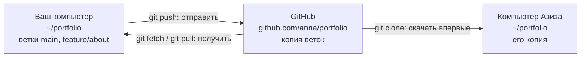
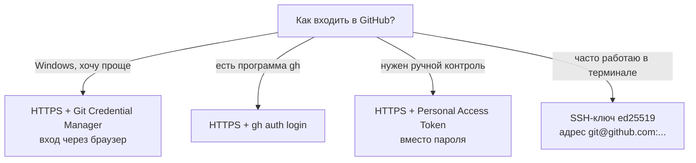
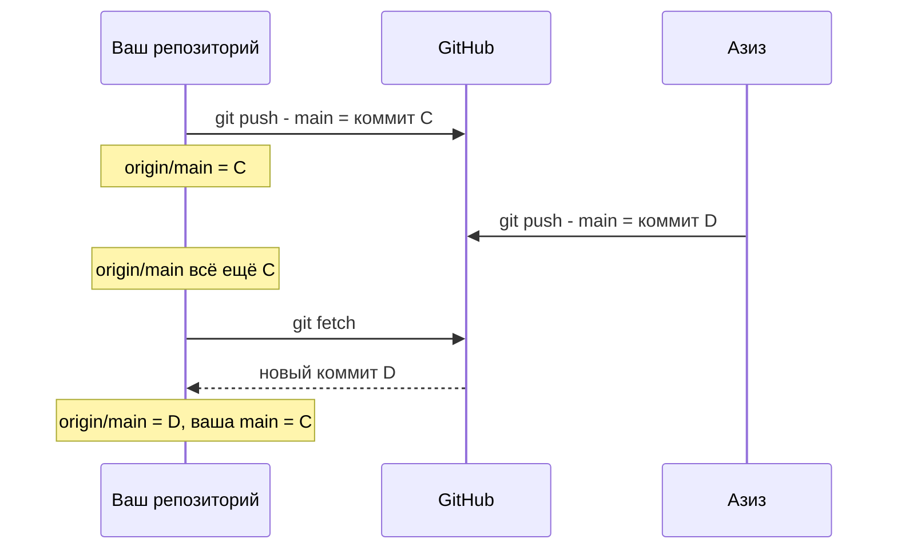
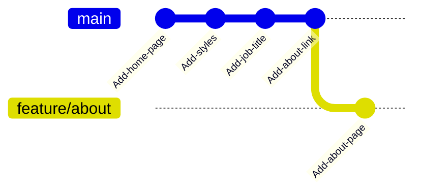

# GitHub и удалённые репозитории

[Содержание](../../README.md) · [← Назад](../../Lesson-7/ru/%D0%A1%D0%BB%D0%B8%D1%8F%D0%BD%D0%B8%D0%B5%20%D0%B8%20%D0%BA%D0%BE%D0%BD%D1%84%D0%BB%D0%B8%D0%BA%D1%82%D1%8B.md) · [Вперёд →](../../Lesson-9/ru/%D0%9A%D0%BE%D0%BC%D0%B0%D0%BD%D0%B4%D0%BD%D0%B0%D1%8F%20%D1%80%D0%B0%D0%B1%D0%BE%D1%82%D0%B0.md) · [RU](GitHub%20%D0%B8%20%D1%83%D0%B4%D0%B0%D0%BB%D1%91%D0%BD%D0%BD%D1%8B%D0%B5%20%D1%80%D0%B5%D0%BF%D0%BE%D0%B7%D0%B8%D1%82%D0%BE%D1%80%D0%B8%D0%B8.md) · [EN](../en/GitHub%20and%20remote%20repositories.md) · [UZ](../uz/GitHub%20va%20masofaviy%20repozitoriylar.md)

> **Связь с уроком 7:** вы научились сливать ветки командой `git merge`, разрешать конфликты и удалять влитые ветки. Вся история при этом жила только на вашем компьютере. Сегодня проект выйдет в интернет: вы создадите репозиторий на GitHub, отправите туда свои ветки, скачаете чужой проект и научитесь получать новые коммиты с сервера.

---

## Зачем это вам

Студентка закончила сайт-портфолио, а через неделю у ноутбука отказал диск. Все 40 коммитов, ветки и аккуратный `.gitignore` пропали вместе с ним. Её однокурсник с таким же проектом спокойно купил новый ноутбук, выполнил одну команду `git clone` - и через минуту продолжил работу с того же места. Разница одна: его репозиторий был на GitHub.

GitHub нужен не только как резервная копия. Ссылку на профиль GitHub просят на собеседовании, по нему преподаватель проверяет работы, а в команде через него обмениваются кодом. Всё это держится на трёх действиях, которые вы освоите сегодня: **отправить** (`push`), **скачать** (`clone`) и **получить новое** (`fetch`, `pull`).

---

## Чему вы научитесь

- Объяснять, что такое удалённый репозиторий и `origin`.
- Создавать репозиторий на GitHub правильно, когда локальный проект уже есть.
- Выбирать между HTTPS и SSH и входить в GitHub токеном или SSH-ключом.
- Подключать удалённый репозиторий: `git remote add`, `git remote -v`.
- Отправлять ветки командой `git push -u` и понимать, что такое upstream.
- Читать `origin/main` как «последнее известное состояние сервера» и сообщения `ahead` / `behind`.
- Скачивать чужие проекты командой `git clone`.
- Различать `git fetch` и `git pull` и узнавать частые ошибки: `No configured push destination`, `has no upstream branch`, `Repository not found`, `Authentication failed`.

---

## Повторение: 3 вопроса из урока 7

1. Чем слияние перемоткой вперёд (fast-forward) отличается от коммита слияния?
2. Что означают маркеры `<<<<<<<`, `=======` и `>>>>>>>` в файле с конфликтом?
3. Вы начали слияние, увидели десять конфликтов и передумали. Какая команда вернёт всё как было до `git merge`?

Ответы - в конце урока.

---

## План урока

| Раздел | Что делаем |
| --- | --- |
| Удалённый репозиторий | Что это, зачем, что такое `origin` |
| Репозиторий на GitHub | Регистрация, кнопка New, Public и Private, почему без README |
| Вход в GitHub | HTTPS и SSH, токен, Git Credential Manager, SSH-ключ |
| `git remote` и `git push -u` | Подключаем GitHub и отправляем `main` |
| Мини-задание 1 | Публикуем учебный сайт |
| `origin/main` и ветки | Upstream, `ahead`, отправка новой ветки |
| `git clone` | Скачиваем чужой репозиторий |
| `git fetch` и `git pull` | Получаем новые коммиты с сервера |
| Мини-задание 2 | «Второй компьютер»: clone, push, fetch, pull |
| Самостоятельная работа | Задание в учебном терминале и на компьютере |

---

## Удалённый репозиторий

**Простыми словами:** ваш локальный репозиторий - это блокнот, который лежит у вас дома. Удалённый репозиторий - его копия в **общей библиотеке**. Вы приносите туда новые страницы (`push`), а любой читатель может взять копию себе (`clone`) и потом забирать свежие страницы (`fetch`, `pull`). Блокнот дома и копия в библиотеке не синхронизируются сами: обмен происходит только тогда, когда вы идёте в библиотеку - то есть вводите команду.

**Удалённый репозиторий** (англ. remote) - это тот же репозиторий Git со всей историей, но в другом месте: на GitHub, GitLab, на сервере компании. У каждого удалённого репозитория в вашем проекте есть короткое имя. Основной по традиции называют **`origin`** («источник»).



**Как читать схему.** Стрелки - это команды, и каждая работает только в момент запуска. GitHub не «следит» за вашей папкой, как облачный диск (Google Drive, OneDrive): пока вы не выполнили `git push`, на сервере ничего не меняется. Коммиты, ветки и история работают и без интернета, а на GitHub отправляют уже готовые коммиты.

---

## Репозиторий на GitHub

### Регистрация и создание репозитория

Зарегистрируйтесь на [github.com](https://github.com) (кнопка **Sign up**). Логин станет частью адресов всех ваших проектов: `github.com/логин/проект`, поэтому выбирайте короткий и серьёзный - его увидит работодатель. Укажите тот же email, что в `git config --global user.email` (урок 1): так GitHub свяжет ваши коммиты с профилем. Сразу включите двухфакторную аутентификацию - GitHub всё равно попросит это сделать. Создание репозитория (интерфейс GitHub иногда меняется, но шаги те же):

1. Нажмите **New** на странице репозиториев (или **+** в правом верхнем углу → **New repository**).
2. **Repository name** - имя проекта латиницей, лучше как у папки: `portfolio`. **Description** - одна строка о проекте.
3. **Public** или **Private** - кто увидит репозиторий.
4. Если проект уже есть на компьютере - **не добавляйте** README, `.gitignore` и лицензию.
5. Нажмите **Create repository**.

**Public** (публичный) репозиторий видит любой человек в интернете - так делают портфолио и учебные проекты. **Private** (приватный) видите только вы и приглашённые участники - для заданий до сдачи и рабочих проектов.

> **Важно:** «публичный» означает «видно всем», а не «все могут менять». Отправлять коммиты в ваш репозиторий могут только те, кого вы добавили. Но и секреты в публичном репозитории видны всем - правила урока 5 про `.env` здесь особенно важны.

### Почему без README

**Простыми словами:** представьте, что вы принесли в библиотеку свой блокнот на 40 страниц, а библиотекарь уже завёл для вас тетрадь и написал на первой странице «Здравствуйте». Теперь это две разные тетради с разным началом, и просто вклеить ваши страницы нельзя.

Если отметить «Add README», GitHub сам сделает первый коммит. У сервера и у вас окажутся две **разные истории без общего начала**, и первый `git push` Git отклонит. Как такие истории объединяют, разберём в уроке 9, а сейчас проще не создавать их: **для существующего проекта - пустой репозиторий**. README вы напишете сами (урок 5) и отправите вместе с остальными коммитами.

После создания пустого репозитория GitHub показывает его адрес и готовые команды для существующего проекта: `git remote add origin ...`, `git branch -M main` и `git push -u origin main`. Средняя переименовывает текущую ветку в `main` (как `-m` из урока 6, но принудительно) - если вы настроили `init.defaultBranch main` в уроке 1, она ничего не изменит. Остальные две разберём ниже.

---

## Вход в GitHub: HTTPS или SSH

Читать публичный репозиторий может кто угодно, а отправлять коммиты - только владелец. Поэтому при `git push` GitHub спрашивает: «Кто вы?». Подключиться можно двумя способами, и у каждого свой вид адреса.

| | HTTPS | SSH |
| --- | --- | --- |
| Адрес | `https://github.com/anna/portfolio.git` | `git@github.com:anna/portfolio.git` |
| Чем входите | Токен, Git Credential Manager или `gh auth login` | SSH-ключ на компьютере |
| Настройка | Почти ничего: вход при первом `push` | Один раз создать ключ и добавить его на GitHub |
| Когда удобно | Новичкам, Windows, работа через прокси | Если часто работаете в терминале на своём компьютере |

> **Важно:** пароль от аккаунта GitHub для `git push` **не подходит**. GitHub перестал принимать пароли для операций Git в 2021 году. Если ввести пароль, вы получите `Authentication failed` (см. «Частые ошибки»).

### Способ 1. Git Credential Manager и `gh auth login` (проще всего)

**Git Credential Manager** (GCM) входит в установщик Git для Windows. При первом `git push` по HTTPS он откроет окно браузера: вы входите на GitHub как обычно, нажимаете «Authorize» - и GCM сам запоминает доступ. Больше вводить ничего не нужно. На macOS и Linux GCM ставится отдельно.

Второй вариант - официальная программа GitHub CLI (`gh`). Команда `gh auth login` задаёт несколько вопросов (GitHub.com, HTTPS, войти через браузер) и настраивает Git на вход через неё.

### Способ 2. Personal Access Token

**Простыми словами:** токен - это пропуск в здание вместо ключа от квартиры. Пропуск открывает только нужные двери, у него есть срок действия, и его можно в любой момент отозвать, не меняя замков.

Personal Access Token (PAT) - длинная строка вида `github_pat_...`, которую вы вводите **вместо пароля**. Где его создать (названия разделов на конец 2026 года):

1. Нажмите на свою аватарку → **Settings**.
2. Внизу левого меню - **Developer settings**.
3. **Personal access tokens** → **Fine-grained tokens** → **Generate new token**.
4. Укажите название, срок действия (Expiration), в **Repository access** выберите только нужные репозитории.
5. В разрешениях репозитория для **Contents** поставьте **Read and write** - это право на `push`.
6. Нажмите **Generate token** и сразу скопируйте токен: GitHub покажет его **только один раз**.

При следующем `git push` в поле `Username` введите логин GitHub, в поле `Password` - токен. Рядом с Fine-grained есть старый тип **Tokens (classic)** - его вы встретите в старых инструкциях; для нового проекта выбирайте fine-grained.

> **Важно:** токен - это такой же секрет, как пароль. Не вставляйте его в код, в `README.md` и в адрес репозитория, не отправляйте в чат. Утёк - удалите его в том же разделе и создайте новый.

### Способ 3. SSH-ключ

**Простыми словами:** SSH-ключ - это замок и ключ от него. **Открытый** ключ (`.pub`) - это замок: его можно отдать кому угодно, вы «вешаете» его на GitHub. **Закрытый** ключ хранится только на вашем компьютере и открывает этот замок. Пароль по сети не передаётся вообще.

Ключ создают один раз на компьютер (в Git Bash на Windows, в терминале на macOS и Linux):

```bash
ssh-keygen -t ed25519 -C "anna@example.com"
```

`-t ed25519` - современный тип ключа, `-C` - подпись, чтобы узнать ключ в списке. На вопросы о файле и пароле (passphrase) можно нажать `Enter`. В конце программа сообщит, где лежат ключи:

```text
Your identification has been saved in /home/student/.ssh/id_ed25519
Your public key has been saved in /home/student/.ssh/id_ed25519.pub
```

`~/.ssh/id_ed25519` - закрытый ключ, его не показывают никому и никогда. `~/.ssh/id_ed25519.pub` - открытый, его отдают GitHub. Дальше: `cat ~/.ssh/id_ed25519.pub`, скопируйте строку целиком (она начинается с `ssh-ed25519`), на GitHub откройте **Settings** → **SSH and GPG keys** → **New SSH key**, вставьте и сохраните. Проверка связи:

```bash
ssh -T git@github.com
```

```text
Hi anna! You've successfully authenticated, but GitHub does not provide shell access.
```

Перевод: «Привет, anna! Вы успешно вошли, но доступа к командной строке GitHub не даёт». Это и есть успех. Теперь в `git remote add` используйте SSH-адрес `git@github.com:anna/portfolio.git`. Если репозиторий уже подключён по HTTPS, адрес меняют командой `git remote set-url origin git@github.com:anna/portfolio.git`.



**Как читать схему.** Все четыре пути ведут к одному результату - `git push` работает. Выберите один способ: в учебном терминале вход не нужен, а на своём компьютере для начала проще всего HTTPS с Git Credential Manager.

---

## Подключаем GitHub: `git remote`

Вернёмся к проекту `~/portfolio` из прошлых уроков: в нём 3 коммита на `main`. На GitHub создан пустой репозиторий `https://github.com/anna/portfolio.git`. Сначала посмотрим, какие удалённые репозитории уже подключены:

```bash
git remote -v
```

Git ничего не вывел: проект пока знает только о себе. Подключим GitHub под именем `origin`:

```bash
git remote add origin https://github.com/anna/portfolio.git
git remote -v
```

```text
origin	https://github.com/anna/portfolio.git (fetch)
origin	https://github.com/anna/portfolio.git (push)
```

| Строка | Перевод и смысл |
| --- | --- |
| `origin` | Короткое имя удалённого репозитория. Дальше вместо длинного адреса пишем `origin` |
| `https://github.com/...` | Адрес, куда Git будет обращаться |
| `(fetch)` | Откуда скачивать (`fetch`, `pull`) |
| `(push)` | Куда отправлять (`push`). Обычно адрес тот же |

`git remote add` ничего не отправляет и даже не проверяет, существует ли такой адрес, - он только записывает «контакт» в настройки репозитория. Как в телефонной книге: сохранить номер ещё не значит позвонить. Ошиблись в адресе - замените его: `git remote set-url origin адрес`; отключить удалённый репозиторий - `git remote remove origin` (на GitHub при этом ничего не удаляется).

---

## Первая отправка: `git push -u`

```bash
git push -u origin main
```

```text
Enumerating objects: 9, done.
Writing objects: 100% (9/9), done.
Total 9 (delta 0), reused 0 (delta 0), pack-reused 0
To https://github.com/anna/portfolio.git
 * [new branch]      main -> main
branch 'main' set up to track 'origin/main'.
```

| Строка | Перевод и смысл |
| --- | --- |
| `Enumerating objects`, `Writing objects` | Подсчёт и отправка данных: коммиты, файлы, папки. В настоящем терминале строк прогресса больше - это нормально |
| `To https://github.com/anna/portfolio.git` | Куда отправили |
| `* [new branch]      main -> main` | На сервере создана новая ветка: ваша `main` → `main` на GitHub |
| `branch 'main' set up to track 'origin/main'.` | Ветка `main` теперь **следит** за `origin/main` - это сделал ключ `-u` |

Обновите страницу репозитория на GitHub - там появятся файлы, число коммитов и содержимое `README.md`, если он есть: GitHub показывает его под списком файлов, как обложку проекта.

### Что такое upstream

**Простыми словами:** upstream - это «адрес по умолчанию» для ветки, как сохранённый адрес доставки в интернет-магазине. Один раз указали - дальше заказы едут туда без вопросов.

Ключ `-u` (полностью `--set-upstream`) связывает локальную ветку с веткой на сервере. После этого:

| Без upstream | С upstream |
| --- | --- |
| `git push origin main` каждый раз | Просто `git push` |
| `git pull origin main` | Просто `git pull` |
| `git status` молчит о сервере | `git status` сравнивает ветку с `origin/main` |

`-u` нужен **один раз** для каждой ветки - при первой отправке. Проверим `git status`:

```bash
git status
```

```text
On branch main
Your branch is up to date with 'origin/main'.

nothing to commit, working tree clean
```

`Your branch is up to date with 'origin/main'` - «ваша ветка совпадает с `origin/main`»: всё, что есть у вас, есть и на сервере. Связи веток видно и в `git branch -vv` (два `v` - «очень подробно»): в квадратных скобках - upstream.

### Следующие отправки

Сделаем ещё один коммит на `main` и посмотрим, что скажет Git:

```bash
echo "<a href=\"about.html\">About</a>" >> index.html
git commit -am "Add link to about page"
git status
```

```text
On branch main
Your branch is ahead of 'origin/main' by 1 commit.
  (use "git push" to publish your local commits)

nothing to commit, working tree clean
```

`ahead of 'origin/main' by 1 commit` - «опережает `origin/main` на 1 коммит»: у вас есть коммит, которого нет на сервере. Git подсказывает: `git push`. Upstream уже настроен, поэтому без `-u` и без имён:

```bash
git push
```

```text
Enumerating objects: 3, done.
Writing objects: 100% (3/3), done.
Total 3 (delta 0), reused 0 (delta 0), pack-reused 0
To https://github.com/anna/portfolio.git
   eb07147..2469e79  main -> main
```

`eb07147..2469e79  main -> main` - ветка `main` на сервере передвинулась со старого коммита на новый. Если отправлять нечего, Git ответит `Everything up-to-date`.

---

## Мини-задание 1

В учебном терминале уже создан пустой репозиторий `https://github.com/student/site.git` (если терминал новый - сначала настройте имя, email и `init.defaultBranch`, как в уроке 1).

1. Создайте папку `site` с репозиторием и сделайте два коммита: `index.html` с `<h1>Hello</h1>` и `style.css` с `h1 { color: teal; }`.
2. Подключите `https://github.com/student/site.git` под именем `origin` и проверьте адрес.
3. Отправьте `main` с настройкой upstream.
4. Убедитесь через `git status`, что ветка `up to date with 'origin/main'`.
5. Посмотрите `git log --oneline` и найдите в нём `origin/main`.

---

## `origin/main`: последнее известное состояние сервера

В выводе `git log --oneline` после отправки появилась новая метка:

```text
eb07147 (HEAD -> main, origin/main) Add job title
c0adb88 Add styles
33b7941 Add home page
```

`origin/main` - это **ветка удалённого отслеживания**. Её нельзя переключить и в неё нельзя делать коммиты. Это «фотография»: в каком состоянии была ветка `main` на `origin`, когда ваш Git в последний раз общался с сервером.

**Простыми словами:** `origin/main` - как прогноз погоды, который вы посмотрели утром. Он показывает, какой была погода на момент проверки. Если днём пошёл дождь, прогноз в вашем телефоне об этом не узнает, пока вы его не обновите.



**Как читать схему.** `origin/main` обновляется только во время обмена с сервером: `push`, `fetch`, `pull`. Пока Азиз отправлял коммит `D`, ваш Git об этом не знал, и `git status` честно писал `up to date` - «совпадает с тем, что я знаю о сервере». После `git fetch` фотография обновилась.

| Сообщение `git status` | Что значит | Что делать |
| --- | --- | --- |
| `Your branch is up to date with 'origin/main'.` | Совпадает с последним известным состоянием сервера | Ничего (или `git fetch`, чтобы проверить свежесть) |
| `Your branch is ahead of 'origin/main' by 1 commit.` | У вас есть неотправленные коммиты | `git push` |
| `Your branch is behind 'origin/main' by 1 commit, and can be fast-forwarded.` | На сервере есть коммиты, которых нет у вас | `git pull` |
| `Your branch and 'origin/main' have diverged` | Новые коммиты и у вас, и на сервере | Урок 9 |
| Строки про `origin` нет | У ветки нет upstream | `git push -u origin ветка` |

### Отправляем новую ветку

Ветки, которые вы создаёте, сами на GitHub не попадают - их отправляют отдельно. Сделаем страницу «Обо мне» в своей ветке (уроки 6 и 7):

```bash
git switch -c feature/about
echo "<h1>About me</h1>" > about.html
git add about.html
git commit -m "Add about page"
git push
```

```text
fatal: The current branch feature/about has no upstream branch.
To push the current branch and set the remote as upstream, use

    git push --set-upstream origin feature/about

To have this happen automatically for branches without a tracking
upstream, see 'push.autoSetupRemote' in 'git help config'.
```

Перевод: «У текущей ветки `feature/about` нет upstream. Чтобы отправить её и сделать удалённую ветку upstream, используйте `git push --set-upstream origin feature/about`». Git не угадывает, куда отправлять новую ветку, - но сам подсказывает команду. `-u` - короткая запись `--set-upstream`:

```bash
git push -u origin feature/about
git branch -vv
```

```text
Enumerating objects: 3, done.
Writing objects: 100% (3/3), done.
Total 3 (delta 0), reused 0 (delta 0), pack-reused 0
To https://github.com/anna/portfolio.git
 * [new branch]      feature/about -> feature/about
branch 'feature/about' set up to track 'origin/feature/about'.
* feature/about 6b594be [origin/feature/about] Add about page
  main          2469e79 [origin/main] Add link to about page
```

| Строка | Перевод и смысл |
| --- | --- |
| `* [new branch]      feature/about -> feature/about` | На GitHub появилась ветка `feature/about` |
| `* feature/about 6b594be [origin/feature/about]` | Текущая ветка, её последний коммит и upstream |
| `  main          2469e79 [origin/main]` | У `main` свой upstream - `origin/main` |

Настоящий GitHub после отправки новой ветки добавит строки `remote: Create a pull request for 'feature/about' on GitHub by visiting: ...` - это ссылка на **pull request**, о нём - в уроке 9.



**Как читать схему.** Это история и у вас, и на GitHub: после двух `git push -u` сервер хранит те же коммиты и те же две ветки. `origin/main` стоит на `Add-about-link`, `origin/feature/about` - на `Add-about-page`. Хеши на сервере совпадают с вашими - это одни и те же коммиты, а не копии.

| Шаг | Команда | Ваша `main` | `origin/main` у вас | `main` на GitHub | Ветки на GitHub |
| --- | --- | --- | --- | --- | --- |
| 1 | (исходно) | `eb07147` | нет | нет | нет |
| 2 | `git push -u origin main` | `eb07147` | `eb07147` | `eb07147` | `main` |
| 3 | `git commit -am "Add link..."` | `2469e79` | `eb07147` | `eb07147` | `main` |
| 4 | `git push` | `2469e79` | `2469e79` | `2469e79` | `main` |
| 5 | `git push -u origin feature/about` | `2469e79` | `2469e79` | `2469e79` | `main`, `feature/about` |

---

## `git clone`: скачать репозиторий

Ваш однокурсник Азиз ведёт конспект по Git в публичном репозитории `https://github.com/aziz/notes.git`. Чтобы получить его целиком - с файлами, историей и ветками, - нужен `git clone`. Клонируют из той папки, **где должна появиться** новая папка проекта, обычно из домашней, а не изнутри другого репозитория:

```bash
cd ~
git clone https://github.com/aziz/notes.git
```

```text
Cloning into 'notes'...
```

`Cloning into 'notes'...` - «Клонирую в папку `notes`». Имя папки Git взял из адреса (без `.git`). В настоящем терминале дальше будут строки прогресса `remote: Enumerating objects...` и `Receiving objects: 100%` - это скачивание. Свою папку можно указать вторым словом: `git clone https://github.com/aziz/notes.git git-notes`.

```bash
cd notes
ls
git log --oneline
git remote -v
```

```text
git.md  README.md
a6e8804 (HEAD -> main, origin/main) Add git log
00e5b04 Add git commands
44bf262 Add README
origin	https://github.com/aziz/notes.git (fetch)
origin	https://github.com/aziz/notes.git (push)
```

`git clone` за один раз сделал всё, что вы делали вручную в прошлых разделах:

| Что сделал `git clone` | Как это делали бы вручную |
| --- | --- |
| Создал папку `notes` и репозиторий в ней | `mkdir notes && cd notes && git init` |
| Подключил `origin` | `git remote add origin https://github.com/aziz/notes.git` |
| Скачал все коммиты и ветки | `git fetch` |
| Создал ветку `main` с upstream `origin/main` | `git switch main` после скачивания |
| Положил файлы последнего коммита в папку | - |

**Простыми словами:** `git init` - завести новую пустую тетрадь, `git clone` - сделать полную ксерокопию чужой тетради вместе со всеми черновиками.

> **Важно:** склонировать публичный репозиторий может любой, а отправить в него коммиты - только Азиз и те, кого он пригласил. Чтобы предложить ему исправление, на GitHub делают **fork** (свою копию) и **pull request** - это урок 9.

---

## `git fetch` и `git pull`: получить новое

Азиз дописал конспект и отправил коммит `Add git push`. У вас в `~/notes` пока старая версия - и Git об этом не знает: `git status` по-прежнему отвечает `Your branch is up to date with 'origin/main'`, но по устаревшей «фотографии». Обновим её командой `git fetch` («принести»):

```bash
git fetch
git status
```

```text
From https://github.com/aziz/notes
   a6e8804..5bf6c1f  main       -> origin/main
On branch main
Your branch is behind 'origin/main' by 1 commit, and can be fast-forwarded.
  (use "git pull" to update your local branch)

nothing to commit, working tree clean
```

| Строка | Перевод и смысл |
| --- | --- |
| `From https://github.com/aziz/notes` | Откуда скачано |
| `a6e8804..5bf6c1f  main -> origin/main` | `origin/main` передвинута на новый коммит. Ваша `main` и файлы - не тронуты |
| `behind 'origin/main' by 1 commit` | Вы отстаёте от сервера на 1 коммит |
| `can be fast-forwarded` | Можно просто перемотать вперёд, без слияния (урок 7) |

`git fetch` безопасен: он только скачивает и обновляет `origin/...`. Посмотреть, что пришло, можно до того, как что-то менять у себя: `git log --oneline --all` покажет новый коммит с меткой `(origin/main)` выше вашей `main`. Теперь забираем изменения в свою ветку:

```bash
git pull
```

```text
Updating a6e8804..5bf6c1f
Fast-forward
 git.md | 1 +
 1 file changed, 1 insertion(+)
```

`Updating ... Fast-forward` - знакомая по уроку 7 перемотка: ваша `main` передвинулась на коммит Азиза, в `git.md` появилась новая строка. Если на сервере ничего нового, `git pull` ответит `Already up to date.`

**Простыми словами:** `git fetch` - заглянуть в почтовый ящик и забрать письма на стол. `git pull` - забрать письма и сразу разложить их по папкам. Сначала посмотреть - всегда безопаснее. То есть `git pull` = `git fetch` + слияние `origin/main` в текущую ветку; без предварительного `fetch` он сначала напечатает строки `From ...`, а потом `Updating ... Fast-forward`.

| Шаг | Команда | Ваша `main` | `origin/main` у вас | `main` на GitHub | Файлы в папке |
| --- | --- | --- | --- | --- | --- |
| 1 | `git clone ...` | `a6e8804` | `a6e8804` | `a6e8804` | версия `a6e8804` |
| 2 | (Азиз: `git push`) | `a6e8804` | `a6e8804` | `5bf6c1f` | версия `a6e8804` |
| 3 | `git status` | `a6e8804` | `a6e8804` | `5bf6c1f` | `up to date` - устаревшие сведения |
| 4 | `git fetch` | `a6e8804` | `5bf6c1f` | `5bf6c1f` | не изменились |
| 5 | `git status` | `a6e8804` | `5bf6c1f` | `5bf6c1f` | `behind ... by 1 commit` |
| 6 | `git pull` | `5bf6c1f` | `5bf6c1f` | `5bf6c1f` | новая строка в `git.md` |

> **Важно:** перед `git pull` закоммитьте или уберите свои изменения: `git status` должен быть чистым. Если и у вас, и на сервере появились новые коммиты, Git 2.56 откажется делать `pull` с ошибкой `fatal: Need to specify how to reconcile divergent branches.` - как с этим работать, разберём в уроке 9.

---

### Попробуйте сломать

1. В новом репозитории без `git remote add` выполните `git push`. Что ответит Git?
2. Подключите `origin`, а потом выполните `git remote add origin ...` второй раз.
3. Отправьте ветку, которой нет: `git push -u origin master`.
4. Подключите адрес с опечаткой (`git remote add typo https://github.com/student/sit.git`) и выполните `git push typo main`.
5. Создайте ветку, сделайте в ней коммит и отправьте её просто `git push`. Найдите в ответе подсказку Git.

### Частые ошибки новичков

| Ошибка | Что получится | Как исправить |
| --- | --- | --- |
| `git push` без `git remote add` | `fatal: No configured push destination.` | `git remote add origin адрес`, затем `git push -u origin main` |
| Первая отправка новой ветки просто `git push` | `fatal: The current branch feature/about has no upstream branch.` | `git push -u origin feature/about` |
| Отправляете `master`, а ветка называется `main` (или в репозитории нет ни одного коммита) | `error: src refspec master does not match any` | Проверить `git branch`; сделать хотя бы один коммит; отправлять правильное имя |
| Опечатка в адресе или репозиторий не создан / приватный чужой | `remote: Repository not found.` | `git remote -v`, исправить: `git remote set-url origin адрес` |
| В поле `Password` ввели пароль от GitHub | `remote: Support for password authentication was removed on August 13, 2021.` и `fatal: Authentication failed for 'https://github.com/anna/portfolio.git/'` | Токен вместо пароля, Git Credential Manager или `gh auth login`; либо SSH-ключ |
| Создали репозиторий на GitHub с README и делаете первый `push` | `! [rejected] main -> main (fetch first)` | Для существующего проекта создавать пустой репозиторий; если уже создали - урок 9 |
| `git clone` внутри папки другого проекта | Репозиторий в репозитории, `git status` внешнего показывает папку как `Untracked` | Клонировать из домашней папки: `cd ~` |
| Повторный `git clone` в ту же папку | `fatal: destination path 'notes' already exists and is not an empty directory.` | Проект уже скачан: `cd notes && git pull` |

---

## Мини-задание 2

Представьте, что у вас второй компьютер. Продолжите в учебном терминале после мини-задания 1:

1. Вернитесь в домашнюю папку и склонируйте `https://github.com/student/site.git` в папку `site-copy`.
2. В `site-copy` допишите в `index.html` строку `<p>Welcome!</p>`, сделайте коммит и отправьте его.
3. Перейдите в `~/site` и посмотрите `git status`. Почему Git пишет `up to date`?
4. Выполните `git fetch`, снова `git status` и `git log --oneline --all`.
5. Заберите изменения командой `git pull` и убедитесь через `cat index.html`, что строка появилась.

---

## Итоги урока: шпаргалка

| Задача | Команда |
| --- | --- |
| Подключить удалённый репозиторий | `git remote add origin адрес` |
| Посмотреть подключённые и адреса | `git remote -v` |
| Сменить адрес | `git remote set-url origin адрес` |
| Первая отправка ветки + upstream | `git push -u origin main` |
| Следующие отправки | `git push` |
| Отправить новую ветку | `git push -u origin feature/about` |
| Ветки и их upstream | `git branch -vv` |
| Сравнить с сервером | `git status` (`ahead`, `behind`, `up to date`) |
| Скачать репозиторий | `git clone адрес` (из домашней папки) |
| Скачать новые коммиты, файлы не трогать | `git fetch` |
| Скачать и влить в текущую ветку | `git pull` |
| Создать SSH-ключ | `ssh-keygen -t ed25519 -C "email"` |
| Проверить SSH-доступ к GitHub | `ssh -T git@github.com` |

---

## Самостоятельная работа

### Часть 1. Задание в IDE (засчитывается платформой)

Вы в папке `~/portfolio` на ветке `main`, в истории 3 коммита. На «GitHub» создан пустой репозиторий `https://github.com/anna/portfolio.git`, а у вашего однокурсника Азиза есть репозиторий `https://github.com/aziz/notes.git` с конспектом по Git. Напишите команды по одной на строке:

1. Подключите удалённый репозиторий `https://github.com/anna/portfolio.git` под именем `origin` и проверьте список удалённых репозиториев (`git remote -v`).
2. Отправьте ветку `main` на GitHub так, чтобы `origin/main` стала её upstream.
3. Выполните `git status` и убедитесь, что ветка `up to date with 'origin/main'`.
4. Создайте ветку `feature/about` и перейдите в неё, создайте файл `about.html` с текстом `<h1>About me</h1>` и закоммитьте его.
5. Отправьте ветку `feature/about` на GitHub с upstream `origin/feature/about`.
6. Вернитесь в домашнюю папку и клонируйте `https://github.com/aziz/notes.git`.
7. Перейдите в папку `notes`, посмотрите историю (`git log --oneline`) и удалённые репозитории.

В итоге история `main` на сервере совпадает с вашей, на сервере ветки `main` и `feature/about`, у обеих веток настроен upstream, а в `~/notes` - копия репозитория Азиза со всей историей.

Что проверяет платформа: что `origin` в `~/portfolio` указывает на нужный адрес и выполнена `git remote -v`; что на сервере ровно ветки `main` и `feature/about`, а история `main` на сервере совпадает с локальной коммит в коммит; что `main` не изменилась, а в `feature/about` - один коммит с `about.html`, который тоже есть на сервере; что upstream `main` - `origin/main`, а `feature/about` - `origin/feature/about`; что `git status` после отправки показала `up to date`; что `~/notes` - клон репозитория Азиза с его историей и `origin`, и вы посмотрели его историю; что решение работает и на другой локальной истории; что сценарий выполняется без ошибок. В какой папке вы закончите, неважно.

### Часть 2. Проект на компьютере

1. Зарегистрируйтесь на GitHub (если ещё нет аккаунта) и создайте **пустой** публичный репозиторий для своего сайта из урока 1 - без README, `.gitignore` и лицензии.
2. Выберите способ входа: HTTPS с Git Credential Manager (или токеном), либо создайте SSH-ключ `ssh-keygen -t ed25519`, добавьте его на GitHub и проверьте `ssh -T git@github.com`.
3. В папке сайта выполните `git remote add origin ...`, `git push -u origin main` и отправьте с `-u` хотя бы одну свою ветку из уроков 6–7. Откройте репозиторий на GitHub и найдите там коммиты, ветки и `README.md`.
4. Склонируйте свой же репозиторий в другую папку (`git clone адрес site-copy`), сделайте в копии коммит и `git push`, затем в основной папке выполните `git fetch`, `git status` и `git pull`.
5. Если в каком-то репозитории на GitHub случайно оказался секрет - смените его (урок 5): удаление из следующих коммитов не помогает.

### Критерии готовности

- [ ] Задание в IDE засчитано.
- [ ] Ваш сайт есть на GitHub, история там совпадает с `git log --oneline` на компьютере.
- [ ] `git status` в папке сайта показывает `Your branch is up to date with 'origin/main'`.
- [ ] `git branch -vv` показывает upstream в квадратных скобках у `main` и у отправленной ветки.
- [ ] Вы можете объяснить, чем `git fetch` отличается от `git pull` и что такое `origin/main`.

---

## Вопросы для самопроверки

1. Что такое удалённый репозиторий и что означает имя `origin`?
2. Почему для существующего проекта репозиторий на GitHub создают без README?
3. Чем публичный репозиторий отличается от приватного? Может ли незнакомец отправить коммит в ваш публичный репозиторий?
4. Чем HTTPS-адрес отличается от SSH-адреса? Почему пароль от GitHub не подходит для `git push`?
5. Что делает `git remote add` и что он **не** делает?
6. Что делает ключ `-u` в `git push -u origin main`? Что такое upstream?
7. Что показывает `origin/main` и когда эта метка обновляется?
8. Что значат сообщения `ahead of 'origin/main' by 1 commit` и `behind 'origin/main' by 1 commit`?
9. Что делает `git clone`, кроме скачивания файлов? Из какой папки его запускать?
10. Чем `git fetch` отличается от `git pull`?

После вопросов пройдите **тест урока** на платформе: 12 вопросов, порог 70%.

---

## Что дальше

Теперь ваш проект живёт на GitHub, и вы умеете получать чужие изменения. Пока всё шло гладко: новые коммиты появлялись только с одной стороны. В уроке 9 вы начнёте по-настоящему работать в команде: GitHub Flow, pull request и ревью кода, отклонённый `push`, когда товарищ успел раньше вас, расхождение веток, `git pull --rebase` и `git stash`.

---

## Ответы

**Повторение**

1. Перемотка вперёд просто передвигает указатель ветки, если в ней не было своих новых коммитов, - новый коммит не создаётся. Коммит слияния - отдельный коммит с двумя родителями, когда обе ветки ушли вперёд (или при `--no-ff`).
2. Между `<<<<<<<` и `=======` - версия текущей ветки (`HEAD`), между `=======` и `>>>>>>>` - версия вливаемой ветки. Маркеры нужно удалить, оставив правильный текст.
3. `git merge --abort`.

**Мини-задание 1**

```bash
git config --global user.name "Anna Karimova"
git config --global user.email "anna@example.com"
git config --global init.defaultBranch main
mkdir site && cd site && git init
echo "<h1>Hello</h1>" > index.html
git add . && git commit -m "Add home page"
echo "h1 { color: teal; }" > style.css
git add . && git commit -m "Add styles"
git remote add origin https://github.com/student/site.git
git remote -v
git push -u origin main
git status
git log --oneline
```

**Мини-задание 2**

```bash
cd ~
git clone https://github.com/student/site.git site-copy
cd site-copy
echo "<p>Welcome!</p>" >> index.html
git commit -am "Add welcome text"
git push
cd ~/site
git status
git fetch
git status
git log --oneline --all
git pull
cat index.html
```

В шаге 3 Git пишет `up to date`, потому что сравнивает `main` с `origin/main` - последним известным ему состоянием сервера. О новом коммите из `site-copy` он узнает только после `git fetch`.

**Вопросы для самопроверки**

1. Копия репозитория со всей историей на другом компьютере или сервере (GitHub). `origin` - принятое короткое имя основного удалённого репозитория.
2. Иначе GitHub создаст свой первый коммит, у сервера и у вас будут разные истории, и первый `push` отклонят.
3. Публичный видят все, приватный - только вы и приглашённые. Отправлять коммиты в оба могут только приглашённые участники.
4. HTTPS - `https://github.com/...`, вход токеном, через Git Credential Manager или `gh auth login`; SSH - `git@github.com:...`, вход ключом. Пароли для операций Git GitHub не принимает с 2021 года.
5. Записывает имя и адрес удалённого репозитория в настройки. Ничего не отправляет и не проверяет адрес.
6. Связывает локальную ветку с веткой на сервере (upstream). После этого `git push`, `git pull` работают без аргументов, а `git status` сравнивает ветку с сервером.
7. Последнее известное состояние ветки `main` на сервере. Обновляется только при `push`, `fetch`, `pull`.
8. `ahead` - у вас есть неотправленные коммиты, нужен `git push`. `behind` - на сервере есть коммиты, которых нет у вас, нужен `git pull`.
9. Создаёт папку и репозиторий, подключает `origin`, скачивает всю историю, создаёт `main` с upstream `origin/main`. Запускать из папки, где должна появиться папка проекта (обычно `~`), а не внутри другого репозитория.
10. `git fetch` только скачивает новые коммиты и обновляет `origin/...`, не трогая ваши ветки и файлы. `git pull` = `git fetch` + слияние в текущую ветку.

---

[Содержание](../../README.md) · [← Назад](../../Lesson-7/ru/%D0%A1%D0%BB%D0%B8%D1%8F%D0%BD%D0%B8%D0%B5%20%D0%B8%20%D0%BA%D0%BE%D0%BD%D1%84%D0%BB%D0%B8%D0%BA%D1%82%D1%8B.md) · [Вперёд →](../../Lesson-9/ru/%D0%9A%D0%BE%D0%BC%D0%B0%D0%BD%D0%B4%D0%BD%D0%B0%D1%8F%20%D1%80%D0%B0%D0%B1%D0%BE%D1%82%D0%B0.md) · [RU](GitHub%20%D0%B8%20%D1%83%D0%B4%D0%B0%D0%BB%D1%91%D0%BD%D0%BD%D1%8B%D0%B5%20%D1%80%D0%B5%D0%BF%D0%BE%D0%B7%D0%B8%D1%82%D0%BE%D1%80%D0%B8%D0%B8.md) · [EN](../en/GitHub%20and%20remote%20repositories.md) · [UZ](../uz/GitHub%20va%20masofaviy%20repozitoriylar.md)
