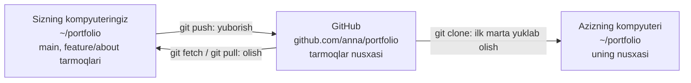
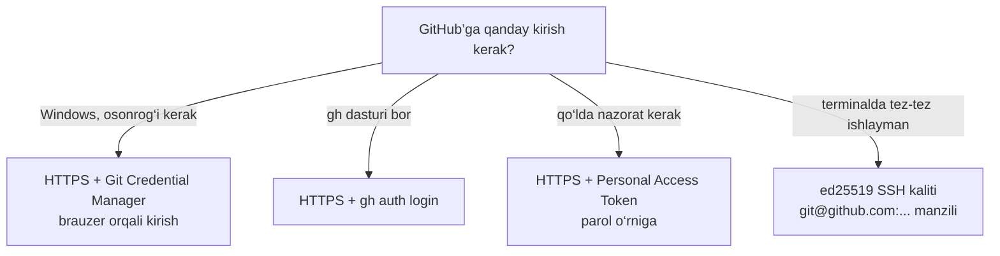
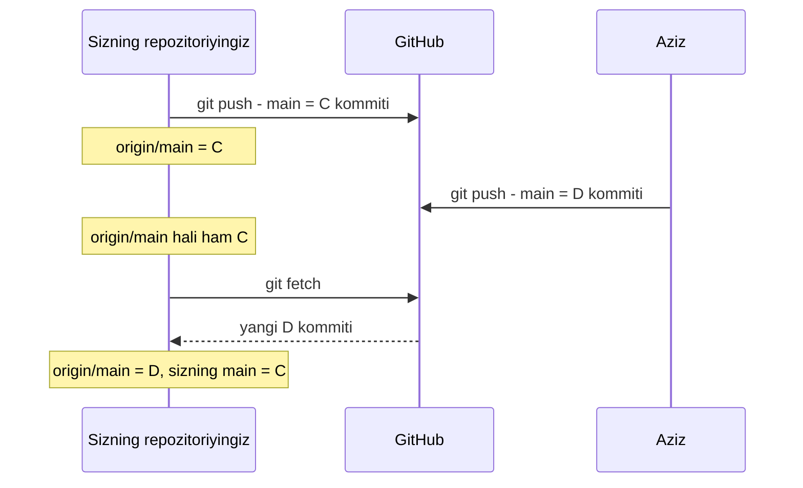
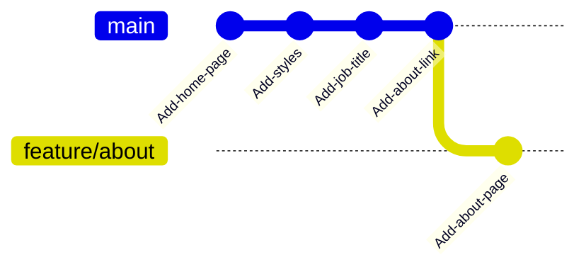

# GitHub va masofaviy repozitoriylar

[Mundarija](../../README.md) · [← Orqaga](../../Lesson-7/uz/Birlashtirish%20va%20konfliktlar.md) · [Keyingi →](../../Lesson-9/uz/Jamoada%20ishlash.md) · [RU](../ru/GitHub%20%D0%B8%20%D1%83%D0%B4%D0%B0%D0%BB%D1%91%D0%BD%D0%BD%D1%8B%D0%B5%20%D1%80%D0%B5%D0%BF%D0%BE%D0%B7%D0%B8%D1%82%D0%BE%D1%80%D0%B8%D0%B8.md) · [EN](../en/GitHub%20and%20remote%20repositories.md) · [UZ](GitHub%20va%20masofaviy%20repozitoriylar.md)

> **7-dars bilan bog‘liqlik:** siz `git merge` buyrug‘i bilan tarmoqlarni birlashtirishni, konfliktlarni hal qilishni va birlashtirilgan tarmoqlarni o‘chirishni o‘rgandingiz. Bunda butun tarix faqat kompyuteringizda yashardi. Bugun loyiha internetga chiqadi: siz GitHub’da repozitoriy yaratasiz, tarmoqlaringizni u yerga yuborasiz, birovning loyihasini yuklab olasiz va serverdan yangi kommitlarni olishni o‘rganasiz.

---

## Bu sizga nima uchun kerak

Bir talaba qiz portfolio saytini tugatdi, bir haftadan keyin esa noutbukining diski ishdan chiqdi. Barcha 40 ta kommit, tarmoqlar va puxta yozilgan `.gitignore` disk bilan birga yo‘qoldi. Xuddi shunday loyihasi bo‘lgan kursdoshi esa bemalol yangi noutbuk sotib oldi, bitta `git clone` buyrug‘ini bajardi - va bir daqiqadan keyin ishni o‘sha joyidan davom ettirdi. Farq bitta: uning repozitoriysi GitHub’da edi.

GitHub faqat zaxira nusxa uchun kerak emas. Ish suhbatida GitHub profilingizga havolani so‘rashadi, o‘qituvchi u orqali ishlarni tekshiradi, jamoada esa u orqali kod almashishadi. Bularning barchasi bugun o‘zlashtiradigan uchta amalga tayanadi: **yuborish** (`push`), **yuklab olish** (`clone`) va **yangilarini olish** (`fetch`, `pull`).

---

## Nimani o‘rganasiz

- Masofaviy repozitoriy va `origin` nima ekanini tushuntirish.
- Lokal loyiha allaqachon mavjud bo‘lganda GitHub’da repozitoriyni to‘g‘ri yaratish.
- HTTPS va SSH orasidan tanlash hamda GitHub’ga token yoki SSH kaliti bilan kirish.
- Masofaviy repozitoriyni ulash: `git remote add`, `git remote -v`.
- Tarmoqlarni `git push -u` buyrug‘i bilan yuborish va upstream nima ekanini tushunish.
- `origin/main` ni «serverning oxirgi ma’lum holati» deb o‘qish hamda `ahead` / `behind` xabarlarini tushunish.
- Boshqalarning loyihalarini `git clone` buyrug‘i bilan yuklab olish.
- `git fetch` va `git pull` ni farqlash hamda tipik xatolarni tanish: `No configured push destination`, `has no upstream branch`, `Repository not found`, `Authentication failed`.

---

## Takrorlash: 7-darsdan 3 savol

1. Oldinga o‘tkazish (fast-forward) orqali birlashtirish birlashtirish kommitidan nimasi bilan farq qiladi?
2. Konfliktli fayldagi `<<<<<<<`, `=======` va `>>>>>>>` belgilari nimani bildiradi?
3. Siz birlashtirishni boshladingiz, o‘nta konfliktni ko‘rdingiz va fikringizdan qaytdingiz. Qaysi buyruq hammasini `git merge` dan oldingi holatga qaytaradi?

Javoblar - dars oxirida.

---

## Reja

| Bo‘lim | Nima qilamiz |
| --- | --- |
| Masofaviy repozitoriy | Bu nima, nima uchun kerak, `origin` nima |
| GitHub’dagi repozitoriy | Ro‘yxatdan o‘tish, New tugmasi, Public va Private, nega README’siz |
| GitHub’ga kirish | HTTPS va SSH, token, Git Credential Manager, SSH kaliti |
| `git remote` va `git push -u` | GitHub’ni ulaymiz va `main` ni yuboramiz |
| Mini-topshiriq 1 | O‘quv saytini e’lon qilamiz |
| `origin/main` va tarmoqlar | Upstream, `ahead`, yangi tarmoqni yuborish |
| `git clone` | Birovning repozitoriysini yuklab olamiz |
| `git fetch` va `git pull` | Serverdan yangi kommitlarni olamiz |
| Mini-topshiriq 2 | «Ikkinchi kompyuter»: clone, push, fetch, pull |
| Mustaqil ish | O‘quv terminalida va kompyuterda topshiriq |

---

## Masofaviy repozitoriy

**Oddiy so‘z bilan:** lokal repozitoriyingiz - uyingizda turgan daftar. Masofaviy repozitoriy - uning **umumiy kutubxonadagi** nusxasi. Siz u yerga yangi sahifalarni olib borasiz (`push`), istalgan o‘quvchi esa o‘ziga nusxa olishi (`clone`) va keyin yangi sahifalarni olib turishi (`fetch`, `pull`) mumkin. Uydagi daftar va kutubxonadagi nusxa o‘z-o‘zidan sinxronlanmaydi: almashish faqat siz kutubxonaga borganingizda - ya’ni buyruq kiritganingizda bo‘ladi.

**Masofaviy repozitoriy** (ingl. remote) - bu butun tarixi bilan o‘sha Git repozitoriysi, faqat boshqa joyda: GitHub’da, GitLab’da, kompaniya serverida. Loyihangizdagi har bir masofaviy repozitoriyning qisqa nomi bor. Asosiysini an’anaga ko‘ra **`origin`** («manba») deb atashadi.



**Sxemani qanday o‘qish kerak.** Strelkalar - bu buyruqlar va har biri faqat ishga tushirilgan paytda ishlaydi. GitHub bulutli disk (Google Drive, OneDrive) kabi papkangizni «kuzatib turmaydi»: siz `git push` ni bajarmaguningizcha serverda hech narsa o‘zgarmaydi. Kommitlar, tarmoqlar va tarix internetsiz ham ishlaydi, GitHub’ga esa tayyor kommitlar yuboriladi.

---

## GitHub’dagi repozitoriy

### Ro‘yxatdan o‘tish va repozitoriy yaratish

[github.com](https://github.com) saytida ro‘yxatdan o‘ting (**Sign up** (Ro‘yxatdan o‘tish) tugmasi). Login barcha loyihalaringiz manzilining bir qismi bo‘ladi: `github.com/login/loyiha`, shuning uchun qisqa va jiddiy login tanlang - uni ish beruvchi ko‘radi. `git config --global user.email` dagi emailni ko‘rsating (1-dars): shunda GitHub kommitlaringizni profilingizga bog‘laydi. Ikki bosqichli autentifikatsiyani darhol yoqing - GitHub baribir buni so‘raydi. Repozitoriy yaratish (GitHub interfeysi ba’zan o‘zgaradi, lekin qadamlar o‘sha):

1. Repozitoriylar sahifasida **New** (Yangi) tugmasini bosing (yoki o‘ng yuqori burchakdagi **+** → **New repository** (Yangi repozitoriy)).
2. **Repository name** (repozitoriy nomi) - loyiha nomi lotin harflarida, yaxshisi papka nomi bilan bir xil: `portfolio`. **Description** (tavsif) - loyiha haqida bir qator.
3. **Public** (ochiq) yoki **Private** (yopiq) - repozitoriyni kim ko‘radi.
4. Agar loyiha kompyuterda allaqachon bo‘lsa - README, `.gitignore` va litsenziyani **qo‘shmang**.
5. **Create repository** (Repozitoriy yaratish) tugmasini bosing.

**Public** (ochiq) repozitoriyni internetdagi istalgan odam ko‘radi - portfolio va o‘quv loyihalari shunday qilinadi. **Private** (yopiq) repozitoriyni faqat siz va taklif qilingan ishtirokchilar ko‘radi - topshirilmagan vazifalar va ishchi loyihalar uchun.

> **Muhim:** «ochiq» degani «hammaga ko‘rinadi», «hamma o‘zgartira oladi» emas. Repozitoriyingizga kommitlarni faqat siz qo‘shgan odamlar yubora oladi. Lekin ochiq repozitoriydagi sirlar ham hammaga ko‘rinadi - 5-darsdagi `.env` haqidagi qoidalar bu yerda ayniqsa muhim.

### Nega README’siz

**Oddiy so‘z bilan:** tasavvur qiling, siz kutubxonaga 40 sahifali daftaringizni olib keldingiz, kutubxonachi esa siz uchun allaqachon daftar ochib, uning birinchi sahifasiga «Assalomu alaykum» deb yozib qo‘ygan. Endi bu boshlanishi har xil bo‘lgan ikki xil daftar va sahifalaringizni shunchaki yopishtirib qo‘yib bo‘lmaydi.

Agar «Add README» (README qo‘shish) belgilansa, GitHub birinchi kommitni o‘zi yaratadi. Serverda va sizda **umumiy boshlanishi yo‘q ikki xil tarix** paydo bo‘ladi va Git birinchi `git push` ni rad etadi. Bunday tarixlar qanday birlashtirilishini 9-darsda ko‘rib chiqamiz, hozircha esa ularni yaratmagan ma’qul: **mavjud loyiha uchun - bo‘sh repozitoriy**. README’ni o‘zingiz yozasiz (5-dars) va boshqa kommitlar bilan birga yuborasiz.

Bo‘sh repozitoriy yaratilgandan keyin GitHub uning manzilini va mavjud loyiha uchun tayyor buyruqlarni ko‘rsatadi: `git remote add origin ...`, `git branch -M main` va `git push -u origin main`. O‘rtadagisi joriy tarmoqni `main` deb qayta nomlaydi (6-darsdagi `-m` kabi, lekin majburan) - agar 1-darsda `init.defaultBranch main` ni sozlagan bo‘lsangiz, u hech narsani o‘zgartirmaydi. Qolgan ikkitasini quyida ko‘rib chiqamiz.

---

## GitHub’ga kirish: HTTPS yoki SSH

Ochiq repozitoriyni istalgan kishi o‘qiy oladi, kommit yuborishni esa faqat egasi. Shuning uchun `git push` paytida GitHub «Siz kimsiz?» deb so‘raydi. Ulanishning ikki usuli bor va har birining o‘z manzil ko‘rinishi bor.

| | HTTPS | SSH |
| --- | --- | --- |
| Manzil | `https://github.com/anna/portfolio.git` | `git@github.com:anna/portfolio.git` |
| Nima bilan kirasiz | Token, Git Credential Manager yoki `gh auth login` | Kompyuterdagi SSH kaliti |
| Sozlash | Deyarli hech narsa: birinchi `push` da kirasiz | Bir marta kalit yaratib, uni GitHub’ga qo‘shish |
| Qachon qulay | Yangi o‘rganuvchilarga, Windows’da, proksi orqali ishlaganda | O‘z kompyuteringizda terminalda tez-tez ishlasangiz |

> **Muhim:** GitHub akkauntingiz paroli `git push` uchun **yaramaydi**. GitHub 2021-yilda Git amallari uchun parollarni qabul qilishni to‘xtatgan. Parol kiritsangiz, `Authentication failed` xatosini olasiz («Tipik xatolar» bo‘limiga qarang).

### 1-usul. Git Credential Manager va `gh auth login` (eng osoni)

**Git Credential Manager** (GCM) Windows uchun Git o‘rnatuvchisi tarkibiga kiradi. HTTPS orqali birinchi `git push` da u brauzer oynasini ochadi: siz GitHub’ga odatdagidek kirasiz, «Authorize» (Ruxsat berish) tugmasini bosasiz - va GCM kirish huquqini o‘zi eslab qoladi. Boshqa hech narsa kiritish shart emas. macOS va Linux’da GCM alohida o‘rnatiladi.

Ikkinchi variant - GitHub’ning rasmiy dasturi GitHub CLI (`gh`). `gh auth login` buyrug‘i bir nechta savol beradi (GitHub.com, HTTPS, brauzer orqali kirish) va Git’ni u orqali kiradigan qilib sozlaydi.

### 2-usul. Personal Access Token

**Oddiy so‘z bilan:** token - kvartira kaliti o‘rniga binoga kirish ruxsatnomasi. Ruxsatnoma faqat kerakli eshiklarni ochadi, uning amal qilish muddati bor va uni istalgan payt qulflarni almashtirmasdan bekor qilish mumkin.

Personal Access Token (PAT, shaxsiy kirish tokeni) - `github_pat_...` ko‘rinishidagi uzun qator, uni **parol o‘rniga** kiritasiz. Uni qayerda yaratish mumkin (bo‘limlar nomi 2026-yil oxiridagi holatda):

1. Avataringizni bosing → **Settings** (Sozlamalar).
2. Chap menyuning pastida - **Developer settings** (Dasturchi sozlamalari).
3. **Personal access tokens** (Shaxsiy kirish tokenlari) → **Fine-grained tokens** (Aniq sozlanadigan tokenlar) → **Generate new token** (Yangi token yaratish).
4. Nomini, amal qilish muddatini (Expiration) ko‘rsating, **Repository access** (Repozitoriylarga kirish) bo‘limida faqat kerakli repozitoriylarni tanlang.
5. Repozitoriy ruxsatlarida **Contents** (Tarkib) uchun **Read and write** (O‘qish va yozish) ni qo‘ying - bu `push` huquqi.
6. **Generate token** tugmasini bosing va tokenni darhol nusxalang: GitHub uni **faqat bir marta** ko‘rsatadi.

Keyingi `git push` da `Username` maydoniga GitHub loginini, `Password` maydoniga esa tokenni kiriting. Fine-grained yonida eski **Tokens (classic)** (klassik tokenlar) turi bor - uni eski yo‘riqnomalarda uchratasiz; yangi loyiha uchun fine-grained’ni tanlang.

> **Muhim:** token - parol kabi sir. Uni kodga, `README.md` ga va repozitoriy manziliga qo‘ymang, chatga yubormang. Tarqalib ketsa - o‘sha bo‘limda uni o‘chiring va yangisini yarating.

### 3-usul. SSH kaliti

**Oddiy so‘z bilan:** SSH kaliti - qulf va uning kaliti. **Ochiq** kalit (`.pub`) - bu qulf: uni istalgan kishiga berish mumkin, siz uni GitHub’ga «osib qo‘yasiz». **Yopiq** kalit faqat kompyuteringizda saqlanadi va shu qulfni ochadi. Parol tarmoq orqali umuman uzatilmaydi.

Kalit har bir kompyuter uchun bir marta yaratiladi (Windows’da Git Bash’da, macOS va Linux’da terminalda):

```bash
ssh-keygen -t ed25519 -C "anna@example.com"
```

`-t ed25519` - kalitning zamonaviy turi, `-C` - kalitni ro‘yxatda tanib olish uchun imzo. Fayl va parol (passphrase) haqidagi savollarga `Enter` ni bosish mumkin. Oxirida dastur kalitlar qayerda saqlanganini aytadi:

```text
Your identification has been saved in /home/student/.ssh/id_ed25519
Your public key has been saved in /home/student/.ssh/id_ed25519.pub
```

`~/.ssh/id_ed25519` - yopiq kalit, uni hech qachon hech kimga ko‘rsatmaysiz. `~/.ssh/id_ed25519.pub` - ochiq kalit, uni GitHub’ga berasiz. Keyin: `cat ~/.ssh/id_ed25519.pub`, qatorni to‘liq nusxalang (u `ssh-ed25519` bilan boshlanadi), GitHub’da **Settings** → **SSH and GPG keys** (SSH va GPG kalitlari) → **New SSH key** (Yangi SSH kaliti) ni oching, joylashtiring va saqlang. Aloqani tekshirish:

```bash
ssh -T git@github.com
```

```text
Hi anna! You've successfully authenticated, but GitHub does not provide shell access.
```

Tarjimasi: «Salom, anna! Siz muvaffaqiyatli kirdingiz, lekin GitHub buyruq qatoriga kirish imkonini bermaydi». Aynan shu - muvaffaqiyat. Endi `git remote add` da `git@github.com:anna/portfolio.git` SSH manzilidan foydalaning. Agar repozitoriy allaqachon HTTPS orqali ulangan bo‘lsa, manzil `git remote set-url origin git@github.com:anna/portfolio.git` buyrug‘i bilan almashtiriladi.



**Sxemani qanday o‘qish kerak.** To‘rtala yo‘l ham bitta natijaga olib keladi - `git push` ishlaydi. Bitta usulni tanlang: o‘quv terminalida kirish shart emas, o‘z kompyuteringizda esa boshlash uchun eng osoni - Git Credential Manager bilan HTTPS.

---

## GitHub’ni ulaymiz: `git remote`

O‘tgan darslardagi `~/portfolio` loyihasiga qaytamiz: unda `main` da 3 ta kommit bor. GitHub’da bo‘sh `https://github.com/anna/portfolio.git` repozitoriysi yaratilgan. Avval qaysi masofaviy repozitoriylar allaqachon ulanganini ko‘ramiz:

```bash
git remote -v
```

Git hech narsa chiqarmadi: loyiha hozircha faqat o‘zi haqida biladi. GitHub’ni `origin` nomi bilan ulaymiz:

```bash
git remote add origin https://github.com/anna/portfolio.git
git remote -v
```

```text
origin	https://github.com/anna/portfolio.git (fetch)
origin	https://github.com/anna/portfolio.git (push)
```

| Qator | Tarjimasi va ma’nosi |
| --- | --- |
| `origin` | Masofaviy repozitoriyning qisqa nomi. Bundan keyin uzun manzil o‘rniga `origin` deb yozamiz |
| `https://github.com/...` | Git murojaat qiladigan manzil |
| `(fetch)` | Qayerdan yuklab olish (`fetch`, `pull`) |
| `(push)` | Qayerga yuborish (`push`). Odatda manzil o‘sha |

`git remote add` hech narsa yubormaydi va hatto bunday manzil mavjudligini ham tekshirmaydi - u faqat repozitoriy sozlamalariga «kontakt» yozib qo‘yadi. Telefon kitobidagi kabi: raqamni saqlash hali qo‘ng‘iroq qilish degani emas. Manzilda xato qildingizmi - uni almashtiring: `git remote set-url origin manzil`; masofaviy repozitoriyni uzish - `git remote remove origin` (bunda GitHub’da hech narsa o‘chirilmaydi).

---

## Birinchi yuborish: `git push -u`

```bash
git push -u origin main
```

```text
Enumerating objects: 9, done.
Writing objects: 100% (9/9), done.
Total 9 (delta 0), reused 0 (delta 0), pack-reused 0
To https://github.com/anna/portfolio.git
 * [new branch]      main -> main
branch 'main' set up to track 'origin/main'.
```

| Qator | Tarjimasi va ma’nosi |
| --- | --- |
| `Enumerating objects`, `Writing objects` | Ma’lumotlarni sanash va yuborish: kommitlar, fayllar, papkalar. Haqiqiy terminalda progress qatorlari ko‘proq bo‘ladi - bu normal |
| `To https://github.com/anna/portfolio.git` | Qayerga yuborildi |
| `* [new branch]      main -> main` | Serverda yangi tarmoq yaratildi: sizning `main` → GitHub’dagi `main` |
| `branch 'main' set up to track 'origin/main'.` | `main` tarmog‘i endi `origin/main` ni **kuzatadi** - buni `-u` kaliti qildi |

GitHub’dagi repozitoriy sahifasini yangilang - u yerda fayllar, kommitlar soni va `README.md` mazmuni (agar u bo‘lsa) paydo bo‘ladi: GitHub uni fayllar ro‘yxati ostida loyiha muqovasi kabi ko‘rsatadi.

### Upstream nima

**Oddiy so‘z bilan:** upstream - tarmoq uchun «standart manzil», xuddi internet-do‘kondagi saqlangan yetkazib berish manzili kabi. Bir marta ko‘rsatdingiz - keyin buyurtmalar savolsiz o‘sha yerga boradi.

`-u` kaliti (to‘liq shakli `--set-upstream`) lokal tarmoqni serverdagi tarmoq bilan bog‘laydi. Shundan keyin:

| Upstream’siz | Upstream bilan |
| --- | --- |
| Har safar `git push origin main` | Shunchaki `git push` |
| `git pull origin main` | Shunchaki `git pull` |
| `git status` server haqida jim | `git status` tarmoqni `origin/main` bilan solishtiradi |

`-u` har bir tarmoq uchun **bir marta** - birinchi yuborishda kerak. `git status` ni tekshiramiz:

```bash
git status
```

```text
On branch main
Your branch is up to date with 'origin/main'.

nothing to commit, working tree clean
```

`Your branch is up to date with 'origin/main'` - «tarmog‘ingiz `origin/main` bilan bir xil»: sizda bor hamma narsa serverda ham bor. Tarmoqlar bog‘lanishini `git branch -vv` da ham ko‘rish mumkin (ikkita `v` - «juda batafsil»): kvadrat qavslar ichida - upstream.

### Keyingi yuborishlar

`main` da yana bitta kommit qilamiz va Git nima deyishini ko‘ramiz:

```bash
echo "<a href=\"about.html\">About</a>" >> index.html
git commit -am "Add link to about page"
git status
```

```text
On branch main
Your branch is ahead of 'origin/main' by 1 commit.
  (use "git push" to publish your local commits)

nothing to commit, working tree clean
```

`ahead of 'origin/main' by 1 commit` - «`origin/main` dan 1 kommit oldinda»: sizda serverda yo‘q kommit bor. Git maslahat beradi: `git push`. Upstream allaqachon sozlangan, shuning uchun `-u` siz va nomlarsiz:

```bash
git push
```

```text
Enumerating objects: 3, done.
Writing objects: 100% (3/3), done.
Total 3 (delta 0), reused 0 (delta 0), pack-reused 0
To https://github.com/anna/portfolio.git
   eb07147..2469e79  main -> main
```

`eb07147..2469e79  main -> main` - serverdagi `main` tarmog‘i eski kommitdan yangisiga surildi. Agar yuboradigan narsa bo‘lmasa, Git `Everything up-to-date` deb javob beradi.

---

## Mini-topshiriq 1

O‘quv terminalida bo‘sh `https://github.com/student/site.git` repozitoriysi allaqachon yaratilgan (agar terminal yangi bo‘lsa - avval 1-darsdagidek ism, email va `init.defaultBranch` ni sozlang).

1. Repozitoriyli `site` papkasini yarating va ikkita kommit qiling: `<h1>Hello</h1>` bilan `index.html` va `h1 { color: teal; }` bilan `style.css`.
2. `https://github.com/student/site.git` ni `origin` nomi bilan ulang va manzilni tekshiring.
3. `main` ni upstream sozlab yuboring.
4. `git status` orqali tarmoq `up to date with 'origin/main'` ekaniga ishonch hosil qiling.
5. `git log --oneline` ni ko‘ring va undan `origin/main` ni toping.

---

## `origin/main`: serverning oxirgi ma’lum holati

Yuborishdan keyin `git log --oneline` chiqishida yangi belgi paydo bo‘ldi:

```text
eb07147 (HEAD -> main, origin/main) Add job title
c0adb88 Add styles
33b7941 Add home page
```

`origin/main` - bu **masofaviy kuzatuv tarmog‘i** (remote-tracking branch). Unga o‘tib bo‘lmaydi va unda kommit qilib bo‘lmaydi. Bu «surat»: Git’ingiz server bilan oxirgi marta bog‘langanda `origin` dagi `main` tarmog‘i qanday holatda bo‘lgan.

**Oddiy so‘z bilan:** `origin/main` - ertalab ko‘rgan ob-havo ma’lumotingiz kabi. U tekshirgan paytingizdagi ob-havoni ko‘rsatadi. Agar tushda yomg‘ir yog‘sa, telefoningizdagi ma’lumot buni siz yangilamaguningizcha bilmaydi.



**Sxemani qanday o‘qish kerak.** `origin/main` faqat server bilan almashish paytida yangilanadi: `push`, `fetch`, `pull`. Aziz `D` kommitini yuborayotganda Git’ingiz bundan bexabar edi va `git status` halol ravishda `up to date` deb yozdi - «server haqida bilganlarim bilan bir xil». `git fetch` dan keyin surat yangilandi.

| `git status` xabari | Ma’nosi | Nima qilish kerak |
| --- | --- | --- |
| `Your branch is up to date with 'origin/main'.` | Serverning oxirgi ma’lum holati bilan bir xil | Hech narsa (yoki yangilikni tekshirish uchun `git fetch`) |
| `Your branch is ahead of 'origin/main' by 1 commit.` | Sizda yuborilmagan kommitlar bor | `git push` |
| `Your branch is behind 'origin/main' by 1 commit, and can be fast-forwarded.` | Serverda sizda yo‘q kommitlar bor | `git pull` |
| `Your branch and 'origin/main' have diverged` | Yangi kommitlar ham sizda, ham serverda | 9-dars |
| `origin` haqida qator yo‘q | Tarmoqning upstream’i yo‘q | `git push -u origin tarmoq` |

### Yangi tarmoqni yuboramiz

Siz yaratgan tarmoqlar GitHub’ga o‘z-o‘zidan tushmaydi - ular alohida yuboriladi. «Men haqimda» sahifasini alohida tarmoqda qilamiz (6- va 7-darslar):

```bash
git switch -c feature/about
echo "<h1>About me</h1>" > about.html
git add about.html
git commit -m "Add about page"
git push
```

```text
fatal: The current branch feature/about has no upstream branch.
To push the current branch and set the remote as upstream, use

    git push --set-upstream origin feature/about

To have this happen automatically for branches without a tracking
upstream, see 'push.autoSetupRemote' in 'git help config'.
```

Tarjimasi: «Joriy `feature/about` tarmog‘ining upstream’i yo‘q. Uni yuborish va masofaviy tarmoqni upstream qilish uchun `git push --set-upstream origin feature/about` dan foydalaning». Git yangi tarmoqni qayerga yuborishni taxmin qilmaydi - lekin buyruqni o‘zi maslahat beradi. `-u` - `--set-upstream` ning qisqa yozuvi:

```bash
git push -u origin feature/about
git branch -vv
```

```text
Enumerating objects: 3, done.
Writing objects: 100% (3/3), done.
Total 3 (delta 0), reused 0 (delta 0), pack-reused 0
To https://github.com/anna/portfolio.git
 * [new branch]      feature/about -> feature/about
branch 'feature/about' set up to track 'origin/feature/about'.
* feature/about 6b594be [origin/feature/about] Add about page
  main          2469e79 [origin/main] Add link to about page
```

| Qator | Tarjimasi va ma’nosi |
| --- | --- |
| `* [new branch]      feature/about -> feature/about` | GitHub’da `feature/about` tarmog‘i paydo bo‘ldi |
| `* feature/about 6b594be [origin/feature/about]` | Joriy tarmoq, uning oxirgi kommiti va upstream’i |
| `  main          2469e79 [origin/main]` | `main` ning o‘z upstream’i bor - `origin/main` |

Haqiqiy GitHub yangi tarmoq yuborilgandan keyin `remote: Create a pull request for 'feature/about' on GitHub by visiting: ...` qatorlarini qo‘shadi - bu **pull request** ga havola, u haqda - 9-darsda.



**Sxemani qanday o‘qish kerak.** Bu ham sizdagi, ham GitHub’dagi tarix: ikkita `git push -u` dan keyin server o‘sha kommitlarni va o‘sha ikki tarmoqni saqlaydi. `origin/main` `Add-about-link` da, `origin/feature/about` esa `Add-about-page` da turibdi. Serverdagi xeshlar siznikiga mos keladi - bu nusxalar emas, aynan o‘sha kommitlar.

| Qadam | Buyruq | Sizning `main` | Sizdagi `origin/main` | GitHub’dagi `main` | GitHub’dagi tarmoqlar |
| --- | --- | --- | --- | --- | --- |
| 1 | (boshlang‘ich) | `eb07147` | yo‘q | yo‘q | yo‘q |
| 2 | `git push -u origin main` | `eb07147` | `eb07147` | `eb07147` | `main` |
| 3 | `git commit -am "Add link..."` | `2469e79` | `eb07147` | `eb07147` | `main` |
| 4 | `git push` | `2469e79` | `2469e79` | `2469e79` | `main` |
| 5 | `git push -u origin feature/about` | `2469e79` | `2469e79` | `2469e79` | `main`, `feature/about` |

---

## `git clone`: repozitoriyni yuklab olish

Kursdoshingiz Aziz Git bo‘yicha konspektini `https://github.com/aziz/notes.git` ochiq repozitoriysida yuritadi. Uni to‘liq - fayllari, tarixi va tarmoqlari bilan olish uchun `git clone` kerak. Klonlash yangi loyiha papkasi **paydo bo‘lishi kerak bo‘lgan** papkadan, odatda uy papkasidan bajariladi, boshqa repozitoriy ichidan emas:

```bash
cd ~
git clone https://github.com/aziz/notes.git
```

```text
Cloning into 'notes'...
```

`Cloning into 'notes'...` - «`notes` papkasiga klonlayapman». Papka nomini Git manzildan oldi (`.git` siz). Haqiqiy terminalda keyin `remote: Enumerating objects...` va `Receiving objects: 100%` progress qatorlari bo‘ladi - bu yuklab olish. O‘z papka nomingizni ikkinchi so‘z sifatida ko‘rsatish mumkin: `git clone https://github.com/aziz/notes.git git-notes`.

```bash
cd notes
ls
git log --oneline
git remote -v
```

```text
git.md  README.md
a6e8804 (HEAD -> main, origin/main) Add git log
00e5b04 Add git commands
44bf262 Add README
origin	https://github.com/aziz/notes.git (fetch)
origin	https://github.com/aziz/notes.git (push)
```

`git clone` bir martada siz o‘tgan bo‘limlarda qo‘lda qilgan hamma narsani bajardi:

| `git clone` nima qildi | Qo‘lda qanday qilinardi |
| --- | --- |
| `notes` papkasini va unda repozitoriy yaratdi | `mkdir notes && cd notes && git init` |
| `origin` ni uladi | `git remote add origin https://github.com/aziz/notes.git` |
| Barcha kommitlar va tarmoqlarni yuklab oldi | `git fetch` |
| `origin/main` upstream’li `main` tarmog‘ini yaratdi | Yuklab olgandan keyin `git switch main` |
| Oxirgi kommit fayllarini papkaga joyladi | - |

**Oddiy so‘z bilan:** `git init` - yangi bo‘sh daftar ochish, `git clone` - birovning daftarini barcha qoralamalari bilan birga to‘liq nusxalash.

> **Muhim:** ochiq repozitoriyni istalgan kishi klonlay oladi, unga kommit yuborishni esa faqat Aziz va u taklif qilganlar qila oladi. Unga tuzatish taklif qilish uchun GitHub’da **fork** (o‘z nusxangiz) va **pull request** qilinadi - bu 9-dars.

---

## `git fetch` va `git pull`: yangilarini olish

Aziz konspektini to‘ldirdi va `Add git push` kommitini yubordi. Sizning `~/notes` da hozircha eski versiya - va Git bundan bexabar: `git status` avvalgidek `Your branch is up to date with 'origin/main'` deb javob beradi, lekin eskirgan «surat» bo‘yicha. Uni `git fetch` («olib kelish») buyrug‘i bilan yangilaymiz:

```bash
git fetch
git status
```

```text
From https://github.com/aziz/notes
   a6e8804..5bf6c1f  main       -> origin/main
On branch main
Your branch is behind 'origin/main' by 1 commit, and can be fast-forwarded.
  (use "git pull" to update your local branch)

nothing to commit, working tree clean
```

| Qator | Tarjimasi va ma’nosi |
| --- | --- |
| `From https://github.com/aziz/notes` | Qayerdan yuklab olindi |
| `a6e8804..5bf6c1f  main -> origin/main` | `origin/main` yangi kommitga surildi. Sizning `main` va fayllaringizga tegilmagan |
| `behind 'origin/main' by 1 commit` | Siz serverdan 1 kommit orqadasiz |
| `can be fast-forwarded` | Birlashtirishsiz, shunchaki oldinga o‘tkazish mumkin (7-dars) |

`git fetch` xavfsiz: u faqat yuklab oladi va `origin/...` ni yangilaydi. Nima kelganini o‘zingizda biror narsani o‘zgartirishdan oldin ko‘rish mumkin: `git log --oneline --all` yangi kommitni `main` ingizdan yuqorida `(origin/main)` belgisi bilan ko‘rsatadi. Endi o‘zgarishlarni o‘z tarmog‘imizga olamiz:

```bash
git pull
```

```text
Updating a6e8804..5bf6c1f
Fast-forward
 git.md | 1 +
 1 file changed, 1 insertion(+)
```

`Updating ... Fast-forward` - 7-darsdan tanish oldinga o‘tkazish: `main` ingiz Azizning kommitiga surildi, `git.md` da yangi qator paydo bo‘ldi. Agar serverda yangilik bo‘lmasa, `git pull` `Already up to date.` deb javob beradi.

**Oddiy so‘z bilan:** `git fetch` - pochta qutisiga qarab, xatlarni stolga olib qo‘yish. `git pull` - xatlarni olib, darhol papkalarga taqsimlash. Avval ko‘rib chiqish har doim xavfsizroq. Ya’ni `git pull` = `git fetch` + `origin/main` ni joriy tarmoqqa birlashtirish; oldindan `fetch` qilinmagan bo‘lsa, u avval `From ...` qatorlarini, keyin esa `Updating ... Fast-forward` ni chiqaradi.

| Qadam | Buyruq | Sizning `main` | Sizdagi `origin/main` | GitHub’dagi `main` | Papkadagi fayllar |
| --- | --- | --- | --- | --- | --- |
| 1 | `git clone ...` | `a6e8804` | `a6e8804` | `a6e8804` | `a6e8804` versiyasi |
| 2 | (Aziz: `git push`) | `a6e8804` | `a6e8804` | `5bf6c1f` | `a6e8804` versiyasi |
| 3 | `git status` | `a6e8804` | `a6e8804` | `5bf6c1f` | `up to date` - eskirgan ma’lumot |
| 4 | `git fetch` | `a6e8804` | `5bf6c1f` | `5bf6c1f` | o‘zgarmadi |
| 5 | `git status` | `a6e8804` | `5bf6c1f` | `5bf6c1f` | `behind ... by 1 commit` |
| 6 | `git pull` | `5bf6c1f` | `5bf6c1f` | `5bf6c1f` | `git.md` da yangi qator |

> **Muhim:** `git pull` dan oldin o‘zgarishlaringizni kommit qiling yoki olib tashlang: `git status` toza bo‘lishi kerak. Agar ham sizda, ham serverda yangi kommitlar paydo bo‘lsa, Git 2.56 `fatal: Need to specify how to reconcile divergent branches.` xatosi bilan `pull` qilishdan bosh tortadi - bu bilan qanday ishlashni 9-darsda ko‘rib chiqamiz.

---

### Buzib ko‘ring

1. `git remote add` qilinmagan yangi repozitoriyda `git push` ni bajaring. Git nima deb javob beradi?
2. `origin` ni ulang, keyin `git remote add origin ...` ni ikkinchi marta bajaring.
3. Mavjud bo‘lmagan tarmoqni yuboring: `git push -u origin master`.
4. Xato yozilgan manzilni ulang (`git remote add typo https://github.com/student/sit.git`) va `git push typo main` ni bajaring.
5. Tarmoq yarating, unda kommit qiling va uni shunchaki `git push` bilan yuboring. Javobdan Git maslahatini toping.

### Yangi o‘rganuvchilarning tipik xatolari

| Xato | Nima bo‘ladi | Qanday tuzatish |
| --- | --- | --- |
| `git remote add` siz `git push` | `fatal: No configured push destination.` | `git remote add origin manzil`, keyin `git push -u origin main` |
| Yangi tarmoqni birinchi marta shunchaki `git push` bilan yuborish | `fatal: The current branch feature/about has no upstream branch.` | `git push -u origin feature/about` |
| `master` ni yuboryapsiz, tarmoq esa `main` deb atalgan (yoki repozitoriyda birorta ham kommit yo‘q) | `error: src refspec master does not match any` | `git branch` ni tekshirish; kamida bitta kommit qilish; to‘g‘ri nomni yuborish |
| Manzilda xato yoki repozitoriy yaratilmagan / birovning yopiq repozitoriysi | `remote: Repository not found.` | `git remote -v`, tuzatish: `git remote set-url origin manzil` |
| `Password` maydoniga GitHub paroli kiritildi | `remote: Support for password authentication was removed on August 13, 2021.` va `fatal: Authentication failed for 'https://github.com/anna/portfolio.git/'` | Parol o‘rniga token, Git Credential Manager yoki `gh auth login`; yoki SSH kaliti |
| GitHub’da repozitoriy README bilan yaratildi va birinchi `push` qilinyapti | `! [rejected] main -> main (fetch first)` | Mavjud loyiha uchun bo‘sh repozitoriy yaratish; allaqachon yaratilgan bo‘lsa - 9-dars |
| Boshqa loyiha papkasi ichida `git clone` | Repozitoriy ichida repozitoriy, tashqi repozitoriyning `git status` i papkani `Untracked` deb ko‘rsatadi | Uy papkasidan klonlash: `cd ~` |
| O‘sha papkaga qayta `git clone` | `fatal: destination path 'notes' already exists and is not an empty directory.` | Loyiha allaqachon yuklab olingan: `cd notes && git pull` |

---

## Mini-topshiriq 2

Tasavvur qiling, sizda ikkinchi kompyuter bor. O‘quv terminalida mini-topshiriq 1 dan keyin davom eting:

1. Uy papkasiga qayting va `https://github.com/student/site.git` ni `site-copy` papkasiga klonlang.
2. `site-copy` da `index.html` ga `<p>Welcome!</p>` qatorini qo‘shing, kommit qiling va uni yuboring.
3. `~/site` ga o‘ting va `git status` ni ko‘ring. Nega Git `up to date` deb yozadi?
4. `git fetch` ni, yana `git status` ni va `git log --oneline --all` ni bajaring.
5. O‘zgarishlarni `git pull` buyrug‘i bilan oling va `cat index.html` orqali qator paydo bo‘lganiga ishonch hosil qiling.

---

## Dars yakuni: shpargalka

| Vazifa | Buyruq |
| --- | --- |
| Masofaviy repozitoriyni ulash | `git remote add origin manzil` |
| Ulanganlar va manzillarni ko‘rish | `git remote -v` |
| Manzilni almashtirish | `git remote set-url origin manzil` |
| Tarmoqni birinchi yuborish + upstream | `git push -u origin main` |
| Keyingi yuborishlar | `git push` |
| Yangi tarmoqni yuborish | `git push -u origin feature/about` |
| Tarmoqlar va ularning upstream’i | `git branch -vv` |
| Server bilan solishtirish | `git status` (`ahead`, `behind`, `up to date`) |
| Repozitoriyni yuklab olish | `git clone manzil` (uy papkasidan) |
| Yangi kommitlarni yuklab olish, fayllarga tegmaslik | `git fetch` |
| Yuklab olish va joriy tarmoqqa birlashtirish | `git pull` |
| SSH kalitini yaratish | `ssh-keygen -t ed25519 -C "email"` |
| GitHub’ga SSH orqali kirishni tekshirish | `ssh -T git@github.com` |

---

## Mustaqil ish

### 1-qism. IDE topshirig‘i (platforma hisoblaydi)

Siz `~/portfolio` papkasida, `main` tarmog‘idasiz, tarixda 3 ta kommit bor. «GitHub»da bo‘sh `https://github.com/anna/portfolio.git` repozitoriysi yaratilgan, kursdoshingiz Azizda esa Git bo‘yicha konspektli `https://github.com/aziz/notes.git` repozitoriysi bor. Buyruqlarni har bir qatorga bittadan yozing:

1. `https://github.com/anna/portfolio.git` masofaviy repozitoriysini `origin` nomi bilan ulang va masofaviy repozitoriylar ro‘yxatini tekshiring (`git remote -v`).
2. `main` tarmog‘ini GitHub’ga shunday yuboringki, `origin/main` uning upstream’i bo‘lsin.
3. `git status` ni bajaring va tarmoq `up to date with 'origin/main'` ekaniga ishonch hosil qiling.
4. `feature/about` tarmog‘ini yarating va unga o‘ting, `<h1>About me</h1>` matnli `about.html` faylini yarating va uni kommit qiling.
5. `feature/about` tarmog‘ini `origin/feature/about` upstream’i bilan GitHub’ga yuboring.
6. Uy papkasiga qayting va `https://github.com/aziz/notes.git` ni klonlang.
7. `notes` papkasiga o‘ting, tarixni (`git log --oneline`) va masofaviy repozitoriylarni ko‘ring.

Natijada serverdagi `main` tarixi siznikiga mos keladi, serverda `main` va `feature/about` tarmoqlari bor, ikkala tarmoqda upstream sozlangan, `~/notes` da esa Aziz repozitoriysining butun tarixi bilan nusxasi turibdi.

Platforma nimani tekshiradi: `~/portfolio` dagi `origin` kerakli manzilni ko‘rsatishini va `git remote -v` bajarilganini; serverda aynan `main` va `feature/about` tarmoqlari borligini, serverdagi `main` tarixi lokal tarix bilan kommitma-kommit mos kelishini; `main` o‘zgarmaganini, `feature/about` da esa `about.html` bilan bitta kommit borligini va u serverda ham borligini; `main` ning upstream’i `origin/main`, `feature/about` niki esa `origin/feature/about` ekanini; yuborishdan keyin `git status` `up to date` ni ko‘rsatganini; `~/notes` Aziz repozitoriysining uning tarixi va `origin` bilan kloni ekanini va siz uning tarixini ko‘rganingizni; yechim boshqa lokal tarixda ham ishlashini; ssenariy xatolarsiz bajarilishini. Qaysi papkada tugatishingiz muhim emas.

### 2-qism. Kompyuterdagi loyiha

1. GitHub’da ro‘yxatdan o‘ting (agar hali akkauntingiz bo‘lmasa) va 1-darsdagi saytingiz uchun **bo‘sh** ochiq repozitoriy yarating - README, `.gitignore` va litsenziyasiz.
2. Kirish usulini tanlang: Git Credential Manager (yoki token) bilan HTTPS, yoki `ssh-keygen -t ed25519` bilan SSH kaliti yarating, uni GitHub’ga qo‘shing va `ssh -T git@github.com` bilan tekshiring.
3. Sayt papkasida `git remote add origin ...`, `git push -u origin main` ni bajaring va 6–7-darslardagi o‘z tarmoqlaringizdan kamida bittasini `-u` bilan yuboring. GitHub’da repozitoriyni oching va u yerdan kommitlar, tarmoqlar va `README.md` ni toping.
4. O‘z repozitoriyingizni boshqa papkaga klonlang (`git clone manzil site-copy`), nusxada kommit va `git push` qiling, keyin asosiy papkada `git fetch`, `git status` va `git pull` ni bajaring.
5. Agar GitHub’dagi biror repozitoriyga tasodifan sir tushib qolgan bo‘lsa - uni almashtiring (5-dars): keyingi kommitlardan o‘chirish yordam bermaydi.

### Tayyorlik mezonlari

- [ ] IDE topshirig‘i qabul qilindi.
- [ ] Saytingiz GitHub’da bor, u yerdagi tarix kompyuterdagi `git log --oneline` bilan mos keladi.
- [ ] Sayt papkasidagi `git status` `Your branch is up to date with 'origin/main'` ni ko‘rsatadi.
- [ ] `git branch -vv` `main` va yuborilgan tarmoqda kvadrat qavslar ichida upstream’ni ko‘rsatadi.
- [ ] `git fetch` ning `git pull` dan farqini va `origin/main` nima ekanini tushuntira olasiz.

---

## O‘zini tekshirish uchun savollar

1. Masofaviy repozitoriy nima va `origin` nomi nimani bildiradi?
2. Nega mavjud loyiha uchun GitHub’dagi repozitoriy README’siz yaratiladi?
3. Ochiq repozitoriy yopig‘idan nimasi bilan farq qiladi? Begona odam ochiq repozitoriyingizga kommit yubora oladimi?
4. HTTPS manzil SSH manzildan nimasi bilan farq qiladi? Nega GitHub paroli `git push` uchun yaramaydi?
5. `git remote add` nima qiladi va nimani **qilmaydi**?
6. `git push -u origin main` dagi `-u` kaliti nima qiladi? Upstream nima?
7. `origin/main` nimani ko‘rsatadi va bu belgi qachon yangilanadi?
8. `ahead of 'origin/main' by 1 commit` va `behind 'origin/main' by 1 commit` xabarlari nimani bildiradi?
9. `git clone` fayllarni yuklab olishdan tashqari nima qiladi? Uni qaysi papkadan ishga tushirish kerak?
10. `git fetch` `git pull` dan nimasi bilan farq qiladi?

Savollardan keyin platformada **dars testini** topshiring: 12 ta savol, o‘tish chegarasi 70%.

---

## Keyin nima

Endi loyihangiz GitHub’da yashaydi va siz boshqalarning o‘zgarishlarini ola bilasiz. Hozircha hammasi silliq kechdi: yangi kommitlar faqat bir tomonda paydo bo‘ldi. 9-darsda siz jamoada haqiqiy ishni boshlaysiz: GitHub Flow, pull request va kodni ko‘rib chiqish (review), sherigingiz sizdan oldin ulgurganda rad etilgan `push`, tarmoqlar ajralishi, `git pull --rebase` va `git stash`.

---

## Javoblar

**Takrorlash**

1. Oldinga o‘tkazish, agar tarmoqda o‘zining yangi kommitlari bo‘lmasa, tarmoq ko‘rsatkichini shunchaki suradi - yangi kommit yaratilmaydi. Birlashtirish kommiti - ikkala tarmoq ham oldinga ketganda (yoki `--no-ff` bilan) yaratiladigan ikki ota-onali alohida kommit.
2. `<<<<<<<` va `=======` orasida - joriy tarmoq (`HEAD`) versiyasi, `=======` va `>>>>>>>` orasida - birlashtirilayotgan tarmoq versiyasi. Belgilarni o‘chirib, to‘g‘ri matnni qoldirish kerak.
3. `git merge --abort`.

**Mini-topshiriq 1**

```bash
git config --global user.name "Anna Karimova"
git config --global user.email "anna@example.com"
git config --global init.defaultBranch main
mkdir site && cd site && git init
echo "<h1>Hello</h1>" > index.html
git add . && git commit -m "Add home page"
echo "h1 { color: teal; }" > style.css
git add . && git commit -m "Add styles"
git remote add origin https://github.com/student/site.git
git remote -v
git push -u origin main
git status
git log --oneline
```

**Mini-topshiriq 2**

```bash
cd ~
git clone https://github.com/student/site.git site-copy
cd site-copy
echo "<p>Welcome!</p>" >> index.html
git commit -am "Add welcome text"
git push
cd ~/site
git status
git fetch
git status
git log --oneline --all
git pull
cat index.html
```

3-qadamda Git `up to date` deb yozadi, chunki u `main` ni `origin/main` bilan - o‘ziga ma’lum bo‘lgan serverning oxirgi holati bilan solishtiradi. `site-copy` dagi yangi kommit haqida u faqat `git fetch` dan keyin biladi.

**O‘zini tekshirish uchun savollar**

1. Boshqa kompyuter yoki serverdagi (GitHub) repozitoriyning butun tarixi bilan nusxasi. `origin` - asosiy masofaviy repozitoriyning qabul qilingan qisqa nomi.
2. Aks holda GitHub o‘zining birinchi kommitini yaratadi, serverda va sizda har xil tarix bo‘ladi va birinchi `push` rad etiladi.
3. Ochiq repozitoriyni hamma ko‘radi, yopig‘ini - faqat siz va taklif qilinganlar. Ikkalasiga ham kommitlarni faqat taklif qilingan ishtirokchilar yubora oladi.
4. HTTPS - `https://github.com/...`, token, Git Credential Manager yoki `gh auth login` orqali kirish; SSH - `git@github.com:...`, kalit bilan kirish. GitHub 2021-yildan beri Git amallari uchun parollarni qabul qilmaydi.
5. Masofaviy repozitoriy nomi va manzilini sozlamalarga yozadi. Hech narsa yubormaydi va manzilni tekshirmaydi.
6. Lokal tarmoqni serverdagi tarmoq bilan bog‘laydi (upstream). Shundan keyin `git push`, `git pull` argumentlarsiz ishlaydi, `git status` esa tarmoqni server bilan solishtiradi.
7. Serverdagi `main` tarmog‘ining oxirgi ma’lum holatini. Faqat `push`, `fetch`, `pull` paytida yangilanadi.
8. `ahead` - sizda yuborilmagan kommitlar bor, `git push` kerak. `behind` - serverda sizda yo‘q kommitlar bor, `git pull` kerak.
9. Papka va repozitoriy yaratadi, `origin` ni ulaydi, butun tarixni yuklab oladi, `origin/main` upstream’li `main` ni yaratadi. Loyiha papkasi paydo bo‘lishi kerak bo‘lgan papkadan (odatda `~`) ishga tushiriladi, boshqa repozitoriy ichidan emas.
10. `git fetch` faqat yangi kommitlarni yuklab oladi va `origin/...` ni yangilaydi, tarmoqlaringiz va fayllaringizga tegmaydi. `git pull` = `git fetch` + joriy tarmoqqa birlashtirish.

---

[Mundarija](../../README.md) · [← Orqaga](../../Lesson-7/uz/Birlashtirish%20va%20konfliktlar.md) · [Keyingi →](../../Lesson-9/uz/Jamoada%20ishlash.md) · [RU](../ru/GitHub%20%D0%B8%20%D1%83%D0%B4%D0%B0%D0%BB%D1%91%D0%BD%D0%BD%D1%8B%D0%B5%20%D1%80%D0%B5%D0%BF%D0%BE%D0%B7%D0%B8%D1%82%D0%BE%D1%80%D0%B8%D0%B8.md) · [EN](../en/GitHub%20and%20remote%20repositories.md) · [UZ](GitHub%20va%20masofaviy%20repozitoriylar.md)
