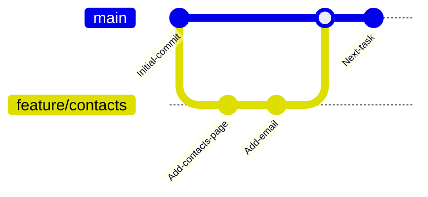
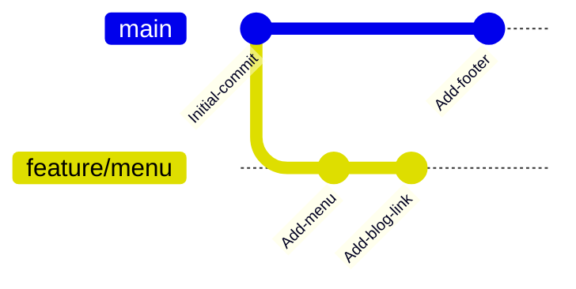
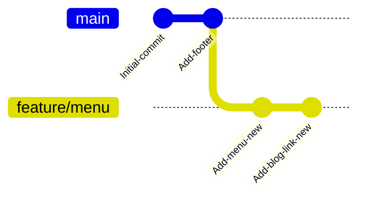

# Teamwork

[Contents](../../README.md) · [← Back](../../Lesson-8/en/GitHub%20and%20remote%20repositories.md) · [Next →](../../Lesson-10/en/Tags%2C%20releases%20and%20final%20project.md) · [RU](../ru/%D0%9A%D0%BE%D0%BC%D0%B0%D0%BD%D0%B4%D0%BD%D0%B0%D1%8F%20%D1%80%D0%B0%D0%B1%D0%BE%D1%82%D0%B0.md) · [EN](Teamwork.md) · [UZ](../uz/Jamoada%20ishlash.md)

> **Link to lesson 8:** you published a project on GitHub, learned `git push`, `git clone`, `git fetch` and `git pull`, and found out that `origin/main` is "the last thing your Git knows about `main` on the server". While you worked alone, `push` always went through. Today a teammate joins the project - and you will learn what to do when Git refuses to accept your `push`, how to agree on the order of work with a pull request, and how to put an unfinished change aside.

---

## Why you need this

You and a friend are building a website for a study team; in the morning you both cloned the repository. You added the home page and notes, your friend added the styles, and he managed to push them first. You type `git push` - and see a red `! [rejected]`. On top of that, `notes.md` has one more line that you have not committed yet. What do you do? Delete the folder and clone again? Push "by force"? Both options are bad: the first loses your work, the second loses your friend's work. In any team, from two students to a hundred developers, this happens every day. The good news: the solution is a few calm commands, and after this lesson you will know them by heart.

---

## What you will learn

- Work with **GitHub Flow**: branch → commits → `push` → pull request → review → merge → delete the branch.
- Open a pull request on GitHub and do a **code review**.
- Understand why a `push` is rejected with the hint `fetch first`, and fix it without `--force`.
- Read the message `Need to specify how to reconcile divergent branches` and choose `pull.rebase false`, `pull.rebase true` or `pull.ff only`.
- Use `git pull --rebase` and `git rebase main` and know when you **must not** rebase.
- Put uncommitted changes aside: `git stash`, `list`, `pop`, `-m`, `-u`.
- Copy one commit to another branch with `git cherry-pick`.
- Resolve a conflict that appears during `git pull`.

---

## Review: 3 questions from lesson 8

1. How is `git fetch` different from `git pull`?
2. What does `origin/main` show, and when is it updated?
3. What does the `-u` option do in `git push -u origin main`?

Answers are at the end of the lesson.

---

## Lesson plan

| Section | What we do |
| --- | --- |
| GitHub Flow | How a team works with branches |
| Pull request and review | How to propose changes and check other people's changes |
| A rejected `push` | Why `fetch first` and what to do |
| Diverged branches | `pull.rebase`, `pull.ff` and three ways to combine |
| Mini-task 1 | Two clones, a rejected `push`, a merge |
| `git stash` | Put an unfinished change aside |
| `git rebase` | Move commits on top of a fresh `main` |
| Conflicts during `pull` and `cherry-pick` | A recap of lesson 7 and copying one commit |
| Mini-task 2 | stash, rebase, cherry-pick |
| Independent work | Syncing with a teammate in the learning terminal and on your computer |

---

## GitHub Flow: how a team works

When several people work on a project, they need to agree on rules. The simplest and most popular rule is **GitHub Flow**: the `main` branch always works, and every task is done in a **separate short branch** (lesson 6). The branch is pushed to GitHub, a **pull request** is opened - a request to merge it into `main`, a teammate checks the changes (**review**), and the branch is merged and deleted.

**In simple words:** GitHub Flow is like the work of a magazine's editorial office. A journalist writes an article in their own draft (a branch), hands it to the editor (a pull request), the editor makes corrections and asks questions (a review), and only after that the article goes into the issue (`main`). Nobody writes directly into the laid-out issue.



**How to read the diagram.** The main line is `main`. Each task branches off `main`, gets its own commits and comes back to `main` with a merge commit (the point where two lines meet). Branches live for a short time - hours or days: the shorter the branch, the fewer the conflicts.

### Step by step in the terminal

```bash
git switch -c feature/contacts
echo "<h1>Contacts</h1>" > contacts.html
git add contacts.html
git commit -m "Add contacts page"
git push -u origin feature/contacts
```

The important part of the output is the last lines:

```text
To https://github.com/team/site.git
 * [new branch]      feature/contacts -> feature/contacts
branch 'feature/contacts' set up to track 'origin/feature/contacts'.
```

`[new branch]` - a new branch appeared on GitHub, and thanks to `-u` the next `git push` and `git pull` in this branch can be written without names.

Next comes the pull request on GitHub (the next section). When it is merged, the branch is deleted on the server, and on your computer you update `main`:

```bash
git switch main
git pull
git branch -d feature/contacts
```

`git pull` will do a fast-forward (`Fast-forward`), and `git branch -d` will answer `Deleted branch feature/contacts (was 34b950b).` The branch on the server is deleted with a button on GitHub or with the command `git push origin --delete feature/contacts`, and the `origin/feature/contacts` reference left on your teammates' computers is removed by `git fetch --prune` (lesson 8).

| Step | Command | What changed / where HEAD points |
| --- | --- | --- |
| 1 | `git switch -c feature/contacts` | A new branch from `main`, HEAD → `feature/contacts` |
| 2 | `git push -u origin feature/contacts` | The branch appeared on GitHub |
| 3 | Pull request → review → **Merge** on GitHub | On the server, `main` got a merge commit |
| 4 | `git switch main` and `git pull` | HEAD → `main`, the local `main` caught up with the server |
| 5 | `git branch -d feature/contacts` | The local branch is deleted: its commits are already in `main` |

---

## Pull request and code review

A **pull request** (PR for short, "a request to merge") is a page on GitHub that shows: from which branch into which branch the changes are proposed, all the commits, all the changed lines and the discussion. In GitLab the same thing is called a **merge request**.

**In simple words:** a pull request is like handing in your term paper to your supervisor. You do not paste the chapters into the final copy yourself: the supervisor reads them, leaves notes in the margins, you make corrections, and only then the work is accepted.

### How to open a pull request

The PR description says what was done and how to check it. The GitHub interface changes sometimes, but the main names stay the same for years:

| Where | What to click | What happens |
| --- | --- | --- |
| The repository's main page right after you `push` a branch | A yellow bar with the **Compare & pull request** button | GitHub itself offers a PR for the branch you just pushed |
| The **Pull requests** tab | **New pull request**, then choose `base: main` and `compare: feature/contacts` | The same PR, if the bar has already disappeared |
| The PR form | A title, a description (what was done and why), **Create pull request** | The PR is open, the team got a notification |

### Code review: checking other people's changes

A **review** ("a look over") means a teammate reads your changes before they get into `main`. The PR page has a **Files changed** tab: it shows the same lines with `+` and `-` as `git diff` (lesson 3). You can leave a comment on any line, and at the end choose a verdict: **Comment** (just a comment), **Approve** (I approve) or **Request changes** (needs fixing). If the reviewer finds a mistake, the author fixes it in the same branch: `git commit`, `git push` - the PR updates by itself.

> **Important:** a review checks the code, not the person. Write specifically and politely: "the closing `</p>` tag is missing here", not "you broke everything again". And do not take comments personally: their goal is to keep mistakes out of `main`.

### Merge: three buttons

When the PR is approved, you click **Merge pull request** at the bottom of the page (then **Confirm merge**). The button has an arrow with options:

| Option | What ends up in `main` |
| --- | --- |
| **Create a merge commit** | All the branch commits + a merge commit (like `git merge --no-ff`, lesson 7) |
| **Squash and merge** | All the branch commits are "squashed" into one new commit |
| **Rebase and merge** | The branch commits are moved on top of `main` without a merge commit (more on rebase below) |

After the merge GitHub shows the **Delete branch** button - the branch is not needed anymore. The team decides which option to use; for a beginner the first one is fine.

---

## A rejected `push`

Let's go back to the situation from the beginning of the lesson. You cloned `https://github.com/team/site.git` and made two commits: `Add home page` and `Add notes`. Meanwhile Aziz also cloned the repository, added `style.css` and has already pushed it. You have an uncommitted line in `notes.md`.

`git status` says `Your branch is ahead of 'origin/main' by 2 commits.` and shows `modified: notes.md`. Git is sure that you are simply 2 commits ahead: it does not know about Aziz's commit yet. Let's try to push:

```bash
git push
```

```text
To https://github.com/team/site.git
 ! [rejected]        main -> main (fetch first)
error: failed to push some refs to 'https://github.com/team/site.git'
hint: Updates were rejected because the remote contains work that you do not
hint: have locally. This is usually caused by another repository pushing to
hint: the same ref. If you want to integrate the remote changes, use
hint: 'git pull' before pushing again.
hint: See the 'Note about fast-forwards' in 'git push --help' for details.
```

| Line | Meaning |
| --- | --- |
| `! [rejected] main -> main (fetch first)` | Rejected. "Fetch first" - there is something new on the server |
| `the remote contains work that you do not have locally` | The server has work that you do not have |
| `use 'git pull' before pushing again` | The solution: `git pull`, then `git push` again |

**Why Git does this.** The server accepts a `push` only if the new history **continues** the old one (a fast-forward, lesson 7). Your `main` starts from `Initial commit`, but on the server `Add styles` already comes after it. If the server accepted your `push`, Aziz's commit would simply disappear from `main`. The refusal protects your teammate's work.

The order is always the same: whoever pushed first, their `push` went through; the second person takes the other commits, combines them with their own **on their own computer** and only then pushes. The server never combines histories by itself.

> **Important:** do not "cure" a rejected `push` with `git push --force`. It makes the server accept your history, and your teammate's commit disappears from `main`. `--force` is acceptable only in **your own** branch that nobody else uses, and only when you know exactly what you are doing.

---

## Diverged branches and `git pull`

Let's see what Git knows after `git fetch`:

```bash
git fetch
git status
```

```text
From https://github.com/team/site.git
   d7ac0cb..8e429e3  main       -> origin/main
On branch main
Your branch and 'origin/main' have diverged,
and have 2 and 1 different commits each, respectively.
  (use "git pull" if you want to integrate the remote branch with yours)
```

Meaning: "Your branch and `origin/main` have **diverged**: you have 2 commits of your own, the server has 1 of its own".

**In simple words:** divergence is like two authors who took the same chapter and wrote different continuations for it. To get one book, the continuations have to be joined. There are two ways to join them: bind both continuations together and add a page saying "two versions meet here" (merge), or rewrite your continuation as if you had started it after the other one (rebase).

### Git asks you to choose a way

Let's try `git pull` without any settings. The output is long, but very useful:

```bash
git pull
```

```text
hint: You have divergent branches and need to specify how to reconcile them.
hint: You can do so by running one of the following commands sometime before
hint: your next pull:
hint:
hint:   git config pull.rebase false  # merge
hint:   git config pull.rebase true   # rebase
hint:   git config pull.ff only       # fast-forward only
hint:
hint: You can replace "git config" with "git config --global" to set a default
hint: preference for all repositories. You can also pass --rebase, --no-rebase,
hint: or --ff-only on the command line to override the configured default per
hint: invocation.
fatal: Need to specify how to reconcile divergent branches.
```

| Line | Meaning |
| --- | --- |
| `You have divergent branches and need to specify how to reconcile them` | The branches have diverged, specify how to reconcile them |
| `git config pull.rebase false / true`, `pull.ff only` | Three ways: merge, rebase, fast-forward only (details in the table below) |
| `--global`, `--rebase, --no-rebase, or --ff-only` | Set it for all repositories or choose with an option for one `pull` |
| `fatal: Need to specify how to reconcile divergent branches.` | An error: no way is chosen, nothing is combined |

Git has behaved like this since version 2.33: before, it silently made a merge, and beginners got unexpected merge commits. The other person's commits are **already downloaded** into `origin/main` - only the combining is missing.

| Setting | Option for one time | What it does when branches diverge | When to choose it |
| --- | --- | --- | --- |
| `pull.rebase false` | `git pull --no-rebase` | A merge commit `Merge branch 'main' of ...` | For beginners: nothing is rewritten, everything is visible in the history |
| `pull.rebase true` | `git pull --rebase` | Your commits are moved on top of the received ones, the history is a straight line | The team wants a history without extra merges |
| `pull.ff only` | `git pull --ff-only` | Only a fast-forward; when branches diverge - `fatal: Not possible to fast-forward, aborting.` | You never commit directly to `main`, only through branches and PRs |

A setting without `--global` works in one repository, with `--global` - in all of them. An option in the command is stronger than the setting.

> **Important:** if the working directory has uncommitted changes, `git pull --rebase` refuses to work (`error: cannot pull with rebase: You have unstaged changes.`), and `git pull` with a merge refuses if the change is in a file that your teammate changed. Put the change aside first - that is `git stash`, two sections below.

### Option 1: merge

```bash
git config pull.rebase false
git pull
git log --oneline --graph
```

```text
Merge made by the 'ort' strategy.
 style.css | 1 +
 1 file changed, 1 insertion(+)
 create mode 100644 style.css
*   49563fe (HEAD -> main) Merge branch 'main' of https://github.com/team/site
|\
| * 8e429e3 (origin/main) Add styles
* | 2a28250 Add notes
* | 31ee276 Add home page
|/
* d7ac0cb Initial commit
```

`Merge made by the 'ort' strategy.` - a merge was made, as in lesson 7; Git wrote the message `Merge branch 'main' of ...` by itself. In the graph, your commits are on the left, Aziz's commit is on the right, and they meet at the top.

Now your history **continues** the server's history, and `git push` will go through. In real Git an editor with a ready message may open during the merge - just save it and close it.

### Option 2: `git pull --rebase`

The same starting case, but with rebase (the working directory must be clean - you will learn how to put a change aside in the section about `git stash`):

```bash
git pull --rebase
git log --oneline --graph
```

```text
Successfully rebased and updated refs/heads/main.
* fa692a0 (HEAD -> main) Add notes
* 0e30042 Add home page
* 8e429e3 (origin/main) Add styles
* d7ac0cb Initial commit
```

There is no merge commit: Git "unhooked" your two commits, put Aziz's commit in their place and "hooked" yours on top. The hashes of your commits changed (`31ee276` → `0e30042`): these are **new** commits with the same content. This is safe because they had not been published yet.

---

## Mini-task 1

The learning terminal has an empty remote repository `https://github.com/student/site.git`. We will play the "teammate" with a second clone in the `~/site-aziz` folder.

1. Set up your name, email and the `main` branch. Create `~/site` with a repository, an `index.html` file (`<h1>Team site</h1>`) and the commit `Add home page`.
2. Connect the remote repository as `origin` and push `main` with `-u`.
3. In the home folder, clone it into `site-aziz`, add `style.css` there with the text `body { margin: 0; }`, commit `Add styles` and push.
4. Go back to `~/site`, add the line `<p>Welcome</p>` to `index.html`, commit `Add welcome text` and try `git push`. Find `fetch first` in the output.
5. Run `git pull` without settings and find the `fatal` line. Then take the changes with a merge using the `--no-rebase` option, look at the graph and push.

---

## `git stash`: put a change aside

You often need to take changes urgently or switch to another branch, while the working directory has an unfinished change - it is too early to commit it, and it is a pity to throw it away.

**In simple words:** `git stash` is a pocket. You are writing a letter, and suddenly the doorbell rings. You put the draft in your pocket, open the door, accept the parcel (`git pull`), and then take out the draft and keep writing. The desk (the working directory) is clean for that time.

```bash
git stash
git status
git stash list
```

```text
Saved working directory and index state WIP on main: 2a28250 Add notes
On branch main
Your branch and 'origin/main' have diverged,
and have 2 and 1 different commits each, respectively.
  (use "git pull" if you want to integrate the remote branch with yours)

nothing to commit, working tree clean
stash@{0}: WIP on main: 2a28250 Add notes
```

| Line | Meaning |
| --- | --- |
| `Saved working directory and index state` | The changes of the working directory and the index are saved |
| `WIP on main: 2a28250 Add notes` | WIP (work in progress); put aside on the `main` branch on top of the commit `Add notes` |
| `nothing to commit, working tree clean` | The working directory is clean: the change is in the "pocket" |
| `stash@{0}` | The entry number: `0` is the newest |

Now we calmly take the changes and push the commits (here - the merge option from the previous section), and then take out the change:

```bash
git pull
git push
git stash pop
```

`git pull` and `git push` will answer the same way as in option 1. The output of `git stash pop` starts with the usual `git status`, and the important part is here:

```text
	modified:   notes.md

no changes added to commit (use "git add" and/or "git commit -a")
Dropped refs/stash@{0} (a34aa5c1d940d7a31fdc6eb7484e1b717a81d608)
```

| Line | Meaning |
| --- | --- |
| `modified: notes.md` | The change is back in the working directory |
| `Dropped refs/stash@{0}` | The entry is removed from the list: `pop` = "take it out and throw away the wrapper" |

All that is left is to commit the change and push it: `git commit -am "Update notes"`, `git push`.

| Step | Command | Working directory | Index | Repository |
| --- | --- | --- | --- | --- |
| 1 | (start) | `notes.md` is modified | as in `Add notes` | 2 commits ahead, the server moved 1 ahead |
| 2 | `git stash` | clean | as in `Add notes` | + the entry `stash@{0}` |
| 3 | `git pull` | + `style.css` | + `style.css` | + Aziz's commit and a merge commit |
| 4 | `git push` | no changes | no changes | server = local `main` |
| 5 | `git stash pop` | `notes.md` is modified again | no changes | the stash entry is removed |
| 6 | `git commit -am "Update notes"` | clean | = new commit | + `Update notes`, then `git push` |

### What `git stash` can do

| Command | What it does |
| --- | --- |
| `git stash` or `git stash push` | Put aside the changes of tracked files (and the index) |
| `git stash -m "footer idea"` | The same with a clear label instead of `WIP on main` |
| `git stash -u` | Also put aside **new** (untracked) files |
| `git stash list` | The list of entries |
| `git stash show` | Which files are in the last entry |
| `git stash pop` | Bring back the last entry and remove it from the list |
| `git stash apply` | Bring it back, but keep the entry in the list |
| `git stash drop` | Remove the last entry **without** bringing it back |

Labels and new files:

```bash
git stash -m "footer idea"
echo "draft" > todo.txt
git stash -u -m "todo draft"
git stash list
```

```text
Saved working directory and index state On main: footer idea
Saved working directory and index state On main: todo draft
stash@{0}: On main: todo draft
stash@{1}: On main: footer idea
```

Entries are stacked: a new one gets number `0`, the old ones move down. `git stash pop` takes the top one - `todo draft`.

> **Important:** without `-u` a new file (`Untracked`) stays in the folder and does not get into the stash. And `git stash drop` throws a change away forever - do not confuse it with `pop`. If a conflict appears during `pop`, Git writes `The stash entry is kept in case you need it again.`: the entry is not removed, resolve the conflict as in lesson 7.

---

## `git rebase`: move commits

You have seen `git pull --rebase`. The same idea works with branches too. You are making a menu in the `feature/menu` branch, and meanwhile Aziz's commit `Add footer` got into `main`. To make your branch start from a fresh `main`, you rebase it. First update `main` (`git switch main`, `git pull`) and go back to the branch: `git switch feature/menu`.

**In simple words:** rebase means "transplanting" a branch. You were drawing on a sheet pinned to a board. While you were drawing, a new sheet was pinned to the board under yours. Rebase takes off your drawings, puts them on top of the new sheet and redraws each one again. The drawings are the same, but these are new sheets now.



**How to read the diagram.** Before the rebase: the `feature/menu` branch goes off the old commit `Initial-commit` and does not know about `Add-footer`. If you merge it now, you get a merge commit.

```bash
git rebase main
```

```text
Successfully rebased and updated refs/heads/feature/menu.
```

In `git log --oneline --graph --all` there is now one line: `566d27d Add blog link to menu`, `ca1d8dc Add menu`, `f3d5db9 Add footer`, `d7ac0cb Initial commit`.



**How to read the diagram.** After the rebase the branch starts from `Add-footer`, the history is a straight line. Merging such a branch into `main` will be a simple fast-forward. But look at the hashes: before the rebase the branch commits were `cce299f Add menu` and `ba21373 Add blog link to menu`, and now they are `ca1d8dc` and `566d27d`. The old commits are no longer in the branch - they were replaced by copies.

Merge keeps an honest history (you can see where work went in parallel), does not change hashes and is always safe. Rebase gives a straight line, as if everyone worked in turn, but it creates new commits with new hashes - so it is safe only for unpublished commits.

> **Important:** the main rule of rebase is **do not rebase commits that are already published and that other people use**. If a teammate took your branch and you rebased it, they will keep the old commits, you will have the new ones, and the histories will diverge "forever". This is the same rule as in lesson 4: published history is not rewritten. You can rebase your own local commits and your own branch while nobody else works with it. If a rebase stopped on a conflict: resolve it, `git add` and `git rebase --continue`, and to cancel everything - `git rebase --abort`.

---

## Conflicts during `pull` and `git cherry-pick`

### A conflict during `pull`: a recap of lesson 7

If you and your teammate changed **the same line**, `git pull` stops on a conflict - exactly like `git merge` in lesson 7. After all, `pull` = `fetch` + `merge` (or `rebase`). An example: you wrote the heading `Team website`, Aziz wrote `Our team`.

```bash
git config pull.rebase false
git pull
cat index.html
```

```text
From https://github.com/team/site.git
   31ee276..a1e349d  main       -> origin/main
Auto-merging index.html
CONFLICT (content): Merge conflict in index.html
Automatic merge failed; fix conflicts and then commit the result.
<<<<<<< HEAD
<h1>Team website</h1>
=======
<h1>Our team</h1>
>>>>>>> 9c41f2a7d3e85b06f1a4c2d8e7b93f50a6d1c2e4
```

Between `<<<<<<< HEAD` and `=======` is your version, between `=======` and `>>>>>>> 9c41f2a...` is the version from the server: with `git pull` the marker is followed by the full hash of the received commit (yours will be different). When you merge your own branch, as in lesson 7, the branch name stands there.

We resolve it the same way as in lesson 7: keep the needed text without the markers, `git add`, `git commit`, and do not forget `git push`:

```bash
echo "<h1>Our team website</h1>" > index.html
git add index.html
git commit -m "Merge title changes"
git push
```

`git log --oneline --graph` will show the merge commit `Merge title changes` with two parents: your `Change page title` and Aziz's `Rename page title`. Changed your mind about resolving - `git merge --abort` brings everything back to how it was before `pull`. **Tip:** to have fewer conflicts, run `git pull` more often and agree on who edits which file.

### `git cherry-pick`: one commit to another branch

Sometimes you need not the whole branch, but one commit from it. For example, the `hotfix` branch has a fix for the text color and a draft to-do list - and `main` needs only the fix.

**In simple words:** cherry-pick means "picking one cherry": taking one berry from someone else's tree instead of transplanting the whole tree.

We find the hash of the needed commit (`b823ea5 Fix text color`) with `git log --oneline` in the `hotfix` branch, then:

```bash
git switch main
git cherry-pick b823ea5
```

```text
Switched to branch 'main'
Your branch is up to date with 'origin/main'.
[main 7759e6e] Fix text color
 Date: Tue Sep 1 10:07:00 2026 +0500
 1 file changed, 1 insertion(+)
 create mode 100644 style.css
```

A **new** commit `7759e6e` is created in `main` with the same change, message and date (`Date:`), but its hash is different: it is a copy, not the same commit `b823ea5`.

Cherry-pick is a tool for special cases (moving an urgent fix, saving a commit from a branch that the team decided not to merge). For normal work, use branches and merge.

---

### Try to break it

1. Push a commit from the first clone, then make your own commit in the second clone and run `git push --force`. In the first clone, run `git fetch` and `git log --oneline origin/main`: is the first clone's commit still on the server?
2. Run `git stash pop` when the stash list is empty. What will Git answer?
3. Create a new file and run `git stash` without `-u`. Did the file stay in the folder? What does `git stash list` show?
4. In one clone, change a line of a file, commit and push; in the other, change the same line, but do **not** commit, and run `git pull`. Read the error and fix it with `git stash`.
5. Set `git config pull.ff only` and run `git pull` when the branches have diverged.

### Typical beginner mistakes

| Mistake | What you get | How to fix |
| --- | --- | --- |
| `git push` without taking the other person's commits | `! [rejected] main -> main (fetch first)` | `git pull` (with a way to combine), then `git push` |
| A rejected `push` "fixed" with `git push --force` | The teammate's commits disappeared from the server | Do not do this in a shared branch. The teammate can bring them back with their own `git push` while they still have them |
| `git pull` with diverged branches and no setting | `fatal: Need to specify how to reconcile divergent branches.` | `git config pull.rebase false` or `git pull --no-rebase` / `--rebase` |
| `git pull` when a teammate changed the file with your uncommitted change | `error: Your local changes to the following files would be overwritten by merge:` and `Aborting` | `git stash`, `git pull`, `git stash pop` |
| `git stash drop` instead of `git stash pop` | The change is deleted, it is not in the folder | Use `pop`; `drop` is only for unneeded entries |
| Forgot `git stash pop` | The change is "lost"; `git stash list` shows `stash@{0}` | `git stash pop` |
| Rebased a published branch that a teammate works with | The histories diverged, the teammate has duplicate commits | Rebase only your own unpublished commits; in shared branches - merge |
| Resolved a conflict after `pull`, but did not push | `Your branch is ahead of 'origin/main'` | `git push` |

---

## Mini-task 2

Continue in the same folders `~/site` and `~/site-aziz` after mini-task 1.

1. In `~/site`, create the file `notes.md` with the text `- add contacts page` and put it aside in the stash with the label `notes draft` (it is a new file - you need the option for untracked files). Look at the list.
2. Create the `feature/menu` branch, add `menu.html` with the text `<nav>Home | About</nav>` and the commit `Add menu`.
3. In `~/site-aziz`, take the changes, add `footer.html` (`<footer>2026</footer>`), the commit `Add footer`, and push.
4. In `~/site`, update `main`, go back to `feature/menu` and rebase it onto `main`. Look at the graph of all branches: which commit does the branch start from now?
5. Switch to `main`, copy the last commit of the `feature/menu` branch into it with `git cherry-pick feature/menu`, and bring back the stashed `notes.md`. Check `git status -s`.

---

## Lesson summary: cheat sheet

| Task | Command |
| --- | --- |
| Push a branch for a pull request | `git push -u origin feature/name` |
| After the PR merge: update `main` and delete the branch | `git switch main`, `git pull`, `git branch -d feature/name` |
| `push` is rejected (`fetch first`) | `git pull`, then `git push` |
| Choose merge for `pull` | `git config pull.rebase false` or `git pull --no-rebase` |
| Choose rebase for `pull` | `git config pull.rebase true` or `git pull --rebase` |
| Fast-forward only | `git config pull.ff only` or `git pull --ff-only` |
| Put a change aside / with a label / with new files | `git stash`, `git stash -m "text"`, `git stash -u` |
| The list, the contents of an entry | `git stash list`, `git stash show` |
| Bring back and remove the entry / bring back and keep it | `git stash pop`, `git stash apply` |
| Move a branch on top of a fresh `main` | `git switch feature/name`, `git rebase main` |
| Continue / cancel a rebase | `git rebase --continue`, `git rebase --abort` |
| Copy one commit into the current branch | `git cherry-pick <hash>` |

---

## Independent work

### Part 1. IDE task (graded by the platform)

You are in the `~/site` folder - a clone of the shared repository `https://github.com/team/site.git`. You have a local commit that has not been pushed yet, and your teammate Aziz has already pushed his commit with a different file. You have an uncommitted change in `notes.md`. Write the commands one per line:

1. Check the state and try to push the commit with `git push` - make sure that Git rejects it.
2. Put the uncommitted change aside with `git stash` and look at the stash list.
3. Choose a way to combine: `git config pull.rebase false` (or the `--no-rebase` / `--rebase` option of `git pull`) and take your teammate's changes.
4. Push your commits.
5. Bring back the stashed change (`git stash pop`) and commit it with the message `Update notes`.
6. Push the commit and check that the working directory is clean. Do not use `git push --force`.

What the platform checks: that the first `git push` was rejected and that you used `git stash`; that the server has Aziz's commit, your local commit and the `Update notes` commit under your name, and that `notes.md` on the server has the stashed change; that the local `main` matches `origin/main` and the server; that the stash list is empty, the working directory is clean and there is no unfinished merge or rebase; that your teammate's file appeared on your computer; that `git push --force` was not used; that the solution also works with other data (a different teammate's file and a different change) - both merge and rebase are accepted; that the script runs without errors.

### Part 2. Project on your computer

1. Find a partner (a classmate) or make a second clone of your website repository from lesson 8 in a neighboring folder: `git clone <address> site-second`. Set the setting on your computer once: `git config --global pull.rebase false`.
2. Work with GitHub Flow: in the first folder, create the `feature/footer` branch, make 1–2 commits, push it and open a pull request on GitHub with the **Compare & pull request** button.
3. Do a review: on the **Files changed** tab, leave a comment on a line (if you work alone - to yourself), fix the remark with a new commit and `git push`, then **Merge pull request** and **Delete branch**. Update `main` on your computer and delete the local branch.
4. In the second folder, make a commit in `main` and push it, and in the first one - a different commit in `main` and an uncommitted change. Go through the path from the lesson: `push` (rejected) → `git stash` → `git pull` → `git push` → `git stash pop` → commit → `git push`.
5. Look at `git log --oneline --graph` in both folders after `git pull` and at the **Commits** tab on GitHub.

### Acceptance criteria

- [ ] The IDE task is accepted.
- [ ] Your repository on GitHub has at least one merged pull request with a review comment.
- [ ] `git config --global pull.rebase` on your computer shows `false` (or `true`, if you chose rebase on purpose).
- [ ] You went through a rejected `push` and syncing with stash without `--force`, and `git stash list` is empty.
- [ ] You can explain how `git pull --rebase` differs from `git pull --no-rebase` and why you must not rebase published branches that other people use.

---

## Self-check questions

1. List the steps of GitHub Flow. Why is every task done in a separate branch?
2. What are a pull request and a code review? What do **Approve** and **Request changes** mean?
3. How do the options **Create a merge commit**, **Squash and merge** and **Rebase and merge** differ?
4. Why does Git reject a `push` with the hint `fetch first`, and why is `git push --force` a bad solution?
5. What does `Your branch and 'origin/main' have diverged, and have 2 and 1 different commits each` mean?
6. What does `git pull` do when branches have diverged and there is no setting, and which three settings does it suggest?
7. How does the result of `git pull --rebase` differ from `git pull --no-rebase`? Why do hashes change after a rebase?
8. What is the main rule of rebase, and why is it similar to the rule from lesson 4?
9. How does `git stash pop` differ from `git stash apply` and `git stash drop`? What is the `-u` option for?
10. What does `git cherry-pick` do, and how does the copy differ from the original commit?

After the questions, take the **lesson test** on the platform: 12 questions, pass mark 70%.

---

## What's next

Now you can work in a team: sync with others, go through reviews and lose neither your own work nor anyone else's. In lesson 10 - the last one - you will learn to mark important versions with tags (`v1.0`), publish releases on GitHub, shorten long commands with aliases, and publish your final project - your website - on GitHub Pages.

---

## Answers

**Review**

1. `git fetch` only downloads new commits and updates `origin/main`; your branches and files do not change. `git pull` = `fetch` + combining with your branch.
2. `origin/main` is the last state of the `main` branch on the server that your Git knows. It is updated by `git fetch`, `git pull` and a successful `git push`.
3. It links the local branch with the branch on the server (upstream): after that you can simply write `git push` and `git pull`.

**Mini-task 1**

```bash
git config --global user.name "Anna Karimova"
git config --global user.email "anna@example.com"
git config --global init.defaultBranch main
mkdir site && cd site && git init
echo "<h1>Team site</h1>" > index.html && git add . && git commit -m "Add home page"
git remote add origin https://github.com/student/site.git
git push -u origin main
cd ~ && git clone https://github.com/student/site.git site-aziz
cd site-aziz && echo "body { margin: 0; }" > style.css
git add . && git commit -m "Add styles" && git push
cd ~/site && echo "<p>Welcome</p>" >> index.html
git commit -am "Add welcome text"
git push
git pull
git pull --no-rebase
git log --oneline --graph
git push
```

The `git push` and `git pull` commands in the middle must end with an error - that is the goal of the exercise.

**Mini-task 2**

```bash
echo "- add contacts page" > notes.md
git stash -u -m "notes draft" && git stash list
git switch -c feature/menu
echo "<nav>Home | About</nav>" > menu.html && git add . && git commit -m "Add menu"
cd ~/site-aziz && git pull
echo "<footer>2026</footer>" > footer.html
git add . && git commit -m "Add footer" && git push
cd ~/site && git switch main && git pull
git switch feature/menu
git rebase main
git log --oneline --graph --all
git switch main && git cherry-pick feature/menu
git stash pop && git status -s
```

After the rebase the `feature/menu` branch starts from the `Add footer` commit. At the end `git status -s` shows `?? notes.md`.

**Self-check questions**

1. Branch → commits → `push` → pull request → review → merge → delete the branch. A separate branch keeps `main` working and lets you check the changes before the merge.
2. A pull request is a page on GitHub with a request to merge a branch, its changes and a discussion. A code review is a teammate checking the changes. **Approve** means I approve, **Request changes** means it needs fixing.
3. A merge commit keeps all the commits and adds a merge commit; squash squashes the branch into one commit; rebase moves the commits on top of `main` without a merge commit.
4. The server has commits that you do not have, and your history does not continue them. `--force` overwrites the branch on the server and destroys your teammate's commits.
5. The branches have diverged: you have 2 commits that are not on the server, and the server has 1 commit that you do not have.
6. It downloads the commits into `origin/main`, but does not combine them and ends with `fatal: Need to specify how to reconcile divergent branches.` It suggests `pull.rebase false` (merge), `pull.rebase true` (rebase), `pull.ff only` (fast-forward only).
7. `--no-rebase` creates a merge commit, the history has two lines. `--rebase` moves your commits on top of the received ones, the history is straight. The hashes change because these are new commits with a different parent.
8. Do not rebase published commits that other people use. Rebase rewrites history, and published history is not rewritten (lesson 4).
9. `pop` brings back and removes the entry, `apply` brings back and keeps it, `drop` removes it without bringing it back. `-u` also puts aside new untracked files.
10. It creates in the current branch a copy of one commit from another branch. The changes and the message are the same, the hash is new.

---

[Contents](../../README.md) · [← Back](../../Lesson-8/en/GitHub%20and%20remote%20repositories.md) · [Next →](../../Lesson-10/en/Tags%2C%20releases%20and%20final%20project.md) · [RU](../ru/%D0%9A%D0%BE%D0%BC%D0%B0%D0%BD%D0%B4%D0%BD%D0%B0%D1%8F%20%D1%80%D0%B0%D0%B1%D0%BE%D1%82%D0%B0.md) · [EN](Teamwork.md) · [UZ](../uz/Jamoada%20ishlash.md)
