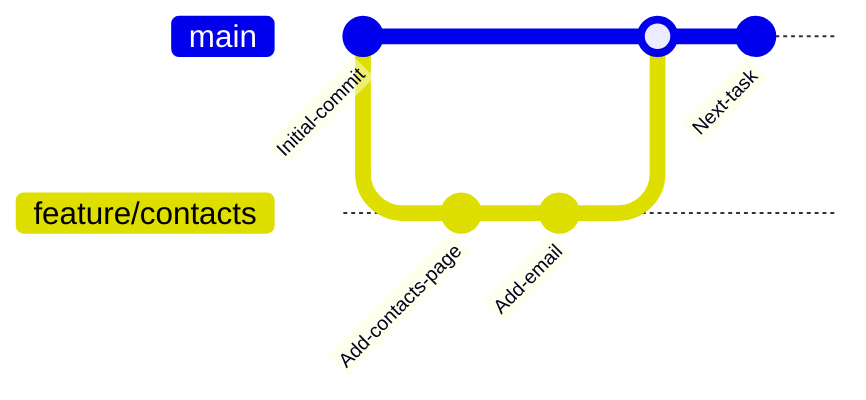
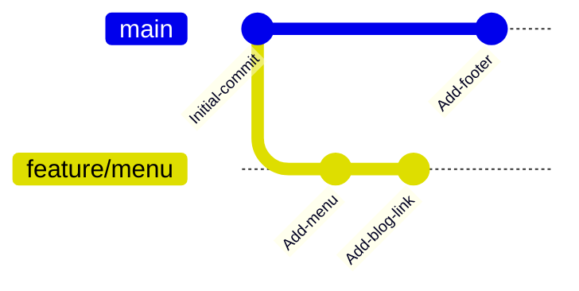
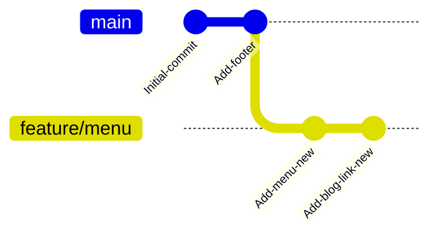

# Командная работа

[Содержание](../../README.md) · [← Назад](../../Lesson-8/ru/GitHub%20%D0%B8%20%D1%83%D0%B4%D0%B0%D0%BB%D1%91%D0%BD%D0%BD%D1%8B%D0%B5%20%D1%80%D0%B5%D0%BF%D0%BE%D0%B7%D0%B8%D1%82%D0%BE%D1%80%D0%B8%D0%B8.md) · [Вперёд →](../../Lesson-10/ru/%D0%A2%D0%B5%D0%B3%D0%B8%2C%20%D1%80%D0%B5%D0%BB%D0%B8%D0%B7%D1%8B%20%D0%B8%20%D0%B8%D1%82%D0%BE%D0%B3%D0%BE%D0%B2%D1%8B%D0%B9%20%D0%BF%D1%80%D0%BE%D0%B5%D0%BA%D1%82.md) · [RU](%D0%9A%D0%BE%D0%BC%D0%B0%D0%BD%D0%B4%D0%BD%D0%B0%D1%8F%20%D1%80%D0%B0%D0%B1%D0%BE%D1%82%D0%B0.md) · [EN](../en/Teamwork.md) · [UZ](../uz/Jamoada%20ishlash.md)

> **Связь с уроком 8:** вы опубликовали проект на GitHub, научились `git push`, `git clone`, `git fetch` и `git pull` и узнали, что `origin/main` - это «последнее, что ваш Git знает о `main` на сервере». Пока вы работали один, `push` всегда проходил. Сегодня к проекту подключится товарищ по команде - и вы узнаете, что делать, когда Git отказывается принять ваш `push`, как договориться о порядке работы через pull request и как отложить недоделанную правку.

---

## Зачем это вам

Вы с другом делаете сайт для учебной команды; утром вы оба клонировали репозиторий. Вы добавили главную страницу и заметки, друг - стили, и он успел отправить их первым. Вы пишете `git push` - и видите красное `! [rejected]`. При этом в файле `notes.md` у вас есть ещё одна строчка, которую вы не успели закоммитить. Что делать? Удалить папку и клонировать заново? Отправить «силой»? Оба варианта плохие: первый теряет вашу работу, второй - работу друга. В любой команде, от двух студентов до сотни разработчиков, это происходит каждый день. Хорошая новость: решение - несколько спокойных команд, и после этого урока вы будете знать их наизусть.

---

## Чему вы научитесь

- Работать по **GitHub Flow**: ветка → коммиты → `push` → pull request → ревью → merge → удаление ветки.
- Открывать pull request на GitHub и проводить **code review**.
- Понимать, почему `push` отклонён с подсказкой `fetch first`, и исправлять это без `--force`.
- Читать сообщение `Need to specify how to reconcile divergent branches` и выбирать `pull.rebase false`, `pull.rebase true` или `pull.ff only`.
- Использовать `git pull --rebase` и `git rebase main` и знать, когда rebase **нельзя** делать.
- Откладывать незакоммиченные правки: `git stash`, `list`, `pop`, `-m`, `-u`.
- Копировать один коммит в другую ветку командой `git cherry-pick`.
- Разрешать конфликт, который возник при `git pull`.

---

## Повторение: 3 вопроса из урока 8

1. Чем `git fetch` отличается от `git pull`?
2. Что показывает `origin/main` и когда он обновляется?
3. Что делает ключ `-u` в команде `git push -u origin main`?

Ответы - в конце урока.

---

## План урока

| Раздел | Что делаем |
| --- | --- |
| GitHub Flow | Порядок работы команды через ветки |
| Pull request и ревью | Как предложить изменения и проверить чужие |
| Отклонённый `push` | Почему `fetch first` и что делать |
| Расхождение веток | `pull.rebase`, `pull.ff` и три способа объединения |
| Мини-задание 1 | Два клона, отклонённый `push`, слияние |
| `git stash` | Отложить недоделанную правку |
| `git rebase` | Перенести коммиты поверх свежей `main` |
| Конфликты при `pull` и `cherry-pick` | Повтор урока 7 и копирование одного коммита |
| Мини-задание 2 | stash, rebase, cherry-pick |
| Самостоятельная работа | Синхронизация с товарищем в учебном терминале и на компьютере |

---

## GitHub Flow: как работает команда

Когда над проектом работают несколько человек, нужно договориться о правилах. Самое простое и популярное правило - **GitHub Flow**: ветка `main` всегда рабочая, а любая задача делается в **отдельной короткой ветке** (урок 6). Ветку отправляют на GitHub, открывают **pull request** - просьбу влить её в `main`, товарищ проверяет изменения (**ревью**), и ветку вливают и удаляют.

**Простыми словами:** GitHub Flow - как работа редакции журнала. Журналист пишет статью в своём черновике (ветка), сдаёт её редактору (pull request), редактор правит и задаёт вопросы (ревью), и только после этого статья попадает в номер (`main`). Никто не пишет прямо в свёрстанный номер.



**Как читать схему.** Основная линия - `main`. Каждая задача ответвляется от `main`, получает свои коммиты и возвращается в `main` коммитом слияния (точка, куда входят две линии). Ветки живут недолго - часы или дни: чем короче ветка, тем меньше конфликтов.

### Шаг за шагом в терминале

```bash
git switch -c feature/contacts
echo "<h1>Contacts</h1>" > contacts.html
git add contacts.html
git commit -m "Add contacts page"
git push -u origin feature/contacts
```

Главное в ответе - последние строки:

```text
To https://github.com/team/site.git
 * [new branch]      feature/contacts -> feature/contacts
branch 'feature/contacts' set up to track 'origin/feature/contacts'.
```

`[new branch]` - на GitHub появилась новая ветка, а благодаря `-u` следующие `git push` и `git pull` в этой ветке можно писать без имён.

Дальше - pull request на GitHub (следующий раздел). Когда его влили, ветку на сервере удаляют, а у себя обновляют `main`:

```bash
git switch main
git pull
git branch -d feature/contacts
```

`git pull` выполнит перемотку вперёд (`Fast-forward`), а `git branch -d` ответит `Deleted branch feature/contacts (was 34b950b).` Ветку на сервере удаляют кнопкой на GitHub или командой `git push origin --delete feature/contacts`, а оставшуюся у товарищей ссылку `origin/feature/contacts` убирает `git fetch --prune` (урок 8).

| Шаг | Команда | Что изменилось / куда указывает HEAD |
| --- | --- | --- |
| 1 | `git switch -c feature/contacts` | Новая ветка от `main`, HEAD → `feature/contacts` |
| 2 | `git push -u origin feature/contacts` | Ветка появилась на GitHub |
| 3 | Pull request → ревью → **Merge** на GitHub | На сервере `main` получила коммит слияния |
| 4 | `git switch main` и `git pull` | HEAD → `main`, локальная `main` догнала сервер |
| 5 | `git branch -d feature/contacts` | Локальная ветка удалена: её коммиты уже в `main` |

---

## Pull request и code review

**Pull request** (сокращённо PR, «запрос на слияние») - страница на GitHub, где видно: из какой ветки в какую предлагают влить изменения, все коммиты, все изменённые строки и обсуждение. В GitLab то же самое называется **merge request**.

**Простыми словами:** pull request - как отдать курсовую на проверку научному руководителю. Вы не вклеиваете главы в чистовик сами: руководитель читает, оставляет пометки на полях, вы исправляете, и только потом работа считается принятой.

### Как открыть pull request

В описании PR пишут, что сделано и как это проверить. Интерфейс GitHub иногда меняется, но основные названия держатся годами:

| Где | Что нажать | Что происходит |
| --- | --- | --- |
| Главная страница репозитория сразу после `push` ветки | Жёлтая плашка с кнопкой **Compare & pull request** | GitHub сам предлагает PR для только что отправленной ветки |
| Вкладка **Pull requests** | **New pull request**, затем выбрать `base: main` и `compare: feature/contacts` | Тот же PR, если плашка уже исчезла |
| Форма PR | Заголовок, описание (что и зачем сделано), **Create pull request** | PR открыт, команда получила уведомление |

### Code review: проверка чужих изменений

**Ревью** (review, «просмотр») - товарищ читает ваши изменения до того, как они попадут в `main`. На странице PR есть вкладка **Files changed**: там те же строки с `+` и `-`, что в `git diff` (урок 3). К любой строке можно оставить комментарий, а в конце выбрать итог: **Comment** (просто комментарий), **Approve** (одобряю) или **Request changes** (нужно исправить). Если ревьюер нашёл ошибку, автор исправляет её в той же ветке: `git commit`, `git push` - PR обновится сам.

> **Важно:** ревью - это проверка кода, а не человека. Пишите конкретно и вежливо: «здесь потерялся закрывающий тег `</p>`», а не «опять всё сломал». И не обижайтесь на замечания: их цель - чтобы в `main` не попала ошибка.

### Merge: три кнопки

Когда PR одобрен, внизу страницы нажимают **Merge pull request** (затем **Confirm merge**). У кнопки есть стрелка с вариантами:

| Вариант | Что окажется в `main` |
| --- | --- |
| **Create a merge commit** | Все коммиты ветки + коммит слияния (как `git merge --no-ff`, урок 7) |
| **Squash and merge** | Все коммиты ветки «сжимаются» в один новый коммит |
| **Rebase and merge** | Коммиты ветки переносятся поверх `main` без коммита слияния (о rebase - ниже) |

После слияния GitHub показывает кнопку **Delete branch** - ветка больше не нужна. Какой вариант использовать, решает команда; новичку подходит первый.

---

## Отклонённый `push`

Вернёмся к ситуации из начала урока. Вы клонировали `https://github.com/team/site.git` и сделали два коммита: `Add home page` и `Add notes`. В это время Aziz тоже клонировал репозиторий, добавил `style.css` и уже отправил его. В `notes.md` у вас есть незакоммиченная строка.

`git status` пишет `Your branch is ahead of 'origin/main' by 2 commits.` и показывает `modified: notes.md`. Git уверен, что вы просто впереди на 2 коммита: о коммите Aziz он ещё не знает. Пробуем отправить:

```bash
git push
```

```text
To https://github.com/team/site.git
 ! [rejected]        main -> main (fetch first)
error: failed to push some refs to 'https://github.com/team/site.git'
hint: Updates were rejected because the remote contains work that you do not
hint: have locally. This is usually caused by another repository pushing to
hint: the same ref. If you want to integrate the remote changes, use
hint: 'git pull' before pushing again.
hint: See the 'Note about fast-forwards' in 'git push --help' for details.
```

| Строка | Перевод и смысл |
| --- | --- |
| `! [rejected] main -> main (fetch first)` | Отклонено. «Сначала заберите» (fetch first) - на сервере есть что-то новое |
| `the remote contains work that you do not have locally` | На сервере есть работа, которой у вас нет |
| `use 'git pull' before pushing again` | Решение: `git pull`, затем снова `git push` |

**Почему Git так делает.** Сервер принимает `push`, только если новая история **продолжает** старую (перемотка вперёд, урок 7). Ваша `main` начинается от `Initial commit`, а на сервере после него уже стоит `Add styles`. Если бы сервер принял ваш `push`, коммит Aziz просто исчез бы из `main`. Отказ защищает работу товарища.

Порядок всегда такой: кто отправил первым, у того `push` прошёл; второй забирает чужие коммиты, объединяет их со своими **у себя на компьютере** и только потом отправляет. Сервер никогда не объединяет истории сам.

> **Важно:** не «лечите» отклонённый `push` командой `git push --force`. Она заставит сервер принять вашу историю, и коммит товарища пропадёт из `main`. `--force` допустим только в **своей** ветке, которую никто больше не использует, и только когда вы точно понимаете, что делаете.

---

## Расхождение веток и `git pull`

Посмотрим, что знает Git после `git fetch`:

```bash
git fetch
git status
```

```text
From https://github.com/team/site.git
   d7ac0cb..8e429e3  main       -> origin/main
On branch main
Your branch and 'origin/main' have diverged,
and have 2 and 1 different commits each, respectively.
  (use "git pull" if you want to integrate the remote branch with yours)
```

Перевод: «Ваша ветка и `origin/main` **разошлись**: у вас 2 своих коммита, у сервера - 1 свой».

**Простыми словами:** расхождение - как два автора, которые взяли одну и ту же главу и написали к ней разные продолжения. Чтобы получилась одна книга, продолжения надо соединить. Соединить можно двумя способами: подшить оба продолжения и добавить страницу «здесь сходятся две версии» (merge) или переписать своё продолжение так, будто вы начали его после чужого (rebase).

### Git просит выбрать способ

Пробуем `git pull` без настроек. Ответ длинный, но очень полезный:

```bash
git pull
```

```text
hint: You have divergent branches and need to specify how to reconcile them.
hint: You can do so by running one of the following commands sometime before
hint: your next pull:
hint:
hint:   git config pull.rebase false  # merge
hint:   git config pull.rebase true   # rebase
hint:   git config pull.ff only       # fast-forward only
hint:
hint: You can replace "git config" with "git config --global" to set a default
hint: preference for all repositories. You can also pass --rebase, --no-rebase,
hint: or --ff-only on the command line to override the configured default per
hint: invocation.
fatal: Need to specify how to reconcile divergent branches.
```

| Строка | Перевод и смысл |
| --- | --- |
| `You have divergent branches and need to specify how to reconcile them` | Ветки разошлись, укажите, как их примирить |
| `git config pull.rebase false / true`, `pull.ff only` | Три способа: слияние, rebase, только перемотка (подробно - в таблице ниже) |
| `--global`, `--rebase, --no-rebase, or --ff-only` | Задать для всех репозиториев или выбрать ключом для одного `pull` |
| `fatal: Need to specify how to reconcile divergent branches.` | Ошибка: способ не выбран, ничего не объединено |

Так Git ведёт себя с версии 2.33: раньше он молча делал слияние, и новички получали неожиданные коммиты слияния. Чужие коммиты при этом **уже скачаны** в `origin/main` - не хватает только объединения.

| Настройка | Ключ для одного раза | Что делает при расхождении | Когда выбирать |
| --- | --- | --- | --- |
| `pull.rebase false` | `git pull --no-rebase` | Коммит слияния `Merge branch 'main' of ...` | Новичкам: ничего не переписывается, всё видно в истории |
| `pull.rebase true` | `git pull --rebase` | Ваши коммиты переносятся поверх полученных, история - прямая линия | Команда хочет историю без лишних слияний |
| `pull.ff only` | `git pull --ff-only` | Только перемотка; при расхождении - `fatal: Not possible to fast-forward, aborting.` | Вы никогда не коммитите прямо в `main`, только через ветки и PR |

Настройка без `--global` действует в одном репозитории, с `--global` - во всех. Ключ в команде сильнее настройки.

> **Важно:** если в рабочей папке есть незакоммиченные правки, `git pull --rebase` откажется работать (`error: cannot pull with rebase: You have unstaged changes.`), а `git pull` со слиянием откажется, если правка в файле, который меняет товарищ. Сначала отложите правку - это `git stash`, о нём через один раздел.

### Вариант 1: слияние

```bash
git config pull.rebase false
git pull
git log --oneline --graph
```

```text
Merge made by the 'ort' strategy.
 style.css | 1 +
 1 file changed, 1 insertion(+)
 create mode 100644 style.css
*   49563fe (HEAD -> main) Merge branch 'main' of https://github.com/team/site
|\
| * 8e429e3 (origin/main) Add styles
* | 2a28250 Add notes
* | 31ee276 Add home page
|/
* d7ac0cb Initial commit
```

`Merge made by the 'ort' strategy.` - сделано слияние, как в уроке 7; сообщение `Merge branch 'main' of ...` Git написал сам. В графе слева ваши коммиты, справа - коммит Aziz, сверху они сходятся.

Теперь ваша история **продолжает** серверную, и `git push` пройдёт. В настоящем Git при слиянии может открыться редактор с готовым сообщением - просто сохраните и закройте его.

### Вариант 2: `git pull --rebase`

Тот же исходный случай, но с rebase (рабочая папка должна быть чистой - как отложить правку, вы узнаете в разделе про `git stash`):

```bash
git pull --rebase
git log --oneline --graph
```

```text
Successfully rebased and updated refs/heads/main.
* fa692a0 (HEAD -> main) Add notes
* 0e30042 Add home page
* 8e429e3 (origin/main) Add styles
* d7ac0cb Initial commit
```

Коммита слияния нет: Git «отцепил» ваши два коммита, поставил на их место коммит Aziz и «прицепил» ваши сверху. Хеши ваших коммитов изменились (`31ee276` → `0e30042`): это **новые** коммиты с тем же содержимым. Это безопасно, потому что они ещё не были опубликованы.

---

## Мини-задание 1

В учебном терминале есть пустой удалённый репозиторий `https://github.com/student/site.git`. «Товарища» мы изобразим вторым клоном в папке `~/site-aziz`.

1. Настройте имя, email и ветку `main`. Создайте `~/site` с репозиторием, файлом `index.html` (`<h1>Team site</h1>`) и коммитом `Add home page`.
2. Подключите удалённый репозиторий как `origin` и отправьте `main` с `-u`.
3. В домашней папке клонируйте его в `site-aziz`, добавьте там `style.css` с текстом `body { margin: 0; }`, закоммитьте `Add styles` и отправьте.
4. Вернитесь в `~/site`, допишите в `index.html` строку `<p>Welcome</p>`, закоммитьте `Add welcome text` и попробуйте `git push`. Найдите в ответе `fetch first`.
5. Выполните `git pull` без настроек и найдите строку `fatal`. Затем заберите изменения слиянием ключом `--no-rebase`, посмотрите граф и отправьте.

---

## `git stash`: отложить правку

Часто вам нужно срочно забрать изменения или переключиться на другую ветку, а в рабочей папке лежит недоделанная правка - коммитить её рано, выбрасывать жалко.

**Простыми словами:** `git stash` - это карман. Вы пишете письмо, вдруг звонят в дверь. Вы кладёте черновик в карман, открываете дверь, принимаете посылку (`git pull`), а потом достаёте черновик и пишете дальше. Стол (рабочая папка) на это время чист.

```bash
git stash
git status
git stash list
```

```text
Saved working directory and index state WIP on main: 2a28250 Add notes
On branch main
Your branch and 'origin/main' have diverged,
and have 2 and 1 different commits each, respectively.
  (use "git pull" if you want to integrate the remote branch with yours)

nothing to commit, working tree clean
stash@{0}: WIP on main: 2a28250 Add notes
```

| Строка | Перевод и смысл |
| --- | --- |
| `Saved working directory and index state` | Сохранены изменения рабочей папки и индекса |
| `WIP on main: 2a28250 Add notes` | WIP (work in progress) - «работа в процессе»; отложено на ветке `main` поверх коммита `Add notes` |
| `nothing to commit, working tree clean` | Рабочая папка чистая: правка в «кармане» |
| `stash@{0}` | Номер записи: `0` - самая свежая |

Теперь спокойно забираем изменения и отправляем коммиты (здесь - вариант со слиянием из прошлого раздела), а затем достаём правку:

```bash
git pull
git push
git stash pop
```

`git pull` и `git push` ответят так же, как в варианте 1. В ответе `git stash pop` сначала идёт обычный `git status`, а главное - здесь:

```text
	modified:   notes.md

no changes added to commit (use "git add" and/or "git commit -a")
Dropped refs/stash@{0} (a34aa5c1d940d7a31fdc6eb7484e1b717a81d608)
```

| Строка | Перевод и смысл |
| --- | --- |
| `modified: notes.md` | Правка вернулась в рабочую папку |
| `Dropped refs/stash@{0}` | Запись удалена из списка: `pop` = «достать и выбросить обёртку» |

Остаётся закоммитить правку и отправить её: `git commit -am "Update notes"`, `git push`.

| Шаг | Команда | Рабочая папка | Индекс | Репозиторий |
| --- | --- | --- | --- | --- |
| 1 | (начало) | `notes.md` изменён | как в `Add notes` | 2 коммита впереди, сервер ушёл вперёд на 1 |
| 2 | `git stash` | чистая | как в `Add notes` | + запись `stash@{0}` |
| 3 | `git pull` | + `style.css` | + `style.css` | + коммит Aziz и коммит слияния |
| 4 | `git push` | без изменений | без изменений | сервер = локальная `main` |
| 5 | `git stash pop` | `notes.md` снова изменён | без изменений | запись stash удалена |
| 6 | `git commit -am "Update notes"` | чистая | = новый коммит | + `Update notes`, затем `git push` |

### Возможности `git stash`

| Команда | Что делает |
| --- | --- |
| `git stash` или `git stash push` | Отложить изменения отслеживаемых файлов (и индекс) |
| `git stash -m "footer idea"` | То же с понятной подписью вместо `WIP on main` |
| `git stash -u` | Отложить ещё и **новые** (неотслеживаемые) файлы |
| `git stash list` | Список записей |
| `git stash show` | Какие файлы в последней записи |
| `git stash pop` | Вернуть последнюю запись и удалить её из списка |
| `git stash apply` | Вернуть, но оставить запись в списке |
| `git stash drop` | Удалить последнюю запись **без** возврата |

Подписи и новые файлы:

```bash
git stash -m "footer idea"
echo "draft" > todo.txt
git stash -u -m "todo draft"
git stash list
```

```text
Saved working directory and index state On main: footer idea
Saved working directory and index state On main: todo draft
stash@{0}: On main: todo draft
stash@{1}: On main: footer idea
```

Записи складываются стопкой: новая получает номер `0`, старые сдвигаются. `git stash pop` достаёт верхнюю - `todo draft`.

> **Важно:** без `-u` новый файл (`Untracked`) остаётся в папке и в stash не попадает. А `git stash drop` выбрасывает правку навсегда - не путайте его с `pop`. Если при `pop` возник конфликт, Git пишет `The stash entry is kept in case you need it again.`: запись не удаляется, разрешите конфликт как в уроке 7.

---

## `git rebase`: перенести коммиты

Вы видели `git pull --rebase`. Та же идея работает и с ветками. Вы делаете меню в ветке `feature/menu`, а тем временем в `main` попал коммит Aziz `Add footer`. Чтобы ваша ветка начиналась от свежей `main`, её перебазируют. Сначала обновите `main` (`git switch main`, `git pull`) и вернитесь в ветку: `git switch feature/menu`.

**Простыми словами:** rebase - «пересадить» ветку. Вы рисовали на листе, приколотом к доске. Пока рисовали, на доску под ваш лист прикололи новый. Rebase снимает ваши рисунки, кладёт их поверх нового листа и перерисовывает каждый заново. Рисунки те же, но это уже новые листы.



**Как читать схему.** До rebase: ветка `feature/menu` отходит от старого коммита `Initial-commit` и не знает про `Add-footer`. Если влить её сейчас, получится коммит слияния.

```bash
git rebase main
```

```text
Successfully rebased and updated refs/heads/feature/menu.
```

В `git log --oneline --graph --all` теперь одна линия: `566d27d Add blog link to menu`, `ca1d8dc Add menu`, `f3d5db9 Add footer`, `d7ac0cb Initial commit`.



**Как читать схему.** После rebase ветка начинается от `Add-footer`, история - прямая линия. Слияние такой ветки в `main` будет простой перемоткой вперёд. Но обратите внимание на хеши: до rebase коммиты ветки были `cce299f Add menu` и `ba21373 Add blog link to menu`, а теперь - `ca1d8dc` и `566d27d`. Старых коммитов в ветке больше нет - их заменили копии.

Merge сохраняет честную историю (видно, где работа шла параллельно), не меняет хеши и безопасен всегда. Rebase даёт прямую линию, будто все работали по очереди, но создаёт новые коммиты с новыми хешами - поэтому безопасен только для неопубликованных коммитов.

> **Важно:** главное правило rebase - **не перебазируйте коммиты, которые уже опубликованы и которыми пользуются другие**. Если товарищ взял вашу ветку, а вы её перебазировали, у него останутся старые коммиты, у вас - новые, и истории разойдутся «навсегда». Это то же правило, что в уроке 4: опубликованную историю не переписывают. Перебазировать можно свои локальные коммиты и свою ветку, пока с ней никто не работает. Если rebase остановился на конфликте: разрешите его, `git add` и `git rebase --continue`, а чтобы всё отменить - `git rebase --abort`.

---

## Конфликты при `pull` и `git cherry-pick`

### Конфликт при `pull`: повтор урока 7

Если вы и товарищ изменили **одну и ту же строку**, `git pull` остановится на конфликте - ровно как `git merge` в уроке 7. Ведь `pull` = `fetch` + `merge` (или `rebase`). Пример: вы написали заголовок `Team website`, Aziz - `Our team`.

```bash
git config pull.rebase false
git pull
cat index.html
```

```text
From https://github.com/team/site.git
   31ee276..a1e349d  main       -> origin/main
Auto-merging index.html
CONFLICT (content): Merge conflict in index.html
Automatic merge failed; fix conflicts and then commit the result.
<<<<<<< HEAD
<h1>Team website</h1>
=======
<h1>Our team</h1>
>>>>>>> 9c41f2a7d3e85b06f1a4c2d8e7b93f50a6d1c2e4
```

Между `<<<<<<< HEAD` и `=======` - ваша версия, между `=======` и `>>>>>>> 9c41f2a...` - версия с сервера: при `git pull` после маркера стоит полный хеш полученного коммита (у вас он будет другим). При слиянии своей ветки, как в уроке 7, там стоит имя ветки.

Разрешаем так же, как в уроке 7: оставить нужный текст без маркеров, `git add`, `git commit`, и не забыть `git push`:

```bash
echo "<h1>Our team website</h1>" > index.html
git add index.html
git commit -m "Merge title changes"
git push
```

В `git log --oneline --graph` появится коммит слияния `Merge title changes` с двумя родителями: вашим `Change page title` и `Rename page title` от Aziz. Передумали разрешать - `git merge --abort` вернёт всё как было до `pull`. **Совет:** чтобы конфликтов было меньше, делайте `git pull` почаще и договаривайтесь, кто какой файл правит.

### `git cherry-pick`: один коммит в другую ветку

Иногда нужна не вся ветка, а один коммит из неё. Например, в ветке `hotfix` есть исправление цвета текста и черновой список дел - а в `main` нужно только исправление.

**Простыми словами:** cherry-pick - «сорвать одну вишенку»: взять с чужого дерева одну ягоду, а не пересаживать всё дерево.

Хеш нужного коммита (`b823ea5 Fix text color`) находим через `git log --oneline` в ветке `hotfix`, затем:

```bash
git switch main
git cherry-pick b823ea5
```

```text
Switched to branch 'main'
Your branch is up to date with 'origin/main'.
[main 7759e6e] Fix text color
 Date: Tue Sep 1 10:07:00 2026 +0500
 1 file changed, 1 insertion(+)
 create mode 100644 style.css
```

В `main` создан **новый** коммит `7759e6e` с тем же изменением, сообщением и датой (`Date:`), но хеш у него другой: это копия, а не тот же коммит `b823ea5`.

Cherry-pick - инструмент для особых случаев (перенести срочное исправление, спасти коммит из ветки, которую решили не вливать). Для обычной работы используйте ветки и merge.

---

### Попробуйте сломать

1. Отправьте коммит из первого клона, затем во втором клоне сделайте свой коммит и выполните `git push --force`. В первом клоне выполните `git fetch` и `git log --oneline origin/main`: остался ли на сервере коммит первого клона?
2. Выполните `git stash pop`, когда список stash пуст. Что ответит Git?
3. Создайте новый файл и выполните `git stash` без `-u`. Остался ли файл в папке? Что показывает `git stash list`?
4. В одном клоне измените строку файла, закоммитьте и отправьте, в другом измените её же, но **не** коммитьте, и выполните `git pull`. Прочитайте ошибку и исправьте её через `git stash`.
5. Задайте `git config pull.ff only` и выполните `git pull`, когда ветки разошлись.

### Частые ошибки новичков

| Ошибка | Что получится | Как исправить |
| --- | --- | --- |
| `git push`, не забрав чужие коммиты | `! [rejected] main -> main (fetch first)` | `git pull` (со способом объединения), затем `git push` |
| Отклонённый `push` «починили» через `git push --force` | Коммиты товарища пропали с сервера | Не делать так в общей ветке. Товарищ может вернуть их своим `git push`, пока они есть у него |
| `git pull` при расхождении без настройки | `fatal: Need to specify how to reconcile divergent branches.` | `git config pull.rebase false` или `git pull --no-rebase` / `--rebase` |
| `git pull`, когда товарищ изменил файл с вашей незакоммиченной правкой | `error: Your local changes to the following files would be overwritten by merge:` и `Aborting` | `git stash`, `git pull`, `git stash pop` |
| `git stash drop` вместо `git stash pop` | Правка удалена, в папке её нет | Использовать `pop`; `drop` - только для ненужных записей |
| Забыли `git stash pop` | Правка «потерялась»; `git stash list` показывает `stash@{0}` | `git stash pop` |
| Перебазировали опубликованную ветку, с которой работает товарищ | Истории разошлись, у товарища дубли коммитов | Перебазировать только свои неопубликованные коммиты; в общих ветках - merge |
| Разрешили конфликт после `pull`, но не отправили | `Your branch is ahead of 'origin/main'` | `git push` |

---

## Мини-задание 2

Продолжайте в тех же папках `~/site` и `~/site-aziz` после мини-задания 1.

1. В `~/site` создайте файл `notes.md` с текстом `- add contacts page` и отложите его в stash с подписью `notes draft` (это новый файл - нужен ключ для неотслеживаемых файлов). Посмотрите список.
2. Создайте ветку `feature/menu`, добавьте `menu.html` с текстом `<nav>Home | About</nav>` и коммит `Add menu`.
3. В `~/site-aziz` заберите изменения, добавьте `footer.html` (`<footer>2026</footer>`), коммит `Add footer` и отправьте.
4. В `~/site` обновите `main`, вернитесь в `feature/menu` и перебазируйте её на `main`. Посмотрите граф всех веток: от какого коммита теперь начинается ветка?
5. Перейдите на `main`, скопируйте в неё последний коммит ветки `feature/menu` командой `git cherry-pick feature/menu` и верните отложенный `notes.md`. Проверьте `git status -s`.

---

## Итоги урока: шпаргалка

| Задача | Команда |
| --- | --- |
| Отправить ветку для pull request | `git push -u origin feature/имя` |
| После merge PR: обновить `main` и удалить ветку | `git switch main`, `git pull`, `git branch -d feature/имя` |
| `push` отклонён (`fetch first`) | `git pull`, затем `git push` |
| Выбрать слияние для `pull` | `git config pull.rebase false` или `git pull --no-rebase` |
| Выбрать rebase для `pull` | `git config pull.rebase true` или `git pull --rebase` |
| Только перемотка | `git config pull.ff only` или `git pull --ff-only` |
| Отложить правку / с подписью / с новыми файлами | `git stash`, `git stash -m "текст"`, `git stash -u` |
| Список, содержимое записи | `git stash list`, `git stash show` |
| Вернуть и удалить запись / вернуть и оставить | `git stash pop`, `git stash apply` |
| Перенести ветку поверх свежей `main` | `git switch feature/имя`, `git rebase main` |
| Продолжить / отменить rebase | `git rebase --continue`, `git rebase --abort` |
| Скопировать один коммит в текущую ветку | `git cherry-pick <хеш>` |

---

## Самостоятельная работа

### Часть 1. Задание в IDE (засчитывается платформой)

Вы в папке `~/site` - клоне общего репозитория `https://github.com/team/site.git`. У вас есть локальный коммит, который ещё не отправлен, а товарищ Aziz уже отправил свой коммит с другим файлом. В `notes.md` у вас есть незакоммиченная правка. Напишите команды по одной на строке:

1. Посмотрите состояние и попробуйте отправить коммит командой `git push` - убедитесь, что Git его отклоняет.
2. Отложите незакоммиченную правку командой `git stash` и посмотрите список stash.
3. Выберите способ объединения: `git config pull.rebase false` (или ключ `--no-rebase` / `--rebase` у `git pull`) и заберите изменения товарища.
4. Отправьте свои коммиты.
5. Верните отложенную правку (`git stash pop`) и закоммитьте её с сообщением `Update notes`.
6. Отправьте коммит и проверьте, что рабочая папка чистая. Не используйте `git push --force`.

Что проверяет платформа: что первый `git push` был отклонён и что вы использовали `git stash`; что на сервере есть коммит Aziz, ваш локальный коммит и коммит `Update notes` от вашего имени, а в `notes.md` на сервере - отложенная правка; что локальная `main` совпадает с `origin/main` и с сервером; что список stash пуст, рабочая папка чистая и нет незаконченного слияния или rebase; что файл товарища появился у вас; что не использован `git push --force`; что решение работает и на других данных (другой файл товарища и другая правка) - подходят и слияние, и rebase; что сценарий выполняется без ошибок.

### Часть 2. Проект на компьютере

1. Найдите напарника (однокурсника) или сделайте второй клон своего репозитория сайта из урока 8 в соседнюю папку: `git clone <адрес> site-second`. Задайте настройку на компьютере один раз: `git config --global pull.rebase false`.
2. Работайте по GitHub Flow: в первой папке создайте ветку `feature/footer`, сделайте 1–2 коммита, отправьте её и откройте pull request на GitHub кнопкой **Compare & pull request**.
3. Проведите ревью: на вкладке **Files changed** оставьте комментарий к строке (если работаете один - себе), исправьте замечание новым коммитом и `git push`, затем **Merge pull request** и **Delete branch**. Обновите `main` у себя и удалите локальную ветку.
4. Во второй папке сделайте коммит в `main` и отправьте его, а в первой - другой коммит в `main` и незакоммиченную правку. Пройдите путь из урока: `push` (отклонён) → `git stash` → `git pull` → `git push` → `git stash pop` → коммит → `git push`.
5. Посмотрите `git log --oneline --graph` в обеих папках после `git pull` и на вкладке **Commits** на GitHub.

### Критерии готовности

- [ ] Задание в IDE засчитано.
- [ ] На GitHub в вашем репозитории есть хотя бы один влитый pull request с комментарием ревью.
- [ ] `git config --global pull.rebase` на вашем компьютере показывает `false` (или `true`, если вы осознанно выбрали rebase).
- [ ] Вы прошли отклонённый `push` и синхронизацию со stash без `--force`, и `git stash list` пуст.
- [ ] Вы можете объяснить, чем `git pull --rebase` отличается от `git pull --no-rebase` и почему нельзя перебазировать опубликованные чужие ветки.

---

## Вопросы для самопроверки

1. Перечислите шаги GitHub Flow. Зачем каждая задача делается в отдельной ветке?
2. Что такое pull request и code review? Что означают **Approve** и **Request changes**?
3. Чем отличаются варианты **Create a merge commit**, **Squash and merge** и **Rebase and merge**?
4. Почему Git отклоняет `push` с подсказкой `fetch first` и почему `git push --force` - плохое решение?
5. Что означает `Your branch and 'origin/main' have diverged, and have 2 and 1 different commits each`?
6. Что делает `git pull` при расхождении веток без настройки и какие три настройки он предлагает?
7. Чем результат `git pull --rebase` отличается от `git pull --no-rebase`? Почему после rebase меняются хеши?
8. Какое главное правило rebase и почему оно похоже на правило из урока 4?
9. Чем `git stash pop` отличается от `git stash apply` и `git stash drop`? Зачем ключ `-u`?
10. Что делает `git cherry-pick` и чем копия отличается от исходного коммита?

После вопросов пройдите **тест урока** на платформе: 12 вопросов, порог 70%.

---

## Что дальше

Теперь вы умеете работать с командой: синхронизироваться, проходить ревью и не терять ни свою, ни чужую работу. В уроке 10 - последнем - вы научитесь отмечать важные версии тегами (`v1.0`), выпускать релизы на GitHub, сокращать длинные команды алиасами и опубликуете итоговый проект - свой сайт - на GitHub Pages.

---

## Ответы

**Повторение**

1. `git fetch` только скачивает новые коммиты и обновляет `origin/main`, ваши ветки и файлы не меняются. `git pull` = `fetch` + объединение с вашей веткой.
2. `origin/main` - последнее известное вашему Git состояние ветки `main` на сервере. Обновляется при `git fetch`, `git pull` и успешном `git push`.
3. Связывает локальную ветку с веткой на сервере (upstream): дальше можно писать просто `git push` и `git pull`.

**Мини-задание 1**

```bash
git config --global user.name "Anna Karimova"
git config --global user.email "anna@example.com"
git config --global init.defaultBranch main
mkdir site && cd site && git init
echo "<h1>Team site</h1>" > index.html && git add . && git commit -m "Add home page"
git remote add origin https://github.com/student/site.git
git push -u origin main
cd ~ && git clone https://github.com/student/site.git site-aziz
cd site-aziz && echo "body { margin: 0; }" > style.css
git add . && git commit -m "Add styles" && git push
cd ~/site && echo "<p>Welcome</p>" >> index.html
git commit -am "Add welcome text"
git push
git pull
git pull --no-rebase
git log --oneline --graph
git push
```

Команды `git push` и `git pull` в середине должны завершиться ошибкой - это и есть цель упражнения.

**Мини-задание 2**

```bash
echo "- add contacts page" > notes.md
git stash -u -m "notes draft" && git stash list
git switch -c feature/menu
echo "<nav>Home | About</nav>" > menu.html && git add . && git commit -m "Add menu"
cd ~/site-aziz && git pull
echo "<footer>2026</footer>" > footer.html
git add . && git commit -m "Add footer" && git push
cd ~/site && git switch main && git pull
git switch feature/menu
git rebase main
git log --oneline --graph --all
git switch main && git cherry-pick feature/menu
git stash pop && git status -s
```

После rebase ветка `feature/menu` начинается от коммита `Add footer`. В конце `git status -s` показывает `?? notes.md`.

**Вопросы для самопроверки**

1. Ветка → коммиты → `push` → pull request → ревью → merge → удалить ветку. Отдельная ветка держит `main` рабочей и позволяет проверить изменения до слияния.
2. Pull request - страница на GitHub с просьбой влить ветку, её изменениями и обсуждением. Code review - проверка изменений товарищем. **Approve** - одобряю, **Request changes** - нужно исправить.
3. Merge commit сохраняет все коммиты и добавляет коммит слияния; squash сжимает ветку в один коммит; rebase переносит коммиты поверх `main` без коммита слияния.
4. На сервере есть коммиты, которых нет у вас, и ваша история их не продолжает. `--force` перезапишет ветку на сервере и уничтожит коммиты товарища.
5. Ветки разошлись: у вас 2 коммита, которых нет на сервере, а на сервере 1 коммит, которого нет у вас.
6. Скачивает коммиты в `origin/main`, но не объединяет и завершается `fatal: Need to specify how to reconcile divergent branches.` Предлагает `pull.rebase false` (merge), `pull.rebase true` (rebase), `pull.ff only` (только перемотка).
7. `--no-rebase` создаёт коммит слияния, история с двумя линиями. `--rebase` переносит ваши коммиты поверх полученных, история прямая. Хеши меняются, потому что это новые коммиты с другим родителем.
8. Не перебазировать опубликованные коммиты, которыми пользуются другие. Rebase переписывает историю, а опубликованную историю не переписывают (урок 4).
9. `pop` возвращает и удаляет запись, `apply` возвращает и оставляет, `drop` удаляет без возврата. `-u` откладывает и новые неотслеживаемые файлы.
10. Создаёт в текущей ветке копию одного коммита из другой ветки. Изменения и сообщение те же, хеш новый.

---

[Содержание](../../README.md) · [← Назад](../../Lesson-8/ru/GitHub%20%D0%B8%20%D1%83%D0%B4%D0%B0%D0%BB%D1%91%D0%BD%D0%BD%D1%8B%D0%B5%20%D1%80%D0%B5%D0%BF%D0%BE%D0%B7%D0%B8%D1%82%D0%BE%D1%80%D0%B8%D0%B8.md) · [Вперёд →](../../Lesson-10/ru/%D0%A2%D0%B5%D0%B3%D0%B8%2C%20%D1%80%D0%B5%D0%BB%D0%B8%D0%B7%D1%8B%20%D0%B8%20%D0%B8%D1%82%D0%BE%D0%B3%D0%BE%D0%B2%D1%8B%D0%B9%20%D0%BF%D1%80%D0%BE%D0%B5%D0%BA%D1%82.md) · [RU](%D0%9A%D0%BE%D0%BC%D0%B0%D0%BD%D0%B4%D0%BD%D0%B0%D1%8F%20%D1%80%D0%B0%D0%B1%D0%BE%D1%82%D0%B0.md) · [EN](../en/Teamwork.md) · [UZ](../uz/Jamoada%20ishlash.md)
