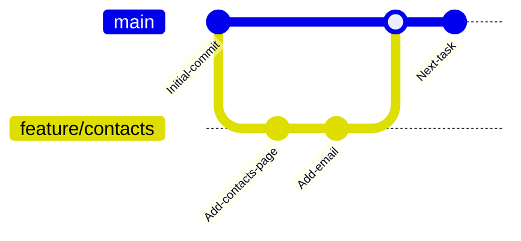
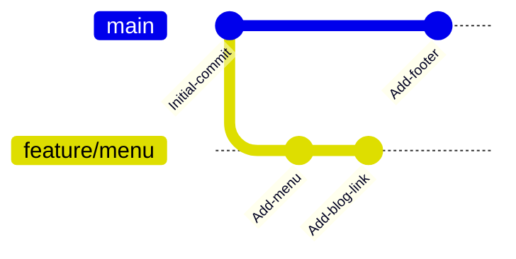
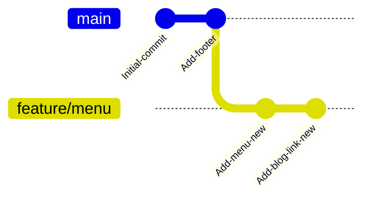

# Jamoada ishlash

[Mundarija](../../README.md) · [← Orqaga](../../Lesson-8/uz/GitHub%20va%20masofaviy%20repozitoriylar.md) · [Keyingi →](../../Lesson-10/uz/Teglar%2C%20relizlar%20va%20yakuniy%20loyiha.md) · [RU](../ru/%D0%9A%D0%BE%D0%BC%D0%B0%D0%BD%D0%B4%D0%BD%D0%B0%D1%8F%20%D1%80%D0%B0%D0%B1%D0%BE%D1%82%D0%B0.md) · [EN](../en/Teamwork.md) · [UZ](Jamoada%20ishlash.md)

> **8-dars bilan bog‘liqlik:** siz loyihani GitHub’da e’lon qildingiz, `git push`, `git clone`, `git fetch` va `git pull` ni o‘rgandingiz hamda `origin/main` - bu «Git’ingiz serverdagi `main` haqida bilgan eng oxirgi narsa» ekanini bildingiz. Yolg‘iz ishlaganingizda `push` doim o‘tardi. Bugun loyihaga jamoadoshingiz qo‘shiladi - va siz Git `push` ingizni qabul qilishdan bosh tortganda nima qilish kerakligini, pull request orqali ish tartibini qanday kelishib olishni va chala tahrirni qanday chetga qo‘yishni bilib olasiz.

---

## Bu sizga nima uchun kerak

Siz do‘stingiz bilan o‘quv jamoasi uchun sayt yasayapsiz; ertalab ikkalangiz ham repozitoriyni klonladingiz. Siz bosh sahifa va eslatmalarni qo‘shdingiz, do‘stingiz - uslublarni, va u ularni birinchi bo‘lib yuborishga ulgurdi. Siz `git push` ni yozasiz - va qizil `! [rejected]` ni ko‘rasiz. Buning ustiga `notes.md` faylida sizda yana bitta qator bor, uni kommit qilishga ulgurmagansiz. Nima qilish kerak? Papkani o‘chirib, qaytadan klonlashmi? «Kuch bilan» yuborishmi? Ikkala yo‘l ham yomon: birinchisi sizning ishingizni yo‘qotadi, ikkinchisi - do‘stingiznikini. Ikki talabadan yuzta dasturchigacha bo‘lgan har qanday jamoada bu har kuni sodir bo‘ladi. Yaxshi xabar: yechim - bir nechta xotirjam buyruq, va bu darsdan keyin siz ularni yoddan bilasiz.

---

## Nimani o‘rganasiz

- **GitHub Flow** bo‘yicha ishlash: tarmoq → kommitlar → `push` → pull request → ko‘rib chiqish (review) → birlashtirish (merge) → tarmoqni o‘chirish.
- GitHub’da pull request ochish va **code review** o‘tkazish.
- `push` nima uchun `fetch first` maslahati bilan rad etilganini tushunish va buni `--force` siz tuzatish.
- `Need to specify how to reconcile divergent branches` xabarini o‘qish va `pull.rebase false`, `pull.rebase true` yoki `pull.ff only` ni tanlash.
- `git pull --rebase` va `git rebase main` dan foydalanish hamda rebase qachon **mumkin emasligini** bilish.
- Kommit qilinmagan tahrirlarni chetga qo‘yish: `git stash`, `list`, `pop`, `-m`, `-u`.
- `git cherry-pick` buyrug‘i bilan bitta kommitni boshqa tarmoqqa nusxalash.
- `git pull` paytida paydo bo‘lgan konfliktni hal qilish.

---

## Takrorlash: 8-darsdan 3 savol

1. `git fetch` ning `git pull` dan farqi nimada?
2. `origin/main` nimani ko‘rsatadi va u qachon yangilanadi?
3. `git push -u origin main` buyrug‘idagi `-u` kaliti nima qiladi?

Javoblar - dars oxirida.

---

## Reja

| Bo‘lim | Nima qilamiz |
| --- | --- |
| GitHub Flow | Jamoaning tarmoqlar orqali ishlash tartibi |
| Pull request va ko‘rib chiqish | O‘zgarishlarni qanday taklif qilish va boshqalarnikini tekshirish |
| Rad etilgan `push` | Nega `fetch first` va nima qilish kerak |
| Tarmoqlarning ajralishi | `pull.rebase`, `pull.ff` va birlashtirishning uchta usuli |
| Mini-topshiriq 1 | Ikkita klon, rad etilgan `push`, birlashtirish |
| `git stash` | Chala tahrirni chetga qo‘yish |
| `git rebase` | Kommitlarni yangi `main` ustiga ko‘chirish |
| `pull` va `cherry-pick` dagi konfliktlar | 7-darsni takrorlash va bitta kommitni nusxalash |
| Mini-topshiriq 2 | stash, rebase, cherry-pick |
| Mustaqil ish | O‘quv terminalida va kompyuterda jamoadosh bilan sinxronlash |

---

## GitHub Flow: jamoa qanday ishlaydi

Loyiha ustida bir necha kishi ishlaganda qoidalarni kelishib olish kerak. Eng oddiy va mashhur qoida - **GitHub Flow**: `main` tarmog‘i doim ishlaydigan holatda bo‘ladi, har qanday vazifa esa **alohida qisqa tarmoqda** bajariladi (6-dars). Tarmoq GitHub’ga yuboriladi, **pull request** ochiladi - uni `main` ga birlashtirish so‘rovi, jamoadosh o‘zgarishlarni tekshiradi (**ko‘rib chiqish**, review), so‘ng tarmoq birlashtiriladi va o‘chiriladi.

**Oddiy so‘z bilan:** GitHub Flow - jurnal tahririyatining ishiga o‘xshaydi. Jurnalist maqolani o‘z qoralamasida yozadi (tarmoq), uni muharrirga topshiradi (pull request), muharrir tuzatadi va savollar beradi (ko‘rib chiqish), va faqat shundan keyin maqola songa tushadi (`main`). Hech kim to‘g‘ridan-to‘g‘ri sahifalangan songa yozmaydi.



**Sxemani qanday o‘qish kerak.** Asosiy chiziq - `main`. Har bir vazifa `main` dan ajralib chiqadi, o‘z kommitlarini oladi va `main` ga birlashtirish kommiti bilan qaytadi (ikki chiziq qo‘shiladigan nuqta). Tarmoqlar qisqa yashaydi - soatlar yoki kunlar: tarmoq qanchalik qisqa bo‘lsa, konfliktlar shunchalik kam bo‘ladi.

### Terminalda qadamma-qadam

```bash
git switch -c feature/contacts
echo "<h1>Contacts</h1>" > contacts.html
git add contacts.html
git commit -m "Add contacts page"
git push -u origin feature/contacts
```

Javobdagi asosiy narsa - oxirgi qatorlar:

```text
To https://github.com/team/site.git
 * [new branch]      feature/contacts -> feature/contacts
branch 'feature/contacts' set up to track 'origin/feature/contacts'.
```

`[new branch]` - GitHub’da yangi tarmoq paydo bo‘ldi, `-u` tufayli esa bu tarmoqdagi keyingi `git push` va `git pull` ni nomlarsiz yozish mumkin.

Keyin - GitHub’dagi pull request (keyingi bo‘lim). U birlashtirilgach, serverdagi tarmoq o‘chiriladi, o‘zingizda esa `main` yangilanadi:

```bash
git switch main
git pull
git branch -d feature/contacts
```

`git pull` oldinga o‘tkazishni (`Fast-forward`) bajaradi, `git branch -d` esa `Deleted branch feature/contacts (was 34b950b).` deb javob beradi. Serverdagi tarmoq GitHub’dagi tugma yoki `git push origin --delete feature/contacts` buyrug‘i bilan o‘chiriladi, jamoadoshlarda qolgan `origin/feature/contacts` havolasini esa `git fetch --prune` olib tashlaydi (8-dars).

| Qadam | Buyruq | Nima o‘zgardi / HEAD qayerga ko‘rsatadi |
| --- | --- | --- |
| 1 | `git switch -c feature/contacts` | `main` dan yangi tarmoq, HEAD → `feature/contacts` |
| 2 | `git push -u origin feature/contacts` | Tarmoq GitHub’da paydo bo‘ldi |
| 3 | Pull request → ko‘rib chiqish → GitHub’da **Merge** (birlashtirish) | Serverda `main` birlashtirish kommitini oldi |
| 4 | `git switch main` va `git pull` | HEAD → `main`, lokal `main` serverga yetib oldi |
| 5 | `git branch -d feature/contacts` | Lokal tarmoq o‘chirildi: uning kommitlari allaqachon `main` da |

---

## Pull request va code review

**Pull request** (qisqacha PR, «birlashtirish so‘rovi») - GitHub’dagi sahifa, unda quyidagilar ko‘rinadi: o‘zgarishlarni qaysi tarmoqdan qaysi tarmoqqa birlashtirish taklif qilinyapti, barcha kommitlar, barcha o‘zgargan qatorlar va muhokama. GitLab’da xuddi shu narsa **merge request** deb ataladi.

**Oddiy so‘z bilan:** pull request - kurs ishini ilmiy rahbarga tekshirishga topshirishga o‘xshaydi. Siz boblarni oqqa o‘zingiz yopishtirmaysiz: rahbar o‘qiydi, hoshiyalarga belgilar qo‘yadi, siz tuzatasiz va faqat shundan keyin ish qabul qilingan hisoblanadi.

### Pull request qanday ochiladi

PR tavsifida nima qilingani va buni qanday tekshirish mumkinligi yoziladi. GitHub interfeysi ba’zan o‘zgaradi, lekin asosiy nomlar yillar davomida saqlanadi:

| Qayerda | Nimani bosish kerak | Nima sodir bo‘ladi |
| --- | --- | --- |
| Tarmoq `push` qilingandan so‘ng darhol repozitoriyning bosh sahifasi | **Compare & pull request** (solishtirish va pull request) tugmasi bor sariq panel | GitHub hozirgina yuborilgan tarmoq uchun PR ni o‘zi taklif qiladi |
| **Pull requests** (pull request’lar) yorlig‘i | **New pull request** (yangi pull request), so‘ng `base: main` va `compare: feature/contacts` ni tanlash | Agar panel allaqachon yo‘qolgan bo‘lsa, xuddi shu PR |
| PR shakli | Sarlavha, tavsif (nima va nima uchun qilingan), **Create pull request** (pull request yaratish) | PR ochildi, jamoa bildirishnoma oldi |

### Code review: boshqalarning o‘zgarishlarini tekshirish

**Ko‘rib chiqish** (review) - jamoadosh o‘zgarishlaringizni ular `main` ga tushishidan oldin o‘qib chiqadi. PR sahifasida **Files changed** (o‘zgargan fayllar) yorlig‘i bor: unda `git diff` dagi (3-dars) kabi `+` va `-` belgili qatorlar. Istalgan qatorga izoh qoldirish mumkin, oxirida esa xulosani tanlash kerak: **Comment** (shunchaki izoh), **Approve** (ma’qullayman) yoki **Request changes** (tuzatish kerak). Agar tekshiruvchi xato topsa, muallif uni o‘sha tarmoqda tuzatadi: `git commit`, `git push` - PR o‘zi yangilanadi.

> **Muhim:** ko‘rib chiqish - odamni emas, kodni tekshirish. Aniq va xushmuomala yozing: «bu yerda yopuvchi `</p>` tegi tushib qolgan», «yana hammasini buzding» emas. Izohlardan xafa bo‘lmang: ularning maqsadi - `main` ga xato tushmasligi.

### Merge: uchta tugma

PR ma’qullangach, sahifa pastida **Merge pull request** (pull request’ni birlashtirish) bosiladi (keyin **Confirm merge** - birlashtirishni tasdiqlash). Tugmada variantlari bor strelka bor:

| Variant | `main` da nima bo‘ladi |
| --- | --- |
| **Create a merge commit** (birlashtirish kommitini yaratish) | Tarmoqning barcha kommitlari + birlashtirish kommiti (`git merge --no-ff` kabi, 7-dars) |
| **Squash and merge** (siqish va birlashtirish) | Tarmoqning barcha kommitlari bitta yangi kommitga «siqiladi» |
| **Rebase and merge** (rebase va birlashtirish) | Tarmoq kommitlari birlashtirish kommitisiz `main` ustiga ko‘chiriladi (rebase haqida - pastda) |

Birlashtirishdan keyin GitHub **Delete branch** (tarmoqni o‘chirish) tugmasini ko‘rsatadi - tarmoq endi kerak emas. Qaysi variantdan foydalanishni jamoa hal qiladi; yangi o‘rganuvchiga birinchisi mos keladi.

---

## Rad etilgan `push`

Dars boshidagi vaziyatga qaytamiz. Siz `https://github.com/team/site.git` ni klonladingiz va ikkita kommit qildingiz: `Add home page` va `Add notes`. Shu paytda Aziz ham repozitoriyni klonladi, `style.css` ni qo‘shdi va uni allaqachon yubordi. `notes.md` da sizda kommit qilinmagan qator bor.

`git status` `Your branch is ahead of 'origin/main' by 2 commits.` deb yozadi va `modified: notes.md` ni ko‘rsatadi. Git siz shunchaki 2 kommit oldinda ekaningizga ishonadi: u Aziz kommiti haqida hali bilmaydi. Yuborib ko‘ramiz:

```bash
git push
```

```text
To https://github.com/team/site.git
 ! [rejected]        main -> main (fetch first)
error: failed to push some refs to 'https://github.com/team/site.git'
hint: Updates were rejected because the remote contains work that you do not
hint: have locally. This is usually caused by another repository pushing to
hint: the same ref. If you want to integrate the remote changes, use
hint: 'git pull' before pushing again.
hint: See the 'Note about fast-forwards' in 'git push --help' for details.
```

| Qator | Tarjimasi va ma’nosi |
| --- | --- |
| `! [rejected] main -> main (fetch first)` | Rad etildi. «Avval olib keling» (fetch first) - serverda nimadir yangi bor |
| `the remote contains work that you do not have locally` | Serverda sizda yo‘q ish bor |
| `use 'git pull' before pushing again` | Yechim: `git pull`, keyin yana `git push` |

**Git nega shunday qiladi.** Server `push` ni faqat yangi tarix eskisini **davom ettirsa** qabul qiladi (oldinga o‘tkazish, 7-dars). Sizning `main` ingiz `Initial commit` dan boshlanadi, serverda esa undan keyin allaqachon `Add styles` turibdi. Agar server `push` ingizni qabul qilganida, Aziz kommiti `main` dan shunchaki yo‘qolib ketardi. Rad etish jamoadoshning ishini himoya qiladi.

Tartib doim shunday: kim birinchi yuborgan bo‘lsa, o‘shaning `push` i o‘tdi; ikkinchisi boshqalarning kommitlarini oladi, ularni o‘zinikilari bilan **o‘z kompyuterida** birlashtiradi va faqat keyin yuboradi. Server tarixlarni hech qachon o‘zi birlashtirmaydi.

> **Muhim:** rad etilgan `push` ni `git push --force` buyrug‘i bilan «davolamang». U serverni sizning tarixingizni qabul qilishga majbur qiladi va jamoadoshning kommiti `main` dan yo‘qoladi. `--force` faqat boshqa hech kim foydalanmaydigan **o‘z** tarmog‘ingizda va faqat nima qilayotganingizni aniq tushunganingizda joiz.

---

## Tarmoqlarning ajralishi va `git pull`

`git fetch` dan keyin Git nimani bilishini ko‘ramiz:

```bash
git fetch
git status
```

```text
From https://github.com/team/site.git
   d7ac0cb..8e429e3  main       -> origin/main
On branch main
Your branch and 'origin/main' have diverged,
and have 2 and 1 different commits each, respectively.
  (use "git pull" if you want to integrate the remote branch with yours)
```

Tarjimasi: «Tarmog‘ingiz va `origin/main` **ajralib ketdi**: sizda 2 ta o‘z kommitingiz, serverda - 1 ta o‘z kommiti bor».

**Oddiy so‘z bilan:** ajralish - bitta bobni olib, unga turli davomlar yozgan ikki muallifga o‘xshaydi. Bitta kitob chiqishi uchun davomlarni birlashtirish kerak. Buni ikki usulda qilish mumkin: ikkala davomni tikib, «bu yerda ikki versiya qo‘shiladi» degan sahifa qo‘shish (merge) yoki o‘z davomingizni xuddi uni boshqasinikidan keyin boshlagandek qayta yozish (rebase).

### Git usulni tanlashni so‘raydi

Sozlamalarsiz `git pull` ni sinab ko‘ramiz. Javob uzun, lekin juda foydali:

```bash
git pull
```

```text
hint: You have divergent branches and need to specify how to reconcile them.
hint: You can do so by running one of the following commands sometime before
hint: your next pull:
hint:
hint:   git config pull.rebase false  # merge
hint:   git config pull.rebase true   # rebase
hint:   git config pull.ff only       # fast-forward only
hint:
hint: You can replace "git config" with "git config --global" to set a default
hint: preference for all repositories. You can also pass --rebase, --no-rebase,
hint: or --ff-only on the command line to override the configured default per
hint: invocation.
fatal: Need to specify how to reconcile divergent branches.
```

| Qator | Tarjimasi va ma’nosi |
| --- | --- |
| `You have divergent branches and need to specify how to reconcile them` | Tarmoqlar ajralib ketdi, ularni qanday murosaga keltirishni ko‘rsating |
| `git config pull.rebase false / true`, `pull.ff only` | Uchta usul: birlashtirish, rebase, faqat oldinga o‘tkazish (batafsil - pastdagi jadvalda) |
| `--global`, `--rebase, --no-rebase, or --ff-only` | Barcha repozitoriylar uchun belgilash yoki bitta `pull` uchun kalit bilan tanlash |
| `fatal: Need to specify how to reconcile divergent branches.` | Xato: usul tanlanmagan, hech narsa birlashtirilmadi |

Git 2.33 versiyasidan beri shunday ishlaydi: avval u jimgina birlashtirardi va yangi o‘rganuvchilar kutilmagan birlashtirish kommitlarini olardi. Bunda boshqalarning kommitlari `origin/main` ga **allaqachon yuklab olingan** - faqat birlashtirish yetishmaydi.

| Sozlama | Bir martalik kalit | Ajralganda nima qiladi | Qachon tanlash kerak |
| --- | --- | --- | --- |
| `pull.rebase false` | `git pull --no-rebase` | `Merge branch 'main' of ...` birlashtirish kommiti | Yangi o‘rganuvchilarga: hech narsa qayta yozilmaydi, hammasi tarixda ko‘rinadi |
| `pull.rebase true` | `git pull --rebase` | Kommitlaringiz olinganlar ustiga ko‘chiriladi, tarix - to‘g‘ri chiziq | Jamoa ortiqcha birlashtirishlarsiz tarixni xohlaydi |
| `pull.ff only` | `git pull --ff-only` | Faqat oldinga o‘tkazish; ajralganda - `fatal: Not possible to fast-forward, aborting.` | Siz hech qachon to‘g‘ridan-to‘g‘ri `main` ga kommit qilmaysiz, faqat tarmoqlar va PR orqali |

`--global` siz sozlama bitta repozitoriyda, `--global` bilan - hammasida amal qiladi. Buyruqdagi kalit sozlamadan kuchliroq.

> **Muhim:** agar ishchi papkada kommit qilinmagan tahrirlar bo‘lsa, `git pull --rebase` ishlashdan bosh tortadi (`error: cannot pull with rebase: You have unstaged changes.`), birlashtiruvchi `git pull` esa tahrir jamoadosh o‘zgartirgan faylda bo‘lsa, rad etadi. Avval tahrirni chetga qo‘ying - bu `git stash`, u haqda bitta bo‘limdan keyin.

### 1-variant: birlashtirish

```bash
git config pull.rebase false
git pull
git log --oneline --graph
```

```text
Merge made by the 'ort' strategy.
 style.css | 1 +
 1 file changed, 1 insertion(+)
 create mode 100644 style.css
*   49563fe (HEAD -> main) Merge branch 'main' of https://github.com/team/site
|\
| * 8e429e3 (origin/main) Add styles
* | 2a28250 Add notes
* | 31ee276 Add home page
|/
* d7ac0cb Initial commit
```

`Merge made by the 'ort' strategy.` - 7-darsdagi kabi birlashtirish bajarildi; `Merge branch 'main' of ...` xabarini Git o‘zi yozdi. Grafda chapda sizning kommitlaringiz, o‘ngda - Aziz kommiti, tepada ular qo‘shiladi.

Endi tarixingiz serverdagisini **davom ettiradi** va `git push` o‘tadi. Haqiqiy Git’da birlashtirishda tayyor xabarli muharrir ochilishi mumkin - uni shunchaki saqlang va yoping.

### 2-variant: `git pull --rebase`

Xuddi o‘sha boshlang‘ich holat, lekin rebase bilan (ishchi papka toza bo‘lishi kerak - tahrirni qanday chetga qo‘yishni `git stash` haqidagi bo‘limda bilib olasiz):

```bash
git pull --rebase
git log --oneline --graph
```

```text
Successfully rebased and updated refs/heads/main.
* fa692a0 (HEAD -> main) Add notes
* 0e30042 Add home page
* 8e429e3 (origin/main) Add styles
* d7ac0cb Initial commit
```

Birlashtirish kommiti yo‘q: Git ikkita kommitingizni «uzib oldi», ularning o‘rniga Aziz kommitini qo‘ydi va siznikilarni tepadan «ulab qo‘ydi». Kommitlaringiz xeshlari o‘zgardi (`31ee276` → `0e30042`): bular tarkibi o‘sha-o‘sha **yangi** kommitlar. Bu xavfsiz, chunki ular hali e’lon qilinmagan edi.

---

## Mini-topshiriq 1

O‘quv terminalida bo‘sh masofaviy repozitoriy `https://github.com/student/site.git` bor. «Jamoadosh» ni `~/site-aziz` papkasidagi ikkinchi klon bilan tasvirlaymiz.

1. Ism, email va `main` tarmog‘ini sozlang. Repozitoriy, `index.html` fayli (`<h1>Team site</h1>`) va `Add home page` kommiti bilan `~/site` ni yarating.
2. Masofaviy repozitoriyni `origin` sifatida ulang va `main` ni `-u` bilan yuboring.
3. Uy papkasida uni `site-aziz` ga klonlang, u yerda `body { margin: 0; }` matnli `style.css` ni qo‘shing, `Add styles` kommitini qiling va yuboring.
4. `~/site` ga qayting, `index.html` ga `<p>Welcome</p>` qatorini qo‘shing, `Add welcome text` kommitini qiling va `git push` ni sinab ko‘ring. Javobda `fetch first` ni toping.
5. Sozlamalarsiz `git pull` ni bajaring va `fatal` qatorini toping. So‘ng o‘zgarishlarni `--no-rebase` kaliti bilan birlashtirib oling, grafni ko‘ring va yuboring.

---

## `git stash`: tahrirni chetga qo‘yish

Ko‘pincha o‘zgarishlarni zudlik bilan olish yoki boshqa tarmoqqa o‘tish kerak bo‘ladi, ishchi papkada esa chala tahrir yotibdi - uni kommit qilishga hali erta, tashlab yuborishga achinasiz.

**Oddiy so‘z bilan:** `git stash` - bu cho‘ntak. Siz xat yozyapsiz, to‘satdan eshik qo‘ng‘irog‘i chalinadi. Qoralamani cho‘ntakka solasiz, eshikni ochasiz, posilkani qabul qilasiz (`git pull`), keyin qoralamani chiqarib, yozishda davom etasiz. Bu vaqtda stol (ishchi papka) toza.

```bash
git stash
git status
git stash list
```

```text
Saved working directory and index state WIP on main: 2a28250 Add notes
On branch main
Your branch and 'origin/main' have diverged,
and have 2 and 1 different commits each, respectively.
  (use "git pull" if you want to integrate the remote branch with yours)

nothing to commit, working tree clean
stash@{0}: WIP on main: 2a28250 Add notes
```

| Qator | Tarjimasi va ma’nosi |
| --- | --- |
| `Saved working directory and index state` | Ishchi papka va indeks o‘zgarishlari saqlandi |
| `WIP on main: 2a28250 Add notes` | WIP (work in progress) - «jarayondagi ish»; `main` tarmog‘ida `Add notes` kommiti ustidan chetga qo‘yildi |
| `nothing to commit, working tree clean` | Ishchi papka toza: tahrir «cho‘ntakda» |
| `stash@{0}` | Yozuv raqami: `0` - eng yangisi |

Endi o‘zgarishlarni bemalol olamiz va kommitlarni yuboramiz (bu yerda - oldingi bo‘limdagi birlashtirish varianti), keyin tahrirni chiqaramiz:

```bash
git pull
git push
git stash pop
```

`git pull` va `git push` 1-variantdagidek javob beradi. `git stash pop` javobida avval oddiy `git status` keladi, asosiysi esa - mana bu yerda:

```text
	modified:   notes.md

no changes added to commit (use "git add" and/or "git commit -a")
Dropped refs/stash@{0} (a34aa5c1d940d7a31fdc6eb7484e1b717a81d608)
```

| Qator | Tarjimasi va ma’nosi |
| --- | --- |
| `modified: notes.md` | Tahrir ishchi papkaga qaytdi |
| `Dropped refs/stash@{0}` | Yozuv ro‘yxatdan o‘chirildi: `pop` = «chiqarib olish va o‘ramini tashlab yuborish» |

Tahrirni kommit qilish va yuborish qoladi: `git commit -am "Update notes"`, `git push`.

| Qadam | Buyruq | Ishchi papka | Indeks | Repozitoriy |
| --- | --- | --- | --- | --- |
| 1 | (boshlanish) | `notes.md` o‘zgargan | `Add notes` dagidek | 2 kommit oldinda, server 1 kommit oldinga ketgan |
| 2 | `git stash` | toza | `Add notes` dagidek | + `stash@{0}` yozuvi |
| 3 | `git pull` | + `style.css` | + `style.css` | + Aziz kommiti va birlashtirish kommiti |
| 4 | `git push` | o‘zgarishsiz | o‘zgarishsiz | server = lokal `main` |
| 5 | `git stash pop` | `notes.md` yana o‘zgargan | o‘zgarishsiz | stash yozuvi o‘chirildi |
| 6 | `git commit -am "Update notes"` | toza | = yangi kommit | + `Update notes`, keyin `git push` |

### `git stash` imkoniyatlari

| Buyruq | Nima qiladi |
| --- | --- |
| `git stash` yoki `git stash push` | Kuzatiladigan fayllar o‘zgarishlarini (va indeksni) chetga qo‘yish |
| `git stash -m "footer idea"` | Xuddi shunday, lekin `WIP on main` o‘rniga tushunarli yorliq bilan |
| `git stash -u` | **Yangi** (kuzatilmaydigan) fayllarni ham chetga qo‘yish |
| `git stash list` | Yozuvlar ro‘yxati |
| `git stash show` | Oxirgi yozuvda qaysi fayllar bor |
| `git stash pop` | Oxirgi yozuvni qaytarish va uni ro‘yxatdan o‘chirish |
| `git stash apply` | Qaytarish, lekin yozuvni ro‘yxatda qoldirish |
| `git stash drop` | Oxirgi yozuvni qaytar**masdan** o‘chirish |

Yorliqlar va yangi fayllar:

```bash
git stash -m "footer idea"
echo "draft" > todo.txt
git stash -u -m "todo draft"
git stash list
```

```text
Saved working directory and index state On main: footer idea
Saved working directory and index state On main: todo draft
stash@{0}: On main: todo draft
stash@{1}: On main: footer idea
```

Yozuvlar taxlam bo‘lib yig‘iladi: yangisi `0` raqamini oladi, eskilari suriladi. `git stash pop` tepadagisini - `todo draft` ni chiqaradi.

> **Muhim:** `-u` siz yangi fayl (`Untracked`) papkada qoladi va stash ga tushmaydi. `git stash drop` esa tahrirni butunlay tashlab yuboradi - uni `pop` bilan adashtirmang. Agar `pop` paytida konflikt yuz bersa, Git `The stash entry is kept in case you need it again.` deb yozadi: yozuv o‘chirilmaydi, konfliktni 7-darsdagidek hal qiling.

---

## `git rebase`: kommitlarni ko‘chirish

Siz `git pull --rebase` ni ko‘rdingiz. Xuddi shu g‘oya tarmoqlar bilan ham ishlaydi. Siz `feature/menu` tarmog‘ida menyu yasayapsiz, bu orada esa `main` ga Aziz’ning `Add footer` kommiti tushdi. Tarmog‘ingiz yangi `main` dan boshlanishi uchun uni rebase qilishadi. Avval `main` ni yangilang (`git switch main`, `git pull`) va tarmoqqa qayting: `git switch feature/menu`.

**Oddiy so‘z bilan:** rebase - tarmoqni «ko‘chirib o‘tqazish». Siz doskaga qadab qo‘yilgan varaqqa rasm chizayotgan edingiz. Chizayotganingizda doskaga varag‘ingiz ostiga yangisini qadashdi. Rebase rasmlaringizni olib, yangi varaq ustiga qo‘yadi va har birini qaytadan chizadi. Rasmlar o‘sha-o‘sha, lekin bu endi yangi varaqlar.



**Sxemani qanday o‘qish kerak.** Rebase’dan oldin: `feature/menu` tarmog‘i eski `Initial-commit` kommitidan ajraladi va `Add-footer` haqida bilmaydi. Agar uni hozir birlashtirsangiz, birlashtirish kommiti hosil bo‘ladi.

```bash
git rebase main
```

```text
Successfully rebased and updated refs/heads/feature/menu.
```

`git log --oneline --graph --all` da endi bitta chiziq: `566d27d Add blog link to menu`, `ca1d8dc Add menu`, `f3d5db9 Add footer`, `d7ac0cb Initial commit`.



**Sxemani qanday o‘qish kerak.** Rebase’dan keyin tarmoq `Add-footer` dan boshlanadi, tarix - to‘g‘ri chiziq. Bunday tarmoqni `main` ga birlashtirish oddiy oldinga o‘tkazish bo‘ladi. Lekin xeshlarga e’tibor bering: rebase’dan oldin tarmoq kommitlari `cce299f Add menu` va `ba21373 Add blog link to menu` edi, endi esa - `ca1d8dc` va `566d27d`. Eski kommitlar tarmoqda endi yo‘q - ularni nusxalar almashtirdi.

Merge halol tarixni saqlaydi (ish qayerda parallel borgani ko‘rinadi), xeshlarni o‘zgartirmaydi va doim xavfsiz. Rebase xuddi hamma navbat bilan ishlagandek to‘g‘ri chiziq beradi, lekin yangi xeshli yangi kommitlar yaratadi - shuning uchun faqat e’lon qilinmagan kommitlar uchun xavfsiz.

> **Muhim:** rebase’ning asosiy qoidasi - **allaqachon e’lon qilingan va boshqalar foydalanayotgan kommitlarni rebase qilmang**. Agar jamoadosh tarmog‘ingizni olgan bo‘lsa-yu, siz uni rebase qilsangiz, unda eski kommitlar, sizda - yangilari qoladi va tarixlar «abadiy» ajralib ketadi. Bu 4-darsdagi qoidaning o‘zi: e’lon qilingan tarix qayta yozilmaydi. O‘zingizning lokal kommitlaringizni va hech kim ishlamayotgan o‘z tarmog‘ingizni rebase qilish mumkin. Agar rebase konfliktda to‘xtasa: uni hal qiling, `git add` va `git rebase --continue`, hammasini bekor qilish uchun esa - `git rebase --abort`.

---

## `pull` dagi konfliktlar va `git cherry-pick`

### `pull` dagi konflikt: 7-darsni takrorlash

Agar siz va jamoadoshingiz **bitta qatorni** o‘zgartirgan bo‘lsangiz, `git pull` konfliktda to‘xtaydi - xuddi 7-darsdagi `git merge` kabi. Axir `pull` = `fetch` + `merge` (yoki `rebase`). Misol: siz `Team website` sarlavhasini yozdingiz, Aziz - `Our team`.

```bash
git config pull.rebase false
git pull
cat index.html
```

```text
From https://github.com/team/site.git
   31ee276..a1e349d  main       -> origin/main
Auto-merging index.html
CONFLICT (content): Merge conflict in index.html
Automatic merge failed; fix conflicts and then commit the result.
<<<<<<< HEAD
<h1>Team website</h1>
=======
<h1>Our team</h1>
>>>>>>> 9c41f2a7d3e85b06f1a4c2d8e7b93f50a6d1c2e4
```

`<<<<<<< HEAD` va `=======` orasida - sizning versiyangiz, `=======` va `>>>>>>> 9c41f2a...` orasida - serverdagi versiya: `git pull` da belgidan keyin olingan kommitning to‘liq xeshi turadi (sizda u boshqacha bo‘ladi). 7-darsdagidek o‘z tarmog‘ingizni birlashtirganda u yerda tarmoq nomi turadi.

7-darsdagidek hal qilamiz: kerakli matnni belgilarsiz qoldirish, `git add`, `git commit` va `git push` ni unutmaslik:

```bash
echo "<h1>Our team website</h1>" > index.html
git add index.html
git commit -m "Merge title changes"
git push
```

`git log --oneline --graph` da ikki ota-onali `Merge title changes` birlashtirish kommiti paydo bo‘ladi: sizning `Change page title` va Aziz’ning `Rename page title` kommitlari. Hal qilishdan fikringiz qaytdimi - `git merge --abort` hammasini `pull` dan oldingi holatga qaytaradi. **Maslahat:** konfliktlar kamroq bo‘lishi uchun `git pull` ni tez-tez qiling va kim qaysi faylni tahrirlashini kelishib oling.

### `git cherry-pick`: bitta kommitni boshqa tarmoqqa

Ba’zan butun tarmoq emas, undagi bitta kommit kerak bo‘ladi. Masalan, `hotfix` tarmog‘ida matn rangini tuzatish va ishlar ro‘yxatining qoralamasi bor - `main` ga esa faqat tuzatish kerak.

**Oddiy so‘z bilan:** cherry-pick - «bitta gilos uzish»: butun daraxtni ko‘chirib o‘tqazmasdan, birovning daraxtidan bitta mevani olish.

Kerakli kommit xeshini (`b823ea5 Fix text color`) `hotfix` tarmog‘ida `git log --oneline` orqali topamiz, keyin:

```bash
git switch main
git cherry-pick b823ea5
```

```text
Switched to branch 'main'
Your branch is up to date with 'origin/main'.
[main 7759e6e] Fix text color
 Date: Tue Sep 1 10:07:00 2026 +0500
 1 file changed, 1 insertion(+)
 create mode 100644 style.css
```

`main` da o‘sha o‘zgarish, xabar va sana (`Date:`) bilan **yangi** `7759e6e` kommiti yaratildi, lekin uning xeshi boshqa: bu nusxa, o‘sha `b823ea5` kommitining o‘zi emas.

Cherry-pick - alohida holatlar uchun vosita (shoshilinch tuzatishni ko‘chirish, birlashtirmaslikka qaror qilingan tarmoqdan kommitni qutqarish). Oddiy ish uchun tarmoqlar va merge’dan foydalaning.

---

### Buzib ko‘ring

1. Birinchi klondan kommit yuboring, so‘ng ikkinchi klonda o‘z kommitingizni qiling va `git push --force` ni bajaring. Birinchi klonda `git fetch` va `git log --oneline origin/main` ni bajaring: birinchi klonning kommiti serverda qoldimi?
2. stash ro‘yxati bo‘sh bo‘lganda `git stash pop` ni bajaring. Git nima javob beradi?
3. Yangi fayl yarating va `-u` siz `git stash` ni bajaring. Fayl papkada qoldimi? `git stash list` nimani ko‘rsatadi?
4. Bitta klonda fayl qatorini o‘zgartiring, kommit qiling va yuboring, boshqasida o‘sha qatorni o‘zgartiring, lekin kommit **qilmang** va `git pull` ni bajaring. Xatoni o‘qing va uni `git stash` orqali tuzating.
5. `git config pull.ff only` ni belgilang va tarmoqlar ajralib ketganda `git pull` ni bajaring.

### Yangi o‘rganuvchilarning tipik xatolari

| Xato | Nima bo‘ladi | Qanday tuzatish |
| --- | --- | --- |
| Boshqalarning kommitlarini olmasdan `git push` | `! [rejected] main -> main (fetch first)` | `git pull` (birlashtirish usuli bilan), keyin `git push` |
| Rad etilgan `push` `git push --force` orqali «tuzatildi» | Jamoadoshning kommitlari serverdan yo‘qoldi | Umumiy tarmoqda bunday qilmang. Jamoadosh ular o‘zida bor ekan, ularni o‘z `git push` i bilan qaytarishi mumkin |
| Tarmoqlar ajralganda sozlamasiz `git pull` | `fatal: Need to specify how to reconcile divergent branches.` | `git config pull.rebase false` yoki `git pull --no-rebase` / `--rebase` |
| Jamoadosh siz kommit qilmagan tahrirli faylni o‘zgartirganda `git pull` | `error: Your local changes to the following files would be overwritten by merge:` va `Aborting` | `git stash`, `git pull`, `git stash pop` |
| `git stash pop` o‘rniga `git stash drop` | Tahrir o‘chirildi, papkada u yo‘q | `pop` dan foydalaning; `drop` - faqat keraksiz yozuvlar uchun |
| `git stash pop` unutildi | Tahrir «yo‘qoldi»; `git stash list` `stash@{0}` ni ko‘rsatadi | `git stash pop` |
| Jamoadosh ishlayotgan e’lon qilingan tarmoq rebase qilindi | Tarixlar ajralib ketdi, jamoadoshda kommitlar takrorlandi | Faqat o‘zingizning e’lon qilinmagan kommitlaringizni rebase qiling; umumiy tarmoqlarda - merge |
| `pull` dan keyin konflikt hal qilindi, lekin yuborilmadi | `Your branch is ahead of 'origin/main'` | `git push` |

---

## Mini-topshiriq 2

1-mini-topshiriqdan keyin o‘sha `~/site` va `~/site-aziz` papkalarida davom eting.

1. `~/site` da `- add contacts page` matnli `notes.md` faylini yarating va uni `notes draft` yorlig‘i bilan stash ga qo‘ying (bu yangi fayl - kuzatilmaydigan fayllar uchun kalit kerak). Ro‘yxatni ko‘ring.
2. `feature/menu` tarmog‘ini yarating, `<nav>Home | About</nav>` matnli `menu.html` ni va `Add menu` kommitini qo‘shing.
3. `~/site-aziz` da o‘zgarishlarni oling, `footer.html` ni (`<footer>2026</footer>`), `Add footer` kommitini qo‘shing va yuboring.
4. `~/site` da `main` ni yangilang, `feature/menu` ga qayting va uni `main` ustiga rebase qiling. Barcha tarmoqlar grafini ko‘ring: tarmoq endi qaysi kommitdan boshlanadi?
5. `main` ga o‘ting, unga `feature/menu` tarmog‘ining oxirgi kommitini `git cherry-pick feature/menu` buyrug‘i bilan nusxalang va chetga qo‘yilgan `notes.md` ni qaytaring. `git status -s` ni tekshiring.

---

## Dars yakuni: shpargalka

| Vazifa | Buyruq |
| --- | --- |
| Pull request uchun tarmoqni yuborish | `git push -u origin feature/nom` |
| PR birlashtirilgandan keyin: `main` ni yangilash va tarmoqni o‘chirish | `git switch main`, `git pull`, `git branch -d feature/nom` |
| `push` rad etildi (`fetch first`) | `git pull`, keyin `git push` |
| `pull` uchun birlashtirishni tanlash | `git config pull.rebase false` yoki `git pull --no-rebase` |
| `pull` uchun rebase ni tanlash | `git config pull.rebase true` yoki `git pull --rebase` |
| Faqat oldinga o‘tkazish | `git config pull.ff only` yoki `git pull --ff-only` |
| Tahrirni chetga qo‘yish / yorliq bilan / yangi fayllar bilan | `git stash`, `git stash -m "matn"`, `git stash -u` |
| Ro‘yxat, yozuv tarkibi | `git stash list`, `git stash show` |
| Qaytarish va yozuvni o‘chirish / qaytarish va qoldirish | `git stash pop`, `git stash apply` |
| Tarmoqni yangi `main` ustiga ko‘chirish | `git switch feature/nom`, `git rebase main` |
| Rebase’ni davom ettirish / bekor qilish | `git rebase --continue`, `git rebase --abort` |
| Bitta kommitni joriy tarmoqqa nusxalash | `git cherry-pick <xesh>` |

---

## Mustaqil ish

### 1-qism. IDE topshirig‘i (platforma hisoblaydi)

Siz `~/site` papkasidasiz - umumiy `https://github.com/team/site.git` repozitoriysining klonida. Sizda hali yuborilmagan lokal kommit bor, jamoadoshingiz Aziz esa boshqa faylli o‘z kommitini allaqachon yubordi. `notes.md` da sizda kommit qilinmagan tahrir bor. Buyruqlarni har qatorga bittadan yozing:

1. Holatni ko‘ring va kommitni `git push` buyrug‘i bilan yuborib ko‘ring - Git uni rad etishiga ishonch hosil qiling.
2. Kommit qilinmagan tahrirni `git stash` buyrug‘i bilan chetga qo‘ying va stash ro‘yxatini ko‘ring.
3. Birlashtirish usulini tanlang: `git config pull.rebase false` (yoki `git pull` ning `--no-rebase` / `--rebase` kaliti) va jamoadosh o‘zgarishlarini oling.
4. Kommitlaringizni yuboring.
5. Chetga qo‘yilgan tahrirni qaytaring (`git stash pop`) va uni `Update notes` xabari bilan kommit qiling.
6. Kommitni yuboring va ishchi papka toza ekanini tekshiring. `git push --force` dan foydalanmang.

Platforma nimani tekshiradi: birinchi `git push` rad etilganini va siz `git stash` dan foydalanganingizni; serverda Aziz kommiti, lokal kommitingiz va sizning nomingizdan `Update notes` kommiti borligini, serverdagi `notes.md` da esa chetga qo‘yilgan tahrir borligini; lokal `main` `origin/main` va server bilan mos kelishini; stash ro‘yxati bo‘shligini, ishchi papka tozaligini va tugallanmagan birlashtirish yoki rebase yo‘qligini; jamoadosh fayli sizda paydo bo‘lganini; `git push --force` ishlatilmaganini; yechim boshqa ma’lumotlarda ham (jamoadoshning boshqa fayli va boshqa tahrir) ishlashini - birlashtirish ham, rebase ham mos keladi; ssenariy xatosiz bajarilishini.

### 2-qism. Kompyuterdagi loyiha

1. Sherik (kursdosh) toping yoki 8-darsdagi sayt repozitoriyingizning ikkinchi klonini qo‘shni papkaga qiling: `git clone <manzil> site-second`. Kompyuterda sozlamani bir marta belgilang: `git config --global pull.rebase false`.
2. GitHub Flow bo‘yicha ishlang: birinchi papkada `feature/footer` tarmog‘ini yarating, 1–2 ta kommit qiling, uni yuboring va GitHub’da **Compare & pull request** tugmasi bilan pull request oching.
3. Ko‘rib chiqishni o‘tkazing: **Files changed** yorlig‘ida qatorga izoh qoldiring (yolg‘iz ishlasangiz - o‘zingizga), izohni yangi kommit va `git push` bilan tuzating, keyin **Merge pull request** va **Delete branch**. O‘zingizda `main` ni yangilang va lokal tarmoqni o‘chiring.
4. Ikkinchi papkada `main` ga kommit qiling va uni yuboring, birinchisida esa - `main` ga boshqa kommit va kommit qilinmagan tahrir. Darsdagi yo‘lni bosib o‘ting: `push` (rad etildi) → `git stash` → `git pull` → `git push` → `git stash pop` → kommit → `git push`.
5. `git pull` dan keyin ikkala papkada `git log --oneline --graph` ni va GitHub’dagi **Commits** (kommitlar) yorlig‘ini ko‘ring.

### Tayyorlik mezonlari

- [ ] IDE topshirig‘i qabul qilindi.
- [ ] GitHub’dagi repozitoriyingizda ko‘rib chiqish izohli kamida bitta birlashtirilgan pull request bor.
- [ ] Kompyuteringizdagi `git config --global pull.rebase` `false` ni ko‘rsatadi (yoki ongli ravishda rebase’ni tanlagan bo‘lsangiz, `true` ni).
- [ ] Siz rad etilgan `push` va stash bilan sinxronlashni `--force` siz bosib o‘tdingiz, `git stash list` esa bo‘sh.
- [ ] Siz `git pull --rebase` ning `git pull --no-rebase` dan farqini va nima uchun boshqalarning e’lon qilingan tarmoqlarini rebase qilib bo‘lmasligini tushuntira olasiz.

---

## O‘zini tekshirish uchun savollar

1. GitHub Flow qadamlarini sanab bering. Nima uchun har bir vazifa alohida tarmoqda bajariladi?
2. Pull request va code review nima? **Approve** va **Request changes** nimani anglatadi?
3. **Create a merge commit**, **Squash and merge** va **Rebase and merge** variantlari nimasi bilan farq qiladi?
4. Nega Git `push` ni `fetch first` maslahati bilan rad etadi va nima uchun `git push --force` - yomon yechim?
5. `Your branch and 'origin/main' have diverged, and have 2 and 1 different commits each` nimani anglatadi?
6. Tarmoqlar ajralganda sozlamasiz `git pull` nima qiladi va u qaysi uchta sozlamani taklif qiladi?
7. `git pull --rebase` natijasi `git pull --no-rebase` dan nimasi bilan farq qiladi? Nega rebase’dan keyin xeshlar o‘zgaradi?
8. Rebase’ning asosiy qoidasi qanday va nega u 4-darsdagi qoidaga o‘xshaydi?
9. `git stash pop` ning `git stash apply` va `git stash drop` dan farqi nimada? `-u` kaliti nima uchun kerak?
10. `git cherry-pick` nima qiladi va nusxa asl kommitdan nimasi bilan farq qiladi?

Savollardan keyin platformada **dars testini** topshiring: 12 ta savol, o‘tish chegarasi 70%.

---

## Keyin nima

Endi siz jamoada ishlay olasiz: sinxronlashish, ko‘rib chiqishdan o‘tish va na o‘z ishingizni, na boshqalarnikini yo‘qotmaslik. 10-darsda - oxirgisida - siz muhim versiyalarni teglar (`v1.0`) bilan belgilashni, GitHub’da relizlar chiqarishni, uzun buyruqlarni aliaslar bilan qisqartirishni o‘rganasiz va yakuniy loyihani - o‘z saytingizni - GitHub Pages’da e’lon qilasiz.

---

## Javoblar

**Takrorlash**

1. `git fetch` faqat yangi kommitlarni yuklab oladi va `origin/main` ni yangilaydi, tarmoqlaringiz va fayllaringiz o‘zgarmaydi. `git pull` = `fetch` + tarmog‘ingiz bilan birlashtirish.
2. `origin/main` - serverdagi `main` tarmog‘ining Git’ingizga ma’lum oxirgi holati. U `git fetch`, `git pull` va muvaffaqiyatli `git push` da yangilanadi.
3. Lokal tarmoqni serverdagi tarmoq (upstream) bilan bog‘laydi: keyin shunchaki `git push` va `git pull` deb yozish mumkin.

**Mini-topshiriq 1**

```bash
git config --global user.name "Anna Karimova"
git config --global user.email "anna@example.com"
git config --global init.defaultBranch main
mkdir site && cd site && git init
echo "<h1>Team site</h1>" > index.html && git add . && git commit -m "Add home page"
git remote add origin https://github.com/student/site.git
git push -u origin main
cd ~ && git clone https://github.com/student/site.git site-aziz
cd site-aziz && echo "body { margin: 0; }" > style.css
git add . && git commit -m "Add styles" && git push
cd ~/site && echo "<p>Welcome</p>" >> index.html
git commit -am "Add welcome text"
git push
git pull
git pull --no-rebase
git log --oneline --graph
git push
```

O‘rtadagi `git push` va `git pull` buyruqlari xato bilan tugashi kerak - mashqning maqsadi aynan shu.

**Mini-topshiriq 2**

```bash
echo "- add contacts page" > notes.md
git stash -u -m "notes draft" && git stash list
git switch -c feature/menu
echo "<nav>Home | About</nav>" > menu.html && git add . && git commit -m "Add menu"
cd ~/site-aziz && git pull
echo "<footer>2026</footer>" > footer.html
git add . && git commit -m "Add footer" && git push
cd ~/site && git switch main && git pull
git switch feature/menu
git rebase main
git log --oneline --graph --all
git switch main && git cherry-pick feature/menu
git stash pop && git status -s
```

Rebase’dan keyin `feature/menu` tarmog‘i `Add footer` kommitidan boshlanadi. Oxirida `git status -s` `?? notes.md` ni ko‘rsatadi.

**O‘zini tekshirish uchun savollar**

1. Tarmoq → kommitlar → `push` → pull request → ko‘rib chiqish → merge → tarmoqni o‘chirish. Alohida tarmoq `main` ni ishlaydigan holatda saqlaydi va o‘zgarishlarni birlashtirishdan oldin tekshirish imkonini beradi.
2. Pull request - GitHub’dagi tarmoqni birlashtirish so‘rovi, uning o‘zgarishlari va muhokamasi bor sahifa. Code review - o‘zgarishlarni jamoadosh tomonidan tekshirish. **Approve** - ma’qullayman, **Request changes** - tuzatish kerak.
3. Merge commit barcha kommitlarni saqlaydi va birlashtirish kommitini qo‘shadi; squash tarmoqni bitta kommitga siqadi; rebase kommitlarni birlashtirish kommitisiz `main` ustiga ko‘chiradi.
4. Serverda sizda yo‘q kommitlar bor va tarixingiz ularni davom ettirmaydi. `--force` serverdagi tarmoqni qayta yozadi va jamoadoshning kommitlarini yo‘q qiladi.
5. Tarmoqlar ajralib ketdi: sizda serverda yo‘q 2 ta kommit, serverda esa sizda yo‘q 1 ta kommit bor.
6. Kommitlarni `origin/main` ga yuklab oladi, lekin birlashtirmaydi va `fatal: Need to specify how to reconcile divergent branches.` bilan tugaydi. `pull.rebase false` (merge), `pull.rebase true` (rebase), `pull.ff only` (faqat oldinga o‘tkazish) ni taklif qiladi.
7. `--no-rebase` birlashtirish kommitini yaratadi, tarix ikki chiziqli. `--rebase` kommitlaringizni olinganlar ustiga ko‘chiradi, tarix to‘g‘ri. Xeshlar o‘zgaradi, chunki bular ota-onasi boshqa bo‘lgan yangi kommitlar.
8. Boshqalar foydalanayotgan e’lon qilingan kommitlarni rebase qilmaslik. Rebase tarixni qayta yozadi, e’lon qilingan tarix esa qayta yozilmaydi (4-dars).
9. `pop` qaytaradi va yozuvni o‘chiradi, `apply` qaytaradi va qoldiradi, `drop` qaytarmasdan o‘chiradi. `-u` yangi kuzatilmaydigan fayllarni ham chetga qo‘yadi.
10. Joriy tarmoqda boshqa tarmoqdagi bitta kommitning nusxasini yaratadi. O‘zgarishlar va xabar o‘sha-o‘sha, xesh yangi.

---

[Mundarija](../../README.md) · [← Orqaga](../../Lesson-8/uz/GitHub%20va%20masofaviy%20repozitoriylar.md) · [Keyingi →](../../Lesson-10/uz/Teglar%2C%20relizlar%20va%20yakuniy%20loyiha.md) · [RU](../ru/%D0%9A%D0%BE%D0%BC%D0%B0%D0%BD%D0%B4%D0%BD%D0%B0%D1%8F%20%D1%80%D0%B0%D0%B1%D0%BE%D1%82%D0%B0.md) · [EN](../en/Teamwork.md) · [UZ](Jamoada%20ishlash.md)
