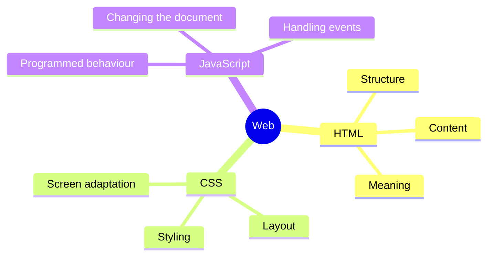
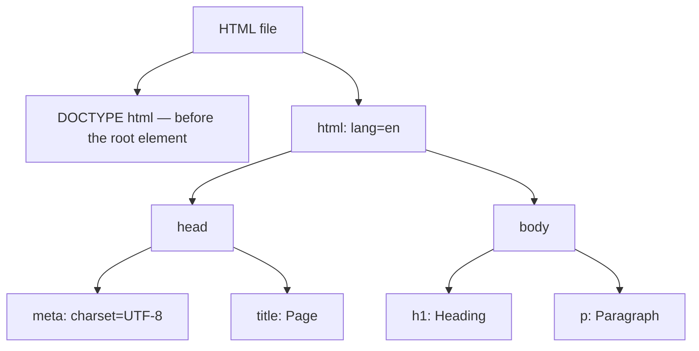

# Introduction to HTML document structure

[Contents](../../README.md) · [Next →](../../Lesson-2/en/Text%20and%20semantics.md) · [RU](../ru/%D0%92%D0%B2%D0%B5%D0%B4%D0%B5%D0%BD%D0%B8%D0%B5%20%D0%B2%20HTML%20%D1%81%D1%82%D1%80%D1%83%D0%BA%D1%82%D1%83%D1%80%D0%B0%20%D0%B4%D0%BE%D0%BA%D1%83%D0%BC%D0%B5%D0%BD%D1%82%D0%B0.md) · [EN](Introduction%20to%20HTML%20document%20structure.md) · [UZ](../uz/HTML%20ga%20kirish%20hujjat%20tuzilishi.md) · [Practice](../practice.html)

> **The first lesson of the course.** Today you will create your first web page and open it in a browser. No programming knowledge is needed: you only need to know how to create folders and save files.

---

## Why you need this

Open any website: a news site, a shop, a university page. Behind each one is an ordinary text file with HTML markup. The browser reads that file and turns it into a page.

In an hour you will have a file like that too. You will write it yourself, open it in a browser and see your own page.

---

## What you will learn

- Explain what HTML is and how it differs from CSS and JavaScript.
- Tell a tag, an attribute and an element apart.
- Write the skeleton of any HTML document: `<!DOCTYPE html>`, `<html>`, `<head>`, `<body>`.
- Create an `index.html` file, save it and open it in a browser.
- Look at the markup of any website with DevTools.

---

## Lesson plan

| Section | What we do |
| --- | --- |
| What HTML is | A house frame and its finishing |
| Tools | VS Code, Live Server, DevTools |
| Tag, attribute, element | Explained with a parcel |
| Document skeleton | DOCTYPE, html, head, body line by line |
| Mini-task 1 | Build the skeleton from memory |
| First page | Write, save, open |
| Mini-task 2 | Change the page and see the result |
| Independent work | IDE task and an introduction page |

---

## What HTML is

**In simple terms:** to build a house, you first put up the frame: walls, floors, stairs. Without a frame there is nothing to hang curtains on or run wiring through.

**HTML** (HyperText Markup Language) is the frame of a web page. It describes **what** is on the page: where the heading is, where a paragraph is, where an image is.

The frame has two helpers:

| Technology | Role in the house | What it does on a site |
| --- | --- | --- |
| **HTML** | Frame | Structure and meaning: headings, paragraphs, lists |
| **CSS** | Interior designer | Colours, fonts, layout |
| **JavaScript** | Wiring and automation | Behaviour: reacting to clicks, changing the page |



**How to read the diagram.** Three branches, three different jobs. In this course you write HTML. CSS and JavaScript are shown so you know where the boundary is.

**Important:** HTML is a **markup language**, not a programming language. It has no conditions, loops or calculations. It only marks up text: "this is a heading", "this is a paragraph".

---

## Tools

### VS Code - the code editor

1. Download the free editor from [code.visualstudio.com](https://code.visualstudio.com).
2. Install and open it.
3. On the left, click the **Extensions** icon (four squares).
4. Find **Live Server** (by Ritwick Dey) and click **Install**.

**Why Live Server:** it refreshes the page in the browser every time you save the file. Without it you have to press F5 yourself.

**A handy trick - Emmet.** In an empty `.html` file, type `!` and press Tab. VS Code inserts the document skeleton for you. But learn to write the skeleton by hand first: there are no shortcuts in the IDE check.

### DevTools - developer tools

DevTools are built into every browser. They show which elements the open page is made of.

**How to open:** right-click the page → **Inspect**. Or F12. On macOS: Cmd+Option+I.

**Try it now:** open DevTools on any website. In the **Elements** tab, find an `<h1>` tag and click it. The main heading on the page will be highlighted.

**Remember:** changes in DevTools only last until the page is reloaded. They do not change the file on disk.

---

## Tag, attribute, element

Beginners almost always mix up these three words. Let's use a parcel as an example.

| Term | In a parcel | In HTML |
| --- | --- | --- |
| **Tag** | The lid and bottom of the box | `<p>` opens, `</p>` closes |
| **Attribute** | A "Fragile" sticker | `class="intro"` inside the opening tag |
| **Element** | The whole parcel | Tags + attributes + content |

```html
<p class="intro">Welcome!</p>
```

- `<p class="intro">` - an opening tag with an attribute;
- `Welcome!` - the content;
- `</p>` - the closing tag (with a slash `/`);
- the whole line - the paragraph **element**.

### Paired and void elements

Most elements are **paired**: there is an opening and a closing tag, with content between them.

Some elements are **void**: they have no content and no closing tag.

```html
<br>

```

We will cover them in later lessons. For now, just notice the difference in how they are written.

### Attributes

An attribute is written **only in the opening tag**, as `name="value"`. Several attributes are separated by spaces:

```html

```

### Comments

You can leave a note for yourself in a comment. The browser does not show it:

```html
<!-- This is a comment: you can only see it in the code -->
```

### Common beginner mistakes

| Mistake | How to fix |
| --- | --- |
| `<p>` not closed | Close paired elements: `<p>...</p>` |
| `<p/>` instead of `</p>` | The slash goes **before** the name: `</p>` |
| An attribute in the closing tag: `</p class="intro">` | Attributes go only in the opening tag |
| A value without quotes | In this course we always use quotes: `class="intro"` |
| Wrong nesting: `<p><strong>text</p></strong>` | Close the inner one first: `</strong></p>` |

---

## The HTML document skeleton

Every HTML page starts with the same skeleton:

```html
<!DOCTYPE html>
<html lang="en">
<head>
    <meta charset="UTF-8">
    <title>My first page</title>
</head>
<body>
    <h1>Hello, world!</h1>
</body>
</html>
```

Let's go line by line.

| Line | What it means | Analogy |
| --- | --- | --- |
| `<!DOCTYPE html>` | "This is modern HTML". Turns on the browser's standard mode | An "approved" stamp on the plan |
| `<html lang="en">` | The document root. `lang` is the language of the text | The whole house with a "we speak English here" sign |
| `<head>` | Service information. Not visible on the page | The house's technical passport |
| `<meta charset="UTF-8">` | The encoding. Without it, letters can turn into gibberish | The language the passport is written in |
| `<title>` | The browser tab name | The address plate on the gate |
| `<body>` | Everything the user sees | The rooms people live in |

**Why `lang` matters:** a screen reader (a program that reads the page aloud) chooses pronunciation by it. The browser uses it to offer translation.

**Why the encoding matters:** without `charset`, a word like "café" can look like `café`.

**`<title>` and `<h1>` are different things:** `title` is shown on the tab, `h1` is shown on the page itself, in a large font.



**How to read the diagram.** An arrow goes from a parent to a nested element. DOCTYPE stands before `html`, not inside it. `head` and `body` sit side by side inside `html`.

### Common beginner mistakes

| Mistake | How to fix |
| --- | --- |
| No `<!DOCTYPE html>` | Write it as the first line of the file |
| Text directly in `<html>` or in `<head>` | Visible text goes only in `<body>` |
| No `<meta charset="UTF-8">` | Add it to `<head>` in every file |
| Mixing up `<title>` and `<h1>` | `title` is the tab, `h1` is the heading on the page |
| Two `<body>` or `<head>` elements | One of each per document |

---

## Mini-task 1

Build the document skeleton **without looking**:

1. The document type declaration.
2. A root element with English as the language.
3. A service part: UTF-8 encoding and the tab name "Lesson 1".
4. An empty visible part.

The solution is in the "Answers" section.

---

## First page

**Step 1.** Create a `my-html-site` folder. In VS Code: **File → Open Folder** and choose it.

**Step 2.** Create an `index.html` file. This is the standard name for a site's home page. Make sure the file is not called `index.html.txt`.

**Step 3.** Paste the code:

```html
<!DOCTYPE html>
<html lang="en">
<head>
    <meta charset="UTF-8">
    <title>My first page</title>
</head>
<body>
    <h1>Hello, world!</h1>
    <p>This is my first HTML page.</p>
    <p>I am learning HTML on the JLearn platform.</p>
</body>
</html>
```

There are two new elements here: `<h1>` is the main heading of the page, `<p>` is a paragraph. More about them in lesson 2.

**Step 4.** Save: Ctrl+S (on macOS: Cmd+S).

**Step 5.** Open it in a browser: in VS Code, right-click the file → **Open with Live Server**. Or double-click the file in its folder.

**What you will see:** the tab says "My first page". On the page there is a large heading "Hello, world!" with two paragraphs below it, separated by a gap.

### Try breaking it

1. Delete `</h1>` and save. What happened to the paragraphs? (Hint: the browser does not know where the heading ends.)
2. Put `</h1>` back. Now delete `</title>` and save. What do you see on the page and on the tab?
3. Restore everything. Is the page back to normal?

This way you see for yourself why tags must be closed.

---

## Mini-task 2

1. Change the text of the second paragraph in the editor.
2. Save the file.
3. Look at the browser: did the change appear?
4. Now change the heading text **in DevTools** (double-click the text in the Elements tab). Reload the page with F5. What happened to your change?

The answer is in the "Answers" section.

---

## Lesson summary: cheat sheet

| What | Code | Remember |
| --- | --- | --- |
| Document type | `<!DOCTYPE html>` | First line of the file |
| Root and language | `<html lang="en">` | The language of the page text |
| Service part | `<head>...</head>` | Not visible on the page |
| Encoding | `<meta charset="UTF-8">` | Otherwise you get gibberish |
| Tab | `<title>...</title>` | Don't confuse it with `h1` |
| Visible part | `<body>...</body>` | All content goes here |
| Heading and paragraph | `<h1>`, `<p>` | Details in lesson 2 |
| Comment | `<!-- ... -->` | The browser doesn't show it |

---

## Independent work

### Part 1. IDE task (counted by the platform)

Open the editor below the lesson and build an **introduction page** from scratch:

1. The document skeleton: DOCTYPE, `html` with a language, `head`, `body`.
2. In `head`: UTF-8 encoding and the tab name "Introduction".
3. In `body`: **one** main heading and **two** paragraphs - about yourself and about why you are learning HTML.

Click **"Check"**. If the check fails, a list of what is missing appears below the editor. Fix it and check again.

**How to see the result:** copy the code into an `index.html` file on your computer and open it in a browser.

What the platform checks: DOCTYPE, `lang`, `charset`, the presence of `head`, `body` and `title`, exactly one `h1` and at least two `p`.

### Part 2. Project on your computer

1. Create a `my-html-site` folder with an `index.html` containing the same introduction page.
2. Open it in a browser.
3. Change the second paragraph in the editor, save, and check that the change appears.

### Acceptance criteria

- [ ] The IDE task is accepted.
- [ ] The file is called `index.html`, not `index.html.txt`.
- [ ] There are DOCTYPE, `html`, `head`, `body`; all paired tags are closed.
- [ ] The language matches the text; the encoding is UTF-8.
- [ ] The tab name and the page heading are different elements.
- [ ] One `<h1>` and two `<p>` are visible in the browser.
- [ ] A change saved in the editor appears after reloading.

---

## Self-check questions

1. How is HTML different from a programming language?
2. What are HTML, CSS and JavaScript each responsible for?
3. How is an element different from a tag?
4. Where is an attribute written: in the opening or the closing tag?
5. What happens if you leave out `<meta charset="UTF-8">`?
6. Why is the `lang` attribute needed?
7. Where is `<title>` visible, and where is `<h1>`?
8. What goes into `<head>`, and what into `<body>`?
9. Why is a change made in DevTools not saved to the file?
10. Why is the home page called `index.html`?

After the questions, take the **lesson test** on the platform: 12 questions, 70% to pass. The lesson counts when both the IDE task and the test are passed.

---

## What's next

The skeleton is ready. In lesson 2 we will fill it with meaning: headings of different levels, paragraphs, lists and the semantic blocks of a page - header, navigation, main part, footer.

---

## Answers

**Mini-task 1**

```html
<!DOCTYPE html>
<html lang="en">
<head>
    <meta charset="UTF-8">
    <title>Lesson 1</title>
</head>
<body>

</body>
</html>
```

**Mini-task 2.** The change from the editor appeared because you saved the file. The change from DevTools disappeared after F5: DevTools only changes the copy that is open in the browser right now, while the file on disk stays the same.

**Self-check questions**

1. HTML has no conditions, loops or calculations. It only marks up content.
2. HTML - structure and meaning, CSS - styling, JavaScript - behaviour.
3. A tag is the text `<p>` or `</p>`. An element is the whole thing: tags, attributes and content.
4. Only in the opening tag.
5. Letters may show up as unreadable symbols.
6. So a screen reader picks the right pronunciation and the browser picks the right translation.
7. `title` - on the browser tab, `h1` - on the page itself.
8. `head` - service information: encoding, tab name. `body` - everything visible.
9. DevTools changes the copy of the page in the browser, not the file.
10. When the address does not name a file, the server opens `index.html` by default.

---

[Contents](../../README.md) · [Next →](../../Lesson-2/en/Text%20and%20semantics.md) · [RU](../ru/%D0%92%D0%B2%D0%B5%D0%B4%D0%B5%D0%BD%D0%B8%D0%B5%20%D0%B2%20HTML%20%D1%81%D1%82%D1%80%D1%83%D0%BA%D1%82%D1%83%D1%80%D0%B0%20%D0%B4%D0%BE%D0%BA%D1%83%D0%BC%D0%B5%D0%BD%D1%82%D0%B0.md) · [EN](Introduction%20to%20HTML%20document%20structure.md) · [UZ](../uz/HTML%20ga%20kirish%20hujjat%20tuzilishi.md) · [Practice](../practice.html)
