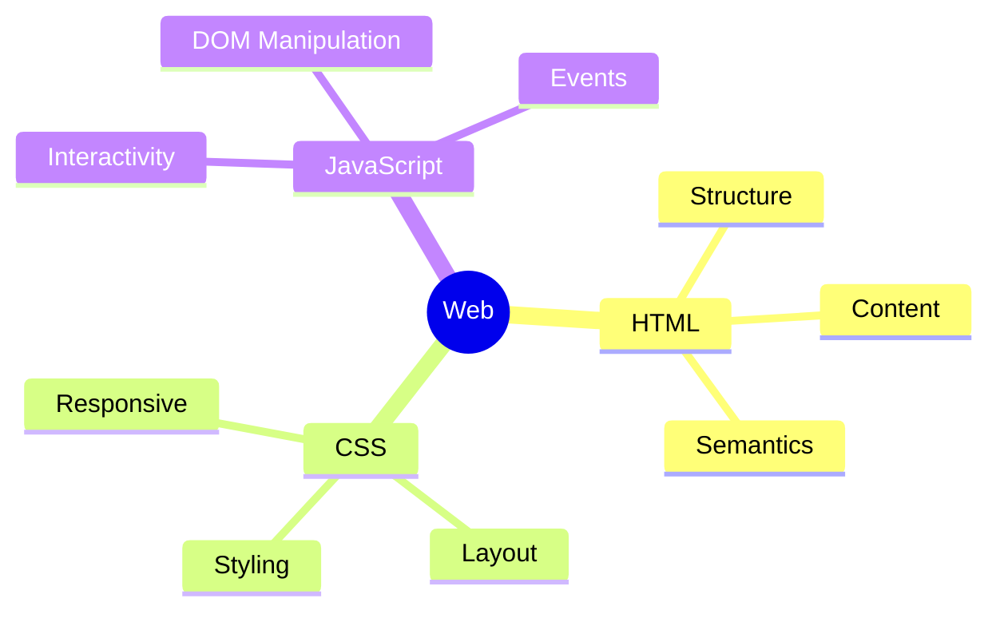
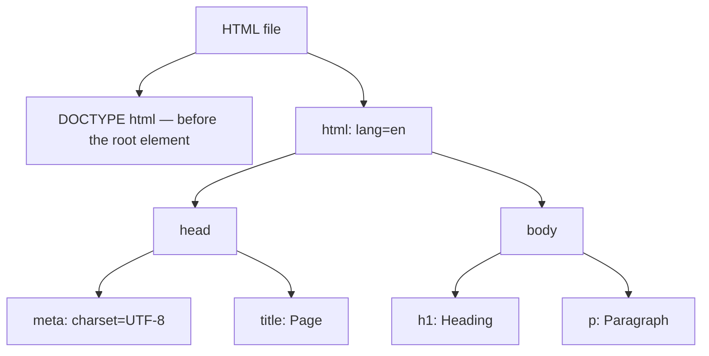

# Introduction to HTML document structure

[Contents](../../README.md) · [← Back](../../README.md) · [Next →](../../Lesson-2/en/Text%20and%20semantics.md) · [RU](../ru/%D0%92%D0%B2%D0%B5%D0%B4%D0%B5%D0%BD%D0%B8%D0%B5%20%D0%B2%20HTML%20%D1%81%D1%82%D1%80%D1%83%D0%BA%D1%82%D1%83%D1%80%D0%B0%20%D0%B4%D0%BE%D0%BA%D1%83%D0%BC%D0%B5%D0%BD%D1%82%D0%B0.md) · [EN](Introduction%20to%20HTML%20document%20structure.md) · [UZ](../uz/HTML%20ga%20kirish%20hujjat%20tuzilishi.md) · [Practice](../practice.html)


> This is the first lesson of the course - today we lay the foundation without which no web page can exist.

---

## What you will learn by the end of the lesson

- Understand what HTML, a tag, an attribute, and an element are - and how they differ from each other.
- Install and set up tools for work: VS Code and browser DevTools.
- Understand the structure of any HTML document: `<!DOCTYPE html>`, `<html>`, `<head>`, `<body>`.
- Create, save, and open your first HTML page in a browser.
- Use the element inspector to peek "under the hood" of any website.

---

## Lesson plan

| Topic                                  | Content                                         |
| -------------------------------------- | ----------------------------------------------- |
| What is HTML and why do we need it  | Analogy with a house skeleton, HTML's role on the web |
| Installing tools                    | VS Code, Live Server extension, DevTools overview |
| Tag, attribute, element             | Breaking down terms with examples               |
| HTML document structure             | DOCTYPE, html, head, body - line-by-line breakdown |
| Mini-assignment                     | Build the document skeleton on your own          |
| The first page complete             | Writing and opening in a browser                 |
| Summary and practical assignment    | Reinforcement, homework assignment               |

---

## What is HTML and why do we need it

**In simple terms:** imagine you are building a house. First you erect the framework - walls, floors, stairs. Without the framework, the house simply won't stand, even if you have the most beautiful furniture and paint.

**HTML (HyperText Markup Language)** describes content structure and meaning: headings, paragraphs, lists and images. CSS controls presentation and layout; JavaScript enables programmed behavior. Links and forms already have built-in browser behavior without JavaScript.

The analogy continues: if HTML is the house framework, then:

- **CSS** is the interior designer: paints the walls, arranges furniture, picks curtains.
- **JavaScript** is the electrical and automation: lights turn on with a clap, doors open by themselves.

We start with the framework because without it, neither design nor automation makes sense - there's nothing to "hang" them on.



**How to read this diagram:** The branches separate the roles of HTML, CSS and JavaScript; they are categories, not execution steps. This course builds HTML structure before styling or behavior.


**Important to understand right away:** HTML is a **markup language**, not a programming language. It has no "if" conditions, no loops, no calculations. It simply describes the structure of the document using tags.

---

## Tools: VS Code and DevTools

For working with HTML we need two tools.

### VS Code (Visual Studio Code)

This is a free code editor from Microsoft. You can download it from the official website [code.visualstudio.com](https://code.visualstudio.com) - the version for Windows, macOS, or Linux will be detected automatically.

After installation, install one extension - it will make life much easier:

1. Open VS Code.
2. On the left panel, find the "Extensions" icon (squares).
3. In the search, type **Live Server**.
4. Click "Install" on the extension by author Ritwick Dey.

**Why Live Server is needed:** without it, to see changes in the browser, you'd have to manually refresh the page each time (F5). Live Server does this automatically every time you save a file - and opens the page on a local address like `http://127.0.0.1:5500`.

### DevTools (browser developer tools)

DevTools shows the current element tree (DOM). It can differ from the source HTML: the browser repairs markup and scripts can change it.

**Open it:** right-click → Inspect. In Chrome you can also use Ctrl+Shift+I (Windows/Linux) or Cmd+Option+I (macOS). View Page Source is a different command.

Try opening DevTools on any website right now and find the **Elements** tab (Chrome/Edge) or **Inspector** (Firefox) - there you'll see the HTML structure of the page in real time.

**Mini-assignment (2 minutes):** open DevTools on your favorite website, find the `<h1>` tag in the Elements panel (usually the article heading) and click on it - you'll see that exact element highlighted on the page.

---

## Tag, attribute, element - what's the difference

These are three terms that beginners almost always confuse. Let's break them down using a parcel analogy.

Imagine you are sending a parcel:

- **A tag** is markup written in angle brackets: `<p>` opens an element and `</p>` closes it. Void elements such as `img` have no closing tag.
- **Attribute** - this is a sticker on the box with additional information: "fragile", "top", "recipient's address". In HTML, an attribute is written inside the opening tag: `<p class="intro">`.
- **Element** - this is the entire box as a whole: the box (tag) + stickers (attributes) + content inside.

### Tag syntax

Most tags are **paired**: there is an opening tag and a closing tag, with content in between.

```html
<p>This is a paragraph of text.</p>
```

Here:

- `<p>` - opening tag
- `This is a paragraph of text.` - content
- `</p>` - closing tag (note the slash `/`)

There are also **unpaired (self-closing) tags** - they have no content and no closing tag, they simply "insert" something into the document:

```html
<br>
<hr>

```

We'll talk about `br`, `hr`, and `img` in detail in later lessons - for now it's important to just see the difference in syntax.

### Attribute syntax

Attributes go in the opening tag. In this lesson we use `name="value"`; attributes without a written value are covered later.

```html
<p class="intro">Paragraph text</p>
```

Here `class` is the attribute name, `"intro"` is its value. The value is always in quotes (double quotes, by convention in this course).

A single tag can have multiple attributes - they are separated by spaces:

```html

```

### The complete element

A paired element is written with an opening tag, optional attributes, content and a closing tag. A void element such as `img` has no content or closing tag.

```html
<p class="intro">Welcome to my website!</p>
```

This entire chunk of code is one HTML element.

---

### Common beginner mistakes

| Mistake                                                                           | How to fix                                                                                                        |
| --------------------------------------------------------------------------------- | ----------------------------------------------------------------------------------------------------------------- |
| Omitted an explicit `</p>` | In this course we close paired elements explicitly for readability; HTML permits omission of certain end tags under specific rules. |
| Unquoted `class` value | Use `class="intro"` consistently; HTML permits some unquoted values. |
| Wrote `<p/>` instead of `</p>` | The closing tag is `</p>`. A slash after the name does not close a normal HTML element. |
| Mixed `<P>` and `<p>` | Both are allowed in HTML. Our course convention is lowercase. |
| Closed nested elements in the wrong order | Close the inner element before the outer one. We practice nesting in lesson 2. |

---

## HTML document structure

Every HTML page, regardless of its content, starts with the same "skeleton". Let's break it down line by line.

```html
<!DOCTYPE html>
<html lang="en">
<head>
    <meta charset="UTF-8">
    <title>My first page</title>
</head>
<body>
    <h1>Hello, world!</h1>
</body>
</html>
```

Let's break down each line, continuing the house skeleton analogy.

### `<!DOCTYPE html>`

`<!DOCTYPE html>` is a document type declaration. In a regular HTML document it enables the browser’s standards rendering mode. Without it, modern browsers can also enter quirks mode, which preserves historical layout behavior.

It selects a rendering mode; it is not a version number or a standard’s year.

It is **always written the same way**, once, at the very beginning of the file.

### `<html lang="en">`

The root (main) tag, inside which all page content resides. All other tags are its "children" and "grandchildren".

The `lang="en"` attribute specifies the page language - English. This helps:

- screen readers (programs for visually impaired users) pronounce text correctly;
- the browser offer correct translations;
- search engines understand the content language.

**Analogy:** `<html>` is the house itself, and `lang="en"` is a sign saying "People inside speak English."

### `<head>` - the document's "head"

This is where service information **about the page** is located, which is not displayed directly on the screen: the browser tab title, encoding, linked style and script files (covered in lesson 9), metadata for search engines.

**Analogy:** `<head>` is the house's technical passport: address, year of construction, materials. We don't see the technical passport while walking around the house, but it determines important characteristics.

Inside `<head>` in this lesson we use two tags:

**`<meta charset="UTF-8">`** - specifies the document encoding. UTF-8 supports virtually all languages of the world, including Cyrillic. Without this line, Russian text may display as gibberish (for example, `привет` instead of "privet").

**`<title>My first page</title>`** sets the browser tab title. Search engines may use it for a result title or generate another title. The visible heading inside the page is written separately with `<h1>`.

### `<body>` - the document's "body"

This is where **everything the user sees** is located: text, images, buttons, links, tables. All course content starting from the second lesson will be added here.

**Analogy:** if `<head>` is the house's technical passport, then `<body>` is all the rooms where people actually live: living room, kitchen, bedroom. All tags we'll study later (headings, paragraphs, images, forms) are placed inside `<body>`.



**How to read this diagram:** Follow the arrows as containment: html contains head and body. The DOCTYPE sits before html and is not a child element.

---

### Common beginner mistakes

| Mistake                                                    | How to fix                                                                                                       |
| ---------------------------------------------------------- | ---------------------------------------------------------------------------------------------------------------- |
| Forgot `<!DOCTYPE html>`                                   | Always write it as the first line of the file - no spaces or text before it                                      |
| Putting text directly in `<html>`, bypassing `<head>`/`<body>` | All visible content goes inside `<body>` only, service information goes inside `<head>` only                     |
| Forgetting `<meta charset="UTF-8">`                        | Add this line in `<head>` in every project - otherwise Cyrillic may display incorrectly                           |
| Confusing `<title>` with the `<h1>` heading on the page    | `<title>` is only visible on the browser tab, `<h1>` is the visible heading on the page itself (covered in lesson 2) |
| Not closing `<head>` or `<body>`                           | Each of these tags is paired - don't forget `</head>` and `</body>`                                              |

---

## Mini-assignment

Build the HTML document "skeleton" on your own, without peeking at the example above:

1. Document type declaration.
2. Root tag with the English language specified.
3. Service section with UTF-8 encoding and the tab title "Lesson 1".
4. The visible part of the page - empty for now.

**Solution:**

```html
<!DOCTYPE html>
<html lang="en">
<head>
    <meta charset="UTF-8">
    <title>Lesson 1</title>
</head>
<body>

</body>
</html>
```

---

## Building the first page completely

### Your working folder and first two elements

Create a `my-html-site` folder somewhere convenient and open it with File → Open Folder in VS Code. Create `index.html` inside it. The `.html` extension is part of the file name: make sure no `.txt` was appended. Avoid editing different files with the same name in different folders.

Inside `body`, `<h1>` marks the main page heading and `<p>` marks a paragraph. One heading and separate paragraphs are enough for the first task. The tab title is set separately in `title`. Lesson 2 develops text markup further.

To check your workflow, change a word in a `<p>`, save the file and refresh the browser. If nothing changes, first compare the open file’s name and folder with the browser address.

Now let's supplement the skeleton with real content (a heading and a paragraph of text - we'll talk about these tags in detail in lesson 2, for now we'll just use them so the page isn't empty).

**Step 1.** Open VS Code, create a new folder for the project, for example `html-course`.

**Step 2.** Inside the folder, create a file `index.html` (this exact name is the standard for a website's main page).

**Step 3.** Paste the following code:

```html
<!DOCTYPE html>
<html lang="en">
<head>
    <meta charset="UTF-8">
    <title>My first page</title>
</head>
<body>
    <h1>Hello, world!</h1>
    <p>This is my first HTML page. I'm learning web development in the "HTML: in 10 lessons" course.</p>
</body>
</html>
```

**Step 4.** Save the file (Ctrl+S / Cmd+S).

**Step 5.** Open the page using one of two methods:

- Via Live Server: right-click the file in VS Code → "Open with Live Server".
- Manually: find the `index.html` file in the file explorer/finder and double-click it - it will open in the default browser.

**Step 6.** Open DevTools using Inspect and locate your heading and paragraph. Change text in the editor, save and check the browser. Edits made only in DevTools are not saved in the HTML file.

---

## Lesson summary

Today you learned:

- **HTML** is a markup language, the "framework" of a web page that describes the structure and meaning of content.
- **A tag** is markup such as `<p>` or `</p>`; **an attribute** supplies information in the opening tag; **an element** is the part of the document structure created by that markup.
- Every HTML document starts with `<!DOCTYPE html>` and consists of `<html>`, inside which are `<head>` (service information) and `<body>` (visible content).
- You set up VS Code with Live Server and learned to use browser DevTools.
- You created and opened your first HTML page.

---

## Independent task: an introduction page

Create a new `my-html-site` folder with an `index.html` file inside it. Build from the requirements rather than copying a complete document. Do not add links, lists, images, CSS or JavaScript yet.

1. Set the language of your text and UTF-8 encoding.
2. Give the browser tab the title “Introduction”.
3. Write one main heading and two paragraphs: about yourself and your learning goal.
4. Open the file in a browser. Change the second paragraph in the editor, save and check the update.

### Completion criteria

- [ ] The file is named `index.html`, not `index.html.txt`.
- [ ] DOCTYPE, `html`, `head` and `body` are present; paired elements are explicitly closed.
- [ ] The language matches the text and the encoding is UTF-8.
- [ ] You can distinguish the tab title from the page heading.
- [ ] One `<h1>` and two `<p>` elements appear; the saved change is visible.

### Check your understanding

1. How does an element differ from its opening tag?
2. Why does the tab title belong in `head` and a paragraph in `body`?
3. Why does an edit in DevTools not change the file on disk?

If a criterion fails, revisit the relevant example and check again. Continue when all criteria pass and you can explain the answers in your own words.

---

[Contents](../../README.md) · [← Back](../../README.md) · [Next →](../../Lesson-2/en/Text%20and%20semantics.md) · [RU](../ru/%D0%92%D0%B2%D0%B5%D0%B4%D0%B5%D0%BD%D0%B8%D0%B5%20%D0%B2%20HTML%20%D1%81%D1%82%D1%80%D1%83%D0%BA%D1%82%D1%83%D1%80%D0%B0%20%D0%B4%D0%BE%D0%BA%D1%83%D0%BC%D0%B5%D0%BD%D1%82%D0%B0.md) · [EN](Introduction%20to%20HTML%20document%20structure.md) · [UZ](../uz/HTML%20ga%20kirish%20hujjat%20tuzilishi.md) · [Practice](../practice.html)
