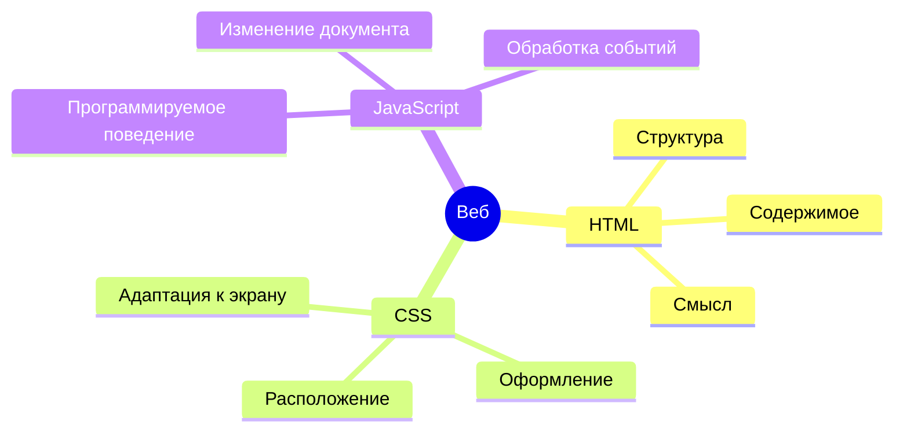
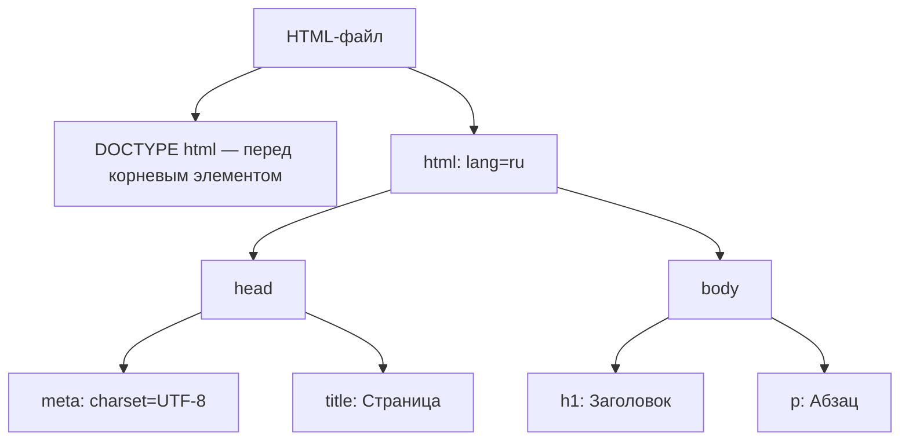

# Введение в HTML структура документа

[Содержание](../../README.md) · [← Назад](../../README.md) · [Вперёд →](../../Lesson-2/ru/%D0%A2%D0%B5%D0%BA%D1%81%D1%82%20%D0%B8%20%D1%81%D0%B5%D0%BC%D0%B0%D0%BD%D1%82%D0%B8%D0%BA%D0%B0.md) · [RU](%D0%92%D0%B2%D0%B5%D0%B4%D0%B5%D0%BD%D0%B8%D0%B5%20%D0%B2%20HTML%20%D1%81%D1%82%D1%80%D1%83%D0%BA%D1%82%D1%83%D1%80%D0%B0%20%D0%B4%D0%BE%D0%BA%D1%83%D0%BC%D0%B5%D0%BD%D1%82%D0%B0.md) · [EN](../en/Introduction%20to%20HTML%20document%20structure.md) · [UZ](../uz/HTML%20ga%20kirish%20hujjat%20tuzilishi.md) · [Практика](../practice.html)

> **Первый урок курса.** Сегодня вы создадите свою первую веб-страницу и откроете её в браузере. Знания программирования не нужны: достаточно уметь создавать папки и сохранять файлы.

---

## Зачем это вам

Откройте любой сайт: новости, магазин, страницу университета. За каждым из них стоит обычный текстовый файл с HTML-разметкой. Браузер читает этот файл и превращает его в страницу.

Через час у вас будет такой же файл. Вы напишете его сами, откроете в браузере и увидите свою страницу.

---

## Чему вы научитесь

- Объяснять, что такое HTML и чем он отличается от CSS и JavaScript.
- Различать тег, атрибут и элемент.
- Писать скелет любого HTML-документа: `<!DOCTYPE html>`, `<html>`, `<head>`, `<body>`.
- Создавать файл `index.html`, сохранять его и открывать в браузере.
- Смотреть разметку любого сайта через DevTools.

---

## План урока

| Раздел | Что делаем |
| --- | --- |
| Что такое HTML | Каркас дома и его отделка |
| Инструменты | VS Code, Live Server, DevTools |
| Тег, атрибут, элемент | Разбираем на примере посылки |
| Скелет документа | DOCTYPE, html, head, body построчно |
| Мини-задание 1 | Собрать скелет без подсказок |
| Первая страница | Пишем, сохраняем, открываем |
| Мини-задание 2 | Изменить страницу и увидеть результат |
| Самостоятельная работа | Задание в IDE и страница знакомства |

---

## Что такое HTML

**Простыми словами:** чтобы построить дом, сначала ставят каркас: стены, перекрытия, лестницы. Без каркаса не на что повесить шторы и провести свет.

**HTML** (HyperText Markup Language, язык гипертекстовой разметки) - это каркас веб-страницы. Он описывает, **что** на странице: где заголовок, где абзац, где картинка.

У каркаса есть два помощника:

| Технология | Роль в доме | Что делает на сайте |
| --- | --- | --- |
| **HTML** | Каркас | Структура и смысл: заголовки, абзацы, списки |
| **CSS** | Дизайнер интерьера | Цвета, шрифты, расположение |
| **JavaScript** | Электрика и автоматика | Поведение: реакция на клики, изменение страницы |



**Как читать схему.** Три ветви - три разные задачи. В этом курсе вы пишете HTML. CSS и JavaScript показаны, чтобы вы понимали, где граница.

**Важно:** HTML - **язык разметки**, а не программирования. В нём нет условий, циклов и вычислений. Он только размечает текст: «это заголовок», «это абзац».

---

## Инструменты

### VS Code - редактор кода

1. Скачайте бесплатный редактор с сайта [code.visualstudio.com](https://code.visualstudio.com).
2. Установите и откройте его.
3. Слева нажмите значок **Extensions** (четыре квадратика).
4. Найдите **Live Server** (автор Ritwick Dey) и нажмите **Install**.

**Зачем Live Server:** он сам обновляет страницу в браузере каждый раз, когда вы сохраняете файл. Без него нужно нажимать F5 вручную.

**Полезный приём - Emmet.** В пустом файле `.html` наберите `!` и нажмите Tab. VS Code сам вставит скелет документа. Но сначала научитесь писать скелет руками: на проверке в IDE подсказок не будет.

### DevTools - инструменты разработчика

DevTools встроены в каждый браузер. Они показывают, из каких элементов состоит открытая страница.

**Как открыть:** правый клик по странице → **Просмотреть код** (Inspect). Или F12. На macOS: Cmd+Option+I.

**Попробуйте сейчас:** откройте DevTools на любом сайте. Во вкладке **Elements** найдите тег `<h1>` и кликните по нему. На странице подсветится главный заголовок.

**Запомните:** изменения в DevTools живут только до обновления страницы. Файл на диске они не меняют.

---

## Тег, атрибут, элемент

Новички почти всегда путают эти три слова. Разберём на примере посылки.

| Термин | В посылке | В HTML |
| --- | --- | --- |
| **Тег** | Крышка и дно коробки | `<p>` открывает, `</p>` закрывает |
| **Атрибут** | Наклейка «Хрупкое» | `class="intro"` внутри открывающего тега |
| **Элемент** | Вся посылка целиком | Теги + атрибуты + содержимое |

```html
<p class="intro">Добро пожаловать!</p>
```

- `<p class="intro">` - открывающий тег с атрибутом;
- `Добро пожаловать!` - содержимое;
- `</p>` - закрывающий тег (со слэшем `/`);
- вся строка целиком - **элемент** «абзац».

### Парные и пустые элементы

Большинство элементов **парные**: есть открывающий и закрывающий тег, между ними содержимое.

Некоторые элементы **пустые**: у них нет содержимого и закрывающего тега.

```html
<br>

```

Их разберём в следующих уроках. Сейчас важно увидеть разницу в записи.

### Атрибуты

Атрибут пишется **только в открывающем теге** в форме `имя="значение"`. Несколько атрибутов разделяются пробелом:

```html

```

### Комментарии

Заметку для себя можно оставить в комментарии. Браузер его не покажет:

```html
<!-- Это комментарий: его видно только в коде -->
```

### Частые ошибки новичков

| Ошибка | Как исправить |
| --- | --- |
| Не закрыли `<p>` | Закрывайте парные элементы: `<p>...</p>` |
| Написали `<p/>` вместо `</p>` | Слэш ставится **перед** именем: `</p>` |
| Атрибут в закрывающем теге: `</p class="intro">` | Атрибуты - только в открывающем теге |
| Значение без кавычек | В курсе всегда пишем кавычки: `class="intro"` |
| Неверный порядок вложения: `<p><strong>текст</p></strong>` | Сначала закрываем внутренний: `</strong></p>` |

---

## Скелет HTML-документа

Каждая HTML-страница начинается с одного и того же скелета:

```html
<!DOCTYPE html>
<html lang="ru">
<head>
    <meta charset="UTF-8">
    <title>Моя первая страница</title>
</head>
<body>
    <h1>Привет, мир!</h1>
</body>
</html>
```

Разберём построчно.

| Строка | Что значит | Аналогия |
| --- | --- | --- |
| `<!DOCTYPE html>` | «Это современный HTML». Включает стандартный режим браузера | Штамп «проект утверждён» |
| `<html lang="ru">` | Корень документа. `lang` - язык текста | Весь дом с табличкой «здесь говорят по-русски» |
| `<head>` | Служебная информация. На странице не видна | Техпаспорт дома |
| `<meta charset="UTF-8">` | Кодировка. Без неё кириллица может превратиться в «кракозябры» | Язык, на котором заполнен паспорт |
| `<title>` | Название вкладки браузера | Табличка с адресом на воротах |
| `<body>` | Всё, что видит пользователь | Комнаты, где живут |

**Почему важен `lang`:** скринридер (программа, которая читает страницу вслух) выбирает по нему произношение. Браузер по нему предлагает перевод.

**Почему важна кодировка:** без `charset` слово «привет» может выглядеть как `привет`.

**`<title>` и `<h1>` - разные вещи:** `title` виден на вкладке, а `h1` - на самой странице, крупным шрифтом.



**Как читать схему.** Стрелка ведёт от родителя к вложенному элементу. DOCTYPE стоит перед `html`, а не внутри него. `head` и `body` лежат внутри `html` рядом друг с другом.

### Частые ошибки новичков

| Ошибка | Как исправить |
| --- | --- |
| Нет `<!DOCTYPE html>` | Пишите первой строкой файла |
| Текст прямо в `<html>` или в `<head>` | Видимый текст - только в `<body>` |
| Нет `<meta charset="UTF-8">` | Добавляйте в `<head>` в каждом файле |
| Путают `<title>` и `<h1>` | `title` - вкладка, `h1` - заголовок на странице |
| Два `<body>` или `<head>` | В документе по одному |

---

## Мини-задание 1

Соберите скелет документа **без подглядывания**:

1. Декларация типа документа.
2. Корневой элемент с русским языком.
3. Служебная часть: кодировка UTF-8 и вкладка «Урок 1».
4. Пустая видимая часть.

Решение - в разделе «Ответы».

---

## Первая страница

**Шаг 1.** Создайте папку `my-html-site`. В VS Code: **File → Open Folder** и выберите её.

**Шаг 2.** Создайте файл `index.html`. Это стандартное имя главной страницы сайта. Убедитесь, что файл не называется `index.html.txt`.

**Шаг 3.** Вставьте код:

```html
<!DOCTYPE html>
<html lang="ru">
<head>
    <meta charset="UTF-8">
    <title>Моя первая страница</title>
</head>
<body>
    <h1>Привет, мир!</h1>
    <p>Это моя первая HTML-страница.</p>
    <p>Я изучаю HTML на платформе JLearn.</p>
</body>
</html>
```

Здесь два новых элемента: `<h1>` - главный заголовок страницы, `<p>` - абзац. Подробно о них - в уроке 2.

**Шаг 4.** Сохраните: Ctrl+S (на macOS: Cmd+S).

**Шаг 5.** Откройте в браузере: правый клик по файлу в VS Code → **Open with Live Server**. Или дважды кликните по файлу в папке.

**Что увидите:** на вкладке - «Моя первая страница». На странице - крупный заголовок «Привет, мир!» и под ним два абзаца с отступом между ними.

### Попробуйте сломать

1. Удалите `</h1>` и сохраните. Что стало с абзацами? (Подсказка: браузер не знает, где кончается заголовок.)
2. Верните `</h1>`. Теперь удалите `</title>` и сохраните. Что видно на странице и на вкладке?
3. Верните всё назад. Страница снова в порядке?

Так вы на практике увидите, зачем закрывать теги.

---

## Мини-задание 2

1. Измените текст второго абзаца в редакторе.
2. Сохраните файл.
3. Посмотрите в браузер: изменение появилось?
4. Теперь измените текст заголовка **в DevTools** (двойной клик по тексту во вкладке Elements). Обновите страницу F5. Что произошло с изменением?

Ответ - в разделе «Ответы».

---

## Итоги урока: шпаргалка

| Что | Запись | Запомнить |
| --- | --- | --- |
| Тип документа | `<!DOCTYPE html>` | Первая строка файла |
| Корень и язык | `<html lang="ru">` | Язык - по тексту страницы |
| Служебная часть | `<head>...</head>` | Не видна на странице |
| Кодировка | `<meta charset="UTF-8">` | Иначе «кракозябры» |
| Вкладка | `<title>...</title>` | Не путать с `h1` |
| Видимая часть | `<body>...</body>` | Весь контент - здесь |
| Заголовок и абзац | `<h1>`, `<p>` | Подробно - в уроке 2 |
| Комментарий | `<!-- ... -->` | Браузер его не показывает |

---

## Самостоятельная работа

### Часть 1. Задание в IDE (засчитывается платформой)

Под уроком откройте редактор и соберите **страницу знакомства** с нуля:

1. Скелет документа: DOCTYPE, `html` с языком, `head`, `body`.
2. В `head`: кодировка UTF-8 и название вкладки «Знакомство».
3. В `body`: **один** главный заголовок и **два** абзаца - о себе и о том, зачем вы изучаете HTML.

Нажмите **«Проверить»**. Если проверка не прошла, под редактором появится список того, чего не хватает. Исправьте и проверьте снова.

**Как увидеть результат:** скопируйте код в файл `index.html` на компьютере и откройте в браузере.

Что проверяет платформа: DOCTYPE, `lang`, `charset`, наличие `head`, `body` и `title`, ровно один `h1` и не меньше двух `p`.

### Часть 2. Проект на компьютере

1. Создайте папку `my-html-site` и в ней `index.html` с той же страницей знакомства.
2. Откройте её в браузере.
3. Измените второй абзац в редакторе, сохраните, проверьте, что изменение появилось.

### Критерии готовности

- [ ] Задание в IDE засчитано.
- [ ] Файл называется `index.html`, а не `index.html.txt`.
- [ ] Есть DOCTYPE, `html`, `head`, `body`; все парные теги закрыты.
- [ ] Язык совпадает с языком текста, кодировка - UTF-8.
- [ ] Название вкладки и заголовок на странице - разные элементы.
- [ ] Один `<h1>` и два `<p>` видны в браузере.
- [ ] Изменение, сохранённое в редакторе, появилось после обновления.

---

## Вопросы для самопроверки

1. Чем HTML отличается от языка программирования?
2. За что отвечают HTML, CSS и JavaScript?
3. Чем элемент отличается от тега?
4. Где пишется атрибут: в открывающем или закрывающем теге?
5. Что произойдёт, если не указать `<meta charset="UTF-8">`?
6. Зачем атрибут `lang`?
7. Где виден `<title>`, а где `<h1>`?
8. Что попадает в `<head>`, а что в `<body>`?
9. Почему изменение в DevTools не сохраняется в файле?
10. Почему главную страницу называют `index.html`?

После вопросов пройдите **тест урока** на платформе: 12 вопросов, для зачёта нужно 70%. Урок засчитывается, когда сдан и тест, и задание в IDE.

---

## Что дальше

Скелет готов. В уроке 2 наполним его смыслом: заголовки разных уровней, абзацы, списки и семантические блоки страницы - шапка, навигация, основная часть, подвал.

---

## Ответы

**Мини-задание 1**

```html
<!DOCTYPE html>
<html lang="ru">
<head>
    <meta charset="UTF-8">
    <title>Урок 1</title>
</head>
<body>

</body>
</html>
```

**Мини-задание 2.** Изменение из редактора появилось, потому что вы сохранили файл. Изменение из DevTools пропало после F5: DevTools меняет только то, что сейчас открыто в браузере, а файл на диске остаётся прежним.

**Вопросы для самопроверки**

1. В HTML нет условий, циклов и вычислений. Он только размечает содержимое.
2. HTML - структура и смысл, CSS - оформление, JavaScript - поведение.
3. Тег - это запись `<p>` или `</p>`. Элемент - всё целиком: теги, атрибуты и содержимое.
4. Только в открывающем.
5. Кириллица может отобразиться нечитаемыми символами.
6. Чтобы скринридер выбрал правильное произношение, а браузер - перевод.
7. `title` - на вкладке браузера, `h1` - на самой странице.
8. В `head` - служебное: кодировка, название вкладки. В `body` - всё видимое.
9. DevTools меняет открытую копию страницы в браузере, а не файл.
10. Сервер открывает `index.html` по умолчанию, когда в адресе не указан файл.

---

[Содержание](../../README.md) · [← Назад](../../README.md) · [Вперёд →](../../Lesson-2/ru/%D0%A2%D0%B5%D0%BA%D1%81%D1%82%20%D0%B8%20%D1%81%D0%B5%D0%BC%D0%B0%D0%BD%D1%82%D0%B8%D0%BA%D0%B0.md) · [RU](%D0%92%D0%B2%D0%B5%D0%B4%D0%B5%D0%BD%D0%B8%D0%B5%20%D0%B2%20HTML%20%D1%81%D1%82%D1%80%D1%83%D0%BA%D1%82%D1%83%D1%80%D0%B0%20%D0%B4%D0%BE%D0%BA%D1%83%D0%BC%D0%B5%D0%BD%D1%82%D0%B0.md) · [EN](../en/Introduction%20to%20HTML%20document%20structure.md) · [UZ](../uz/HTML%20ga%20kirish%20hujjat%20tuzilishi.md) · [Практика](../practice.html)
