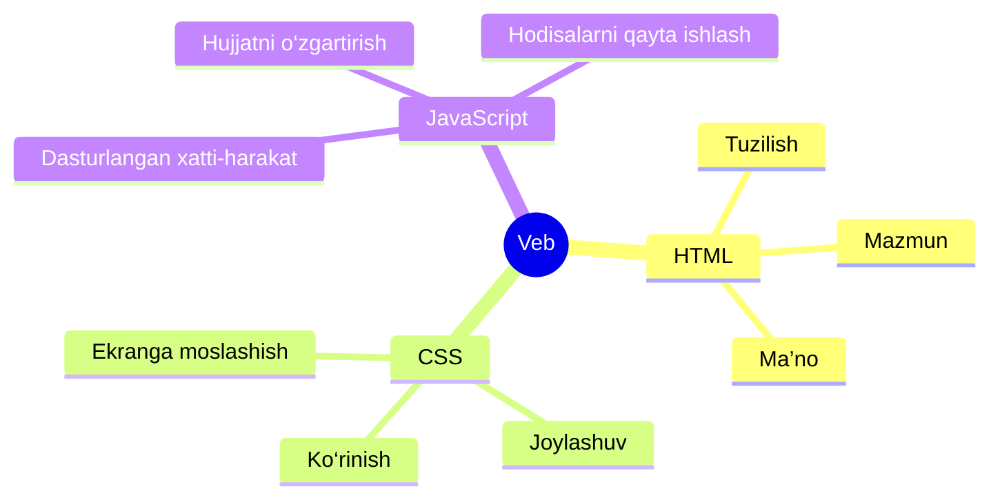

# HTML ga kirish: hujjat tuzilishi

[Mundarija](../../README.md) · [← Orqaga](../../README.md) · [Keyingi →](../../Lesson-2/uz/Matn%20va%20semantika.md) · [RU](../ru/%D0%92%D0%B2%D0%B5%D0%B4%D0%B5%D0%BD%D0%B8%D0%B5%20%D0%B2%20HTML%20%D1%81%D1%82%D1%80%D1%83%D0%BA%D1%82%D1%83%D1%80%D0%B0%20%D0%B4%D0%BE%D0%BA%D1%83%D0%BC%D0%B5%D0%BD%D1%82%D0%B0.md) · [EN](../en/Introduction%20to%20HTML%20document%20structure.md) · [UZ](HTML%20ga%20kirish%20hujjat%20tuzilishi.md) · [Amaliyot](../practice.html)


> bu kursning birinchi darsi - bugun biz asos qo'yamiz, bu asossiz hech qanday veb-sahifa yaratib bo'lmaydi.

---

## Dars oxirida nimani o'rganasiz

- HTML, teg, atribut va element nima ekanligini va ular qanday farq qilishini tushunish.
- Ish vositalarini o'rnatish va sozlash: VS Code va brauzer DevTools.
- Har qanday HTML-hujjatning tuzilishini tushunish: `<!DOCTYPE html>`, `<html>`, `<head>`, `<body>`.
- Birinchi HTML-sahifangizni yaratish, saqlash va brauzerda ochish.
- Elementlar inspektoridan foydalanib, har qanday saytning "ichki qismini" ko'rish.

---

## Dars rejasi

| Bo‘lim                                       | Mazmun                                        |
| ------------------------------------------ | --------------------------------------------- |
| HTML nima va u nima uchun kerak         | Uy skeleti bilan taqqoslash, HTMLning vebdagi roli |
| Vositalarni o'rnatish                   | VS Code, Live Server kengaytmasi, DevTools ko'rib chiqish |
| Teg, atribut, element                   | Misollarda atamalarni tahlil qilish           |
| HTML-hujjatning tuzilishi               | DOCTYPE, html, head, body - satrma-satr tahlil |
| Mini-vazifa                              | Hujjat skeletini mustaqil yig'ish            |
| Birinchi sahifa to'liq                  | Yozib brauzerda ochamiz                       |
| Xulosalar va amaliy vazifa              | Mustahkamlash, uy vazifasi                    |

---

## HTML nima va u nima uchun kerak

**Oddiy qilib aytganda:** tasavvur qiling, siz uy quryapsiz. Avval karkas quriladi - devorlar, pol, zinapoyalar. Karkasiz uy turib qolmaydi, hatto eng chiroyli mebel va bo'yoq bo'lsa ham.

**HTML (HyperText Markup Language)** mazmunning tuzilishi va ma'nosini ifodalaydi: sarlavhalar, abzatslar, ro'yxatlar va rasmlar. CSS ko'rinish va joylashuvni boshqaradi, JavaScript xatti-harakatlarni dasturlash imkonini beradi. Havolalar va shakllar JavaScriptsiz ham brauzerning tayyor imkoniyatlari orqali ishlaydi.

Davomiy taqqoslash: agar HTML - uy karkasi bo'lsa, demak:

- **CSS** - bu ichki dizayner: devorlarni bo'yaydi, mebelni joylashtiradi, parda tanlaydi.
- **JavaScript** - bu elektr va avtomatika: chiroq qarsak bilan yonadi, eshiklar o'z-o'zidan ochiladi.

Biz karkasdan boshlaymiz, chunki karkasiz dizayn va avtomatikaning ma'nosi bor - ularni osib qo'yadigan joy yo'q.



**Chizmani qanday o‘qish kerak:** Markazdagi Veb tugunidan uch yo‘nalish chiqadi: HTML mazmun va tuzilishni, CSS ko‘rinishni, JavaScript dasturlangan harakatni boshqaradi. Shoxlar ishni bajarish ketma-ketligini emas, vazifalar taqsimotini ko‘rsatadi.

**Darhol tushunish kerak:** HTML - bu **belgilash tili**, dasturlash tili emas. Unda "agar" shartlari, sikllar, hisob-kitoblar yo'q. U faqat teglar yordamida hujjatning tuzilishini tasvirlaydi.

---

## Vositalar: VS Code va DevTools

HTML bilan ishlash uchun bizga ikki vosita kerak bo'ladi.

### VS Code (Visual Studio Code)

Bu Microsoft tomonidan taqdim etilgan bepul kod muharriri. Uni rasmiy saytdan yuklab olish mumkin [code.visualstudio.com](https://code.visualstudio.com) - Windows, macOS yoki Linux versiyasi avtomatik aniqlanadi.

O'rnatgandan so'ng, bitta kengaytmani o'rnating - bu hayotni sezilarli darajada osonlashtiradi:

1. VS Code oching.
2. Chap tomondagi panelda "Extensions" (kvadratchalar) ikonasini toping.
3. Qidiruvga **Live Server** kiriting.
4. Ritwick Dey tomonidan yaratilgan kengaytma uchun "Install" tugmasini bosing.

**Live Server nima uchun kerak:** unisiz, o'zgarishlarni brauzerda ko'rish uchun har safar sahifani qo'lda yangilashingiz kerak bo'ladi (F5). Live Server har saqlashda avtomatik ravishda buni amalga oshiradi - va sahifani `http://127.0.0.1:5500` kabi mahalliy manzilda ochadi.

### DevTools (brauzerdagi dasturchi vositalari)

DevTools sahifa elementlarining joriy daraxtini (DOM) ko'rsatadi. U asl HTML fayldan farq qilishi mumkin: brauzer belgilashni tuzatadi, skriptlar esa uni o'zgartirishi mumkin.

**Ochish:** o'ng tugma → Inspect. Chromeda Ctrl+Shift+I (Windows/Linux) yoki Cmd+Option+I (macOS) ham ishlaydi. View Page Source — alohida buyruq.

Hozir har qanday saytda DevTools oching va **Elements** (Chrome/Edge) yoki **Инспектор** (Firefox) yorlig'ini toping - u yerda sahifaning HTML-tuzilishini haqiqiy vaqtda ko'rasiz.

**Mini-vazifa (2 daqiqa):** sevimli saytingizda DevTools oching, Elements panelida `<h1>` tegini toping (odatda bu maqolaning sarlavhasi) va uning ustiga bosing - sahifada aynan shu element yoritilganini ko'rasiz.

---

## Teg, atribut, element - farq nima

Bu uchta atama yangi boshlovchilar deyarli har doim aralashtirib yuboradi. Pochta orqali yuborilgan posilkaga o'xshatib tushunamiz.

Tasavvur qiling, siz posilka yuboryapsiz:

- **Teg** - bu qutining turi: "mo'rt narsa uchun quti", "hujjatlar uchun quti". HTML'da teglar burchakli qavslarda yoziladi: `<p>`, `<h1>`, ``.
- **Atribut** - bu qutiga yopishtirilgan qo'shimcha ma'lumot bilan yorliq: "mo'rt", "tepa", "qabul qiluvchi manzili". HTML'da atribut ochuvchi teg ichida yoziladi: `<p class="intro">`.
- **Element** - bu allaqachon butun quti: quti (teg) + yorliqlar (atributlar) + ichidagi mazmun.

### Teg sintaksisi

Ko'pchilik teglar **juft**: ochuvchi va yopuvchi teg bor, ularning orasida esa mazmun mavjud.

```html
<p>Bu matn abzatsi.</p>
```

Bu yerda:

- `<p>` - ochuvchi teg
- `Bu matn abzatsi.` - mazmun
- `</p>` - yopuvchi teg (teskari chiziq `/` ga e'tibor bering)

**Juft bo'lmagan (yolg'iz) teglar** ham mavjud - ularning mazmuni va yopuvchisi yo'q, ular oddiygina hujjatga biror narsa "qo'shadi":

```html
<br>
<hr>

```

`br`, `hr` va `img` haqida keyingi darslarda batafsil gaplashamiz - hozir faqat sintaksis farqini ko'rish muhim.

### Atribut sintaksisi

Atribut ochuvchi teg ichida yoziladi. Bu darsda `nom="qiymat"` ko'rinishidan foydalanamiz; qiymatsiz yoziladigan atributlarni keyin o'rganamiz.

```html
<p class="intro">Matn abzatsi</p>
```

Bu yerda `class` - atribut nomi, `"intro"` - uning qiymati. Qiymat doimo qo'shtirnoq ichida yoziladi (ikki tirnoq, kurs bo'yicha shunday qabul qilingan).

Bir tegda bir nechta atribut bo'lishi mumkin - ular bo'sh joy bilan ajratiladi:

```html

```

### Element to'liq

Juft element ochuvchi teg, ixtiyoriy atributlar, mazmun va yopuvchi teg orqali yoziladi. `img` kabi bo'sh elementda mazmun ham, yopuvchi teg ham bo'lmaydi.

```html
<p class="intro">Mening saytimga xush kelibsiz!</p>
```

Bu butun kod parchasi - bitta HTML-elementi.

---

### Yangi boshlovchilarning ko'p uchraydigan xatolari

| Xato                                                                              | Qanday tuzatish                                                                                                   |
| --------------------------------------------------------------------------------- | ----------------------------------------------------------------------------------------------------------------- |
| `</p>` aniq yozilmagan | Kursda o'qishni osonlashtirish uchun juft elementlarni aniq yopamiz; HTML ayrim yopuvchi teglarni muayyan qoidalar asosida tushirib qoldirishga ruxsat beradi. |
| `class` qiymati qo'shtirnoqsiz | Bir xillik uchun `class="intro"` yozamiz; HTML ayrim qiymatlarni qo'shtirnoqsiz ham qabul qiladi. |
| `</p>` o'rniga `<p/>` yozilgan | Yopuvchi teg — `</p>`. Nomdan keyingi slesh oddiy HTML elementni yopmaydi. |
| `<P>` va `<p>` aralashtirilgan | HTMLda ikkalasi ham mumkin. Kurs kelishuvi — kichik harflar. |
| Ichma-ich elementlar noto'g'ri tartibda yopilgan | Avval ichki elementni, keyin tashqi elementni yoping. 2-darsda batafsil mashq qilamiz. |

---

## HTML-hujjatning tuzilishi

Har bir HTML-sahifa, mazmunidan qat'i nazar, bir xil "skelet"dan boshlanadi. Uni satrma-satr tahlil qilamiz.

```html
<!DOCTYPE html>
<html lang="uz">
<head>
    <meta charset="UTF-8">
    <title>Mening birinchi sahifam</title>
</head>
<body>
    <h1>Salom, dunyo!</h1>
</body>
</html>
```

Har bir satrni uy skeleti bilan taqqoslab tahlil qilamiz.

### `<!DOCTYPE html>`

`<!DOCTYPE html>` — hujjat turini e'lon qilish. Oddiy HTML hujjatda u brauzerning standart ko'rsatish rejimini yoqadi. Usiz zamonaviy brauzerlar ham eski joylashuv xususiyatlarini saqlaydigan quirks mode rejimiga o'tishi mumkin.

Bu rejim tanlovi, standart versiyasi yoki yili emas.

**Har doim bir xil** yoziladi, bir marta, faylning eng boshida.

### `<html lang="uz">`

Asosiy (bosh) teg, uning ichida sahifaning butun mazmuni joylashgan. Boshqa barcha teglar uning "farzandlari" va "nevaralari".

`lang="uz"` atributi sahifaning tilini ko'rsatadi - o'zbek tili. Bu quyidagilarga yordam beradi:

- ekran o'quvchilari (ko'zi ojizlar uchun dasturlar) matnni to'g'ri o'qishiga;
- brauzer to'g'ri tarjimani taklif qilishiga;
- qidiruv tizimlari kontent tilini tushunishiga.

**Taqqoslash:** `<html>` - bu butun uy, `lang="uz"` esa "Ichida o'zbek tilida gaplashiladi" degan yorliq.

### `<head>` - hujjatning "boshi"

Bu yerda sahifa haqida **xizmat ma'lumotlari** joylashgan, ular to'g'ridan-to'g'ri ekranda ko'rsatilmaydi: brauzer yorlig'ining sarlavhasi, kodlash, ulanayotgan stil va skript fayllari (bu 9-darsda), qidiruv tizimlari uchun metama'lumotlar.

**Taqqoslash:** `<head>` - bu uyning texnik pasporti: manzil, qurilgan yili, materiallar. Biz uyda yurganda texnik pasportni ko'rmaymiz, lekin u muhim xususiyatlarni belgilaydi.

`<head>` ichida bu darsda biz ikkita teg ishlatamiz:

**`<meta charset="UTF-8">`** - hujjat kodlashini ko'rsatadi. UTF-8 deyarli barcha dunyo tillarini, shu jumladan kirillitsani qo'llab-quvvatlaydi. Bu satr bo'lmasa, rus matni "noto‘g‘ri belgilar" ko'rinishida ko'rsatilishi mumkin (masalan, ruscha “Привет” o‘rniga `привет`).

**`<title>Mening birinchi sahifam</title>`** brauzer yorlig'ining nomini belgilaydi. Qidiruv tizimi uni natija sarlavhasi sifatida ishlatishi yoki boshqa matn tuzishi mumkin. Sahifaning ko'rinadigan sarlavhasi alohida `<h1>` bilan yoziladi.

### `<body>` - hujjatning "tanasi"

Bu yerda **foydalanuvchi ko'radigan hamma narsa** joylashgan: matn, rasmlar, tugmalar, havolalar, jadvallar. Ikkinchi darsdan boshlangan kursning butun mazmuni shu yerga qo'shiladi.

**Taqqoslash:** agar `<head>` - uyning texnik pasporti bo'lsa, `<body>` - bu haqiqatda yashaydigan barcha xonalar: mehmonxona, oshxona, yotoq xonasi. Keyinchalik o'rganadigan barcha teglar (sarlavhalar, abzatslar, rasmlar, shakllar) `<body>` ichiga joylashtiriladi.


**Chizmani qanday o‘qish kerak:** HTML faylda DOCTYPE asosiy elementdan oldin keladi. html ichida head va body yonma-yon turadi; head xizmat ma’lumotini, body ko‘rinadigan mazmunni saqlaydi.
---

### Yangi boshlovchilarning ko'p uchraydigan xatolari

| Xato                                                        | Qanday tuzatish                                                                                                    |
| ----------------------------------------------------------- | ------------------------------------------------------------------------------------------------------------------ |
| `<!DOCTYPE html>` ni unutdilar                               | Har doim faylning birinchi satrida yozing - oldidan bo'sh joy yoki matn yo'q                                       |
| Matnni to'g'ridan-to'g'ri `<html>` ga joylashtirish, `<head>`/`<body>` ni chetlab o'tish | Barcha ko'rinadigan kontent faqat `<body>` ichida, xizmat ma'lumotlari faqat `<head>` ichida                      |
| `<meta charset="UTF-8">` ni unutish                          | Har loyihada `<head>` ga shu satrni qo'shing - aks holda kirillitsa noto'g'ri ko'rinishi mumkin                    |
| `<title>` ni sahifadagi `<h1>` sarlavhasi bilan aralashtirish | `<title>` faqat brauzer yorlig'ida ko'rinadi, `<h1>` - sahifaning o'zidagi ko'rinadigan sarlavha (2-darsda tahlil qilamiz) |
| `<head>` yoki `<body>` ni yopishni unutish                   | Har ikkala teg ham juft - `</head>` va `</body>` ni unutmang                                                       |

---

## Mini-vazifa

HTML-hujjatning "skeletini" yuqoridagi misolga qaramasdan mustaqil yig'ing:

1. Hujjat turini e'lon qilish.
2. O'zbek tilini ko'rsatgan asosiy teg.
3. UTF-8 kodlash va "1-dars" yorlig'i sarlavhasi bilan xizmat qismi.
4. Sahifaning ko'rinadigan qismi - hozircha bo'sh.

**Yechim:**

```html
<!DOCTYPE html>
<html lang="uz">
<head>
    <meta charset="UTF-8">
    <title>1-dars</title>
</head>
<body>

</body>
</html>
```

---

## Birinchi sahifani to'liq yig'amiz

### Ishchi papka va dastlabki ikki element

Qulay joyda `my-html-site` papkasini yarating va VS Codeda File → Open Folder orqali oching. Ichida `index.html` yarating. `.html` kengaytmasi fayl nomining bir qismi: oxiriga `.txt` qo'shilmaganini tekshiring. Turli papkalardagi bir xil nomli fayllarni adashtirmang.

`body` ichida `<h1>` sahifaning asosiy sarlavhasini, `<p>` esa abzatsni bildiradi. Birinchi vazifa uchun bitta sarlavha va alohida abzatslar yetarli. Yorliq nomi alohida `title` orqali beriladi. Matn belgilashni 2-darsda batafsil o'rganamiz.

Ish jarayonini tekshirish uchun `<p>` ichidagi bir so'zni o'zgartiring, faylni saqlang va brauzerni yangilang. O'zgarish bo'lmasa, avval ochiq faylning nomi va papkasini brauzer manzili bilan solishtiring.

Endi skeletni haqiqiy mazmun bilan to'ldiramiz (sarlavha va matn abzatsi - bu teglar haqida 2-darsda batafsil gaplashamiz, hozir esa sahifaning bo'sh bo'lmaganligi uchun shunchaki ishlatamiz).

**1-qadam.** VS Code oching, loyiha uchun yangi papka yarating, masalan `html-course`.

**2-qadam.** Papka ichida `index.html` faylini yarating (aynan shu nom - saytning bosh sahifasi uchun standart nom).

**3-qadam.** Quyidagi kodni kiriting:

```html
<!DOCTYPE html>
<html lang="uz">
<head>
    <meta charset="UTF-8">
    <title>Mening birinchi sahifam</title>
</head>
<body>
    <h1>Salom, dunyo!</h1>
    <p>Bu mening birinchi HTML-sahifam. Men «HTML: 10 darsda» kursida HTML belgilash o'rganyapman.</p>
</body>
</html>
```

**4-qadam.** Faylni saqlang (Ctrl+S / Cmd+S).

**5-qadam.** Sahifani ikki usuldan biri bilan oching:

- Live Server orqali: VS Code'da fayl ustiga o'ng tugmani bosing → "Open with Live Server".
- Qo'lda: `index.html` faylini fayl menejerida/finder'da toping va ikki marta bosing - u standart brauzerda ochiladi.

**6-qadam.** Inspect orqali DevToolsni ochib, sarlavha va abzatsni toping. Matnni muharrirda o'zgartiring, saqlang va brauzerda tekshiring. Faqat DevToolsda kiritilgan o'zgarishlar HTML faylga saqlanmaydi.

---

## Dars xulosalari

Bugun siz quyidagilarni o'rgandingiz:

- **HTML** - bu belgilash tili, veb-sahifaning "karkasi", u tuzilishni va mazmun ma'nosini tasvirlaydi.
- **Teg** — `<p>` yoki `</p>` kabi belgilash; **atribut** ochuvchi tegda qo'shimcha ma'lumot beradi; **element** — shu belgilash yaratadigan hujjat tuzilishining qismi.
- Har bir HTML-hujjat `<!DOCTYPE html>` dan boshlanadi va `<html>` dan iborat, uning ichida `<head>` (xizmat ma'lumotlari) va `<body>` (ko'rinadigan mazmun) joylashgan.
- Siz VS Code va Live Server ni sozlashni va brauzer DevToolsidan foydalanishni o'rgandingiz.
- Siz o'z birinchi HTML-sahifangizni yaratdingiz va ochdingiz.

---

## Mustaqil ish: tanishuv sahifasi

Yangi `my-html-site` papkasini va uning ichida `index.html` faylini yarating. Tayyor hujjatni ko'chirmay, talablar bo'yicha tuzing. Hozircha havola, ro'yxat, rasm, CSS yoki JavaScript qo'shmang.

1. Matningiz tilini va UTF-8 kodlashni ko'rsating.
2. Brauzer yorlig'iga “Tanishuv” nomini bering.
3. Bitta asosiy sarlavha va ikkita abzats yozing: o'zingiz va o'rganish maqsadingiz haqida.
4. Faylni brauzerda oching. Ikkinchi abzatsni muharrirda o'zgartiring, saqlang va yangilanishni tekshiring.

### Tayyorlik mezonlari

- [ ] Fayl nomi `index.html`, `index.html.txt` emas.
- [ ] DOCTYPE, `html`, `head`, `body` mavjud; juft elementlar aniq yopilgan.
- [ ] Til matnga mos, kodlash UTF-8.
- [ ] Yorliq nomi va sahifa sarlavhasini farqlay olasiz.
- [ ] Bitta `<h1>` va ikkita `<p>` ko'rinadi; saqlangan o'zgarish brauzerda paydo bo'ldi.

### O'zingizni tekshiring

1. Element ochuvchi tegdan nimasi bilan farq qiladi?
2. Nega yorliq nomi `head`, abzats esa `body` ichida yoziladi?
3. Nega DevToolsdagi o'zgarish diskdagi faylni o'zgartirmaydi?

Bajarilmagan mezon bo'lsa, tegishli misolga qayting va qayta tekshiring. Barcha mezonlar bajarilgach va javoblarni o'z so'zlaringiz bilan tushuntira olgach, keyingi darsga o'ting.

---

[Mundarija](../../README.md) · [← Orqaga](../../README.md) · [Keyingi →](../../Lesson-2/uz/Matn%20va%20semantika.md) · [RU](../ru/%D0%92%D0%B2%D0%B5%D0%B4%D0%B5%D0%BD%D0%B8%D0%B5%20%D0%B2%20HTML%20%D1%81%D1%82%D1%80%D1%83%D0%BA%D1%82%D1%83%D1%80%D0%B0%20%D0%B4%D0%BE%D0%BA%D1%83%D0%BC%D0%B5%D0%BD%D1%82%D0%B0.md) · [EN](../en/Introduction%20to%20HTML%20document%20structure.md) · [UZ](HTML%20ga%20kirish%20hujjat%20tuzilishi.md) · [Amaliyot](../practice.html)
