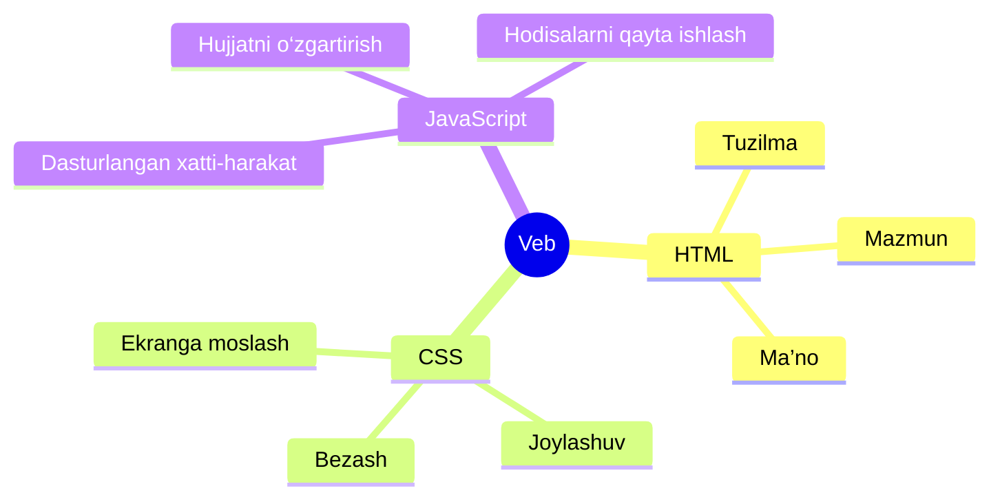
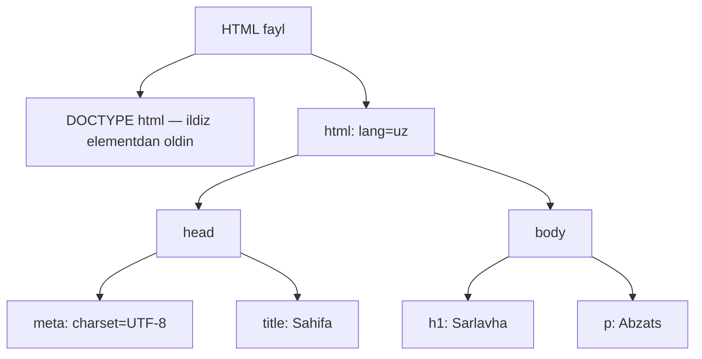

# HTML ga kirish hujjat tuzilishi

[Mundarija](../../README.md) · [Keyingi →](../../Lesson-2/uz/Matn%20va%20semantika.md) · [RU](../ru/%D0%92%D0%B2%D0%B5%D0%B4%D0%B5%D0%BD%D0%B8%D0%B5%20%D0%B2%20HTML%20%D1%81%D1%82%D1%80%D1%83%D0%BA%D1%82%D1%83%D1%80%D0%B0%20%D0%B4%D0%BE%D0%BA%D1%83%D0%BC%D0%B5%D0%BD%D1%82%D0%B0.md) · [EN](../en/Introduction%20to%20HTML%20document%20structure.md) · [UZ](HTML%20ga%20kirish%20hujjat%20tuzilishi.md) · [Amaliyot](../practice.html)

> **Kursning birinchi darsi.** Bugun birinchi veb-sahifangizni yaratasiz va uni brauzerda ochasiz. Dasturlashni bilish shart emas: papka yaratish va faylni saqlashni bilish kifoya.

---

## Bu sizga nima uchun kerak

Istalgan saytni oching: yangiliklar, do‘kon, universitet sahifasi. Ularning har biri ortida HTML belgilashli oddiy matn fayli turadi. Brauzer bu faylni o‘qiydi va sahifaga aylantiradi.

Bir soatdan keyin sizda ham shunday fayl bo‘ladi. Uni o‘zingiz yozasiz, brauzerda ochasiz va o‘z sahifangizni ko‘rasiz.

---

## Nimani o‘rganasiz

- HTML nima ekanini va u CSS hamda JavaScriptdan nimasi bilan farq qilishini tushuntirish.
- Teg, atribut va elementni farqlash.
- Har qanday HTML-hujjat skeletini yozish: `<!DOCTYPE html>`, `<html>`, `<head>`, `<body>`.
- `index.html` faylini yaratish, saqlash va brauzerda ochish.
- DevTools orqali istalgan saytning belgilashini ko‘rish.

---

## Reja

| Bo‘lim | Nima qilamiz |
| --- | --- |
| HTML nima | Uy karkasi va uning bezagi |
| Vositalar | VS Code, Live Server, DevTools |
| Teg, atribut, element | Posilka misolida |
| Hujjat skeleti | DOCTYPE, html, head, body qatorma-qator |
| Mini-topshiriq 1 | Skeletni yordamsiz yig‘ish |
| Birinchi sahifa | Yozamiz, saqlaymiz, ochamiz |
| Mini-topshiriq 2 | Sahifani o‘zgartirib natijani ko‘rish |
| Mustaqil ish | IDE topshirig‘i va tanishuv sahifasi |

---

## HTML nima

**Oddiy qilib aytganda:** uy qurish uchun avval karkas qo‘yiladi: devorlar, qavatlar, zinalar. Karkassiz pardani ham, chiroqni ham ilib bo‘lmaydi.

**HTML** (HyperText Markup Language, gipermatn belgilash tili) - veb-sahifaning karkasi. U sahifada **nima** borligini tasvirlaydi: qayerda sarlavha, qayerda abzats, qayerda rasm.

Karkasning ikki yordamchisi bor:

| Texnologiya | Uydagi roli | Saytda nima qiladi |
| --- | --- | --- |
| **HTML** | Karkas | Tuzilma va ma’no: sarlavhalar, abzatslar, ro‘yxatlar |
| **CSS** | Interyer dizayneri | Ranglar, shriftlar, joylashuv |
| **JavaScript** | Elektr va avtomatika | Xatti-harakat: bosishlarga javob, sahifani o‘zgartirish |



**Sxemani qanday o‘qish kerak.** Uchta shox - uchta turli vazifa. Bu kursda siz HTML yozasiz. CSS va JavaScript chegarani tushunishingiz uchun ko‘rsatilgan.

**Muhim:** HTML - **belgilash tili**, dasturlash tili emas. Unda shartlar, sikllar va hisob-kitoblar yo‘q. U faqat matnni belgilaydi: «bu sarlavha», «bu abzats».

---

## Vositalar

### VS Code - kod muharriri

1. Bepul muharrirni [code.visualstudio.com](https://code.visualstudio.com) saytidan yuklab oling.
2. O‘rnating va oching.
3. Chap tomonda **Extensions** belgisini bosing (to‘rtta kvadratcha).
4. **Live Server** (muallif Ritwick Dey) ni toping va **Install** ni bosing.

**Live Server nima uchun:** u faylni har saqlaganingizda brauzerdagi sahifani o‘zi yangilaydi. Usiz F5 ni qo‘lda bosish kerak.

**Foydali usul - Emmet.** Bo‘sh `.html` faylida `!` yozib Tab ni bosing. VS Code hujjat skeletini o‘zi qo‘yadi. Lekin avval skeletni qo‘lda yozishni o‘rganing: IDE tekshiruvida yordamchi bo‘lmaydi.

### DevTools - dasturchi vositalari

DevTools har bir brauzerga o‘rnatilgan. U ochiq sahifa qaysi elementlardan iboratligini ko‘rsatadi.

**Qanday ochiladi:** sahifada o‘ng tugma → **Kodni ko‘rish** (Inspect). Yoki F12. macOS da: Cmd+Option+I.

**Hozir sinab ko‘ring:** istalgan saytda DevTools ni oching. **Elements** yorlig‘ida `<h1>` tegini toping va ustiga bosing. Sahifada asosiy sarlavha yoritiladi.

**Eslab qoling:** DevTools dagi o‘zgarishlar sahifa yangilanguncha yashaydi. Ular diskdagi faylni o‘zgartirmaydi.

---

## Teg, atribut, element

Yangi o‘rganuvchilar bu uch so‘zni deyarli doim adashtiradi. Posilka misolida ko‘rib chiqamiz.

| Atama | Posilkada | HTML da |
| --- | --- | --- |
| **Teg** | Qutining qopqog‘i va tubi | `<p>` ochadi, `</p>` yopadi |
| **Atribut** | «Mo‘rt» yorlig‘i | Ochuvchi teg ichidagi `class="intro"` |
| **Element** | Butun posilka | Teglar + atributlar + mazmun |

```html
<p class="intro">Xush kelibsiz!</p>
```

- `<p class="intro">` - atributli ochuvchi teg;
- `Xush kelibsiz!` - mazmun;
- `</p>` - yopuvchi teg (`/` belgisi bilan);
- butun qator - «abzats» **elementi**.

### Juft va bo‘sh elementlar

Ko‘pchilik elementlar **juft**: ochuvchi va yopuvchi teg bor, ular orasida mazmun.

Ba’zi elementlar **bo‘sh**: ularda mazmun ham, yopuvchi teg ham yo‘q.

```html
<br>

```

Ularni keyingi darslarda ko‘rib chiqamiz. Hozir yozuvdagi farqni ko‘rish muhim.

### Atributlar

Atribut **faqat ochuvchi tegda** `nom="qiymat"` ko‘rinishida yoziladi. Bir nechta atribut probel bilan ajratiladi:

```html

```

### Izohlar

O‘zingiz uchun eslatmani izohda qoldirish mumkin. Brauzer uni ko‘rsatmaydi:

```html
<!-- Bu izoh: uni faqat kodda ko‘rish mumkin -->
```

### Yangi o‘rganuvchilarning tipik xatolari

| Xato | Qanday tuzatish |
| --- | --- |
| `<p>` yopilmagan | Juft elementlarni yoping: `<p>...</p>` |
| `</p>` o‘rniga `<p/>` | Slesh nomdan **oldin**: `</p>` |
| Yopuvchi tegda atribut: `</p class="intro">` | Atributlar - faqat ochuvchi tegda |
| Qiymat qo‘shtirnoqsiz | Kursda doim qo‘shtirnoq: `class="intro"` |
| Noto‘g‘ri ichma-ichlik: `<p><strong>matn</p></strong>` | Avval ichkisini yopamiz: `</strong></p>` |

---

## HTML-hujjat skeleti

Har bir HTML-sahifa bir xil skeletdan boshlanadi:

```html
<!DOCTYPE html>
<html lang="uz">
<head>
    <meta charset="UTF-8">
    <title>Mening birinchi sahifam</title>
</head>
<body>
    <h1>Salom, dunyo!</h1>
</body>
</html>
```

Qatorma-qator ko‘ramiz.

| Qator | Ma’nosi | O‘xshatish |
| --- | --- | --- |
| `<!DOCTYPE html>` | «Bu zamonaviy HTML». Brauzerning standart rejimini yoqadi | «Loyiha tasdiqlangan» muhri |
| `<html lang="uz">` | Hujjat ildizi. `lang` - matn tili | «Bu yerda o‘zbekcha gaplashiladi» lavhali butun uy |
| `<head>` | Xizmat ma’lumotlari. Sahifada ko‘rinmaydi | Uyning texnik pasporti |
| `<meta charset="UTF-8">` | Kodlash. Usiz harflar «g‘alati belgilar»ga aylanishi mumkin | Pasport to‘ldirilgan til |
| `<title>` | Brauzer yorlig‘i nomi | Darvozadagi manzil lavhasi |
| `<body>` | Foydalanuvchi ko‘radigan hamma narsa | Yashaladigan xonalar |

**`lang` nega muhim:** ekran o‘quvchi (sahifani ovoz chiqarib o‘qiydigan dastur) unga qarab talaffuzni tanlaydi. Brauzer unga qarab tarjima taklif qiladi.

**Kodlash nega muhim:** `charset` siz «o‘qish» so‘zi `o‘qish` kabi ko‘rinishi mumkin.

**`<title>` va `<h1>` - turli narsalar:** `title` yorliqda, `h1` esa sahifaning o‘zida yirik shriftda ko‘rinadi.



**Sxemani qanday o‘qish kerak.** Strelka ota-elementdan ichki elementga boradi. DOCTYPE `html` dan oldin turadi, uning ichida emas. `head` va `body` `html` ichida yonma-yon joylashgan.

### Yangi o‘rganuvchilarning tipik xatolari

| Xato | Qanday tuzatish |
| --- | --- |
| `<!DOCTYPE html>` yo‘q | Faylning birinchi qatoriga yozing |
| Matn to‘g‘ridan-to‘g‘ri `<html>` yoki `<head>` da | Ko‘rinadigan matn - faqat `<body>` da |
| `<meta charset="UTF-8">` yo‘q | Har bir faylda `<head>` ga qo‘shing |
| `<title>` va `<h1>` ni adashtirish | `title` - yorliq, `h1` - sahifadagi sarlavha |
| Ikkita `<body>` yoki `<head>` | Hujjatda bittadan |

---

## Mini-topshiriq 1

Hujjat skeletini **qaramasdan** yig‘ing:

1. Hujjat turi deklaratsiyasi.
2. O‘zbek tilidagi ildiz element.
3. Xizmat qismi: UTF-8 kodlash va «1-dars» yorlig‘i.
4. Bo‘sh ko‘rinadigan qism.

Yechim - «Javoblar» bo‘limida.

---

## Birinchi sahifa

**1-qadam.** `my-html-site` papkasini yarating. VS Code da: **File → Open Folder** va uni tanlang.

**2-qadam.** `index.html` faylini yarating. Bu sayt bosh sahifasining standart nomi. Fayl `index.html.txt` deb nomlanmaganiga ishonch hosil qiling.

**3-qadam.** Kodni joylashtiring:

```html
<!DOCTYPE html>
<html lang="uz">
<head>
    <meta charset="UTF-8">
    <title>Mening birinchi sahifam</title>
</head>
<body>
    <h1>Salom, dunyo!</h1>
    <p>Bu mening birinchi HTML-sahifam.</p>
    <p>Men JLearn platformasida HTML o‘rganyapman.</p>
</body>
</html>
```

Bu yerda ikki yangi element bor: `<h1>` - sahifaning asosiy sarlavhasi, `<p>` - abzats. Ular haqida batafsil - 2-darsda.

**4-qadam.** Saqlang: Ctrl+S (macOS da: Cmd+S).

**5-qadam.** Brauzerda oching: VS Code da fayl ustida o‘ng tugma → **Open with Live Server**. Yoki papkadagi faylga ikki marta bosing.

**Nimani ko‘rasiz:** yorliqda - «Mening birinchi sahifam». Sahifada - yirik «Salom, dunyo!» sarlavhasi va uning ostida orasi ochiq ikki abzats.

### Buzib ko‘ring

1. `</h1>` ni o‘chirib saqlang. Abzatslarga nima bo‘ldi? (Maslahat: brauzer sarlavha qayerda tugashini bilmaydi.)
2. `</h1>` ni qaytaring. Endi `</title>` ni o‘chirib saqlang. Sahifada va yorliqda nima ko‘rinyapti?
3. Hammasini qaytaring. Sahifa yana joyidami?

Shunday qilib teglarni nega yopish kerakligini amalda ko‘rasiz.

---

## Mini-topshiriq 2

1. Muharrirda ikkinchi abzats matnini o‘zgartiring.
2. Faylni saqlang.
3. Brauzerga qarang: o‘zgarish paydo bo‘ldimi?
4. Endi sarlavha matnini **DevTools da** o‘zgartiring (Elements yorlig‘ida matnga ikki marta bosing). F5 bilan sahifani yangilang. O‘zgarishga nima bo‘ldi?

Javob - «Javoblar» bo‘limida.

---

## Dars yakuni: shpargalka

| Nima | Yozuv | Eslab qoling |
| --- | --- | --- |
| Hujjat turi | `<!DOCTYPE html>` | Faylning birinchi qatori |
| Ildiz va til | `<html lang="uz">` | Til - sahifa matniga qarab |
| Xizmat qismi | `<head>...</head>` | Sahifada ko‘rinmaydi |
| Kodlash | `<meta charset="UTF-8">` | Aks holda «g‘alati belgilar» |
| Yorliq | `<title>...</title>` | `h1` bilan adashtirmang |
| Ko‘rinadigan qism | `<body>...</body>` | Butun mazmun - shu yerda |
| Sarlavha va abzats | `<h1>`, `<p>` | Batafsil - 2-darsda |
| Izoh | `<!-- ... -->` | Brauzer uni ko‘rsatmaydi |

---

## Mustaqil ish

### 1-qism. IDE topshirig‘i (platforma hisoblaydi)

Dars ostidagi muharrirni oching va noldan **tanishuv sahifasini** yig‘ing:

1. Hujjat skeleti: DOCTYPE, tilli `html`, `head`, `body`.
2. `head` da: UTF-8 kodlash va «Tanishuv» yorliq nomi.
3. `body` da: **bitta** asosiy sarlavha va **ikkita** abzats - o‘zingiz haqingizda va HTML ni nima uchun o‘rganayotganingiz haqida.

**«Tekshirish»** ni bosing. Tekshiruv o‘tmasa, muharrir ostida nima yetishmayotgani ro‘yxati chiqadi. Tuzating va qayta tekshiring.

**Natijani qanday ko‘rish:** kodni kompyuterdagi `index.html` fayliga ko‘chirib, brauzerda oching.

Platforma nimani tekshiradi: DOCTYPE, `lang`, `charset`, `head`, `body` va `title` borligi, aynan bitta `h1` va kamida ikkita `p`.

### 2-qism. Kompyuterdagi loyiha

1. `my-html-site` papkasini va unda xuddi shu tanishuv sahifasi bilan `index.html` ni yarating.
2. Uni brauzerda oching.
3. Muharrirda ikkinchi abzatsni o‘zgartiring, saqlang, o‘zgarish paydo bo‘lganini tekshiring.

### Tayyorlik mezonlari

- [ ] IDE topshirig‘i qabul qilingan.
- [ ] Fayl `index.html.txt` emas, `index.html` deb nomlangan.
- [ ] DOCTYPE, `html`, `head`, `body` bor; barcha juft teglar yopilgan.
- [ ] Til matn tiliga mos, kodlash - UTF-8.
- [ ] Yorliq nomi va sahifadagi sarlavha - turli elementlar.
- [ ] Brauzerda bitta `<h1>` va ikkita `<p>` ko‘rinadi.
- [ ] Muharrirda saqlangan o‘zgarish yangilashdan keyin paydo bo‘ldi.

---

## O‘zini tekshirish uchun savollar

1. HTML dasturlash tilidan nimasi bilan farq qiladi?
2. HTML, CSS va JavaScript nimaga javob beradi?
3. Element tegdan nimasi bilan farq qiladi?
4. Atribut qayerda yoziladi: ochuvchi yoki yopuvchi tegda?
5. `<meta charset="UTF-8">` ko‘rsatilmasa nima bo‘ladi?
6. `lang` atributi nima uchun kerak?
7. `<title>` qayerda, `<h1>` qayerda ko‘rinadi?
8. `<head>` ga nima, `<body>` ga nima tushadi?
9. DevTools dagi o‘zgarish nega faylda saqlanmaydi?
10. Bosh sahifa nega `index.html` deb nomlanadi?

Savollardan keyin platformada **dars testini** topshiring: 12 ta savol, o‘tish uchun 70% kerak. Dars IDE topshirig‘i ham, test ham topshirilganda hisoblanadi.

---

## Keyin nima

Skelet tayyor. 2-darsda uni ma’no bilan to‘ldiramiz: turli darajadagi sarlavhalar, abzatslar, ro‘yxatlar va sahifaning semantik bloklari - sarlavha qismi, navigatsiya, asosiy qism, pastki qism.

---

## Javoblar

**Mini-topshiriq 1**

```html
<!DOCTYPE html>
<html lang="uz">
<head>
    <meta charset="UTF-8">
    <title>1-dars</title>
</head>
<body>

</body>
</html>
```

**Mini-topshiriq 2.** Muharrirdagi o‘zgarish paydo bo‘ldi, chunki faylni saqladingiz. DevTools dagi o‘zgarish F5 dan keyin yo‘qoldi: DevTools faqat brauzerda hozir ochiq turgan nusxani o‘zgartiradi, diskdagi fayl esa o‘zgarmaydi.

**O‘zini tekshirish uchun savollar**

1. HTML da shartlar, sikllar va hisob-kitoblar yo‘q. U faqat mazmunni belgilaydi.
2. HTML - tuzilma va ma’no, CSS - bezash, JavaScript - xatti-harakat.
3. Teg - `<p>` yoki `</p>` yozuvi. Element - hammasi birga: teglar, atributlar va mazmun.
4. Faqat ochuvchi tegda.
5. Harflar o‘qib bo‘lmaydigan belgilar bo‘lib ko‘rinishi mumkin.
6. Ekran o‘quvchi to‘g‘ri talaffuzni, brauzer esa tarjimani tanlashi uchun.
7. `title` - brauzer yorlig‘ida, `h1` - sahifaning o‘zida.
8. `head` ga - xizmat ma’lumotlari: kodlash, yorliq nomi. `body` ga - ko‘rinadigan hamma narsa.
9. DevTools faylni emas, brauzerdagi sahifa nusxasini o‘zgartiradi.
10. Manzilda fayl ko‘rsatilmaganda server `index.html` ni avtomatik ochadi.

---

[Mundarija](../../README.md) · [Keyingi →](../../Lesson-2/uz/Matn%20va%20semantika.md) · [RU](../ru/%D0%92%D0%B2%D0%B5%D0%B4%D0%B5%D0%BD%D0%B8%D0%B5%20%D0%B2%20HTML%20%D1%81%D1%82%D1%80%D1%83%D0%BA%D1%82%D1%83%D1%80%D0%B0%20%D0%B4%D0%BE%D0%BA%D1%83%D0%BC%D0%B5%D0%BD%D1%82%D0%B0.md) · [EN](../en/Introduction%20to%20HTML%20document%20structure.md) · [UZ](HTML%20ga%20kirish%20hujjat%20tuzilishi.md) · [Amaliyot](../practice.html)
