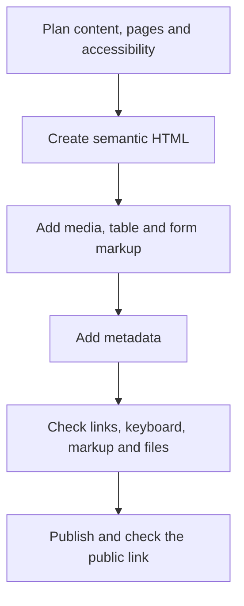
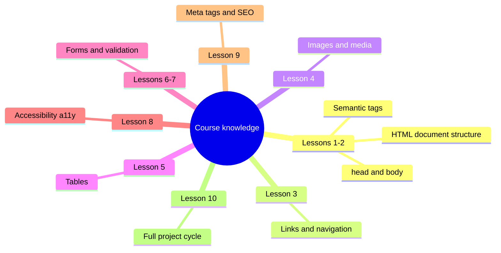

# Final project from planning to publication

[Contents](../../README.md) · [← Back](../../Lesson-9/en/Meta%20tags%2C%20SEO%2C%20linking%20CSS%20and%20JS.md) · [RU](../ru/%D0%98%D1%82%D0%BE%D0%B3%D0%BE%D0%B2%D1%8B%D0%B9%20%D0%BF%D1%80%D0%BE%D0%B5%D0%BA%D1%82%20%D0%BE%D1%82%20%D0%BF%D0%BB%D0%B0%D0%BD%D0%B8%D1%80%D0%BE%D0%B2%D0%B0%D0%BD%D0%B8%D1%8F%20%D0%B4%D0%BE%20%D0%BF%D1%83%D0%B1%D0%BB%D0%B8%D0%BA%D0%B0%D1%86%D0%B8%D0%B8.md) · [EN](Final%20project%20from%20planning%20to%20publication.md) · [UZ](../uz/Yakuniy%20loyiha%20rejalashtirishdan%20nashr%20etishgacha.md) · [Project source code](../../final-project/README.md)

> **Link to previous lessons:** there are no new tags today. You will put everything you learned in Lessons 1–9 into one website and publish it on the internet.

---

## Why you need this

Until now your pages lived only on your computer. Today your site gets a real address like `your-name.github.io/my-site`. You can send it to a friend or a teacher, or put it in your CV.

A finished four-page site is your first portfolio.

---

## What you will learn

- Plan a site before the first line of code: a site map and a content plan.
- Build a site step by step: skeleton → content → media → table → form → meta tags → accessibility.
- Check a site against a checklist and record checks in a log.
- Publish a site on GitHub Pages and check the public link.

---

## Review: 3 questions from Lessons 3, 8 and 9

1. Why must paths in a project be relative?
2. What is the "Skip to main content" link for?
3. Which two meta tags are required on every page, besides `charset`?

Answers are at the end of the lesson.

---

## Lesson plan

| Section | What we do |
| --- | --- |
| Project source code | Where the sample is and how to use it |
| Planning | A house blueprint before construction |
| Steps 1–7 | Build the site layer by layer |
| Checklist and log | Acceptance before submission |
| Publication | GitHub Pages |
| Independent work | IDE task |
| Independent final exam | Your own site from scratch |

---

## Project source code

The sample - Aziz's four-page portfolio - is in a separate folder, [final-project](../../final-project/README.md) (the sample texts are in Russian):

```
final-project/
├── starter/          ← empty templates for 4 pages
├── steps/
│   ├── 01-skeleton/  ← after step 1
│   ├── 02-content/
│   ├── 03-media/
│   ├── 04-table/
│   ├── 05-form/
│   ├── 06-meta/
│   └── 07-a11y/      ← after step 7
├── final/            ← finished site
└── docs/             ← plan, checklist, log
```

**How to use it:** do a lesson step on **your own** site, then compare with that step's folder. Each step folder is a working site: open it via Live Server.

**Do not copy the sample.** Compare and explain the difference. The exam requires your own site on a different topic.

---

## Planning

**In simple terms:** nobody builds a house without a blueprint. First they draw how many rooms there are and where the doors go. A mistake on paper takes a minute to fix; in a finished house, a week.

### Step A. Topic

Choose a topic you have something to say about:
- a personal portfolio;
- a club or study group;
- a small café, workshop, tutor.

### Step B. Site map

| Page | File | What is on it |
| --- | --- | --- |
| Home | `index.html` | Greeting, photo, links to sections |
| About me | `about.html` | Story, skills, path |
| Projects | `projects.html` | Works with images |
| Contacts | `contact.html` | Ways to get in touch, form |

### Step C. A plan for each page

For each page write down which tags it needs. For example, `contact.html`:

- `header` with a menu of 4 pages;
- `main` with an `h1` "Contacts";
- a table of contact methods with `caption` and `scope`;
- a form with `fieldset`, `legend` and labels;
- `footer` with an icon link with `aria-label`.

Sample plan - [docs/PLAN.md](../../final-project/docs/PLAN.md).



**How to read the diagram.** This is the working cycle from plan to checking the published site. Found an error during checking - go back to the right step and fix it.

---

## Step 1. Skeleton

The same skeleton on all four pages. Only `title` differs.

```html
<!DOCTYPE html>
<html lang="en">
<head>
    <meta charset="UTF-8">
    <title>Contacts - Aziz's portfolio</title>
</head>
<body>
    <header>
        <nav>
            <ul>
                <li><a href="index.html">Home</a></li>
                <li><a href="about.html">About me</a></li>
                <li><a href="projects.html">Projects</a></li>
                <li><a href="contact.html">Contacts</a></li>
            </ul>
        </nav>
    </header>
    <main>
        <!-- page content: step 2 -->
    </main>
    <footer>
    </footer>
</body>
</html>
```

**Check:** from every page click every menu item: 4 × 4 = 16 transitions.

Compare: `steps/01-skeleton`.

---

## Step 2. Content

We fill `main` with text. One `h1`, no skipped levels, lists where the meaning calls for them.

```html
<main>
    <h1>About me</h1>
    <p>My name is Aziz. I have been <strong>into web development</strong> for a year and took the "HTML in 10 lessons" course to put my knowledge in order.</p>
    <section>
        <h2>My skills</h2>
        <ul>
            <li>Semantic HTML markup</li>
            <li>Tables and forms</li>
            <li>Page accessibility</li>
        </ul>
    </section>
    <section>
        <h2>My path</h2>
        <ol>
            <li>Started learning layout on my own</li>
            <li>Took the "HTML in 10 lessons" course</li>
            <li>Next - CSS and JavaScript</li>
        </ol>
    </section>
</main>
```

Compare: `steps/02-content`.

---

## Step 3. Media

Images with `alt`, `figure` captions, a site icon.

```html
<figure>
    
    <figcaption>This is how I spend my evenings after classes</figcaption>
</figure>
```

**The main rule of this step:** open every image and write its `alt` **based on what is in it**. Four different images - four different `alt`s. In the sample, every mockup on the projects page has its own description.

Add the icon to `<head>`:

```html
<link rel="icon" type="image/png" href="favicon.png">
```

Compare: `steps/03-media`.

---

## Step 4. Table

A table only where there is tabular data. In the sample it is the response time on the contacts page:

```html
<table>
    <caption>When I reply</caption>
    <thead>
        <tr>
            <th scope="col">Method</th>
            <th scope="col">Contact</th>
            <th scope="col">Response time</th>
        </tr>
    </thead>
    <tbody>
        <tr>
            <th scope="row">Email</th>
            <td><a href="mailto:aziz@example.com">aziz@example.com</a></td>
            <td>Within a day</td>
        </tr>
        <tr>
            <th scope="row">Telegram</th>
            <td><a href="https://t.me/example">@example</a></td>
            <td>A few hours</td>
        </tr>
    </tbody>
</table>
```

No tabular data for your topic? Do not add a table just to tick a box. But the exam requires a table: find a real job for it, such as a schedule.

Compare: `steps/04-table`.

---

## Step 5. Form

```html
<form method="get">
    <fieldset>
        <legend>Feedback</legend>
        <p>
            <label for="name">Name</label>
            <input type="text" id="name" name="name" autocomplete="name" maxlength="50" required>
        </p>
        <p>
            <label for="email">Email</label>
            <input type="email" id="email" name="email" autocomplete="email" required>
        </p>
        <p>
            <label for="message">Message</label>
            <textarea id="message" name="message" rows="5" maxlength="500" required></textarea>
        </p>
    </fieldset>
    <p><button type="submit">Send</button></p>
</form>
```

Above the form, write that it is a practice form: the data appears in the page address and is not delivered anywhere. Enter only made-up data.

Compare: `steps/05-form`.

---

## Step 6. Meta tags, CSS and JS

Now that the text is ready, it is easy to write each page's description:

```html
<head>
    <meta charset="UTF-8">
    <meta name="viewport" content="width=device-width, initial-scale=1.0">
    <title>About me - Aziz's portfolio</title>
    <meta name="description" content="Aziz tells how he started learning web development, which skills he has already mastered and what he plans next.">
    <meta property="og:title" content="About me - Aziz's portfolio">
    <meta property="og:description" content="Aziz tells how he started learning web development, which skills he has already mastered and what he plans next.">
    <link rel="icon" type="image/png" href="favicon.png">
    <link rel="stylesheet" href="css/style.css">
    <script src="js/main.js" defer></script>
</head>
```

**Each page has its own `title` and `description`.** The files `css/style.css` and `js/main.js` are the ready ones from Lesson 9.

Compare: `steps/06-meta`.

---

## Step 7. Accessibility

The first line in `body` is the skip-menu link; `main` gets an `id`:

```html
<body>
    <a href="#main">Skip to main content</a>
    <header>...</header>
    <main id="main">
```

The icon link in the footer gets a name:

```html
<a href="https://t.me/example" aria-label="Aziz's Telegram">
    
</a>
```

Then go through every page with the keyboard, as in Lesson 8.

Compare: `steps/07-a11y` - this is the finished site.

---

## Checklist and log

Before publishing, go through the [checklist](../../final-project/docs/CHECKLIST.md) for every page. Record every check in the [log](../../final-project/docs/JOURNAL.md): what you checked, what you expected, what you got, what you fixed.

Main items:

- [ ] One `h1`, no skipped levels.
- [ ] All 16 menu transitions work.
- [ ] Every image has its own `alt` based on its content.
- [ ] A table with `caption` and `scope`.
- [ ] Every field has a connected label.
- [ ] Every page has its own `title` and `description`.
- [ ] The whole page can be used with the keyboard.
- [ ] Nu HTML Checker - no errors.

---

## Publishing on GitHub Pages

**GitHub Pages** is free hosting for sites made of HTML, CSS and JS. The address will be: `https://your-login.github.io/repository-name/`.

### Step 1. Account

Sign up at [github.com](https://github.com).

### Step 2. Repository

1. Click **New repository**.
2. Name: for example, `my-site` (Latin letters, no spaces).
3. Choose **Public**.
4. Click **Create repository**.

### Step 3. Upload files

1. On the repository page click **uploading an existing file**.
2. Drag in the **contents** of your site folder: `index.html`, the other pages and the `images`, `css`, `js` folders.
3. Click **Commit changes**.

`index.html` must sit in the repository root, not inside a nested folder.

### Step 4. Turn on Pages

1. **Settings** → **Pages** in the left menu.
2. **Source**: **Deploy from a branch**.
3. **Branch**: `main`, folder `/ (root)`. Click **Save**.

### Step 5. Check

After 1–3 minutes reload the Pages settings page - a link to the site appears. Open it and check all transitions and images **again**: on a server, letter case in file names matters.

The GitHub interface sometimes changes. If the button names differ, see the [official guide](https://docs.github.com/en/pages/getting-started-with-github-pages/creating-a-github-pages-site).

### Typical publishing mistakes

| Mistake | How to fix |
| --- | --- |
| The site does not open: 404 | The home page must be named `index.html` and sit in the root |
| Uploaded the whole folder, site is in a subfolder | Upload the **contents** of the folder |
| Images do not show on the server | Check the case: `Photo.JPG` and `photo.jpg` are different files |
| Paths like `C:\Users\...` | Relative paths only |
| The repository is private | Free Pages needs Public |
| Pages is not turned on | Settings → Pages → choose the branch |

---

## Course summary



**How to read the diagram.** Each branch is a lesson and the skill it gave you. You use all of them in your final site.

**What's next:** HTML is the frame. The next step is **CSS**: colors, fonts, layout, adapting to phones. Then **JavaScript**: page behavior. Your published site becomes a playground for these skills.

---

## Independent work

### IDE task (graded by the platform)

Make the **contacts page of your own** club, study group or library - not Aziz's portfolio:

1. A complete `<head>`: `charset`, `viewport`, `title`, `description`.
2. A "Skip to main content" link first in `body`, `main` with `id="main"`.
3. `header` with a menu to `index.html`, `about.html`, `projects.html`, `contact.html`.
4. One `h1`.
5. A table with `caption` and headers with `scope="col"` and `scope="row"`.
6. A form with `method="get"`: `fieldset`, `legend`, at least two labelled fields, one of them `email`, a `<button type="submit">` button.
7. `footer`.

What the platform checks: everything listed above, plus the absence of `div`, positive `tabindex`, `role="button"` and the sample's text ("Aziz").

---

## Independent final exam

The step-by-step build above is a learning sample. Repeating the finished portfolio does not show independence.

**Task:** without copying the sample, make a site for a club, library or study group with four linked pages. It must have:

- headings and lists that follow the meaning;
- your own or permitted images with a suitable `alt`;
- a table with `caption` and headers;
- a form with labels, `fieldset`/`legend` and input checks, marked as a practice form;
- its own metadata on every page;
- publication on GitHub Pages.

**What to submit:** source files, the public link and the check log.

| Criterion | Points |
| --- | ---: |
| Structure and navigation | 20 |
| Semantics and content | 20 |
| Images and table | 15 |
| Form and validation | 15 |
| Accessibility and keyboard check | 20 |
| Metadata, publication and log | 10 |

**Pass:** 80 points or more out of 100. Required: all four pages open, navigation works, every field has a label. Broken links and unlabelled fields are fixed before a pass.

**How points are given:** full points - the requirement is met and checked; half - partly met; zero - not met.

**Oral defense:** explain your choice of tags and how the form works, and describe two checks from your log and the problems you found.

---

## Self-check questions

1. Why make a site map before writing code?
2. Why is the menu the same on every page?
3. How many menu transitions need checking on a 4-page site?
4. Why is `alt` written after opening the image?
5. When is a table on a page unnecessary?
6. Why is the form in the practice project `method="get"` and without `action`?
7. How should the `title`s of different pages differ?
8. Where should `index.html` sit in the repository?
9. Why might an image disappear after publication even though it showed locally?
10. What is submitted together with the site at the exam?

After the questions, take the **lesson test** on the platform: 12 questions, pass threshold 70%.

---

## Answers

**Review**

1. Absolute paths from your disk do not work on a server, while relative ones move together with the folder.
2. So that a keyboard user does not have to go through the whole menu on every page.
3. `viewport` and `description`.

**Self-check questions**

1. Structural mistakes are cheaper to find on paper than in the code of four pages.
2. The user always knows where they are and how to get to any section.
3. 16: 4 links from each of the 4 pages.
4. A file name does not say what is in the image. `alt` describes the actual content.
5. When there is no data in rows and columns.
6. There is no handler: GET lets you see the submitted values in the address, and the data goes nowhere.
7. Each `title` describes its own page and the site name.
8. In the repository root.
9. On a server, letter case in the file name matters.
10. Source files, the public link and the check log.

---

[Contents](../../README.md) · [← Back](../../Lesson-9/en/Meta%20tags%2C%20SEO%2C%20linking%20CSS%20and%20JS.md) · [RU](../ru/%D0%98%D1%82%D0%BE%D0%B3%D0%BE%D0%B2%D1%8B%D0%B9%20%D0%BF%D1%80%D0%BE%D0%B5%D0%BA%D1%82%20%D0%BE%D1%82%20%D0%BF%D0%BB%D0%B0%D0%BD%D0%B8%D1%80%D0%BE%D0%B2%D0%B0%D0%BD%D0%B8%D1%8F%20%D0%B4%D0%BE%20%D0%BF%D1%83%D0%B1%D0%BB%D0%B8%D0%BA%D0%B0%D1%86%D0%B8%D0%B8.md) · [EN](Final%20project%20from%20planning%20to%20publication.md) · [UZ](../uz/Yakuniy%20loyiha%20rejalashtirishdan%20nashr%20etishgacha.md) · [Project source code](../../final-project/README.md)
