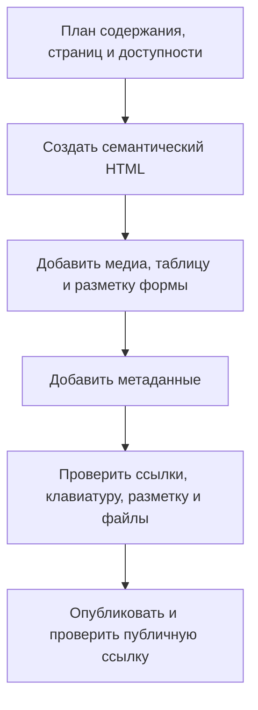
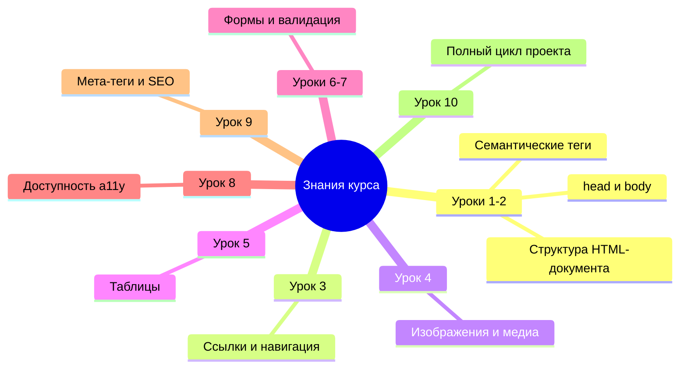

# Итоговый проект от планирования до публикации

[Содержание](../../README.md) · [Назад](../../Lesson-9/ru/%D0%9C%D0%B5%D1%82%D0%B0-%D1%82%D0%B5%D0%B3%D0%B8%2C%20SEO%2C%20%D1%81%D0%B2%D1%8F%D0%B7%D1%8C%20%D1%81%20CSS%2C%20JS.md) · [Исходный код проекта](../../final-project/README.md) · [RU](../ru/%D0%98%D1%82%D0%BE%D0%B3%D0%BE%D0%B2%D1%8B%D0%B9%20%D0%BF%D1%80%D0%BE%D0%B5%D0%BA%D1%82%20%D0%BE%D1%82%20%D0%BF%D0%BB%D0%B0%D0%BD%D0%B8%D1%80%D0%BE%D0%B2%D0%B0%D0%BD%D0%B8%D1%8F%20%D0%B4%D0%BE%20%D0%BF%D1%83%D0%B1%D0%BB%D0%B8%D0%BA%D0%B0%D1%86%D0%B8%D0%B8.md) · [EN](../en/Final%20project%20from%20planning%20to%20publication.md) · [UZ](../uz/Yakuniy%20loyiha%20rejalashtirishdan%20nashr%20etishgacha.md)

> **Связь с прошлыми уроками:** новых тегов сегодня не будет. Вы соберёте всё, что изучили в уроках 1–9, в один сайт и опубликуете его в интернете.

---

## Зачем это вам

До сих пор ваши страницы жили только на вашем компьютере. Сегодня у сайта появится настоящий адрес вида `ваше-имя.github.io/my-site`. Его можно отправить другу, преподавателю или вставить в резюме.

Готовый сайт из четырёх страниц - ваше первое портфолио.

---

## Чему вы научитесь

- Планировать сайт до первой строки кода: карта страниц и план содержимого.
- Собирать сайт по шагам: скелет → контент → медиа → таблица → форма → метатеги → доступность.
- Проверять сайт по чек-листу и записывать проверки в журнал.
- Публиковать сайт на GitHub Pages и проверять публичную ссылку.

---

## Повторение: 3 вопроса из уроков 3, 8 и 9

1. Почему пути в проекте должны быть относительными?
2. Зачем ссылка «Перейти к основному содержимому»?
3. Какие два метатега обязательны на каждой странице, кроме `charset`?

Ответы - в конце урока.

---

## План урока

| Раздел | Что делаем |
| --- | --- |
| Исходный код проекта | Где лежит образец и как им пользоваться |
| Планирование | Чертёж дома до стройки |
| Шаги 1–7 | Собираем сайт по слоям |
| Чек-лист и журнал | Приёмка перед сдачей |
| Публикация | GitHub Pages |
| Самостоятельная работа | Задание в IDE |
| Независимый итоговый экзамен | Свой сайт с нуля |

---

## Исходный код проекта

Образец - портфолио Азиза из четырёх страниц - лежит в отдельной папке [final-project](../../final-project/README.md):

```
final-project/
├── starter/          ← пустые заготовки 4 страниц
├── steps/
│   ├── 01-skeleton/  ← после шага 1
│   ├── 02-content/
│   ├── 03-media/
│   ├── 04-table/
│   ├── 05-form/
│   ├── 06-meta/
│   └── 07-a11y/      ← после шага 7
├── final/            ← готовый сайт
└── docs/             ← план, чек-лист, журнал
```

**Как пользоваться:** делаете шаг урока на **своём** сайте, а потом сравниваете с папкой этого шага. Каждая папка шага - рабочий сайт: откройте её через Live Server.

**Не копируйте образец.** Сравнивайте и объясняйте разницу. На экзамене нужен свой сайт на другую тему.

---

## Планирование

**Простыми словами:** дом не строят без чертежа. Сначала рисуют, сколько комнат и где двери. Ошибку на бумаге исправить за минуту, а в готовом доме - неделю.

### Шаг А. Тема

Выберите тему, о которой вам есть что рассказать:
- личное портфолио;
- клуб или кружок;
- небольшое кафе, мастерская, репетитор.

### Шаг Б. Карта сайта

| Страница | Файл | Что на ней |
| --- | --- | --- |
| Главная | `index.html` | Приветствие, фото, ссылки на разделы |
| Обо мне | `about.html` | Рассказ, навыки, путь |
| Проекты | `projects.html` | Работы с картинками |
| Контакты | `contact.html` | Способы связи, форма |

### Шаг В. План каждой страницы

Для каждой страницы запишите, какие теги понадобятся. Например, `contact.html`:

- `header` с меню на 4 страницы;
- `main` с `h1` «Контакты»;
- таблица способов связи с `caption` и `scope`;
- форма с `fieldset`, `legend` и подписями;
- `footer` с иконкой-ссылкой с `aria-label`.

Образец плана - [docs/PLAN.md](../../final-project/docs/PLAN.md).



**Как читать схему.** Это рабочий цикл от плана до проверки опубликованного сайта. Нашли ошибку при проверке - вернитесь к нужному шагу и исправьте.

---

## Шаг 1. Скелет

Одинаковый скелет на всех четырёх страницах. Отличается только `title`.

```html
<!DOCTYPE html>
<html lang="ru">
<head>
    <meta charset="UTF-8">
    <title>Контакты - Портфолио Азиза</title>
</head>
<body>
    <header>
        <nav>
            <ul>
                <li><a href="index.html">Главная</a></li>
                <li><a href="about.html">Обо мне</a></li>
                <li><a href="projects.html">Проекты</a></li>
                <li><a href="contact.html">Контакты</a></li>
            </ul>
        </nav>
    </header>
    <main>
        <!-- содержимое страницы: шаг 2 -->
    </main>
    <footer>
    </footer>
</body>
</html>
```

**Проверка:** с каждой страницы нажмите каждый пункт меню: 4 × 4 = 16 переходов.

Сравните: `steps/01-skeleton`.

---

## Шаг 2. Контент

Наполняем `main` текстом. Один `h1`, уровни без пропусков, списки по смыслу.

```html
<main>
    <h1>Обо мне</h1>
    <p>Меня зовут Азиз. Я <strong>увлекаюсь веб-разработкой</strong> уже год и прошёл курс «HTML за 10 уроков», чтобы привести знания в порядок.</p>
    <section>
        <h2>Мои навыки</h2>
        <ul>
            <li>Семантическая разметка HTML</li>
            <li>Таблицы и формы</li>
            <li>Доступность страниц</li>
        </ul>
    </section>
    <section>
        <h2>Мой путь</h2>
        <ol>
            <li>Начал изучать вёрстку самостоятельно</li>
            <li>Прошёл курс «HTML за 10 уроков»</li>
            <li>Дальше - CSS и JavaScript</li>
        </ol>
    </section>
</main>
```

Сравните: `steps/02-content`.

---

## Шаг 3. Медиа

Картинки с `alt`, подписи `figure`, иконка сайта.

```html
<figure>
    
    <figcaption>Так я провожу вечера после учёбы</figcaption>
</figure>
```

**Главное правило шага:** откройте каждую картинку и напишите `alt` **по тому, что на ней**. Четыре разные картинки - четыре разных `alt`. В образце на странице проектов у каждого макета своё описание.

В `<head>` добавьте иконку:

```html
<link rel="icon" type="image/png" href="favicon.png">
```

Сравните: `steps/03-media`.

---

## Шаг 4. Таблица

Таблица - только там, где есть табличные данные. В образце это время ответа на странице контактов:

```html
<table>
    <caption>Когда я отвечаю</caption>
    <thead>
        <tr>
            <th scope="col">Способ</th>
            <th scope="col">Контакт</th>
            <th scope="col">Время ответа</th>
        </tr>
    </thead>
    <tbody>
        <tr>
            <th scope="row">Почта</th>
            <td><a href="mailto:aziz@example.com">aziz@example.com</a></td>
            <td>В течение суток</td>
        </tr>
        <tr>
            <th scope="row">Telegram</th>
            <td><a href="https://t.me/example">@example</a></td>
            <td>Несколько часов</td>
        </tr>
    </tbody>
</table>
```

Нет табличных данных на вашей теме? Не добавляйте таблицу ради галочки. Но на экзамене таблица обязательна: найдите для неё настоящую задачу, например расписание.

Сравните: `steps/04-table`.

---

## Шаг 5. Форма

```html
<form method="get">
    <fieldset>
        <legend>Обратная связь</legend>
        <p>
            <label for="name">Имя</label>
            <input type="text" id="name" name="name" autocomplete="name" maxlength="50" required>
        </p>
        <p>
            <label for="email">Почта</label>
            <input type="email" id="email" name="email" autocomplete="email" required>
        </p>
        <p>
            <label for="message">Сообщение</label>
            <textarea id="message" name="message" rows="5" maxlength="500" required></textarea>
        </p>
    </fieldset>
    <p><button type="submit">Отправить</button></p>
</form>
```

Над формой напишите, что она учебная: данные появятся в адресе страницы и никуда не доставляются. Вводите только вымышленные данные.

Сравните: `steps/05-form`.

---

## Шаг 6. Метатеги, CSS и JS

Теперь, когда текст готов, легко написать описание каждой страницы:

```html
<head>
    <meta charset="UTF-8">
    <meta name="viewport" content="width=device-width, initial-scale=1.0">
    <title>Обо мне - Портфолио Азиза</title>
    <meta name="description" content="Азиз рассказывает, как начал изучать веб-разработку, какие навыки уже освоил и что планирует дальше.">
    <meta property="og:title" content="Обо мне - Портфолио Азиза">
    <meta property="og:description" content="Азиз рассказывает, как начал изучать веб-разработку, какие навыки уже освоил и что планирует дальше.">
    <link rel="icon" type="image/png" href="favicon.png">
    <link rel="stylesheet" href="css/style.css">
    <script src="js/main.js" defer></script>
</head>
```

**Свои `title` и `description` на каждой странице.** Файлы `css/style.css` и `js/main.js` - готовые из урока 9.

Сравните: `steps/06-meta`.

---

## Шаг 7. Доступность

Первой строкой в `body` - ссылка пропуска меню, у `main` - `id`:

```html
<body>
    <a href="#main">Перейти к основному содержимому</a>
    <header>...</header>
    <main id="main">
```

Иконка-ссылка в подвале получает имя:

```html
<a href="https://t.me/example" aria-label="Telegram Азиза">
    
</a>
```

Затем пройдите каждую страницу клавиатурой, как в уроке 8.

Сравните: `steps/07-a11y` - это и есть готовый сайт.

---

## Чек-лист и журнал

Перед публикацией пройдите [чек-лист](../../final-project/docs/CHECKLIST.md) для каждой страницы. Каждую проверку запишите в [журнал](../../final-project/docs/JOURNAL.md): что проверяли, что ожидали, что получилось, что исправили.

Главные пункты:

- [ ] Один `h1`, уровни без пропусков.
- [ ] 16 переходов меню работают.
- [ ] У каждой картинки свой `alt` по её содержанию.
- [ ] Таблица с `caption` и `scope`.
- [ ] У каждого поля связанная подпись.
- [ ] Свои `title` и `description` на каждой странице.
- [ ] Вся страница проходится клавиатурой.
- [ ] Nu HTML Checker - без ошибок.

---

## Публикация на GitHub Pages

**GitHub Pages** - бесплатный хостинг для сайтов из HTML, CSS и JS. Адрес будет таким: `https://ваш-логин.github.io/название-репозитория/`.

### Шаг 1. Аккаунт

Зарегистрируйтесь на [github.com](https://github.com).

### Шаг 2. Репозиторий

1. Нажмите **New repository**.
2. Название: например, `my-site` (латиница, без пробелов).
3. Выберите **Public**.
4. Нажмите **Create repository**.

### Шаг 3. Загрузка файлов

1. На странице репозитория нажмите **uploading an existing file**.
2. Перетащите **содержимое** папки сайта: `index.html`, остальные страницы и папки `images`, `css`, `js`.
3. Нажмите **Commit changes**.

`index.html` должен лежать в корне репозитория, а не внутри вложенной папки.

### Шаг 4. Включение Pages

1. **Settings** → в меню слева **Pages**.
2. **Source**: **Deploy from a branch**.
3. **Branch**: `main`, папка `/ (root)`. Нажмите **Save**.

### Шаг 5. Проверка

Через 1–3 минуты обновите страницу настроек Pages - появится ссылка на сайт. Откройте её и **заново** проверьте все переходы и картинки: на сервере регистр букв в именах файлов важен.

Интерфейс GitHub иногда меняется. Если названия кнопок другие, смотрите [официальную инструкцию](https://docs.github.com/en/pages/getting-started-with-github-pages/creating-a-github-pages-site).

### Частые ошибки при публикации

| Ошибка | Как исправить |
| --- | --- |
| Сайт не открывается: 404 | Главная страница должна называться `index.html` и лежать в корне |
| Загрузили папку целиком, сайт в подпапке | Загружайте **содержимое** папки |
| Картинки не видны на сервере | Проверьте регистр: `Photo.JPG` и `photo.jpg` - разные файлы |
| Пути `C:\Users\...` | Только относительные пути |
| Репозиторий приватный | Для бесплатного Pages - Public |
| Pages не включён | Settings → Pages → выбрать ветку |

---

## Итоги курса



**Как читать схему.** Каждая ветвь - урок и навык, который он дал. В итоговом сайте вы используете их все.

**Что дальше:** HTML - каркас. Следующий шаг - **CSS**: цвета, шрифты, раскладка, адаптивность под телефон. Потом - **JavaScript**: поведение страницы. Ваш опубликованный сайт станет площадкой для этих навыков.

---

## Самостоятельная работа

### Задание в IDE (засчитывается платформой)

Сделайте **страницу контактов своего** клуба, кружка или библиотеки - не портфолио Азиза:

1. Полный `<head>`: `charset`, `viewport`, `title`, `description`.
2. Ссылка «Перейти к основному содержимому» первой в `body`, у `main` - `id="main"`.
3. `header` с меню на `index.html`, `about.html`, `projects.html`, `contact.html`.
4. Один `h1`.
5. Таблица с `caption`, заголовками `scope="col"` и `scope="row"`.
6. Форма `method="get"`: `fieldset`, `legend`, минимум два поля с подписями, одно - `email`, кнопка `<button type="submit">`.
7. `footer`.

Что проверяет платформа: всё перечисленное, а также отсутствие `div`, положительных `tabindex`, `role="button"` и текста образца («Азиз»).

---

## Независимый итоговый экзамен

Пошаговая сборка выше - учебный образец. Повторить готовое портфолио - не значит показать самостоятельность.

**Задание:** без копирования образца сделайте сайт клуба, библиотеки или кружка из четырёх связанных страниц. В нём должны быть:

- заголовки и списки по смыслу;
- свои или разрешённые изображения с подходящим `alt`;
- таблица с `caption` и заголовками;
- форма с подписями, `fieldset`/`legend` и проверкой ввода, с пометкой, что форма учебная;
- свои метаданные на каждой странице;
- публикация на GitHub Pages.

**Что сдать:** исходники, публичную ссылку и журнал проверок.

| Критерий | Баллы |
| --- | ---: |
| Структура и навигация | 20 |
| Семантика и содержание | 20 |
| Изображения и таблица | 15 |
| Форма и валидация | 15 |
| Доступность и проверка клавиатурой | 20 |
| Метаданные, публикация и журнал | 10 |

**Зачёт:** от 80 баллов из 100. Обязательно: все четыре страницы открываются, навигация работает, у всех полей есть подписи. Битые ссылки и поля без подписей исправляются до зачёта.

**Как ставятся баллы:** полный балл - требование выполнено и проверено; половина - выполнено частично; ноль - нет.

**Устная защита:** объясните выбор тегов, как работает форма, и расскажите о двух проверках из журнала и найденных проблемах.

---

## Вопросы для самопроверки

1. Зачем составлять карту сайта до кода?
2. Почему меню одинаковое на всех страницах?
3. Сколько переходов меню нужно проверить на сайте из 4 страниц?
4. Почему `alt` пишут после того, как открыли картинку?
5. Когда таблица на странице лишняя?
6. Почему форма в учебном проекте - `method="get"` и без `action`?
7. Чем `title` разных страниц должны отличаться?
8. Где должен лежать `index.html` в репозитории?
9. Почему картинка может пропасть после публикации, хотя локально была?
10. Что сдаётся вместе с сайтом на экзамене?

После вопросов пройдите **тест урока** на платформе: 12 вопросов, порог 70%.

---

## Ответы

**Повторение**

1. Абсолютные пути с диска не работают на сервере, а относительные переносятся вместе с папкой.
2. Чтобы пользователь клавиатуры не проходил всё меню на каждой странице.
3. `viewport` и `description`.

**Вопросы для самопроверки**

1. Ошибки структуры дешевле найти на бумаге, чем в коде четырёх страниц.
2. Пользователь всегда знает, где он и как попасть в любой раздел.
3. 16: с каждой из 4 страниц по 4 ссылки.
4. Имя файла не говорит, что на картинке. `alt` описывает реальное содержание.
5. Когда нет данных со строками и столбцами.
6. Обработчика нет: GET позволяет увидеть отправленные значения в адресе, и данные никуда не уходят.
7. Каждый `title` описывает свою страницу и название сайта.
8. В корне репозитория.
9. На сервере важен регистр букв в имени файла.
10. Исходники, публичная ссылка и журнал проверок.

---

[Содержание](../../README.md) · [Назад](../../Lesson-9/ru/%D0%9C%D0%B5%D1%82%D0%B0-%D1%82%D0%B5%D0%B3%D0%B8%2C%20SEO%2C%20%D1%81%D0%B2%D1%8F%D0%B7%D1%8C%20%D1%81%20CSS%2C%20JS.md) · [Исходный код проекта](../../final-project/README.md) · [RU](../ru/%D0%98%D1%82%D0%BE%D0%B3%D0%BE%D0%B2%D1%8B%D0%B9%20%D0%BF%D1%80%D0%BE%D0%B5%D0%BA%D1%82%20%D0%BE%D1%82%20%D0%BF%D0%BB%D0%B0%D0%BD%D0%B8%D1%80%D0%BE%D0%B2%D0%B0%D0%BD%D0%B8%D1%8F%20%D0%B4%D0%BE%20%D0%BF%D1%83%D0%B1%D0%BB%D0%B8%D0%BA%D0%B0%D1%86%D0%B8%D0%B8.md) · [EN](../en/Final%20project%20from%20planning%20to%20publication.md) · [UZ](../uz/Yakuniy%20loyiha%20rejalashtirishdan%20nashr%20etishgacha.md)
