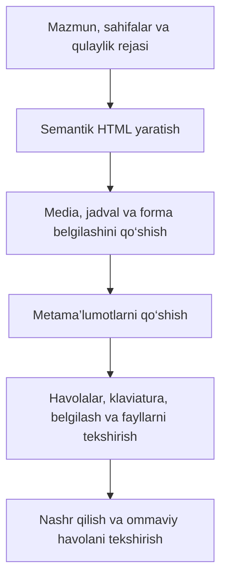
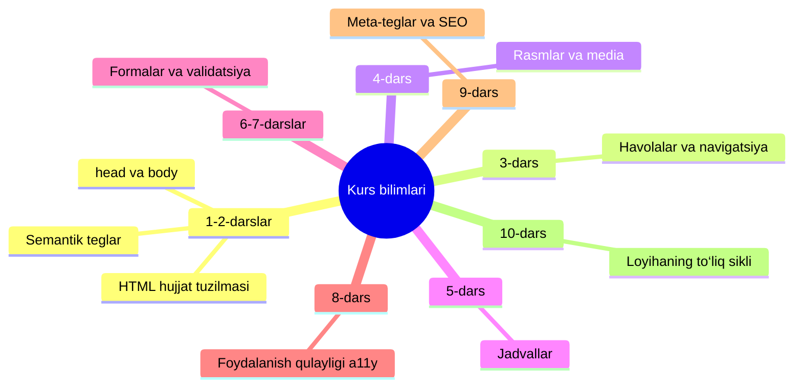

# Yakuniy loyiha: rejalashtirishdan nashrgacha

[Mundarija](../../README.md) · [← Orqaga](../../Lesson-9/uz/Meta-teglar%2C%20SEO%2C%20CSS%20va%20JS%20bilan%20bog%27lanish.md) · [Keyingi kurs: CSS →](https://github.com/JLearn-space/JLearn-docs/tree/main/CSS) · [RU](../ru/%D0%98%D1%82%D0%BE%D0%B3%D0%BE%D0%B2%D1%8B%D0%B9%20%D0%BF%D1%80%D0%BE%D0%B5%D0%BA%D1%82%20%D0%BE%D1%82%20%D0%BF%D0%BB%D0%B0%D0%BD%D0%B8%D1%80%D0%BE%D0%B2%D0%B0%D0%BD%D0%B8%D1%8F%20%D0%B4%D0%BE%20%D0%BF%D1%83%D0%B1%D0%BB%D0%B8%D0%BA%D0%B0%D1%86%D0%B8%D0%B8.md) · [EN](../en/Final%20project%20from%20planning%20to%20publication.md) · [UZ](Yakuniy%20loyiha%20rejalashtirishdan%20nashr%20etishgacha.md) · [Loyihaning boshlang‘ich kodi](../../final-project/README.md)

> **Oldingi darslar bilan bog‘liqlik:** bugun yangi teglar bo‘lmaydi. 1–9-darslarda o‘rganganlaringizning hammasini bitta saytga yig‘asiz va uni internetda nashr qilasiz.

---

## Bu sizga nima uchun kerak

Shu paytgacha sahifalaringiz faqat kompyuteringizda yashadi. Bugun saytda `sizning-ismingiz.github.io/my-site` ko‘rinishidagi haqiqiy manzil paydo bo‘ladi. Uni do‘stingizga, o‘qituvchiga yuborish yoki rezyumega qo‘yish mumkin.

To‘rt sahifali tayyor sayt - sizning birinchi portfoliongiz.

---

## Nimani o‘rganasiz

- Saytni kodning birinchi qatoridan oldin rejalashtirish: sahifalar xaritasi va mazmun rejasi.
- Saytni qadamma-qadam yig‘ish: skelet → mazmun → media → jadval → forma → meta-teglar → foydalanish qulayligi.
- Saytni chek-list bo‘yicha tekshirish va tekshiruvlarni jurnalga yozish.
- Saytni GitHub Pages da nashr qilish va ommaviy havolani tekshirish.

---

## Takrorlash: 3, 8 va 9-darslardan 3 savol

1. Nega loyihadagi yo‘llar nisbiy bo‘lishi kerak?
2. «Asosiy mazmunga o‘tish» havolasi nima uchun?
3. `charset` dan tashqari har bir sahifada qaysi ikki meta-teg majburiy?

Javoblar - dars oxirida.

---

## Reja

| Bo‘lim | Nima qilamiz |
| --- | --- |
| Loyihaning boshlang‘ich kodi | Namuna qayerda va undan qanday foydalanish |
| Rejalashtirish | Qurilishdan oldin uy chizmasi |
| 1–7-qadamlar | Saytni qatlamma-qatlam yig‘amiz |
| Chek-list va jurnal | Topshirishdan oldin qabul |
| Nashr | GitHub Pages |
| Mustaqil ish | IDE topshirig‘i |
| Mustaqil yakuniy imtihon | Noldan o‘z saytingiz |

---

## Loyihaning boshlang‘ich kodi

Namuna - Azizning to‘rt sahifali portfoliosi - alohida [final-project](../../final-project/README.md) papkasida turadi (namuna matnlari rus tilida):

```
final-project/
├── starter/          ← 4 sahifaning bo‘sh shablonlari
├── steps/
│   ├── 01-skeleton/  ← 1-qadamdan keyin
│   ├── 02-content/
│   ├── 03-media/
│   ├── 04-table/
│   ├── 05-form/
│   ├── 06-meta/
│   └── 07-a11y/      ← 7-qadamdan keyin
├── final/            ← tayyor sayt
└── docs/             ← reja, chek-list, jurnal
```

**Qanday foydalanish:** dars qadamini **o‘z** saytingizda bajarasiz, keyin shu qadam papkasi bilan solishtirasiz. Har bir qadam papkasi - ishlaydigan sayt: uni Live Server orqali oching.

**Namunani ko‘chirmang.** Solishtiring va farqni tushuntiring. Imtihonda boshqa mavzudagi o‘z saytingiz kerak.

---

## Rejalashtirish

**Oddiy qilib aytganda:** uy chizmasiz qurilmaydi. Avval nechta xona va eshiklar qayerda ekanini chizishadi. Qog‘ozdagi xatoni bir daqiqada, tayyor uyda esa bir haftada tuzatasiz.

### A qadam. Mavzu

Aytib beradigan narsangiz bor mavzuni tanlang:
- shaxsiy portfolio;
- klub yoki to‘garak;
- kichik kafe, ustaxona, repetitor.

### B qadam. Sayt xaritasi

| Sahifa | Fayl | Unda nima |
| --- | --- | --- |
| Bosh sahifa | `index.html` | Salomlashuv, rasm, bo‘limlarga havolalar |
| Men haqimda | `about.html` | Hikoya, ko‘nikmalar, yo‘l |
| Loyihalar | `projects.html` | Rasmli ishlar |
| Kontaktlar | `contact.html` | Bog‘lanish usullari, forma |

### V qadam. Har bir sahifa rejasi

Har bir sahifa uchun qaysi teglar kerakligini yozing. Masalan, `contact.html`:

- 4 sahifali menyuli `header`;
- «Kontaktlar» `h1` li `main`;
- `caption` va `scope` li bog‘lanish usullari jadvali;
- `fieldset`, `legend` va imzoli forma;
- `aria-label` li belgi-havolali `footer`.

Reja namunasi - [docs/PLAN.md](../../final-project/docs/PLAN.md).



**Sxemani qanday o‘qish kerak.** Bu rejadan nashr qilingan saytni tekshirishgacha bo‘lgan ish sikli. Tekshiruvda xato topdingiz - kerakli qadamga qayting va tuzating.

---

## 1-qadam. Skelet

To‘rtala sahifada bir xil skelet. Faqat `title` farq qiladi.

```html
<!DOCTYPE html>
<html lang="uz">
<head>
    <meta charset="UTF-8">
    <title>Kontaktlar - Azizning portfoliosi</title>
</head>
<body>
    <header>
        <nav>
            <ul>
                <li><a href="index.html">Bosh sahifa</a></li>
                <li><a href="about.html">Men haqimda</a></li>
                <li><a href="projects.html">Loyihalar</a></li>
                <li><a href="contact.html">Kontaktlar</a></li>
            </ul>
        </nav>
    </header>
    <main>
        <!-- sahifa mazmuni: 2-qadam -->
    </main>
    <footer>
    </footer>
</body>
</html>
```

**Tekshiruv:** har bir sahifadan menyuning har bir bandini bosing: 4 × 4 = 16 ta o‘tish.

Solishtiring: `steps/01-skeleton`.

---

## 2-qadam. Mazmun

`main` ni matn bilan to‘ldiramiz. Bitta `h1`, darajalar o‘tkazilmagan, ro‘yxatlar ma’noga ko‘ra.

```html
<main>
    <h1>Men haqimda</h1>
    <p>Mening ismim Aziz. Men bir yildan beri <strong>veb-dasturlashga qiziqaman</strong> va bilimlarimni tartibga keltirish uchun «10 darsda HTML» kursini o‘tdim.</p>
    <section>
        <h2>Ko‘nikmalarim</h2>
        <ul>
            <li>HTML semantik belgilash</li>
            <li>Jadvallar va formalar</li>
            <li>Sahifalar qulayligi</li>
        </ul>
    </section>
    <section>
        <h2>Mening yo‘lim</h2>
        <ol>
            <li>Sahifa yasashni mustaqil o‘rgana boshladim</li>
            <li>«10 darsda HTML» kursini o‘tdim</li>
            <li>Keyin - CSS va JavaScript</li>
        </ol>
    </section>
</main>
```

Solishtiring: `steps/02-content`.

---

## 3-qadam. Media

`alt` li rasmlar, `figure` imzolari, sayt belgisi.

```html
<figure>
    
    <figcaption>O‘qishdan keyingi kechlarimni shunday o‘tkazaman</figcaption>
</figure>
```

**Qadamning asosiy qoidasi:** har bir rasmni oching va `alt` ni **unda nima borligiga qarab** yozing. To‘rtta turli rasm - to‘rtta turli `alt`. Namunada loyihalar sahifasidagi har bir maketning o‘z tavsifi bor.

`<head>` ga belgini qo‘shing:

```html
<link rel="icon" type="image/png" href="favicon.png">
```

Solishtiring: `steps/03-media`.

---

## 4-qadam. Jadval

Jadval - faqat jadvalli ma’lumotlar bor joyda. Namunada bu kontaktlar sahifasidagi javob berish vaqti:

```html
<table>
    <caption>Qachon javob beraman</caption>
    <thead>
        <tr>
            <th scope="col">Usul</th>
            <th scope="col">Kontakt</th>
            <th scope="col">Javob vaqti</th>
        </tr>
    </thead>
    <tbody>
        <tr>
            <th scope="row">Pochta</th>
            <td><a href="mailto:aziz@example.com">aziz@example.com</a></td>
            <td>Bir sutka ichida</td>
        </tr>
        <tr>
            <th scope="row">Telegram</th>
            <td><a href="https://t.me/example">@example</a></td>
            <td>Bir necha soat</td>
        </tr>
    </tbody>
</table>
```

Mavzuingizda jadvalli ma’lumot yo‘qmi? Jadvalni shunchaki belgi uchun qo‘shmang. Lekin imtihonda jadval majburiy: unga haqiqiy vazifa toping, masalan jadval-raspisaniye.

Solishtiring: `steps/04-table`.

---

## 5-qadam. Forma

```html
<form method="get">
    <fieldset>
        <legend>Fikr-mulohaza</legend>
        <p>
            <label for="name">Ism</label>
            <input type="text" id="name" name="name" autocomplete="name" maxlength="50" required>
        </p>
        <p>
            <label for="email">Pochta</label>
            <input type="email" id="email" name="email" autocomplete="email" required>
        </p>
        <p>
            <label for="message">Xabar</label>
            <textarea id="message" name="message" rows="5" maxlength="500" required></textarea>
        </p>
    </fieldset>
    <p><button type="submit">Yuborish</button></p>
</form>
```

Forma ustiga u o‘quv forma ekanini yozing: ma’lumotlar sahifa manzilida paydo bo‘ladi va hech qayerga yetkazilmaydi. Faqat o‘ylab topilgan ma’lumotlarni kiriting.

Solishtiring: `steps/05-form`.

---

## 6-qadam. Meta-teglar, CSS va JS

Endi matn tayyor bo‘lgach, har bir sahifa tavsifini yozish oson:

```html
<head>
    <meta charset="UTF-8">
    <meta name="viewport" content="width=device-width, initial-scale=1.0">
    <title>Men haqimda - Azizning portfoliosi</title>
    <meta name="description" content="Aziz veb-dasturlashni qanday o‘rgana boshlagani, qaysi ko‘nikmalarni egallagani va keyin nimani rejalashtirgani haqida gapiradi.">
    <meta property="og:title" content="Men haqimda - Azizning portfoliosi">
    <meta property="og:description" content="Aziz veb-dasturlashni qanday o‘rgana boshlagani, qaysi ko‘nikmalarni egallagani va keyin nimani rejalashtirgani haqida gapiradi.">
    <link rel="icon" type="image/png" href="favicon.png">
    <link rel="stylesheet" href="css/style.css">
    <script src="js/main.js" defer></script>
</head>
```

**Har bir sahifada o‘z `title` va `description` i.** `css/style.css` va `js/main.js` fayllari - 9-darsdan tayyor.

Solishtiring: `steps/06-meta`.

---

## 7-qadam. Foydalanish qulayligi

`body` dagi birinchi qator - menyuni o‘tkazib yuborish havolasi, `main` da - `id`:

```html
<body>
    <a href="#main">Asosiy mazmunga o‘tish</a>
    <header>...</header>
    <main id="main">
```

Futerdagi belgi-havola nom oladi:

```html
<a href="https://t.me/example" aria-label="Azizning Telegrami">
    
</a>
```

Keyin 8-darsdagidek har bir sahifani klaviatura bilan o‘ting.

Solishtiring: `steps/07-a11y` - bu tayyor saytning o‘zi.

---

## Chek-list va jurnal

Nashrdan oldin har bir sahifa uchun [chek-list](../../final-project/docs/CHECKLIST.md) dan o‘ting. Har bir tekshiruvni [jurnal](../../final-project/docs/JOURNAL.md) ga yozing: nimani tekshirdingiz, nimani kutdingiz, nima bo‘ldi, nimani tuzatdingiz.

Asosiy bandlar:

- [ ] Bitta `h1`, darajalar o‘tkazilmagan.
- [ ] Menyuning 16 ta o‘tishi ishlaydi.
- [ ] Har bir rasmda mazmuniga ko‘ra o‘z `alt` i.
- [ ] `caption` va `scope` li jadval.
- [ ] Har bir maydonda bog‘langan imzo.
- [ ] Har bir sahifada o‘z `title` va `description` i.
- [ ] Butun sahifa klaviatura bilan o‘tiladi.
- [ ] Nu HTML Checker - xatosiz.

---

## GitHub Pages da nashr qilish

**GitHub Pages** - HTML, CSS va JS dan iborat saytlar uchun bepul xosting. Manzil shunday bo‘ladi: `https://sizning-loginingiz.github.io/repozitoriy-nomi/`.

### 1-qadam. Akkaunt

[github.com](https://github.com) da ro‘yxatdan o‘ting.

### 2-qadam. Repozitoriy

1. **New repository** ni bosing.
2. Nomi: masalan, `my-site` (lotincha, bo‘shliqsiz).
3. **Public** ni tanlang.
4. **Create repository** ni bosing.

### 3-qadam. Fayllarni yuklash

1. Repozitoriy sahifasida **uploading an existing file** ni bosing.
2. Sayt papkasining **ichidagilarini** sudrab keling: `index.html`, qolgan sahifalar va `images`, `css`, `js` papkalari.
3. **Commit changes** ni bosing.

`index.html` ichki papkada emas, repozitoriy ildizida turishi kerak.

### 4-qadam. Pages ni yoqish

1. **Settings** → chapdagi menyuda **Pages**.
2. **Source**: **Deploy from a branch**.
3. **Branch**: `main`, `/ (root)` papkasi. **Save** ni bosing.

### 5-qadam. Tekshiruv

1–3 daqiqadan keyin Pages sozlamalari sahifasini yangilang - sayt havolasi paydo bo‘ladi. Uni oching va barcha o‘tishlar va rasmlarni **qaytadan** tekshiring: serverda fayl nomlaridagi harflar registri muhim.

GitHub interfeysi ba’zan o‘zgaradi. Tugmalar nomi boshqacha bo‘lsa, [rasmiy qo‘llanmaga](https://docs.github.com/en/pages/getting-started-with-github-pages/creating-a-github-pages-site) qarang.

### Buzib ko‘ring

Chek-list tekshiruvlari xatolarni ushlashiga ishonch hosil qiling. Har bir buzilishni saytning nusxasida qiling, uni toping va avvalgi holiga qaytaring:

1. Bitta sahifa menyusida `about.html` ni `About.html` ga almashtiring. Windows kompyuterida havola ishlashi mumkin, GitHub Pages da esa 404 ochiladi. Nashr qilingan versiyani tekshirish shuning uchun kerak.
2. `<main>` dan `id="main"` ni o‘chiring. Tab ni, so‘ng «Asosiy mazmunga o‘tish» havolasida Enter ni bosing. Fokus joyida qoladi: havola hech qayerga olib bormaydi.
3. Profil rasmidan `alt` ni o‘chiring va sahifani Nu HTML Checker da tekshiring. Xato: `An img element must have an alt attribute, except under certain conditions.`
4. «Pochta» yozuvidan `for="email"` ni olib tashlang. «Pochta» so‘zini bosing: kursor endi maydonga tushmaydi.
5. `<h2>Ko‘nikmalarim</h2>` ni `<h4>` ga almashtiring va Lighthouse ni ishga tushiring. Accessibility bo‘limida `Heading elements are not in a sequentially-descending order` paydo bo‘ladi.
6. «Ism» maydonidan `required` ni o‘chiring va formani bo‘sh ism bilan yuboring. Forma yuborildi, manzil satrida esa `name=&` ko‘rinadi.

### Nashrdagi tipik xatolar

| Xato | Qanday tuzatish |
| --- | --- |
| Sayt ochilmaydi: 404 | Bosh sahifa `index.html` deb nomlanib, ildizda turishi kerak |
| Papkani butunligicha yukladingiz, sayt ichki papkada | Papkaning **ichidagilarini** yuklang |
| Rasmlar serverda ko‘rinmaydi | Registrni tekshiring: `Photo.JPG` va `photo.jpg` - turli fayllar |
| `C:\Users\...` yo‘llari | Faqat nisbiy yo‘llar |
| Repozitoriy yopiq | Bepul Pages uchun - Public |
| Pages yoqilmagan | Settings → Pages → tarmoqni tanlash |

---

## Kurs yakuni



**Sxemani qanday o‘qish kerak.** Har bir shox - dars va u bergan ko‘nikma. Yakuniy saytda ularning hammasidan foydalanasiz.

**Keyin nima:** HTML - karkas. Keyingi qadam - **CSS**: ranglar, shriftlar, joylashuv, telefonga moslashuvchanlik. Keyin - **JavaScript**: sahifa xatti-harakati. Nashr qilingan saytingiz bu ko‘nikmalar uchun maydonga aylanadi.

---

## Mustaqil ish

### IDE topshirig‘i (platforma hisoblaydi)

Azizning portfoliosini emas, **o‘z** klubingiz, to‘garagingiz yoki kutubxonangizning **kontaktlar sahifasini** yasang:

1. To‘liq `<head>`: `charset`, `viewport`, `title`, `description`.
2. `body` da birinchi bo‘lib «Asosiy mazmunga o‘tish» havolasi, `main` da - `id="main"`.
3. `index.html`, `about.html`, `projects.html`, `contact.html` ga menyuli `header`.
4. Bitta `h1`.
5. `caption`, `scope="col"` va `scope="row"` sarlavhali jadval.
6. `method="get"` forma: `fieldset`, `legend`, imzoli kamida ikki maydon, bittasi - `email`, `<button type="submit">` tugmasi.
7. `footer`.

Platforma nimani tekshiradi: sanab o‘tilgan hamma narsa, shuningdek `div`, musbat `tabindex`, `role="button"` va namuna matni («Aziz») yo‘qligi.

---

## Mustaqil yakuniy imtihon

Yuqoridagi qadamma-qadam yig‘ish - o‘quv namunasi. Tayyor portfolioni takrorlash mustaqillikni ko‘rsatish degani emas.

**Topshiriq:** namunani ko‘chirmasdan klub, kutubxona yoki to‘garakning to‘rtta bog‘langan sahifali saytini yasang. Unda bo‘lishi kerak:

- ma’noga ko‘ra sarlavhalar va ro‘yxatlar;
- mos `alt` li o‘z yoki ruxsat berilgan rasmlar;
- `caption` va sarlavhali jadval;
- imzoli, `fieldset`/`legend` li va kiritish tekshiruvli forma, forma o‘quv ekani haqida belgi bilan;
- har bir sahifada o‘z metama’lumotlari;
- GitHub Pages da nashr.

**Nimani topshirish kerak:** boshlang‘ich fayllar, ommaviy havola va tekshiruvlar jurnali.

| Mezon | Ball |
| --- | ---: |
| Tuzilma va navigatsiya | 20 |
| Semantika va mazmun | 20 |
| Rasmlar va jadval | 15 |
| Forma va validatsiya | 15 |
| Qulaylik va klaviatura tekshiruvi | 20 |
| Metama’lumotlar, nashr va jurnal | 10 |

**O‘tish:** 100 dan 80 ball va undan yuqori. Majburiy: to‘rtala sahifa ochiladi, navigatsiya ishlaydi, barcha maydonlarda imzo bor. Buzilgan havolalar va imzosiz maydonlar o‘tishdan oldin tuzatiladi.

**Ball qanday qo‘yiladi:** to‘liq ball - talab bajarilgan va tekshirilgan; yarmi - qisman bajarilgan; nol - yo‘q.

**Og‘zaki himoya:** teglar tanlovini, forma qanday ishlashini tushuntiring va jurnaldagi ikki tekshiruv hamda topilgan muammolar haqida gapirib bering.

---

## O‘zini tekshirish uchun savollar

1. Nega sayt xaritasini koddan oldin tuzish kerak?
2. Nega menyu barcha sahifalarda bir xil?
3. 4 sahifali saytda menyuning nechta o‘tishini tekshirish kerak?
4. Nega `alt` rasmni ochgandan keyin yoziladi?
5. Sahifada jadval qachon ortiqcha?
6. Nega o‘quv loyihadagi forma `method="get"` va `action` siz?
7. Turli sahifalarning `title` lari nimasi bilan farq qilishi kerak?
8. Repozitoriyda `index.html` qayerda turishi kerak?
9. Nega rasm lokal ko‘ringan bo‘lsa ham nashrdan keyin yo‘qolishi mumkin?
10. Imtihonda sayt bilan birga nima topshiriladi?

Savollardan keyin platformada **dars testini** topshiring: 12 ta savol, o‘tish chegarasi 70%.

---

## Javoblar

**Takrorlash**

1. Diskdagi absolyut yo‘llar serverda ishlamaydi, nisbiylari esa papka bilan birga ko‘chadi.
2. Klaviatura foydalanuvchisi har bir sahifada butun menyuni o‘tmasligi uchun.
3. `viewport` va `description`.

**O‘zini tekshirish uchun savollar**

1. Tuzilma xatolarini to‘rt sahifa kodida emas, qog‘ozda topish arzonroq.
2. Foydalanuvchi doim qayerdaligini va istalgan bo‘limga qanday o‘tishni biladi.
3. 16: 4 sahifaning har biridan 4 tadan havola.
4. Fayl nomi rasmda nima borligini aytmaydi. `alt` haqiqiy mazmunni tasvirlaydi.
5. Satr va ustunli ma’lumotlar bo‘lmaganda.
6. Ishlov beruvchi yo‘q: GET yuborilgan qiymatlarni manzilda ko‘rish imkonini beradi va ma’lumotlar hech qayerga ketmaydi.
7. Har bir `title` o‘z sahifasini va sayt nomini tasvirlaydi.
8. Repozitoriy ildizida.
9. Serverda fayl nomidagi harflar registri muhim.
10. Boshlang‘ich fayllar, ommaviy havola va tekshiruvlar jurnali.

---

[Mundarija](../../README.md) · [← Orqaga](../../Lesson-9/uz/Meta-teglar%2C%20SEO%2C%20CSS%20va%20JS%20bilan%20bog%27lanish.md) · [Keyingi kurs: CSS →](https://github.com/JLearn-space/JLearn-docs/tree/main/CSS) · [RU](../ru/%D0%98%D1%82%D0%BE%D0%B3%D0%BE%D0%B2%D1%8B%D0%B9%20%D0%BF%D1%80%D0%BE%D0%B5%D0%BA%D1%82%20%D0%BE%D1%82%20%D0%BF%D0%BB%D0%B0%D0%BD%D0%B8%D1%80%D0%BE%D0%B2%D0%B0%D0%BD%D0%B8%D1%8F%20%D0%B4%D0%BE%20%D0%BF%D1%83%D0%B1%D0%BB%D0%B8%D0%BA%D0%B0%D1%86%D0%B8%D0%B8.md) · [EN](../en/Final%20project%20from%20planning%20to%20publication.md) · [UZ](Yakuniy%20loyiha%20rejalashtirishdan%20nashr%20etishgacha.md) · [Loyihaning boshlang‘ich kodi](../../final-project/README.md)
