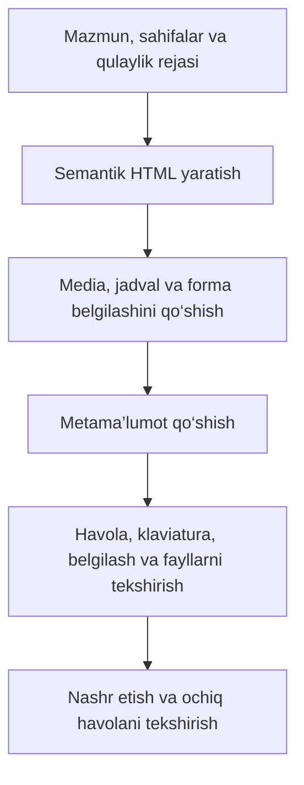
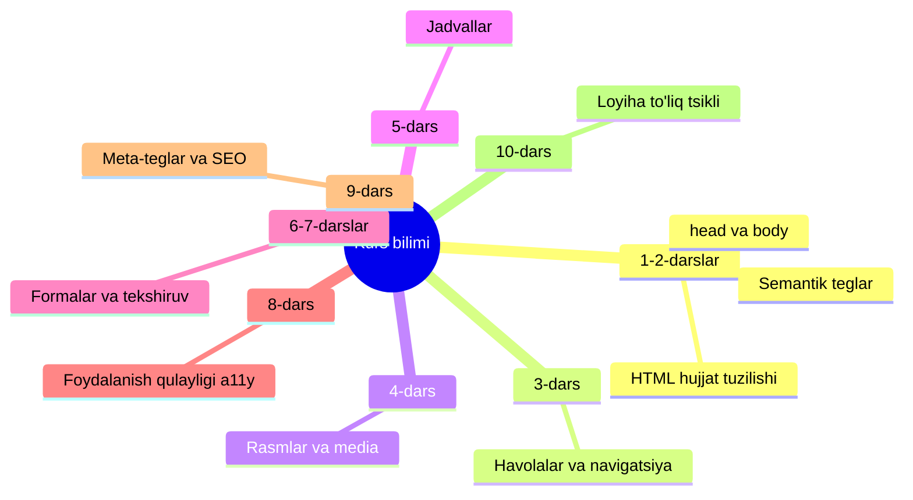

# Yakuniy loyiha: rejalashtirishdan nashr etishgacha

[Mundarija](../../README.md) · [Oldingi dars](../../Lesson-9/uz/Meta-teglar%2C%20SEO%2C%20CSS%20va%20JS%20bilan%20bog%27lanish.md) · [Amaliyot](../index.html) · [RU](../ru/%D0%98%D1%82%D0%BE%D0%B3%D0%BE%D0%B2%D1%8B%D0%B9%20%D0%BF%D1%80%D0%BE%D0%B5%D0%BA%D1%82%20%D0%BE%D1%82%20%D0%BF%D0%BB%D0%B0%D0%BD%D0%B8%D1%80%D0%BE%D0%B2%D0%B0%D0%BD%D0%B8%D1%8F%20%D0%B4%D0%BE%20%D0%BF%D1%83%D0%B1%D0%BB%D0%B8%D0%BA%D0%B0%D1%86%D0%B8%D0%B8.md) · [EN](../en/Final%20project%20from%20planning%20to%20publication.md) · [UZ](../uz/Yakuniy%20loyiha%20rejalashtirishdan%20nashr%20etishgacha.md)

> **Oldingi dars bilan bog'lanish:** biz birinchi `<!DOCTYPE html>` dan meta-teglar va loyiha tuzilmasigacha bo'lgan yo'lni bosib o'tdik. Bugun - yangi emas, balki **butun kursni amalda qo'llash**: noldan boshlab haqiqiy sayt-vizitkani rejalashtiramiz, yig'amiz va nashr etamiz.

---

## Dars oxiriga qadar nimani o'rganasiz

- Birinchi kod yozilmasidan oldin sayt tuzilmasini rejalashtirish.
- To'g'ri tartibda to'liq sahifani yig'ish: semantika → kontent → media → jadval → forma → meta-teglar → foydalanish qulayligi.
- Yakuniy sifat tekshiruv ro'yxatidan o'tish va o'z kodingizdagi zaif tomonlarni topish.
- Tayyor saytni GitHub Pages orqali nashr etish bosqichlarini bajarish va natijani tekshirish.

---

## Dars rejasi

| Bo‘lim                             | Kontent                                  |
| -------------------------------- | ------------------------------------------- |
| Loyiha rejalashtirish          | Qanday sayt, nechta sahifa, har birida nima |
| Bosqichma-bosqich yig'ish: semantika   | Sahifa skeleti, header/nav/main/footer     |
| Bosqichma-bosqich yig'ish: kontent     | Sarlavhalar, matn, ro'yxatlar                    |
| Bosqichma-bosqich yig'ish: media       | Rasmlar, figure                         |
| Bosqichma-bosqich yig'ish: jadval     | Agar loyihaga mos bo'lsa                    |
| Bosqichma-bosqich yig'ish: forma       | Fikr-mulohaza formasi                        |
| Bosqichma-bosqich yig'ish: meta-teglar   | head to'liq                                |
| Bosqichma-bosqich yig'ish: foydalanish qulayligi | Yakuniy aria/alt/scope tekshiruvi           |
| Yakuniy sifat tekshiruv ro'yxati   | To'liq o'z-o'zini tekshirish                         |
| GitHub Pages'da nashr etish   | Bosqichma-bosqich ko'rsatma                        |


---

## O‘qituvchi bilan namuna tahlili

method="get" bo‘lgan forma xabar yetkazishni emas, belgilashni namoyish etadi: brauzer o‘quv qiymatlarini GET orqali joriy manzilga yuboradi, statik hosting esa xabarni qayta ishlamaydi. POST ma’lumotni shifrlamaydi; uzatishni HTTPS himoyalaydi. Mashqda o‘ylab topilgan ma’lumotlardan foydalaning. Ishlatilgan rasm va favicon fayllarini qo‘shing, alt haqiqiy rasmga mos bo‘lsin. Qulaylikni boshidan rejalang va nashrdan oldin qayta tekshiring. Fayllarni repozitoriyga saqlashning o‘zi Pages ni sozlamaydi.


Keyingi bo‘limlar o‘quv portfoliosini yig‘ishni ko‘rsatadi. Alohida baholanadigan mustaqil sinov dars oxirida berilgan.

## Kod yozishdan oldin rejalashtirish

**Oddiy qilib aytganda:** uy qurishdan oldin arxitektor qog'ozga rejani chizadi - nechta xona, qayerda nima joylashgan, ular orqasida qanday harakat qilish kerak. Sayt bilan ham xuddi shunday: agar plansiz kod yozishga o'tirsangiz, hamma narsani doimiy qayta ishlash xavfi juda katta.

### 1-qadam. Loyiha mavzusini tanlang

Yakuniy loyiha - bu oddiy ko'p sahifali sayt-vizitka. O'quv loyihasi uchun yaxshi mavzular misollari:

- Shaxsiy portfolioning (o'zingiz haqida, loyihalar, kontaktlar).
- Kichik mahalliy biznes sayti (kafetereya, repetitorlik, ustaxona).
- O'quv kursi yoki qiziqishlar klubi sayt-vizitkasi.

**Muhim:** o'zingiz haqida haqiqatan aytadigan narsangiz bor mavzuni tanlang - bu sahifalarni mazmunli kontent bilan to'ldirish osonroq bo'ladi, "ko'z uchun" yozilgan matn emas.

### 2-qadam. Sahifalar tuzilmasini aniqlang (sayt xaritasi)

Qog'ozda yoki matn faylida sahifalar ro'yxatini va har birida nima bo'lishini yozing:

**Shaxsiy portfolio uchun sayt xaritasi misoli:**

|Sahifa|Fayl|Mazmuni|
|---|---|---|
|Bosh sahifa|`index.html`|Salomlashish, qisqacha "o'zim haqimda", qolgan bo'limlarga havolalar|
|O'zim haqimda|`about.html`|Batafsil hikoya, foto, ko'nikmalar ro'yxati|
|Loyihalar|`projects.html`|Ishlar ro'yxati oldindan ko'rish rasmlari bilan|
|Kontaktlar|`contact.html`|Fikr-mulohaza formasi, bog'lanish usullari jadvali|

### 3-qadam. Har bir sahifa uchun kontent rejasini tuzing

Har bir sahifa uchuni qisqacha, kursdagi qaysi HTML vositalarini ishlatishingizni yozing. Masalan, `contact.html` uchun:

- `<header>` umumiy menyu `<nav>` bilan
- `<main>` sarlavha `<h1>Kontaktlar</h1>`
- `<table>` `scope` bilan - bog'lanish usullari va ish vaqti
- `<form>` `fieldset`/`legend` bilan - fikr-mulohaza formasi
- `<footer>` `aria-label` orqali ijtimoiy tarmoqlarga havolalar

**Bu rejalashtirish shunchaki rasmiy emas.** Aynan shu qadamda odatda nomuvofiqliklarni sezasiz: masalan, bosh sahifada siz yangi gaplashgan sahifaga havola yo'q ekanligini - buni qog'ozda tuzish kod to'rt sahifa yozilgandan keyin tuzishdan ancha oson.



**Chizmani qanday o‘qish kerak:** O‘qlar loyiha ishining ketma-ketligini bildiradi: reja, HTML, kerakli mazmun, tekshiruv va nashr. Tekshiruvda xato topilsa, tegishli avvalgi bosqichga qaytib tuzatish kerak; nashr yangi xatolarni tekshirish o‘rnini bosmaydi.

---

## Bosqichma-bosqich yig'ish: semantika (har bir sahifaning skeleti)

Yig'ishni semantik skeletdan boshlaymiz - bu 2-darsda muhokama qilgan narsa. Buni haqiqiy kontent bilan to'ldirishdan **oldin** qilinadi - avval tuzilma, keyin ichiga kontent.

```html
<!DOCTYPE html>
<html lang="uz">
<head>
    <meta charset="UTF-8">
    <title><!-- Meta-teglar bo‘limida to‘ldiramiz --></title>
</head>
<body>
    <header>
        <nav>
            <!-- umumiy menyu -->
        </nav>
    </header>

    <main>
        <!-- sahifaning asosiy kontenti -->
    </main>

    <footer>
        <!-- pastki qism -->
    </footer>
</body>
</html>
```

**Buni loyihangizning har bir sahifasi uchun bir xil qiling** - barcha sahifalarda bir xil `<header>`/`<nav>`/`<footer>` bilan yagona skelet, faqat `<main>` kontenti farq qiladi - aynan shunday biz 3-darsda ko'p sahifali sayt qilganmiz.

---

## Bosqichma-bosqich yig'ish: kontent (matn, sarlavhalar, ro'yxatlar)

Endi `<main>` ni haqiqiy matn bilan to'ldiramiz, to'g'ri sarlavhalar ierarxiyasidan foydalanib (2-dars) - sahifada yagona `<h1>`, darajalarni o'tkazib yubormasdan.

**`about.html` uchun misol:**

```html
<main>
    <h1>Men haqimda</h1>

    <p>Mening ismim Aziz, men bir yildan ortiq vaqtdan beri <strong>veb-dasturlashga qiziqaman</strong>. HTMLdan boshladim - va endi bilimlarimni tartibga solish uchun shu kursdan o'tmoqdaman.</p>

    <h2>Mening ko'nikmalarim</h2>
    <ul>
        <li>HTML5 - semantik kodlash</li>
        <li>CSSning asoslari</li>
        <li>JavaScriptni o'rganmoqdaman</li>
    </ul>

    <h2>Mening yo'lim</h2>
    <ol>
        <li>Veb-dasturlashni mustaqil o'rganishni boshladim</li>
        <li>"HTML: A dan Ya gacha" kursidan o'tdim</li>
        <li>Davom etishni rejalashtiraman - CSS va JavaScriptga</li>
    </ol>
</main>
```

`<strong>`/`<em>` ni faqat matn haqiqatan ma'noviy urg'u talab qilgan joyda ishlating - bezak uchun emas, mazmun uchun (2-darsda muhokama qilganimizdek).

---

## Bosqichma-bosqich yig'ish: media (rasmlar)

Rasmlarni o'rinli joylarga qo'shing - profil fotosurati, loyihalarning oldindan ko'rish rasmlari, tasvirlar. `alt` (4-dars) va rasmga izohli yozuv kerak bo'lsa `figure`/`figcaption` ni unutmang.

```html
<figure>
    
    <figcaption>Mening ish joyim</figcaption>
</figure>
```

**Agar loyiha uchun o'z rasmlaringiz bo'lmasa** - erkin foydalanish mumkin bo'lgan zaxira rasmlardan foydalaning (muhim: har doim rasmda haqiqatan nima tasvirlanganiga mos mazmunli `alt` yozing, ixtiro qilingan matn emas).

---

## Bosqichma-bosqich yig'ish: jadval

Jadvalni loyihada haqiqatan jadval ma'lumotlari bo'lgan joylarga qo'shing (5-dars) - qoidani unutmang: jadval faqat ma'lumotlar uchun, maket kodlash uchun emas.

**`contact.html` uchun misol - bog'lanish usullari jadvali:**

```html
<table>
    <caption>Bog'lanish usullari</caption>
    <thead>
        <tr>
            <th scope="col">Usul</th>
            <th scope="col">Kontakt</th>
            <th scope="col">Javob vaqti</th>
        </tr>
    </thead>
    <tbody>
        <tr>
            <th scope="row">Email</th>
            <td><a href="mailto:info@saydullayev.fun">info@saydullayev.fun</a></td>
            <td>Kun ichida</td>
        </tr>
        <tr>
            <th scope="row">Telegram</th>
            <td><a href="https://t.me/example" target="_blank" rel="noopener noreferrer">@example</a></td>
            <td>Bir necha soat</td>
        </tr>
    </tbody>
</table>
```

**Agar loyiha mavzuingiz uchun jadval mos kelmasa** (masalan, faqat rasmlardan iborat, taqqoslanadigan ma’lumotlari yo‘q portfolio) - bu normal, tegni sun'iy ravishda ishlatish uchun qo'shmang. O'z muhandislik bahongizni ishlating: teg haqiqiy vazifani hal qiladigan joyda paydo bo'lishi kerak.

---

## Bosqichma-bosqich yig'ish: forma

Fikr-mulohaza formasini qo'shing (6-7-dars), to'g'ri `label`/`for`/`id` bog'lanishi, `fieldset`/`legend` orqali guruhlash va kamida minimal tekshirish bilan.

O‘quv formasi `method="get"` ishlatadi: brauzer qiymatlarni joriy sahifa URL manziliga qo‘shadi. Faqat o‘ylab topilgan ma’lumot kiriting. Qayta ishlovchi yo‘q, xabar yetkazilmaydi. GET yuborilgan qiymatlarni ko‘rsatadi; POST o‘zi ma’lumotni shifrlamaydi.

```html
<form method="get">
    <fieldset>
        <legend>Menga murojaat qiling</legend>

        <p><label for="name">Ism:</label> <input type="text" id="name" name="name" required maxlength="50"></p>

        <p><label for="email">Email:</label> <input type="email" id="email" name="email" required></p>

        <p><label for="message">Xabar:</label> <textarea id="message" name="message" rows="5" cols="40" placeholder="Savolingizni yozing..." required></textarea></p>
    </fieldset>

    <button type="submit">Yuborish</button>
</form>
```


---

## Bosqichma-bosqich yig'ish: meta-teglar

Har bir sahifaning `<head>` qismini to'ldiring (9-dars) - endi kontent tayyor bo'lgach, mazmunli `description` yozish oson.

```html
<head>
    <meta charset="UTF-8">
    <meta name="viewport" content="width=device-width, initial-scale=1.0">
    <meta name="description" content="Men haqimda - Aziz, yangi boshlagan veb-dasturchi, HTML, CSS va JavaScriptni o'rganmoqda.">
    <title>Men haqimda - Azizning portfoliosi</title>
    <link rel="icon" type="image/png" href="favicon.png">
    <link rel="stylesheet" href="css/style.css">
</head>
```

**Har bir sahifada tekshiring:** yagona `<title>` (barcha sahifalarda bir xil emas!), ma'lum sahifaning kontentini aks ettiruvchi yagona `description`.

---

## Bosqichma-bosqich yig'ish: foydalanish qulayligi

8-dars vositalari bo'yicha har bir sahifaning yakuniy tekshiruvi:

- Barcha `` ma'noli `alt` ga ega (yoki bezak rasmlar uchun bo'sh `alt=""`).
- Matnsiz havola belgilari `aria-label` ga ega.
- Sarlavhalar ierarxiyasida bo'sh joylar yo'q va sahifada yagona `<h1>` mavjud.
- Tab-navigatsiyani tekshiring - har bir interaktiv elementga sichqonchadan foydalanmasdan yeting.

---

## Yakuniy sifat tekshiruv ro'yxati

Loyihangizning **har bir** sahifasi uchun ushbu ro'yxatdan o'ting - qog'ozda yoki eslatmalarda belgilang:

- [ ] Sahifada yagona `<h1>`
- [ ] Semantika div-shorbasining o'rniga (`header`/`nav`/`main`/`footer` o'z maqsadida ishlatilgan)
- [ ] Barcha `` da `alt`
- [ ] Barcha forma maydonlarida `label`
- [ ] Havolalarning ma'noli matni ("bosing" emas, aniq tavsif - masalan, "Loyiha haqida batafsil o'qing")
- [ ] `meta charset` va `meta viewport` o'rnida
- [ ] Kod W3C-tekshiruvidan xatosiz o'tadi
- [ ] Sahifa mobil ekranda o'qilishi mumkin (DevTools orqali tekshirishingiz mumkin - qurilma rejimi, yuqori paneldagi telefon/planshet belgisi)

**Hozir tayyor sahifalarinizdan biri bo'yicha shu tekshiruv ro'yxatidan o'ting** - ehtimol, tuzatish kerak bo'lgan kamida bitta band topiladi. Bu normal va foydali - aynan shunday nashr etishdan oldin haqiqiy sifat tekshiruvi ko'rinishadi.

---

## GitHub Pages'da nashr etish

Kursning yakuniy qadami - saytingizni real havola orqali butun dunyoga ochiq qilish, faqat o'z kompyuteringizda emas.

### GitHub Pages nima

GitHub - kod saqlash xizmati (biz oldingi darslarda uni portfolio uchun maydon sifatida eslatganmiz). **GitHub Pages** - GitHubning bepul funksiyasi, bu sizning statik HTML/CSS/JS saytingizni to'g'ridan-to'g'ri repozitoriyangizdan `username.github.io/repository-name` ko'rinishidagi manzilda nashr etishga imkon beradi.

### Bosqichma-bosqich ko'rsatma

**1-qadam.** Agar hali GitHub'da akkauntingiz bo'lmasa - github.com'da ro'yxatdan o'ting.

**2-qadam.** Yangi repozitoriya yarating:

- "New repository" tugmasini bosing.
- Nom bering, masalan `my-portfolio`.
- "Public" ni tanlang (repozitoriya bepul GitHub Pages uchun ochiq bo'lishi kerak).
- "Create repository" tugmasini bosing.

**3-qadam.** Fayllarni ikki usuldan biri bilan yuklang:

_A usuli - veb-interfeys orqali (yangi boshlaganlar uchun osonroq):_

- Repozitoriya sahifasida "uploading an existing file" tugmasini bosing.
- Loyihangizning barcha fayllari va papkalarini tortib tashlang (`index.html`, `css/`, `js/`, `images/` va boshqalar).
- Pastda "Commit changes" tugmasini bosing.

_B usuli - terminal orqali Git bilan (agar Git bilan tanish bo'lsangiz):_

```bash
git init
git add .
git commit -m "Saytning birinchi nashri"
git branch -M main
git remote add origin https://github.com/your-username/my-portfolio.git
git push -u origin main
```

**4-qadam.** GitHub Pages'ni yoqing:

- Repozitoriyangizdagi "Settings" varaqlarini oching.
- Yon menyuda "Pages" bo'limini toping.
- "Build and deployment" bo‘limida "Source" uchun "Deploy from a branch" ni tanlang. So‘ng "Branch" da `main` va `/ (root)` ni tanlang.
- "Save" tugmasini bosing.

**5-qadam.** Nashr tugashini kuting; bu bir necha daqiqa olishi mumkin - GitHub saytingizni yig'adi va nashr etadi. "Pages" sozlamalar sahifasini yangilang - havola paydo bo'ladi:

```
https://your-username.github.io/my-portfolio/
```

**6-qadam.** Shu havolani brauzerda oching - saytingiz endi internetdagi har qanday odam uchun mavjud.

### Muhim amaliy nuqta: asosiy fayl nomi

GitHub Pages repozitoriyaning ildiz manziliga kirilganda avtomatik ravishda `index.html` faylini ochadi - shuning uchun bosh sahifangiz aynan `index.html` deb atalishi muhim (masalan, `home.html` yoki `main.html` emas), aks holda qisqa havola orqali avtomatik ochilmaydi.

### Saytni kelajakda yangilash

Agar keyinchalik nimadir o'zgartirishni istasangiz - yangilangan fayllarni shu usul bilan yuklang (veb-interfeysda "Add file" → "Upload files" yoki terminal orqali ishlasangiz `git push`) - GitHub Pages yangi nashr muvaffaqiyatli tugagach sayt versiyasini yangilaydi.

---

###  Nashr etishda tez-tez uchraydigan xatolar

|Xato|Qanday tuzatish|
|---|---|
|Repozitoriya maxfiy (Private) yaratilgan|Bepul GitHub Pages uchun repozitoriya ochiq bo'lishi kerak|
|Bosh sahifa `index.html` deb nomlanmagan|Bosh sahifa faylini aynan `index.html` deb qayta nomlang|
|CSS/JS/rasmlarga yo'llar nashr etishdan keyin sinadi|Nisbiy yo'llardan foydalaning (3-dars), faqat o'z kompyuteringizda ishlaydigan `C:\Users\...` ko'rinishidagi mutlaq yo'llar emas|
|Pages funksiyasi sozlamalarda yoqilmagan|Settings → Pages ga kirib, nashr tarmog‘ini aniq tanlashni unutmang|

---

## Kurs yakunlari

Tabriklaymiz - siz birinchi `<!DOCTYPE html>` dan to'liq nashr etilgan ko'p sahifali saytgacha bo'lgan yo'lni bosib o'tdingiz! 10 ta dars davomida siz o'zlashtirdingiz:

- HTML hujjatining tuzilmasi va asosiy vositalar (1-2-darslar).
- Havolalar va sahifalar orasidagi navigatsiya (3-dars).
- Rasmlar va media bilan ishlash (4-dars).
- Jadval ma'lumotlari uchun jadvallar (5-dars).
- Formalar - oddiy maydonlardan tekshirishgacha, ikki qiyinlik darajasi (6-7-darslar).
- Foydalanish qulayligi tamoyili sifatida, alohida "ficha" emas (8-dars).
- Meta-teglar, SEO asoslari va CSS/JS bilan bog'lanish (9-dars).
- To'liq tsikl: loyiha rejalashtirishdan ochiq nashr etishgacha (10-dars).

**Keyingisi nima:** HTML - bu faqat "skelet" (birinchi darsdan beri aytganimizdek). Yo‘lingizning mantiqiy davomi - **CSS** (dizayn, ranglar, bo'sh joylar, turli ekranlar uchun moslashuvchan kodlash) va keyin **JavaScript** (interaktivlik, formalar bilan haqiqatan ishlash, sahifaning dinamik xulq-atvori). Bugun nashr etilgan saytingiz kelajakda yangi bilimlaringizni amalda qo'llash uchun ajoyib "ish maydoni" bo'ladi.



**Chizmani qanday o‘qish kerak:** Markazdagi kursdan chiqqan shoxlar bilimlarning qaysi darslarda o‘rganilganini jamlaydi. Yakuniy loyiha bu mavzularni bitta maqsadli saytda birlashtiradi; barcha teglarni sababsiz qo‘shishni talab qilmaydi.


## Mustaqil yakuniy sinov

Yuqoridagi bosqichli yig‘ish — o‘quv namunasi. Tayyor portfolioni takrorlash mustaqil ko‘nikmani tasdiqlamaydi.

Namunani ko‘chirmasdan klub, kutubxona yoki to‘garak uchun to‘rtta bog‘langan sahifadan iborat sayt yarating. Mazmunli sarlavha va ro‘yxatlar, ruxsat etilgan rasmlar va mos alt, caption va sarlavhali jadval, label, fieldset/legend va tekshiruvli forma qo‘shing. Forma namuna ekanini yozing. Noyob metama’lumot qo‘shib, nashr eting. Manba fayllari, ochiq havola va tekshiruv qaydini topshiring.

| Mezon | Ball |
|---|---:|
| Tuzilma va navigatsiya | 20 |
| Semantika va mazmun | 20 |
| Rasmlar va jadval | 15 |
| Forma va tekshiruv | 15 |
| Qulaylik va klaviatura tekshiruvi | 20 |
| Metama’lumot, nashr va tekshiruv qaydi | 10 |

O‘tish: kamida 80/100; to‘rtta sahifa ochiladi, navigatsiya ishlaydi va forma maydonlarida tushunarli yorliq bor. Buzilgan havola va yo‘q yorliqlar tuzatilishi shart. To‘liq ball: bajarilgan va tekshirilgan; yarmi: qisman; nol: yo‘q. Teg tanlovi, forma xatti-harakati va bajarilgan ikkita tekshiruv va topilgan muammolarni (bo‘lsa) tushuntiring.

---

[Mundarija](../../README.md) · [Oldingi dars](../../Lesson-9/uz/Meta-teglar%2C%20SEO%2C%20CSS%20va%20JS%20bilan%20bog%27lanish.md) · [Amaliyot](../index.html) · [RU](../ru/%D0%98%D1%82%D0%BE%D0%B3%D0%BE%D0%B2%D1%8B%D0%B9%20%D0%BF%D1%80%D0%BE%D0%B5%D0%BA%D1%82%20%D0%BE%D1%82%20%D0%BF%D0%BB%D0%B0%D0%BD%D0%B8%D1%80%D0%BE%D0%B2%D0%B0%D0%BD%D0%B8%D1%8F%20%D0%B4%D0%BE%20%D0%BF%D1%83%D0%B1%D0%BB%D0%B8%D0%BA%D0%B0%D1%86%D0%B8%D0%B8.md) · [EN](../en/Final%20project%20from%20planning%20to%20publication.md) · [UZ](../uz/Yakuniy%20loyiha%20rejalashtirishdan%20nashr%20etishgacha.md)
