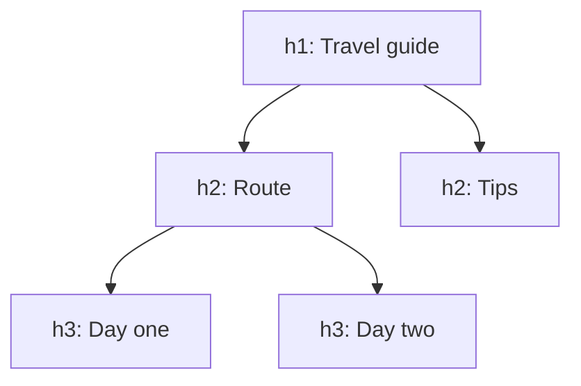
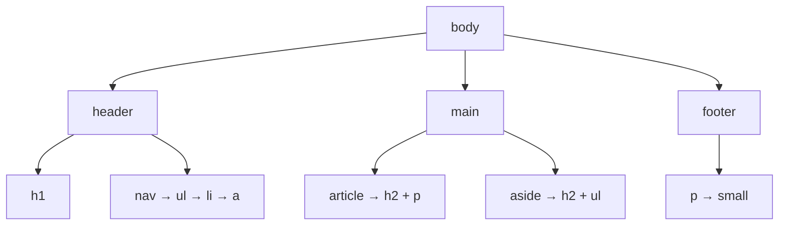

# Text and semantics

[Contents](../../README.md) · [← Back](../../Lesson-1/en/Introduction%20to%20HTML%20document%20structure.md) · [Next →](../../Lesson-3/en/Links%20and%20navigation.md) · [RU](../ru/%D0%A2%D0%B5%D0%BA%D1%81%D1%82%20%D0%B8%20%D1%81%D0%B5%D0%BC%D0%B0%D0%BD%D1%82%D0%B8%D0%BA%D0%B0.md) · [EN](Text%20and%20semantics.md) · [UZ](../uz/Matn%20va%20semantika.md) · [Practice](../practice.html)

> **Link to the previous lesson:** in lesson 1 you built the document skeleton and added `<h1>` and `<p>`. Today we fill `<body>` with real text and split the page into meaningful blocks.

---

## Why you need this

Compare two pages. The first is a wall of text with no headings or lists. The second has the same text, but with sections, bullet points and steps. Which one will you read to the end?

The HTML tags in this lesson make text easy to read. They also make it understandable for search engines and for programs that read pages aloud.

---

## What you will learn

- Build a heading hierarchy `h1`–`h6` without skipping levels.
- Split text into `p` paragraphs and use `br` and `hr` correctly.
- Mark importance (`strong`) and stress (`em`), highlight (`mark`), write notes (`small`).
- Choose the right list: `ul`, `ol` or `dl`.
- Show quotes and code: `blockquote`, `code`, the special characters `&lt;` and `&copy;`.
- Split a page into blocks: `header`, `nav`, `main`, `section`, `article`, `aside`, `footer`.

---

## Review: 3 questions from lesson 1

1. Where does visible text go: in `<head>` or in `<body>`?
2. How is `<title>` different from `<h1>`?
3. What does the closing tag of a paragraph look like?

Answers are at the end of the lesson.

---

## Lesson plan

The lesson has two parts.

| Part | Section | What we do |
| --- | --- | --- |
| A. Text | Headings | A book's table of contents |
| | Paragraphs, `br`, `hr` | Paragraph or line break |
| | Emphasis | `strong`, `em`, `mark`, `small` |
| | Lists | Shopping, a recipe, a dictionary |
| | Quotes and code | `blockquote`, `code`, special characters |
| | Mini-task 1 | A three-step list |
| B. Page | Semantic blocks | Rooms in a house |
| | Mini-task 2 | Mark up a page with blocks |
| | Independent work | IDE task and a guide |

---

## Part A. Text

## Headings `h1`–`h6`

**In simple terms:** a book has a title, chapters, sections and subsections. HTML headings are that same table of contents. They are not "big bold text" - they are a **hierarchy of meaning**.

```html
<h1>Page title</h1>
<h2>Section</h2>
<h3>Subsection</h3>
<h4>Sub-subsection</h4>
```

There are six levels: `<h1>` to `<h6>`. Three are usually enough.

**Three course rules:**

1. **One** `<h1>` per page - the main topic.
2. Levels go **in order**: after `h2` comes `h3`, not `h4`.
3. You can always go back up: `h2` after `h3` starts a new section.



**How to read the diagram.** "Route" has two subsections. "Tips" is on the same level as "Route". You don't need to use all six levels.

**Why this matters:** a blind user opens a list of headings and jumps to the section they need. If you use `<h3>` just because "I need smaller text", the table of contents breaks. Text size is set with CSS.

---

## Paragraphs and line breaks: `p`, `br`, `hr`

| Tag | What it does | When to use it |
| --- | --- | --- |
| `<p>` | A paragraph. The browser adds spacing | Each separate thought |
| `<br>` | A line break **inside** a paragraph | Addresses, poems |
| `<hr>` | A change of topic | Moving to a new part of the text |

```html
<p>Our club meets on Wednesdays.</p>
<p>
    10 Amir Temur Street<br>
    Almalyk
</p>
<hr>
<p>New topic: participation rules.</p>
```

**What you will see:** two paragraphs with a gap, an address on two lines, a horizontal line, then one more paragraph.

`<br>` and `<hr>` are void elements with no closing tag.

### Try breaking it

Replace two paragraphs with one, and put `<br><br><br>` between them. Looks similar? But for the browser and a screen reader it is now **one** paragraph. Put the `<p>` back.

---

## Emphasis: `strong`, `em`, `mark`, `small`

**The key principle:** HTML describes **meaning**, not appearance.

| Tag | Meaning | Default look | Example |
| --- | --- | --- | --- |
| `<strong>` | Important, don't miss it | Bold | **Note:** save the file |
| `<em>` | Spoken stress | Italic | I *will* make it |
| `<mark>` | Highlighted, like a marker | Yellow background | Found: three errors |
| `<small>` | A note, a footnote | Small | Price may change |

```html
<p><strong>Note:</strong> save the file before you start.</p>
<p>I <em>will</em> finish the project today.</p>
<p>The report found <mark>three errors</mark>.</p>
<p><small>The schedule may change.</small></p>
```

**What about `<b>` and `<i>`?** They are not outdated, but they mean something else:
- `<b>` - draws attention without "importance", for example a keyword in a description;
- `<i>` - a different voice: a term, a foreign word, a character's thought.

If you only want bold text for looks, that is a job for CSS.

### Common beginner mistakes

| Mistake | How to fix |
| --- | --- |
| A whole paragraph in `<strong>` | Highlight only the important words |
| `<br><br>` instead of a new paragraph | New thought - new `<p>` |
| `<h3>` for a smaller font | Level by structure, size by CSS |
| Skipping a level `h2` → `h4` | Go in order |
| `<mark>` for importance | Importance - `<strong>`, `<mark>` - highlighting |

---

## Lists: `ul`, `ol`, `dl`

**In simple terms:**

| List | Analogy | When |
| --- | --- | --- |
| `<ul>` | A shopping list | Order does not matter |
| `<ol>` | A recipe | Order matters |
| `<dl>` | A dictionary | A term and its description |

```html
<ul>
    <li>Notebook</li>
    <li>Pen</li>
</ul>

<ol>
    <li>Open VS Code</li>
    <li>Create index.html</li>
    <li>Save and open in the browser</li>
</ol>

<dl>
    <dt>HTML</dt>
    <dd>The page markup language</dd>
    <dt>CSS</dt>
    <dd>The styling language</dd>
</dl>
```

**What you will see:** bullets before the `ul` items, numbers 1-2-3 for `ol`, `dt` terms and indented `dd` descriptions.

Each `ul` and `ol` item is an `<li>`. It lives **only** inside `<ul>` or `<ol>`.

### Nested list

A nested list goes **inside** an `<li>`, before `</li>`:

```html
<ul>
    <li>Frontend
        <ul>
            <li>HTML</li>
            <li>CSS</li>
        </ul>
    </li>
    <li>Backend</li>
</ul>
```

### Common beginner mistakes

| Mistake | How to fix |
| --- | --- |
| `<li>` without `<ul>` or `<ol>` | Wrap it in a list |
| `<ol>` for a shopping list | Order doesn't matter - `<ul>` |
| A nested list after `</li>` | Put it inside the `<li>` |
| Text directly inside `<ul>` without `<li>` | Every item is an `<li>` |

---

## Quotes, code and special characters

### `<blockquote>` - a quote

```html
<blockquote>
    <p>The best way to learn is to start doing.</p>
</blockquote>
```

**What you will see:** a paragraph indented from the left.

### `<code>` - a piece of code

```html
<p>A paragraph is created with the <code>&lt;p&gt;</code> tag.</p>
```

**What you will see:** "A paragraph is created with the `<p>` tag." - the tag is shown in a monospace font.

### Special characters (HTML entities)

Why `&lt;p&gt;` in the example above and not `<p>`? If you write `<p>`, the browser thinks it is a real tag. To **show** angle brackets, you replace them with entities:

| We write | We see | Why |
| --- | --- | --- |
| `&lt;` | `<` | "Less than" or the start of a tag |
| `&gt;` | `>` | "Greater than" or the end of a tag |
| `&amp;` | `&` | An ampersand |
| `&copy;` | © | The copyright sign in a footer |
| `&nbsp;` | non-breaking space | Keep "10&nbsp;km" together |

---

## Mini-task 1

Without looking, build a numbered list of three steps for "How to make tea". The solution is in the "Answers" section.

---

## Part B. Page

## Semantic blocks

**In simple terms:** a house has a hallway, a living room, a kitchen, a storeroom. Each room has its own purpose. A page is also divided into "rooms" - **semantic blocks**.

Pages used to be built from identical `<div>` elements - "faceless boxes". This is called "div soup": neither the browser nor a screen reader knows where the menu is and where the footer is. Semantic tags name a block by its meaning.

| Tag | Room | What goes inside |
| --- | --- | --- |
| `<header>` | Hallway | Site name, logo, sometimes the menu |
| `<nav>` | Signposts on the walls | The main menu, a table of contents |
| `<main>` | Living room | The main content. **One** per page |
| `<section>` | An area in a room | A section on one topic, usually with a heading |
| `<article>` | A book on a shelf | Stand-alone material: news, a post, a review |
| `<aside>` | A side table | Extra content: "Related articles" |
| `<footer>` | The storeroom by the exit | Copyright, contacts |

**`section` or `article`?** Ask yourself: "Would this block make sense if I cut it out and published it separately?" Yes - it's an `<article>` (news, a post). No - it's a `<section>` (an "About us" section on a home page).

**And `<div>`?** It stays for cases where no meaningful tag fits, such as a wrapper for styling.

### Building a page

```html
<body>
    <header>
        <h1>Travel blog</h1>
        <nav>
            <!-- menu: we learn links in lesson 3 -->
        </nav>
    </header>

    <main>
        <article>
            <h2>A trip to Samarkand</h2>
            <p>Last month I visited Samarkand.</p>
        </article>

        <aside>
            <h2>Related posts</h2>
            <ul>
                <li>A trip to Bukhara</li>
            </ul>
        </aside>
    </main>

    <footer>
        <p><small>&copy; 2026 Travel blog</small></p>
    </footer>
</body>
```

**What you will see:** on screen, just plain text from top to bottom. Blocks are invisible until there is CSS. But open DevTools → Elements and the page structure is visible right away.



**How to read the diagram.** Arrows show the nesting in the example. `header`, `main` and `footer` are siblings inside `body`. `article` and `aside` are siblings inside `main`. Links in `nav` will appear in lesson 3.

### Common beginner mistakes

| Mistake | How to fix |
| --- | --- |
| Two `<main>` elements on a page | Only one |
| `<div class="header">` instead of `<header>` | If a meaningful tag exists, use it |
| The site header inside `<main>` | The site header goes outside `main` |
| A `<section>` without a heading | Give it an `h2` or use a `div` |

---

## Mini-task 2

Mark up a club page with blocks: the club name in the header, two sections in the main part ("About the club", "Schedule"), copyright in the footer. The solution is in the "Answers" section.

---

## Lesson summary: cheat sheet

| Task | Tag |
| --- | --- |
| Main topic of the page | `<h1>` - one |
| Sections and subsections | `<h2>` → `<h3>` in order |
| Paragraph / line break / change of topic | `<p>` / `<br>` / `<hr>` |
| Important / stress / highlight / note | `<strong>` / `<em>` / `<mark>` / `<small>` |
| Unordered / ordered / terms | `<ul>` / `<ol>` / `<dl>` |
| Quote / code | `<blockquote>` / `<code>` |
| Show `<` and © | `&lt;` and `&copy;` |
| Header / menu / main / footer | `<header>` / `<nav>` / `<main>` / `<footer>` |
| Section / stand-alone material / extra | `<section>` / `<article>` / `<aside>` |

---

## Independent work

### Part 1. IDE task (counted by the platform)

Make a **guide** on a familiar topic: getting ready for a trip, caring for a plant, organising a study day.

1. A full document: DOCTYPE, `lang`, UTF-8, tab name.
2. A `<header>` with one `<h1>` - the topic of the guide.
3. One `<main>` with two `<section>` elements inside, each with an `<h2>`:
   - the first section - a list of things you need (`<ul>`);
   - the second - the order of actions (`<ol>`).
4. In one of the paragraphs, mark something important with `<strong>`.
5. A `<footer>` with a note in `<small>`.

Don't use links, images or `<div>` in this task.

What the platform checks: the document skeleton, `header`, `main`, `footer`, two `section` elements, one `h1`, at least two `h2`, `ul`, `ol`, at least five `li`, `strong`, `small`, and no `<div>` or `<br><br>`.

### Part 2. Project on your computer

Save the guide as `guide.html` in your `my-html-site` folder. Open it in the browser and in DevTools. Explain out loud why each block uses the tag it does.

### Acceptance criteria

- [ ] The IDE task is accepted.
- [ ] One `<h1>` and two `<h2>`; levels follow the structure.
- [ ] One `<main>`; each `<section>` starts with a heading.
- [ ] `<ul>` where order doesn't matter, `<ol>` where it does.
- [ ] Every item is an `<li>` inside a list.
- [ ] `<strong>` marks only what is truly important.
- [ ] You can explain your choice for every block.

---

## Self-check questions

1. How many `<h1>` elements should a page have by the course rules?
2. Why can't you put `<h4>` right after `<h2>`?
3. How is `<br>` different from a new `<p>`?
4. How is `<strong>` different from `<b>`?
5. When do you need `<ol>`, and when `<ul>`?
6. Where does a nested list go?
7. How do you show the text `<p>` on a page so the browser doesn't treat it as a tag?
8. How is `<article>` different from `<section>`?
9. How many `<main>` elements can a page have?
10. When do you still need `<div>`?

After the questions, take the **lesson test** on the platform: 12 questions, 70% to pass.

---

## What's next

The page has structure, but there is only one. In lesson 3 we will connect several pages with links, build a shared menu and learn to jump to a specific section.

---

## Answers

**Review**

1. In `<body>`.
2. `<title>` is the tab name, `<h1>` is the heading on the page.
3. `</p>`.

**Mini-task 1**

```html
<ol>
    <li>Boil water</li>
    <li>Put tea in a cup</li>
    <li>Pour boiling water and wait 3 minutes</li>
</ol>
```

**Mini-task 2**

```html
<body>
    <header>
        <h1>Web development club</h1>
    </header>
    <main>
        <section>
            <h2>About the club</h2>
            <p>We learn to build websites from scratch.</p>
        </section>
        <section>
            <h2>Schedule</h2>
            <p>Every Wednesday at 15:00.</p>
        </section>
    </main>
    <footer>
        <p><small>&copy; 2026 Web development club</small></p>
    </footer>
</body>
```

**Self-check questions**

1. One.
2. Skipping a level confuses the table of contents: where is the `h3` subsection?
3. `<br>` breaks the line inside the same paragraph, `<p>` starts a new thought.
4. `<strong>` means importance, `<b>` draws attention without importance.
5. `<ol>` - order matters (instructions), `<ul>` - it doesn't (shopping).
6. Inside the `<li>`, before `</li>`.
7. With entities: `&lt;p&gt;`.
8. An `<article>` makes sense on its own, a `<section>` is part of the page.
9. One.
10. When no meaningful tag fits, for example a wrapper for styling.

---

[Contents](../../README.md) · [← Back](../../Lesson-1/en/Introduction%20to%20HTML%20document%20structure.md) · [Next →](../../Lesson-3/en/Links%20and%20navigation.md) · [RU](../ru/%D0%A2%D0%B5%D0%BA%D1%81%D1%82%20%D0%B8%20%D1%81%D0%B5%D0%BC%D0%B0%D0%BD%D1%82%D0%B8%D0%BA%D0%B0.md) · [EN](Text%20and%20semantics.md) · [UZ](../uz/Matn%20va%20semantika.md) · [Practice](../practice.html)
