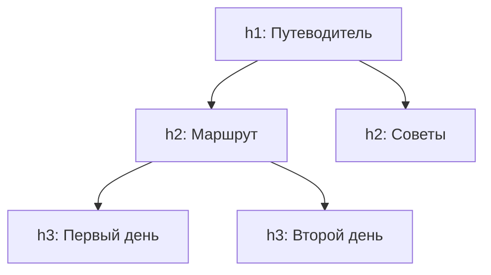
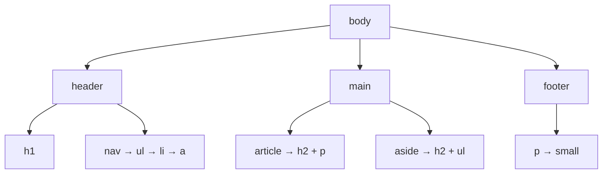

# Текст и семантика

[Содержание](../../README.md) · [← Назад](../../Lesson-1/ru/%D0%92%D0%B2%D0%B5%D0%B4%D0%B5%D0%BD%D0%B8%D0%B5%20%D0%B2%20HTML%20%D1%81%D1%82%D1%80%D1%83%D0%BA%D1%82%D1%83%D1%80%D0%B0%20%D0%B4%D0%BE%D0%BA%D1%83%D0%BC%D0%B5%D0%BD%D1%82%D0%B0.md) · [Вперёд →](../../Lesson-3/ru/%D0%A1%D1%81%D1%8B%D0%BB%D0%BA%D0%B8%20%D0%B8%20%D0%BD%D0%B0%D0%B2%D0%B8%D0%B3%D0%B0%D1%86%D0%B8%D1%8F.md) · [RU](%D0%A2%D0%B5%D0%BA%D1%81%D1%82%20%D0%B8%20%D1%81%D0%B5%D0%BC%D0%B0%D0%BD%D1%82%D0%B8%D0%BA%D0%B0.md) · [EN](../en/Text%20and%20semantics.md) · [UZ](../uz/Matn%20va%20semantika.md) · [Практика](../practice.html)

> **Связь с прошлым уроком:** в уроке 1 вы собрали скелет документа и добавили `<h1>` и `<p>`. Сегодня наполним `<body>` настоящим текстом и разобьём страницу на смысловые блоки.

---

## Зачем это вам

Сравните две страницы. На первой сплошной текст без заголовков и списков. На второй тот же текст, но с разделами, пунктами и шагами. Какую вы дочитаете?

HTML-теги этого урока делают текст удобным для чтения. А заодно понятным для поисковиков и программ, которые читают страницу вслух.

---

## Чему вы научитесь

- Строить иерархию заголовков `h1`–`h6` без пропуска уровней.
- Разделять текст на абзацы `p` и правильно использовать `br` и `hr`.
- Выделять важное (`strong`) и ударное (`em`), подсвечивать (`mark`), писать примечания (`small`).
- Выбирать нужный список: `ul`, `ol` или `dl`.
- Показывать цитаты и код: `blockquote`, `code`, спецсимволы `&lt;` и `&copy;`.
- Делить страницу на блоки: `header`, `nav`, `main`, `section`, `article`, `aside`, `footer`.

---

## Повторение: 3 вопроса из урока 1

1. Где пишется видимый текст: в `<head>` или в `<body>`?
2. Чем `<title>` отличается от `<h1>`?
3. Как выглядит закрывающий тег абзаца?

Ответы - в конце урока.

---

## План урока

Урок состоит из двух частей.

| Часть | Раздел | Что делаем |
| --- | --- | --- |
| А. Текст | Заголовки | Оглавление книги |
| | Абзацы, `br`, `hr` | Абзац или перенос строки |
| | Акценты | `strong`, `em`, `mark`, `small` |
| | Списки | Покупки, рецепт, словарь |
| | Цитаты и код | `blockquote`, `code`, спецсимволы |
| | Мини-задание 1 | Список из трёх шагов |
| Б. Страница | Семантические блоки | Комнаты в доме |
| | Мини-задание 2 | Разметить страницу блоками |
| | Самостоятельная работа | Задание в IDE и памятка |

---

## Часть А. Текст

## Заголовки `h1`–`h6`

**Простыми словами:** у книги есть название, главы, разделы и подразделы. Заголовки HTML - то же оглавление. Это не «крупный жирный текст», а **иерархия смысла**.

```html
<h1>Название страницы</h1>
<h2>Раздел</h2>
<h3>Подраздел</h3>
<h4>Подподраздел</h4>
```

Есть шесть уровней: от `<h1>` до `<h6>`. Обычно хватает трёх.

**Три правила курса:**

1. На странице **один** `<h1>` - главная тема.
2. Уровни идут **по порядку**: после `h2` идёт `h3`, а не `h4`.
3. Вернуться вверх можно всегда: после `h3` снова `h2` - это новый раздел.



**Как читать схему.** У «Маршрута» два подраздела. «Советы» стоят на одном уровне с «Маршрутом». Все шесть уровней использовать не нужно.

**Почему это важно:** незрячий пользователь открывает список заголовков и прыгает к нужному разделу. Если взять `<h3>` только потому, что «нужен текст поменьше», оглавление сломается. Размер текста задают через CSS.

---

## Абзацы и переносы: `p`, `br`, `hr`

| Тег | Что делает | Когда использовать |
| --- | --- | --- |
| `<p>` | Абзац. Браузер сам добавит отступ | Каждая отдельная мысль |
| `<br>` | Перенос строки **внутри** абзаца | Адрес, стихи |
| `<hr>` | Смена темы | Переход к новой части текста |

```html
<p>Наш кружок собирается по средам.</p>
<p>
    ул. Амира Темура, 10<br>
    г. Алмалык
</p>
<hr>
<p>Новая тема: правила участия.</p>
```

**Что увидите:** два абзаца с отступом, адрес на двух строках, горизонтальная линия, ещё один абзац.

`<br>` и `<hr>` - пустые элементы, закрывающего тега у них нет.

### Попробуйте сломать

Замените два абзаца на один, а между ними поставьте `<br><br><br>`. Внешне похоже? Но для браузера и скринридера это теперь **один** абзац. Верните `<p>`.

---

## Акценты: `strong`, `em`, `mark`, `small`

**Главный принцип:** HTML описывает **смысл**, а не внешний вид.

| Тег | Смысл | Как выглядит по умолчанию | Пример |
| --- | --- | --- | --- |
| `<strong>` | Важно, не пропусти | Жирный | **Внимание:** сохраните файл |
| `<em>` | Ударение голосом | Курсив | Я *действительно* успею |
| `<mark>` | Подсветка, как маркером | Жёлтый фон | Найдено: три ошибки |
| `<small>` | Примечание, сноска | Мелкий | Цена может измениться |

```html
<p><strong>Внимание:</strong> перед началом работы сохраните файл.</p>
<p>Я <em>действительно</em> закончу проект сегодня.</p>
<p>В отчёте нашли <mark>три ошибки</mark>.</p>
<p><small>Расписание может измениться.</small></p>
```

**А `<b>` и `<i>`?** Они не устарели, но означают другое:
- `<b>` - привлечь внимание без «важности», например ключевое слово в описании;
- `<i>` - другой голос: термин, иностранное слово, мысль героя.

Если нужно только сделать текст жирным для красоты - это задача CSS.

### Частые ошибки новичков

| Ошибка | Как исправить |
| --- | --- |
| Весь абзац в `<strong>` | Выделяйте только важные слова |
| `<br><br>` вместо нового абзаца | Новая мысль - новый `<p>` |
| `<h3>` ради мелкого шрифта | Уровень - по структуре, размер - CSS |
| Пропуск уровня `h2` → `h4` | Идите по порядку |
| `<mark>` для важности | Важность - `<strong>`, `<mark>` - подсветка |

---

## Списки: `ul`, `ol`, `dl`

**Простыми словами:**

| Список | Аналогия | Когда |
| --- | --- | --- |
| `<ul>` | Список покупок | Порядок не важен |
| `<ol>` | Рецепт | Порядок важен |
| `<dl>` | Словарь | Термин и его описание |

```html
<ul>
    <li>Блокнот</li>
    <li>Ручка</li>
</ul>

<ol>
    <li>Открыть VS Code</li>
    <li>Создать index.html</li>
    <li>Сохранить и открыть в браузере</li>
</ol>

<dl>
    <dt>HTML</dt>
    <dd>Язык разметки страниц</dd>
    <dt>CSS</dt>
    <dd>Язык оформления</dd>
</dl>
```

**Что увидите:** точки перед пунктами `ul`, номера 1-2-3 у `ol`, термины `dt` и описания `dd` с отступом.

Каждый пункт `ul` и `ol` - это `<li>`. Он живёт **только** внутри `<ul>` или `<ol>`.

### Вложенный список

Вложенный список ставится **внутрь** `<li>`, до `</li>`:

```html
<ul>
    <li>Frontend
        <ul>
            <li>HTML</li>
            <li>CSS</li>
        </ul>
    </li>
    <li>Backend</li>
</ul>
```

### Частые ошибки новичков

| Ошибка | Как исправить |
| --- | --- |
| `<li>` без `<ul>` или `<ol>` | Оберните в список |
| `<ol>` для списка покупок | Порядок не важен - `<ul>` |
| Вложенный список после `</li>` | Ставьте внутрь `<li>` |
| Текст прямо в `<ul>` без `<li>` | Каждый пункт - `<li>` |

---

## Цитаты, код и спецсимволы

### `<blockquote>` - цитата

```html
<blockquote>
    <p>Лучший способ научиться - начать делать.</p>
</blockquote>
```

**Что увидите:** абзац с отступом слева.

### `<code>` - фрагмент кода

```html
<p>Абзац создаётся тегом <code>&lt;p&gt;</code>.</p>
```

**Что увидите:** «Абзац создаётся тегом `<p>`.» - тег показан моноширинным шрифтом.

### Спецсимволы (HTML-сущности)

Почему в примере выше `&lt;p&gt;`, а не `<p>`? Если написать `<p>`, браузер решит, что это настоящий тег. Чтобы **показать** угловые скобки, их заменяют сущностями:

| Пишем | Видим | Зачем |
| --- | --- | --- |
| `&lt;` | `<` | Показать «меньше» или начало тега |
| `&gt;` | `>` | Показать «больше» или конец тега |
| `&amp;` | `&` | Показать амперсанд |
| `&copy;` | © | Знак копирайта в подвале |
| `&nbsp;` | неразрывный пробел | Не разрывать «10&nbsp;км» |

---

## Мини-задание 1

Без подглядывания соберите нумерованный список из трёх шагов «Как заварить чай». Решение - в разделе «Ответы».

---

## Часть Б. Страница

## Семантические блоки

**Простыми словами:** в доме есть прихожая, гостиная, кухня, кладовка. У каждой комнаты своё назначение. Страница тоже делится на «комнаты» - **семантические блоки**.

Раньше страницы собирали из одинаковых `<div>` - «безликих коробок». Это называют «div-супом»: ни браузер, ни скринридер не понимают, где меню, а где подвал. Семантические теги называют блок по смыслу.

| Тег | Комната | Что внутри |
| --- | --- | --- |
| `<header>` | Прихожая | Название сайта, логотип, иногда меню |
| `<nav>` | Указатели на стенах | Главное меню, содержание |
| `<main>` | Гостиная | Основное содержимое. **Один** на странице |
| `<section>` | Зона в комнате | Раздел на одну тему, обычно с заголовком |
| `<article>` | Книга на полке | Самостоятельный материал: новость, пост, отзыв |
| `<aside>` | Тумбочка сбоку | Дополнительное: «Похожие статьи» |
| `<footer>` | Кладовка у выхода | Копирайт, контакты |

**`section` или `article`?** Задайте вопрос: «Есть ли смысл у блока, если вырезать его и опубликовать отдельно?» Да - это `<article>` (новость, пост). Нет - `<section>` (раздел «О нас» на главной).

**А `<div>`?** Он остаётся для случаев, когда ни один смысловой тег не подходит, например обёртка для оформления.

### Собираем страницу

```html
<body>
    <header>
        <h1>Блог о путешествиях</h1>
        <nav>
            <!-- меню: ссылки изучим в уроке 3 -->
        </nav>
    </header>

    <main>
        <article>
            <h2>Поездка в Самарканд</h2>
            <p>В прошлом месяце я побывал в Самарканде.</p>
        </article>

        <aside>
            <h2>Похожие записи</h2>
            <ul>
                <li>Поездка в Бухару</li>
            </ul>
        </aside>
    </main>

    <footer>
        <p><small>&copy; 2026 Блог о путешествиях</small></p>
    </footer>
</body>
```

**Что увидите:** внешне - обычный текст сверху вниз. Блоки невидимы, пока нет CSS. Но откройте DevTools → Elements: структура страницы видна сразу.



**Как читать схему.** Стрелки показывают вложенность примера. `header`, `main` и `footer` - соседи внутри `body`. `article` и `aside` - соседи внутри `main`. Ссылки в `nav` появятся в уроке 3.

### Частые ошибки новичков

| Ошибка | Как исправить |
| --- | --- |
| Два `<main>` на странице | Только один |
| `<div class="header">` вместо `<header>` | Есть смысловой тег - берите его |
| `<header>` внутри `<main>` для шапки сайта | Шапка сайта - снаружи `main` |
| `<section>` без заголовка | Дайте разделу `h2` или используйте `div` |

---

## Мини-задание 2

Разметьте блоками страницу кружка: название кружка в шапке, два раздела в основной части («О кружке», «Расписание»), копирайт в подвале. Решение - в разделе «Ответы».

---

## Итоги урока: шпаргалка

| Задача | Тег |
| --- | --- |
| Главная тема страницы | `<h1>` - один |
| Разделы и подразделы | `<h2>` → `<h3>` по порядку |
| Абзац / перенос / смена темы | `<p>` / `<br>` / `<hr>` |
| Важно / ударение / подсветка / примечание | `<strong>` / `<em>` / `<mark>` / `<small>` |
| Без порядка / по порядку / термины | `<ul>` / `<ol>` / `<dl>` |
| Цитата / код | `<blockquote>` / `<code>` |
| Показать `<` и © | `&lt;` и `&copy;` |
| Шапка / меню / основное / подвал | `<header>` / `<nav>` / `<main>` / `<footer>` |
| Раздел / самостоятельный материал / дополнение | `<section>` / `<article>` / `<aside>` |

---

## Самостоятельная работа

### Часть 1. Задание в IDE (засчитывается платформой)

Соберите **памятку** на знакомую тему: подготовка к поездке, уход за растением, организация учебного дня.

1. Полный документ: DOCTYPE, `lang`, UTF-8, название вкладки.
2. `<header>` с одним `<h1>` - темой памятки.
3. Один `<main>` и в нём два `<section>`, у каждого `<h2>`:
   - первый раздел - список нужных вещей (`<ul>`);
   - второй - порядок действий (`<ol>`).
4. В одном из абзацев выделите важное через `<strong>`.
5. `<footer>` с примечанием в `<small>`.

Ссылки, картинки и `<div>` в этом задании не используйте.

Что проверяет платформа: скелет документа, `header`, `main`, `footer`, два `section`, один `h1`, минимум два `h2`, `ul`, `ol`, не меньше пяти `li`, `strong`, `small`, отсутствие `<div>` и `<br><br>`.

### Часть 2. Проект на компьютере

Сохраните памятку как `guide.html` в папке `my-html-site`. Откройте в браузере и в DevTools. Устно объясните, почему для каждого блока выбран именно этот тег.

### Критерии готовности

- [ ] Задание в IDE засчитано.
- [ ] Один `<h1>` и два `<h2>`; уровни выбраны по структуре.
- [ ] Один `<main>`; каждый `<section>` начинается с заголовка.
- [ ] `<ul>` там, где порядок не важен, `<ol>` - где важен.
- [ ] Каждый пункт - `<li>` внутри списка.
- [ ] `<strong>` выделяет только действительно важное.
- [ ] Можете объяснить выбор каждого блока.

---

## Вопросы для самопроверки

1. Сколько `<h1>` должно быть на странице по правилам курса?
2. Почему нельзя ставить `<h4>` сразу после `<h2>`?
3. Чем `<br>` отличается от нового `<p>`?
4. Чем `<strong>` отличается от `<b>`?
5. Когда нужен `<ol>`, а когда `<ul>`?
6. Где ставится вложенный список?
7. Как показать на странице текст `<p>`, чтобы браузер не принял его за тег?
8. Чем `<article>` отличается от `<section>`?
9. Сколько `<main>` может быть на странице?
10. Когда всё ещё нужен `<div>`?

После вопросов пройдите **тест урока** на платформе: 12 вопросов, порог 70%.

---

## Что дальше

Страница стала структурной, но она одна. В уроке 3 свяжем несколько страниц ссылками, сделаем общее меню и научимся прыгать к нужному разделу.

---

## Ответы

**Повторение**

1. В `<body>`.
2. `<title>` - название вкладки, `<h1>` - заголовок на странице.
3. `</p>`.

**Мини-задание 1**

```html
<ol>
    <li>Вскипятить воду</li>
    <li>Положить чай в чашку</li>
    <li>Залить кипятком и подождать 3 минуты</li>
</ol>
```

**Мини-задание 2**

```html
<body>
    <header>
        <h1>Кружок веб-разработки</h1>
    </header>
    <main>
        <section>
            <h2>О кружке</h2>
            <p>Учимся делать сайты с нуля.</p>
        </section>
        <section>
            <h2>Расписание</h2>
            <p>Каждую среду в 15:00.</p>
        </section>
    </main>
    <footer>
        <p><small>&copy; 2026 Кружок веб-разработки</small></p>
    </footer>
</body>
```

**Вопросы для самопроверки**

1. Один.
2. Пропуск уровня путает оглавление: где подраздел `h3`?
3. `<br>` переносит строку внутри того же абзаца, `<p>` начинает новую мысль.
4. `<strong>` - важность, `<b>` - привлечение внимания без важности.
5. `<ol>` - порядок важен (инструкция), `<ul>` - не важен (покупки).
6. Внутрь `<li>`, до `</li>`.
7. Через сущности: `&lt;p&gt;`.
8. `<article>` имеет смысл отдельно от страницы, `<section>` - часть страницы.
9. Один.
10. Когда ни один смысловой тег не подходит, например обёртка для оформления.

---

[Содержание](../../README.md) · [Назад](../../Lesson-1/ru/%D0%92%D0%B2%D0%B5%D0%B4%D0%B5%D0%BD%D0%B8%D0%B5%20%D0%B2%20HTML%20%D1%81%D1%82%D1%80%D1%83%D0%BA%D1%82%D1%83%D1%80%D0%B0%20%D0%B4%D0%BE%D0%BA%D1%83%D0%BC%D0%B5%D0%BD%D1%82%D0%B0.md) · [Вперёд](../../Lesson-3/ru/%D0%A1%D1%81%D1%8B%D0%BB%D0%BA%D0%B8%20%D0%B8%20%D0%BD%D0%B0%D0%B2%D0%B8%D0%B3%D0%B0%D1%86%D0%B8%D1%8F.md) · [Практика](../practice.html) · [RU](%D0%A2%D0%B5%D0%BA%D1%81%D1%82%20%D0%B8%20%D1%81%D0%B5%D0%BC%D0%B0%D0%BD%D1%82%D0%B8%D0%BA%D0%B0.md) · [EN](../en/Text%20and%20semantics.md) · [UZ](../uz/Matn%20va%20semantika.md)
