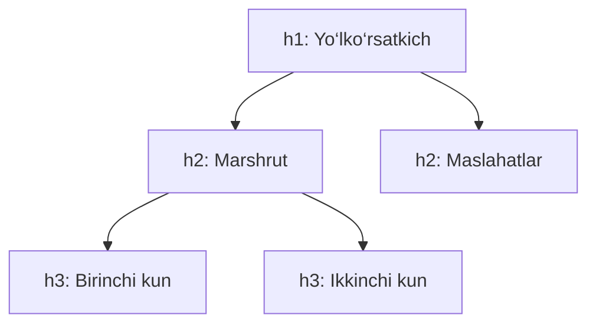
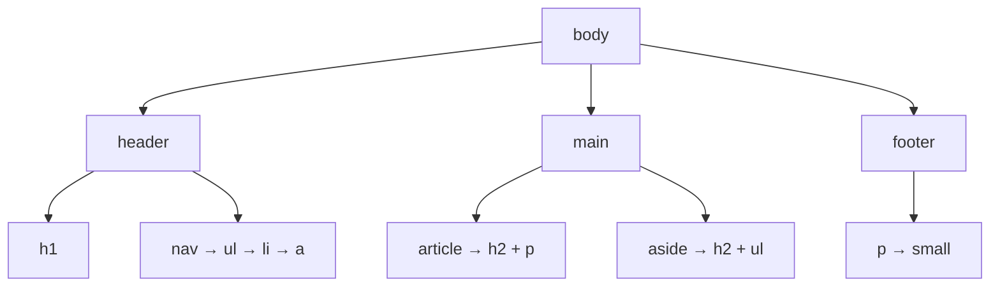

# Matn va semantika

[Mundarija](../../README.md) · [← Orqaga](../../Lesson-1/uz/HTML%20ga%20kirish%20hujjat%20tuzilishi.md) · [Keyingi →](../../Lesson-3/uz/Havolalar%20va%20navigatsiya.md) · [RU](../ru/%D0%A2%D0%B5%D0%BA%D1%81%D1%82%20%D0%B8%20%D1%81%D0%B5%D0%BC%D0%B0%D0%BD%D1%82%D0%B8%D0%BA%D0%B0.md) · [EN](../en/Text%20and%20semantics.md) · [UZ](Matn%20va%20semantika.md) · [Amaliyot](../practice.html)

> **Oldingi dars bilan bog‘liqlik:** 1-darsda hujjat skeletini yig‘dingiz va `<h1>` hamda `<p>` qo‘shdingiz. Bugun `<body>` ni haqiqiy matn bilan to‘ldiramiz va sahifani ma’noli bloklarga ajratamiz.

---

## Bu sizga nima uchun kerak

Ikki sahifani solishtiring. Birinchisida sarlavha va ro‘yxatsiz yaxlit matn. Ikkinchisida xuddi shu matn, lekin bo‘limlar, bandlar va qadamlar bilan. Qaysi birini oxirigacha o‘qiysiz?

Bu darsdagi HTML teglari matnni o‘qishga qulay qiladi. Shu bilan birga qidiruv tizimlari va sahifani ovoz chiqarib o‘qiydigan dasturlar uchun ham tushunarli qiladi.

---

## Nimani o‘rganasiz

- `h1`–`h6` sarlavhalar ierarxiyasini darajalarni o‘tkazib yubormasdan qurish.
- Matnni `p` abzatslarga bo‘lish va `br` hamda `hr` ni to‘g‘ri ishlatish.
- Muhimni (`strong`) va urg‘uni (`em`) ajratish, yoritish (`mark`), izoh yozish (`small`).
- Kerakli ro‘yxatni tanlash: `ul`, `ol` yoki `dl`.
- Iqtibos va kodni ko‘rsatish: `blockquote`, `code`, `&lt;` va `&copy;` maxsus belgilari.
- Sahifani bloklarga bo‘lish: `header`, `nav`, `main`, `section`, `article`, `aside`, `footer`.

---

## Takrorlash: 1-darsdan 3 savol

1. Ko‘rinadigan matn qayerga yoziladi: `<head>` ga yoki `<body>` ga?
2. `<title>` `<h1>` dan nimasi bilan farq qiladi?
3. Abzatsning yopuvchi tegi qanday ko‘rinadi?

Javoblar - dars oxirida.

---

## Reja

Dars ikki qismdan iborat.

| Qism | Bo‘lim | Nima qilamiz |
| --- | --- | --- |
| A. Matn | Sarlavhalar | Kitob mundarijasi |
| | Abzatslar, `br`, `hr` | Abzats yoki yangi qator |
| | Urg‘ular | `strong`, `em`, `mark`, `small` |
| | Ro‘yxatlar | Xaridlar, retsept, lug‘at |
| | Iqtibos va kod | `blockquote`, `code`, maxsus belgilar |
| | Mini-topshiriq 1 | Uch qadamli ro‘yxat |
| B. Sahifa | Semantik bloklar | Uydagi xonalar |
| | Mini-topshiriq 2 | Sahifani bloklarga ajratish |
| | Mustaqil ish | IDE topshirig‘i va eslatma |

---

## A qism. Matn

## Sarlavhalar `h1`–`h6`

**Oddiy qilib aytganda:** kitobda nom, boblar, bo‘limlar va kichik bo‘limlar bor. HTML sarlavhalari - xuddi shu mundarija. Bu «yirik qalin matn» emas, **ma’no ierarxiyasi**.

```html
<h1>Sahifa nomi</h1>
<h2>Bo‘lim</h2>
<h3>Kichik bo‘lim</h3>
<h4>Undan ham kichik bo‘lim</h4>
```

Oltita daraja bor: `<h1>` dan `<h6>` gacha. Odatda uchtasi yetadi.

**Kursning uchta qoidasi:**

1. Sahifada **bitta** `<h1>` - asosiy mavzu.
2. Darajalar **tartib bilan**: `h2` dan keyin `h4` emas, `h3`.
3. Yuqoriga har doim qaytish mumkin: `h3` dan keyin yana `h2` - bu yangi bo‘lim.



**Sxemani qanday o‘qish kerak.** «Marshrut» ning ikki kichik bo‘limi bor. «Maslahatlar» «Marshrut» bilan bir darajada turadi. Oltita darajaning hammasini ishlatish shart emas.

**Bu nega muhim:** ko‘zi ojiz foydalanuvchi sarlavhalar ro‘yxatini ochadi va kerakli bo‘limga sakraydi. `<h3>` ni faqat «kichikroq matn kerak» deb olsangiz, mundarija buziladi. Matn o‘lchamini CSS beradi.

---

## Abzatslar va yangi qator: `p`, `br`, `hr`

| Teg | Nima qiladi | Qachon ishlatiladi |
| --- | --- | --- |
| `<p>` | Abzats. Brauzer o‘zi oraliq qo‘shadi | Har bir alohida fikr |
| `<br>` | Abzats **ichida** yangi qator | Manzil, she’r |
| `<hr>` | Mavzu almashinuvi | Matnning yangi qismiga o‘tish |

```html
<p>To‘garagimiz chorshanba kunlari yig‘iladi.</p>
<p>
    Amir Temur ko‘chasi, 10<br>
    Olmaliq shahri
</p>
<hr>
<p>Yangi mavzu: ishtirok qoidalari.</p>
```

**Nimani ko‘rasiz:** orasi ochiq ikki abzats, ikki qatorli manzil, gorizontal chiziq, yana bir abzats.

`<br>` va `<hr>` - bo‘sh elementlar, yopuvchi tegi yo‘q.

### Buzib ko‘ring

Ikki abzatsni bittaga almashtiring, ularning orasiga `<br><br><br>` qo‘ying. Tashqi ko‘rinishi o‘xshashmi? Lekin brauzer va ekran o‘quvchi uchun endi bu **bitta** abzats. `<p>` ni qaytaring.

---

## Urg‘ular: `strong`, `em`, `mark`, `small`

**Asosiy tamoyil:** HTML tashqi ko‘rinishni emas, **ma’noni** tasvirlaydi.

| Teg | Ma’nosi | Odatiy ko‘rinishi | Misol |
| --- | --- | --- | --- |
| `<strong>` | Muhim, o‘tkazib yubormang | Qalin | **Diqqat:** faylni saqlang |
| `<em>` | Ovoz bilan urg‘u | Kursiv | Men *albatta* ulguraman |
| `<mark>` | Marker bilan yoritish | Sariq fon | Topildi: uchta xato |
| `<small>` | Izoh, havola | Kichik | Narx o‘zgarishi mumkin |

```html
<p><strong>Diqqat:</strong> ishni boshlashdan oldin faylni saqlang.</p>
<p>Men loyihani bugun <em>albatta</em> tugataman.</p>
<p>Hisobotda <mark>uchta xato</mark> topildi.</p>
<p><small>Jadval o‘zgarishi mumkin.</small></p>
```

**`<b>` va `<i>` chi?** Ular eskirmagan, lekin boshqa narsani bildiradi:
- `<b>` - «muhimlik»siz e’tiborni tortish, masalan tavsifdagi kalit so‘z;
- `<i>` - boshqa ovoz: atama, chet so‘z, qahramon fikri.

Matnni faqat chiroy uchun qalin qilish kerak bo‘lsa - bu CSS ning vazifasi.

### Yangi o‘rganuvchilarning tipik xatolari

| Xato | Qanday tuzatish |
| --- | --- |
| Butun abzats `<strong>` da | Faqat muhim so‘zlarni ajrating |
| Yangi abzats o‘rniga `<br><br>` | Yangi fikr - yangi `<p>` |
| Kichik shrift uchun `<h3>` | Daraja - tuzilmaga ko‘ra, o‘lcham - CSS |
| Darajani o‘tkazish `h2` → `h4` | Tartib bilan boring |
| Muhimlik uchun `<mark>` | Muhimlik - `<strong>`, `<mark>` - yoritish |

---

## Ro‘yxatlar: `ul`, `ol`, `dl`

**Oddiy qilib aytganda:**

| Ro‘yxat | O‘xshatish | Qachon |
| --- | --- | --- |
| `<ul>` | Xaridlar ro‘yxati | Tartib muhim emas |
| `<ol>` | Retsept | Tartib muhim |
| `<dl>` | Lug‘at | Atama va uning tavsifi |

```html
<ul>
    <li>Daftar</li>
    <li>Ruchka</li>
</ul>

<ol>
    <li>VS Code ni ochish</li>
    <li>index.html yaratish</li>
    <li>Saqlab, brauzerda ochish</li>
</ol>

<dl>
    <dt>HTML</dt>
    <dd>Sahifalarni belgilash tili</dd>
    <dt>CSS</dt>
    <dd>Bezash tili</dd>
</dl>
```

**Nimani ko‘rasiz:** `ul` bandlari oldida nuqtalar, `ol` da 1-2-3 raqamlar, `dt` atamalari va surilgan `dd` tavsiflari.

`ul` va `ol` ning har bir bandi - `<li>`. U **faqat** `<ul>` yoki `<ol>` ichida yashaydi.

### Ichki ro‘yxat

Ichki ro‘yxat `<li>` **ichiga**, `</li>` dan oldin qo‘yiladi:

```html
<ul>
    <li>Frontend
        <ul>
            <li>HTML</li>
            <li>CSS</li>
        </ul>
    </li>
    <li>Backend</li>
</ul>
```

### Yangi o‘rganuvchilarning tipik xatolari

| Xato | Qanday tuzatish |
| --- | --- |
| `<ul>` yoki `<ol>` siz `<li>` | Ro‘yxatga o‘rang |
| Xaridlar ro‘yxati uchun `<ol>` | Tartib muhim emas - `<ul>` |
| Ichki ro‘yxat `</li>` dan keyin | `<li>` ichiga qo‘ying |
| `<li>` siz to‘g‘ridan-to‘g‘ri `<ul>` ichida matn | Har bir band - `<li>` |

---

## Iqtibos, kod va maxsus belgilar

### `<blockquote>` - iqtibos

```html
<blockquote>
    <p>O‘rganishning eng yaxshi yo‘li - qilishni boshlash.</p>
</blockquote>
```

**Nimani ko‘rasiz:** chapdan surilgan abzats.

### `<code>` - kod parchasi

```html
<p>Abzats <code>&lt;p&gt;</code> tegi bilan yaratiladi.</p>
```

**Nimani ko‘rasiz:** «Abzats `<p>` tegi bilan yaratiladi.» - teg bir xil kenglikdagi shriftda ko‘rsatilgan.

### Maxsus belgilar (HTML-ob’ektlar)

Yuqoridagi misolda nega `<p>` emas, `&lt;p&gt;`? Agar `<p>` yozsangiz, brauzer uni haqiqiy teg deb o‘ylaydi. Burchakli qavslarni **ko‘rsatish** uchun ularni maxsus belgilar bilan almashtirishadi:

| Yozamiz | Ko‘ramiz | Nima uchun |
| --- | --- | --- |
| `&lt;` | `<` | «Kichik» belgisi yoki teg boshi |
| `&gt;` | `>` | «Katta» belgisi yoki teg oxiri |
| `&amp;` | `&` | Ampersand |
| `&copy;` | © | Pastki qismdagi mualliflik belgisi |
| `&nbsp;` | uzilmas bo‘sh joy | «10&nbsp;km» ni ajratmaslik |

---

## Mini-topshiriq 1

Qaramasdan «Choy qanday damlanadi» degan uch qadamli raqamli ro‘yxat tuzing. Yechim - «Javoblar» bo‘limida.

---

## B qism. Sahifa

## Semantik bloklar

**Oddiy qilib aytganda:** uyda dahliz, mehmonxona, oshxona, omborxona bor. Har bir xonaning o‘z vazifasi bor. Sahifa ham «xonalar»ga - **semantik bloklarga** bo‘linadi.

Ilgari sahifalar bir xil `<div>` lardan - «yuzsiz qutilar»dan yig‘ilardi. Buni «div-sho‘rva» deyishadi: na brauzer, na ekran o‘quvchi menyu qayerda, pastki qism qayerda ekanini tushunmaydi. Semantik teglar blokni ma’nosiga ko‘ra nomlaydi.

| Teg | Xona | Ichida nima |
| --- | --- | --- |
| `<header>` | Dahliz | Sayt nomi, logotip, ba’zan menyu |
| `<nav>` | Devordagi ko‘rsatkichlar | Asosiy menyu, mundarija |
| `<main>` | Mehmonxona | Asosiy mazmun. Sahifada **bitta** |
| `<section>` | Xonadagi zona | Bir mavzudagi bo‘lim, odatda sarlavha bilan |
| `<article>` | Javondagi kitob | Mustaqil material: yangilik, post, sharh |
| `<aside>` | Yondagi tumba | Qo‘shimcha: «O‘xshash maqolalar» |
| `<footer>` | Chiqishdagi omborxona | Mualliflik, kontaktlar |

**`section` mi yoki `article` mi?** O‘zingizga savol bering: «Blokni kesib olib, alohida e’lon qilsa, ma’nosi qoladimi?» Ha - bu `<article>` (yangilik, post). Yo‘q - `<section>` (bosh sahifadagi «Biz haqimizda» bo‘limi).

**`<div>` chi?** Hech bir ma’noli teg mos kelmaganda qoladi, masalan bezash uchun o‘ram.

### Sahifani yig‘amiz

```html
<body>
    <header>
        <h1>Sayohatlar blogi</h1>
        <nav>
            <!-- menyu: havolalarni 3-darsda o‘rganamiz -->
        </nav>
    </header>

    <main>
        <article>
            <h2>Samarqandga sayohat</h2>
            <p>O‘tgan oy Samarqandda bo‘ldim.</p>
        </article>

        <aside>
            <h2>O‘xshash yozuvlar</h2>
            <ul>
                <li>Buxoroga sayohat</li>
            </ul>
        </aside>
    </main>

    <footer>
        <p><small>&copy; 2026 Sayohatlar blogi</small></p>
    </footer>
</body>
```

**Nimani ko‘rasiz:** tashqi ko‘rinishda - yuqoridan pastga oddiy matn. CSS bo‘lmaguncha bloklar ko‘rinmaydi. Lekin DevTools → Elements ni oching: sahifa tuzilmasi darhol ko‘rinadi.



**Sxemani qanday o‘qish kerak.** Strelkalar misoldagi ichma-ichlikni ko‘rsatadi. `header`, `main` va `footer` - `body` ichidagi qo‘shnilar. `article` va `aside` - `main` ichidagi qo‘shnilar. `nav` dagi havolalar 3-darsda paydo bo‘ladi.

### Yangi o‘rganuvchilarning tipik xatolari

| Xato | Qanday tuzatish |
| --- | --- |
| Sahifada ikkita `<main>` | Faqat bitta |
| `<header>` o‘rniga `<div class="header">` | Ma’noli teg bor - shuni oling |
| Sayt sarlavha qismi `<main>` ichida | Sayt sarlavha qismi - `main` dan tashqarida |
| Sarlavhasiz `<section>` | Bo‘limga `h2` bering yoki `div` ishlating |

---

## Mini-topshiriq 2

To‘garak sahifasini bloklarga ajrating: sarlavha qismida to‘garak nomi, asosiy qismda ikki bo‘lim («To‘garak haqida», «Jadval»), pastki qismda mualliflik belgisi. Yechim - «Javoblar» bo‘limida.

---

## Dars yakuni: shpargalka

| Vazifa | Teg |
| --- | --- |
| Sahifaning asosiy mavzusi | `<h1>` - bitta |
| Bo‘limlar va kichik bo‘limlar | Tartib bilan `<h2>` → `<h3>` |
| Abzats / yangi qator / mavzu almashinuvi | `<p>` / `<br>` / `<hr>` |
| Muhim / urg‘u / yoritish / izoh | `<strong>` / `<em>` / `<mark>` / `<small>` |
| Tartibsiz / tartibli / atamalar | `<ul>` / `<ol>` / `<dl>` |
| Iqtibos / kod | `<blockquote>` / `<code>` |
| `<` va © ni ko‘rsatish | `&lt;` va `&copy;` |
| Sarlavha qismi / menyu / asosiy / pastki qism | `<header>` / `<nav>` / `<main>` / `<footer>` |
| Bo‘lim / mustaqil material / qo‘shimcha | `<section>` / `<article>` / `<aside>` |

---

## Mustaqil ish

### 1-qism. IDE topshirig‘i (platforma hisoblaydi)

Tanish mavzuda **eslatma** tuzing: safarga tayyorgarlik, o‘simlik parvarishi, o‘quv kunini tashkil qilish.

1. To‘liq hujjat: DOCTYPE, `lang`, UTF-8, yorliq nomi.
2. Eslatma mavzusi bilan bitta `<h1>` li `<header>`.
3. Bitta `<main>` va uning ichida ikkita `<section>`, har birida `<h2>`:
   - birinchi bo‘lim - kerakli narsalar ro‘yxati (`<ul>`);
   - ikkinchisi - harakatlar tartibi (`<ol>`).
4. Abzatslardan birida muhimni `<strong>` bilan ajrating.
5. `<small>` dagi izohli `<footer>`.

Bu topshiriqda havolalar, rasmlar va `<div>` ishlatmang.

Platforma nimani tekshiradi: hujjat skeleti, `header`, `main`, `footer`, ikkita `section`, bitta `h1`, kamida ikkita `h2`, `ul`, `ol`, kamida beshta `li`, `strong`, `small`, `<div>` va `<br><br>` yo‘qligi.

### 2-qism. Kompyuterdagi loyiha

Eslatmani `my-html-site` papkasida `guide.html` nomi bilan saqlang. Brauzerda va DevTools da oching. Har bir blok uchun nega aynan shu teg tanlanganini og‘zaki tushuntiring.

### Tayyorlik mezonlari

- [ ] IDE topshirig‘i qabul qilingan.
- [ ] Bitta `<h1>` va ikkita `<h2>`; darajalar tuzilmaga ko‘ra tanlangan.
- [ ] Bitta `<main>`; har bir `<section>` sarlavha bilan boshlanadi.
- [ ] Tartib muhim bo‘lmagan joyda `<ul>`, muhim joyda `<ol>`.
- [ ] Har bir band - ro‘yxat ichidagi `<li>`.
- [ ] `<strong>` faqat haqiqatan muhimni ajratadi.
- [ ] Har bir blok tanlovini tushuntira olasiz.

---

## O‘zini tekshirish uchun savollar

1. Kurs qoidasiga ko‘ra sahifada nechta `<h1>` bo‘lishi kerak?
2. Nega `<h2>` dan keyin darhol `<h4>` qo‘yib bo‘lmaydi?
3. `<br>` yangi `<p>` dan nimasi bilan farq qiladi?
4. `<strong>` `<b>` dan nimasi bilan farq qiladi?
5. Qachon `<ol>`, qachon `<ul>` kerak?
6. Ichki ro‘yxat qayerga qo‘yiladi?
7. Brauzer teg deb o‘ylamasligi uchun sahifada `<p>` matnini qanday ko‘rsatish mumkin?
8. `<article>` `<section>` dan nimasi bilan farq qiladi?
9. Sahifada nechta `<main>` bo‘lishi mumkin?
10. `<div>` hali qachon kerak?

Savollardan keyin platformada **dars testini** topshiring: 12 ta savol, o‘tish chegarasi 70%.

---

## Keyin nima

Sahifa tuzilmali bo‘ldi, lekin u bitta. 3-darsda bir nechta sahifani havolalar bilan bog‘laymiz, umumiy menyu qilamiz va kerakli bo‘limga sakrashni o‘rganamiz.

---

## Javoblar

**Takrorlash**

1. `<body>` ga.
2. `<title>` - yorliq nomi, `<h1>` - sahifadagi sarlavha.
3. `</p>`.

**Mini-topshiriq 1**

```html
<ol>
    <li>Suv qaynatish</li>
    <li>Choyni piyolaga solish</li>
    <li>Qaynoq suv quyib, 3 daqiqa kutish</li>
</ol>
```

**Mini-topshiriq 2**

```html
<body>
    <header>
        <h1>Veb-dasturlash to‘garagi</h1>
    </header>
    <main>
        <section>
            <h2>To‘garak haqida</h2>
            <p>Noldan sayt yaratishni o‘rganamiz.</p>
        </section>
        <section>
            <h2>Jadval</h2>
            <p>Har chorshanba soat 15:00 da.</p>
        </section>
    </main>
    <footer>
        <p><small>&copy; 2026 Veb-dasturlash to‘garagi</small></p>
    </footer>
</body>
```

**O‘zini tekshirish uchun savollar**

1. Bitta.
2. Darajani o‘tkazish mundarijani chalkashtiradi: `h3` kichik bo‘limi qayerda?
3. `<br>` o‘sha abzats ichida yangi qatorga o‘tkazadi, `<p>` yangi fikrni boshlaydi.
4. `<strong>` - muhimlik, `<b>` - muhimliksiz e’tiborni tortish.
5. `<ol>` - tartib muhim (yo‘riqnoma), `<ul>` - muhim emas (xaridlar).
6. `<li>` ichiga, `</li>` dan oldin.
7. Maxsus belgilar orqali: `&lt;p&gt;`.
8. `<article>` sahifadan alohida ham ma’noga ega, `<section>` - sahifaning bir qismi.
9. Bitta.
10. Hech bir ma’noli teg mos kelmaganda, masalan bezash uchun o‘ram.

---

[Mundarija](../../README.md) · [← Orqaga](../../Lesson-1/uz/HTML%20ga%20kirish%20hujjat%20tuzilishi.md) · [Keyingi →](../../Lesson-3/uz/Havolalar%20va%20navigatsiya.md) · [RU](../ru/%D0%A2%D0%B5%D0%BA%D1%81%D1%82%20%D0%B8%20%D1%81%D0%B5%D0%BC%D0%B0%D0%BD%D1%82%D0%B8%D0%BA%D0%B0.md) · [EN](../en/Text%20and%20semantics.md) · [UZ](Matn%20va%20semantika.md) · [Amaliyot](../practice.html)
