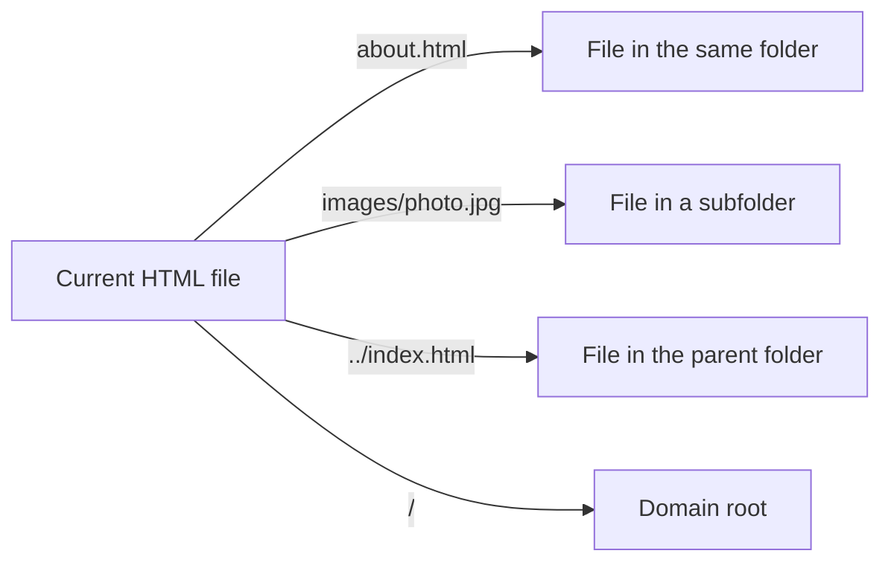
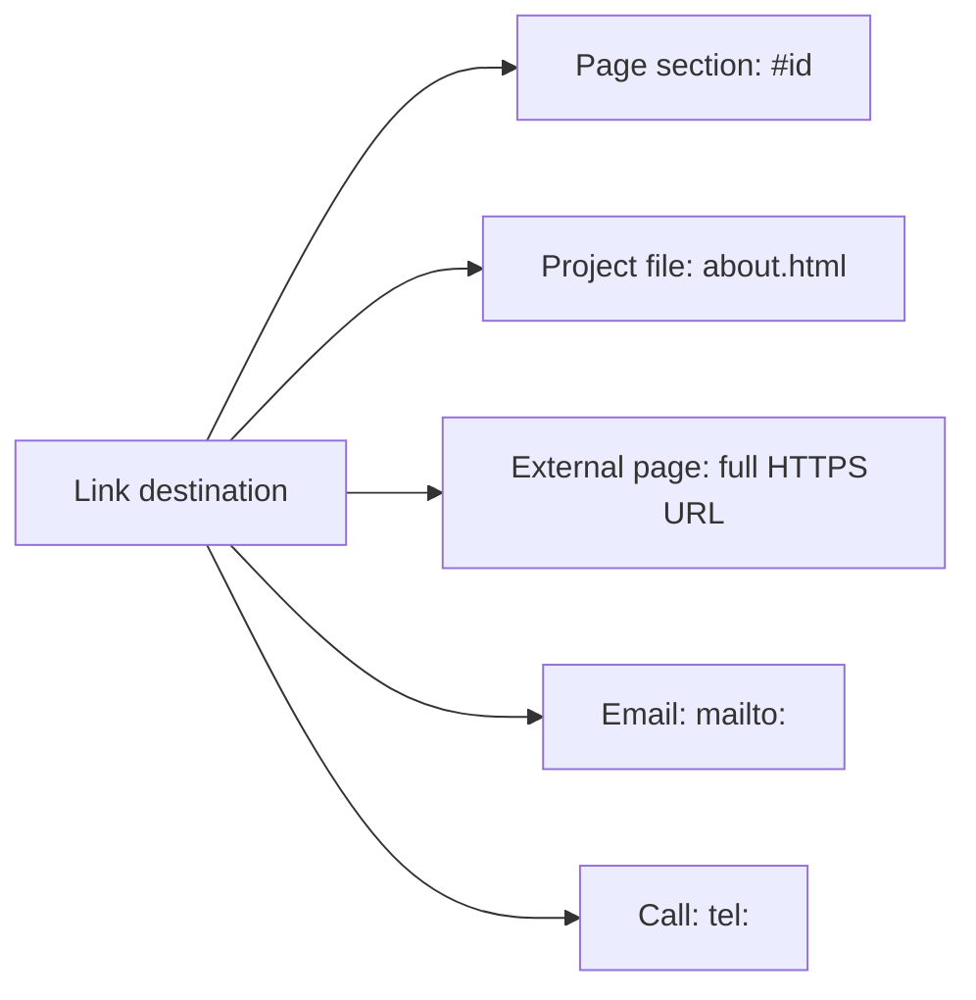

# Links and navigation

[Contents](../../README.md) · [← Back](../../Lesson-2/en/Text%20and%20semantics.md) · [Next →](../../Lesson-4/en/Images%20and%20media.md) · [RU](../ru/%D0%A1%D1%81%D1%8B%D0%BB%D0%BA%D0%B8%20%D0%B8%20%D0%BD%D0%B0%D0%B2%D0%B8%D0%B3%D0%B0%D1%86%D0%B8%D1%8F.md) · [EN](Links%20and%20navigation.md) · [UZ](../uz/Havolalar%20va%20navigatsiya.md) · [Practice](../practice.html)

> **Link to the previous lesson:** in lesson 2 you split the page into blocks and left `<nav>` empty. Today we fill it with real links and connect several pages into one site.

---

## Why you need this

A one-page site is a leaflet. A site of several pages connected by a menu is a book with a table of contents. Links turn separate files into a website.

Today you will build a three-page mini-site and move between the pages with one click.

---

## What you will learn

- Create a link with the `<a>` tag and the `href` attribute.
- Choose a path: absolute for other sites, relative for your own pages.
- Go up to a parent folder with `../`.
- Make anchors: jump to a page section with `id` and `#`.
- Create email (`mailto:`) and phone (`tel:`) links.
- Open a link in a new tab when it really helps.
- Use the same menu on every page of the site.

---

## Review: 3 questions from lessons 1–2

1. What is the file name of a site's home page?
2. Which block is meant for the site menu?
3. Which list fits menu items when order doesn't matter?

Answers are at the end of the lesson.

---

## Lesson plan

| Section | What we do |
| --- | --- |
| The `<a>` tag | A door and an address |
| File paths | A full address and "two houses down" |
| Anchors | Bookmarks in a book |
| Email and phone | `mailto:` and `tel:` |
| New tab | When it is needed |
| Mini-task 1 | Three links from memory |
| A three-page site | A shared menu |
| Mini-task 2 | A table of contents with anchors |
| Independent work | IDE task and a club mini-site |

---

## The `<a>` tag and the `href` attribute

**In simple terms:** a link is a door. `href` is the address it leads to. Without an address, the door is just painted on the wall.

```html
<a href="https://www.wikipedia.org">Wikipedia</a>
```

| Part | Meaning |
| --- | --- |
| `<a>` | A link (anchor) |
| `href="..."` | Where it leads. Without it the link does not work |
| `Wikipedia` | The text people click |

**What you will see:** blue underlined text "Wikipedia". The cursor turns into a hand over it. Click, and Wikipedia opens.

**Link text should explain where it leads.** "Club schedule" is good. "Click here" is bad: the text doesn't say what's behind the door.

---

## File paths

### Absolute path - for other sites

A full address with `https://` and a domain:

```html
<a href="https://developer.mozilla.org">MDN</a>
```

**Analogy:** a full postal address, "10 Amir Temur Street, Almalyk, Uzbekistan". It is understood from anywhere in the world.

### Relative path - for your own pages

A path **from the current file**. Analogy: "go two houses down". It only works if you are standing in the right place.

Take this project:

```
my-site/
├── index.html
├── about.html
├── pages/
│   └── schedule.html
└── images/
    └── photo.jpg
```

| From | To | `href` | How to read it |
| --- | --- | --- | --- |
| `index.html` | `about.html` | `about.html` | Next to it, in the same folder |
| `index.html` | `schedule.html` | `pages/schedule.html` | Go into the `pages` folder |
| `pages/schedule.html` | `index.html` | `../index.html` | Go up one level out of `pages` |
| `pages/schedule.html` | `photo.jpg` | `../images/photo.jpg` | Go up, then into `images` |

`../` means "step out of the room into the hallway".



**How to read the diagram.** Every path starts from the current file's folder. No prefix - the same folder; a folder name - go inside; `../` - go up. A path starting with `/` counts from the site root: we don't use it in this course.

**Course rule:** your own pages - relative paths, other sites - absolute.

### Try breaking it

1. In the link `href="about.html"`, write `href="About.html"`. The link may work on your computer but not on a server, where letter case matters. Always write the file name exactly, preferably in lowercase.
2. Remove the extension: `href="about"`. Click the link. What does the browser show?

### Common beginner mistakes

| Mistake | How to fix |
| --- | --- |
| `href="C:\Users\...\about.html"` | A disk path works only on your computer. Write `about.html` |
| `href="about"` without an extension | The full name: `about.html` |
| `About.html` instead of `about.html` | The name in the link matches the file letter for letter |
| A link `index.html` from `pages/` | You need to go up: `../index.html` |
| Spaces in a file name | Name files without spaces: `my-page.html` |

---

## Anchors: jumping to a page section

**In simple terms:** an anchor is a bookmark in a book. First you put in the bookmark, then you open the book right at it.

**Step 1.** Give the section a unique name with `id`:

```html
<h2 id="schedule">Schedule</h2>
```

**Step 2.** Make a link with `#` before that name:

```html
<a href="#schedule">Go to the schedule</a>
```

**What you will see:** click, and the page scrolls to the "Schedule" heading.

### A table of contents for a long page

```html
<nav>
    <h2>Contents</h2>
    <ul>
        <li><a href="#about">About the club</a></li>
        <li><a href="#schedule">Schedule</a></li>
    </ul>
</nav>

<section>
    <h2 id="about">About the club</h2>
    <p>We learn to build websites.</p>
</section>

<section>
    <h2 id="schedule">Schedule</h2>
    <p>Every Wednesday at 15:00.</p>
</section>
```

### An anchor on another page

First the file, then `#` and the `id`:

```html
<a href="schedule.html#wednesday">Wednesday session</a>
```

`schedule.html` opens right at the section with `id="wednesday"`.

### Rules for `id`

- An `id` is **unique** on the page: two elements with the same `id` is an error.
- No spaces: `id="schedule-2"`, not `id="schedule 2"`.
- In a link on the same page - always with `#`.

### Try breaking it

Remove the `#` from the link: `href="schedule"`. Click it. The browser now looks for a **file** named `schedule` and can't find it.

---

## Email and phone

```html
<a href="mailto:club@example.com">club@example.com</a>
<a href="tel:+998901112233">+998 90 111-22-33</a>
```

| Link | What happens on click |
| --- | --- |
| `mailto:` | The mail app opens with the address filled in |
| `tel:` | The phone offers to make a call |

**Rule for `tel:`:** in `href`, write the number without spaces, with `+` and the country code. In the visible text, format it for easy reading.

If no mail app is set up on the computer, clicking `mailto:` may open nothing. That is not an error in your HTML.

### Common beginner mistakes

| Mistake | How to fix |
| --- | --- |
| `href="club@example.com"` | The prefix is needed: `mailto:club@example.com` |
| `href="tel:+998 90 111 22 33"` | No spaces: `tel:+998901112233` |
| Real personal data in a practice project | Use made-up data: `example.com` |

---

## New tab: `target="_blank"`

By default a link opens **in the same tab**. That is the right behaviour: the user decides where to open a link ("Back" button, middle mouse button).

Sometimes a new tab really helps, for example a reference page that shouldn't interrupt filling in a form. Then:

```html
<a href="https://developer.mozilla.org" target="_blank" rel="noopener noreferrer">MDN (opens in a new tab)</a>
```

| Attribute | What it does |
| --- | --- |
| `target="_blank"` | Open in a new tab |
| `rel="noopener"` | The new tab gets no access to your page |
| `rel="noreferrer"` | Don't tell the site where the user came from |

**Course rule:** if you use `_blank`, always add `rel="noopener noreferrer"` and warn in the link text: "(new tab)".

### Which `href` to choose



**How to read the diagram.** First decide where the user should land, then choose the `href`. A link to another page can also lead to one of its sections: `about.html#history`.

---

## Mini-task 1

Without looking, create three links:

1. To the file `contact.html` in the same folder.
2. To `https://developer.mozilla.org` in a new tab, with protection and a warning.
3. A call to +998 90 111-22-33.

The solution is in the "Answers" section.

---

## A three-page site

Let's build a club site:

```
club-site/
├── index.html
├── schedule.html
└── contacts.html
```

**The main rule:** the same menu on **every** page.

```html
<nav>
    <ul>
        <li><a href="index.html">Home</a></li>
        <li><a href="schedule.html">Schedule</a></li>
        <li><a href="contacts.html">Contacts</a></li>
    </ul>
</nav>
```

**The `index.html` file:**

```html
<!DOCTYPE html>
<html lang="en">
<head>
    <meta charset="UTF-8">
    <title>Home - Web development club</title>
</head>
<body>
    <header>
        <p>Web development club</p>
        <nav>
            <ul>
                <li><a href="index.html">Home</a></li>
                <li><a href="schedule.html">Schedule</a></li>
                <li><a href="contacts.html">Contacts</a></li>
            </ul>
        </nav>
    </header>
    <main>
        <h1>Welcome to the club</h1>
        <p>We learn to build websites from scratch. See the next session in the <a href="schedule.html">schedule</a>.</p>
    </main>
    <footer>
        <p><small>&copy; 2026 Web development club</small></p>
    </footer>
</body>
</html>
```

The `schedule.html` and `contacts.html` pages are built the same way: the same `header` with the same menu, their own `title`, their own `h1` and their own content. Give the schedule as a list, and the contacts as `mailto:` and `tel:` links.

**What you will see:** three pages with the same menu at the top. Click the menu items and the pages change.

**How to test the site:** from **every** page, click **every** menu item. 3 pages × 3 links = 9 transitions. All 9 must work.

---

## Mini-task 2

On the `index.html` page, add a two-item table of contents that leads to the "About the club" and "How to join" sections on the same page. The solution is in the "Answers" section.

---

## Lesson summary: cheat sheet

| Task | Code |
| --- | --- |
| Link | `<a href="address">Clear text</a>` |
| Another site | `href="https://site.uz"` |
| Your page next to it | `href="about.html"` |
| Page in a subfolder | `href="pages/schedule.html"` |
| Page one level up | `href="../index.html"` |
| Section on this page | `id="about"` + `href="#about"` |
| Section of another page | `href="schedule.html#wednesday"` |
| Email / phone | `href="mailto:..."` / `href="tel:+998..."` |
| New tab | `target="_blank" rel="noopener noreferrer"` + a warning |

---

## Independent work

### Part 1. IDE task (counted by the platform)

Make the **club home page** `index.html`:

1. A full document: DOCTYPE, `lang`, UTF-8, `title`.
2. A `<header>` with a `<nav>` menu of three links: `index.html`, `schedule.html`, `contacts.html`.
3. One `<h1>` in `<main>`.
4. A table of contents of two anchor links: `#about` and `#join`.
5. Two sections with the headings `<h2 id="about">` and `<h2 id="join">`.
6. In the "How to join" section:
   - an email link (`mailto:`);
   - a phone link (`tel:` without spaces, with `+`);
   - an external link to any site with `https://`, in a new tab, with `rel="noopener noreferrer"`.

Don't use tables or images.

What the platform checks: the document skeleton, `nav`, all five link addresses, both `id` values, `mailto:`, `tel:+` without spaces, an external `https://` link with `target="_blank"` and `rel="noopener`, one `h1`, at least two `h2`, and no disk paths.

### Part 2. Project on your computer

1. Create a `club-site` folder and three pages: `index.html`, `schedule.html`, `contacts.html`.
2. The same menu on every page, each with its own `title` and `h1`.
3. The schedule as a list. On the contacts page - `mailto:` and `tel:`.
4. From `schedule.html`, link to the `#join` section of the home page.
5. Check all 9 menu transitions and all anchors. Write down the errors you found and how you fixed them.

### Acceptance criteria

- [ ] The IDE task is accepted.
- [ ] All 9 menu transitions lead to the right pages.
- [ ] File names in `href` match the files letter for letter.
- [ ] No paths like `C:\Users\...`.
- [ ] All `id` values are unique; anchors lead to the right sections.
- [ ] Every link's text explains where it leads.
- [ ] `mailto:` and `tel:` are written correctly; the data is made up.

---

## Self-check questions

1. What happens to a link without `href`?
2. When do you need an absolute path, and when a relative one?
3. What does `../` mean in a path?
4. Why won't a link with `C:\Users\...` work on a website?
5. How is the link `href="#about"` different from `href="about.html"`?
6. Why can't two elements have the same `id`?
7. How do you link to the `#join` section of `index.html` from another page?
8. How do you write a phone number correctly in `tel:`?
9. Why add `rel="noopener noreferrer"` next to `target="_blank"`?
10. Why is "Click here" bad link text?

After the questions, take the **lesson test** on the platform: 12 questions, 70% to pass.

---

## What's next

The site moves between pages, but it only has text. In lesson 4 we will add images with captions, audio and video, and a site icon on the tab.

---

## Answers

**Review**

1. `index.html`.
2. `<nav>`.
3. `<ul>`.

**Mini-task 1**

```html
<a href="contact.html">Contacts</a>
<a href="https://developer.mozilla.org" target="_blank" rel="noopener noreferrer">MDN (opens in a new tab)</a>
<a href="tel:+998901112233">+998 90 111-22-33</a>
```

**Mini-task 2**

```html
<nav>
    <h2>Contents</h2>
    <ul>
        <li><a href="#about">About the club</a></li>
        <li><a href="#join">How to join</a></li>
    </ul>
</nav>

<section>
    <h2 id="about">About the club</h2>
    <p>We learn to build websites from scratch.</p>
</section>

<section>
    <h2 id="join">How to join</h2>
    <p>Write to us by email.</p>
</section>
```

**Self-check questions**

1. It won't work as a link: it is just text.
2. Absolute - for other sites, relative - for pages of your own project.
3. Go up one folder.
4. The server has no `C:` drive and none of your folders.
5. `#about` is a section on this page, `about.html` is another file.
6. The browser won't know which one to jump to. An `id` is a unique name.
7. `href="index.html#join"`.
8. Without spaces, with `+` and the country code: `tel:+998901112233`.
9. So the new tab gets no access to your page and doesn't learn where the user came from.
10. The text doesn't say where the link leads. Screen readers often read the list of links separately from the text.

---

[Contents](../../README.md) · [← Back](../../Lesson-2/en/Text%20and%20semantics.md) · [Next →](../../Lesson-4/en/Images%20and%20media.md) · [RU](../ru/%D0%A1%D1%81%D1%8B%D0%BB%D0%BA%D0%B8%20%D0%B8%20%D0%BD%D0%B0%D0%B2%D0%B8%D0%B3%D0%B0%D1%86%D0%B8%D1%8F.md) · [EN](Links%20and%20navigation.md) · [UZ](../uz/Havolalar%20va%20navigatsiya.md) · [Practice](../practice.html)
