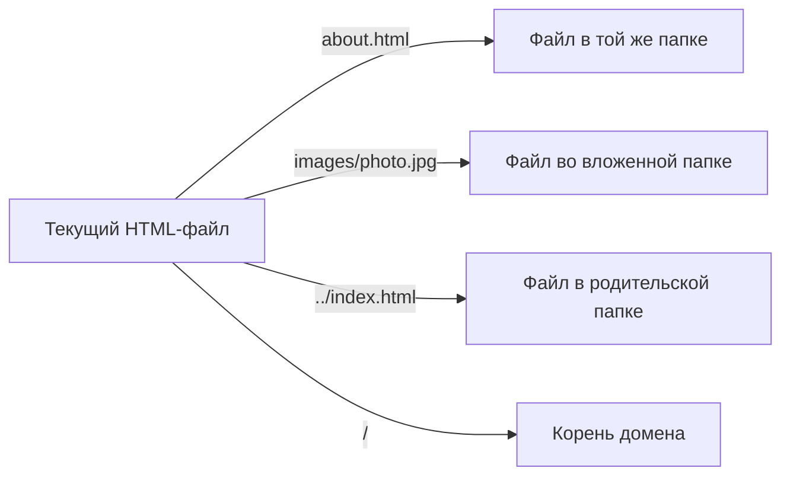
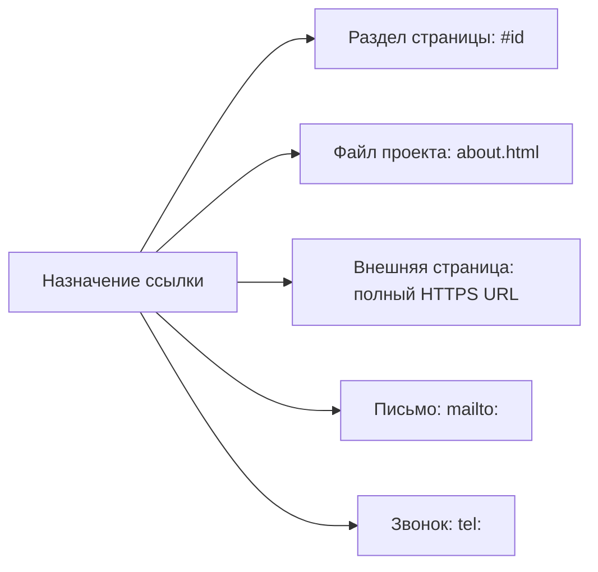

# Ссылки и навигация

[Содержание](../../README.md) · [← Назад](../../Lesson-2/ru/%D0%A2%D0%B5%D0%BA%D1%81%D1%82%20%D0%B8%20%D1%81%D0%B5%D0%BC%D0%B0%D0%BD%D1%82%D0%B8%D0%BA%D0%B0.md) · [Вперёд →](../../Lesson-4/ru/%D0%98%D0%B7%D0%BE%D0%B1%D1%80%D0%B0%D0%B6%D0%B5%D0%BD%D0%B8%D1%8F%20%D0%B8%20%D0%BC%D0%B5%D0%B4%D0%B8%D0%B0.md) · [RU](%D0%A1%D1%81%D1%8B%D0%BB%D0%BA%D0%B8%20%D0%B8%20%D0%BD%D0%B0%D0%B2%D0%B8%D0%B3%D0%B0%D1%86%D0%B8%D1%8F.md) · [EN](../en/Links%20and%20navigation.md) · [UZ](../uz/Havolalar%20va%20navigatsiya.md) · [Практика](../practice.html)

> **Связь с прошлым уроком:** в уроке 2 вы разметили страницу блоками и оставили пустой `<nav>`. Сегодня наполним его настоящими ссылками и свяжем несколько страниц в один сайт.

---

## Зачем это вам

Сайт из одной страницы - это листовка. Сайт из нескольких страниц, связанных меню, - это уже книга с оглавлением. Ссылки превращают отдельные файлы в сайт.

Сегодня вы соберёте мини-сайт из трёх страниц и сможете переходить между ними одним кликом.

---

## Чему вы научитесь

- Создавать ссылку тегом `<a>` с атрибутом `href`.
- Выбирать путь: абсолютный для чужих сайтов, относительный для своих страниц.
- Подниматься в родительскую папку через `../`.
- Делать якоря: переход к разделу страницы через `id` и `#`.
- Создавать ссылки на почту (`mailto:`) и телефон (`tel:`).
- Открывать ссылку в новой вкладке, когда это действительно нужно.
- Делать одинаковое меню на всех страницах сайта.

---

## Повторение: 3 вопроса из уроков 1–2

1. Как называется файл главной страницы сайта?
2. Какой блок предназначен для меню сайта?
3. Какой список подходит для пунктов меню, если порядок не важен?

Ответы - в конце урока.

---

## План урока

| Раздел | Что делаем |
| --- | --- |
| Тег `<a>` | Дверь и адрес |
| Пути к файлам | Полный адрес и «два дома дальше» |
| Якоря | Закладки в книге |
| Почта и телефон | `mailto:` и `tel:` |
| Новая вкладка | Когда она нужна |
| Мини-задание 1 | Три ссылки без подсказок |
| Сайт из трёх страниц | Общее меню |
| Мини-задание 2 | Содержание страницы на якорях |
| Самостоятельная работа | Задание в IDE и мини-сайт кружка |

---

## Тег `<a>` и атрибут `href`

**Простыми словами:** ссылка - это дверь. `href` - адрес, куда она ведёт. Без адреса дверь просто нарисована на стене.

```html
<a href="https://www.wikipedia.org">Википедия</a>
```

| Часть | Что значит |
| --- | --- |
| `<a>` | Ссылка (anchor - «якорь») |
| `href="..."` | Куда ведёт. Без него ссылка не работает |
| `Википедия` | Текст, на который нажимают |

**Что увидите:** синий подчёркнутый текст «Википедия». Курсор над ним превращается в руку. Клик - и открывается Википедия.

**Текст ссылки должен объяснять, куда она ведёт.** «Расписание кружка» - хорошо. «Нажмите здесь» - плохо: из текста непонятно, что за дверью.

---

## Пути к файлам

### Абсолютный путь - для чужих сайтов

Полный адрес с `https://` и доменом:

```html
<a href="https://developer.mozilla.org">MDN</a>
```

**Аналогия:** полный почтовый адрес «Узбекистан, Алмалык, ул. Амира Темура, 10». Его поймут из любой точки мира.

### Относительный путь - для своих страниц

Путь **от текущего файла**. Аналогия: «иди два дома дальше». Работает, только если вы стоите в нужном месте.

Возьмём проект:

```
my-site/
├── index.html
├── about.html
├── pages/
│   └── schedule.html
└── images/
    └── photo.jpg
```

| Откуда | Куда | `href` | Как читать |
| --- | --- | --- | --- |
| `index.html` | `about.html` | `about.html` | Рядом, в той же папке |
| `index.html` | `schedule.html` | `pages/schedule.html` | Зайти в папку `pages` |
| `pages/schedule.html` | `index.html` | `../index.html` | Выйти из `pages` на уровень выше |
| `pages/schedule.html` | `photo.jpg` | `../images/photo.jpg` | Выйти, затем зайти в `images` |

`../` - это «выйти из комнаты в коридор».



**Как читать схему.** Каждый путь отсчитывается от папки текущего файла. Без префикса - та же папка, имя папки - спуститься внутрь, `../` - подняться. Путь с `/` в начале отсчитывается от корня сайта: в курсе мы его не используем.

**Правило курса:** свои страницы - относительный путь, чужие сайты - абсолютный.

### Попробуйте сломать

1. В ссылке `href="about.html"` напишите `href="About.html"`. На вашем компьютере ссылка может сработать, а на сервере - нет: там регистр букв важен. Всегда пишите имя файла точно, лучше строчными буквами.
2. Удалите расширение: `href="about"`. Нажмите ссылку. Что показал браузер?

### Частые ошибки новичков

| Ошибка | Как исправить |
| --- | --- |
| `href="C:\Users\...\about.html"` | Путь с диска работает только на вашем компьютере. Пишите `about.html` |
| `href="about"` без расширения | Полное имя: `about.html` |
| `About.html` вместо `about.html` | Имя в ссылке - буква в букву как у файла |
| Из `pages/` ссылка `index.html` | Нужно подняться: `../index.html` |
| Пробелы в имени файла | Называйте файлы без пробелов: `my-page.html` |

---

## Якоря: переход к разделу страницы

**Простыми словами:** якорь - это закладка в книге. Сначала вкладываете закладку, потом открываете книгу сразу на ней.

**Шаг 1.** Даём разделу уникальное имя через `id`:

```html
<h2 id="schedule">Расписание</h2>
```

**Шаг 2.** Делаем ссылку с `#` перед этим именем:

```html
<a href="#schedule">Перейти к расписанию</a>
```

**Что увидите:** клик - и страница прокручивается к заголовку «Расписание».

### Содержание длинной страницы

```html
<nav>
    <h2>Содержание</h2>
    <ul>
        <li><a href="#about">О кружке</a></li>
        <li><a href="#schedule">Расписание</a></li>
    </ul>
</nav>

<section>
    <h2 id="about">О кружке</h2>
    <p>Учимся делать сайты.</p>
</section>

<section>
    <h2 id="schedule">Расписание</h2>
    <p>Каждую среду в 15:00.</p>
</section>
```

### Якорь на другой странице

Сначала файл, потом `#` и `id`:

```html
<a href="schedule.html#wednesday">Занятие в среду</a>
```

Откроется `schedule.html` сразу на разделе с `id="wednesday"`.

### Правила для `id`

- `id` **уникален** на странице: два элемента с одним `id` - ошибка.
- Без пробелов: `id="schedule-2"`, а не `id="schedule 2"`.
- В ссылке на этой странице - всегда с `#`.

### Попробуйте сломать

Удалите `#` в ссылке: `href="schedule"`. Нажмите. Браузер теперь ищет **файл** с именем `schedule` и не находит его.

---

## Почта и телефон

```html
<a href="mailto:club@example.com">club@example.com</a>
<a href="tel:+998901112233">+998 90 111-22-33</a>
```

| Ссылка | Что происходит при клике |
| --- | --- |
| `mailto:` | Открывается почтовая программа, адрес уже вписан |
| `tel:` | Телефон предлагает позвонить |

**Правило для `tel:`:** в `href` номер пишется слитно, с `+` и кодом страны. В видимом тексте - как удобно читать.

Если на компьютере не настроена почтовая программа, клик по `mailto:` может ничего не открыть. Это не ошибка вашего HTML.

### Частые ошибки новичков

| Ошибка | Как исправить |
| --- | --- |
| `href="club@example.com"` | Нужен префикс: `mailto:club@example.com` |
| `href="tel:+998 90 111 22 33"` | Без пробелов: `tel:+998901112233` |
| Настоящие личные данные в учебном проекте | Используйте вымышленные: `example.com` |

---

## Новая вкладка: `target="_blank"`

По умолчанию ссылка открывается **в той же вкладке**. Это правильное поведение: пользователь сам решает, где открыть ссылку (кнопка «Назад», средняя кнопка мыши).

Иногда новая вкладка действительно помогает, например справка, которая не должна прерывать заполнение формы. Тогда:

```html
<a href="https://developer.mozilla.org" target="_blank" rel="noopener noreferrer">MDN (откроется в новой вкладке)</a>
```

| Атрибут | Что делает |
| --- | --- |
| `target="_blank"` | Открыть в новой вкладке |
| `rel="noopener"` | Новая вкладка не получит доступа к вашей странице |
| `rel="noreferrer"` | Не сообщать сайту, откуда пришёл пользователь |

**Правило курса:** если используете `_blank`, всегда добавляйте `rel="noopener noreferrer"` и предупреждайте в тексте ссылки: «(новая вкладка)».

### Какой `href` выбрать



**Как читать схему.** Сначала решите, куда должен попасть пользователь, затем выберите `href`. Ссылка на другую страницу может ещё и вести к её разделу: `about.html#history`.

---

## Мини-задание 1

Без подглядывания создайте три ссылки:

1. На файл `contact.html` в той же папке.
2. На `https://developer.mozilla.org` в новой вкладке, с защитой и предупреждением.
3. На звонок по номеру +998 90 111-22-33.

Решение - в разделе «Ответы».

---

## Сайт из трёх страниц

Соберём сайт кружка:

```
club-site/
├── index.html
├── schedule.html
└── contacts.html
```

**Главное правило:** на **каждой** странице одинаковое меню.

```html
<nav>
    <ul>
        <li><a href="index.html">Главная</a></li>
        <li><a href="schedule.html">Расписание</a></li>
        <li><a href="contacts.html">Контакты</a></li>
    </ul>
</nav>
```

**Файл `index.html`:**

```html
<!DOCTYPE html>
<html lang="ru">
<head>
    <meta charset="UTF-8">
    <title>Главная - Кружок веб-разработки</title>
</head>
<body>
    <header>
        <p>Кружок веб-разработки</p>
        <nav>
            <ul>
                <li><a href="index.html">Главная</a></li>
                <li><a href="schedule.html">Расписание</a></li>
                <li><a href="contacts.html">Контакты</a></li>
            </ul>
        </nav>
    </header>
    <main>
        <h1>Добро пожаловать в кружок</h1>
        <p>Учимся делать сайты с нуля. Ближайшее занятие смотрите в <a href="schedule.html">расписании</a>.</p>
    </main>
    <footer>
        <p><small>&copy; 2026 Кружок веб-разработки</small></p>
    </footer>
</body>
</html>
```

Страницы `schedule.html` и `contacts.html` устроены так же: тот же `header` с тем же меню, свой `title`, свой `h1` и своё содержимое. Расписание оформите списком, контакты - ссылками `mailto:` и `tel:`.

**Что увидите:** три страницы с одинаковым меню вверху. Нажимайте пункты меню - страницы сменяют друг друга.

**Как проверить сайт:** с **каждой** страницы нажмите **каждый** пункт меню. 3 страницы × 3 ссылки = 9 переходов. Все 9 должны работать.

---

## Мини-задание 2

На странице `index.html` добавьте содержание из двух пунктов, которое ведёт к разделам «О кружке» и «Как вступить» на этой же странице. Решение - в разделе «Ответы».

---

## Итоги урока: шпаргалка

| Задача | Запись |
| --- | --- |
| Ссылка | `<a href="адрес">Понятный текст</a>` |
| Чужой сайт | `href="https://site.uz"` |
| Своя страница рядом | `href="about.html"` |
| Страница во вложенной папке | `href="pages/schedule.html"` |
| Страница уровнем выше | `href="../index.html"` |
| Раздел на этой странице | `id="about"` + `href="#about"` |
| Раздел другой страницы | `href="schedule.html#wednesday"` |
| Почта / телефон | `href="mailto:..."` / `href="tel:+998..."` |
| Новая вкладка | `target="_blank" rel="noopener noreferrer"` + предупреждение |

---

## Самостоятельная работа

### Часть 1. Задание в IDE (засчитывается платформой)

Сделайте **главную страницу кружка** `index.html`:

1. Полный документ: DOCTYPE, `lang`, UTF-8, `title`.
2. `<header>` с меню `<nav>` из трёх ссылок: `index.html`, `schedule.html`, `contacts.html`.
3. Один `<h1>` в `<main>`.
4. Содержание из двух ссылок-якорей: `#about` и `#join`.
5. Два раздела с заголовками `<h2 id="about">` и `<h2 id="join">`.
6. В разделе «Как вступить»:
   - ссылка на почту (`mailto:`);
   - ссылка на телефон (`tel:` слитно, с `+`);
   - внешняя ссылка на любой сайт с `https://` в новой вкладке, с `rel="noopener noreferrer"`.

Таблицы и картинки не используйте.

Что проверяет платформа: скелет документа, `nav`, все пять адресов ссылок, оба `id`, `mailto:`, `tel:+` без пробелов, внешнюю ссылку `https://` с `target="_blank"` и `rel="noopener`, один `h1`, минимум два `h2`, отсутствие путей с диска.

### Часть 2. Проект на компьютере

1. Создайте папку `club-site` и три страницы: `index.html`, `schedule.html`, `contacts.html`.
2. На каждой странице одинаковое меню, свой `title` и свой `h1`.
3. Расписание - списком. На странице контактов - `mailto:` и `tel:`.
4. С `schedule.html` сделайте ссылку на раздел `#join` главной страницы.
5. Проверьте все 9 переходов меню и все якоря. Запишите найденные ошибки и исправления.

### Критерии готовности

- [ ] Задание в IDE засчитано.
- [ ] Все 9 переходов меню ведут на нужные страницы.
- [ ] Имена файлов в `href` совпадают с файлами буква в букву.
- [ ] Нет путей вида `C:\Users\...`.
- [ ] Все `id` уникальны, якоря ведут к нужным разделам.
- [ ] Текст каждой ссылки объясняет, куда она ведёт.
- [ ] `mailto:` и `tel:` записаны правильно, данные вымышленные.

---

## Вопросы для самопроверки

1. Что будет со ссылкой без `href`?
2. Когда нужен абсолютный путь, а когда относительный?
3. Что означает `../` в пути?
4. Почему ссылка с `C:\Users\...` не сработает на сайте?
5. Чем ссылка `href="#about"` отличается от `href="about.html"`?
6. Почему два элемента не могут иметь одинаковый `id`?
7. Как сослаться на раздел `#join` страницы `index.html` из другой страницы?
8. Как правильно записать номер телефона в `tel:`?
9. Зачем `rel="noopener noreferrer"` рядом с `target="_blank"`?
10. Почему «Нажмите здесь» - плохой текст ссылки?

После вопросов пройдите **тест урока** на платформе: 12 вопросов, порог 70%.

---

## Что дальше

Сайт уже ходит по страницам, но в нём только текст. В уроке 4 добавим изображения с подписями, аудио и видео, а также иконку сайта на вкладке.

---

## Ответы

**Повторение**

1. `index.html`.
2. `<nav>`.
3. `<ul>`.

**Мини-задание 1**

```html
<a href="contact.html">Контакты</a>
<a href="https://developer.mozilla.org" target="_blank" rel="noopener noreferrer">MDN (откроется в новой вкладке)</a>
<a href="tel:+998901112233">+998 90 111-22-33</a>
```

**Мини-задание 2**

```html
<nav>
    <h2>Содержание</h2>
    <ul>
        <li><a href="#about">О кружке</a></li>
        <li><a href="#join">Как вступить</a></li>
    </ul>
</nav>

<section>
    <h2 id="about">О кружке</h2>
    <p>Учимся делать сайты с нуля.</p>
</section>

<section>
    <h2 id="join">Как вступить</h2>
    <p>Напишите нам на почту.</p>
</section>
```

**Вопросы для самопроверки**

1. Она не будет работать как ссылка: это просто текст.
2. Абсолютный - для чужих сайтов, относительный - для страниц своего проекта.
3. Подняться на одну папку выше.
4. На сервере нет вашего диска `C:` и вашей папки.
5. `#about` - раздел на этой же странице, `about.html` - другой файл.
6. Браузер не поймёт, к какому из них переходить. `id` - уникальное имя.
7. `href="index.html#join"`.
8. Слитно, с `+` и кодом страны: `tel:+998901112233`.
9. Чтобы новая вкладка не получила доступ к вашей странице и не узнала, откуда пришёл пользователь.
10. Из текста не понятно, куда ведёт ссылка. Скринридер часто читает список ссылок отдельно от текста.

---

[Содержание](../../README.md) · [← Назад](../../Lesson-2/ru/%D0%A2%D0%B5%D0%BA%D1%81%D1%82%20%D0%B8%20%D1%81%D0%B5%D0%BC%D0%B0%D0%BD%D1%82%D0%B8%D0%BA%D0%B0.md) · [Вперёд →](../../Lesson-4/ru/%D0%98%D0%B7%D0%BE%D0%B1%D1%80%D0%B0%D0%B6%D0%B5%D0%BD%D0%B8%D1%8F%20%D0%B8%20%D0%BC%D0%B5%D0%B4%D0%B8%D0%B0.md) · [RU](%D0%A1%D1%81%D1%8B%D0%BB%D0%BA%D0%B8%20%D0%B8%20%D0%BD%D0%B0%D0%B2%D0%B8%D0%B3%D0%B0%D1%86%D0%B8%D1%8F.md) · [EN](../en/Links%20and%20navigation.md) · [UZ](../uz/Havolalar%20va%20navigatsiya.md) · [Практика](../practice.html)
