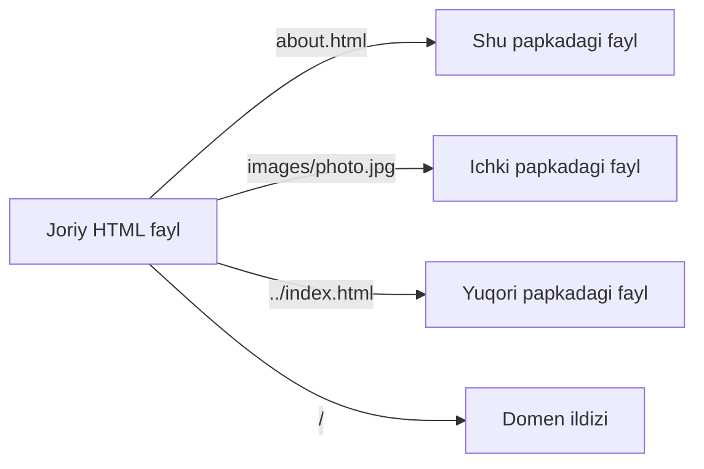
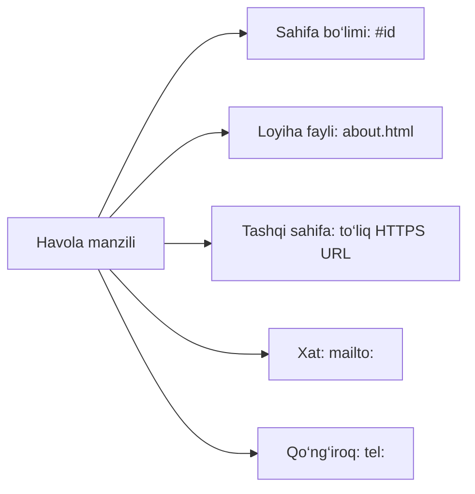

# Havolalar va navigatsiya

[Mundarija](../../README.md) · [← Orqaga](../../Lesson-2/uz/Matn%20va%20semantika.md) · [Keyingi →](../../Lesson-4/uz/Rasmlar%20va%20media.md) · [RU](../ru/%D0%A1%D1%81%D1%8B%D0%BB%D0%BA%D0%B8%20%D0%B8%20%D0%BD%D0%B0%D0%B2%D0%B8%D0%B3%D0%B0%D1%86%D0%B8%D1%8F.md) · [EN](../en/Links%20and%20navigation.md) · [UZ](Havolalar%20va%20navigatsiya.md) · [Amaliyot](../practice.html)


> **Oldingi dars bilan bog'lanish:** o'tgan darsda biz matnni tizimlashtirishni o'rgandik va `<nav>` tegini namuna havolalar `href="#"` bilan ishlatdik. Bugun havolalar qanday haqiqatan ishlashini tushunamiz - va bir nechta HTML-sahifalarni bitta saytga bog'laymiz.

---

## Dars oxirida nimani o'rganasiz

- `<a>` tegi va `href` atributi bilan havolalar yaratish.
- Absolyut va nisbiy yo'llarni farqlash va qaysi holatda qaysini ishlatishni bilish.
- `target="_blank"` orqali havolalarni yangi yorliqda ochish.
- Bo‘limga havolalarni yaratish - sahifaning ma'lum joyiga o'tish.
- Email va telefon uchun havolalar yaratish (`mailto:`, `tel:`).
- Bir nechta HTML-sahifalardan uzluksiz navigatsiyali sayt yig'ish.

---

## Dars rejasi

| Bo‘lim                                       | Mazmun                                        |
| ------------------------------------------ | --------------------------------------------- |
| a tegi va href atributi                 | Havolaning asosiy sintaksisi                  |
| Absolyut va nisbiy yo'llar              | Farq, qachon qaysini ishlatish, papka tuzilishi |
| target="_blank"                         | Yangi yorliqda ochish, xavfsizlik             |
| Bo‘limga havolalar                          | Sahifaning bir qismiga o'tish, id             |
| mailto va tel                            | Email va telefon uchun havolalar               |
| Mini-vazifa                              | Havolani mustaqil yaratish                    |
| Ko'p sahifali sayt                       | Uzluksiz menyu bilan 3 sahifani yig'amiz      |
| Xulosalar va amaliy vazifa               | Mustahkamlash                                 |

---

## `<a>` tegi va `href` atributi

**Oddiy qilib aytganda:** tasavvur qiling, kitobda "batafsil bu haqida 42-sahifada o'qing" deb yozilgan. HTML'dagi havola - bu xuddi shu narsa, faqat "42-sahifa" o'rniga boshqa veb-sahifaning manzilini (yoki shu sahifaning boshqa joyini) ko'rsatasiz va o'tish bitta bosish bilan amalga oshadi.

`<a>` tegi (anchor - "yakor") - juft teg bo'lib, matnni (yoki rasmini - bu 4-darsda) o'rab, uni bosiladigan havolaga aylantiradi.

```html
<a href="https://www.google.com">Google ga o'tish</a>
```

Bu yerda:

- `<a>` - havola tegi
- `href` (hypertext reference) - havola qayerga borishini ko'rsatadigan atribut - **majburiy** atribut, usiz `<a>` havola sifatida ishlamaydi
- `Google ga o'tish` - foydalanuvchi bosadigan ko'rinadigan havola matni

**Taqqoslash:** `<a>` - bu eshik, `href` esa manzil, bu eshik qayerga borishini ko'rsatadi. Manzilsiz eshik shunchaki devorga chizilgan va hech qayerga ochilmaydi.

---

## Absolyut va nisbiy yo'llar

Bu darsning asosiy mavzusi - ko'pchilik yangi boshlovchilar aynan shu yerda adashadi.

### Absolyut yo'l

**Absolyut yo'l** - bu to'liq manzil, protokol (`https://`) va domen bilan birga. **Tashqi** saytlarga havolalar uchun ishlatiladi - ya'ni shaxsiy loyihangizning sahifalariga emas.

```html
<a href="https://www.wikipedia.org">Vikipediya</a>
<a href="https://github.com/Saydullayev017">Mening GitHub</a>
```

**Taqqoslash:** absolyut yo'l - bu shahar va mamlakat bilan to'liq pochta manzili: "O'zbekiston, Toshkent shahri, Amir Temur ko'chasi, 10-uy". U dunyoning istalgan nuqtasidan aniq tushunarli.

### Nisbiy yo'l

**Nisbiy yo'l** - bu **joriy faylga nisbatan** ko'rsatilgan manzil. Bitta loyiha ichidagi **o'z** sahifalaringizga havolalar uchun ishlatiladi.

**Taqqoslash:** nisbiy yo'l - bu qo'shniga "ikkita uy nariga boring" deb aytishga o'xshaydi - bu faqat boshlang'ich nuqtada turgan bo'lsangiz tushunarli. Agar boshqa shaharda bo'lsangiz, bu ko'rsatma ma'nosini yo'qotadi - lekin to'liq manzil istalgan joydan ishlaydi.

Loyiha tuzilishi misolida tushunamiz:

```
html-course/
├── index.html
├── about.html
├── contact.html
└── images/
    └── photo.jpg
```

**Bitta papkadagi faylga havola:**

```html
<a href="about.html">Sayt haqida</a>
```

Faylning oddiy nomi - brauzer uni joriy fayl yonida qidiradi.

**Ichki papkadagi faylga havola:**

```html
<a href="images/photo.jpg">Rasmini ko'rish</a>
```

**Yuqoridagi papkadagi faylga havola** (agar siz masalan `images/` ichida bo'lsangiz va `index.html` ga havola qo'ymoqchi bo'lsangiz):

```html
<a href="../index.html">Bosh sahifaga</a>
```

`../` "bir daraja yuqoriga ko'tarilish" degan ma'noni anglatadi - xonadan koridorga chiqishdek.

**Saytning o'z papkasiga/bosh sahifasiga havola:**

```html
<a href="/">Bosh sahifaga</a>
```

Boshidagi slesh "sayt ildizi" degan ma'noni anglatadi - agar sizda masalan `mysite.uz` sayti bo'lsa, `/` havolasi `mysite.uz` ga olib boradi, yonidagi faylga emas.



**Chizmani qanday o‘qish kerak:** Joriy fayldan chiquvchi o‘q yozilgan yo‘l qayerga olib borishini ko‘rsatadi. ../ bir papka yuqoriga, boshidagi / esa sayt manzilining ildiziga olib boradi; ular bir xil manzil emas.

### Qachon qaysini ishlatish

|Holat|Qaysi yo'l|
|---|---|
|O'z loyihangizdagi boshqa sahifaga havola|Nisbiy|
|Tashqi saytga havola (ijtimoiy tarmoq, Vikipediya, boshqa sayt)|Absolyut|
|Loyihangizdagi rasmga havola|Nisbiy|

**Amaliy tanlov:** o'z sahifangizga absolyut URL yozish mumkin, lekin lokal ishlashda u nashr qilingan domenga olib boradi. Nisbiy yo'llar lokal fayllarni tekshirish va loyihani birga ko'chirishga yordam beradi. `/about.html` domen ildizidan boshlanadi; sayt ichki papkada bo'lsa, kutilmagan joyga olib borishi mumkin.



**Chizmani qanday o‘qish kerak:** Avval havolaning vazifasini tanlang: bo‘lim, loyiha fayli, tashqi sahifa, xat yoki qo‘ng‘iroq. Shunga mos ravishda href boshida #, fayl yo‘li, https:, mailto: yoki tel: yoziladi.

---

### Yangi boshlovchilarning ko'p uchraydigan xatolari

| Xato                                                                                  | Qanday tuzatish                                                                                                            |
| ------------------------------------------------------------------------------------- | -------------------------------------------------------------------------------------------------------------------------- |
| Lokal sahifani tekshirganda kutilmaganda nashr qilingan saytga o'tish: `href="https://mysite.ru/about.html"` | Loyiha ichidagi sahifalar uchun nisbiy yo'ldan foydalaning: `href="about.html"`                                              |
| `/about.html` (sayt ildizidan) va `about.html` (joriy papkadani) ni aralashtirish       | Eslab qoling: boshidagi slesh "sayt ildizidan" degan ma'noni anglatadi, sleshsiz - "joriy fayldan"                           |
| Havolada `.html` kengaytmasini unutish: `href="about"`                                | To'liq fayl nomini kengaytma bilan ko'rsating: `href="about.html"`                                                         |
| Fayl nomidagi registrni noto'g'ri yozish: `href="About.html"` o'rniga `about.html`     | Ko'pchilik serverlarda (ayniqsa Linux/GitHub Pages) registr muhim - havola nomi fayl nomi bilan aniq mos kelishi kerak       |

---

## `target="_blank"` - yangi yorliqda ochish

Standart ravishda havola bir xil oynada/yorliqda ochiladi, joriy sahifani almashtiradi. Agar sahifa **yangi** yorliqda ochilishini xohlasangiz (masalan, tashqi saytga o'tishda, foydalanuvchi sizning saytingizni yo'qotmasligi uchun) - `target="_blank"` atributini ishlating.

```html
<a href="https://github.com/Saydullayev017" target="_blank">Mening GitHub</a>
```

**`rel` nima qiladi:** `noopener` yangi yorliqning asl sahifaga `window.opener` orqali kirishini cheklaydi. Zamonaviy brauzerlar `_blank` uchun buni allaqachon nazarda tutadi; aniq yozish maqsadni tushunarli qiladi. `noreferrer` qo'shimcha ravishda manba sahifa manzilini yubormaydi. Kurs misollarida ikkala qiymat ham bor; ularning vazifalari farq qiladi.

```html
<a href="https://github.com/Saydullayev017" target="_blank" rel="noopener noreferrer">Mening GitHub</a>
```

**Tavsiya:** odatda shu yorliqda qoling. Yangi yorliq vazifaga foydali bo'lsa `_blank` ishlating va havola matnida ayting: “MDN (yangi yorliq)”. HTML ichki havolalar uchun ham `_blank` ga ruxsat beradi; tashqi havolaga yangi yorliq doimo kerak emas.

---

## Bo‘limga havolalar - sahifaning bir qismiga o'tish

Ba'zan boshqa sahifaga emas, balki shu (yoki boshqa) sahifaning ma'lum **joyiga** o'tish kerak - masalan, uzun maqolaning aniq bo'limiga.

Bu ikki qadamda amalga oshiriladi.

**1-qadam.** O'tmoqchi bo'lgan elementga `id` atributi orqali noyob identifikator berish:

```html
<h2 id="section2">2-bo'im. Shakllar</h2>
```

**2-qadam.** Shu `id` ga havola yaratish, nomdan oldin `#` belgisini qo'yish:

```html
<a href="#section2">2-bo'imga o'tish</a>
```

Bosganingizda brauzer silliq (yoki darhol, sozlamalarga qarab) sahifani `id="section2"` ga ega elementga buradi.

### Misol: uzun maqolaning mundarijasi

```html
<nav>
    <h2>Mundarija</h2>
    <ul>
        <li><a href="#intro">Kirish</a></li>
        <li><a href="#history">Tarix</a></li>
        <li><a href="#conclusion">Xulosa</a></li>
    </ul>
</nav>

<article>
    <h2 id="intro">Kirish</h2>
    <p>Kirish matni...</p>

    <h2 id="history">Tarix</h2>
    <p>Tarix haqida matn...</p>

    <h2 id="conclusion">Xulosa</h2>
    <p>Xulosa matni...</p>
</article>
```

### Boshqa sahifaning bo'limiga bo‘limga havola

Xuddi shu tamoyil, faqat avval fayl ko'rsatiladi, keyin `#` va `id`:

```html
<a href="about.html#history">Kompaniya tarixi</a>
```

Bu `about.html` faylini ochadi va darhol `id="history"` ga ega elementga buradi.

### Sahifaning yuqorisiga qaytish

Ko'p ishlatiladigan usul - uzun sahifaning oxiridagi "yuqoriga" havola:

```html
<a href="#top">Yuqoriga ↑</a>
```

(Sahifaning boshida biror joyda `id="top"` ga ega element bor shartida, masalan `<body id="top">` yoki birinchi sarlavha.)

**`id` haqida muhim qoida:** `id` qiymati butun sahifada **noyob** bo'lishi kerak - bir xil `id` ga ega ikki element bo'lishi mumkin emas. Bu `id` ni `class` dan ajratadi (`class` haqida CSS darsidan batafsil gaplashamiz).

---

### Yangi boshlovchilarning ko'p uchraydigan xatolari

|Xato|Qanday tuzatish|
|---|---|
|Havolada nomdan oldin `#` belgisini unutish: `href="section2"`|Shu sahadagi bo‘limga havolada har doim `href="#section2"` deb yozing|
|Bir nechta element uchun bir xil `id` ishlatish|Sahifadagi har bir `id` noyob bo'lishi kerak|
|`id` qiymatida bo'sh joy ishlatish: `id="section 2"`|`id` qiymati bo'sh joysiz yoziladi, odatda `camelCase` yoki defis bilan: `id="section2"` yoki `id="section-2"`|
|`id` (noyob, bitta element uchun) va `class` (elementlar guruhi uchun, keyinroq tahlil qilamiz) ni aralashtirish|Bo‘limga havolalar uchun aynan `id` ishlatiladi, `class` emas|

---

## Email va telefon uchun havolalar

### `mailto:` - pochta dasturini to'ldirilgan manzil bilan ochish

```html
<a href="mailto:info@saydullayev.fun">Bizga xat yozish</a>
```

Bosganingizda brauzer qurilmaga o'rnatilgan pochta ilovasini (masalan, Outlook, Gmail) oldindan to'ldirilgan "Kimga" maydoni bilan ochadi.

Xat mavzusini darhol belgilash mumkin:

```html
<a href="mailto:info@saydullayev.fun?subject=Kurs haqida savol">Bizga xat yozish</a>
```

### `tel:` - qo'ng'iroq ilovasini ochish

```html
<a href="tel:+998901234567">+998 90 123-45-67</a>
```

Ayniqsa mobil qurilmalarda foydali - bosganingizda telefon darhol shu raqamga qo'ng'iroq qilishni taklif qiladi. Raqamni xalqaro formatda (va `+` va mamlakat kodi bilan) ko'rsatish tavsiya etiladi, `href` atributi ichida bo'sh joy va qavslarsiz - ko'rinadigan matnda esa istalgandek formatlash mumkin.

---

### Yangi boshlovchilarning ko'p uchraydigan xatolari

| Xato                                                                              | Qanday tuzatish                                                                                                    |
| --------------------------------------------------------------------------------- | ----------------------------------------------------------------------------------------------------------------- |
| Manzildan oldin `mailto:` va `tel:` ni unutish: `href="info@site.uz"`             | Har doim protokolni ko'rsating: `href="mailto:info@site.uz"`                                                      |
| `href` ichida bo'sh joy bilan telefon raqamini ko'rsatish: `href="tel:+998 90 123 45 67"` | Atribut ichida raqamni yig'ish shaklida yozing: `href="tel:+998901234567"` - formatlashni faqat ko'rinadigan matnda bajaring |

---

## Mini-vazifa

Mustaqil ravishda, misollarga qaramasdan yarating:

1. Bitta papkadagi `contact.html` fayliga havola.
2. `https://developer.mozilla.org` tashqi saytiga havola, yangi yorliqda ochilishi va xavfsizlik himoyasi bilan.
3. +998901112233 raqamiga qo'ng'iroq havolasi.

**Yechim:**

```html
<a href="contact.html">Aloqa</a>

<a href="https://developer.mozilla.org" target="_blank" rel="noopener noreferrer">MDN</a>

<a href="tel:+998901112233">+998 90 111-22-33</a>
```

---

## Uzluksiz navigatsiyali ko'p sahifali saytni yig'amiz

Endi barcha havola teglarini ular mavjud bo'lgan narsa uchun qo'llaymiz - bir nechta sahifani bitta saytga bog'laymiz. Uchta sahifa yaratamiz: `index.html`, `about.html`, `contact.html` - har birida bir xil navigatsiya menyusi.

Papka tuzilishi:

```
html-course/
├── index.html
├── about.html
└── contact.html
```

**`index.html` fayli:**

```html
<!DOCTYPE html>
<html lang="uz">
<head>
    <meta charset="UTF-8">
    <title>Bosh sahifa - Mening saytim</title>
</head>
<body>
    <header>
        <h1>Mening o'quv saytim</h1>
        <nav>
            <ul>
                <li><a href="index.html">Bosh sahifa</a></li>
                <li><a href="about.html">Sayt haqida</a></li>
                <li><a href="contact.html">Aloqa</a></li>
            </ul>
        </nav>
    </header>

    <main>
        <h2>Xush kelibsiz!</h2>
        <p>Bu mening o'quv loyihamning bosh sahifasi, men uni «HTML: 10 darsda» kursida yaratyapman.</p>
        <p>Ko'proq bilmoqchimisiz? <a href="about.html">«Sayt haqida»</a> bo'limiga o'ting.</p>
    </main>

    <footer>
        <p><small>&copy; 2026 Mening o'quv saytim.</small></p>
    </footer>
</body>
</html>
```

**`about.html` fayli:**

```html
<!DOCTYPE html>
<html lang="uz">
<head>
    <meta charset="UTF-8">
    <title>Sayt haqida - Mening saytim</title>
</head>
<body>
    <header>
        <h1>Mening o'quv saytim</h1>
        <nav>
            <ul>
                <li><a href="index.html">Bosh sahifa</a></li>
                <li><a href="about.html">Sayt haqida</a></li>
                <li><a href="contact.html">Aloqa</a></li>
            </ul>
        </nav>
    </header>

    <main>
        <h2>Sayt haqida</h2>
        <p>Bu saytni men HTML kursi doirasida amaliyotda barcha o'rganilgan mavzularni mustahkamlash uchun yaratyapman.</p>
        <p>Loyihaning manba kodini <a href="https://github.com" target="_blank" rel="noopener noreferrer">GitHub</a> da ko'rishingiz mumkin.</p>
    </main>

    <footer>
        <p><small>&copy; 2026 Mening o'quv saytim.</small></p>
    </footer>
</body>
</html>
```

**`contact.html` fayli:**

```html
<!DOCTYPE html>
<html lang="uz">
<head>
    <meta charset="UTF-8">
    <title>Aloqa - Mening saytim</title>
</head>
<body>
    <header>
        <h1>Mening o'quv saytim</h1>
        <nav>
            <ul>
                <li><a href="index.html">Bosh sahifa</a></li>
                <li><a href="about.html">Sayt haqida</a></li>
                <li><a href="contact.html">Aloqa</a></li>
            </ul>
        </nav>
    </header>

    <main>
        <h2>Aloqa</h2>
        <p>Menga qulay usulda bog'laning:</p>
        <ul>
            <li>Email: <a href="mailto:info@saydullayev.fun">info@saydullayev.fun</a></li>
            <li>Telefon: <a href="tel:+998901234567">+998 90 123-45-67</a></li>
        </ul>
    </main>

    <footer>
        <p><small>&copy; 2026 Mening o'quv saytim.</small></p>
    </footer>
</body>
</html>
```

**O'zingiz sinab ko'ring:** uchta faylni yarating, `index.html` ni Live Server orqali oching va menyudagi barcha havolalarni bosing - o'tishlar uchta sahifa orasida ikki tomonlama ishlashiga ishonch hosil qiling.

E'tibor bering: `<nav>` menyusi uchta sahifada **so'zma-so'z bir xil** - bu standart amaliyot (kelajakda ilg'or texnologiyalarni o'rganganingizda, takrorlanadigan bloklarni bitta faylga chiqarish mumkin bo'ladi, lekin toza HTML darajasida hozircha shu blokni har sahifaga nusxalaymiz).

---

## Dars xulosalari

Bugun siz quyidagilarni o'rgandingiz:

- `<a>` da `href` bo'lsa, u giperhavola yaratadi; `href` bo'lmasa, faol havola emas.
- Absolyut yo'l (`https://` bilan) - tashqi saytlar uchun, nisbiy yo'l - loyiha ichidagi sahifalar uchun.
- `_blank` yangi ko'rish kontekstini, odatda yorliqni ochadi. Uni asosli qo'llang va foydalanuvchini ogohlantiring; `noopener` va `noreferrer` vazifalari farq qiladi.
- Bo‘limga havolalar (`href="#id"`) maqsad elementining `id`si orqali sahifaning ma'lum joyiga o'tkazadi.
- `mailto:` va `tel:` tez xat yuborish yoki qo'ng'iroq qilish uchun havolalar yaratadi.
- Siz birinchi navigatsiya menyusiga ega ko'p sahifali saytingizni yig'diz.

---

## Mustaqil ish: to'garak mini-sayti

Alohida papkada o'quv yoki havaskorlik to'garagi saytini yarating. Quyidagi talablar asosida o'z matningiz va tuzilmangizni tayyorlang; yuqoridagi misoldan faqat ma'lumot uchun foydalaning. Faqat 1–3-dars materialini ishlating: rasm, CSS, jadval va shakllarsiz.

1. `index.html`, `schedule.html` va `contacts.html` yarating. Har birida bir xil uch havolali menyu bo'lsin.
2. Sahifalarga turli `title` va asosiy sarlavhalar bering. Jadval o'rniga dars vaqtlarini ro'yxat qilib yozing.
3. Bosh sahifada ikkita bo'lim va bo‘limga havolali mundarija yarating. Boshqa sahifadan ham shu bo'limlardan biriga havola bering.
4. Tashqi ma'lumot havolasini, aloqa sahifasida esa o'quv ma'lumotlari bilan `mailto:` va `tel:` havolalarini qo'shing. Yangi yorliqni faqat asosli bo'lsa tanlang va bu haqda matnda ayting.
5. Har bir sahifadan menyuning barcha bandlarini va har bir ankorni tekshiring. Xatolar va tuzatishlarni yozib boring.

### Tayyorlik mezonlari

- [ ] Menyudagi barcha to'qqiz o'tish (har bir sahifada uchtadan) kerakli faylga olib boradi.
- [ ] Fayl nomi, kengaytmasi va registri `href` ga mos; `C:\Users\...` kabi yo'llar yo'q.
- [ ] Har bir sahifada `id` lar takrorlanmaydi; ankorlar kerakli bo'limga olib boradi.
- [ ] Havola manzili matndan tushunarli; yangi yorliq ochilishi oldindan aytilgan.
- [ ] `mailto:` va `tel:` to'g'ri sxemada yozilgan; mos dastur sozlanmaganligi HTML xatosi emas.

### O'zingizni tekshiring

1. `about.html`, `../about.html` va `/about.html` nimasi bilan farq qiladi?
2. Bo‘limga havoladan `#` olib tashlansa nima bo'ladi?
3. Nega tashqi havolaga har doim `_blank` kerak emas?

Biror o'tish ishlamasa, tuzating va o'sha boshlang'ich sahifadan qayta tekshiring. Barcha mezonlar bajarilgach, davom eting.

---

[Mundarija](../../README.md) · [← Orqaga](../../Lesson-2/uz/Matn%20va%20semantika.md) · [Keyingi →](../../Lesson-4/uz/Rasmlar%20va%20media.md) · [RU](../ru/%D0%A1%D1%81%D1%8B%D0%BB%D0%BA%D0%B8%20%D0%B8%20%D0%BD%D0%B0%D0%B2%D0%B8%D0%B3%D0%B0%D1%86%D0%B8%D1%8F.md) · [EN](../en/Links%20and%20navigation.md) · [UZ](Havolalar%20va%20navigatsiya.md) · [Amaliyot](../practice.html)
