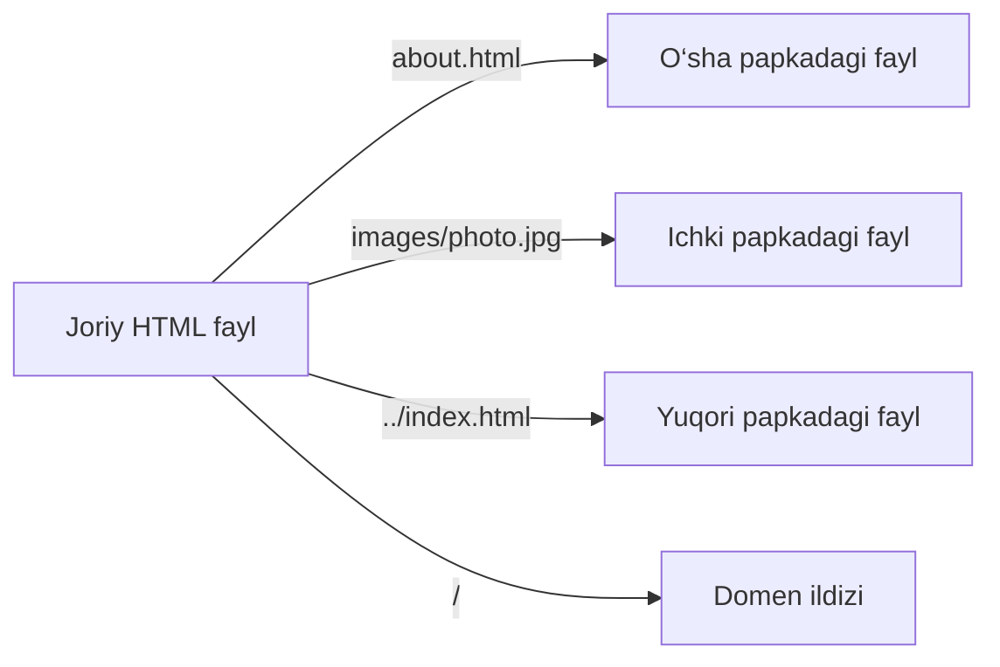
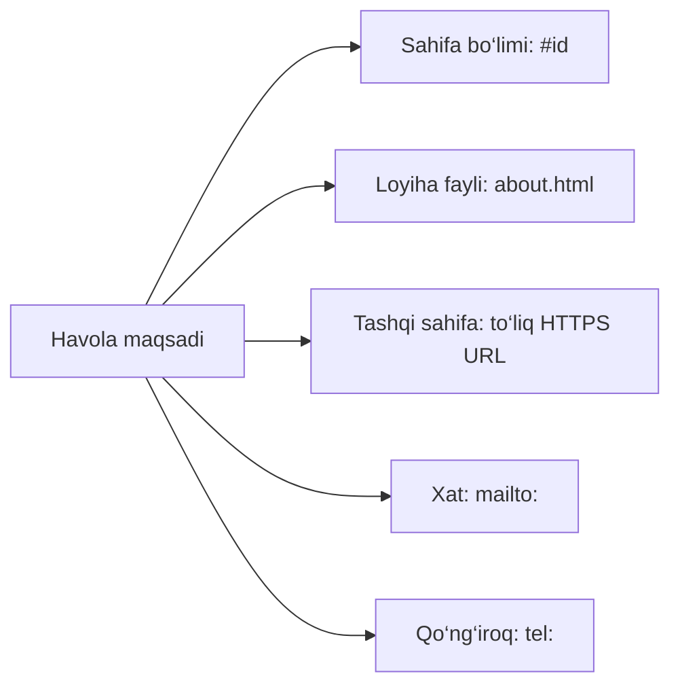

# Havolalar va navigatsiya

[Mundarija](../../README.md) · [← Orqaga](../../Lesson-2/uz/Matn%20va%20semantika.md) · [Keyingi →](../../Lesson-4/uz/Rasmlar%20va%20media.md) · [RU](../ru/%D0%A1%D1%81%D1%8B%D0%BB%D0%BA%D0%B8%20%D0%B8%20%D0%BD%D0%B0%D0%B2%D0%B8%D0%B3%D0%B0%D1%86%D0%B8%D1%8F.md) · [EN](../en/Links%20and%20navigation.md) · [UZ](Havolalar%20va%20navigatsiya.md) · [Amaliyot](../practice.html)

> **Oldingi dars bilan bog‘liqlik:** 2-darsda sahifani bloklarga ajratdingiz va `<nav>` ni bo‘sh qoldirdingiz. Bugun uni haqiqiy havolalar bilan to‘ldiramiz va bir nechta sahifani bitta saytga bog‘laymiz.

---

## Bu sizga nima uchun kerak

Bitta sahifali sayt - bu varaqa. Menyu bilan bog‘langan bir nechta sahifali sayt esa mundarijali kitob. Havolalar alohida fayllarni saytga aylantiradi.

Bugun uch sahifali mini-sayt yig‘asiz va ular orasida bitta bosish bilan o‘tasiz.

---

## Nimani o‘rganasiz

- `href` atributli `<a>` tegi bilan havola yaratish.
- Yo‘lni tanlash: boshqa saytlar uchun mutlaq, o‘z sahifalaringiz uchun nisbiy.
- `../` orqali yuqori papkaga chiqish.
- Langarlar: `id` va `#` orqali sahifa bo‘limiga o‘tish.
- Pochta (`mailto:`) va telefon (`tel:`) havolalari.
- Havolani haqiqatan kerak bo‘lganda yangi yorliqda ochish.
- Saytning barcha sahifalarida bir xil menyu.

---

## Takrorlash: 1–2-darslardan 3 savol

1. Sayt bosh sahifasi fayli qanday nomlanadi?
2. Sayt menyusi uchun qaysi blok mo‘ljallangan?
3. Tartib muhim bo‘lmasa, menyu bandlari uchun qaysi ro‘yxat mos?

Javoblar - dars oxirida.

---

## Reja

| Bo‘lim | Nima qilamiz |
| --- | --- |
| `<a>` tegi | Eshik va manzil |
| Fayllarga yo‘llar | To‘liq manzil va «ikki uy narida» |
| Langarlar | Kitobdagi xatcho‘plar |
| Pochta va telefon | `mailto:` va `tel:` |
| Yangi yorliq | Qachon kerak |
| Mini-topshiriq 1 | Yordamsiz uch havola |
| Uch sahifali sayt | Umumiy menyu |
| Mini-topshiriq 2 | Langarlardagi mundarija |
| Mustaqil ish | IDE topshirig‘i va to‘garak mini-sayti |

---

## `<a>` tegi va `href` atributi

**Oddiy qilib aytganda:** havola - eshik. `href` - u olib boradigan manzil. Manzilsiz eshik devorga shunchaki chizilgan bo‘ladi.

```html
<a href="https://www.wikipedia.org">Vikipediya</a>
```

| Qism | Ma’nosi |
| --- | --- |
| `<a>` | Havola (anchor - «langar») |
| `href="..."` | Qayerga olib boradi. Usiz havola ishlamaydi |
| `Vikipediya` | Bosiladigan matn |

**Nimani ko‘rasiz:** ko‘k, tagiga chizilgan «Vikipediya» matni. Kursor ustida qo‘lga aylanadi. Bosing - Vikipediya ochiladi.

**Havola matni u qayerga olib borishini tushuntirishi kerak.** «To‘garak jadvali» - yaxshi. «Bu yerni bosing» - yomon: eshik ortida nima borligi matndan tushunarsiz.

---

## Fayllarga yo‘llar

### Mutlaq yo‘l - boshqa saytlar uchun

`https://` va domen bilan to‘liq manzil:

```html
<a href="https://developer.mozilla.org">MDN</a>
```

**O‘xshatish:** «O‘zbekiston, Olmaliq, Amir Temur ko‘chasi, 10» to‘liq pochta manzili. Uni dunyoning istalgan nuqtasidan tushunishadi.

### Nisbiy yo‘l - o‘z sahifalaringiz uchun

**Joriy fayldan** yo‘l. O‘xshatish: «ikki uy nariga bor». Faqat kerakli joyda turganingizda ishlaydi.

Loyihani olamiz:

```
my-site/
├── index.html
├── about.html
├── pages/
│   └── schedule.html
└── images/
    └── photo.jpg
```

| Qayerdan | Qayerga | `href` | Qanday o‘qiladi |
| --- | --- | --- | --- |
| `index.html` | `about.html` | `about.html` | Yonida, o‘sha papkada |
| `index.html` | `schedule.html` | `pages/schedule.html` | `pages` papkasiga kirish |
| `pages/schedule.html` | `index.html` | `../index.html` | `pages` dan bir daraja yuqoriga chiqish |
| `pages/schedule.html` | `photo.jpg` | `../images/photo.jpg` | Chiqish, keyin `images` ga kirish |

`../` - bu «xonadan yo‘lakka chiqish».



**Sxemani qanday o‘qish kerak.** Har bir yo‘l joriy fayl papkasidan hisoblanadi. Prefikssiz - o‘sha papka, papka nomi - ichkariga tushish, `../` - yuqoriga chiqish. Boshida `/` bo‘lgan yo‘l sayt ildizidan hisoblanadi: kursda uni ishlatmaymiz.

**Kurs qoidasi:** o‘z sahifalaringiz - nisbiy yo‘l, boshqa saytlar - mutlaq.

### Buzib ko‘ring

1. `href="about.html"` havolasida `href="About.html"` deb yozing. Kompyuteringizda havola ishlashi mumkin, serverda esa yo‘q: u yerda harflar registri muhim. Fayl nomini doim aniq yozing, yaxshisi kichik harflar bilan.
2. Kengaytmani o‘chiring: `href="about"`. Havolani bosing. Brauzer nimani ko‘rsatdi?

### Yangi o‘rganuvchilarning tipik xatolari

| Xato | Qanday tuzatish |
| --- | --- |
| `href="C:\Users\...\about.html"` | Diskdagi yo‘l faqat kompyuteringizda ishlaydi. `about.html` deb yozing |
| Kengaytmasiz `href="about"` | To‘liq nom: `about.html` |
| `about.html` o‘rniga `About.html` | Havoladagi nom faylnikiga harfma-harf mos |
| `pages/` dan `index.html` havolasi | Yuqoriga chiqish kerak: `../index.html` |
| Fayl nomida bo‘sh joylar | Fayllarni bo‘sh joysiz nomlang: `my-page.html` |

---

## Langarlar: sahifa bo‘limiga o‘tish

**Oddiy qilib aytganda:** langar - kitobdagi xatcho‘p. Avval xatcho‘p qo‘yasiz, keyin kitobni to‘g‘ri o‘sha joyda ochasiz.

**1-qadam.** Bo‘limga `id` orqali noyob nom beramiz:

```html
<h2 id="schedule">Jadval</h2>
```

**2-qadam.** Shu nomdan oldin `#` qo‘yib havola qilamiz:

```html
<a href="#schedule">Jadvalga o‘tish</a>
```

**Nimani ko‘rasiz:** bosish - va sahifa «Jadval» sarlavhasigacha aylantiriladi.

### Uzun sahifa mundarijasi

```html
<nav>
    <h2>Mundarija</h2>
    <ul>
        <li><a href="#about">To‘garak haqida</a></li>
        <li><a href="#schedule">Jadval</a></li>
    </ul>
</nav>

<section>
    <h2 id="about">To‘garak haqida</h2>
    <p>Sayt yaratishni o‘rganamiz.</p>
</section>

<section>
    <h2 id="schedule">Jadval</h2>
    <p>Har chorshanba soat 15:00 da.</p>
</section>
```

### Boshqa sahifadagi langar

Avval fayl, keyin `#` va `id`:

```html
<a href="schedule.html#wednesday">Chorshanbadagi mashg‘ulot</a>
```

`schedule.html` darhol `id="wednesday"` bo‘limida ochiladi.

### `id` qoidalari

- `id` sahifada **noyob**: bir xil `id` li ikki element - xato.
- Bo‘sh joysiz: `id="schedule 2"` emas, `id="schedule-2"`.
- Shu sahifadagi havolada - doim `#` bilan.

### Buzib ko‘ring

Havoladagi `#` ni o‘chiring: `href="schedule"`. Bosing. Brauzer endi `schedule` nomli **faylni** qidiradi va topa olmaydi.

---

## Pochta va telefon

```html
<a href="mailto:club@example.com">club@example.com</a>
<a href="tel:+998901112233">+998 90 111-22-33</a>
```

| Havola | Bosilganda nima bo‘ladi |
| --- | --- |
| `mailto:` | Pochta dasturi ochiladi, manzil yozilgan bo‘ladi |
| `tel:` | Telefon qo‘ng‘iroq qilishni taklif qiladi |

**`tel:` qoidasi:** `href` da raqam `+` va mamlakat kodi bilan qo‘shib yoziladi. Ko‘rinadigan matnda - o‘qishga qulay qilib.

Kompyuterda pochta dasturi sozlanmagan bo‘lsa, `mailto:` bosilganda hech narsa ochilmasligi mumkin. Bu HTML ingizning xatosi emas.

### Yangi o‘rganuvchilarning tipik xatolari

| Xato | Qanday tuzatish |
| --- | --- |
| `href="club@example.com"` | Prefiks kerak: `mailto:club@example.com` |
| `href="tel:+998 90 111 22 33"` | Bo‘sh joysiz: `tel:+998901112233` |
| O‘quv loyihada haqiqiy shaxsiy ma’lumotlar | To‘qima ma’lumot ishlating: `example.com` |

---

## Yangi yorliq: `target="_blank"`

Odatda havola **o‘sha yorliqda** ochiladi. Bu to‘g‘ri xatti-harakat: foydalanuvchi havolani qayerda ochishni o‘zi hal qiladi («Orqaga» tugmasi, sichqonchaning o‘rta tugmasi).

Ba’zan yangi yorliq haqiqatan yordam beradi, masalan formani to‘ldirishni to‘xtatmasligi kerak bo‘lgan ma’lumotnoma. Shunda:

```html
<a href="https://developer.mozilla.org" target="_blank" rel="noopener noreferrer">MDN (yangi yorliqda ochiladi)</a>
```

| Atribut | Nima qiladi |
| --- | --- |
| `target="_blank"` | Yangi yorliqda ochish |
| `rel="noopener"` | Yangi yorliq sahifangizga kira olmaydi |
| `rel="noreferrer"` | Foydalanuvchi qayerdan kelganini saytga aytmaslik |

**Kurs qoidasi:** `_blank` ishlatsangiz, doim `rel="noopener noreferrer"` qo‘shing va havola matnida ogohlantiring: «(yangi yorliq)».

### Qaysi `href` ni tanlash



**Sxemani qanday o‘qish kerak.** Avval foydalanuvchi qayerga tushishi kerakligini hal qiling, keyin `href` ni tanlang. Boshqa sahifaga havola uning bo‘limiga ham olib borishi mumkin: `about.html#history`.

---

## Mini-topshiriq 1

Qaramasdan uchta havola yarating:

1. O‘sha papkadagi `contact.html` fayliga.
2. `https://developer.mozilla.org` ga, yangi yorliqda, himoya va ogohlantirish bilan.
3. +998 90 111-22-33 raqamiga qo‘ng‘iroq.

Yechim - «Javoblar» bo‘limida.

---

## Uch sahifali sayt

To‘garak saytini yig‘amiz:

```
club-site/
├── index.html
├── schedule.html
└── contacts.html
```

**Asosiy qoida:** **har bir** sahifada bir xil menyu.

```html
<nav>
    <ul>
        <li><a href="index.html">Bosh sahifa</a></li>
        <li><a href="schedule.html">Jadval</a></li>
        <li><a href="contacts.html">Kontaktlar</a></li>
    </ul>
</nav>
```

**`index.html` fayli:**

```html
<!DOCTYPE html>
<html lang="uz">
<head>
    <meta charset="UTF-8">
    <title>Bosh sahifa - Veb-dasturlash to‘garagi</title>
</head>
<body>
    <header>
        <p>Veb-dasturlash to‘garagi</p>
        <nav>
            <ul>
                <li><a href="index.html">Bosh sahifa</a></li>
                <li><a href="schedule.html">Jadval</a></li>
                <li><a href="contacts.html">Kontaktlar</a></li>
            </ul>
        </nav>
    </header>
    <main>
        <h1>To‘garakka xush kelibsiz</h1>
        <p>Noldan sayt yaratishni o‘rganamiz. Eng yaqin mashg‘ulotni <a href="schedule.html">jadvalda</a> ko‘ring.</p>
    </main>
    <footer>
        <p><small>&copy; 2026 Veb-dasturlash to‘garagi</small></p>
    </footer>
</body>
</html>
```

`schedule.html` va `contacts.html` sahifalari ham xuddi shunday tuzilgan: o‘sha menyu bilan o‘sha `header`, o‘z `title`, o‘z `h1` va o‘z mazmuni. Jadvalni ro‘yxat bilan, kontaktlarni `mailto:` va `tel:` havolalari bilan bering.

**Nimani ko‘rasiz:** yuqorisida bir xil menyu bo‘lgan uchta sahifa. Menyu bandlarini bosing - sahifalar almashadi.

**Saytni qanday tekshirish:** **har bir** sahifadan **har bir** menyu bandini bosing. 3 sahifa × 3 havola = 9 o‘tish. 9 tasi ham ishlashi kerak.

---

## Mini-topshiriq 2

`index.html` sahifasiga xuddi shu sahifadagi «To‘garak haqida» va «Qanday qo‘shilish» bo‘limlariga olib boradigan ikki bandli mundarija qo‘shing. Yechim - «Javoblar» bo‘limida.

---

## Dars yakuni: shpargalka

| Vazifa | Yozuv |
| --- | --- |
| Havola | `<a href="manzil">Tushunarli matn</a>` |
| Boshqa sayt | `href="https://site.uz"` |
| Yondagi o‘z sahifa | `href="about.html"` |
| Ichki papkadagi sahifa | `href="pages/schedule.html"` |
| Bir daraja yuqoridagi sahifa | `href="../index.html"` |
| Shu sahifadagi bo‘lim | `id="about"` + `href="#about"` |
| Boshqa sahifa bo‘limi | `href="schedule.html#wednesday"` |
| Pochta / telefon | `href="mailto:..."` / `href="tel:+998..."` |
| Yangi yorliq | `target="_blank" rel="noopener noreferrer"` + ogohlantirish |

---

## Mustaqil ish

### 1-qism. IDE topshirig‘i (platforma hisoblaydi)

**To‘garak bosh sahifasini** `index.html` ni yarating:

1. To‘liq hujjat: DOCTYPE, `lang`, UTF-8, `title`.
2. Uch havolali `<nav>` menyusi bilan `<header>`: `index.html`, `schedule.html`, `contacts.html`.
3. `<main>` da bitta `<h1>`.
4. Ikki langar-havoladan iborat mundarija: `#about` va `#join`.
5. `<h2 id="about">` va `<h2 id="join">` sarlavhali ikki bo‘lim.
6. «Qanday qo‘shilish» bo‘limida:
   - pochta havolasi (`mailto:`);
   - telefon havolasi (`tel:` qo‘shib, `+` bilan);
   - istalgan saytga `https://` bilan tashqi havola, yangi yorliqda, `rel="noopener noreferrer"` bilan.

Jadval va rasmlar ishlatmang.

Platforma nimani tekshiradi: hujjat skeleti, `nav`, havolalarning beshta manzili, ikkala `id`, `mailto:`, bo‘sh joysiz `tel:+`, `target="_blank"` va `rel="noopener` li tashqi `https://` havola, bitta `h1`, kamida ikkita `h2`, diskdagi yo‘llar yo‘qligi.

### 2-qism. Kompyuterdagi loyiha

1. `club-site` papkasini va uchta sahifani yarating: `index.html`, `schedule.html`, `contacts.html`.
2. Har bir sahifada bir xil menyu, o‘z `title` va o‘z `h1`.
3. Jadval - ro‘yxat bilan. Kontaktlar sahifasida - `mailto:` va `tel:`.
4. `schedule.html` dan bosh sahifaning `#join` bo‘limiga havola qiling.
5. Menyuning barcha 9 o‘tishini va barcha langarlarni tekshiring. Topilgan xato va tuzatishlarni yozib qo‘ying.

### Tayyorlik mezonlari

- [ ] IDE topshirig‘i qabul qilingan.
- [ ] Menyuning barcha 9 o‘tishi kerakli sahifalarga olib boradi.
- [ ] `href` dagi fayl nomlari fayllar bilan harfma-harf mos.
- [ ] `C:\Users\...` kabi yo‘llar yo‘q.
- [ ] Barcha `id` noyob, langarlar kerakli bo‘limlarga olib boradi.
- [ ] Har bir havola matni u qayerga olib borishini tushuntiradi.
- [ ] `mailto:` va `tel:` to‘g‘ri yozilgan, ma’lumotlar to‘qima.

---

## O‘zini tekshirish uchun savollar

1. `href` siz havolaga nima bo‘ladi?
2. Qachon mutlaq, qachon nisbiy yo‘l kerak?
3. Yo‘ldagi `../` nimani bildiradi?
4. `C:\Users\...` li havola saytda nega ishlamaydi?
5. `href="#about"` havolasi `href="about.html"` dan nimasi bilan farq qiladi?
6. Nega ikki element bir xil `id` ga ega bo‘la olmaydi?
7. Boshqa sahifadan `index.html` sahifasining `#join` bo‘limiga qanday havola qilinadi?
8. `tel:` da telefon raqami qanday to‘g‘ri yoziladi?
9. `target="_blank"` yonida `rel="noopener noreferrer"` nima uchun?
10. «Bu yerni bosing» nega yomon havola matni?

Savollardan keyin platformada **dars testini** topshiring: 12 ta savol, o‘tish chegarasi 70%.

---

## Keyin nima

Sayt sahifalar bo‘ylab yuradi, lekin unda faqat matn bor. 4-darsda imzoli rasmlar, audio va video, shuningdek yorliqdagi sayt belgisini qo‘shamiz.

---

## Javoblar

**Takrorlash**

1. `index.html`.
2. `<nav>`.
3. `<ul>`.

**Mini-topshiriq 1**

```html
<a href="contact.html">Kontaktlar</a>
<a href="https://developer.mozilla.org" target="_blank" rel="noopener noreferrer">MDN (yangi yorliqda ochiladi)</a>
<a href="tel:+998901112233">+998 90 111-22-33</a>
```

**Mini-topshiriq 2**

```html
<nav>
    <h2>Mundarija</h2>
    <ul>
        <li><a href="#about">To‘garak haqida</a></li>
        <li><a href="#join">Qanday qo‘shilish</a></li>
    </ul>
</nav>

<section>
    <h2 id="about">To‘garak haqida</h2>
    <p>Noldan sayt yaratishni o‘rganamiz.</p>
</section>

<section>
    <h2 id="join">Qanday qo‘shilish</h2>
    <p>Bizga pochta orqali yozing.</p>
</section>
```

**O‘zini tekshirish uchun savollar**

1. U havola sifatida ishlamaydi: bu shunchaki matn.
2. Mutlaq - boshqa saytlar uchun, nisbiy - o‘z loyihangiz sahifalari uchun.
3. Bir papka yuqoriga chiqish.
4. Serverda sizning `C:` diskingiz va papkangiz yo‘q.
5. `#about` - shu sahifadagi bo‘lim, `about.html` - boshqa fayl.
6. Brauzer qaysi biriga o‘tishni tushunmaydi. `id` - noyob nom.
7. `href="index.html#join"`.
8. Qo‘shib, `+` va mamlakat kodi bilan: `tel:+998901112233`.
9. Yangi yorliq sahifangizga kira olmasligi va foydalanuvchi qayerdan kelganini bilmasligi uchun.
10. Havola qayerga olib borishi matndan tushunarsiz. Ekran o‘quvchi ko‘pincha havolalar ro‘yxatini matndan alohida o‘qiydi.

---

[Mundarija](../../README.md) · [← Orqaga](../../Lesson-2/uz/Matn%20va%20semantika.md) · [Keyingi →](../../Lesson-4/uz/Rasmlar%20va%20media.md) · [RU](../ru/%D0%A1%D1%81%D1%8B%D0%BB%D0%BA%D0%B8%20%D0%B8%20%D0%BD%D0%B0%D0%B2%D0%B8%D0%B3%D0%B0%D1%86%D0%B8%D1%8F.md) · [EN](../en/Links%20and%20navigation.md) · [UZ](Havolalar%20va%20navigatsiya.md) · [Amaliyot](../practice.html)
