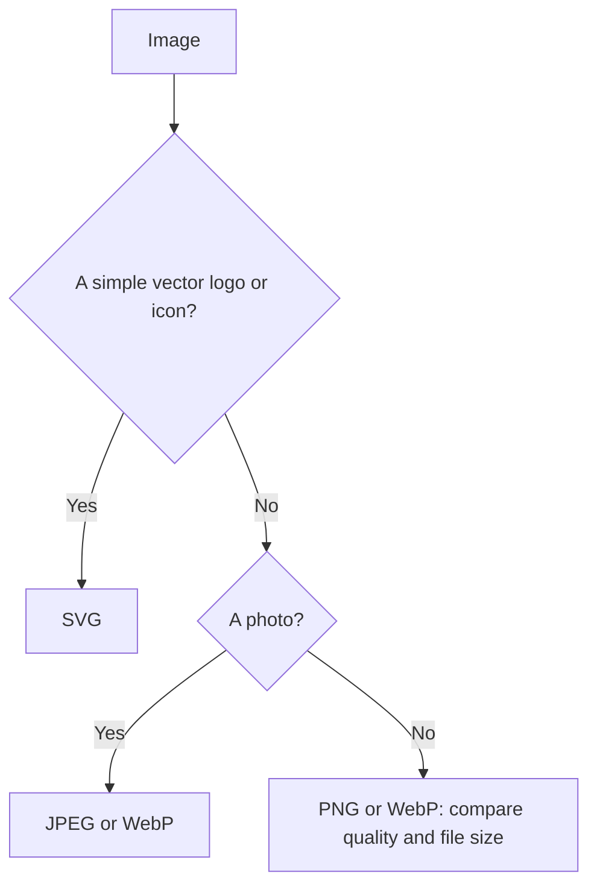
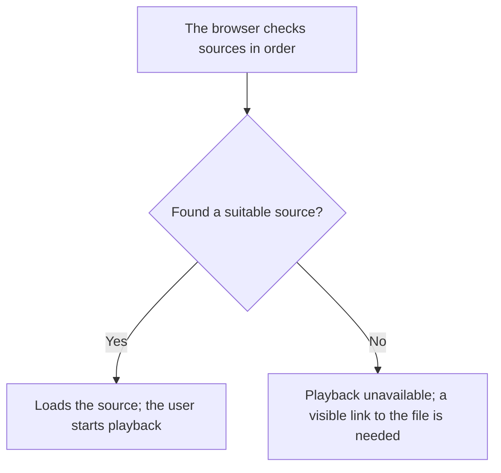

# Images and media

[Contents](../../README.md) · [← Back](../../Lesson-3/en/Links%20and%20navigation.md) · [Next →](../../Lesson-5/en/Tables.md) · [RU](../ru/%D0%98%D0%B7%D0%BE%D0%B1%D1%80%D0%B0%D0%B6%D0%B5%D0%BD%D0%B8%D1%8F%20%D0%B8%20%D0%BC%D0%B5%D0%B4%D0%B8%D0%B0.md) · [EN](Images%20and%20media.md) · [UZ](../uz/Rasmlar%20va%20media.md) · [Practice](../practice.html)

> **Link to the previous lesson:** in lesson 3 you connected pages with links. Today we add images, sound and video to them. File paths follow the same rules as links.

---

## Why you need this

A café page without photos of the dishes, a club page without photos of sessions - people scroll past them in a second. Images and video hold attention.

But not everyone sees an image. A blind user only "hears" it through the description you write. Today we learn both to add media and to describe it.

---

## What you will learn

- Insert an image with `` and the attributes `src`, `alt`, `width`, `height`.
- Write good `alt` text and know when it should be empty.
- Choose a format: JPEG, PNG, SVG or WebP.
- Caption an image with `<figure>` and `<figcaption>`.
- Add audio and video with playback controls.
- Embed a YouTube video with `<iframe>`.
- Add a site icon (favicon).

---

## Review: 3 questions from lesson 3

1. How do you link to `photo.jpg` in the `images` folder if the HTML file sits next to that folder?
2. What does `../` mean in a path?
3. Why won't a `C:\Users\...` path work on a website?

Answers are at the end of the lesson.

---

## Lesson plan

| Section | What we do |
| --- | --- |
| The `` tag | A window in a wall |
| The `alt` attribute | Describing over the phone |
| Size and lazy loading | `width`, `height`, `loading` |
| Formats | Which file to choose |
| Caption | `figure` and `figcaption` |
| Mini-task 1 | An image with a caption |
| Audio and video | `audio`, `video`, `source` |
| YouTube video | `iframe` |
| Favicon | The icon on the tab |
| Mini-task 2 | A video with a cover |
| Independent work | IDE task and a hobbies page |

---

## The `` tag

**In simple terms:** a link is a door to another page, while `` is a window through which an image is "inserted" into the page. The image itself is a separate file.

```html

```

| Attribute | Meaning | Required? |
| --- | --- | --- |
| `src` | Path to the file (same rules as links) | Yes |
| `alt` | A text description of the image | Yes |
| `width`, `height` | Size in pixels | Recommended |

`` is a **void element**: there is no closing tag, everything is set with attributes.

**What you will see:** the image in place of the tag. If the file is not found - a "broken image" icon and the `alt` text.

### An image as a link

An image can be a link - wrap it in `<a>`:

```html
<a href="index.html">
    
</a>
```

Here `alt` describes not the picture but **where the link leads**.

---

## The `alt` attribute

**In simple terms:** imagine describing the picture to a friend over the phone. Short, to the point, only what matters for the page.

`alt` is needed:
- for blind users: a screen reader reads it instead of the image;
- when the image fails to load: the browser shows `alt`;
- for search engines: they understand what is in the image.

| Image | Bad `alt` | Good `alt` |
| --- | --- | --- |
| A photo of a club session | `alt="photo"` | `alt="Students at laptops during a club session"` |
| A logo linking to the home page | `alt="logo.png"` | `alt="Web development club - home page"` |
| An attendance chart | `alt="chart"` | `alt="Attendance grew from 10 to 25 people over the term"` |
| A decorative divider | `alt="pattern"` | `alt=""` |

### Empty `alt=""` - for decoration

If an image **only decorates** and says nothing, write `alt=""`. A screen reader will skip it.

```html

```

**An empty `alt=""` and no `alt` at all are different things.** Without the attribute, a screen reader may read the file name: "decorative-line dot png". That is noise for the listener.

### Try breaking it

1. Put a non-existent file name in `src`: `src="images/cat2.jpg"`. What does the browser show instead of the image?
2. Now delete `alt` completely. What changed?

---

## Size and lazy loading

```html

```

| Attribute | Why |
| --- | --- |
| `width`, `height` | The browser reserves space for the image in advance. Text doesn't "jump" when it loads |
| `loading="lazy"` | The image loads only when the user scrolls to it. The page opens faster |

**Important about proportions:** if the real image is 800×600, then `width="400" height="300"` is correct, while `width="400" height="400"` stretches it. If you don't know the proportions, set only `width`.

Use `loading="lazy"` on images below the first screen. Load the first big image of the page right away.

---

## Image formats

| Format | Best for | Transparency | Note |
| --- | --- | --- | --- |
| **JPEG** `.jpg` | Photos | No | Lossy compression |
| **PNG** `.png` | Screenshots, graphics with sharp edges | Yes | Lossless, but larger files |
| **SVG** `.svg` | Logos, icons | Yes | Vector: no quality loss when scaled |
| **WebP** `.webp` | Photos and graphics | Yes | Usually lighter than JPEG and PNG |

**An analogy for SVG:** JPEG and PNG are mosaics of dots: zoom in and you see squares. SVG is an instruction "draw a circle of this radius": the circle stays smooth at any zoom.



**How to read the diagram.** Two questions suggest a starting format. For photos and complex graphics, compare the quality and size of several options.

**File size matters.** A photo straight from a phone is 3–5 MB. For a website, shrink it to 100–300 KB, for example with the free Squoosh service.

### Common beginner mistakes

| Mistake | How to fix |
| --- | --- |
| No `alt` | Always write `alt`: with a description, or empty for decoration |
| `alt="image"`, `alt="img1"` | Describe the content |
| An image of text instead of text | Write text as text, don't draw it |
| PNG for a photo | For photos - JPEG or WebP |
| JPEG for a logo with a transparent background | PNG or SVG |
| Wrong `width`/`height` proportion | Keep the proportion or set only `width` |

---

## Caption: `figure` and `figcaption`

When an image needs a caption, like "Fig. 1" in a textbook, use this pair:

```html
<figure>
    
    <figcaption>Fig. 1. Club attendance in autumn</figcaption>
</figure>
```

**What you will see:** the image with a caption below it, all slightly indented.

`<figure>` joins an image and its caption into one meaningful block. The caption can also go above the image.

**`alt` and `figcaption` are not the same:**

| | `alt` | `figcaption` |
| --- | --- | --- |
| Who sees it | Only those who can't see the image | Everyone |
| What we write | What is shown | An explanation, a title, a source |

Don't copy the same text into both.

---

## Preparing files for practice

Practice images and media are in the `Lesson-4/images`, `Lesson-4/audio`, `Lesson-4/video` folders. Copy the files you need into your own `images` folder next to the HTML file. Before writing `alt`, **open the image and look at it**: a file name doesn't always match the content.

Use only your own photos and music, or ones you are allowed to use.

---

## Mini-task 1

Insert the image `logo.png` from the `images` folder, 200 pixels wide. Add the caption "Our club logo". Write the `alt` based on what you see in the image. The solution is in the "Answers" section.

---

## Audio and video

### `<audio>`

```html
<audio controls>
    <source src="audio/music.mp3" type="audio/mpeg">
</audio>
<p><a href="audio/music.mp3">Download the audio file</a></p>
```

### `<video>`

```html
<video controls width="640" height="360" poster="images/video-preview.jpg">
    <source src="video/lesson.mp4" type="video/mp4">
</video>
<p><a href="video/lesson.mp4">Download the video</a></p>
```

| Attribute | What it does |
| --- | --- |
| `controls` | Shows buttons: play, volume, seek. **Without it there are no buttons** |
| `<source src type>` | The file and its format. You can list several - the browser takes the first one it can play |
| `poster` | The video cover before playback |
| `muted` | No sound |
| `loop` | Repeat |
| `autoplay` | Start automatically. Browsers allow it only together with `muted` |

**What you will see:** a player with a play button. The video doesn't start on its own - the user presses play.

**A link to the file below the player** is there in case the browser can't play the file.



**How to read the diagram.** The browser goes through the `<source>` elements top to bottom. One suitable source is enough. If none fits, the link below the player helps.

**Accessibility:** if the video contains important speech, add subtitles or a text transcript below the video.

### YouTube video: `<iframe>`

Large videos are not stored on your own site - they are embedded from YouTube. On YouTube, under the video: **Share → Embed**, copy the code:

```html
<iframe width="560" height="315"
        src="https://www.youtube.com/embed/VIDEO_ID"
        title="HTML lesson: document structure"
        allowfullscreen></iframe>
```

`<iframe>` is a "window" into another page. Always give it a `title`: a screen reader uses it to tell what is inside the frame.

### Common beginner mistakes

| Mistake | How to fix |
| --- | --- |
| No `controls` | Without it the user has no buttons |
| `autoplay` with sound | The browser will block it. Better not to autoplay |
| A 500 MB video in the site folder | Upload it to YouTube and embed it with `iframe` |
| An `iframe` without `title` | Add a clear `title` |

---

## Favicon - the icon on the tab

A small icon next to the tab name. It is linked in `<head>`:

```html
<head>
    <meta charset="UTF-8">
    <title>Web development club</title>
    <link rel="icon" type="image/png" href="favicon.png">
</head>
```

**What you will see:** an icon on the browser tab. If it doesn't appear, reload the page with the cache cleared: Ctrl+Shift+R (on macOS: Cmd+Shift+R).

We will look at the `<link>` tag in detail in lesson 9.

---

## Mini-task 2

Insert the video `video/lesson.mp4`, 640 pixels wide, with playback controls and the cover `images/video-preview.jpg`. Add a link to the file below the video. The solution is in the "Answers" section.

---

## Lesson summary: cheat sheet

| Task | Code |
| --- | --- |
| Image | `` |
| Decoration | `alt=""` |
| Lazy loading | `loading="lazy"` |
| Image with a caption | `<figure><figcaption>...</figcaption></figure>` |
| Image as a link | `<a href="..."></a>` |
| Audio / video | `<audio controls>` / `<video controls>` + `<source>` |
| Video cover | `poster="..."` |
| YouTube video | `<iframe src="https://www.youtube.com/embed/..." title="...">` |
| Site icon | `<link rel="icon" href="favicon.png">` in `<head>` |
| Photo / logo | JPEG or WebP / SVG or PNG |

---

## Independent work

### Part 1. IDE task (counted by the platform)

Make a **"My hobbies"** page:

1. A full document and a site icon: `<link rel="icon" ...>` in `<head>`.
2. One `<h1>` and a short paragraph about yourself.
3. At least **three** `` images:
   - one inside a `<figure>` with a `<figcaption>`;
   - one decorative, with `alt=""`;
   - meaningful images have a clear `alt` and a `width`.
4. A `<video>` with `controls` and a `<source>`.

Write file paths as if the images are in an `images` folder and the video in a `video` folder.

What the platform checks: the document skeleton, a favicon, one `h1`, at least three `img` with `src`, `alt` and `width`, a `figure` with a `figcaption`, a decorative `alt=""`, a `video` with `controls` and `source`, and no `autoplay` or empty descriptions like `alt="image"`.

### Part 2. Project on your computer

1. Create `hobbies.html` in your folder.
2. Copy the practice files or use your own (with permission to use them).
3. Open each image and write its `alt` based on what you see.
4. Move the whole folder somewhere else and check that images and video still work.

### Acceptance criteria

- [ ] The IDE task is accepted.
- [ ] All files exist; paths work after moving the folder.
- [ ] Every image has `alt`: a description or empty for decoration.
- [ ] `figcaption` doesn't repeat `alt` word for word.
- [ ] The user starts the video; there is a link to the file.
- [ ] The page makes sense even without watching the video.

---

## Self-check questions

1. Which two `` attributes are required?
2. When should `alt` be empty?
3. How is an empty `alt=""` different from no `alt`?
4. Why set `width` and `height`?
5. What does `loading="lazy"` do?
6. Which format for a photo, and which for a logo?
7. How is `figcaption` different from `alt`?
8. What happens if a video has no `controls`?
9. Why add a link to the file below the player?
10. Where is the favicon linked?

After the questions, take the **lesson test** on the platform: 12 questions, 70% to pass.

---

## What's next

Images and video are in place. In lesson 5 we learn to show data in tables: a schedule, a comparison, grades. And we make tables understandable for screen readers.

---

## Answers

**Review**

1. `images/photo.jpg`.
2. Go up one folder.
3. The server has none of your drives or folders.

**Mini-task 1**

```html
<figure>
    
    <figcaption>Our club logo</figcaption>
</figure>
```

Your `alt` may differ: what matters is that it describes what you see in the image.

**Mini-task 2**

```html
<video controls width="640" poster="images/video-preview.jpg">
    <source src="video/lesson.mp4" type="video/mp4">
</video>
<p><a href="video/lesson.mp4">Download the video</a></p>
```

**Self-check questions**

1. `src` and `alt`.
2. When the image only decorates and says nothing.
3. With `alt=""` a screen reader skips the image. Without `alt` it may read the file name.
4. The browser reserves space in advance, and text doesn't jump when the image loads.
5. It delays loading the image until the user scrolls to it.
6. Photo - JPEG or WebP, logo - SVG or PNG.
7. `alt` replaces the image for those who can't see it. `figcaption` is a caption everyone sees.
8. The user has no buttons and can't start the video.
9. If the browser can't play the file, it can still be opened or downloaded.
10. In `<head>`, with the `<link rel="icon">` tag.

---

[Contents](../../README.md) · [← Back](../../Lesson-3/en/Links%20and%20navigation.md) · [Next →](../../Lesson-5/en/Tables.md) · [RU](../ru/%D0%98%D0%B7%D0%BE%D0%B1%D1%80%D0%B0%D0%B6%D0%B5%D0%BD%D0%B8%D1%8F%20%D0%B8%20%D0%BC%D0%B5%D0%B4%D0%B8%D0%B0.md) · [EN](Images%20and%20media.md) · [UZ](../uz/Rasmlar%20va%20media.md) · [Practice](../practice.html)
