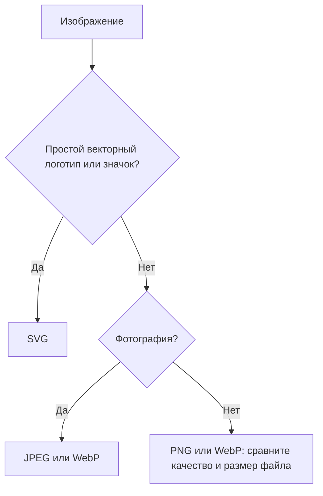
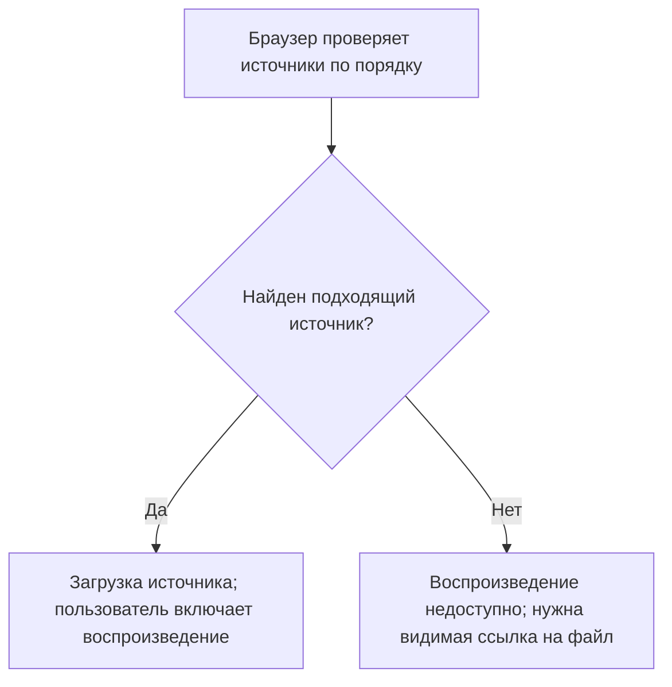

# Изображения и медиа

[Содержание](../../README.md) | [Назад](../../Lesson-3/ru/%D0%A1%D1%81%D1%8B%D0%BB%D0%BA%D0%B8%20%D0%B8%20%D0%BD%D0%B0%D0%B2%D0%B8%D0%B3%D0%B0%D1%86%D0%B8%D1%8F.md) | [Вперёд](../../Lesson-5/ru/%D0%A2%D0%B0%D0%B1%D0%BB%D0%B8%D1%86%D1%8B.md) | [RU](../ru/%D0%98%D0%B7%D0%BE%D0%B1%D1%80%D0%B0%D0%B6%D0%B5%D0%BD%D0%B8%D1%8F%20%D0%B8%20%D0%BC%D0%B5%D0%B4%D0%B8%D0%B0.md) | [EN](../en/Images%20and%20media.md) | [UZ](../uz/Rasmlar%20va%20media.md) | [Практика: пример](../practice.html)

> **Связь с прошлым уроком:** в уроке 3 вы связали страницы ссылками. Сегодня добавим на них картинки, звук и видео. Пути к файлам работают по тем же правилам, что и ссылки.

---

## Зачем это вам

Страница кафе без фото блюд, страница кружка без фотографий занятий - их пролистывают за секунду. Картинки и видео удерживают внимание.

Но картинку видят не все. Незрячий пользователь «услышит» её только через описание, которое вы напишете. Сегодня научимся и вставлять медиа, и описывать его.

---

## Чему вы научитесь

- Вставлять изображение тегом `` с атрибутами `src`, `alt`, `width`, `height`.
- Писать хороший `alt` и понимать, когда он должен быть пустым.
- Выбирать формат: JPEG, PNG, SVG или WebP.
- Подписывать изображение через `<figure>` и `<figcaption>`.
- Вставлять аудио и видео с панелью управления.
- Встраивать видео с YouTube через `<iframe>`.
- Добавлять иконку сайта (favicon).

---

## Повторение: 3 вопроса из урока 3

1. Как сослаться на файл `photo.jpg` в папке `images`, если HTML-файл лежит рядом с этой папкой?
2. Что означает `../` в пути?
3. Почему путь `C:\Users\...` не сработает на сайте?

Ответы - в конце урока.

---

## План урока

| Раздел | Что делаем |
| --- | --- |
| Тег `` | Окно в стене |
| Атрибут `alt` | Описание по телефону |
| Размеры и ленивая загрузка | `width`, `height`, `loading` |
| Форматы | Какой файл выбрать |
| Подпись | `figure` и `figcaption` |
| Мини-задание 1 | Картинка с подписью |
| Аудио и видео | `audio`, `video`, `source` |
| Видео с YouTube | `iframe` |
| Favicon | Иконка на вкладке |
| Мини-задание 2 | Видео с обложкой |
| Самостоятельная работа | Задание в IDE и страница увлечений |

---

## Тег ``

**Простыми словами:** ссылка - это дверь на другую страницу, а `` - окно, через которое в страницу «вставляется» картинка. Сама картинка лежит отдельным файлом.

```html

```

| Атрибут | Что значит | Обязателен? |
| --- | --- | --- |
| `src` | Путь к файлу (правила те же, что у ссылок) | Да |
| `alt` | Текстовое описание картинки | Да |
| `width`, `height` | Размеры в пикселях | Желательно |

`` - **пустой элемент**: закрывающего тега нет, всё передаётся атрибутами.

**Что увидите:** картинку на месте тега. Если файл не найден - значок «сломанной картинки» и текст из `alt`.

### Картинка-ссылка

Картинку можно сделать ссылкой - оберните её в `<a>`:

```html
<a href="index.html">
    
</a>
```

Здесь `alt` описывает не рисунок, а **куда ведёт ссылка**.

---

## Атрибут `alt`

**Простыми словами:** представьте, что описываете картинку другу по телефону. Коротко, по существу, только то, что важно для страницы.

`alt` нужен:
- незрячим: скринридер читает его вместо картинки;
- когда картинка не загрузилась: браузер показывает `alt`;
- поисковикам: они понимают, что на изображении.

| Картинка | Плохой `alt` | Хороший `alt` |
| --- | --- | --- |
| Фото занятия кружка | `alt="фото"` | `alt="Студенты за ноутбуками на занятии кружка"` |
| Логотип-ссылка на главную | `alt="logo.png"` | `alt="Кружок веб-разработки - на главную"` |
| График посещаемости | `alt="график"` | `alt="Посещаемость выросла с 10 до 25 человек за семестр"` |
| Узор-разделитель | `alt="узор"` | `alt=""` |

### Пустой `alt=""` - для украшений

Если картинка **только украшает** и ничего не сообщает, пишите `alt=""`. Скринридер её пропустит.

```html

```

**Пустой `alt=""` и отсутствие `alt` - разные вещи.** Без атрибута скринридер может прочитать имя файла: «decorative-line точка png». Это мусор для слушателя.

### Попробуйте сломать

1. Напишите в `src` несуществующее имя файла: `src="images/cat2.jpg"`. Что показал браузер вместо картинки?
2. Теперь удалите `alt` целиком. Что изменилось?

---

## Размеры и ленивая загрузка

```html

```

| Атрибут | Зачем |
| --- | --- |
| `width`, `height` | Браузер заранее оставляет место под картинку. Текст не «прыгает», когда она загрузится |
| `loading="lazy"` | Картинка загружается, только когда пользователь до неё долистал. Страница открывается быстрее |

**Важно про пропорции:** если реальная картинка 800×600, то `width="400" height="300"` - правильно, а `width="400" height="400"` её растянет. Не знаете пропорции - укажите только `width`.

`loading="lazy"` ставьте на картинки ниже первого экрана. Первую большую картинку страницы грузите сразу.

---

## Форматы изображений

| Формат | Лучше всего для | Прозрачность | Особенность |
| --- | --- | --- | --- |
| **JPEG** `.jpg` | Фотографии | Нет | Сжатие с потерей качества |
| **PNG** `.png` | Скриншоты, графика с чёткими краями | Да | Без потерь, но файл тяжелее |
| **SVG** `.svg` | Логотипы, иконки | Да | Векторный: не теряет качество при увеличении |
| **WebP** `.webp` | Фото и графика | Да | Обычно легче JPEG и PNG |

**Аналогия для SVG:** JPEG и PNG - это мозаика из точек: увеличьте, и станут видны квадратики. SVG - инструкция «нарисуй круг такого радиуса»: при любом увеличении круг остаётся гладким.



**Как читать схему.** Два вопроса подсказывают стартовый выбор формата. Для фото и сложной графики сравните качество и вес нескольких вариантов.

**Вес файла важен.** Фото прямо с телефона весит 3–5 МБ. Для сайта уменьшите его до 100–300 КБ, например в бесплатном сервисе Squoosh.

### Частые ошибки новичков

| Ошибка | Как исправить |
| --- | --- |
| Нет `alt` | Всегда пишите `alt`: с описанием или пустой для украшений |
| `alt="картинка"`, `alt="img1"` | Описывайте содержание |
| Картинка с текстом вместо текста | Текст пишите текстом, а не рисуйте |
| PNG для фотографии | Для фото - JPEG или WebP |
| JPEG для логотипа с прозрачным фоном | PNG или SVG |
| Неправильная пропорция `width`/`height` | Сохраняйте пропорцию или укажите только `width` |

---

## Подпись: `figure` и `figcaption`

Когда картинке нужна подпись, как в учебнике «Рис. 1», используют связку:

```html
<figure>
    
    <figcaption>Рис. 1. Посещаемость кружка за осень</figcaption>
</figure>
```

**Что увидите:** картинку и подпись под ней, всё с небольшим отступом.

`<figure>` объединяет картинку и подпись в один смысловой блок. Подпись можно поставить и над картинкой.

**`alt` и `figcaption` - не одно и то же:**

| | `alt` | `figcaption` |
| --- | --- | --- |
| Кто видит | Только тот, кто не видит картинку | Все |
| Что пишем | Что изображено | Пояснение, название, источник |

Не копируйте одно и то же в оба места.

---

## Подготовка файлов для практики

Учебные картинки и медиа лежат в папках `Lesson-4/images`, `Lesson-4/audio`, `Lesson-4/video`. Скопируйте нужные файлы в свою папку `images` рядом с HTML-файлом. Перед тем как писать `alt`, **откройте картинку и посмотрите**, что на ней: имя файла не всегда совпадает с содержанием.

Свои фото и музыку берите только те, которые вам разрешено использовать.

---

## Мини-задание 1

Вставьте картинку `logo.png` из папки `images` шириной 200 пикселей. Добавьте подпись «Логотип нашего кружка». Напишите `alt` по тому, что видите на картинке. Решение - в разделе «Ответы».

---

## Аудио и видео

### `<audio>`

```html
<audio controls>
    <source src="audio/music.mp3" type="audio/mpeg">
</audio>
<p><a href="audio/music.mp3">Скачать аудиофайл</a></p>
```

### `<video>`

```html
<video controls width="640" height="360" poster="images/video-preview.jpg">
    <source src="video/lesson.mp4" type="video/mp4">
</video>
<p><a href="video/lesson.mp4">Скачать видео</a></p>
```

| Атрибут | Что делает |
| --- | --- |
| `controls` | Показывает кнопки: play, громкость, перемотка. **Без него кнопок нет** |
| `<source src type>` | Файл и его формат. Можно указать несколько - браузер возьмёт первый, который умеет играть |
| `poster` | Обложка видео до запуска |
| `muted` | Без звука |
| `loop` | По кругу |
| `autoplay` | Автозапуск. Браузеры разрешают его только вместе с `muted` |

**Что увидите:** плеер с кнопкой play. Видео не запускается само - пользователь нажимает play.

**Ссылка на файл под плеером** нужна на случай, если браузер не сможет воспроизвести файл.



**Как читать схему.** Браузер перебирает `<source>` сверху вниз. Одного подходящего достаточно. Если не подошёл ни один - пригодится ссылка на файл под плеером.

**Доступность:** если в видео важная речь, добавьте субтитры или текстовую расшифровку под видео.

### Видео с YouTube: `<iframe>`

Большие видео не хранят на своём сайте - их встраивают с YouTube. На YouTube под видео: **Поделиться → Встроить**, скопируйте код:

```html
<iframe width="560" height="315"
        src="https://www.youtube.com/embed/КОД_ВИДЕО"
        title="Урок HTML: структура документа"
        allowfullscreen></iframe>
```

`<iframe>` - «окно» в другую страницу. Обязательно задайте `title`: по нему скринридер поймёт, что во фрейме.

### Частые ошибки новичков

| Ошибка | Как исправить |
| --- | --- |
| Нет `controls` | Без него у пользователя нет кнопок |
| `autoplay` со звуком | Браузер заблокирует. Лучше без автозапуска |
| Видео на 500 МБ в папке сайта | Загрузите на YouTube и встройте `iframe` |
| `iframe` без `title` | Добавьте понятный `title` |

---

## Favicon - иконка на вкладке

Маленькая иконка рядом с названием вкладки. Подключается в `<head>`:

```html
<head>
    <meta charset="UTF-8">
    <title>Кружок веб-разработки</title>
    <link rel="icon" type="image/png" href="favicon.png">
</head>
```

**Что увидите:** иконку на вкладке браузера. Если её нет - обновите страницу с очисткой кэша: Ctrl+Shift+R (на macOS: Cmd+Shift+R).

Тег `<link>` подробно разберём в уроке 9.

---

## Мини-задание 2

Вставьте видео `video/lesson.mp4` шириной 640 пикселей с панелью управления и обложкой `images/video-preview.jpg`. Под видео добавьте ссылку на файл. Решение - в разделе «Ответы».

---

## Итоги урока: шпаргалка

| Задача | Запись |
| --- | --- |
| Картинка | `` |
| Украшение | `alt=""` |
| Ленивая загрузка | `loading="lazy"` |
| Картинка с подписью | `<figure><figcaption>...</figcaption></figure>` |
| Картинка-ссылка | `<a href="..."></a>` |
| Аудио / видео | `<audio controls>` / `<video controls>` + `<source>` |
| Обложка видео | `poster="..."` |
| Видео с YouTube | `<iframe src="https://www.youtube.com/embed/..." title="...">` |
| Иконка сайта | `<link rel="icon" href="favicon.png">` в `<head>` |
| Фото / логотип | JPEG или WebP / SVG или PNG |

---

## Самостоятельная работа

### Часть 1. Задание в IDE (засчитывается платформой)

Сделайте страницу **«Мои увлечения»**:

1. Полный документ и иконка сайта: `<link rel="icon" ...>` в `<head>`.
2. Один `<h1>` и короткий абзац о себе.
3. Минимум **три** картинки ``:
   - одна внутри `<figure>` с `<figcaption>`;
   - одна декоративная с `alt=""`;
   - у смысловых картинок - понятный `alt` и `width`.
4. Видео `<video>` с `controls` и `<source>`.

Пути к файлам пишите так, будто картинки лежат в папке `images`, а видео - в `video`.

Что проверяет платформа: скелет документа, favicon, один `h1`, минимум три `img` с `src`, `alt` и `width`, `figure` с `figcaption`, декоративный `alt=""`, `video` с `controls` и `source`, отсутствие `autoplay` и пустых описаний вроде `alt="картинка"`.

### Часть 2. Проект на компьютере

1. Создайте `hobbies.html` в своей папке.
2. Скопируйте учебные файлы или возьмите свои (с разрешением на использование).
3. Откройте каждую картинку и напишите `alt` по тому, что видите.
4. Перенесите всю папку в другое место и проверьте, что картинки и видео не сломались.

### Критерии готовности

- [ ] Задание в IDE засчитано.
- [ ] Все файлы существуют, пути работают после переноса папки.
- [ ] У каждой картинки есть `alt`: описание или пустой для украшений.
- [ ] `figcaption` не повторяет `alt` слово в слово.
- [ ] Видео запускает пользователь, есть ссылка на файл.
- [ ] Страница понятна, даже если видео не смотреть.

---

## Вопросы для самопроверки

1. Какие два атрибута у `` обязательны?
2. Когда `alt` должен быть пустым?
3. Чем пустой `alt=""` отличается от отсутствия `alt`?
4. Зачем указывать `width` и `height`?
5. Что делает `loading="lazy"`?
6. Какой формат выбрать для фото, а какой для логотипа?
7. Чем `figcaption` отличается от `alt`?
8. Что будет, если не написать `controls` у видео?
9. Зачем ссылка на файл под плеером?
10. Где подключается favicon?

После вопросов пройдите **тест урока** на платформе: 12 вопросов, порог 70%.

---

## Что дальше

Картинки и видео есть. В уроке 5 научимся показывать данные в таблицах: расписание, сравнение, оценки. И сделаем таблицы понятными для скринридера.

---

## Ответы

**Повторение**

1. `images/photo.jpg`.
2. Подняться на одну папку выше.
3. На сервере нет вашего диска и ваших папок.

**Мини-задание 1**

```html
<figure>
    
    <figcaption>Логотип нашего кружка</figcaption>
</figure>
```

Ваш `alt` может отличаться: главное, чтобы он описывал то, что вы видите на картинке.

**Мини-задание 2**

```html
<video controls width="640" poster="images/video-preview.jpg">
    <source src="video/lesson.mp4" type="video/mp4">
</video>
<p><a href="video/lesson.mp4">Скачать видео</a></p>
```

**Вопросы для самопроверки**

1. `src` и `alt`.
2. Когда картинка только украшает и ничего не сообщает.
3. С `alt=""` скринридер пропускает картинку. Без `alt` он может прочитать имя файла.
4. Браузер заранее оставит место, и текст не будет прыгать при загрузке.
5. Откладывает загрузку картинки, пока пользователь до неё не долистает.
6. Фото - JPEG или WebP, логотип - SVG или PNG.
7. `alt` - замена картинки для тех, кто её не видит. `figcaption` - подпись, которую видят все.
8. У пользователя не будет кнопок, видео нельзя будет запустить.
9. Если браузер не сможет воспроизвести файл, его можно будет открыть или скачать.
10. В `<head>`, тегом `<link rel="icon">`.

---

[Содержание](../../README.md) | [Назад](../../Lesson-3/ru/%D0%A1%D1%81%D1%8B%D0%BB%D0%BA%D0%B8%20%D0%B8%20%D0%BD%D0%B0%D0%B2%D0%B8%D0%B3%D0%B0%D1%86%D0%B8%D1%8F.md) | [Вперёд](../../Lesson-5/ru/%D0%A2%D0%B0%D0%B1%D0%BB%D0%B8%D1%86%D1%8B.md) | [RU](../ru/%D0%98%D0%B7%D0%BE%D0%B1%D1%80%D0%B0%D0%B6%D0%B5%D0%BD%D0%B8%D1%8F%20%D0%B8%20%D0%BC%D0%B5%D0%B4%D0%B8%D0%B0.md) | [EN](../en/Images%20and%20media.md) | [UZ](../uz/Rasmlar%20va%20media.md) | [Практика: пример](../practice.html)
