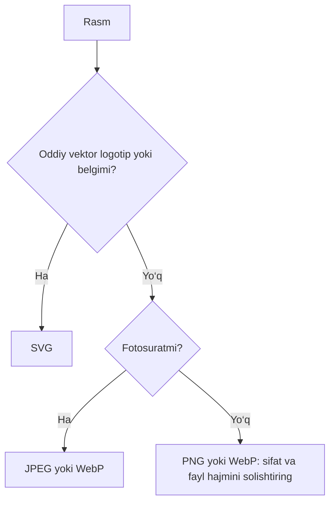
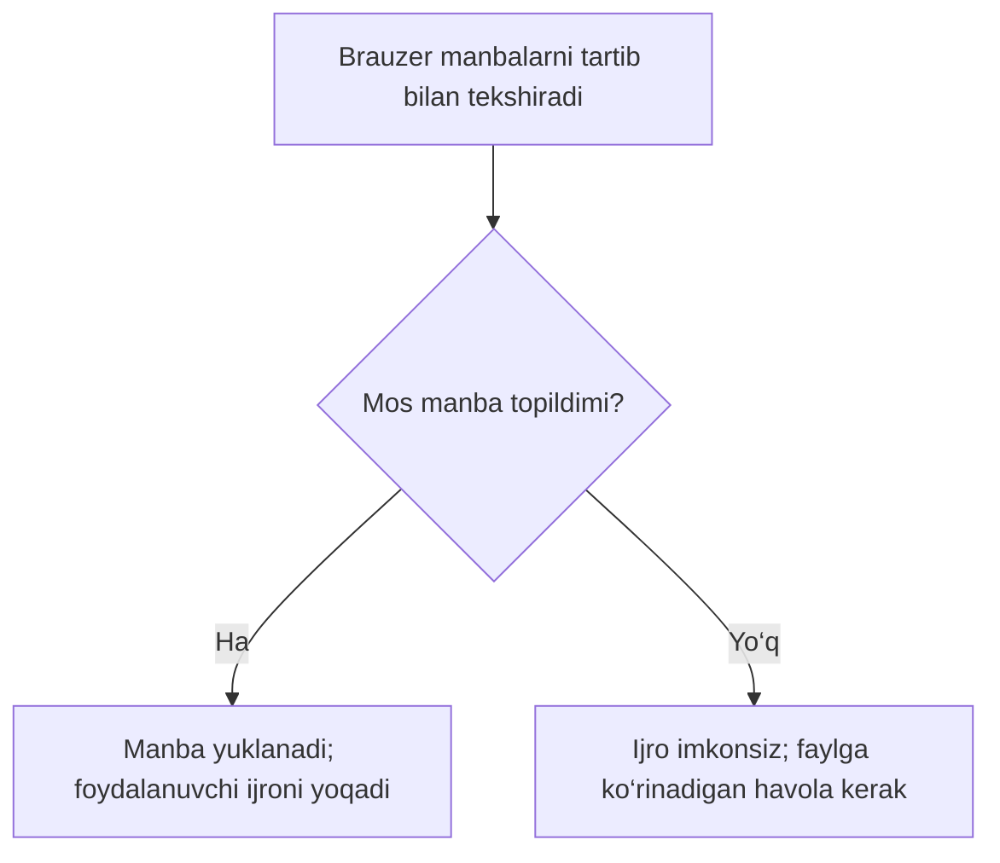

# Rasmlar va media

[Mundarija](../../README.md) · [← Orqaga](../../Lesson-3/uz/Havolalar%20va%20navigatsiya.md) · [Keyingi →](../../Lesson-5/uz/Jadvallar.md) · [RU](../ru/%D0%98%D0%B7%D0%BE%D0%B1%D1%80%D0%B0%D0%B6%D0%B5%D0%BD%D0%B8%D1%8F%20%D0%B8%20%D0%BC%D0%B5%D0%B4%D0%B8%D0%B0.md) · [EN](../en/Images%20and%20media.md) · [UZ](Rasmlar%20va%20media.md) · [Amaliyot](../practice.html)

> **Oldingi dars bilan bog‘liqlik:** 3-darsda sahifalarni havolalar bilan bog‘ladingiz. Bugun ularga rasm, ovoz va video qo‘shamiz. Fayllarga yo‘llar havolalardagi qoidalar bo‘yicha ishlaydi.

---

## Bu sizga nima uchun kerak

Taomlar suratisiz kafe sahifasi, mashg‘ulotlar suratisiz to‘garak sahifasi bir soniyada varaqlab o‘tiladi. Rasm va video e’tiborni ushlab turadi.

Lekin rasmni hamma ham ko‘rmaydi. Ko‘zi ojiz foydalanuvchi uni faqat siz yozgan tavsif orqali «eshitadi». Bugun mediani qo‘shishni ham, tasvirlashni ham o‘rganamiz.

---

## Nimani o‘rganasiz

- `src`, `alt`, `width`, `height` atributli `` tegi bilan rasm qo‘yish.
- Yaxshi `alt` yozish va u qachon bo‘sh bo‘lishi kerakligini tushunish.
- Formatni tanlash: JPEG, PNG, SVG yoki WebP.
- Rasmni `<figure>` va `<figcaption>` orqali imzolash.
- Boshqaruv paneli bilan audio va video qo‘yish.
- YouTube videosini `<iframe>` orqali joylashtirish.
- Sayt belgisini (favicon) qo‘shish.

---

## Takrorlash: 3-darsdan 3 savol

1. HTML fayl `images` papkasi yonida tursa, undagi `photo.jpg` fayliga qanday havola qilinadi?
2. Yo‘ldagi `../` nimani bildiradi?
3. `C:\Users\...` yo‘li saytda nega ishlamaydi?

Javoblar - dars oxirida.

---

## Reja

| Bo‘lim | Nima qilamiz |
| --- | --- |
| `` tegi | Devordagi deraza |
| `alt` atributi | Telefonda tasvirlash |
| O‘lchamlar va kechiktirib yuklash | `width`, `height`, `loading` |
| Formatlar | Qaysi faylni tanlash |
| Imzo | `figure` va `figcaption` |
| Mini-topshiriq 1 | Imzoli rasm |
| Audio va video | `audio`, `video`, `source` |
| YouTube videosi | `iframe` |
| Favicon | Yorliqdagi belgi |
| Mini-topshiriq 2 | Muqovali video |
| Mustaqil ish | IDE topshirig‘i va qiziqishlar sahifasi |

---

## `` tegi

**Oddiy qilib aytganda:** havola - boshqa sahifaga eshik, `` esa sahifaga rasm «qo‘yiladigan» deraza. Rasmning o‘zi alohida faylda turadi.

```html

```

| Atribut | Ma’nosi | Majburiymi? |
| --- | --- | --- |
| `src` | Faylga yo‘l (qoidalar havolalardagidek) | Ha |
| `alt` | Rasmning matnli tavsifi | Ha |
| `width`, `height` | Piksellardagi o‘lcham | Tavsiya etiladi |

`` - **bo‘sh element**: yopuvchi tegi yo‘q, hammasi atributlar orqali beriladi.

**Nimani ko‘rasiz:** teg o‘rnida rasm. Fayl topilmasa - «singan rasm» belgisi va `alt` matni.

### Rasm-havola

Rasmni havola qilish mumkin - uni `<a>` ga o‘rang:

```html
<a href="index.html">
    
</a>
```

Bu yerda `alt` rasmni emas, **havola qayerga olib borishini** tasvirlaydi.

---

## `alt` atributi

**Oddiy qilib aytganda:** rasmni do‘stingizga telefonda tasvirlayotganingizni tasavvur qiling. Qisqa, aniq, faqat sahifa uchun muhim narsa.

`alt` kerak:
- ko‘zi ojizlar uchun: ekran o‘quvchi uni rasm o‘rniga o‘qiydi;
- rasm yuklanmaganda: brauzer `alt` ni ko‘rsatadi;
- qidiruv tizimlari uchun: ular rasmda nima borligini tushunadi.

| Rasm | Yomon `alt` | Yaxshi `alt` |
| --- | --- | --- |
| To‘garak mashg‘uloti surati | `alt="surat"` | `alt="To‘garak mashg‘ulotida noutbuklar ortidagi talabalar"` |
| Bosh sahifaga logotip-havola | `alt="logo.png"` | `alt="Veb-dasturlash to‘garagi - bosh sahifaga"` |
| Qatnashish grafigi | `alt="grafik"` | `alt="Qatnashish semestr davomida 10 tadan 25 kishigacha o‘sdi"` |
| Ajratuvchi naqsh | `alt="naqsh"` | `alt=""` |

### Bo‘sh `alt=""` - bezaklar uchun

Rasm **faqat bezasa** va hech narsa xabar qilmasa, `alt=""` yozing. Ekran o‘quvchi uni o‘tkazib yuboradi.

```html

```

**Bo‘sh `alt=""` va `alt` umuman yo‘qligi - turli narsalar.** Atributsiz ekran o‘quvchi fayl nomini o‘qishi mumkin: «decorative-line nuqta png». Bu tinglovchi uchun axlat.

### Buzib ko‘ring

1. `src` ga mavjud bo‘lmagan fayl nomini yozing: `src="images/cat2.jpg"`. Brauzer rasm o‘rnida nimani ko‘rsatdi?
2. Endi `alt` ni butunlay o‘chiring. Nima o‘zgardi?

---

## O‘lchamlar va kechiktirib yuklash

```html

```

| Atribut | Nima uchun |
| --- | --- |
| `width`, `height` | Brauzer rasm uchun oldindan joy qoldiradi. U yuklanganda matn «sakramaydi» |
| `loading="lazy"` | Rasm faqat foydalanuvchi unga yetib kelganda yuklanadi. Sahifa tezroq ochiladi |

**Proporsiyalar haqida muhim:** haqiqiy rasm 800×600 bo‘lsa, `width="400" height="300"` - to‘g‘ri, `width="400" height="400"` esa uni cho‘zadi. Proporsiyani bilmasangiz - faqat `width` ni ko‘rsating.

`loading="lazy"` ni birinchi ekrandan pastdagi rasmlarga qo‘ying. Sahifaning birinchi katta rasmini darhol yuklang.

---

## Rasm formatlari

| Format | Eng yaxshisi | Shaffoflik | Xususiyati |
| --- | --- | --- | --- |
| **JPEG** `.jpg` | Fotosuratlar | Yo‘q | Sifat yo‘qotish bilan siqish |
| **PNG** `.png` | Skrinshotlar, aniq qirrali grafika | Ha | Yo‘qotishsiz, lekin fayl og‘irroq |
| **SVG** `.svg` | Logotiplar, belgilar | Ha | Vektor: kattalashtirilganda sifat yo‘qolmaydi |
| **WebP** `.webp` | Foto va grafika | Ha | Odatda JPEG va PNG dan yengil |

**SVG uchun o‘xshatish:** JPEG va PNG - nuqtalardan iborat mozaika: kattalashtiring, kvadratchalar ko‘rinadi. SVG - «shunday radiusli doira chiz» degan ko‘rsatma: har qanday kattalashtirishda doira silliq qoladi.



**Sxemani qanday o‘qish kerak.** Ikki savol boshlang‘ich format tanlovini taklif qiladi. Foto va murakkab grafika uchun bir nechta variantning sifati va og‘irligini solishtiring.

**Fayl og‘irligi muhim.** Telefondan olingan surat 3–5 MB bo‘ladi. Sayt uchun uni 100–300 KB gacha kamaytiring, masalan bepul Squoosh xizmatida.

### Yangi o‘rganuvchilarning tipik xatolari

| Xato | Qanday tuzatish |
| --- | --- |
| `alt` yo‘q | `alt` ni doim yozing: tavsif bilan yoki bezaklar uchun bo‘sh |
| `alt="rasm"`, `alt="img1"` | Mazmunni tasvirlang |
| Matn o‘rniga matnli rasm | Matnni matn qilib yozing, chizmang |
| Fotosurat uchun PNG | Foto uchun - JPEG yoki WebP |
| Shaffof fonli logotip uchun JPEG | PNG yoki SVG |
| `width`/`height` proporsiyasi noto‘g‘ri | Proporsiyani saqlang yoki faqat `width` ni bering |

---

## Imzo: `figure` va `figcaption`

Rasmga darslikdagidek «1-rasm» imzosi kerak bo‘lsa, quyidagidan foydalanishadi:

```html
<figure>
    
    <figcaption>1-rasm. Kuzgi to‘garak qatnashuvi</figcaption>
</figure>
```

**Nimani ko‘rasiz:** rasm va uning ostidagi imzo, hammasi kichik chekinish bilan.

`<figure>` rasm va imzoni bitta ma’noli blokka birlashtiradi. Imzoni rasm ustiga ham qo‘yish mumkin.

**`alt` va `figcaption` - bir xil narsa emas:**

| | `alt` | `figcaption` |
| --- | --- | --- |
| Kim ko‘radi | Faqat rasmni ko‘ra olmaydigan | Hamma |
| Nima yozamiz | Nima tasvirlangan | Izoh, nom, manba |

Bir xil matnni ikkala joyga ko‘chirmang.

---

## Amaliyot uchun fayllarni tayyorlash

O‘quv rasmlari va media `Lesson-4/images`, `Lesson-4/audio`, `Lesson-4/video` papkalarida. Kerakli fayllarni HTML fayl yonidagi o‘z `images` papkangizga ko‘chiring. `alt` yozishdan oldin **rasmni ochib ko‘ring**: fayl nomi har doim mazmunga mos kelmaydi.

O‘z suratlaringiz va musiqangizdan faqat foydalanishga ruxsat berilganlarini oling.

---

## Mini-topshiriq 1

`images` papkasidagi `logo.png` rasmini 200 piksel kenglikda qo‘ying. «To‘garagimiz logotipi» imzosini qo‘shing. `alt` ni rasmda ko‘rganingizga ko‘ra yozing. Yechim - «Javoblar» bo‘limida.

---

## Audio va video

### `<audio>`

```html
<audio controls>
    <source src="audio/music.mp3" type="audio/mpeg">
</audio>
<p><a href="audio/music.mp3">Audio faylni yuklab olish</a></p>
```

### `<video>`

```html
<video controls width="640" height="360" poster="images/video-preview.jpg">
    <source src="video/lesson.mp4" type="video/mp4">
</video>
<p><a href="video/lesson.mp4">Videoni yuklab olish</a></p>
```

| Atribut | Nima qiladi |
| --- | --- |
| `controls` | Tugmalarni ko‘rsatadi: play, ovoz, o‘tkazish. **Usiz tugmalar yo‘q** |
| `<source src type>` | Fayl va uning formati. Bir nechtasini ko‘rsatish mumkin - brauzer o‘ynata oladigan birinchisini oladi |
| `poster` | Ishga tushgunga qadar video muqovasi |
| `muted` | Ovozsiz |
| `loop` | Qayta-qayta |
| `autoplay` | Avtomatik ishga tushish. Brauzerlar faqat `muted` bilan birga ruxsat beradi |

**Nimani ko‘rasiz:** play tugmali pleyer. Video o‘zi ishga tushmaydi - foydalanuvchi play ni bosadi.

**Pleyer ostidagi faylga havola** brauzer faylni o‘ynata olmagan holat uchun kerak.



**Sxemani qanday o‘qish kerak.** Brauzer `<source>` larni yuqoridan pastga ko‘rib chiqadi. Bitta mosi yetarli. Hech biri mos kelmasa - pleyer ostidagi faylga havola asqotadi.

**Foydalanish qulayligi:** videoda muhim nutq bo‘lsa, subtitr yoki video ostiga matnli yozuv qo‘shing.

### YouTube videosi: `<iframe>`

Katta videolar o‘z saytida saqlanmaydi - ular YouTube dan joylashtiriladi. YouTube da video ostida: **Ulashish → Joylashtirish**, kodni nusxalang:

```html
<iframe width="560" height="315"
        src="https://www.youtube.com/embed/VIDEO_KODI"
        title="HTML darsi: hujjat tuzilishi"
        allowfullscreen></iframe>
```

`<iframe>` - boshqa sahifaga «deraza». `title` ni albatta bering: ekran o‘quvchi undan freym ichida nima borligini tushunadi.

### Yangi o‘rganuvchilarning tipik xatolari

| Xato | Qanday tuzatish |
| --- | --- |
| `controls` yo‘q | Usiz foydalanuvchida tugmalar yo‘q |
| Ovozli `autoplay` | Brauzer bloklaydi. Avtomatik ishga tushirmagan ma’qul |
| Sayt papkasida 500 MB video | YouTube ga yuklab, `iframe` bilan joylashtiring |
| `title` siz `iframe` | Tushunarli `title` qo‘shing |

---

## Favicon - yorliqdagi belgi

Yorliq nomi yonidagi kichik belgi. `<head>` da ulanadi:

```html
<head>
    <meta charset="UTF-8">
    <title>Veb-dasturlash to‘garagi</title>
    <link rel="icon" type="image/png" href="favicon.png">
</head>
```

**Nimani ko‘rasiz:** brauzer yorlig‘ida belgi. Ko‘rinmasa - sahifani keshni tozalab yangilang: Ctrl+Shift+R (macOS da: Cmd+Shift+R).

`<link>` tegini batafsil 9-darsda ko‘ramiz.

---

## Mini-topshiriq 2

`video/lesson.mp4` videosini 640 piksel kenglikda boshqaruv paneli va `images/video-preview.jpg` muqovasi bilan qo‘ying. Video ostiga faylga havola qo‘shing. Yechim - «Javoblar» bo‘limida.

---

## Dars yakuni: shpargalka

| Vazifa | Yozuv |
| --- | --- |
| Rasm | `` |
| Bezak | `alt=""` |
| Kechiktirib yuklash | `loading="lazy"` |
| Imzoli rasm | `<figure><figcaption>...</figcaption></figure>` |
| Rasm-havola | `<a href="..."></a>` |
| Audio / video | `<audio controls>` / `<video controls>` + `<source>` |
| Video muqovasi | `poster="..."` |
| YouTube videosi | `<iframe src="https://www.youtube.com/embed/..." title="...">` |
| Sayt belgisi | `<head>` da `<link rel="icon" href="favicon.png">` |
| Foto / logotip | JPEG yoki WebP / SVG yoki PNG |

---

## Mustaqil ish

### 1-qism. IDE topshirig‘i (platforma hisoblaydi)

**«Mening qiziqishlarim»** sahifasini yarating:

1. To‘liq hujjat va sayt belgisi: `<head>` da `<link rel="icon" ...>`.
2. Bitta `<h1>` va o‘zingiz haqingizda qisqa abzats.
3. Kamida **uchta** `` rasm:
   - biri `<figcaption>` li `<figure>` ichida;
   - biri bezak, `alt=""` bilan;
   - ma’noli rasmlarda - tushunarli `alt` va `width`.
4. `controls` va `<source>` li `<video>` videosi.

Fayl yo‘llarini rasmlar `images` papkasida, video esa `video` papkasida turgandek yozing.

Platforma nimani tekshiradi: hujjat skeleti, favicon, bitta `h1`, `src`, `alt` va `width` li kamida uchta `img`, `figcaption` li `figure`, bezak `alt=""`, `controls` va `source` li `video`, `autoplay` va `alt="rasm"` kabi bo‘sh tavsiflar yo‘qligi.

### 2-qism. Kompyuterdagi loyiha

1. O‘z papkangizda `hobbies.html` yarating.
2. O‘quv fayllarini ko‘chiring yoki o‘zingiznikini oling (foydalanishga ruxsat bilan).
3. Har bir rasmni ochib, `alt` ni ko‘rganingizga ko‘ra yozing.
4. Butun papkani boshqa joyga ko‘chiring va rasm hamda video buzilmaganini tekshiring.

### Tayyorlik mezonlari

- [ ] IDE topshirig‘i qabul qilingan.
- [ ] Barcha fayllar mavjud, papka ko‘chirilgandan keyin yo‘llar ishlaydi.
- [ ] Har bir rasmda `alt` bor: tavsif yoki bezaklar uchun bo‘sh.
- [ ] `figcaption` `alt` ni so‘zma-so‘z takrorlamaydi.
- [ ] Videoni foydalanuvchi ishga tushiradi, faylga havola bor.
- [ ] Videoni ko‘rmasa ham sahifa tushunarli.

---

## O‘zini tekshirish uchun savollar

1. `` ning qaysi ikki atributi majburiy?
2. Qachon `alt` bo‘sh bo‘lishi kerak?
3. Bo‘sh `alt=""` `alt` yo‘qligidan nimasi bilan farq qiladi?
4. `width` va `height` ni nega ko‘rsatish kerak?
5. `loading="lazy"` nima qiladi?
6. Foto uchun qaysi, logotip uchun qaysi formatni tanlash kerak?
7. `figcaption` `alt` dan nimasi bilan farq qiladi?
8. Videoda `controls` yozilmasa nima bo‘ladi?
9. Pleyer ostidagi faylga havola nima uchun?
10. Favicon qayerda ulanadi?

Savollardan keyin platformada **dars testini** topshiring: 12 ta savol, o‘tish chegarasi 70%.

---

## Keyin nima

Rasm va video bor. 5-darsda ma’lumotlarni jadvallarda ko‘rsatishni o‘rganamiz: jadval, taqqoslash, baholar. Jadvallarni ekran o‘quvchi uchun ham tushunarli qilamiz.

---

## Javoblar

**Takrorlash**

1. `images/photo.jpg`.
2. Bir papka yuqoriga chiqish.
3. Serverda sizning diskingiz va papkalaringiz yo‘q.

**Mini-topshiriq 1**

```html
<figure>
    
    <figcaption>To‘garagimiz logotipi</figcaption>
</figure>
```

`alt` ingiz farq qilishi mumkin: muhimi, u rasmda ko‘rganingizni tasvirlasin.

**Mini-topshiriq 2**

```html
<video controls width="640" poster="images/video-preview.jpg">
    <source src="video/lesson.mp4" type="video/mp4">
</video>
<p><a href="video/lesson.mp4">Videoni yuklab olish</a></p>
```

**O‘zini tekshirish uchun savollar**

1. `src` va `alt`.
2. Rasm faqat bezasa va hech narsa xabar qilmasa.
3. `alt=""` bilan ekran o‘quvchi rasmni o‘tkazib yuboradi. `alt` siz u fayl nomini o‘qishi mumkin.
4. Brauzer oldindan joy qoldiradi va yuklanganda matn sakramaydi.
5. Foydalanuvchi rasmga yetib kelguncha uni yuklashni kechiktiradi.
6. Foto - JPEG yoki WebP, logotip - SVG yoki PNG.
7. `alt` - rasmni ko‘ra olmaydiganlar uchun o‘rinbosar. `figcaption` - hamma ko‘radigan imzo.
8. Foydalanuvchida tugmalar bo‘lmaydi, videoni ishga tushirib bo‘lmaydi.
9. Brauzer faylni o‘ynata olmasa, uni ochish yoki yuklab olish mumkin bo‘ladi.
10. `<head>` da, `<link rel="icon">` tegi bilan.

---

[Mundarija](../../README.md) · [← Orqaga](../../Lesson-3/uz/Havolalar%20va%20navigatsiya.md) · [Keyingi →](../../Lesson-5/uz/Jadvallar.md) · [RU](../ru/%D0%98%D0%B7%D0%BE%D0%B1%D1%80%D0%B0%D0%B6%D0%B5%D0%BD%D0%B8%D1%8F%20%D0%B8%20%D0%BC%D0%B5%D0%B4%D0%B8%D0%B0.md) · [EN](../en/Images%20and%20media.md) · [UZ](Rasmlar%20va%20media.md) · [Amaliyot](../practice.html)
