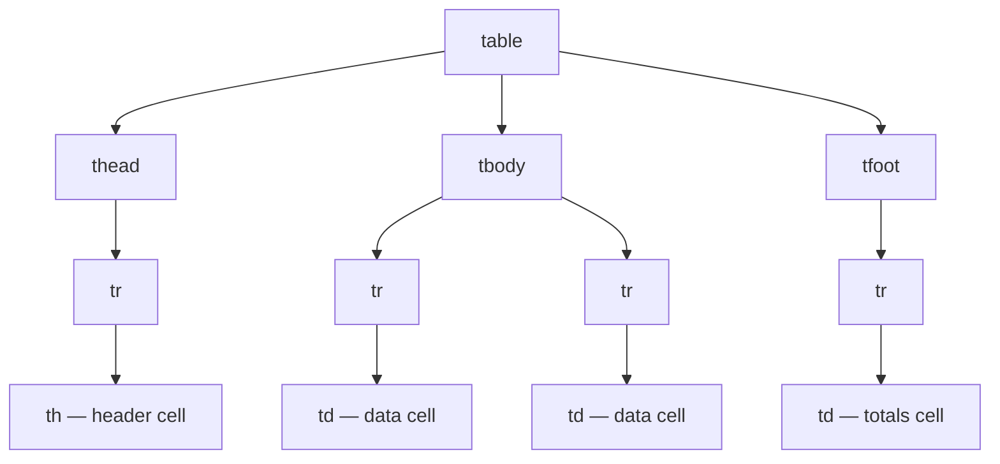
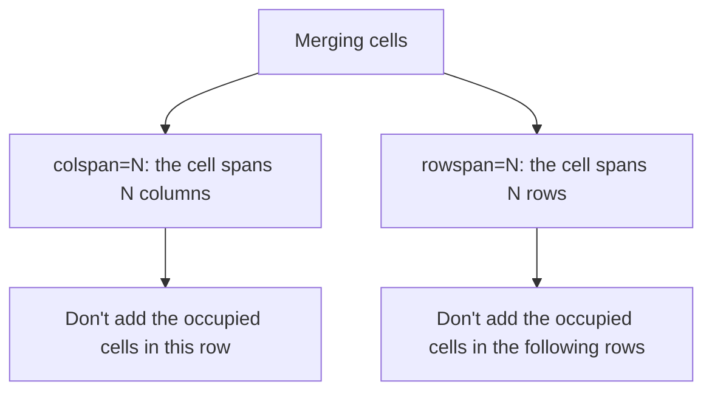

# Tables

[Contents](../../README.md) · [← Back](../../Lesson-4/en/Images%20and%20media.md) · [Next →](../../Lesson-6/en/Forms%20part%201.md) · [RU](../ru/%D0%A2%D0%B0%D0%B1%D0%BB%D0%B8%D1%86%D1%8B.md) · [EN](Tables.md) · [UZ](../uz/Jadvallar.md) · [Practice](../practice.html)

> **Link to the previous lesson:** in lesson 4 you added images and video to your pages. Today we learn to show data: a schedule, grades, a comparison.

---

## Why you need this

A class schedule, term grades, a price comparison - this kind of data is easy to read as a table: a row is an object, a column is a property.

A sighted user sees which heading is above which cell. A blind user hears cells one by one. Today we learn to build a table so that a screen reader names the heading of every cell.

---

## What you will learn

- Build a table from `table`, `tr`, `th`, `td`.
- Split it into parts: `thead`, `tbody`, `tfoot`.
- Give the table a title with `caption`.
- Link headings to data with `scope`.
- Merge cells: `colspan` horizontally and `rowspan` vertically.
- Understand when a table is **not** needed.

---

## Review: 3 questions from lesson 4

1. Which `` attribute is required besides `src`?
2. How is `figcaption` different from `alt`?
3. What does the `controls` attribute do?

Answers are at the end of the lesson.

---

## Lesson plan

| Section | What we do |
| --- | --- |
| When a table is needed | For data, not layout |
| Table structure | A sheet of squared paper |
| Table parts | Head, body, totals |
| Mini-task 1 | A 3 × 3 table |
| Title and headings | `caption` and `scope` |
| Merging cells | `colspan` and `rowspan` step by step |
| Mini-task 2 | A table with a merged cell |
| Independent work | IDE task and a schedule |

---

## When a table is needed

**A table is for data** that has rows and columns: a schedule, a price list, grades, a comparison.

**A table is NOT for page layout.** Sites used to be built with tables: the menu in one cell, the text in another. Today this is a mistake: a screen reader reads such a page as "table, 3 columns, row 1...". The layout of blocks is set with CSS.

**A test:** can you name the columns? "Day, Time, Topic" - yes, it's a table. "Left column, right column" - no, it's layout.

---

## Table structure

**In simple terms:** a table is a sheet of squared paper. You draw it **row by row**, left to right.

| Tag | Meaning | Analogy |
| --- | --- | --- |
| `<table>` | The whole table | The sheet |
| `<tr>` | A row (table row) | One row of squares |
| `<th>` | A header cell (table header) | A labelled square |
| `<td>` | A data cell (table data) | An ordinary square |

```html
<table>
    <tr>
        <th>Day</th>
        <th>Time</th>
        <th>Topic</th>
    </tr>
    <tr>
        <td>Monday</td>
        <td>15:00</td>
        <td>HTML</td>
    </tr>
    <tr>
        <td>Wednesday</td>
        <td>15:00</td>
        <td>CSS</td>
    </tr>
</table>
```

**What you will see:**

| Day | Time | Topic |
| --- | --- | --- |
| Monday | 15:00 | HTML |
| Wednesday | 15:00 | CSS |

Without CSS a table has no borders - just aligned text. The browser shows `th` headings in bold and centred.

**The main rule:** every row has the same number of cells. Three columns means three cells in every `<tr>`.

### A heading can be on the left too

`<th>` is not only at the top. If a row describes one object, its name is a heading too:

```html
<tr>
    <th>Aziz</th>
    <td>5</td>
    <td>4</td>
</tr>
```

### Try breaking it

Delete one `<td>` in the second row. What happened to the table? The cells "slid" to the left, and the time ended up under the "Day" heading.

---

## Table parts: `thead`, `tbody`, `tfoot`

A large table is split into three parts:

| Part | What's inside | Analogy |
| --- | --- | --- |
| `<thead>` | The heading row | The header of a register |
| `<tbody>` | Data rows | The entries themselves |
| `<tfoot>` | Totals | The "Total" row |

```html
<table>
    <thead>
        <tr>
            <th>Item</th>
            <th>Price, sum</th>
        </tr>
    </thead>
    <tbody>
        <tr>
            <td>Notebook</td>
            <td>5 000</td>
        </tr>
        <tr>
            <td>Pen</td>
            <td>3 000</td>
        </tr>
    </tbody>
    <tfoot>
        <tr>
            <td>Total</td>
            <td>8 000</td>
        </tr>
    </tfoot>
</table>
```

**Order in the code:** `thead` → `tbody` → `tfoot`.



**How to read the diagram.** A table is split into three parts. Each part holds `tr` rows, and rows hold cells. The head usually has `th`, the body and totals have `td`.

### Common beginner mistakes

| Mistake | How to fix |
| --- | --- |
| A table for page layout | Tables are only for data |
| Rows with different numbers of cells | Every row has as many cells as there are columns |
| A `<td>` outside a `<tr>` | A cell always sits inside a row |
| Headings made with `<td><strong>` | A heading is a `<th>` |
| `tfoot` before `tbody` | Order: `thead`, `tbody`, `tfoot` |

---

## Mini-task 1

Without looking, build a grades table: the heading "Student, HTML, CSS" and two rows of data. Use `thead` and `tbody`. The solution is in the "Answers" section.

---

## Title and headings: `caption` and `scope`

### `<caption>` - the table title

```html
<table>
    <caption>Club schedule for the week</caption>
    ...
</table>
```

`caption` is written **right after** `<table>`. Everyone sees it, and a screen reader announces it before the table: "Table: Club schedule for the week".

### `scope` - whose heading is this

**In simple terms:** a blind user hears the cell "15:00". To understand what it is, they need a heading: "Time, 15:00". `scope` tells the screen reader what a heading belongs to.

| Value | Heading for | Where it goes |
| --- | --- | --- |
| `scope="col"` | The whole **column** below | In the head |
| `scope="row"` | The whole **row** to the right | At the start of a row |

```html
<table>
    <caption>Term grades</caption>
    <thead>
        <tr>
            <th scope="col">Student</th>
            <th scope="col">HTML</th>
            <th scope="col">CSS</th>
        </tr>
    </thead>
    <tbody>
        <tr>
            <th scope="row">Aziz</th>
            <td>5</td>
            <td>4</td>
        </tr>
        <tr>
            <th scope="row">Madina</th>
            <td>5</td>
            <td>5</td>
        </tr>
    </tbody>
</table>
```

**What a blind user hears** on the cell "4": "Aziz, CSS, 4". Without `scope`, in a complex table they may hear just "4".

---

## Merging cells: `colspan` and `rowspan`

**In simple terms:** on squared paper you erase the line between neighbouring squares and write one text across two.

| Attribute | Direction | Remember |
| --- | --- | --- |
| `colspan="2"` | Across, 2 columns | **col**umn |
| `rowspan="2"` | Down, 2 rows | **row** |

### `colspan` step by step

We want one heading over two columns.

**Before:** 2 rows × 2 columns.

```html
<tr>
    <th>Email</th>
    <th>Phone</th>
</tr>
```

**After:** we add a row at the top with one cell spanning 2 columns.

```html
<table>
    <tr>
        <th colspan="2">Contacts</th>
    </tr>
    <tr>
        <th>Email</th>
        <th>Phone</th>
    </tr>
    <tr>
        <td>club@example.com</td>
        <td>+998 90 111-22-33</td>
    </tr>
</table>
```

**Counting cells:**

| Row | Cells in code | Places taken |
| --- | --- | --- |
| 1 | 1 (with `colspan="2"`) | 2 |
| 2 | 2 | 2 |
| 3 | 2 | 2 |

`colspan` affects **only its own row**.

### `rowspan` step by step

A student took two subjects. We write the name once across two rows.

```html
<table>
    <tr>
        <th>Student</th>
        <th>Subject</th>
        <th>Grade</th>
    </tr>
    <tr>
        <td rowspan="2">Aziz</td>
        <td>HTML</td>
        <td>5</td>
    </tr>
    <tr>
        <td>CSS</td>
        <td>4</td>
    </tr>
</table>
```

**What you will see:**

```
┌──────────┬──────────┬──────────┐
│ Student  │ Subject  │ Grade    │
├──────────┼──────────┼──────────┤
│          │ HTML     │ 5        │
│  Aziz    ├──────────┼──────────┤
│          │ CSS      │ 4        │
└──────────┴──────────┴──────────┘
```

**Counting cells:**

| Row | Cells in code | Why |
| --- | --- | --- |
| 1 | 3 | The header |
| 2 | 3 | "Aziz" also takes a place in row 3 |
| 3 | **2** | The first place is already taken by "Aziz" from above |

`rowspan` affects **the following rows**: they have fewer cells.



**How to read the diagram.** `colspan` saves cells in its own row, `rowspan` in the following rows. An occupied place is not filled with a second cell.

### Try breaking it

In the `rowspan` example, add an extra `<td>Extra</td>` to the third row. What happened? The cell stuck out past the right edge of the table.

### Common beginner mistakes

| Mistake | How to fix |
| --- | --- |
| A full set of cells in the row after `rowspan` | Remove as many cells as places are taken from above |
| Mixing up `colspan` and `rowspan` | col - column (across), row - row (down) |
| Merging everything | Merge only when it makes reading easier |
| No `caption` | Give the table a title |
| No `scope` on headings | `scope="col"` in the head, `scope="row"` at the start of a row |

---

## Mini-task 2

Make a "Day schedule" table with the columns "Time" and "Activity". At 10:00 - "HTML", at 11:00 - "HTML" (the same session continues), at 12:00 - "Lunch". Write the HTML session as **one cell** across two rows. The solution is in the "Answers" section.

---

## Lesson summary: cheat sheet

| Task | Code |
| --- | --- |
| Table / row | `<table>` / `<tr>` |
| Heading / data | `<th>` / `<td>` |
| Head / body / totals | `<thead>` / `<tbody>` / `<tfoot>` |
| Table title | `<caption>` right after `<table>` |
| Column heading | `<th scope="col">` |
| Row heading | `<th scope="row">` |
| Across 2 columns | `colspan="2"`, one cell fewer in the row |
| Down 2 rows | `rowspan="2"`, one cell fewer in the next row |
| Page layout | Not a table, but CSS |

---

## Independent work

### Part 1. IDE task (counted by the platform)

Make a **"Club schedule"** page:

1. A full document and one `<h1>`.
2. A table with `<caption>`, `<thead>` and `<tbody>`.
3. Three `<th scope="col">` headings in the head: day, time, topic.
4. **At least three** rows in the body. The first cell of each row is a `<th scope="row">` with the day of the week.
5. A second table, "Long session": one cell with `rowspan="2"`.

What the platform checks: the document skeleton, one `h1`, at least two tables, `caption`, `thead`, `tbody`, at least four `tr` rows, headings with `scope="col"` and `scope="row"`, and a `rowspan`.

### Part 2. Project on your computer

1. Add a `schedule.html` page to the club site from lesson 3 - now with a table.
2. Recount the cells in every row of the table with a merged cell.
3. Open the page and make sure no cell sticks out past the edge.

### Acceptance criteria

- [ ] The IDE task is accepted.
- [ ] The table describes data, not page layout.
- [ ] There are `caption`, `thead`, `tbody`.
- [ ] Headings are `th` with `scope`.
- [ ] The number of cells in every row adds up, taking merges into account.
- [ ] You can explain how many cells go in the row after a `rowspan` and why.

---

## Self-check questions

1. Why are tables no longer used for page layout?
2. How is `<th>` different from `<td>`?
3. In what order do `thead`, `tbody`, `tfoot` go?
4. Where is `<caption>` written?
5. When is it `scope="col"`, and when `scope="row"`?
6. What does a blind user hear in a complex table without `scope`?
7. What does `colspan="3"` do?
8. A 3-column table, with a `rowspan="2"` cell in the first row. How many cells do you write in the second row?
9. A 4-column table with a `colspan="2"` cell in a row. How many cells are in that row in total?
10. What happens if a row has an extra cell?

After the questions, take the **lesson test** on the platform: 12 questions, 70% to pass.

---

## What's next

A table shows data. In lesson 6 we learn to **collect** it: forms with fields, labels, checkboxes and a submit button.

---

## Answers

**Review**

1. `alt`.
2. `alt` replaces the image for those who can't see it. `figcaption` is a caption for everyone.
3. It shows the player's control buttons.

**Mini-task 1**

```html
<table>
    <thead>
        <tr>
            <th>Student</th>
            <th>HTML</th>
            <th>CSS</th>
        </tr>
    </thead>
    <tbody>
        <tr>
            <td>Aziz</td>
            <td>5</td>
            <td>4</td>
        </tr>
        <tr>
            <td>Madina</td>
            <td>5</td>
            <td>5</td>
        </tr>
    </tbody>
</table>
```

**Mini-task 2**

```html
<table>
    <caption>Day schedule</caption>
    <thead>
        <tr>
            <th scope="col">Time</th>
            <th scope="col">Activity</th>
        </tr>
    </thead>
    <tbody>
        <tr>
            <td>10:00</td>
            <td rowspan="2">HTML</td>
        </tr>
        <tr>
            <td>11:00</td>
        </tr>
        <tr>
            <td>12:00</td>
            <td>Lunch</td>
        </tr>
    </tbody>
</table>
```

The second row has one cell: the "Activity" place is taken by the HTML cell above.

**Self-check questions**

1. A screen reader reads such a page as a data table and confuses the user. Layout is done with CSS.
2. `<th>` is a heading, `<td>` is data.
3. `thead`, `tbody`, `tfoot`.
4. Right after the opening `<table>`.
5. `col` - a column heading (in the head), `row` - a row heading (at the start of a row).
6. Just the cell value without a heading - impossible to tell what it is.
7. The cell spans three columns.
8. Two.
9. Three: one merged and two ordinary.
10. It sticks out past the edge of the table, and the columns no longer line up.

---

[Contents](../../README.md) · [← Back](../../Lesson-4/en/Images%20and%20media.md) · [Next →](../../Lesson-6/en/Forms%20part%201.md) · [RU](../ru/%D0%A2%D0%B0%D0%B1%D0%BB%D0%B8%D1%86%D1%8B.md) · [EN](Tables.md) · [UZ](../uz/Jadvallar.md) · [Practice](../practice.html)
