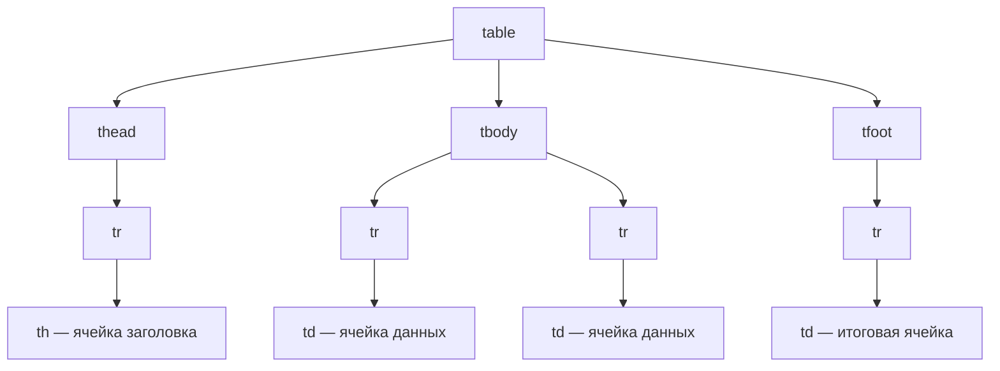
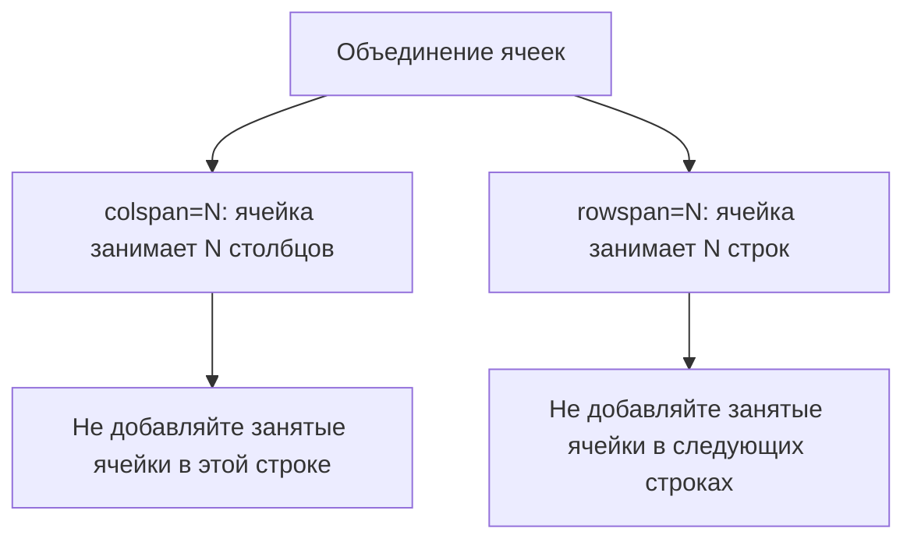

# Таблицы

[Содержание](../../README.md) | [Назад](../../Lesson-4/ru/%D0%98%D0%B7%D0%BE%D0%B1%D1%80%D0%B0%D0%B6%D0%B5%D0%BD%D0%B8%D1%8F%20%D0%B8%20%D0%BC%D0%B5%D0%B4%D0%B8%D0%B0.md) | [Вперёд](../../Lesson-6/ru/%D0%A4%D0%BE%D1%80%D0%BC%D1%8B%20%D1%87-1.md) | [RU](../ru/%D0%A2%D0%B0%D0%B1%D0%BB%D0%B8%D1%86%D1%8B.md) | [EN](../en/Tables.md) | [UZ](../uz/Jadvallar.md) | [Практика: пример](../practice.html)

> **Связь с прошлым уроком:** в уроке 4 вы добавили на страницы картинки и видео. Сегодня научимся показывать данные: расписание, оценки, сравнение.

---

## Зачем это вам

Расписание занятий, оценки за семестр, сравнение тарифов - такие данные удобно читать в виде таблицы: строка - объект, столбец - свойство.

Зрячий пользователь видит, какой заголовок над какой ячейкой. А незрячий слышит ячейки по одной. Сегодня научимся строить таблицу так, чтобы скринридер называл заголовок каждой ячейки.

---

## Чему вы научитесь

- Строить таблицу из `table`, `tr`, `th`, `td`.
- Делить её на части: `thead`, `tbody`, `tfoot`.
- Давать таблице название через `caption`.
- Связывать заголовки с данными через `scope`.
- Объединять ячейки: `colspan` по горизонтали и `rowspan` по вертикали.
- Понимать, когда таблица **не нужна**.

---

## Повторение: 3 вопроса из урока 4

1. Какой атрибут обязателен у ``, кроме `src`?
2. Чем `figcaption` отличается от `alt`?
3. Что делает атрибут `controls`?

Ответы - в конце урока.

---

## План урока

| Раздел | Что делаем |
| --- | --- |
| Когда нужна таблица | Данные, а не раскладка |
| Устройство таблицы | Лист в клетку |
| Части таблицы | Шапка, тело, итог |
| Мини-задание 1 | Таблица 3 × 3 |
| Название и заголовки | `caption` и `scope` |
| Объединение ячеек | `colspan` и `rowspan` по шагам |
| Мини-задание 2 | Таблица с объединением |
| Самостоятельная работа | Задание в IDE и расписание |

---

## Когда нужна таблица

**Таблица - для данных**, у которых есть строки и столбцы: расписание, прайс, оценки, сравнение.

**Таблица - НЕ для раскладки страницы.** Раньше сайты собирали таблицами: меню в одной ячейке, текст в другой. Сейчас это ошибка: скринридер читает такую страницу как «таблица, 3 столбца, строка 1...». Расположение блоков задают через CSS.

**Проверка:** можно ли назвать столбцы? «День, Время, Тема» - да, это таблица. «Левая колонка, правая колонка» - нет, это раскладка.

---

## Устройство таблицы

**Простыми словами:** таблица - лист в клетку. Вы рисуете его **строка за строкой**, слева направо.

| Тег | Что значит | Аналогия |
| --- | --- | --- |
| `<table>` | Вся таблица | Лист |
| `<tr>` | Строка (table row) | Одна строка клеток |
| `<th>` | Ячейка-заголовок (table header) | Подписанная клетка |
| `<td>` | Ячейка с данными (table data) | Обычная клетка |

```html
<table>
    <tr>
        <th>День</th>
        <th>Время</th>
        <th>Тема</th>
    </tr>
    <tr>
        <td>Понедельник</td>
        <td>15:00</td>
        <td>HTML</td>
    </tr>
    <tr>
        <td>Среда</td>
        <td>15:00</td>
        <td>CSS</td>
    </tr>
</table>
```

**Что увидите:**

| День | Время | Тема |
| --- | --- | --- |
| Понедельник | 15:00 | HTML |
| Среда | 15:00 | CSS |

Без CSS у таблицы нет рамок - только выровненный текст. Заголовки `th` браузер показывает жирными и по центру.

**Главное правило:** в каждой строке одинаковое число ячеек. Три столбца - значит три ячейки в каждом `<tr>`.

### Заголовок может быть и слева

`<th>` бывает не только сверху. Если строка описывает один объект, его название - тоже заголовок:

```html
<tr>
    <th>Азиз</th>
    <td>5</td>
    <td>4</td>
</tr>
```

### Попробуйте сломать

Удалите одну `<td>` во второй строке. Что стало с таблицей? Ячейки «съехали» влево, и время оказалось под заголовком «День».

---

## Части таблицы: `thead`, `tbody`, `tfoot`

Большую таблицу делят на три части:

| Часть | Что внутри | Аналогия |
| --- | --- | --- |
| `<thead>` | Строка заголовков | Шапка ведомости |
| `<tbody>` | Строки данных | Сами записи |
| `<tfoot>` | Итоги | Строка «Итого» |

```html
<table>
    <thead>
        <tr>
            <th>Товар</th>
            <th>Цена, сум</th>
        </tr>
    </thead>
    <tbody>
        <tr>
            <td>Тетрадь</td>
            <td>5 000</td>
        </tr>
        <tr>
            <td>Ручка</td>
            <td>3 000</td>
        </tr>
    </tbody>
    <tfoot>
        <tr>
            <td>Итого</td>
            <td>8 000</td>
        </tr>
    </tfoot>
</table>
```

**Порядок в коде:** `thead` → `tbody` → `tfoot`.



**Как читать схему.** Таблица делится на три части. В каждой части - строки `tr`, в строках - ячейки. В шапке обычно `th`, в теле и итоге - `td`.

### Частые ошибки новичков

| Ошибка | Как исправить |
| --- | --- |
| Таблица для раскладки страницы | Таблица - только для данных |
| Разное число ячеек в строках | В каждой строке столько ячеек, сколько столбцов |
| `<td>` вне `<tr>` | Ячейка всегда внутри строки |
| Заголовки через `<td><strong>` | Заголовок - `<th>` |
| `tfoot` перед `tbody` | Порядок: `thead`, `tbody`, `tfoot` |

---

## Мини-задание 1

Без подглядывания соберите таблицу оценок: шапка «Студент, HTML, CSS» и две строки с данными. Используйте `thead` и `tbody`. Решение - в разделе «Ответы».

---

## Название и заголовки: `caption` и `scope`

### `<caption>` - название таблицы

```html
<table>
    <caption>Расписание кружка на неделю</caption>
    ...
</table>
```

`caption` пишется **сразу после** `<table>`. Его видят все, а скринридер объявляет его перед таблицей: «Таблица: Расписание кружка на неделю».

### `scope` - чей это заголовок

**Простыми словами:** незрячий пользователь слышит ячейку «15:00». Чтобы понять, что это, ему нужен заголовок: «Время, 15:00». `scope` подсказывает скринридеру, к чему относится заголовок.

| Значение | Заголовок для | Где стоит |
| --- | --- | --- |
| `scope="col"` | Всего **столбца** под ним | В шапке |
| `scope="row"` | Всей **строки** справа | В начале строки |

```html
<table>
    <caption>Оценки за семестр</caption>
    <thead>
        <tr>
            <th scope="col">Студент</th>
            <th scope="col">HTML</th>
            <th scope="col">CSS</th>
        </tr>
    </thead>
    <tbody>
        <tr>
            <th scope="row">Азиз</th>
            <td>5</td>
            <td>4</td>
        </tr>
        <tr>
            <th scope="row">Мадина</th>
            <td>5</td>
            <td>5</td>
        </tr>
    </tbody>
</table>
```

**Что услышит незрячий** на ячейке «4»: «Азиз, CSS, 4». Без `scope` в сложной таблице он может услышать просто «4».

---

## Объединение ячеек: `colspan` и `rowspan`

**Простыми словами:** на листе в клетку вы стираете границу между соседними клетками и пишете один текст на двух.

| Атрибут | Направление | Запомнить |
| --- | --- | --- |
| `colspan="2"` | Вширь, на 2 столбца | **col**umn - столбец |
| `rowspan="2"` | Вниз, на 2 строки | **row** - строка |

### `colspan` по шагам

Хотим общий заголовок над двумя столбцами.

**До:** 2 строки × 2 столбца.

```html
<tr>
    <th>Почта</th>
    <th>Телефон</th>
</tr>
```

**После:** добавляем строку сверху с одной ячейкой на 2 столбца.

```html
<table>
    <tr>
        <th colspan="2">Контакты</th>
    </tr>
    <tr>
        <th>Почта</th>
        <th>Телефон</th>
    </tr>
    <tr>
        <td>club@example.com</td>
        <td>+998 90 111-22-33</td>
    </tr>
</table>
```

**Считаем ячейки:**

| Строка | Ячеек в коде | Мест занято |
| --- | --- | --- |
| 1 | 1 (с `colspan="2"`) | 2 |
| 2 | 2 | 2 |
| 3 | 2 | 2 |

`colspan` влияет **только на свою строку**.

### `rowspan` по шагам

Студент сдавал два предмета. Имя пишем один раз на две строки.

```html
<table>
    <tr>
        <th>Студент</th>
        <th>Предмет</th>
        <th>Оценка</th>
    </tr>
    <tr>
        <td rowspan="2">Азиз</td>
        <td>HTML</td>
        <td>5</td>
    </tr>
    <tr>
        <td>CSS</td>
        <td>4</td>
    </tr>
</table>
```

**Что увидите:**

```
┌──────────┬──────────┬──────────┐
│ Студент  │ Предмет  │ Оценка   │
├──────────┼──────────┼──────────┤
│          │ HTML     │ 5        │
│  Азиз    ├──────────┼──────────┤
│          │ CSS      │ 4        │
└──────────┴──────────┴──────────┘
```

**Считаем ячейки:**

| Строка | Ячеек в коде | Почему |
| --- | --- | --- |
| 1 | 3 | Шапка |
| 2 | 3 | «Азиз» занимает место и в строке 3 |
| 3 | **2** | Первое место уже занято «Азизом» сверху |

`rowspan` влияет **на следующие строки**: в них ячеек меньше.



**Как читать схему.** `colspan` экономит ячейки в своей строке, `rowspan` - в следующих строках. Занятое место не заполняют второй ячейкой.

### Попробуйте сломать

В примере с `rowspan` добавьте в третью строку лишнюю `<td>Лишняя</td>`. Что произошло? Ячейка вылезла за правый край таблицы.

### Частые ошибки новичков

| Ошибка | Как исправить |
| --- | --- |
| После `rowspan` в следующей строке полное число ячеек | Уберите столько ячеек, сколько мест уже занято сверху |
| Путают `colspan` и `rowspan` | col - столбец (вширь), row - строка (вниз) |
| Объединяют всё подряд | Объединяйте, только если это упрощает чтение |
| Нет `caption` | Дайте таблице название |
| Нет `scope` у заголовков | `scope="col"` в шапке, `scope="row"` в начале строки |

---

## Мини-задание 2

Сделайте таблицу «Расписание на день»: столбцы «Время» и «Занятие». В 10:00 - «HTML», в 11:00 - «HTML» (то же занятие продолжается), в 12:00 - «Обед». Занятие HTML запишите **одной ячейкой** на две строки. Решение - в разделе «Ответы».

---

## Итоги урока: шпаргалка

| Задача | Запись |
| --- | --- |
| Таблица / строка | `<table>` / `<tr>` |
| Заголовок / данные | `<th>` / `<td>` |
| Шапка / тело / итог | `<thead>` / `<tbody>` / `<tfoot>` |
| Название таблицы | `<caption>` сразу после `<table>` |
| Заголовок столбца | `<th scope="col">` |
| Заголовок строки | `<th scope="row">` |
| На 2 столбца | `colspan="2"`, в строке на 1 ячейку меньше |
| На 2 строки | `rowspan="2"`, в следующей строке на 1 ячейку меньше |
| Раскладка страницы | Не таблица, а CSS |

---

## Самостоятельная работа

### Часть 1. Задание в IDE (засчитывается платформой)

Сделайте страницу **«Расписание кружка»**:

1. Полный документ и один `<h1>`.
2. Таблица с `<caption>`, `<thead>` и `<tbody>`.
3. В шапке три заголовка `<th scope="col">`: день, время, тема.
4. В теле **минимум три** строки. Первая ячейка каждой строки - `<th scope="row">` с днём недели.
5. Вторая таблица - «Длинное занятие»: одна ячейка с `rowspan="2"`.

Что проверяет платформа: скелет документа, один `h1`, минимум две таблицы, `caption`, `thead`, `tbody`, минимум четыре строки `tr`, заголовки со `scope="col"` и `scope="row"`, наличие `rowspan`.

### Часть 2. Проект на компьютере

1. Добавьте страницу `schedule.html` в сайт кружка из урока 3 - теперь расписание таблицей.
2. Пересчитайте ячейки в каждой строке таблицы с объединением.
3. Откройте страницу и убедитесь, что ни одна ячейка не вылезла за край.

### Критерии готовности

- [ ] Задание в IDE засчитано.
- [ ] Таблица описывает данные, а не раскладку страницы.
- [ ] Есть `caption`, `thead`, `tbody`.
- [ ] Заголовки - `th` со `scope`.
- [ ] Число ячеек в каждой строке сходится с учётом объединений.
- [ ] Можете объяснить, сколько ячеек в строке после `rowspan` и почему.

---

## Вопросы для самопроверки

1. Почему таблицами больше не делают раскладку страницы?
2. Чем `<th>` отличается от `<td>`?
3. В каком порядке идут `thead`, `tbody`, `tfoot`?
4. Где пишется `<caption>`?
5. Когда `scope="col"`, а когда `scope="row"`?
6. Что услышит незрячий без `scope` в сложной таблице?
7. Что делает `colspan="3"`?
8. Таблица из 3 столбцов, в первой строке ячейка с `rowspan="2"`. Сколько ячеек писать во второй строке?
9. Таблица из 4 столбцов, в строке ячейка с `colspan="2"`. Сколько всего ячеек в этой строке?
10. Что будет, если в строке окажется лишняя ячейка?

После вопросов пройдите **тест урока** на платформе: 12 вопросов, порог 70%.

---

## Что дальше

Таблица показывает данные. В уроке 6 научимся их **собирать**: формы с полями, подписями, флажками и кнопкой отправки.

---

## Ответы

**Повторение**

1. `alt`.
2. `alt` - замена картинки для тех, кто её не видит. `figcaption` - подпись для всех.
3. Показывает кнопки управления плеером.

**Мини-задание 1**

```html
<table>
    <thead>
        <tr>
            <th>Студент</th>
            <th>HTML</th>
            <th>CSS</th>
        </tr>
    </thead>
    <tbody>
        <tr>
            <td>Азиз</td>
            <td>5</td>
            <td>4</td>
        </tr>
        <tr>
            <td>Мадина</td>
            <td>5</td>
            <td>5</td>
        </tr>
    </tbody>
</table>
```

**Мини-задание 2**

```html
<table>
    <caption>Расписание на день</caption>
    <thead>
        <tr>
            <th scope="col">Время</th>
            <th scope="col">Занятие</th>
        </tr>
    </thead>
    <tbody>
        <tr>
            <td>10:00</td>
            <td rowspan="2">HTML</td>
        </tr>
        <tr>
            <td>11:00</td>
        </tr>
        <tr>
            <td>12:00</td>
            <td>Обед</td>
        </tr>
    </tbody>
</table>
```

Во второй строке одна ячейка: место «Занятия» занято ячейкой HTML сверху.

**Вопросы для самопроверки**

1. Скринридер читает такую страницу как таблицу с данными и путает пользователя. Раскладку делают CSS.
2. `<th>` - заголовок, `<td>` - данные.
3. `thead`, `tbody`, `tfoot`.
4. Сразу после открывающего `<table>`.
5. `col` - заголовок столбца (в шапке), `row` - заголовок строки (в начале строки).
6. Просто значение ячейки, без заголовка - непонятно, что это.
7. Ячейка занимает три столбца по ширине.
8. Две.
9. Три: одна объединённая и две обычные.
10. Она вылезет за край таблицы, столбцы перестанут совпадать.

---

[Содержание](../../README.md) | [Назад](../../Lesson-4/ru/%D0%98%D0%B7%D0%BE%D0%B1%D1%80%D0%B0%D0%B6%D0%B5%D0%BD%D0%B8%D1%8F%20%D0%B8%20%D0%BC%D0%B5%D0%B4%D0%B8%D0%B0.md) | [Вперёд](../../Lesson-6/ru/%D0%A4%D0%BE%D1%80%D0%BC%D1%8B%20%D1%87-1.md) | [RU](../ru/%D0%A2%D0%B0%D0%B1%D0%BB%D0%B8%D1%86%D1%8B.md) | [EN](../en/Tables.md) | [UZ](../uz/Jadvallar.md) | [Практика: пример](../practice.html)
