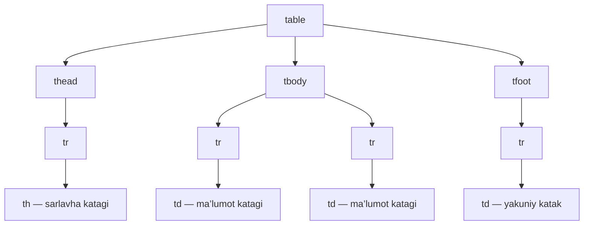
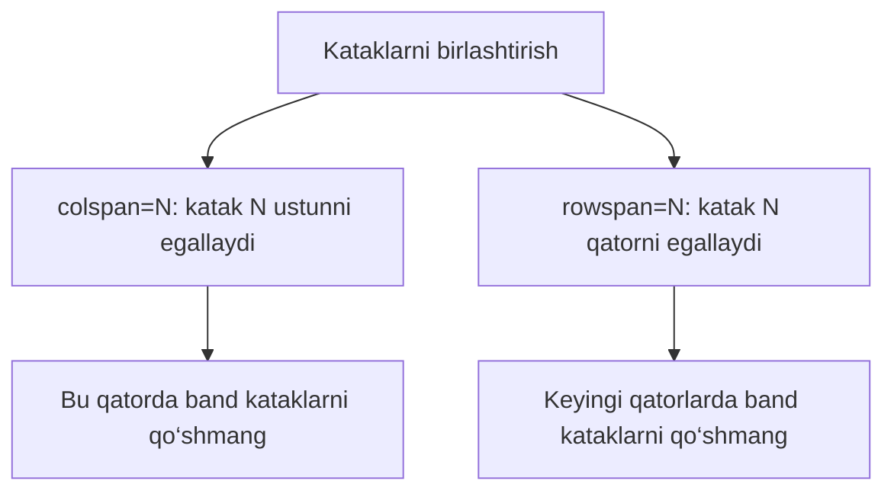

# Jadvallar

[Mundarija](../../README.md) · [← Orqaga](../../Lesson-4/uz/Rasmlar%20va%20media.md) · [Keyingi →](../../Lesson-6/uz/Formalar%20qism-1.md) · [RU](../ru/%D0%A2%D0%B0%D0%B1%D0%BB%D0%B8%D1%86%D1%8B.md) · [EN](../en/Tables.md) · [UZ](Jadvallar.md) · [Amaliyot](../practice.html)

> **Oldingi dars bilan bog‘liqlik:** 4-darsda sahifalarga rasm va video qo‘shdingiz. Bugun ma’lumotlarni ko‘rsatishni o‘rganamiz: jadval, baholar, taqqoslash.

---

## Bu sizga nima uchun kerak

Mashg‘ulotlar jadvali, semestr baholari, tariflarni taqqoslash - bunday ma’lumotlarni jadval ko‘rinishida o‘qish qulay: qator - ob’ekt, ustun - xususiyat.

Ko‘radigan foydalanuvchi qaysi sarlavha qaysi katak ustida ekanini ko‘radi. Ko‘zi ojiz esa kataklarni birma-bir eshitadi. Bugun jadvalni shunday qurishni o‘rganamizki, ekran o‘quvchi har bir katakning sarlavhasini aytsin.

---

## Nimani o‘rganasiz

- `table`, `tr`, `th`, `td` dan jadval qurish.
- Uni qismlarga bo‘lish: `thead`, `tbody`, `tfoot`.
- Jadvalga `caption` orqali nom berish.
- Sarlavhalarni ma’lumotlar bilan `scope` orqali bog‘lash.
- Kataklarni birlashtirish: gorizontal `colspan` va vertikal `rowspan`.
- Jadval qachon **kerak emasligini** tushunish.

---

## Takrorlash: 4-darsdan 3 savol

1. `` da `src` dan tashqari qaysi atribut majburiy?
2. `figcaption` `alt` dan nimasi bilan farq qiladi?
3. `controls` atributi nima qiladi?

Javoblar - dars oxirida.

---

## Reja

| Bo‘lim | Nima qilamiz |
| --- | --- |
| Jadval qachon kerak | Ma’lumotlar uchun, joylashuv uchun emas |
| Jadval tuzilishi | Katakli varaq |
| Jadval qismlari | Sarlavha, tana, yakun |
| Mini-topshiriq 1 | 3 × 3 jadval |
| Nom va sarlavhalar | `caption` va `scope` |
| Kataklarni birlashtirish | `colspan` va `rowspan` qadamma-qadam |
| Mini-topshiriq 2 | Birlashtirilgan jadval |
| Mustaqil ish | IDE topshirig‘i va jadval |

---

## Jadval qachon kerak

**Jadval - ma’lumotlar uchun**, ularning qatorlari va ustunlari bor: jadval, narxlar, baholar, taqqoslash.

**Jadval - sahifa joylashuvi uchun EMAS.** Ilgari saytlar jadvallar bilan yig‘ilardi: menyu bir katakda, matn boshqasida. Hozir bu xato: ekran o‘quvchi bunday sahifani «jadval, 3 ustun, 1-qator...» deb o‘qiydi. Bloklar joylashuvini CSS beradi.

**Tekshiruv:** ustunlarni nomlash mumkinmi? «Kun, Vaqt, Mavzu» - ha, bu jadval. «Chap ustun, o‘ng ustun» - yo‘q, bu joylashuv.

---

## Jadval tuzilishi

**Oddiy qilib aytganda:** jadval - katakli varaq. Siz uni **qatorma-qator**, chapdan o‘ngga chizasiz.

| Teg | Ma’nosi | O‘xshatish |
| --- | --- | --- |
| `<table>` | Butun jadval | Varaq |
| `<tr>` | Qator (table row) | Kataklarning bir qatori |
| `<th>` | Sarlavha katagi (table header) | Imzolangan katak |
| `<td>` | Ma’lumot katagi (table data) | Oddiy katak |

```html
<table>
    <tr>
        <th>Kun</th>
        <th>Vaqt</th>
        <th>Mavzu</th>
    </tr>
    <tr>
        <td>Dushanba</td>
        <td>15:00</td>
        <td>HTML</td>
    </tr>
    <tr>
        <td>Chorshanba</td>
        <td>15:00</td>
        <td>CSS</td>
    </tr>
</table>
```

**Nimani ko‘rasiz:**

| Kun | Vaqt | Mavzu |
| --- | --- | --- |
| Dushanba | 15:00 | HTML |
| Chorshanba | 15:00 | CSS |

CSS siz jadvalda chegaralar yo‘q - faqat tekislangan matn. `th` sarlavhalarini brauzer qalin va markazda ko‘rsatadi.

**Asosiy qoida:** har bir qatorda kataklar soni bir xil. Uch ustun - demak har bir `<tr>` da uchta katak.

### Sarlavha chapda ham bo‘lishi mumkin

`<th>` faqat yuqorida emas. Qator bitta ob’ektni tasvirlasa, uning nomi ham sarlavha:

```html
<tr>
    <th>Aziz</th>
    <td>5</td>
    <td>4</td>
</tr>
```

### Buzib ko‘ring

Ikkinchi qatordagi bitta `<td>` ni o‘chiring. Jadvalga nima bo‘ldi? Kataklar chapga «siljidi» va vaqt «Kun» sarlavhasi ostiga tushdi.

---

## Jadval qismlari: `thead`, `tbody`, `tfoot`

Katta jadval uch qismga bo‘linadi:

| Qism | Ichida nima | O‘xshatish |
| --- | --- | --- |
| `<thead>` | Sarlavhalar qatori | Qaydnoma sarlavhasi |
| `<tbody>` | Ma’lumot qatorlari | Yozuvlarning o‘zi |
| `<tfoot>` | Yakunlar | «Jami» qatori |

```html
<table>
    <thead>
        <tr>
            <th>Mahsulot</th>
            <th>Narx, so‘m</th>
        </tr>
    </thead>
    <tbody>
        <tr>
            <td>Daftar</td>
            <td>5 000</td>
        </tr>
        <tr>
            <td>Ruchka</td>
            <td>3 000</td>
        </tr>
    </tbody>
    <tfoot>
        <tr>
            <td>Jami</td>
            <td>8 000</td>
        </tr>
    </tfoot>
</table>
```

**Koddagi tartib:** `thead` → `tbody` → `tfoot`.



**Sxemani qanday o‘qish kerak.** Jadval uch qismga bo‘linadi. Har bir qismda `tr` qatorlar, qatorlarda kataklar. Sarlavhada odatda `th`, tana va yakunda - `td`.

### Yangi o‘rganuvchilarning tipik xatolari

| Xato | Qanday tuzatish |
| --- | --- |
| Sahifa joylashuvi uchun jadval | Jadval - faqat ma’lumotlar uchun |
| Qatorlarda kataklar soni har xil | Har bir qatorda ustunlar sonicha katak |
| `<tr>` dan tashqaridagi `<td>` | Katak doim qator ichida |
| Sarlavhalar `<td><strong>` orqali | Sarlavha - `<th>` |
| `tfoot` `tbody` dan oldin | Tartib: `thead`, `tbody`, `tfoot` |

---

## Mini-topshiriq 1

Qaramasdan baholar jadvalini tuzing: «Talaba, HTML, CSS» sarlavhasi va ma’lumotli ikki qator. `thead` va `tbody` dan foydalaning. Yechim - «Javoblar» bo‘limida.

---

## Nom va sarlavhalar: `caption` va `scope`

### `<caption>` - jadval nomi

```html
<table>
    <caption>To‘garakning haftalik jadvali</caption>
    ...
</table>
```

`caption` `<table>` dan **darhol keyin** yoziladi. Uni hamma ko‘radi, ekran o‘quvchi esa uni jadvaldan oldin e’lon qiladi: «Jadval: To‘garakning haftalik jadvali».

### `scope` - bu kimning sarlavhasi

**Oddiy qilib aytganda:** ko‘zi ojiz foydalanuvchi «15:00» katagini eshitadi. Bu nimaligini tushunishi uchun unga sarlavha kerak: «Vaqt, 15:00». `scope` ekran o‘quvchiga sarlavha nimaga tegishli ekanini aytadi.

| Qiymat | Kimning sarlavhasi | Qayerda turadi |
| --- | --- | --- |
| `scope="col"` | Ostidagi butun **ustunniki** | Sarlavhada |
| `scope="row"` | O‘ngdagi butun **qatorniki** | Qator boshida |

```html
<table>
    <caption>Semestr baholari</caption>
    <thead>
        <tr>
            <th scope="col">Talaba</th>
            <th scope="col">HTML</th>
            <th scope="col">CSS</th>
        </tr>
    </thead>
    <tbody>
        <tr>
            <th scope="row">Aziz</th>
            <td>5</td>
            <td>4</td>
        </tr>
        <tr>
            <th scope="row">Madina</th>
            <td>5</td>
            <td>5</td>
        </tr>
    </tbody>
</table>
```

**Ko‘zi ojiz nimani eshitadi** «4» katagida: «Aziz, CSS, 4». `scope` siz murakkab jadvalda u shunchaki «4» ni eshitishi mumkin.

---

## Kataklarni birlashtirish: `colspan` va `rowspan`

**Oddiy qilib aytganda:** katakli varaqda qo‘shni kataklar orasidagi chegarani o‘chirib, ikkitasiga bitta matn yozasiz.

| Atribut | Yo‘nalish | Eslab qoling |
| --- | --- | --- |
| `colspan="2"` | Kenglikka, 2 ustunga | **col**umn - ustun |
| `rowspan="2"` | Pastga, 2 qatorga | **row** - qator |

### `colspan` qadamma-qadam

Ikki ustun ustida umumiy sarlavha kerak.

**Oldin:** 2 qator × 2 ustun.

```html
<tr>
    <th>Pochta</th>
    <th>Telefon</th>
</tr>
```

**Keyin:** yuqoriga 2 ustunga bitta katakli qator qo‘shamiz.

```html
<table>
    <tr>
        <th colspan="2">Kontaktlar</th>
    </tr>
    <tr>
        <th>Pochta</th>
        <th>Telefon</th>
    </tr>
    <tr>
        <td>club@example.com</td>
        <td>+998 90 111-22-33</td>
    </tr>
</table>
```

**Kataklarni sanaymiz:**

| Qator | Koddagi kataklar | Band joylar |
| --- | --- | --- |
| 1 | 1 (`colspan="2"` bilan) | 2 |
| 2 | 2 | 2 |
| 3 | 2 | 2 |

`colspan` **faqat o‘z qatoriga** ta’sir qiladi.

### `rowspan` qadamma-qadam

Talaba ikki fan topshirgan. Ismni ikki qatorga bir marta yozamiz.

```html
<table>
    <tr>
        <th>Talaba</th>
        <th>Fan</th>
        <th>Baho</th>
    </tr>
    <tr>
        <td rowspan="2">Aziz</td>
        <td>HTML</td>
        <td>5</td>
    </tr>
    <tr>
        <td>CSS</td>
        <td>4</td>
    </tr>
</table>
```

**Nimani ko‘rasiz:**

```
┌──────────┬──────────┬──────────┐
│ Talaba   │ Fan      │ Baho     │
├──────────┼──────────┼──────────┤
│          │ HTML     │ 5        │
│  Aziz    ├──────────┼──────────┤
│          │ CSS      │ 4        │
└──────────┴──────────┴──────────┘
```

**Kataklarni sanaymiz:**

| Qator | Koddagi kataklar | Nega |
| --- | --- | --- |
| 1 | 3 | Sarlavha |
| 2 | 3 | «Aziz» 3-qatorda ham joy egallaydi |
| 3 | **2** | Birinchi joyni yuqoridagi «Aziz» egallagan |

`rowspan` **keyingi qatorlarga** ta’sir qiladi: ularda kataklar kamroq.



**Sxemani qanday o‘qish kerak.** `colspan` o‘z qatorida, `rowspan` - keyingi qatorlarda kataklarni tejaydi. Band joyni ikkinchi katak bilan to‘ldirishmaydi.

### Buzib ko‘ring

`rowspan` misolidagi uchinchi qatorga ortiqcha `<td>Ortiqcha</td>` qo‘shing. Nima bo‘ldi? Katak jadvalning o‘ng chetidan chiqib ketdi.

### Yangi o‘rganuvchilarning tipik xatolari

| Xato | Qanday tuzatish |
| --- | --- |
| `rowspan` dan keyingi qatorda to‘liq kataklar soni | Yuqoridan band qilingan joylar sonicha katakni olib tashlang |
| `colspan` va `rowspan` ni adashtirish | col - ustun (kenglikka), row - qator (pastga) |
| Hammasini birlashtirish | Faqat o‘qishni osonlashtirsa birlashtiring |
| `caption` yo‘q | Jadvalga nom bering |
| Sarlavhalarda `scope` yo‘q | Sarlavhada `scope="col"`, qator boshida `scope="row"` |

---

## Mini-topshiriq 2

«Kunlik jadval» jadvalini tuzing: «Vaqt» va «Mashg‘ulot» ustunlari. 10:00 da - «HTML», 11:00 da - «HTML» (o‘sha mashg‘ulot davom etadi), 12:00 da - «Tushlik». HTML mashg‘ulotini ikki qatorga **bitta katak** bilan yozing. Yechim - «Javoblar» bo‘limida.

---

## Dars yakuni: shpargalka

| Vazifa | Yozuv |
| --- | --- |
| Jadval / qator | `<table>` / `<tr>` |
| Sarlavha / ma’lumot | `<th>` / `<td>` |
| Sarlavha / tana / yakun | `<thead>` / `<tbody>` / `<tfoot>` |
| Jadval nomi | `<table>` dan darhol keyin `<caption>` |
| Ustun sarlavhasi | `<th scope="col">` |
| Qator sarlavhasi | `<th scope="row">` |
| 2 ustunga | `colspan="2"`, qatorda 1 katak kam |
| 2 qatorga | `rowspan="2"`, keyingi qatorda 1 katak kam |
| Sahifa joylashuvi | Jadval emas, CSS |

---

## Mustaqil ish

### 1-qism. IDE topshirig‘i (platforma hisoblaydi)

**«To‘garak jadvali»** sahifasini yarating:

1. To‘liq hujjat va bitta `<h1>`.
2. `<caption>`, `<thead>` va `<tbody>` li jadval.
3. Sarlavhada uchta `<th scope="col">`: kun, vaqt, mavzu.
4. Tanada **kamida uchta** qator. Har bir qatorning birinchi katagi - hafta kuni bilan `<th scope="row">`.
5. Ikkinchi jadval - «Uzun mashg‘ulot»: `rowspan="2"` li bitta katak.

Platforma nimani tekshiradi: hujjat skeleti, bitta `h1`, kamida ikkita jadval, `caption`, `thead`, `tbody`, kamida to‘rtta `tr` qatori, `scope="col"` va `scope="row"` li sarlavhalar, `rowspan` borligi.

### 2-qism. Kompyuterdagi loyiha

1. 3-darsdagi to‘garak saytiga `schedule.html` sahifasini qo‘shing - endi jadval bilan.
2. Birlashtirilgan jadvalning har bir qatoridagi kataklarni qayta sanang.
3. Sahifani ochib, birorta katak chetdan chiqmaganiga ishonch hosil qiling.

### Tayyorlik mezonlari

- [ ] IDE topshirig‘i qabul qilingan.
- [ ] Jadval sahifa joylashuvini emas, ma’lumotlarni tasvirlaydi.
- [ ] `caption`, `thead`, `tbody` bor.
- [ ] Sarlavhalar - `scope` li `th`.
- [ ] Birlashtirishlarni hisobga olgan holda har bir qatordagi kataklar soni mos.
- [ ] `rowspan` dan keyingi qatorda nechta katak borligini va nega ekanini tushuntira olasiz.

---

## O‘zini tekshirish uchun savollar

1. Nega endi sahifa joylashuvini jadvallar bilan qilishmaydi?
2. `<th>` `<td>` dan nimasi bilan farq qiladi?
3. `thead`, `tbody`, `tfoot` qaysi tartibda keladi?
4. `<caption>` qayerda yoziladi?
5. Qachon `scope="col"`, qachon `scope="row"`?
6. Murakkab jadvalda `scope` siz ko‘zi ojiz nimani eshitadi?
7. `colspan="3"` nima qiladi?
8. 3 ustunli jadval, birinchi qatorda `rowspan="2"` li katak. Ikkinchi qatorga nechta katak yoziladi?
9. 4 ustunli jadval, qatorda `colspan="2"` li katak. Bu qatorda jami nechta katak?
10. Qatorda ortiqcha katak bo‘lsa nima bo‘ladi?

Savollardan keyin platformada **dars testini** topshiring: 12 ta savol, o‘tish chegarasi 70%.

---

## Keyin nima

Jadval ma’lumotlarni ko‘rsatadi. 6-darsda ularni **yig‘ishni** o‘rganamiz: maydonlar, imzolar, belgilash katakchalari va yuborish tugmasi bilan formalar.

---

## Javoblar

**Takrorlash**

1. `alt`.
2. `alt` - rasmni ko‘ra olmaydiganlar uchun o‘rinbosar. `figcaption` - hamma uchun imzo.
3. Pleyer boshqaruv tugmalarini ko‘rsatadi.

**Mini-topshiriq 1**

```html
<table>
    <thead>
        <tr>
            <th>Talaba</th>
            <th>HTML</th>
            <th>CSS</th>
        </tr>
    </thead>
    <tbody>
        <tr>
            <td>Aziz</td>
            <td>5</td>
            <td>4</td>
        </tr>
        <tr>
            <td>Madina</td>
            <td>5</td>
            <td>5</td>
        </tr>
    </tbody>
</table>
```

**Mini-topshiriq 2**

```html
<table>
    <caption>Kunlik jadval</caption>
    <thead>
        <tr>
            <th scope="col">Vaqt</th>
            <th scope="col">Mashg‘ulot</th>
        </tr>
    </thead>
    <tbody>
        <tr>
            <td>10:00</td>
            <td rowspan="2">HTML</td>
        </tr>
        <tr>
            <td>11:00</td>
        </tr>
        <tr>
            <td>12:00</td>
            <td>Tushlik</td>
        </tr>
    </tbody>
</table>
```

Ikkinchi qatorda bitta katak: «Mashg‘ulot» joyini yuqoridagi HTML katagi egallagan.

**O‘zini tekshirish uchun savollar**

1. Ekran o‘quvchi bunday sahifani ma’lumotli jadval deb o‘qiydi va foydalanuvchini chalg‘itadi. Joylashuvni CSS qiladi.
2. `<th>` - sarlavha, `<td>` - ma’lumot.
3. `thead`, `tbody`, `tfoot`.
4. Ochuvchi `<table>` dan darhol keyin.
5. `col` - ustun sarlavhasi (sarlavha qismida), `row` - qator sarlavhasi (qator boshida).
6. Sarlavhasiz faqat katak qiymatini - bu nimaligini tushunib bo‘lmaydi.
7. Katak kenglik bo‘yicha uchta ustunni egallaydi.
8. Ikkita.
9. Uchta: bitta birlashtirilgan va ikkita oddiy.
10. U jadval chetidan chiqadi, ustunlar mos kelmay qoladi.

---

[Mundarija](../../README.md) · [← Orqaga](../../Lesson-4/uz/Rasmlar%20va%20media.md) · [Keyingi →](../../Lesson-6/uz/Formalar%20qism-1.md) · [RU](../ru/%D0%A2%D0%B0%D0%B1%D0%BB%D0%B8%D1%86%D1%8B.md) · [EN](../en/Tables.md) · [UZ](Jadvallar.md) · [Amaliyot](../practice.html)
