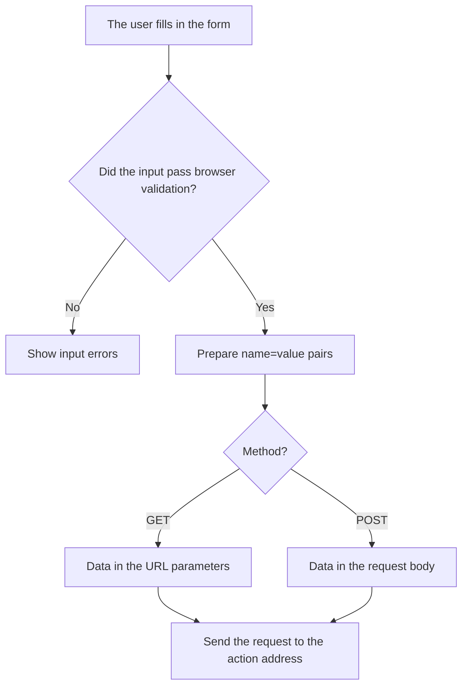
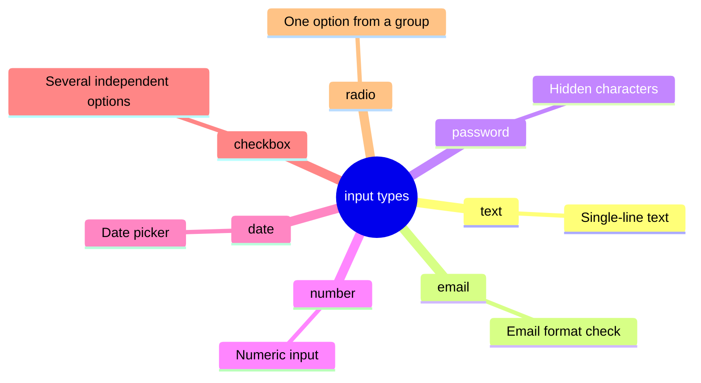

# Forms part 1

[Contents](../../README.md) · [← Back](../../Lesson-5/en/Tables.md) · [Next →](../../Lesson-7/en/Forms%20part%202.md) · [RU](../ru/%D0%A4%D0%BE%D1%80%D0%BC%D1%8B%20%D1%87-1.md) · [EN](Forms%20part%201.md) · [UZ](../uz/Formalar%20qism-1.md) · [Practice](../practice.html)

> **Link to the previous lesson:** in lesson 5 you displayed data in tables. Today we learn to **collect** data: input fields, labels, checkboxes, radio buttons and a submit button.

---

## Why you need this

Signing up for a course, registration, search, an order in a shop - all of these are forms. Without forms a site only shows information; with a form it starts receiving it.

Today you will build a club sign-up form and see what data the browser sends when the button is pressed.

---

## What you will learn

- Create a form with the `<form>` tag and choose the `get` or `post` method.
- Connect a label to a field: `<label for>` and `id`.
- Give fields `name` values, under which data goes to the server.
- Use field types: `text`, `email`, `password`, `number`, `date`, `tel`.
- Make checkboxes (`checkbox`) and radio buttons (`radio`) with `value`.
- Tell `placeholder` from `value`, make a field required (`required`).
- Help the browser with autofill (`autocomplete`).

---

## Review: 3 questions from lessons 3 and 5

1. Which attribute gives an element a unique name?
2. Can two elements on a page have the same `id`?
3. What must tables not be used for?

Answers are at the end of the lesson.

---

## Lesson plan

| Section | What we do |
| --- | --- |
| The `<form>` tag | A paper form |
| Field label | `label`, `for`, `id` |
| Field name | `name` |
| Field types | text, email, password, number, date, tel |
| Checkboxes and radio buttons | checkbox and radio |
| Mini-task 1 | A radio group |
| Hints and required fields | `placeholder`, `value`, `required`, `autocomplete` |
| Submitting | `input type="submit"` and what shows up in the address |
| Mini-task 2 | A search form |
| Independent work | IDE task and a club sign-up |

---

## The `<form>` tag

**In simple terms:** a form is a paper form. You fill in the fields and take it to the right office. In HTML, the browser "takes" the data to an address.

```html
<form action="/register" method="get">
    <!-- fields -->
</form>
```

| Attribute | Meaning | Analogy |
| --- | --- | --- |
| `action` | Where to send it | The office number |
| `method="get"` | Data goes in the page address | A note on the envelope: everyone sees it |
| `method="post"` | Data goes inside the request | A note inside the envelope |

**Important about security:** `post` hides data from the address but does **not encrypt** it. Only `https://` in the site address protects the transfer.

**In this course's practice forms** we write `method="get"` and no `action`: then the form is sent to the same page, and after pressing the button you see the sent data right in the address bar. Nothing is stored anywhere - it's a practice example. Enter only made-up data.



**How to read the diagram.** First the browser checks the fields. If everything is fine, it collects `name=value` pairs and sends them: with GET in the address, with POST inside the request.

---

## Field label: `label`, `for`, `id`

**In simple terms:** every field on a paper form has a caption: "Surname", "Phone". In HTML the caption is a `<label>`. It needs to be **connected** to the field.

```html
<label for="name">Name</label>
<input type="text" id="name" name="name">
```

The link: `for` on the label = `id` on the field. Letter for letter.

**What this gives you:**
1. **Clicking the label puts the cursor in the field.** Especially handy for small checkboxes.
2. **A screen reader reads the label:** "Name, edit text". Without the link it just says "edit text".

### Try breaking it

1. Click the word "Name" - the cursor jumps into the field.
2. Change `for="name"` to `for="nam"`. Click the label again. The cursor no longer jumps: the link is lost.

### The second way: the field inside the label

```html
<label>
    Name
    <input type="text" name="name">
</label>
```

It works the same way. In this course we use the first way, with `for` and `id`: it's clearer to check.

### Common beginner mistakes

| Mistake | How to fix |
| --- | --- |
| The label is plain text `<p>Name</p>` | Use `<label for>` |
| `for` doesn't match `id` | Letter for letter |
| Two fields with the same `id` | An `id` is unique on the page |
| `placeholder` instead of a label | A label is always needed; `placeholder` disappears as you type |

---

## Field name: `name`

**`id` and `name` are different things:**

| Attribute | What for | Analogy |
| --- | --- | --- |
| `id` | Connects to the label on the page | Your seat number in a hall |
| `name` | The name under which the value goes to the server | The caption of a form field for the clerk |

**A field without `name` is not sent.** The browser simply skips it.

After sending a form with `method="get"`, the address shows:

```
?name=Aziz&email=aziz%40example.com
```

These are `name=value` pairs separated by `&`. The browser wrote `@` as `%40` - that's how special characters are encoded in an address.

---

## Field types

An input field is the void element `<input>`. Its type is set by the `type` attribute:

| Type | What for | What the browser does |
| --- | --- | --- |
| `text` | Plain text | Nothing special |
| `email` | Email | Checks for `@`; on a phone - a keyboard with `@` |
| `password` | Password | Hides characters as dots |
| `number` | A number | Up and down arrows; won't accept letters |
| `date` | A date | Shows a calendar |
| `tel` | A phone number | On a phone - a numeric keypad |

```html
<label for="email">Email</label>
<input type="email" id="email" name="email">

<label for="age">Age</label>
<input type="number" id="age" name="age">

<label for="start">Start date</label>
<input type="date" id="start" name="start">
```

**What you will see:** a calendar icon in the date field. Arrows in the age field. Type "abc" into the email field and submit the form: the browser shows an error hint.

**`password` hides characters only on screen.** Without `https://`, the password is sent in the open.

---

## Checkboxes and radio buttons

| Type | How many can be chosen | Analogy |
| --- | --- | --- |
| `checkbox` | Any number or none | Ticks for "interests" on a form |
| `radio` | Exactly **one** from the group | Buttons on an old radio: press one and the other pops out |

### `checkbox` - independent boxes

```html
<input type="checkbox" id="html" name="topics" value="html">
<label for="html">HTML</label>

<input type="checkbox" id="css" name="topics" value="css">
<label for="css">CSS</label>
```

### `radio` - one from the group

```html
<input type="radio" id="morning" name="time" value="morning">
<label for="morning">Morning</label>

<input type="radio" id="evening" name="time" value="evening">
<label for="evening">Evening</label>
```

**A radio group is held together by the same `name`.** If the `name` values differ, you can choose both and the group is broken.

**`value`** is what goes to the server. Without `value` the browser sends a meaningless `on`. With `value` - `time=evening`.



**How to read the diagram.** Each branch is a field type and its purpose. The diagram doesn't set the order of fields in a form.

### Try breaking it

Give two radio buttons different `name` values: `name="time1"` and `name="time2"`. Now you can choose both at once. Put the same name back.

### Common beginner mistakes

| Mistake | How to fix |
| --- | --- |
| Radio buttons with different `name` | One group - one `name` |
| No `value` on radio and checkbox | `on` is sent. Set a `value` |
| A checkbox where only one option is allowed | One of several - `radio` |
| A field without `name` | The field won't be sent |

---

## Mini-task 1

Make a "Level" radio group: "Beginner" and "I have experience". Only one can be chosen. The server should receive `level=beginner` or `level=experienced`. The solution is in the "Answers" section.

---

## Hints and required fields

### `placeholder` and `value`

```html
<input type="email" id="email" name="email" placeholder="name@example.com">
<input type="text" id="city" name="city" value="Almalyk">
```

| | `placeholder` | `value` |
| --- | --- | --- |
| What it is | A grey example hint | The real value in the field |
| When typing | Disappears | Can be erased and replaced |
| Is it sent? | No | Yes |

`placeholder` does **not replace** a `<label>`: the hint disappears as soon as a person starts typing, and they forget what the field was for.

### `required` - a required field

```html
<input type="text" id="name" name="name" required>
```

`required` is an attribute **without a value**. If the field is empty, the browser won't send the form and shows a hint.

### `autocomplete` - helping autofill

```html
<input type="email" id="email" name="email" autocomplete="email">
<input type="tel" id="phone" name="phone" autocomplete="tel">
```

The browser offers to fill in a saved email or phone number. The user doesn't have to type.

---

## Submitting: `<input type="submit">`

```html
<input type="submit" value="Sign up">
```

The `value` of the button is its text. We'll look at the `<button>` tag in lesson 7.

### The whole form

```html
<form method="get">
    <p>
        <label for="name">Name</label>
        <input type="text" id="name" name="name" autocomplete="name" required>
    </p>
    <p>
        <label for="email">Email</label>
        <input type="email" id="email" name="email" autocomplete="email" required>
    </p>
    <p>
        <input type="radio" id="morning" name="time" value="morning">
        <label for="morning">Morning</label>
        <input type="radio" id="evening" name="time" value="evening">
        <label for="evening">Evening</label>
    </p>
    <p>
        <input type="submit" value="Sign up">
    </p>
</form>
```

Each field is wrapped in a `<p>` - this puts the fields one under another.

**Check it:**
1. Press "Sign up" with empty fields. The browser won't send the form and shows a hint on the first required field.
2. Fill it in with made-up data and send it. Look at the address bar: `?name=Aziz&email=aziz%40example.com&time=evening`.

---

## Mini-task 2

Make a search form: one required field labelled "What are we looking for?", field name `q`, a "Find" button. Method `get`. The solution is in the "Answers" section.

---

## Lesson summary: cheat sheet

| Task | Code |
| --- | --- |
| Form | `<form method="get">` |
| Label | `<label for="x">` + `<input id="x">` |
| Name for sending | `name="..."` |
| Email / number / date / phone | `type="email"` / `"number"` / `"date"` / `"tel"` |
| Several options | `type="checkbox"` |
| One from a group | `type="radio"` with one `name` |
| What to send | `value="..."` |
| Example hint | `placeholder="..."` (not instead of `label`) |
| Required | `required` |
| Autofill | `autocomplete="email"` |
| Button | `<input type="submit" value="Text">` |

---

## Independent work

### Part 1. IDE task (counted by the platform)

Make a **"Club sign-up"** form with `method="get"`:

1. Name - `text`, required.
2. Email - `email`, required.
3. Start date - `date`.
4. Two independent `checkbox` boxes - topics of interest.
5. A group of two `radio` buttons - a convenient time. One `name` for the group.
6. **Every** field has a `<label for>`, every field has an `id` and a `name`, checkboxes and radio buttons have a `value`.
7. An `<input type="submit">` button.

Don't use the `<button>` tag yet - it's from lesson 7.

What the platform checks: a form with `method="get"`, every `label for` linked to an existing `id`, the types `text`, `email`, `date`, `checkbox`, `radio`, `submit`, at least seven labels, `required`, `name` and `value` attributes, and no `<button>`.

### Part 2. Project on your computer

1. Add the form to the contacts page of the club site.
2. Open the page with Live Server and submit the form empty - the browser should stop the submission.
3. Submit it with made-up data and find the `name=value` pairs in the address.

### Acceptance criteria

- [ ] The IDE task is accepted.
- [ ] Clicking each label puts the cursor in its field or ticks the box.
- [ ] All `id` values are unique.
- [ ] Only one option can be chosen in the radio group; checkboxes are independent.
- [ ] Empty required fields prevent sending the form.
- [ ] The sent values are visible in the address.

---

## Self-check questions

1. How is `method="get"` different from `method="post"`?
2. Does `post` protect data by itself?
3. How do you connect a label to a field?
4. How is `id` different from `name`?
5. What happens to a field without `name` when the form is sent?
6. How is `checkbox` different from `radio`?
7. How do you make sure only one option can be chosen in a radio group?
8. Why do radio buttons need a `value`?
9. Why doesn't `placeholder` replace `label`?
10. What does `required` do?

After the questions, take the **lesson test** on the platform: 12 questions, 70% to pass.

---

## What's next

The form works, but it only has simple fields so far. In lesson 7 we add drop-down lists, multi-line text, field groups, `<button>` buttons and input format validation.

---

## Answers

**Review**

1. `id`.
2. No, an `id` is unique.
3. For page layout.

**Mini-task 1**

```html
<input type="radio" id="beginner" name="level" value="beginner">
<label for="beginner">Beginner</label>

<input type="radio" id="experienced" name="level" value="experienced">
<label for="experienced">I have experience</label>
```

**Mini-task 2**

```html
<form method="get">
    <label for="q">What are we looking for?</label>
    <input type="text" id="q" name="q" required>
    <input type="submit" value="Find">
</form>
```

**Self-check questions**

1. GET puts the data in the page address, POST puts it inside the request.
2. No. Only HTTPS protects the transfer.
3. The `for` on the `<label>` equals the `id` on the field.
4. `id` connects to the label on the page, `name` is the name of the value when sending.
5. It is not sent.
6. Checkbox - any number of options, radio - exactly one from the group.
7. Give all radio buttons in the group the same `name`.
8. So the server receives a meaningful value instead of `on`.
9. The hint disappears while typing, and a screen reader may not read it as a label.
10. It prevents sending the form while the field is empty.

---

[Contents](../../README.md) · [← Back](../../Lesson-5/en/Tables.md) · [Next →](../../Lesson-7/en/Forms%20part%202.md) · [RU](../ru/%D0%A4%D0%BE%D1%80%D0%BC%D1%8B%20%D1%87-1.md) · [EN](Forms%20part%201.md) · [UZ](../uz/Formalar%20qism-1.md) · [Practice](../practice.html)
