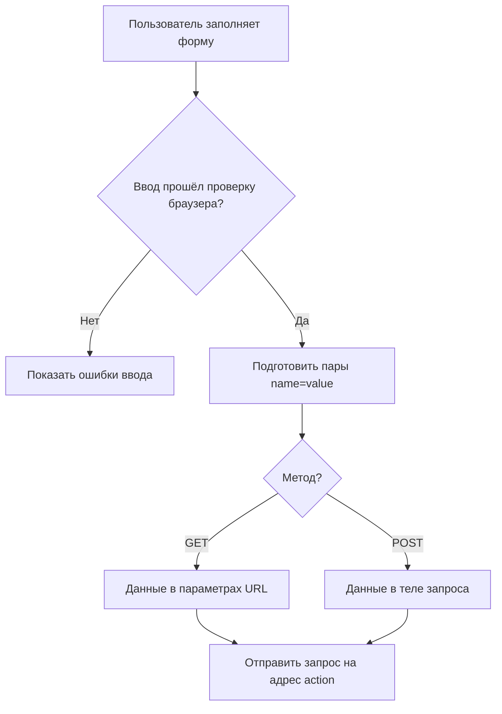
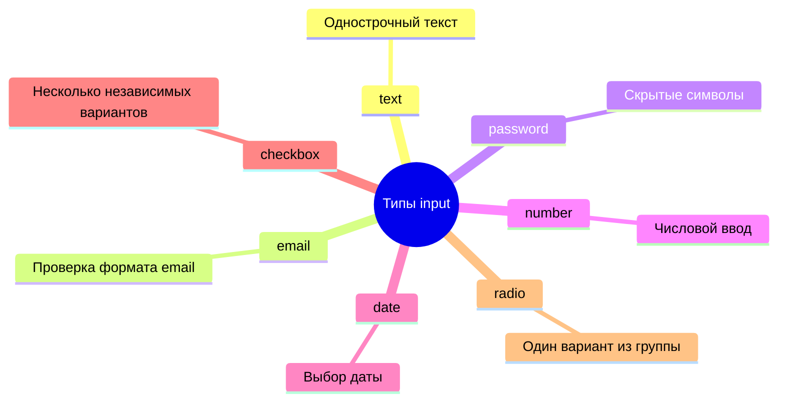

# Формы ч-1

[Содержание](../../README.md) | [Назад](../../Lesson-5/ru/%D0%A2%D0%B0%D0%B1%D0%BB%D0%B8%D1%86%D1%8B.md) | [Вперёд](../../Lesson-7/ru/%D0%A4%D0%BE%D1%80%D0%BC%D1%8B%20%D1%87-2.md) | [RU](../ru/%D0%A4%D0%BE%D1%80%D0%BC%D1%8B%20%D1%87-1.md) | [EN](../en/Forms%20part%201.md) | [UZ](../uz/Formalar%20qism-1.md) | [Практика: пример](../practice.html)

> **Связь с прошлым уроком:** в уроке 5 вы показывали данные в таблицах. Сегодня научимся данные **собирать**: поля ввода, подписи, флажки, переключатели и кнопка отправки.

---

## Зачем это вам

Запись на курс, регистрация, поиск, заказ в магазине - всё это формы. Без форм сайт только показывает информацию, а с формой он начинает её принимать.

Сегодня вы соберёте форму записи в кружок и увидите, какие данные браузер отправляет при нажатии кнопки.

---

## Чему вы научитесь

- Создавать форму тегом `<form>` и выбирать метод `get` или `post`.
- Связывать подпись с полем: `<label for>` и `id`.
- Давать полям имена `name`, по которым данные уходят на сервер.
- Использовать типы полей: `text`, `email`, `password`, `number`, `date`, `tel`.
- Делать флажки (`checkbox`) и переключатели (`radio`) со значениями `value`.
- Отличать `placeholder` от `value`, делать поле обязательным (`required`).
- Подсказывать браузеру автозаполнение (`autocomplete`).

---

## Повторение: 3 вопроса из уроков 3 и 5

1. Каким атрибутом задают уникальное имя элемента?
2. Может ли быть два элемента с одинаковым `id` на странице?
3. Для чего таблицы использовать нельзя?

Ответы - в конце урока.

---

## План урока

| Раздел | Что делаем |
| --- | --- |
| Тег `<form>` | Бумажная анкета |
| Подпись поля | `label`, `for`, `id` |
| Имя поля | `name` |
| Типы полей | text, email, password, number, date, tel |
| Флажки и переключатели | checkbox и radio |
| Мини-задание 1 | Группа radio |
| Подсказки и обязательность | `placeholder`, `value`, `required`, `autocomplete` |
| Отправка | `input type="submit"` и что видно в адресе |
| Мини-задание 2 | Форма поиска |
| Самостоятельная работа | Задание в IDE и запись в кружок |

---

## Тег `<form>`

**Простыми словами:** форма - бумажная анкета. Вы заполняете поля и относите анкету в нужный кабинет. В HTML браузер «относит» данные по адресу.

```html
<form action="/register" method="get">
    <!-- поля -->
</form>
```

| Атрибут | Что значит | Аналогия |
| --- | --- | --- |
| `action` | Куда отправить | Номер кабинета |
| `method="get"` | Данные в адресе страницы | Записка на конверте: видно всем |
| `method="post"` | Данные внутри запроса | Записка в конверте |

**Важно про безопасность:** `post` прячет данные из адреса, но **не шифрует** их. Защищает передачу только `https://` в адресе сайта.

**В учебных формах курса** мы пишем `method="get"` и не пишем `action`: тогда форма отправляется на ту же страницу, и после нажатия кнопки вы увидите отправленные данные прямо в адресной строке. Никуда они не сохраняются - это учебный пример. Вводите только вымышленные данные.



**Как читать схему.** Сначала браузер проверяет поля. Если всё верно - собирает пары `name=value` и отправляет их: при GET - в адресе, при POST - внутри запроса.

---

## Подпись поля: `label`, `for`, `id`

**Простыми словами:** у каждого поля анкеты есть надпись: «Фамилия», «Телефон». В HTML надпись - `<label>`. Её нужно **привязать** к полю.

```html
<label for="name">Имя</label>
<input type="text" id="name" name="name">
```

Связь: `for` у подписи = `id` у поля. Буква в букву.

**Что это даёт:**
1. **Клик по подписи ставит курсор в поле.** Особенно удобно для маленьких флажков.
2. **Скринридер читает подпись:** «Имя, поле ввода». Без связи он скажет только «поле ввода».

### Попробуйте сломать

1. Нажмите на слово «Имя» - курсор прыгнул в поле.
2. Измените `for="name"` на `for="nam"`. Снова нажмите на подпись. Курсор больше не прыгает: связь потеряна.

### Второй способ: поле внутри подписи

```html
<label>
    Имя
    <input type="text" name="name">
</label>
```

Работает так же. В курсе используем первый способ с `for` и `id`: он понятнее для проверки.

### Частые ошибки новичков

| Ошибка | Как исправить |
| --- | --- |
| Подпись просто текстом `<p>Имя</p>` | Используйте `<label for>` |
| `for` не совпадает с `id` | Буква в букву |
| Два поля с одним `id` | `id` уникален на странице |
| `placeholder` вместо подписи | Подпись нужна всегда, `placeholder` исчезает при вводе |

---

## Имя поля: `name`

**`id` и `name` - разные вещи:**

| Атрибут | Для чего | Аналогия |
| --- | --- | --- |
| `id` | Связь с подписью на странице | Номер места в зале |
| `name` | Имя, под которым значение уйдёт на сервер | Подпись на графе анкеты для секретаря |

**Поле без `name` не отправляется.** Браузер просто пропустит его.

После отправки формы с `method="get"` в адресе появится:

```
?name=Aziz&email=aziz%40example.com
```

Это пары `name=значение`, разделённые `&`. Символ `@` браузер записал как `%40` - так кодируются особые символы в адресе.

---

## Типы полей

Поле ввода - пустой элемент `<input>`. Тип задаёт атрибут `type`:

| Тип | Для чего | Что делает браузер |
| --- | --- | --- |
| `text` | Обычный текст | Ничего особенного |
| `email` | Почта | Проверяет, есть ли `@`; на телефоне - клавиатура с `@` |
| `password` | Пароль | Прячет символы точками |
| `number` | Число | Стрелки вверх-вниз; не даёт ввести буквы |
| `date` | Дата | Показывает календарь |
| `tel` | Телефон | На телефоне - цифровая клавиатура |

```html
<label for="email">Почта</label>
<input type="email" id="email" name="email">

<label for="age">Возраст</label>
<input type="number" id="age" name="age">

<label for="start">Дата начала</label>
<input type="date" id="start" name="start">
```

**Что увидите:** у поля даты - значок календаря. В поле возраста - стрелки. Попробуйте ввести в почту «abc» и отправить форму: браузер покажет подсказку об ошибке.

**`password` прячет символы только на экране.** Без `https://` пароль передаётся открыто.

---

## Флажки и переключатели

| Тип | Сколько можно выбрать | Аналогия |
| --- | --- | --- |
| `checkbox` | Сколько угодно или ничего | Галочки в анкете «интересы» |
| `radio` | Ровно **один** из группы | Кнопки на старом радио: нажал одну - другая отжалась |

### `checkbox` - независимые флажки

```html
<input type="checkbox" id="html" name="topics" value="html">
<label for="html">HTML</label>

<input type="checkbox" id="css" name="topics" value="css">
<label for="css">CSS</label>
```

### `radio` - один из группы

```html
<input type="radio" id="morning" name="time" value="morning">
<label for="morning">Утро</label>

<input type="radio" id="evening" name="time" value="evening">
<label for="evening">Вечер</label>
```

**Группу radio объединяет одинаковый `name`.** Если `name` разные - можно выбрать оба, и группа сломана.

**`value`** - что уйдёт на сервер. Без `value` браузер отправит непонятное `on`. С `value` - `time=evening`.



**Как читать схему.** Каждая ветвь - тип поля и его назначение. Схема не задаёт порядок полей в форме.

### Попробуйте сломать

Дайте двум переключателям разные `name`: `name="time1"` и `name="time2"`. Теперь можно выбрать оба сразу. Верните одинаковое имя.

### Частые ошибки новичков

| Ошибка | Как исправить |
| --- | --- |
| У radio разные `name` | Одна группа - один `name` |
| Нет `value` у radio и checkbox | Отправится `on`. Задайте `value` |
| Checkbox там, где нужен один вариант | Один из нескольких - `radio` |
| Нет `name` у поля | Поле не отправится |

---

## Мини-задание 1

Сделайте группу переключателей «Уровень»: «Новичок» и «Есть опыт». Выбрать можно только один. На сервер должно уйти `level=beginner` или `level=experienced`. Решение - в разделе «Ответы».

---

## Подсказки и обязательность

### `placeholder` и `value`

```html
<input type="email" id="email" name="email" placeholder="name@example.com">
<input type="text" id="city" name="city" value="Алмалык">
```

| | `placeholder` | `value` |
| --- | --- | --- |
| Что это | Серая подсказка-пример | Настоящее значение в поле |
| При вводе | Исчезает | Можно стереть и заменить |
| Отправляется? | Нет | Да |

`placeholder` **не заменяет** `<label>`: подсказка пропадает, как только человек начал печатать, и он забывает, что за поле.

### `required` - обязательное поле

```html
<input type="text" id="name" name="name" required>
```

`required` - атрибут **без значения**. Если поле пустое, браузер не отправит форму и покажет подсказку.

### `autocomplete` - помощь с автозаполнением

```html
<input type="email" id="email" name="email" autocomplete="email">
<input type="tel" id="phone" name="phone" autocomplete="tel">
```

Браузер предложит подставить сохранённую почту или телефон. Пользователю не нужно печатать.

---

## Отправка: `<input type="submit">`

```html
<input type="submit" value="Записаться">
```

`value` у кнопки - это надпись на ней. Тег `<button>` разберём в уроке 7.

### Форма целиком

```html
<form method="get">
    <p>
        <label for="name">Имя</label>
        <input type="text" id="name" name="name" autocomplete="name" required>
    </p>
    <p>
        <label for="email">Почта</label>
        <input type="email" id="email" name="email" autocomplete="email" required>
    </p>
    <p>
        <input type="radio" id="morning" name="time" value="morning">
        <label for="morning">Утро</label>
        <input type="radio" id="evening" name="time" value="evening">
        <label for="evening">Вечер</label>
    </p>
    <p>
        <input type="submit" value="Записаться">
    </p>
</form>
```

Каждое поле обёрнуто в `<p>` - так поля встают друг под другом.

**Проверка:**
1. Нажмите «Записаться» с пустыми полями. Браузер не отправит форму и покажет подсказку у первого обязательного поля.
2. Заполните вымышленными данными и отправьте. Посмотрите в адресную строку: `?name=Aziz&email=aziz%40example.com&time=evening`.

---

## Мини-задание 2

Сделайте форму поиска: одно обязательное поле с подписью «Что ищем?», имя поля `q`, кнопка «Найти». Метод `get`. Решение - в разделе «Ответы».

---

## Итоги урока: шпаргалка

| Задача | Запись |
| --- | --- |
| Форма | `<form method="get">` |
| Подпись | `<label for="x">` + `<input id="x">` |
| Имя для отправки | `name="..."` |
| Почта / число / дата / телефон | `type="email"` / `"number"` / `"date"` / `"tel"` |
| Несколько вариантов | `type="checkbox"` |
| Один из группы | `type="radio"` с одним `name` |
| Что отправить | `value="..."` |
| Подсказка-пример | `placeholder="..."` (не вместо `label`) |
| Обязательно | `required` |
| Автозаполнение | `autocomplete="email"` |
| Кнопка | `<input type="submit" value="Надпись">` |

---

## Самостоятельная работа

### Часть 1. Задание в IDE (засчитывается платформой)

Сделайте форму **«Запись в кружок»** с `method="get"`:

1. Имя - `text`, обязательное.
2. Почта - `email`, обязательная.
3. Дата начала - `date`.
4. Два независимых флажка `checkbox` - интересующие темы.
5. Группа из двух `radio` - удобное время. Один `name` на группу.
6. У **каждого** поля - `<label for>`, у каждого поля - `id` и `name`, у флажков и переключателей - `value`.
7. Кнопка `<input type="submit">`.

Тег `<button>` пока не используйте - он из урока 7.

Что проверяет платформа: форму с `method="get"`, связь каждого `label for` с существующим `id`, типы `text`, `email`, `date`, `checkbox`, `radio`, `submit`, минимум семь подписей, `required`, атрибуты `name` и `value`, отсутствие `<button>`.

### Часть 2. Проект на компьютере

1. Добавьте форму на страницу контактов сайта кружка.
2. Откройте страницу через Live Server и отправьте форму пустой - браузер должен остановить отправку.
3. Отправьте с вымышленными данными и найдите пары `name=value` в адресе.

### Критерии готовности

- [ ] Задание в IDE засчитано.
- [ ] Клик по каждой подписи ставит курсор в своё поле или отмечает флажок.
- [ ] Все `id` уникальны.
- [ ] В группе radio выбирается только один вариант, флажки независимы.
- [ ] Пустые обязательные поля не дают отправить форму.
- [ ] Отправленные значения видны в адресе.

---

## Вопросы для самопроверки

1. Чем `method="get"` отличается от `method="post"`?
2. Защищает ли `post` данные сам по себе?
3. Как связать подпись с полем?
4. Чем `id` отличается от `name`?
5. Что будет с полем без `name` при отправке?
6. Чем `checkbox` отличается от `radio`?
7. Как сделать так, чтобы в группе radio выбирался только один вариант?
8. Зачем `value` у переключателей?
9. Почему `placeholder` не заменяет `label`?
10. Что делает `required`?

После вопросов пройдите **тест урока** на платформе: 12 вопросов, порог 70%.

---

## Что дальше

Форма работает, но в ней пока простые поля. В уроке 7 добавим выпадающие списки, многострочный текст, группы полей, кнопки `<button>` и проверку формата ввода.

---

## Ответы

**Повторение**

1. `id`.
2. Нет, `id` уникален.
3. Для раскладки страницы.

**Мини-задание 1**

```html
<input type="radio" id="beginner" name="level" value="beginner">
<label for="beginner">Новичок</label>

<input type="radio" id="experienced" name="level" value="experienced">
<label for="experienced">Есть опыт</label>
```

**Мини-задание 2**

```html
<form method="get">
    <label for="q">Что ищем?</label>
    <input type="text" id="q" name="q" required>
    <input type="submit" value="Найти">
</form>
```

**Вопросы для самопроверки**

1. GET кладёт данные в адрес страницы, POST - внутрь запроса.
2. Нет. Защищает передачу только HTTPS.
3. `for` у `<label>` равен `id` у поля.
4. `id` связывает с подписью на странице, `name` - имя значения при отправке.
5. Оно не отправится.
6. Checkbox - сколько угодно вариантов, radio - ровно один из группы.
7. Дать всем переключателям группы одинаковый `name`.
8. Чтобы на сервер ушло понятное значение, а не `on`.
9. Подсказка исчезает при вводе, а скринридер может её не прочитать как подпись.
10. Не даёт отправить форму, пока поле пустое.

---

[Содержание](../../README.md) | [Назад](../../Lesson-5/ru/%D0%A2%D0%B0%D0%B1%D0%BB%D0%B8%D1%86%D1%8B.md) | [Вперёд](../../Lesson-7/ru/%D0%A4%D0%BE%D1%80%D0%BC%D1%8B%20%D1%87-2.md) | [RU](../ru/%D0%A4%D0%BE%D1%80%D0%BC%D1%8B%20%D1%87-1.md) | [EN](../en/Forms%20part%201.md) | [UZ](../uz/Formalar%20qism-1.md) | [Практика: пример](../practice.html)
