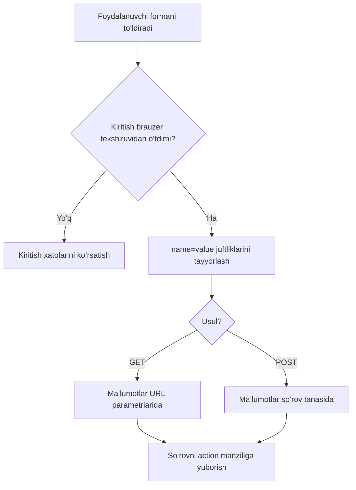
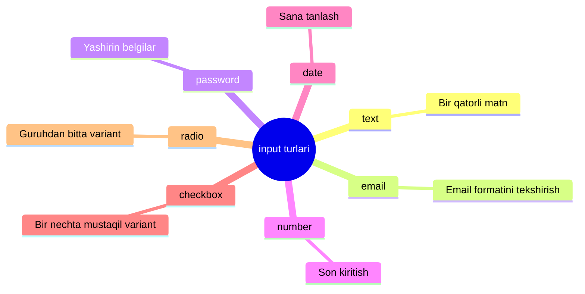

# Formalar qism-1

[Mundarija](../../README.md) · [← Orqaga](../../Lesson-5/uz/Jadvallar.md) · [Keyingi →](../../Lesson-7/uz/Formalar%20qism-2.md) · [RU](../ru/%D0%A4%D0%BE%D1%80%D0%BC%D1%8B%20%D1%87-1.md) · [EN](../en/Forms%20part%201.md) · [UZ](Formalar%20qism-1.md) · [Amaliyot](../practice.html)

> **Oldingi dars bilan bog‘liqlik:** 5-darsda ma’lumotlarni jadvallarda ko‘rsatdingiz. Bugun ma’lumotlarni **yig‘ishni** o‘rganamiz: kiritish maydonlari, imzolar, belgilash katakchalari, o‘tkazgichlar va yuborish tugmasi.

---

## Bu sizga nima uchun kerak

Kursga yozilish, ro‘yxatdan o‘tish, qidiruv, do‘konda buyurtma - bularning hammasi formalar. Formasiz sayt faqat ma’lumot ko‘rsatadi, forma bilan esa uni qabul qila boshlaydi.

Bugun to‘garakka yozilish formasini yig‘asiz va tugma bosilganda brauzer qanday ma’lumot yuborishini ko‘rasiz.

---

## Nimani o‘rganasiz

- `<form>` tegi bilan forma yaratish va `get` yoki `post` usulini tanlash.
- Imzoni maydon bilan bog‘lash: `<label for>` va `id`.
- Ma’lumotlar serverga ketadigan `name` nomlarini berish.
- Maydon turlaridan foydalanish: `text`, `email`, `password`, `number`, `date`, `tel`.
- `value` qiymatli belgilash katakchalari (`checkbox`) va o‘tkazgichlar (`radio`) yaratish.
- `placeholder` ni `value` dan farqlash, maydonni majburiy qilish (`required`).
- Brauzerga avtomatik to‘ldirishni maslahat berish (`autocomplete`).

---

## Takrorlash: 3- va 5-darslardan 3 savol

1. Elementning noyob nomi qaysi atribut bilan beriladi?
2. Sahifada bir xil `id` li ikki element bo‘lishi mumkinmi?
3. Jadvallarni nima uchun ishlatib bo‘lmaydi?

Javoblar - dars oxirida.

---

## Reja

| Bo‘lim | Nima qilamiz |
| --- | --- |
| `<form>` tegi | Qog‘oz anketa |
| Maydon imzosi | `label`, `for`, `id` |
| Maydon nomi | `name` |
| Maydon turlari | text, email, password, number, date, tel |
| Katakchalar va o‘tkazgichlar | checkbox va radio |
| Mini-topshiriq 1 | radio guruhi |
| Maslahat va majburiylik | `placeholder`, `value`, `required`, `autocomplete` |
| Yuborish | `input type="submit"` va manzilda nima ko‘rinadi |
| Mini-topshiriq 2 | Qidiruv formasi |
| Mustaqil ish | IDE topshirig‘i va to‘garakka yozilish |

---

## `<form>` tegi

**Oddiy qilib aytganda:** forma - qog‘oz anketa. Maydonlarni to‘ldirasiz va anketani kerakli xonaga eltasiz. HTML da brauzer ma’lumotlarni manzilga «eltadi».

```html
<form action="/register" method="get">
    <!-- maydonlar -->
</form>
```

| Atribut | Ma’nosi | O‘xshatish |
| --- | --- | --- |
| `action` | Qayerga yuborish | Xona raqami |
| `method="get"` | Ma’lumotlar sahifa manzilida | Konvert ustidagi yozuv: hamma ko‘radi |
| `method="post"` | Ma’lumotlar so‘rov ichida | Konvert ichidagi yozuv |

**Xavfsizlik haqida muhim:** `post` ma’lumotlarni manzildan yashiradi, lekin ularni **shifrlamaydi**. Uzatishni faqat sayt manzilidagi `https://` himoya qiladi.

**Kursning o‘quv formalarida** biz `method="get"` yozamiz va `action` yozmaymiz: shunda forma o‘sha sahifaga yuboriladi va tugmani bosgandan keyin yuborilgan ma’lumotlarni to‘g‘ridan-to‘g‘ri manzil qatorida ko‘rasiz. Ular hech qayerga saqlanmaydi - bu o‘quv misoli. Faqat to‘qima ma’lumotlarni kiriting.



**Sxemani qanday o‘qish kerak.** Avval brauzer maydonlarni tekshiradi. Hammasi to‘g‘ri bo‘lsa - `name=value` juftliklarini yig‘ib yuboradi: GET da - manzilda, POST da - so‘rov ichida.

---

## Maydon imzosi: `label`, `for`, `id`

**Oddiy qilib aytganda:** anketaning har bir maydonida yozuv bor: «Familiya», «Telefon». HTML da yozuv - `<label>`. Uni maydonga **bog‘lash** kerak.

```html
<label for="name">Ism</label>
<input type="text" id="name" name="name">
```

Bog‘lanish: imzodagi `for` = maydondagi `id`. Harfma-harf.

**Bu nima beradi:**
1. **Imzoni bosish kursorni maydonga qo‘yadi.** Ayniqsa kichik katakchalar uchun qulay.
2. **Ekran o‘quvchi imzoni o‘qiydi:** «Ism, kiritish maydoni». Bog‘lanishsiz u faqat «kiritish maydoni» deydi.

### Buzib ko‘ring

1. «Ism» so‘zini bosing - kursor maydonga sakradi.
2. `for="name"` ni `for="nam"` ga o‘zgartiring. Imzoni yana bosing. Kursor endi sakramaydi: bog‘lanish yo‘qoldi.

### Ikkinchi usul: maydon imzo ichida

```html
<label>
    Ism
    <input type="text" name="name">
</label>
```

Xuddi shunday ishlaydi. Kursda `for` va `id` li birinchi usuldan foydalanamiz: uni tekshirish tushunarliroq.

### Yangi o‘rganuvchilarning tipik xatolari

| Xato | Qanday tuzatish |
| --- | --- |
| Imzo oddiy matn `<p>Ism</p>` | `<label for>` ishlating |
| `for` `id` ga mos emas | Harfma-harf |
| Bir xil `id` li ikki maydon | `id` sahifada noyob |
| Imzo o‘rniga `placeholder` | Imzo doim kerak, `placeholder` kiritishda yo‘qoladi |

---

## Maydon nomi: `name`

**`id` va `name` - turli narsalar:**

| Atribut | Nima uchun | O‘xshatish |
| --- | --- | --- |
| `id` | Sahifadagi imzo bilan bog‘lanish | Zaldagi o‘rin raqami |
| `name` | Qiymat serverga ketadigan nom | Kotib uchun anketa grafasidagi yozuv |

**`name` siz maydon yuborilmaydi.** Brauzer uni shunchaki o‘tkazib yuboradi.

`method="get"` bilan forma yuborilgandan keyin manzilda paydo bo‘ladi:

```
?name=Aziz&email=aziz%40example.com
```

Bular `&` bilan ajratilgan `nom=qiymat` juftliklari. `@` belgisini brauzer `%40` deb yozdi - manzilda maxsus belgilar shunday kodlanadi.

---

## Maydon turlari

Kiritish maydoni - bo‘sh `<input>` elementi. Turini `type` atributi belgilaydi:

| Tur | Nima uchun | Brauzer nima qiladi |
| --- | --- | --- |
| `text` | Oddiy matn | Alohida hech narsa |
| `email` | Pochta | `@` borligini tekshiradi; telefonda - `@` li klaviatura |
| `password` | Parol | Belgilarni nuqtalar bilan yashiradi |
| `number` | Son | Yuqori-past strelkalar; harf kiritishga yo‘l qo‘ymaydi |
| `date` | Sana | Kalendar ko‘rsatadi |
| `tel` | Telefon | Telefonda - raqamli klaviatura |

```html
<label for="email">Pochta</label>
<input type="email" id="email" name="email">

<label for="age">Yosh</label>
<input type="number" id="age" name="age">

<label for="start">Boshlanish sanasi</label>
<input type="date" id="start" name="start">
```

**Nimani ko‘rasiz:** sana maydonida - kalendar belgisi. Yosh maydonida - strelkalar. Pochtaga «abc» kiritib formani yuborib ko‘ring: brauzer xato haqida maslahat ko‘rsatadi.

**`password` belgilarni faqat ekranda yashiradi.** `https://` siz parol ochiq uzatiladi.

---

## Katakchalar va o‘tkazgichlar

| Tur | Nechtasini tanlash mumkin | O‘xshatish |
| --- | --- | --- |
| `checkbox` | Istalgancha yoki hech biri | Anketadagi «qiziqishlar» belgilari |
| `radio` | Guruhdan **bittasi** | Eski radio tugmalari: birini bossang, boshqasi chiqib ketadi |

### `checkbox` - mustaqil katakchalar

```html
<input type="checkbox" id="html" name="topics" value="html">
<label for="html">HTML</label>

<input type="checkbox" id="css" name="topics" value="css">
<label for="css">CSS</label>
```

### `radio` - guruhdan bittasi

```html
<input type="radio" id="morning" name="time" value="morning">
<label for="morning">Ertalab</label>

<input type="radio" id="evening" name="time" value="evening">
<label for="evening">Kechqurun</label>
```

**radio guruhini bir xil `name` birlashtiradi.** `name` lar har xil bo‘lsa - ikkalasini tanlash mumkin, guruh buzilgan.

**`value`** - serverga nima ketadi. `value` siz brauzer tushunarsiz `on` yuboradi. `value` bilan - `time=evening`.



**Sxemani qanday o‘qish kerak.** Har bir shox - maydon turi va uning vazifasi. Sxema formadagi maydonlar tartibini belgilamaydi.

### Buzib ko‘ring

Ikki o‘tkazgichga turli `name` bering: `name="time1"` va `name="time2"`. Endi ikkalasini birdaniga tanlash mumkin. Bir xil nomni qaytaring.

### Yangi o‘rganuvchilarning tipik xatolari

| Xato | Qanday tuzatish |
| --- | --- |
| radio larda turli `name` | Bitta guruh - bitta `name` |
| radio va checkbox da `value` yo‘q | `on` yuboriladi. `value` bering |
| Bitta variant kerak joyda checkbox | Bir nechtadan bittasi - `radio` |
| Maydonda `name` yo‘q | Maydon yuborilmaydi |

---

## Mini-topshiriq 1

«Daraja» o‘tkazgichlar guruhini yarating: «Yangi boshlovchi» va «Tajribam bor». Faqat bittasini tanlash mumkin. Serverga `level=beginner` yoki `level=experienced` ketishi kerak. Yechim - «Javoblar» bo‘limida.

---

## Maslahat va majburiylik

### `placeholder` va `value`

```html
<input type="email" id="email" name="email" placeholder="name@example.com">
<input type="text" id="city" name="city" value="Olmaliq">
```

| | `placeholder` | `value` |
| --- | --- | --- |
| Bu nima | Kulrang maslahat-namuna | Maydondagi haqiqiy qiymat |
| Kiritishda | Yo‘qoladi | O‘chirib, almashtirish mumkin |
| Yuboriladimi? | Yo‘q | Ha |

`placeholder` `<label>` ni **almashtirmaydi**: odam yoza boshlashi bilan maslahat yo‘qoladi va u maydon nima ekanini unutadi.

### `required` - majburiy maydon

```html
<input type="text" id="name" name="name" required>
```

`required` - **qiymatsiz** atribut. Maydon bo‘sh bo‘lsa, brauzer formani yubormaydi va maslahat ko‘rsatadi.

### `autocomplete` - avtomatik to‘ldirishga yordam

```html
<input type="email" id="email" name="email" autocomplete="email">
<input type="tel" id="phone" name="phone" autocomplete="tel">
```

Brauzer saqlangan pochta yoki telefonni qo‘yishni taklif qiladi. Foydalanuvchi yozishi shart emas.

---

## Yuborish: `<input type="submit">`

```html
<input type="submit" value="Yozilish">
```

Tugmadagi `value` - undagi yozuv. `<button>` tegini 7-darsda ko‘ramiz.

### To‘liq forma

```html
<form method="get">
    <p>
        <label for="name">Ism</label>
        <input type="text" id="name" name="name" autocomplete="name" required>
    </p>
    <p>
        <label for="email">Pochta</label>
        <input type="email" id="email" name="email" autocomplete="email" required>
    </p>
    <p>
        <input type="radio" id="morning" name="time" value="morning">
        <label for="morning">Ertalab</label>
        <input type="radio" id="evening" name="time" value="evening">
        <label for="evening">Kechqurun</label>
    </p>
    <p>
        <input type="submit" value="Yozilish">
    </p>
</form>
```

Har bir maydon `<p>` ga o‘ralgan - shunday qilib maydonlar ustma-ust turadi.

**Tekshiruv:**
1. Bo‘sh maydonlar bilan «Yozilish» ni bosing. Brauzer formani yubormaydi va birinchi majburiy maydonda maslahat ko‘rsatadi.
2. To‘qima ma’lumotlar bilan to‘ldirib yuboring. Manzil qatoriga qarang: `?name=Aziz&email=aziz%40example.com&time=evening`.

---

## Mini-topshiriq 2

Qidiruv formasini yarating: «Nimani qidiramiz?» imzoli bitta majburiy maydon, maydon nomi `q`, «Topish» tugmasi. Usul - `get`. Yechim - «Javoblar» bo‘limida.

---

## Dars yakuni: shpargalka

| Vazifa | Yozuv |
| --- | --- |
| Forma | `<form method="get">` |
| Imzo | `<label for="x">` + `<input id="x">` |
| Yuborish uchun nom | `name="..."` |
| Pochta / son / sana / telefon | `type="email"` / `"number"` / `"date"` / `"tel"` |
| Bir nechta variant | `type="checkbox"` |
| Guruhdan bittasi | Bitta `name` li `type="radio"` |
| Nima yuborish | `value="..."` |
| Maslahat-namuna | `placeholder="..."` (`label` o‘rniga emas) |
| Majburiy | `required` |
| Avtomatik to‘ldirish | `autocomplete="email"` |
| Tugma | `<input type="submit" value="Yozuv">` |

---

## Mustaqil ish

### 1-qism. IDE topshirig‘i (platforma hisoblaydi)

`method="get"` bilan **«To‘garakka yozilish»** formasini yarating:

1. Ism - `text`, majburiy.
2. Pochta - `email`, majburiy.
3. Boshlanish sanasi - `date`.
4. Ikkita mustaqil `checkbox` katakchasi - qiziqtirgan mavzular.
5. Ikkita `radio` dan iborat guruh - qulay vaqt. Guruhga bitta `name`.
6. **Har bir** maydonda - `<label for>`, har bir maydonda - `id` va `name`, katakcha va o‘tkazgichlarda - `value`.
7. `<input type="submit">` tugmasi.

`<button>` tegini hozircha ishlatmang - u 7-darsdan.

Platforma nimani tekshiradi: `method="get"` li forma, har bir `label for` ning mavjud `id` bilan bog‘lanishi, `text`, `email`, `date`, `checkbox`, `radio`, `submit` turlari, kamida yettita imzo, `required`, `name` va `value` atributlari, `<button>` yo‘qligi.

### 2-qism. Kompyuterdagi loyiha

1. Formani to‘garak saytining kontaktlar sahifasiga qo‘shing.
2. Sahifani Live Server orqali oching va formani bo‘sh yuboring - brauzer yuborishni to‘xtatishi kerak.
3. To‘qima ma’lumotlar bilan yuboring va manzildan `name=value` juftliklarini toping.

### Tayyorlik mezonlari

- [ ] IDE topshirig‘i qabul qilingan.
- [ ] Har bir imzoni bosish kursorni o‘z maydoniga qo‘yadi yoki katakchani belgilaydi.
- [ ] Barcha `id` noyob.
- [ ] radio guruhida faqat bittasi tanlanadi, katakchalar mustaqil.
- [ ] Bo‘sh majburiy maydonlar formani yuborishga yo‘l qo‘ymaydi.
- [ ] Yuborilgan qiymatlar manzilda ko‘rinadi.

---

## O‘zini tekshirish uchun savollar

1. `method="get"` `method="post"` dan nimasi bilan farq qiladi?
2. `post` ma’lumotlarni o‘zi himoya qiladimi?
3. Imzoni maydon bilan qanday bog‘lash mumkin?
4. `id` `name` dan nimasi bilan farq qiladi?
5. Yuborishda `name` siz maydonga nima bo‘ladi?
6. `checkbox` `radio` dan nimasi bilan farq qiladi?
7. radio guruhida faqat bitta variant tanlanishini qanday ta’minlash mumkin?
8. O‘tkazgichlarda `value` nima uchun?
9. Nega `placeholder` `label` ni almashtirmaydi?
10. `required` nima qiladi?

Savollardan keyin platformada **dars testini** topshiring: 12 ta savol, o‘tish chegarasi 70%.

---

## Keyin nima

Forma ishlaydi, lekin unda hozircha oddiy maydonlar. 7-darsda ochiluvchi ro‘yxatlar, ko‘p qatorli matn, maydonlar guruhlari, `<button>` tugmalari va kiritish formatini tekshirishni qo‘shamiz.

---

## Javoblar

**Takrorlash**

1. `id`.
2. Yo‘q, `id` noyob.
3. Sahifa joylashuvi uchun.

**Mini-topshiriq 1**

```html
<input type="radio" id="beginner" name="level" value="beginner">
<label for="beginner">Yangi boshlovchi</label>

<input type="radio" id="experienced" name="level" value="experienced">
<label for="experienced">Tajribam bor</label>
```

**Mini-topshiriq 2**

```html
<form method="get">
    <label for="q">Nimani qidiramiz?</label>
    <input type="text" id="q" name="q" required>
    <input type="submit" value="Topish">
</form>
```

**O‘zini tekshirish uchun savollar**

1. GET ma’lumotlarni sahifa manziliga, POST - so‘rov ichiga qo‘yadi.
2. Yo‘q. Uzatishni faqat HTTPS himoya qiladi.
3. `<label>` dagi `for` maydondagi `id` ga teng bo‘lishi kerak.
4. `id` sahifadagi imzo bilan bog‘laydi, `name` - yuborishdagi qiymat nomi.
5. U yuborilmaydi.
6. Checkbox - istalgancha variant, radio - guruhdan aynan bittasi.
7. Guruhdagi barcha o‘tkazgichlarga bir xil `name` berish.
8. Serverga `on` emas, tushunarli qiymat ketishi uchun.
9. Maslahat kiritishda yo‘qoladi, ekran o‘quvchi esa uni imzo sifatida o‘qimasligi mumkin.
10. Maydon bo‘sh ekan, formani yuborishga yo‘l qo‘ymaydi.

---

[Mundarija](../../README.md) · [← Orqaga](../../Lesson-5/uz/Jadvallar.md) · [Keyingi →](../../Lesson-7/uz/Formalar%20qism-2.md) · [RU](../ru/%D0%A4%D0%BE%D1%80%D0%BC%D1%8B%20%D1%87-1.md) · [EN](../en/Forms%20part%201.md) · [UZ](Formalar%20qism-1.md) · [Amaliyot](../practice.html)
