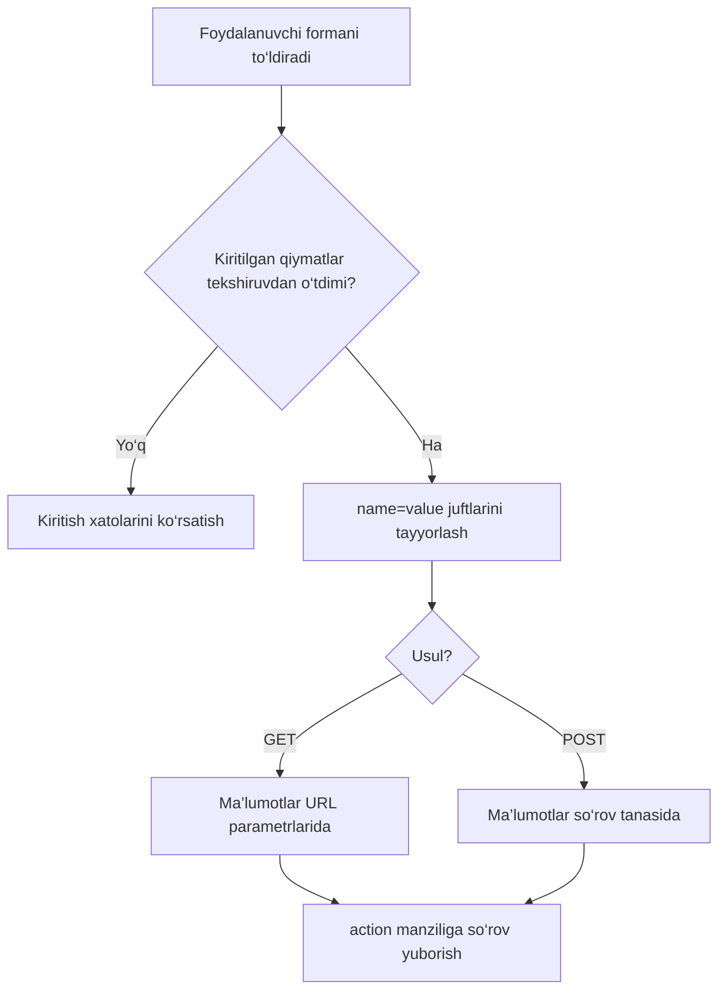
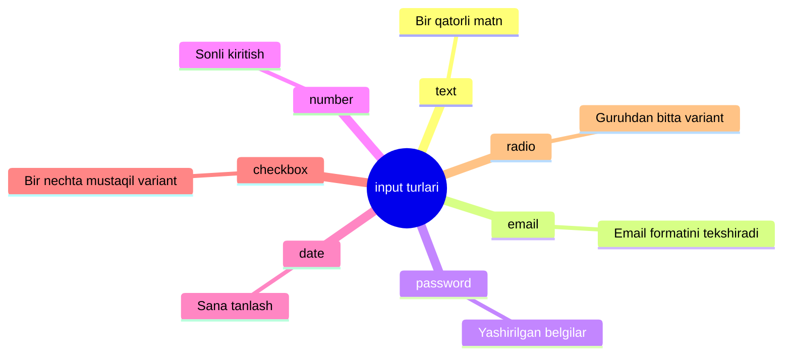

# Formalar qism-1

[Mundarija](../../README.md) | [Oldingi dars](../../Lesson-5/uz/Jadvallar.md) | [Keyingi dars](../../Lesson-7/uz/Formatlar%20qism-2.md) | [RU](../ru/%D0%A4%D0%BE%D1%80%D0%BC%D1%8B%20%D1%87-1.md) | [EN](../en/Forms%20part%201.md) | [UZ](../uz/Formatlar%20qism-1.md) | [Amaliyot: namuna](../practice.html)


> **Oldingi dars bilan bog'lanish:** o'tgan darsda biz ma'lumotlarni jadvallar orqali ko'rsatishni o'rgandik. Bugun formalarga o‘tamiz: HTML formasi foydalanuvchi ma’lumot kiritishi va brauzer uni yuborishi uchun maydonlarni birlashtiradi. Oldin sahifalar faqat ma'lumot ko'rsatardi, endi uni qabul qilishni ham o'rganadi.

---

## Dars oxiriga qadar nimani o'rganasiz

- `<form>` tegi bilan forma yaratish va `action` hamda `method` atributlarini tushunish.
- Asosiy `input` turlarini ishlatish: text, email, password, number, date, checkbox, radio.
- `label` ni `for`/`id` orqali maydon bilan to'g'ri bog'lash.
- `placeholder` va `value` farqini tushunish.
- `required` orqali maydonlarni majburiy qilish.

---

## Dars rejasi

| Bo‘lim                                     | Mazmuni                                         |
| ---------------------------------------- | ----------------------------------------------- |
| form tegi: action, method             | Nima uchun forma kerak, ma'lumotlar qayerga ketadi |
| label va for/id                       | Yorliqni maydon bilan bog'lash - formalar qulayligining asosi |
| input turlari qism 1: text, email, password | Matnli maydonlar                               |
| input turlari qism 2: number, date    | Sonlar va sanalar                               |
| checkbox va radio                     | "Bir nechtasini tanlash" va "bittasini tanlash" farqi |
| Kichik topshiriq                      | Maydonni mustaqil yaratish                      |
| placeholder vs value, required        | Yangi boshlovchilar ko'p adashadigan joy         |
| Xulosalar va amaliy topshiriq         | Mustahkamlash - aloqa formasini yig'amiz         |

---

## `<form>` tegi: action va method

**Oddiy qilib aytganda:** qog'oz anketani tasavvur qiling, uni to'ldirasiz va ma'lum xonaga topshirasiz. HTML da forma shunday ishlaydi: foydalanuvchi maydonlarni to'ldiradi, yuborilganda brauzer ma'lumotlarni ma'lum manzilga "olib boradi" (odatiy serverga, ularni qayta ishlaydi).

```html
<form method="get">
    <!-- forma maydonlari shu yerda bo'ladi -->
</form>
```

- **`action`** — so‘rov manzili. O‘quv misolidagi `action` atributini yozmaslik joriy sahifaga yuborishni bildiradi. Bu kursda ishlaydigan forma qayta ishlovchisi yo‘q.
- **`method`** - ma'lumotlarni qanday usulda yuborish. Ikki asosiy qiymat:
    - **`get`** - ma'lumotlar to'g'ridan-to'g'ri brauzer manzil satriga qo'shiladi (URL da ko'rinadi), shaxsiy ma'lumotlar yo'qidagi qidiruv formalariga mos keladi.
    - **`post`** — ma’lumot so‘rov tanasida uzatiladi. Bu usul ro‘yxatdan o‘tish va xabar yuborishda ko‘p ishlatiladi, ammo o‘zi ma’lumotni shifrlamaydi. Bu darsda yuborishni kuzatish uchun `get` va faqat o‘ylab topilgan ma’lumotlardan foydalanamiz.




**Chizmani qanday o‘qish kerak:** Avval brauzer kiritilgan qiymatlarni tekshiradi: noto‘g‘ri bo‘lsa, foydalanuvchi tuzatadi. To‘g‘ri qiymatlardan yuboriladigan juftlar tayyorlanadi; GET ularni URLga, POST so‘rov tanasiga joylaydi. Bu sxema ma’lumotlar serverda albatta saqlanishini bildirmaydi.

**Yuborish va xavfsizlik.** POST ma’lumotlarni so‘rov tanasiga joylaydi, ammo shifrlamaydi. Uzatishda HTTPS himoya qiladi. Ishlaydigan qayta ishlovchi bo‘lmasa ham brauzer `action` manziliga so‘rov yuborishga urinadi; server xato qaytarishi, ma’lumotlar esa qayta ishlanmasligi va saqlanmasligi mumkin. Statik hostingda HTML o‘zi arizalarni saqlamaydi. Misollardagi `action` atributini yozmaslik joriy sahifaga yuborishni bildiradi: haqiqiy parol yoki shaxsiy ma’lumot yubormang.

---

## `<label>` va `for`/`id` bog'lanishi

Bu, ehtimol, bugungi darsning eng muhim mavzusi - ko'pchilik yangi boshlovchilar uni o'tkazib yuboradi, va bejiz.

**Oddiy qilib aytganda:** `<label>` - bu forma maydonining yorlig'i, masalan, ism maydoni yonidagi "Ism:" yozuvi. Lekin oddiy matnni maydon yoniga joylashtirish yetarli emas. Yorliqni aniq maydon bilan **bog'lash** kerak.

```html
<p><label for="username">Foydalanuvchi nomi:</label> <input type="text" id="username" name="username"></p>
```

Bog'lanishni tushuntiramiz:

- `<label>` ning `for` atributi bor, qiymati `"username"`.
- `<input>` ning `id` atributi bor, **aynan bir xil** qiymat bilan - `"username"`.

Ana shu qiymatlar mos kelishi yorliqni maydon bilan bog'laydi.

**Agar vizual jihatdan yorliq qaysi maydonga tegishliligini tushunish oson bo'lsa, nima uchun bu kerak:**

1. **Yorliqni bosish maydonni faollashtiradi.** Sinab ko'ring - agar bog'lanish to'g'ri o'rnatilgan bo'lsa, "Foydalanuvchi nomi:" matnini bosish kursori kiritish maydoniga qo'yadi. Bu kichik elementlar, masalan, checkbox lar (tegishli bo‘limda) uchun juda foydali - yonidagi matnni bosish kichik kvadratchaga aniq tegishdan qulayroq.
2. **Ekran o'quvchilari aynan shu bog'lanishdan foydalanadi.** Usiz ko'zi ojiz foydalanuvchi kiritish maydoniga tushganda, nimani anglatishini tushunmaydi - ekran o'quvchisi shunchaki kontekstsiz "matn maydoni" deb aytadi.

### Muqobil usul - input ni label ichiga o'rab olish

```html
<label>
    Foydalanuvchi nomi:
    <input type="text" name="username">
</label>
```

Bu yerda `id`/`for` kerak emas - ichki joylashuv o'zi bog'lanishni yaratadi. Ikkala usul ham to'g'ri, lekin `for`/`id` orqali aniq usul (birinchi variant) murakkab veb-qurilishda ko'proq tarqalgan va bashorat qilinadigan hisoblanadi - bu kursda asosan uni ishlatamiz.

**`<input>` dagi `name` atributi:** e'tibor bering, maydonning `id` dan tashqari `name` atributi ham bor - bu `id` bilan **bir xil narsa emas**. `name` - maydon nomi, shu nom orqali ma'lumotlar forma yuborilganda serverga ketadi (serverdagi qayta ishlash aynan `name` bo'yicha o'qiydi). `id` - `<label>` bilan bog'lanish va stilizatsiya/skriptlar uchun ishlatiladi. Aniq label bog‘lanishi va yuborish ishlatilgan misollarimizda **ikkala** atribut kerak, ular (lekin shart emas) qiymatda mos kelishi mumkin.

---

### Yangi boshlovchilarning ko'p uchraydigan xatolari

| Xatolik                                                 | Qanday tuzatish                                                                               |
| ------------------------------------------------------- | --------------------------------------------------------------------------------------------- |
| `<label>` ni `<input>` yoniga `for`/`id` siz yozish    | Har doim aniq bog'lang: `label` da `for="ism"` va `input` da `id="ism"` bir xil qiymat bilan  |
| `id` va `name` ni adashtirish, faqat bittasini ishlatish | Maydonda ikkala atribut kerak: `id` - label bilan bog'lanish uchun, `name` - serverga ma'lumot yuborish uchun |
| Bir nechta turli maydon uchun bir xil `id` ishlatish    | 3-darsdan eslab qoling, `id` butun sahifada noyob bo'lishi kerak                              |

---

## `input` turlari qism 1: text, email, password

`<input>` tegi - 4-darsdagi `` kabi juftlikka kirmaydigan. Uning xulqi `type` atributiga qarab butunlay o'zgaradi.

### `type="text"` - oddiy bir qatorli matn maydoni

```html
<p><label for="fullname">To'liq ism:</label> <input type="text" id="fullname" name="fullname"></p>
```

Asosiy tur - shunchaki to'g'ri burchakli maydon, bir qatorda istalgan matnni kiritish uchun.

### `type="email"` - email maydoni

```html
<p><label for="email">Email:</label> <input type="email" id="email" name="email"></p>
```

Vizual jihatdan oddiy matn maydoniga o'xshaydi, lekin brauzer kiritilgan matn email ga o'xshashligini **avtomatik tekshiradi** (`@` va manzil tuzilishini o'z ichiga oladi) - noto'g'ri email bilan formani yuborishga urinilganda brauzer o'zi ogohlantirish ko'rsatadi, JavaScript yozmasdan. Mobil qurilmalarda bunday maydon faollashtirilganda tezda `@` va `.com` ga kirish imkonini beruvchi maxsus klaviatura paydo bo'ladi.

### `type="password"` - parol maydoni

```html
<p><label for="password">Parol:</label> <input type="password" id="password" name="password"></p>
```

Foydalanuvchi kiritgan belgilar nuqta yoki yulduzcha sifatida ko'rsatiladi (••••••) - parol matni yelkasidan qarab turgan odamdan yashirin.

---

## `input` turlari qism 2: number, date

### `type="number"` - son maydoni

```html
<p><label for="age">Yosh:</label> <input type="number" id="age" name="age"></p>
```

Bu maydon sonli qiymatlar uchun mo‘ljallangan. Strelkalar va kiritish paytidagi oraliq belgilar brauzerga bog‘liq: minus belgisi yoki eksponent yozuvi qabul qilinishi mumkin. Shuning uchun bu “faqat raqam” bilan cheklash usuli emas. Qiymat chegaralarini keyingi darsda o‘rganamiz.

### `type="date"` - sana tanlash maydoni

```html
<p><label for="birthday">Tug'ilgan sana:</label> <input type="date" id="birthday" name="birthday"></p>
```

Brauzer o'zi sanani tanlash uchun qulay vizual kalendar ko'rsatadi - bitta qator qo‘shimcha kodsiz. Serverga ketadigan sana formati har doim standartlashtirilgan (`YYYY-MM-DD`), vizual jihatdan turli mamlakatlarda kalendar turlicha ko'rsatilsa ham.

---

### Yangi boshlovchilarning ko'p uchraydigan xatolari

|Xatolik|Qanday tuzatish|
|---|---|
|Email/sonlar uchun maxsus turlar o'rniga `type="text"` ishlatish|`type="email"`, `type="number"`, `type="date"` ishlating - ular kod qo'shmasdan ichki tekshiruv va qulay kiritish interfeysini beradi|
|`type="email"` o'zi xabar "yuboradi" deb kutish|Bu faqat matn formatini tekshirish - yuborish faqat forma/server logikasi orqali amalga oshiriladi|

---

## `checkbox` va radio

Bu bir-biriga o'xshash, lekin prinsipial jihatdan turli maydon turlari - ularni adashtirish yangi boshlovchilarning eng ko'p uchraydigan xatolaridan biri.

### `type="checkbox"` - bir nechtasini tanlash mumkin (yoki hech birini)

```html
<p>Qiziqayotgan mavzuingizni tanlang:</p>

<p><input type="checkbox" id="html" name="topics" value="html"> <label for="html">HTML</label></p>

<p><input type="checkbox" id="css" name="topics" value="css"> <label for="css">CSS</label></p>

<p><input type="checkbox" id="js" name="topics" value="js"> <label for="js">JavaScript</label></p>
```

Har bir checkbox boshqalardan mustaqil. Foydalanuvchi istalgan sonida variantlarni belgilashi mumkin, jumladan hech birini.


### `type="radio"` - guruhdan faqat bitta variant tanlash mumkin

```html
<p>Tayyorgarlik darajangizni tanlang:</p>

<p><input type="radio" id="beginner" name="level" value="beginner"> <label for="beginner">Boshlang'ich</label></p>

<p><input type="radio" id="intermediate" name="level" value="intermediate"> <label for="intermediate">O'rta</label></p>

<p><input type="radio" id="advanced" name="level" value="advanced"> <label for="advanced">Yuqori</label></p>
```

**Radio tugmalarini guruh qiladigan kalit moment:** barcha variantlarning **bir xil `name` atributi** bor (misolda - `name="level"`). Aynan `name` ning mos kelishi brauzerga "bu bitta savolning variantlari - bittasini tanlash avtomatik boshqalarini tanlashni bekor qiladi" degan signal beradi. Shu bilan birga har bir variantning `id` si **turli** (bo'lmasa label bilan bog'lanish buziladi).


### checkbox/radio da `value` qiymati

`value` atributi tanlangan variant serverga qanday qiymat yuborishini belgilaydi. Foydalanuvchiga ko'rinadigan matn `<label>` orqali belgilanadi, `value` emas - bu turli narsalar.

---

### Yangi boshlovchilarning ko'p uchraydigan xatolari

| Xatolik                                                                               | Qanday tuzatish                                                                                             |
| ------------------------------------------------------------------------------------- | ----------------------------------------------------------------------------------------------------------- |
| "Barcha mos variantlarni tanlang" savollari uchun `checkbox` o‘rniga `radio` ishlatish | Ko'p tanlov uchun - `checkbox`, bitta tanlov uchun - `radio`                                                |
| Bir guruh radio tugmalariga turlicha `name` qiymatlari berish                          | Barcha radio tugmalari bir guruhdan **bir xil** `name` ga ega bo'lishi kerak - bo'lmasa guruh sifatida ishlamaydi |
| Checkbox maydonlariga bir xil `id` berish                                              | Har bir maydonning o'z noyob `id` si bo'lishi kerak, `name` bir xil bo‘lsa ham (masalan, `topics` misolida)    |

---

## Kichik topshiriq

Namunalarga qaramasdan, "Sevimli ichimligingiz" savoli uchun "Choy", "Kofe", "Sharbat" variantlari bilan uchta radio tugmadan iborat guruh yarating - to'g'ri `label`/`id` bog'lanishlari va umumiy `name` bilan.

**Yechim:**

```html
<p>Sevimli ichimligingiz:</p>

<p><input type="radio" id="tea" name="drink" value="tea"> <label for="tea">Choy</label></p>

<p><input type="radio" id="coffee" name="drink" value="coffee"> <label for="coffee">Kofe</label></p>

<p><input type="radio" id="juice" name="drink" value="juice"> <label for="juice">Sharbat</label></p>
```



**Chizmani qanday o‘qish kerak:** Har bir asosiy shox input turini, uning ichki yozuvi asosiy vazifasini bildiradi. checkbox lar mustaqil, bir xil name bilan birlashgan radio lar esa bir savolning yagona tanlovidir.

---

## `placeholder` vs `value` va `required`

Bu yana bir ko'p adashiladigan joy - ikki atribut, ikkalasi ham maydon ichida matn ko'rsatadi, lekin butunlay turlicha ishlaydi.

### `placeholder` - namuna ko'rsatma, kiritishda yo'qoladi

```html
<p><label for="search">Qidirish:</label> <input type="text" id="search" name="search" placeholder="Masalan: HTML kursi"></p>
```

`placeholder` matni **bo'sh maydon ichida kulrang rangda** kiritish formati ko'rsatmasi sifatida ko'rsatiladi - va foydalanuvchi yozishni boshlaganda **avtomatik yo'qoladi**. Foydalanuvchi hech narsa kiritmagan bo'lsa, u serverga **yuborilmaydi** - maydon bo'sh hisoblanadi.

### `value` - maydonning haqiqiy qiymati, yuborilganda qoladi

```html
<p><label for="city">Shahar:</label> <input type="text" id="city" name="city" value="Toshkent"></p>
```

Qiymat yuborilishi maydonning forma ma’lumotlariga kirishiga bog‘liq: `name` kerak; tanlanmagan checkbox va radio yuborilmaydi. `name` berilgan oddiy matn maydoni joriy qiymatini, foydalanuvchi oldindan yozilgan qiymatni o‘zgartirmagan bo‘lsa ham, yuboradi.

### Amalda taqqoslash

```html
<!-- placeholder: format ko'rsatmasi, kiritishda yo'qoladi, maydon bo'sh bo'lsa yuborilmaydi -->
<p><label for="hint-name">Ism</label> <input type="text" id="hint-name" name="hint_name" placeholder="Ismingizni kiriting"></p>

<!-- value: haqiqiy oldindan to'ldirilgan qiymat, o'zgartirmasangiz o'zgacha yuboriladi -->
<p><label for="default-name">Ism</label> <input type="text" id="default-name" name="default_name" value="Mehmon"></p>
```


### `required` - majburiy maydon

```html
<p><label for="email">Email:</label> <input type="email" id="email" name="email" required></p>
```

`required` atributi (qiymatsiz yoziladi) maydonni to'ldirish uchun majburiy qiladi - bo'sh majburiy maydon bilan formani yuborishga urinilganda brauzer o'zi ogohlantirish ko'rsatadi va formani yuborishga ruxsat bermaydi, yana JavaScript yozmasdan.

---

### Yangi boshlovchilarning ko'p uchraydigan xatolari

| Xatolik                                                                                     | Qanday tuzatish                                                                                               |
| ------------------------------------------------------------------------------------------ | ------------------------------------------------------------------------------------------------------------- |
| Maydon yorlig'i o'rniga `placeholder` ni ishlatish                                         | `placeholder` format ko'rsatmasi, `label` almashtirmaydi; maydon yorlig'i har doim `<label>` orqali bo'lishi kerak |
| `placeholder` va `value` ni adashtirish - placeholder forma bilan yuboriladi deb kutish     | Eslab qoling: `placeholder` yo'qoladi va yuborilmaydi, `value` - haqiqiy tarkib, yuborishda qatnashuvchi, `name` berilgan maydondan yuboriladi           |
| Haqiqatan majburiy maydonlar uchun `required` ni unutish (masalan, ro'yxatdan o'tishda email) | Maydon mantiqan bo'sh bo'la olmaydigan joylarga `required` qo'shing                                             |

---

## Formani yuborish tugmasi

`form` ichiga `<input type="submit" value="O‘quv formasini yuborish">` qo‘shing. Bu tugma yaratadi: `type="submit"` tekshirish va yuborishni boshlaydi, `value` esa tugma yozuvini belgilaydi. Bu tugmaga alohida `label` kerak emas. Keyingi darsda uni `button` bilan taqqoslaymiz.

```html
<form method="get">
    <p><label for="demo-name">O‘quv ismi</label> <input type="text" id="demo-name" name="student" required></p>
    <input type="submit" value="O‘quv formasini yuborish">
</form>
```

Faqat o‘ylab topilgan ma’lumotdan foydalaning: so‘rov joriy sahifaga yo‘naladi, parametrlar URLda ko‘rinadi. Bu misol arizani qayta ishlamaydi va saqlamaydi.

---

## Dars xulosalari

Bugun siz o'rgandingiz:

- `action` (qayerga yuborish) va `method` (`get`/`post`, qanday yuborish) atributlari bilan `<form>` - barcha maydonlar uchun konteyner.
- `<label>` maydon bilan `for`/`id` orqali yoki maydonni ichiga joylash orqali bog‘lanadi - bu bosish qulayligiga va ekran o'quvchilari uchun qulaylikka ta'sir qiladi.
- Maxsus `input` turlari: `text`, `email` (format tekshiruvi), `password` (yashirin matn), `number` (sonli kiritish), `date` (vizual kalendar).
- `checkbox` - bir nechta variantni tanlash mumkin (mustaqil maydonlar), `radio` - guruhdan faqat bitta (bir xil `name` orqali birlashtirilgan).
- `placeholder` - yo'qoluvchi ko'rsatma, forma bilan yuborilmaydi; `value` - maydonning haqiqiy tarkibi, yuborishda qatnashuvchi, `name` berilgan maydondan yuboriladi.
- `required` maydonni JavaScript yozmasdan majburiy qiladi.


## Mustaqil ish

Kursga yozilish uchun o‘quv formasi yarating: ism, email, boshlanish sanasi, ikkita mustaqil checkbox va ikki variantli radio guruhi. Har bir maydonni label bilan bog‘lang; `name` va variantlar qiymatlarini belgilang. Ism va emailni majburiy qiling. Faqat o‘ylab topilgan ma’lumotlardan foydalaning. Tajriba uchun `method="get"` ishlating, `action` atributini yozmang; lokal HTTP serverdan formani yuboring va manzildagi `name=value` juftlarini toping.

### Tayyorlik mezonlari

- [ ] Label bosilganda tegishli maydon faollashadi; id takrorlanmaydi.
- [ ] Radio guruhida bitta variant tanlanadi; checkbox mustaqil.
- [ ] Bo‘sh majburiy maydonlar yuborishni to‘xtatadi; tanlangan qiymatlar URLda ko‘rinadi.

### Bilimingizni tekshiring

1. name va id farqi nima?
2. Nima uchun HTTPSsiz POST ma’lumotni himoya qilmaydi?
3. Ishlaydigan qayta ishlovchisiz forma yuborilsa nima bo‘ladi?

---

[Mundarija](../../README.md) | [Oldingi dars](../../Lesson-5/uz/Jadvallar.md) | [Keyingi dars](../../Lesson-7/uz/Formatlar%20qism-2.md) | [RU](../ru/%D0%A4%D0%BE%D1%80%D0%BC%D1%8B%20%D1%87-1.md) | [EN](../en/Forms%20part%201.md) | [UZ](../uz/Formatlar%20qism-1.md) | [Amaliyot: namuna](../practice.html)
