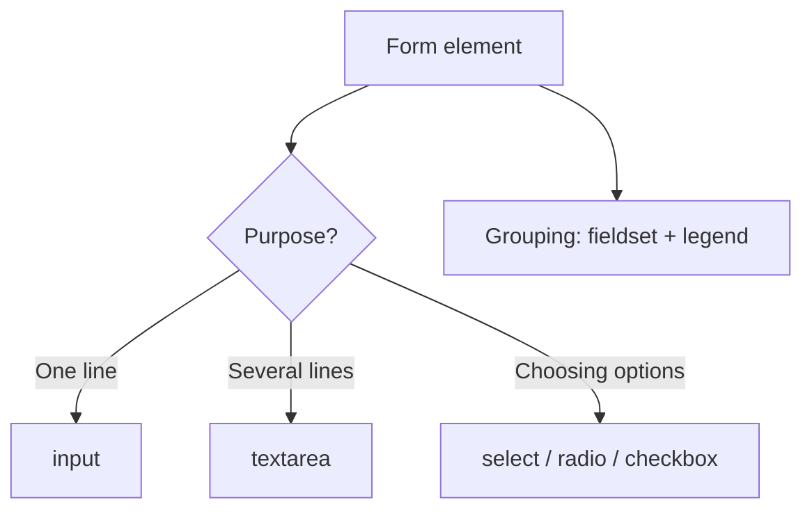
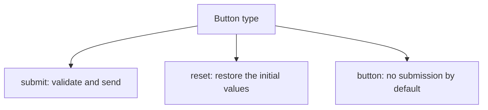

# Forms part 2

[Contents](../../README.md) · [← Back](../../Lesson-6/en/Forms%20part%201.md) · [Next →](../../Lesson-8/en/Accessibility%20%28a11y%29.md) · [RU](../ru/%D0%A4%D0%BE%D1%80%D0%BC%D1%8B%20%D1%87-2.md) · [EN](Forms%20part%202.md) · [UZ](../uz/Formalar%20qism-2.md) · [Practice](../practice.html)

> **Link to the previous lesson:** in lesson 6 you built a form from `input` fields, labels and radio buttons. Today we add drop-down lists, multi-line text, field groups, real buttons and input format validation.

---

## Why you need this

A "Tell us about yourself" question doesn't fit on one line. Choosing a city from 14 regions shouldn't be 14 radio buttons in a row. And a student ID number must be exactly 7 digits, not "abc".

Today you will build a full participant form that checks what the user typed by itself.

---



**How to read the diagram.** Choose an element by the type of answer: one line, several lines, or a choice from ready options. Grouping with `fieldset` + `legend` works with any fields.

---

## What you will learn

- Make a drop-down `select` with `option` items, `optgroup` groups and a default choice.
- Suggest options in an ordinary field with `datalist`.
- Accept long text with `textarea`.
- Group fields: `fieldset` and `legend`.
- Choose a button: `button` with type `submit`, `reset` or `button`.
- Validate input: `min`, `max`, `maxlength`, `pattern`.
- Make a slider with `type="range"`.

---

## Review: 3 questions from lesson 6

1. How do you connect a label to a field?
2. What must radio buttons in one group have in common?
3. What does the `required` attribute do?

Answers are at the end of the lesson.

---

## Lesson plan

| Section | What we do |
| --- | --- |
| Drop-down list | `select`, `option`, `optgroup` |
| Suggestions in a field | `datalist` |
| Multi-line text | `textarea` |
| Field groups | `fieldset` and `legend` |
| Mini-task 1 | A "Contacts" group |
| Buttons | `button` and its three types |
| Input validation | `min`, `max`, `maxlength`, `pattern`, `range` |
| Mini-task 2 | A 7-digit ID field |
| Independent work | IDE task and a participant form |

---

## Drop-down list: `select`

**In simple terms:** `select` is a café menu. The options are already printed; you choose rather than write your own.

```html
<label for="city">City</label>
<select id="city" name="city">
    <option value="">- Choose a city -</option>
    <option value="tashkent">Tashkent</option>
    <option value="almalyk" selected>Almalyk</option>
    <option value="samarkand">Samarkand</option>
</select>
```

| Part | What it does |
| --- | --- |
| `<select>` | The list itself. `id` for the label, `name` for sending |
| `<option value>` | An option. The user sees the text; the server gets the `value` |
| `selected` | The option chosen in advance |

**What you will see:** a field with an arrow, with "Almalyk" already chosen. Click it and the list opens.

### Option groups: `optgroup`

```html
<label for="course">Track</label>
<select id="course" name="course">
    <optgroup label="Frontend">
        <option value="html">HTML</option>
        <option value="css">CSS</option>
    </optgroup>
    <optgroup label="Backend">
        <option value="php">PHP</option>
        <option value="sql">SQL</option>
    </optgroup>
</select>
```

**What you will see:** in the open list - grey "Frontend" and "Backend" headings with options below them. A group heading can't be chosen.

### Several options: `multiple`

```html
<select id="days" name="days" multiple>
```

Now several options can be chosen: hold Ctrl (Cmd on macOS). Beginners find this awkward - if there are few options, checkboxes are better.

**`select` or `radio`?** 2–5 options - `radio`: all are visible at once. More - `select`: it takes up no space.

---

## Suggestions in a field: `datalist`

The user can type their own value, but you suggest popular options:

```html
<label for="lang">Favourite language</label>
<input type="text" id="lang" name="lang" list="langs">
<datalist id="langs">
    <option value="JavaScript">
    <option value="Python">
    <option value="PHP">
</datalist>
```

The link: `list` on the field = `id` on the `datalist`.

**The difference from `select`:** `select` has only ready options; `datalist` gives suggestions, but you can type your own.

---

## Multi-line text: `textarea`

```html
<label for="about">About me</label>
<textarea id="about" name="about" rows="4" cols="40" maxlength="300">I am a first-year student.</textarea>
```

| Attribute | What it does |
| --- | --- |
| `rows` | Height in lines |
| `cols` | Width in characters |
| `maxlength` | No more than N characters |

**`textarea` is a paired tag.** The initial text goes **between the tags**, not in `value`:

```html
<!-- Wrong -->
<textarea value="Text"></textarea>

<!-- Right -->
<textarea>Text</textarea>
```

---

## Field groups: `fieldset` and `legend`

**In simple terms:** on a paper form, fields are framed with headings: "Personal details", "Contacts". In HTML the frame is `<fieldset>`, and the frame heading is `<legend>`.

```html
<fieldset>
    <legend>Convenient time</legend>
    <input type="radio" id="morning" name="time" value="morning">
    <label for="morning">Morning</label>
    <input type="radio" id="evening" name="time" value="evening">
    <label for="evening">Evening</label>
</fieldset>
```

**What you will see:** a frame around the fields with the heading "Convenient time" in its top line.

**What a blind user hears:** "Convenient time, group. Morning, radio button". Without `legend` they hear just "Morning" - but morning for what?

**`legend` comes first** inside `fieldset`.

### Common beginner mistakes

| Mistake | How to fix |
| --- | --- |
| `textarea value="..."` | Text between the tags |
| A `select` without a label | A list needs a `<label for>` too |
| A radio group without `fieldset` | Wrap it and give it a `legend` question |
| `legend` not first | First inside `fieldset` |
| `select` for 2 options | `radio` is better |

---

## Mini-task 1

Make a framed "Contacts" group with a heading: an email field and a phone field, both with labels. The solution is in the "Answers" section.

---

## Buttons: `button`

In lesson 6 you used `<input type="submit">`. There is a more flexible tag - `<button>`:

```html
<button type="submit">Send the form</button>
```

**Why `<button>` is handier:** it's a paired tag, so you can put text with other tags inside, such as `<strong>`.

| Type | What it does |
| --- | --- |
| `type="submit"` | Validates the form and sends it |
| `type="reset"` | Restores the **initial** values of all fields |
| `type="button"` | Does nothing by itself - for JavaScript |



**How to read the diagram.** Three different values of `type`, not three steps.

**Always write `type`.** A button inside a form without `type` behaves like `submit` - and the form gets sent when you didn't expect it.

**`reset` doesn't clear fields; it restores the initial values.** If the `textarea` originally said "I am a first-year student", after `reset` that exact text comes back.

### Try breaking it

Add `<button>Hint</button>` without `type` to the form. Click it. The form was sent, even though you only wanted a button.

### Common beginner mistakes

| Mistake | How to fix |
| --- | --- |
| `<button>` without `type` | Always `type="submit"`, `"reset"` or `"button"` |
| Expecting `reset` to clear the fields | It restores the initial values |
| A `<div>` instead of a button | Only `<button>` - more in lesson 8 |

---

## Input validation

The browser can check a field before sending:

| Attribute | For which fields | Example | What it checks |
| --- | --- | --- | --- |
| `min`, `max` | `number`, `date`, `range` | `min="16" max="60"` | Value limits |
| `maxlength` | `text`, `textarea` | `maxlength="50"` | No more than 50 characters |
| `pattern` | `text`, `tel` | `pattern="[0-9]{7}"` | Format by a template |

### `pattern` - a format template

`pattern` is a regular expression, a small language of templates. You only need a few:

| Template | Meaning |
| --- | --- |
| `[0-9]` | One digit |
| `[0-9]{7}` | Exactly 7 digits |
| `[A-Z]{2}` | Two capital Latin letters |
| `[A-Z]{2}[0-9]{7}` | Two letters, then 7 digits, for example `AB1234567` |

```html
<label for="student-id">Student ID number (7 digits)</label>
<input type="text" id="student-id" name="student-id" pattern="[0-9]{7}" inputmode="numeric" required>
```

`inputmode="numeric"` opens a numeric keypad on a phone. Put the format hint in the label: "7 digits" - so the person knows right away what to type.

**Test the field:**

| Input | Result |
| --- | --- |
| empty | Error: the field is required |
| `123456` | Error: 6 digits |
| `abcdefg` | Error: letters |
| `1234567` | Accepted |

### Slider: `type="range"`

```html
<label for="level">Knowledge level (0–10)</label>
<input type="range" id="level" name="level" min="0" max="10" value="5">
```

**What you will see:** a slider. By default it sits at 5.

**Important:** validation in the browser helps the user; it is not protection. A real server always checks the data again.

---

## Mini-task 2

Make a required "Group code" field in this format: two capital Latin letters, a hyphen, two digits. Example: `IT-25`. Put the format hint in the label. The solution is in the "Answers" section.

---

## Lesson summary: cheat sheet

| Task | Code |
| --- | --- |
| Drop-down list | `<select>` + `<option value>` |
| Chosen in advance | `selected` |
| Option groups | `<optgroup label="...">` |
| Suggestions in a field | `list` + `<datalist id>` |
| Long text | `<textarea>text</textarea>` |
| A frame with a heading | `<fieldset>` + `<legend>` first |
| Submit button | `<button type="submit">` |
| Restore initial values | `<button type="reset">` |
| Number limits | `min`, `max` |
| Text length | `maxlength` |
| Format | `pattern="[0-9]{7}"` |
| Slider | `type="range"` |

---

## Independent work

### Part 1. IDE task (counted by the platform)

Make a **participant form** with `method="get"`:

1. A first `fieldset` group with the `legend` "Personal details":
   - an ID number - required, exactly 7 digits (`pattern`);
   - an "About me" field - a `textarea` with initial text.
2. A second `fieldset` group with the `legend` "Track":
   - a `select` with two `optgroup` groups and a default choice (`selected`).
3. Every field has a `<label for>` and a unique `id`.
4. The buttons `<button type="submit">` and `<button type="reset">`.

What the platform checks: a form, two `fieldset` and two `legend` elements, a `select` with `optgroup` and `selected`, a `textarea`, a `pattern` with `{7}`, `required`, every label linked to a field, a `type="submit"` button and a `type="reset"` button.

### Part 2. Project on your computer

1. Save the form as `profile.html`.
2. Test the ID field: empty, 6 digits, letters, 7 digits.
3. Change the choice in the list and the "About me" text, then press "Reset". Did the initial values come back?

### Acceptance criteria

- [ ] The IDE task is accepted.
- [ ] Every field, list and `textarea` has a label; `for` matches `id`.
- [ ] Buttons have clear text and an explicit `type`.
- [ ] The `select` has `optgroup` and meaningful `value` attributes.
- [ ] The initial `textarea` text is between the tags.
- [ ] The ID field rejects empty, 6 digits and letters; accepts 7 digits.
- [ ] `reset` restores the initial values.

---

## Self-check questions

1. When is `select` better, and when `radio`?
2. In an `<option>`, what does the user see and what goes to the server?
3. How is `datalist` different from `select`?
4. Where is the initial text of a `textarea` written?
5. Why does a group of radio buttons need a `legend`?
6. Why is `<button>` handier than `<input type="submit">`?
7. What happens when you press a `<button>` without `type` inside a form?
8. What does `reset` do: clear the fields or something else?
9. What does `pattern="[0-9]{7}"` mean?
10. Why doesn't browser validation replace server validation?

After the questions, take the **lesson test** on the platform: 12 questions, 70% to pass.

---

## What's next

The form is ready. In lesson 8 we check it through the eyes of different people: without a mouse, without sight, in bright sunlight - and fix what gets in their way.

---

## Answers

**Review**

1. The `for` on the `<label>` equals the `id` on the field.
2. The same `name`.
3. It prevents sending the form while the field is empty.

**Mini-task 1**

```html
<fieldset>
    <legend>Contacts</legend>
    <p>
        <label for="email">Email</label>
        <input type="email" id="email" name="email">
    </p>
    <p>
        <label for="phone">Phone</label>
        <input type="tel" id="phone" name="phone">
    </p>
</fieldset>
```

**Mini-task 2**

```html
<label for="group">Group code (for example, IT-25)</label>
<input type="text" id="group" name="group" pattern="[A-Z]{2}-[0-9]{2}" required>
```

**Self-check questions**

1. 2–5 options - `radio`, all visible at once. More - `select`.
2. They see the text between the tags; the server gets the `value`.
3. `select` has only ready options; `datalist` gives suggestions and lets you type your own.
4. Between the `<textarea>` and `</textarea>` tags.
5. It's the shared question of the group: a screen reader reads it before the options.
6. You can put text with other tags inside; it's a paired tag.
7. The form is sent: without `type`, a button works as `submit`.
8. It restores the initial values of the fields.
9. Exactly 7 digits.
10. Browser validation can be bypassed. The server must check the data itself.

---

[Contents](../../README.md) · [← Back](../../Lesson-6/en/Forms%20part%201.md) · [Next →](../../Lesson-8/en/Accessibility%20%28a11y%29.md) · [RU](../ru/%D0%A4%D0%BE%D1%80%D0%BC%D1%8B%20%D1%87-2.md) · [EN](Forms%20part%202.md) · [UZ](../uz/Formalar%20qism-2.md) · [Practice](../practice.html)
