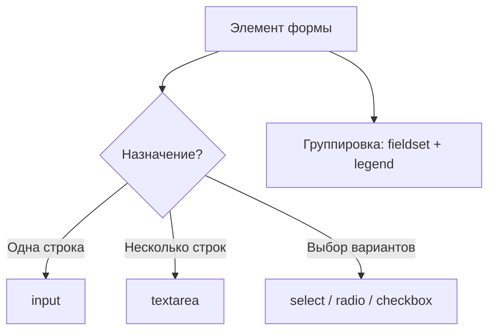
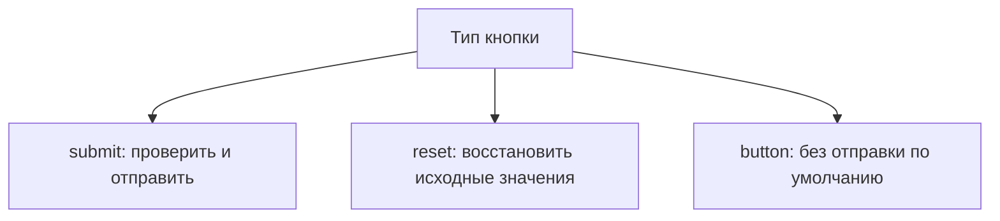

# Формы ч-2

[Содержание](../../README.md) · [Назад](../../Lesson-6/ru/%D0%A4%D0%BE%D1%80%D0%BC%D1%8B%20%D1%87-1.md) · [Вперёд](../../Lesson-8/ru/%D0%94%D0%BE%D1%81%D1%82%D1%83%D0%BF%D0%BD%D0%BE%D1%81%D1%82%D1%8C%20%28a11y%29.md) · [Практика](../practice.html) · [RU](../ru/%D0%A4%D0%BE%D1%80%D0%BC%D1%8B%20%D1%87-2.md) · [EN](../en/Forms%20part%202.md) · [UZ](../uz/Formalar%20qism-2.md)

> **Связь с прошлым уроком:** в уроке 6 вы собрали форму из полей `input`, подписей и переключателей. Сегодня добавим выпадающие списки, многострочный текст, группы полей, настоящие кнопки и проверку формата ввода.

---

## Зачем это вам

Анкета «Расскажите о себе» в одну строку не помещается. Выбор города из 14 областей - это не 14 переключателей подряд. А номер студенческого билета должен быть ровно из 7 цифр, а не «abc».

Сегодня вы соберёте полную анкету участника, которая сама проверяет, что ввёл пользователь.

---



**Как читать схему.** Выбирайте элемент по типу ответа: одна строка, несколько строк или выбор из готовых вариантов. Группировка `fieldset` + `legend` сочетается с любыми полями.

---

## Чему вы научитесь

- Делать выпадающий список `select` с вариантами `option`, группами `optgroup` и выбором по умолчанию.
- Подсказывать варианты в обычном поле через `datalist`.
- Принимать длинный текст через `textarea`.
- Группировать поля: `fieldset` и `legend`.
- Выбирать кнопку: `button` с типом `submit`, `reset` или `button`.
- Проверять ввод: `min`, `max`, `maxlength`, `pattern`.
- Делать ползунок `type="range"`.

---

## Повторение: 3 вопроса из урока 6

1. Как связать подпись с полем?
2. Что общего должно быть у переключателей одной группы?
3. Что делает атрибут `required`?

Ответы - в конце урока.

---

## План урока

| Раздел | Что делаем |
| --- | --- |
| Выпадающий список | `select`, `option`, `optgroup` |
| Подсказки в поле | `datalist` |
| Многострочный текст | `textarea` |
| Группы полей | `fieldset` и `legend` |
| Мини-задание 1 | Группа «Контакты» |
| Кнопки | `button` и три типа |
| Проверка ввода | `min`, `max`, `maxlength`, `pattern`, `range` |
| Мини-задание 2 | Поле ID из 7 цифр |
| Самостоятельная работа | Задание в IDE и анкета участника |

---

## Выпадающий список: `select`

**Простыми словами:** `select` - меню в кафе. Варианты уже напечатаны, вы выбираете, а не пишете своё.

```html
<label for="city">Город</label>
<select id="city" name="city">
    <option value="">- Выберите город -</option>
    <option value="tashkent">Ташкент</option>
    <option value="almalyk" selected>Алмалык</option>
    <option value="samarkand">Самарканд</option>
</select>
```

| Часть | Что делает |
| --- | --- |
| `<select>` | Сам список. `id` - для подписи, `name` - для отправки |
| `<option value>` | Вариант. Пользователь видит текст, на сервер уходит `value` |
| `selected` | Вариант, выбранный заранее |

**Что увидите:** поле со стрелкой, в нём уже выбран «Алмалык». Клик - раскрывается список.

### Группы вариантов: `optgroup`

```html
<label for="course">Направление</label>
<select id="course" name="course">
    <optgroup label="Фронтенд">
        <option value="html">HTML</option>
        <option value="css">CSS</option>
    </optgroup>
    <optgroup label="Бэкенд">
        <option value="php">PHP</option>
        <option value="sql">SQL</option>
    </optgroup>
</select>
```

**Что увидите:** в раскрытом списке - серые заголовки «Фронтенд» и «Бэкенд», под ними варианты. Заголовок группы выбрать нельзя.

### Несколько вариантов: `multiple`

```html
<select id="days" name="days" multiple>
```

Теперь можно выбрать несколько вариантов: удерживайте Ctrl (на macOS - Cmd). Новичкам это неудобно - если вариантов мало, лучше флажки `checkbox`.

**`select` или `radio`?** 2–5 вариантов - `radio`: все видны сразу. Больше - `select`: не занимает место.

---

## Подсказки в поле: `datalist`

Пользователь может ввести своё, но вы подсказываете популярные варианты:

```html
<label for="lang">Любимый язык</label>
<input type="text" id="lang" name="lang" list="langs">
<datalist id="langs">
    <option value="JavaScript">
    <option value="Python">
    <option value="PHP">
</datalist>
```

Связь: `list` у поля = `id` у `datalist`.

**Отличие от `select`:** в `select` только готовые варианты, в `datalist` - подсказки, но можно написать своё.

---

## Многострочный текст: `textarea`

```html
<label for="about">О себе</label>
<textarea id="about" name="about" rows="4" cols="40" maxlength="300">Учусь на первом курсе.</textarea>
```

| Атрибут | Что делает |
| --- | --- |
| `rows` | Высота в строках |
| `cols` | Ширина в символах |
| `maxlength` | Не больше N символов |

**`textarea` - парный тег.** Начальный текст пишется **между тегами**, а не в `value`:

```html
<!-- Неправильно -->
<textarea value="Текст"></textarea>

<!-- Правильно -->
<textarea>Текст</textarea>
```

---

## Группы полей: `fieldset` и `legend`

**Простыми словами:** на бумажной анкете поля обведены рамками с заголовками: «Личные данные», «Контакты». В HTML рамка - `<fieldset>`, заголовок рамки - `<legend>`.

```html
<fieldset>
    <legend>Удобное время</legend>
    <input type="radio" id="morning" name="time" value="morning">
    <label for="morning">Утро</label>
    <input type="radio" id="evening" name="time" value="evening">
    <label for="evening">Вечер</label>
</fieldset>
```

**Что увидите:** рамку вокруг полей с заголовком «Удобное время» в верхней линии.

**Что услышит незрячий:** «Удобное время, группа. Утро, переключатель». Без `legend` он услышит только «Утро» - но утро чего?

**`legend` - первым** внутри `fieldset`.

### Частые ошибки новичков

| Ошибка | Как исправить |
| --- | --- |
| `textarea value="..."` | Текст между тегами |
| `select` без подписи | `<label for>` нужен и списку |
| Группа radio без `fieldset` | Оберните, дайте `legend`-вопрос |
| `legend` не первым | Первым внутри `fieldset` |
| `select` на 2 варианта | Лучше `radio` |

---

## Мини-задание 1

Сделайте группу «Контакты» с рамкой и заголовком: поле почты и поле телефона, оба с подписями. Решение - в разделе «Ответы».

---

## Кнопки: `button`

В уроке 6 вы использовали `<input type="submit">`. Есть тег гибче - `<button>`:

```html
<button type="submit">Отправить анкету</button>
```

**Чем `<button>` удобнее:** это парный тег, внутри можно писать текст с другими тегами, например `<strong>`.

| Тип | Что делает |
| --- | --- |
| `type="submit"` | Проверяет форму и отправляет |
| `type="reset"` | Возвращает **начальные** значения всех полей |
| `type="button"` | Ничего не делает сам - для JavaScript |



**Как читать схему.** Три разных значения `type`, а не три шага.

**Всегда пишите `type`.** Кнопка без `type` внутри формы ведёт себя как `submit` - и форма отправится там, где вы этого не ждали.

**`reset` возвращает начальные значения, а не очищает поля.** Если в `textarea` изначально было «Учусь на первом курсе», после `reset` вернётся именно этот текст.

### Попробуйте сломать

Добавьте в форму `<button>Подсказка</button>` без `type`. Нажмите её. Форма отправилась, хотя вы хотели просто кнопку.

### Частые ошибки новичков

| Ошибка | Как исправить |
| --- | --- |
| `<button>` без `type` | Всегда `type="submit"`, `"reset"` или `"button"` |
| Ожидают, что `reset` очистит поля | Он вернёт начальные значения |
| `<div>` вместо кнопки | Только `<button>` - подробно в уроке 8 |

---

## Проверка ввода

Браузер может сам проверить поле перед отправкой:

| Атрибут | Для каких полей | Пример | Что проверяет |
| --- | --- | --- | --- |
| `min`, `max` | `number`, `date`, `range` | `min="16" max="60"` | Границы значения |
| `maxlength` | `text`, `textarea` | `maxlength="50"` | Не больше 50 символов |
| `pattern` | `text`, `tel` | `pattern="[0-9]{7}"` | Формат по шаблону |

### `pattern` - шаблон формата

`pattern` - это регулярное выражение, мини-язык шаблонов. Достаточно знать несколько записей:

| Шаблон | Значит |
| --- | --- |
| `[0-9]` | Одна цифра |
| `[0-9]{7}` | Ровно 7 цифр |
| `[A-Z]{2}` | Две заглавные латинские буквы |
| `[A-Z]{2}[0-9]{7}` | Две буквы, затем 7 цифр, например `AB1234567` |

```html
<label for="student-id">Номер студенческого билета (7 цифр)</label>
<input type="text" id="student-id" name="student-id" pattern="[0-9]{7}" inputmode="numeric" required>
```

`inputmode="numeric"` откроет на телефоне цифровую клавиатуру. Подскажите формат в подписи: «7 цифр» - так человек сразу знает, что вводить.

**Проверьте поле:**

| Ввод | Результат |
| --- | --- |
| пусто | Ошибка: поле обязательное |
| `123456` | Ошибка: 6 цифр |
| `abcdefg` | Ошибка: буквы |
| `1234567` | Принято |

### Ползунок: `type="range"`

```html
<label for="level">Уровень знаний (0–10)</label>
<input type="range" id="level" name="level" min="0" max="10" value="5">
```

**Что увидите:** ползунок. По умолчанию стоит на 5.

**Важно:** проверка в браузере - помощь пользователю, а не защита. Настоящий сервер всё равно проверяет данные ещё раз.

---

## Мини-задание 2

Сделайте обязательное поле «Код группы» в формате: две заглавные латинские буквы, дефис, две цифры. Пример: `IT-25`. Подсказку формата напишите в подписи. Решение - в разделе «Ответы».

---

## Итоги урока: шпаргалка

| Задача | Запись |
| --- | --- |
| Выпадающий список | `<select>` + `<option value>` |
| Выбрано заранее | `selected` |
| Группы вариантов | `<optgroup label="...">` |
| Подсказки в поле | `list` + `<datalist id>` |
| Длинный текст | `<textarea>текст</textarea>` |
| Рамка с заголовком | `<fieldset>` + `<legend>` первым |
| Кнопка отправки | `<button type="submit">` |
| Вернуть начальные значения | `<button type="reset">` |
| Границы числа | `min`, `max` |
| Длина текста | `maxlength` |
| Формат | `pattern="[0-9]{7}"` |
| Ползунок | `type="range"` |

---

## Самостоятельная работа

### Часть 1. Задание в IDE (засчитывается платформой)

Сделайте **анкету участника** с `method="get"`:

1. Первая группа `fieldset` с `legend` «Личные данные»:
   - номер билета - обязательный, ровно 7 цифр (`pattern`);
   - поле «О себе» - `textarea` с начальным текстом.
2. Вторая группа `fieldset` с `legend` «Направление»:
   - `select` с двумя `optgroup` и заранее выбранным вариантом (`selected`).
3. У каждого поля - `<label for>` и уникальный `id`.
4. Кнопки `<button type="submit">` и `<button type="reset">`.

Что проверяет платформа: форму, два `fieldset` и два `legend`, `select` с `optgroup` и `selected`, `textarea`, `pattern` с `{7}`, `required`, связь каждой подписи с полем, кнопку `type="submit"` и кнопку `type="reset"`.

### Часть 2. Проект на компьютере

1. Сохраните анкету как `profile.html`.
2. Проверьте поле билета: пусто, 6 цифр, буквы, 7 цифр.
3. Измените выбор в списке и текст «О себе», нажмите «Сбросить». Вернулись начальные значения?

### Критерии готовности

- [ ] Задание в IDE засчитано.
- [ ] Каждое поле, список и `textarea` имеют подпись; `for` совпадает с `id`.
- [ ] Кнопки имеют понятный текст и явный `type`.
- [ ] В `select` есть `optgroup` и понятные `value`.
- [ ] Начальный текст `textarea` - между тегами.
- [ ] Поле билета отклоняет пустоту, 6 цифр и буквы; принимает 7 цифр.
- [ ] `reset` возвращает начальные значения.

---

## Вопросы для самопроверки

1. Когда лучше `select`, а когда `radio`?
2. Что видит пользователь и что уходит на сервер у `<option>`?
3. Чем `datalist` отличается от `select`?
4. Где пишется начальный текст `textarea`?
5. Зачем `legend` в группе переключателей?
6. Чем `<button>` удобнее `<input type="submit">`?
7. Что произойдёт при нажатии `<button>` без `type` внутри формы?
8. Что делает `reset`: очищает поля или что-то другое?
9. Что означает `pattern="[0-9]{7}"`?
10. Почему проверка в браузере не заменяет проверку на сервере?

После вопросов пройдите **тест урока** на платформе: 12 вопросов, порог 70%.

---

## Что дальше

Анкета готова. В уроке 8 проверим её глазами разных людей: без мыши, без зрения, на ярком солнце - и исправим то, что мешает.

---

## Ответы

**Повторение**

1. `for` у `<label>` равен `id` у поля.
2. Одинаковый `name`.
3. Не даёт отправить форму, пока поле пустое.

**Мини-задание 1**

```html
<fieldset>
    <legend>Контакты</legend>
    <p>
        <label for="email">Почта</label>
        <input type="email" id="email" name="email">
    </p>
    <p>
        <label for="phone">Телефон</label>
        <input type="tel" id="phone" name="phone">
    </p>
</fieldset>
```

**Мини-задание 2**

```html
<label for="group">Код группы (например, IT-25)</label>
<input type="text" id="group" name="group" pattern="[A-Z]{2}-[0-9]{2}" required>
```

**Вопросы для самопроверки**

1. 2–5 вариантов - `radio`, все видны сразу. Больше - `select`.
2. Видит текст между тегами, на сервер уходит `value`.
3. В `select` только готовые варианты, в `datalist` - подсказки и можно ввести своё.
4. Между тегами `<textarea>` и `</textarea>`.
5. Это общий вопрос группы: скринридер прочитает его перед вариантами.
6. Внутри можно писать текст с другими тегами, это парный тег.
7. Форма отправится: без `type` кнопка работает как `submit`.
8. Возвращает начальные значения полей.
9. Ровно 7 цифр.
10. Проверку в браузере можно обойти. Сервер обязан проверять данные сам.

---

[Содержание](../../README.md) · [Назад](../../Lesson-6/ru/%D0%A4%D0%BE%D1%80%D0%BC%D1%8B%20%D1%87-1.md) · [Вперёд](../../Lesson-8/ru/%D0%94%D0%BE%D1%81%D1%82%D1%83%D0%BF%D0%BD%D0%BE%D1%81%D1%82%D1%8C%20%28a11y%29.md) · [Практика](../practice.html) · [RU](../ru/%D0%A4%D0%BE%D1%80%D0%BC%D1%8B%20%D1%87-2.md) · [EN](../en/Forms%20part%202.md) · [UZ](../uz/Formalar%20qism-2.md)
