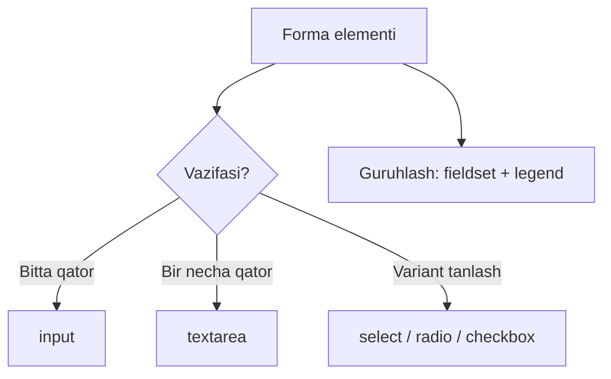
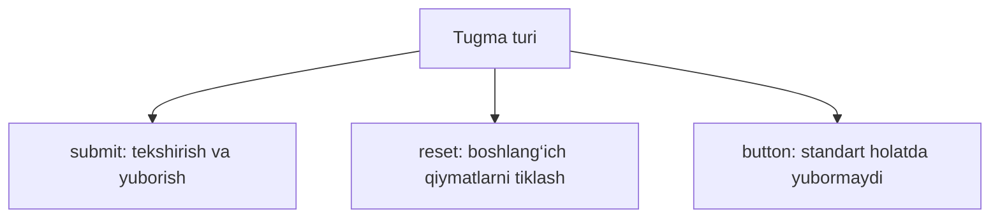

# Formalar qism-2

[Mundarija](../../README.md) · [← Orqaga](../../Lesson-6/uz/Formalar%20qism-1.md) · [Keyingi →](../../Lesson-8/uz/Foydalanish%20qulayligi%20%28a11y%29.md) · [RU](../ru/%D0%A4%D0%BE%D1%80%D0%BC%D1%8B%20%D1%87-2.md) · [EN](../en/Forms%20part%202.md) · [UZ](Formalar%20qism-2.md) · [Amaliyot](../practice.html)

> **Oldingi dars bilan bog‘liqlik:** 6-darsda `input` maydonlari, imzolar va o‘tkazgichlardan forma yig‘dingiz. Bugun ochiluvchi ro‘yxatlar, ko‘p qatorli matn, maydon guruhlari, haqiqiy tugmalar va kiritish formatini tekshirishni qo‘shamiz.

---

## Bu sizga nima uchun kerak

«O‘zingiz haqingizda gapiring» anketasi bitta qatorga sig‘maydi. 14 ta viloyatdan shaharni tanlash - ketma-ket 14 ta o‘tkazgich emas. Talabalik guvohnomasi raqami esa «abc» emas, aynan 7 ta raqamdan iborat bo‘lishi kerak.

Bugun foydalanuvchi nima kiritganini o‘zi tekshiradigan to‘liq ishtirokchi anketasini yig‘asiz.

---



**Sxemani qanday o‘qish kerak.** Elementni javob turiga qarab tanlang: bitta qator, bir necha qator yoki tayyor variantlardan tanlash. `fieldset` + `legend` guruhlash har qanday maydonlar bilan birga ishlaydi.

---

## Nimani o‘rganasiz

- `option` variantlari, `optgroup` guruhlari va oldindan tanlangan variantli `select` ochiluvchi ro‘yxatini yaratish.
- Oddiy maydonda `datalist` orqali variantlarni maslahat berish.
- Uzun matnni `textarea` orqali qabul qilish.
- Maydonlarni guruhlash: `fieldset` va `legend`.
- Tugmani tanlash: `submit`, `reset` yoki `button` turli `button`.
- Kiritishni tekshirish: `min`, `max`, `maxlength`, `pattern`.
- `type="range"` slayderini yaratish.

---

## Takrorlash: 6-darsdan 3 savol

1. Imzoni maydon bilan qanday bog‘lash mumkin?
2. Bitta guruhdagi o‘tkazgichlarda nima umumiy bo‘lishi kerak?
3. `required` atributi nima qiladi?

Javoblar - dars oxirida.

---

## Reja

| Bo‘lim | Nima qilamiz |
| --- | --- |
| Ochiluvchi ro‘yxat | `select`, `option`, `optgroup` |
| Maydondagi maslahatlar | `datalist` |
| Ko‘p qatorli matn | `textarea` |
| Maydon guruhlari | `fieldset` va `legend` |
| Mini-topshiriq 1 | «Kontaktlar» guruhi |
| Tugmalar | `button` va uch turi |
| Kiritishni tekshirish | `min`, `max`, `maxlength`, `pattern`, `range` |
| Mini-topshiriq 2 | 7 raqamli ID maydoni |
| Mustaqil ish | IDE topshirig‘i va ishtirokchi anketasi |

---

## Ochiluvchi ro‘yxat: `select`

**Oddiy qilib aytganda:** `select` - kafedagi menyu. Variantlar allaqachon bosilgan, siz o‘zingiznikini yozmaysiz, tanlaysiz.

```html
<label for="city">Shahar</label>
<select id="city" name="city">
    <option value="">- Shaharni tanlang -</option>
    <option value="tashkent">Toshkent</option>
    <option value="almalyk" selected>Olmaliq</option>
    <option value="samarkand">Samarqand</option>
</select>
```

| Qism | Nima qiladi |
| --- | --- |
| `<select>` | Ro‘yxatning o‘zi. `id` - imzo uchun, `name` - yuborish uchun |
| `<option value>` | Variant. Foydalanuvchi matnni ko‘radi, serverga `value` ketadi |
| `selected` | Oldindan tanlangan variant |

**Nimani ko‘rasiz:** strelkali maydon, unda allaqachon «Olmaliq» tanlangan. Bosing - ro‘yxat ochiladi.

### Variantlar guruhlari: `optgroup`

```html
<label for="course">Yo‘nalish</label>
<select id="course" name="course">
    <optgroup label="Frontend">
        <option value="html">HTML</option>
        <option value="css">CSS</option>
    </optgroup>
    <optgroup label="Backend">
        <option value="php">PHP</option>
        <option value="sql">SQL</option>
    </optgroup>
</select>
```

**Nimani ko‘rasiz:** ochilgan ro‘yxatda - kulrang «Frontend» va «Backend» sarlavhalari, ular ostida variantlar. Guruh sarlavhasini tanlab bo‘lmaydi.

### Bir nechta variant: `multiple`

```html
<select id="days" name="days" multiple>
```

Endi bir nechta variantni tanlash mumkin: Ctrl ni (macOS da - Cmd) ushlab turing. Yangi o‘rganuvchilarga bu noqulay - variantlar kam bo‘lsa, `checkbox` katakchalari yaxshiroq.

**`select` mi yoki `radio` mi?** 2–5 variant - `radio`: hammasi darhol ko‘rinadi. Ko‘proq - `select`: joy egallamaydi.

---

## Maydondagi maslahatlar: `datalist`

Foydalanuvchi o‘zinikini kiritishi mumkin, lekin siz mashhur variantlarni maslahat berasiz:

```html
<label for="lang">Sevimli til</label>
<input type="text" id="lang" name="lang" list="langs">
<datalist id="langs">
    <option value="JavaScript">
    <option value="Python">
    <option value="PHP">
</datalist>
```

Bog‘lanish: maydondagi `list` = `datalist` dagi `id`.

**`select` dan farqi:** `select` da faqat tayyor variantlar, `datalist` da - maslahatlar, lekin o‘zingiznikini yozish mumkin.

---

## Ko‘p qatorli matn: `textarea`

```html
<label for="about">O‘zim haqimda</label>
<textarea id="about" name="about" rows="4" cols="40" maxlength="300">Birinchi kursda o‘qiyman.</textarea>
```

| Atribut | Nima qiladi |
| --- | --- |
| `rows` | Qatorlardagi balandlik |
| `cols` | Belgilardagi kenglik |
| `maxlength` | N ta belgidan ko‘p emas |

**`textarea` - juft teg.** Boshlang‘ich matn `value` da emas, **teglar orasida** yoziladi:

```html
<!-- Noto‘g‘ri -->
<textarea value="Matn"></textarea>

<!-- To‘g‘ri -->
<textarea>Matn</textarea>
```

---

## Maydon guruhlari: `fieldset` va `legend`

**Oddiy qilib aytganda:** qog‘oz anketada maydonlar sarlavhali ramkalar bilan o‘ralgan: «Shaxsiy ma’lumotlar», «Kontaktlar». HTML da ramka - `<fieldset>`, ramka sarlavhasi - `<legend>`.

```html
<fieldset>
    <legend>Qulay vaqt</legend>
    <input type="radio" id="morning" name="time" value="morning">
    <label for="morning">Ertalab</label>
    <input type="radio" id="evening" name="time" value="evening">
    <label for="evening">Kechqurun</label>
</fieldset>
```

**Nimani ko‘rasiz:** yuqori chizig‘ida «Qulay vaqt» sarlavhasi bo‘lgan maydonlar atrofidagi ramka.

**Ko‘zi ojiz nimani eshitadi:** «Qulay vaqt, guruh. Ertalab, o‘tkazgich». `legend` siz u faqat «Ertalab» ni eshitadi - lekin nimaning ertalabi?

**`legend` - `fieldset` ichida birinchi.**

### Yangi o‘rganuvchilarning tipik xatolari

| Xato | Qanday tuzatish |
| --- | --- |
| `textarea value="..."` | Matn teglar orasida |
| Imzosiz `select` | Ro‘yxatga ham `<label for>` kerak |
| `fieldset` siz radio guruhi | O‘rang, `legend`-savol bering |
| `legend` birinchi emas | `fieldset` ichida birinchi |
| 2 variant uchun `select` | `radio` yaxshiroq |

---

## Mini-topshiriq 1

Ramka va sarlavhali «Kontaktlar» guruhini yarating: pochta maydoni va telefon maydoni, ikkalasi imzolar bilan. Yechim - «Javoblar» bo‘limida.

---

## Tugmalar: `button`

6-darsda `<input type="submit">` ishlatdingiz. Moslashuvchanroq teg bor - `<button>`:

```html
<button type="submit">Anketani yuborish</button>
```

**`<button>` nimasi bilan qulay:** bu juft teg, ichiga boshqa teglar bilan matn yozish mumkin, masalan `<strong>`.

| Tur | Nima qiladi |
| --- | --- |
| `type="submit"` | Formani tekshiradi va yuboradi |
| `type="reset"` | Barcha maydonlarning **boshlang‘ich** qiymatlarini qaytaradi |
| `type="button"` | O‘zi hech narsa qilmaydi - JavaScript uchun |



**Sxemani qanday o‘qish kerak.** `type` ning uchta turli qiymati, uch qadam emas.

**`type` ni doim yozing.** Forma ichidagi `type` siz tugma `submit` kabi ishlaydi - va forma siz kutmagan joyda yuboriladi.

**`reset` maydonlarni tozalamaydi, boshlang‘ich qiymatlarni qaytaradi.** `textarea` da dastlab «Birinchi kursda o‘qiyman» bo‘lgan bo‘lsa, `reset` dan keyin aynan shu matn qaytadi.

### Buzib ko‘ring

Formaga `type` siz `<button>Maslahat</button>` qo‘shing. Uni bosing. Siz shunchaki tugma istagan edingiz, lekin forma yuborildi.

### Yangi o‘rganuvchilarning tipik xatolari

| Xato | Qanday tuzatish |
| --- | --- |
| `type` siz `<button>` | Doim `type="submit"`, `"reset"` yoki `"button"` |
| `reset` maydonlarni tozalaydi deb kutish | U boshlang‘ich qiymatlarni qaytaradi |
| Tugma o‘rniga `<div>` | Faqat `<button>` - 8-darsda batafsil |

---

## Kiritishni tekshirish

Brauzer maydonni yuborishdan oldin o‘zi tekshira oladi:

| Atribut | Qaysi maydonlar uchun | Misol | Nimani tekshiradi |
| --- | --- | --- | --- |
| `min`, `max` | `number`, `date`, `range` | `min="16" max="60"` | Qiymat chegaralari |
| `maxlength` | `text`, `textarea` | `maxlength="50"` | 50 ta belgidan ko‘p emas |
| `pattern` | `text`, `tel` | `pattern="[0-9]{7}"` | Shablon bo‘yicha format |

### `pattern` - format shabloni

`pattern` - muntazam ifoda, shablonlarning kichik tili. Bir nechta yozuvni bilish kifoya:

| Shablon | Ma’nosi |
| --- | --- |
| `[0-9]` | Bitta raqam |
| `[0-9]{7}` | Aynan 7 ta raqam |
| `[A-Z]{2}` | Ikkita lotin bosh harfi |
| `[A-Z]{2}[0-9]{7}` | Ikki harf, keyin 7 ta raqam, masalan `AB1234567` |

```html
<label for="student-id">Talabalik guvohnomasi raqami (7 ta raqam)</label>
<input type="text" id="student-id" name="student-id" pattern="[0-9]{7}" inputmode="numeric" required>
```

`inputmode="numeric"` telefonda raqamli klaviaturani ochadi. Formatni imzoda ko‘rsating: «7 ta raqam» - shunda odam nima kiritishni darhol biladi.

**Maydonni tekshiring:**

| Kiritish | Natija |
| --- | --- |
| bo‘sh | Xato: maydon majburiy |
| `123456` | Xato: 6 ta raqam |
| `abcdefg` | Xato: harflar |
| `1234567` | Qabul qilindi |

### Slayder: `type="range"`

```html
<label for="level">Bilim darajasi (0–10)</label>
<input type="range" id="level" name="level" min="0" max="10" value="5">
```

**Nimani ko‘rasiz:** slayder. Standart holatda 5 da turadi.

**Muhim:** brauzerdagi tekshiruv - foydalanuvchiga yordam, himoya emas. Haqiqiy server ma’lumotlarni baribir yana tekshiradi.

---

## Mini-topshiriq 2

Quyidagi formatdagi majburiy «Guruh kodi» maydonini yarating: ikkita lotin bosh harfi, chiziqcha, ikkita raqam. Misol: `IT-25`. Format maslahatini imzoga yozing. Yechim - «Javoblar» bo‘limida.

---

## Dars yakuni: shpargalka

| Vazifa | Yozuv |
| --- | --- |
| Ochiluvchi ro‘yxat | `<select>` + `<option value>` |
| Oldindan tanlangan | `selected` |
| Variant guruhlari | `<optgroup label="...">` |
| Maydondagi maslahatlar | `list` + `<datalist id>` |
| Uzun matn | `<textarea>matn</textarea>` |
| Sarlavhali ramka | `<fieldset>` + birinchi `<legend>` |
| Yuborish tugmasi | `<button type="submit">` |
| Boshlang‘ich qiymatlarni qaytarish | `<button type="reset">` |
| Son chegaralari | `min`, `max` |
| Matn uzunligi | `maxlength` |
| Format | `pattern="[0-9]{7}"` |
| Slayder | `type="range"` |

---

## Mustaqil ish

### 1-qism. IDE topshirig‘i (platforma hisoblaydi)

`method="get"` bilan **ishtirokchi anketasini** yarating:

1. «Shaxsiy ma’lumotlar» `legend` li birinchi `fieldset` guruhi:
   - guvohnoma raqami - majburiy, aynan 7 ta raqam (`pattern`);
   - «O‘zim haqimda» maydoni - boshlang‘ich matnli `textarea`.
2. «Yo‘nalish» `legend` li ikkinchi `fieldset` guruhi:
   - ikkita `optgroup` va oldindan tanlangan variantli (`selected`) `select`.
3. Har bir maydonda - `<label for>` va noyob `id`.
4. `<button type="submit">` va `<button type="reset">` tugmalari.

Platforma nimani tekshiradi: forma, ikkita `fieldset` va ikkita `legend`, `optgroup` va `selected` li `select`, `textarea`, `{7}` li `pattern`, `required`, har bir imzoning maydon bilan bog‘lanishi, `type="submit"` tugmasi va `type="reset"` tugmasi.

### 2-qism. Kompyuterdagi loyiha

1. Anketani `profile.html` deb saqlang.
2. Guvohnoma maydonini tekshiring: bo‘sh, 6 ta raqam, harflar, 7 ta raqam.
3. Ro‘yxatdagi tanlovni va «O‘zim haqimda» matnini o‘zgartiring, «Tozalash» ni bosing. Boshlang‘ich qiymatlar qaytdimi?

### Tayyorlik mezonlari

- [ ] IDE topshirig‘i qabul qilingan.
- [ ] Har bir maydon, ro‘yxat va `textarea` da imzo bor; `for` `id` ga mos.
- [ ] Tugmalarda tushunarli matn va aniq `type` bor.
- [ ] `select` da `optgroup` va tushunarli `value` lar bor.
- [ ] `textarea` boshlang‘ich matni - teglar orasida.
- [ ] Guvohnoma maydoni bo‘shlik, 6 ta raqam va harflarni rad etadi; 7 ta raqamni qabul qiladi.
- [ ] `reset` boshlang‘ich qiymatlarni qaytaradi.

---

## O‘zini tekshirish uchun savollar

1. Qachon `select`, qachon `radio` yaxshiroq?
2. `<option>` da foydalanuvchi nimani ko‘radi va serverga nima ketadi?
3. `datalist` `select` dan nimasi bilan farq qiladi?
4. `textarea` ning boshlang‘ich matni qayerda yoziladi?
5. O‘tkazgichlar guruhida `legend` nima uchun?
6. `<button>` `<input type="submit">` dan nimasi bilan qulayroq?
7. Forma ichida `type` siz `<button>` bosilsa nima bo‘ladi?
8. `reset` nima qiladi: maydonlarni tozalaydimi yoki boshqa narsa?
9. `pattern="[0-9]{7}"` nimani bildiradi?
10. Nega brauzerdagi tekshiruv serverdagi tekshiruvni almashtirmaydi?

Savollardan keyin platformada **dars testini** topshiring: 12 ta savol, o‘tish chegarasi 70%.

---

## Keyin nima

Anketa tayyor. 8-darsda uni turli odamlar ko‘zi bilan tekshiramiz: sichqonchasiz, ko‘rmasdan, yorqin quyoshda - va xalaqit beradigan narsalarni tuzatamiz.

---

## Javoblar

**Takrorlash**

1. `<label>` dagi `for` maydondagi `id` ga teng.
2. Bir xil `name`.
3. Maydon bo‘sh ekan, formani yuborishga yo‘l qo‘ymaydi.

**Mini-topshiriq 1**

```html
<fieldset>
    <legend>Kontaktlar</legend>
    <p>
        <label for="email">Pochta</label>
        <input type="email" id="email" name="email">
    </p>
    <p>
        <label for="phone">Telefon</label>
        <input type="tel" id="phone" name="phone">
    </p>
</fieldset>
```

**Mini-topshiriq 2**

```html
<label for="group">Guruh kodi (masalan, IT-25)</label>
<input type="text" id="group" name="group" pattern="[A-Z]{2}-[0-9]{2}" required>
```

**O‘zini tekshirish uchun savollar**

1. 2–5 variant - `radio`, hammasi darhol ko‘rinadi. Ko‘proq - `select`.
2. Teglar orasidagi matnni ko‘radi, serverga `value` ketadi.
3. `select` da faqat tayyor variantlar, `datalist` da - maslahatlar va o‘zingiznikini kiritish mumkin.
4. `<textarea>` va `</textarea>` teglari orasida.
5. Bu guruhning umumiy savoli: ekran o‘quvchi uni variantlardan oldin o‘qiydi.
6. Ichiga boshqa teglar bilan matn yozish mumkin, bu juft teg.
7. Forma yuboriladi: `type` siz tugma `submit` kabi ishlaydi.
8. Maydonlarning boshlang‘ich qiymatlarini qaytaradi.
9. Aynan 7 ta raqam.
10. Brauzerdagi tekshiruvni chetlab o‘tish mumkin. Server ma’lumotlarni o‘zi tekshirishi shart.

---

[Mundarija](../../README.md) · [← Orqaga](../../Lesson-6/uz/Formalar%20qism-1.md) · [Keyingi →](../../Lesson-8/uz/Foydalanish%20qulayligi%20%28a11y%29.md) · [RU](../ru/%D0%A4%D0%BE%D1%80%D0%BC%D1%8B%20%D1%87-2.md) · [EN](../en/Forms%20part%202.md) · [UZ](Formalar%20qism-2.md) · [Amaliyot](../practice.html)
