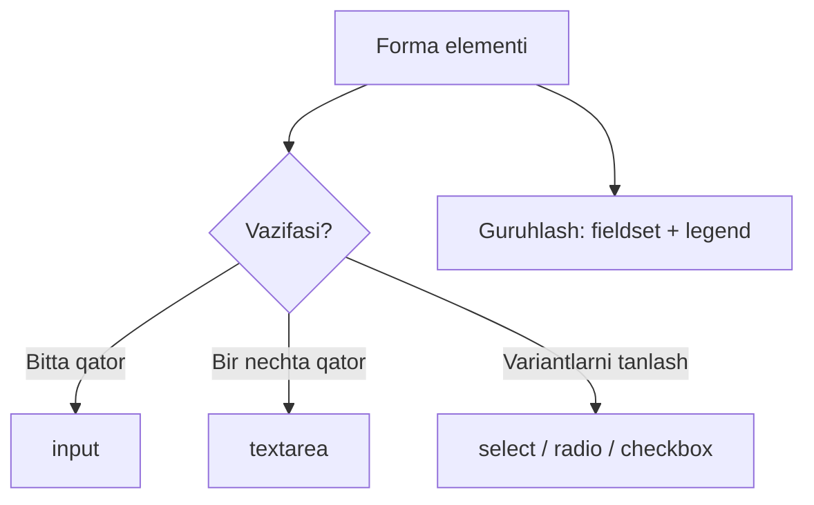
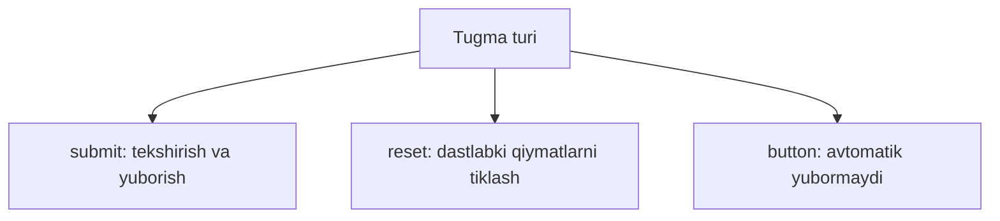

# Formalar: 2-qism

[Mundarija](../../README.md) · [Oldingi dars](../../Lesson-6/uz/Formatlar%20qism-1.md) · [Keyingi dars](../../Lesson-8/uz/Mavjudlik%20%28a11y%29.md) · [Amaliyot](../practice.html) · [RU](../ru/%D0%A4%D0%BE%D1%80%D0%BC%D1%8B%20%D1%87-2.md) · [EN](../en/Forms%20part%202.md) · [UZ](../uz/Formatlar%20qism-2.md)

> **Oldingi dars bilan bog'lanish:** o'tgan darsda biz asosiy forma maydonlarini (text, email, password, number, date, checkbox, radio) va `label`/`for`/`id` bog'lanishini o'rgandik. Bugun qolgan forma elementlarini tugallab, maydonlarni guruhlash va JavaScript ishlatmasdan kiritishni tekshirishni o'rganamiz.



**Chizmani qanday o‘qish kerak:** Avval maydonning vazifasini aniqlang: bitta satr, ko‘p satr yoki variant tanlash. fieldset va legend maydon turini almashtirmaydi; bir-biriga bog‘liq maydonlarni ma’noli guruhga birlashtiradi.

---

## Dars oxiriga qadar nimalarni o'rganasiz

- `select`/`option` orqali ochiladigan ro'yxatlar yaratish, `optgroup` orqali variantlarni guruhlash.
- Ko'p qatorli matn uchun `textarea` ishlatish.
- `fieldset`/`legend` orqali bog'liq forma maydonlarini guruhlash.
- `button` va `input type="submit"` orasidagi farqni tushunish.
- Ichki tekshiruvni sozlash: `min`, `max`, `pattern`, `maxlength`.

---

## Dars rejasi

| Bo‘lim                                    | Mazmuni                            |
| --------------------------------------- | --------------------------------- |
| select, option, optgroup             | Ochiladigan ro'yxatlar             |
| textarea                             | Ko'p qatorli matn                 |
| fieldset va legend                   | Forma maydonlarini guruhlash      |
| Mini-vazifa                           | Selectni mustaqil yig'ish         |
| button vs input type="submit"        | Forma yuborish, yondashuv farqi   |
| Tekshiruv: min/max/pattern/maxlength | Ichki ma'lumot tekshiruvi         |
| Xulosalar va amaliy vazifa           | To'liq ro'yxatdan o'tish formasini yig'ish |

---

## `select`, `option`, `optgroup`


**Oddiy qilib aytganda:** agar o'tgan darsdagi `radio` tugmalari 2-4 ta variant uchun yaxshi bo'lsa, variantlar ko'p bo'lganda (masalan, mamlakatlar yoki shaharlar ro'yxati) radio tugmalar ekranda juda ko'p joy egallaydi. Bunday holat uchun ochiladigan ro'yxat mavjud - faqat bosilganda ochiladigan ixcham ro'yxat.

```html
<label for="city">Shahar:</label>
<select id="city" name="city">
    <option value="tashkent">Toshkent</option>
    <option value="almalyk">Almalyk</option>
    <option value="samarkand">Samarqand</option>
    <option value="bukhara">Buxoro</option>
</select>
```

Teglarni tahlil qilamiz:

- **`<select>`** variantlar ro‘yxati. `name` yuboriladigan qiymat nomi; `id` esa tashqi `label` ni `for` orqali bog‘laydi.
- **`<option>`** - ro'yxat ichidagi har bir alohida variant. `value` atributi - serverga yuboriladigan narsa, teglar orasidagi ko'rinadigan matn - foydalanuvchi ko'radigan narsa.

### `selected` orqali boshqa qiymat belgilash

```html
<select id="city" name="city">
    <option value="tashkent">Toshkent</option>
    <option value="almalyk" selected>Almalyk</option>
    <option value="samarkand">Samarqand</option>
</select>
```

`selected` atributi (qiymatsiz, o'tgan darsdagi `required` kabi) sahifa yuklanganda foydalanuvchi bosmasdan ko'rsatiladigan variantni belgilaydi.

### `multiple` orqali bir nechta tanlash

```html
<label for="subjects">Fanlarni tanlang (bir nechta bo'lishi mumkin):</label>
<select id="subjects" name="subjects" multiple>
    <option value="html">HTML</option>
    <option value="css">CSS</option>
    <option value="js">JavaScript</option>
</select>
```

`multiple` atributi foydalanuvchiga bir vaqtda bir nechta variantni tanlashga imkon beradi (odatda bosishda Ctrl/Cmd ni ushlab turadi). Bu kamdan-kam uchraydigan, lekin foydali holat - aslida, checkboxlar guruhi uchun vizual alternativa.

### `<optgroup>` - variantlarni guruhlash

Variantlar juda ko'p bo'lganda, ularni nomlangan guruhlarga ajratish mumkin:

```html
<label for="course">Kursni tanlang:</label>
<select id="course" name="course">
    <optgroup label="Frontend">
        <option value="html">HTML</option>
        <option value="css">CSS</option>
        <option value="js">JavaScript</option>
    </optgroup>
    <optgroup label="Backend">
        <option value="php">PHP</option>
        <option value="mysql">MySQL</option>
    </optgroup>
</select>
```

`<optgroup>` mustaqil tanlanadigan variant emas - bu ochiladigan ro'yxat ichidagi vizual sarlavha-ajratgich (qalin, o'zini bosish mumkin emas), `label` atributi ushbu sarlavha matnini belgilaydi.

**O'xshatish:** ko'p `<optgroup>` bilan `<select>` bu restoran menyusiga o'xshaydi, "Sho'rvalar", "Issiq taomlar", "Shirinliklar" bo'limlariga bo'lingan - bo‘limlarni tanlab bo'lmaydi, ular faqat ko'p taomlar orasida yo‘l topishga yordam beradi.

---

### Yangi boshlovchilarning ko'p uchraydigan xatolari

| Xato                                                                                | Tuzatish                                                                                                                          |
| ------------------------------------------------------------------------------------- | -------------------------------------------------------------------------------------------------------------------------------------- |
| `<option>` da `value` ni unutish                                                         | `value` bo'lmasa, serverga variantning ko'rinadigan matni yuboriladi - bu ba'zan noqulay (masalan, uzoq matn uchun); `value` ni ongli belgilang |
| `multiple` berilmagan `<select>` da bir nechta `selected` ishlatish                     | `multiple` bo'lmasa, faqat bitta `<option>` ga `selected` qo'yish mumkin                                                                    |
| `<optgroup>` ni oddiy `<option>` bilan adashtirish, uni bosiladigan variantga aylantirishga harakat qilish | `<optgroup>` vizual va semantik guruhlash, o'zi tanlanmaydi                                                                |

---

## `<textarea>` - ko'p qatorli matn

O'tgan darsdagi oddiy `<input type="text">` - bitta qatorli maydon. Uzoq matn kiritish kerak bo'lganda (izoh, xabar, fikr) - `<textarea>` ishlatiladi.

```html
<p><label for="message">Xabar:</label> <textarea id="message" name="message" rows="5" cols="40"></textarea></p>
```

`<input>` dan muhim farqi: **`<textarea>` - juft teg**, juft emas. Boshlang'ich matn (kerak bo'lsa) ochuvchi va yopuvchi teglar orasiga joylashtiriladi, `value` atributiga emas (`textarea` da umuman `value` atributi yo'q):

```html
<textarea id="bio" name="bio" rows="4" cols="40">O'zingiz haqida biroz gapiring...</textarea>
```

**Diqqat:** agar siz aynan kiritishda yo'qoladigan maslahat-pleysxolder (o'tgan darsda tushuntirgandek) istasangiz, teg ichidagi matn emas, `placeholder` atributini ishlating:

```html
<textarea id="bio" name="bio" rows="4" cols="40" placeholder="O'zingiz haqida biroz gapiring..."></textarea>
```

- **`rows`** - maydonning qatorlardagi taxminiy balandligi.
- **`cols`** - maydonning belgilardagi taxminiy kengligi.

Har ikki atribut **dastlabki** o'lchamni belgilaydi - ko'p brauzerlarda foydalanuvchi `textarea` ni o'ng pastki burchakdagi tutqich orqali qo'lda kengaytirishi mumkin.

---

### Yangi boshlovchilarning ko'p uchraydigan xatolari

| Xato                                                                     | Tuzatish                                                                                                                    |
| -------------------------------------------------------------------------- | -------------------------------------------------------------------------------------------------------------------------------- |
| Boshlang'ich matnni `value="..."` orqali belgilashga harakat qilish                        | `<textarea>` da `value` atributi yo'q - matn ochuvchi va yopuvchi teglar orasiga yoziladi                                        |
| Matn-mazmunini (yuborishda qoladi) va `placeholder` (yo'qoladi) ni adashtirish | Maslahat formati kerak bo'lsa - `placeholder` ishlating; haqiqiy oldindan to'ldirilgan qiymat kerak bo'lsa - uni teglar orasiga yozing |
| Yopuvchi teg `</textarea>` ni unutish                                     | `textarea` - juft teg, maydon dastlab bo'sh bo'lsa ham yopuvchi tegini unutmang                                      |

---

## `<fieldset>` va `<legend>` - forma maydonlarini guruhlash

Forma katta bo'lganda (masalan, bir nechta mantiqiy bo'limli ro'yxatdan o'tish: "Shaxsiy ma'lumotlar", "Aloqa ma'lumotlari", "Parol"), bog'liq maydonlarni vizual va semantik jihatdan birlashtirish foydali.

```html
<fieldset>
    <legend>Shaxsiy ma'lumotlar</legend>

    <p><label for="firstname">Ism:</label> <input type="text" id="firstname" name="firstname"></p>

    <p><label for="lastname">Familiya:</label> <input type="text" id="lastname" name="lastname"></p>
</fieldset>

<fieldset>
    <legend>Aloqa ma'lumotlari</legend>

    <p><label for="email">Email:</label> <input type="email" id="email" name="email"></p>

    <p><label for="phone">Telefon:</label> <input type="text" id="phone" name="phone"></p>
</fieldset>
```

- **`<fieldset>`** - bog'liq maydonlar guruhining qobig'i, brauzer buni odatda guruh atrofida ramka bilan ko'rsatadi.
- **`<legend>`** - ushbu guruhning yorlig'i/sarlavhasi, to'g'ridan-to'g'ri `fieldset` "ramkasi" "ustida" ko'rsatiladi (vizual yuqori chegaraga kiradi).

**Radio guruhlari uchun juda foydali:** bir nechta radio tugma semantik jihatdan bitta "savol" bo'lgani uchun, ularni `fieldset` va `legend` (o'zini savolni belgilovchi) bilan o'rab olish mantiqiy:

```html
<fieldset>
    <legend>Tayyorgarlik darajangiz</legend>

    <p><input type="radio" id="beginner" name="level" value="beginner"> <label for="beginner">Boshlang'ich</label></p>

    <p><input type="radio" id="intermediate" name="level" value="intermediate"> <label for="intermediate">O'rtacha</label></p>

    <p><input type="radio" id="advanced" name="level" value="advanced"> <label for="advanced">Yuqori</label></p>
</fieldset>
```

**Nima uchun bu oddiy vizual ramkadan muhimroq:** ekran o'quvchisi `fieldset` va `legend` ichidagi radio tugmani o'qiganida, `legend` matnini ham, aniq variantning yorlig'ini ham talaffuz qiladi - masalan, "Tayyorgarlik darajangiz, Boshlang'ich" - bu foydalanuvchiga to'liq kontekst beradi, yolg'iz "Boshlang'ich" so'zi emas, qaysi savolga javob ekanini tushunmasdan.

---

### Yangi boshlovchilarning ko'p uchraydigan xatolari

| Xato                                                                          | Tuzatish                                                                                          |
| ------------------------------------------------------------------------------- | ------------------------------------------------------------------------------------------------------ |
| `legend` ishlatmasdan `fieldset` ishlatish                                              | `legend` guruhga tushunarli nom beradi; mashqda uni qo‘shing                                      |
| `legend` ni `fieldset` ichida birinchi element qilmash                         | `legend` ochuvchi `<fieldset>` tegidan darhol keyin kelishi kerak                                        |
| Butun formani mantiqiy guruhlarni ajtmasdan `fieldset` bilan o'rab olish | `fieldset` ni faqat mantiqiy maydon bloklari uchun ishlating, "chiroy uchun" emas |

---

## Mini-vazifa

O'zingiz "Mamlakatni tanlang" ochiladigan ro'yxatini yig'ing, uchta variant bilan (O'zbekiston, Qozog'iston, Qirg'iziston), O'zbekiston boshlang'ich tanlangan bo'lsin.

**Yechim:**

```html
<label for="country">Mamlakat:</label>
<select id="country" name="country">
    <option value="uz" selected>O'zbekiston</option>
    <option value="kz">Qozog'iston</option>
    <option value="kg">Qirg'iziston</option>
</select>
```

---

## `button` vs `input type="submit"`

Har ikki element forma yuborishi mumkin, lekin ular orasida muhim farqlar bor.

### `<input type="submit">`

```html
<input type="submit" value="Formani yuborish">
```

Tugmadagi matn `value` atributi orqali belgilanadi (oddiy maydonlarda ko'rgandek). Bu juft teg - ichiga masalan, ikonka boshqa HTML belgilarini qo'yib bo'lmaydi, faqat `value` orqali oddiy matn.

### `<button>`

```html
<button type="submit">Formani yuborish</button>
```

`<button>` - **juft** teg, matn (yoki hatto murakkabroq mazmun - ikonka, ichki teglar) ochuvchi va yopuvchi teglar orasiga joylashtiriladi:

```html
<button type="submit">
    <strong>Yuborish</strong> formasi
</button>
```

### `<button>` dagi `type` atributi - muhim tafsilot

`<button>` da uchta mumkin bo'lgan `type` qiymati bor va bu xatolarning ko'p uchraydigan manbai:

```html
<button type="submit">Yuborish</button>
<button type="reset">Formani tozalash</button>
<button type="button">Oddiy tugma (o'zi hech narsa qilmaydi)</button>
```

- **`type="submit"`** - formani yuboradi (agar `type` aniq ko'rsatilmasa, boshqa qiymat).
- **`type="reset"`** - barcha forma maydonlarini dastlabki qiymatlariga qaytaradi.
- **`type="button"`** - ichki xulqiga ega bo'lmagan oddiy tugma; tugmaning xulqini keyinroq JavaScript orqali qo'shish kerak bo'lganda ishlatiladi (bu kursda biz bunday tugmalarni faol ishlatmaymiz, chunki JavaScript kurs dasturiga kirmaydi, lekin bu qiymatning mavjudligini bilish muhim).

**Muhim ogohlantirish:** agar `<button>` `<form>` ichida va siz `type` ni **aniq ko'rsatmagan bo'lsangiz** - brauzer uni odatda `type="submit"` deb hisoblaydi. Bu kutilmagan forma yuborishiga olib kelishi mumkin, agar siz oddiy "boshqa narsa uchun tugma" qilmoqchi bo'lsangiz. **Qoida: doimo `<button>` da `type` ni aniq ko'rsating.**



**Chizmani qanday o‘qish kerak:** Uch shox button turining uch xil xatti-harakatini ko‘rsatadi. submit tekshirish va yuborishni boshlaydi, reset asl qiymatlarni qaytaradi, button esa o‘z-o‘zidan forma yubormaydi.

---
### Yangi boshlovchilarning ko'p uchraydigan xatolari

| Xato                                                                                                                    | Tuzatish                                                              |
| ------------------------------------------------------------------------------------------------------------------------- | -------------------------------------------------------------------------- |
| `<button>` da `type` ko'rsatmaslik, "oddiy tugma" deb kutish                                                         | Doimo `type="submit"`, `type="reset"` yoki `type="button"` ni aniq ko'rsating |
| `input type="submit"` ichiga HTML qo'yishga harakat qilish                                                                        | Murakkab mazmunli tugma kerak bo'lsa - `<button>` ishlating           |
| Aniq kerak bo'lmasdan `type="reset"` ishlatish - foydalanuvchilar ko'p tasodifan bosib, kiritilgan butun matnni yo'qotadi | `reset` ni ehtiyotkorlik bilan ishlating, faqat haqiqatdan kerak bo'lsa |

---

## Ichki tekshiruv: `min`, `max`, `pattern`, `maxlength`

6-darsda `required` va maxsus input turlarini o‘rgandik. `min` va `max` chegaralarini birinchi marta shu darsda o‘rganamiz; keyin `maxlength` va `pattern` bilan tekshiruvni kengaytiramiz.

### `min` va `max` - sonlar va sanalar uchun

```html
<p><label for="age">Yosh:</label> <input type="number" id="age" name="age" min="16" max="99"></p>

<p><label for="event-date">Tadbir sanasi:</label> <input type="date" id="event-date" name="event-date" min="2026-01-01" max="2026-12-31"></p>
```

Brauzer qiymat ko'rsatilgan chegaralardan tashqariga chiqsa, formani yuborishga ruxsat bermaydi va foydalanuvchiga suzuvchi ogohlantirish ko'rsatadi.

### `maxlength` - matn uzunligini cheklash

```html
<p><label for="username">Foydalanuvchi nomi (maks. 20 ta belgi):</label> <input type="text" id="username" name="username" maxlength="20"></p>

<p><label for="comment">Izoh (maks. 500 ta belgi):</label> <textarea id="comment" name="comment" maxlength="500"></textarea></p>
```

`maxlength` matnning ruxsat etilgan eng katta uzunligini belgilaydi. Brauzer odatda qo‘lda kiritishni shu chegarada to‘xtatadi, ammo HTML tekshiruvi serverdagi tekshiruv o‘rnini bosmaydi.

### `pattern` - shablon bo'yicha tekshirish (muntazam ifoda)

`pattern` - eng quvvatli, lekin eng murakkab tekshiruv vositasi. U **muntazam ifodalarni** ishlatadi - matn shablonlarini tasvirlovchi maxsus til. Biz bu kursda muntazam ifodalar sintaksisiga chuqur kirmaymiz (bu alohida katta mavzu), lekin bir nechta amaliy misollarni ko'rib chiqamiz.

**Misol: faqat raqamlar, aniq 7 ta belgi (talaba guvohnomasining shartli raqam formati):**

```html
<p><label for="student-id">Talaba guvohnoma raqami (7 ta raqam):</label> <input type="text" id="student-id" name="student-id" pattern="[0-9]{7}" title="Aniq 7 ta raqam kiriting"></p>
```

`[0-9]{7}` shablonini tahlil qilish: `[0-9]` "0 dan 9 gacha istalgan raqam" degan ma'noni anglatadi, `{7}` "ketma-ket aniq 7 marta" degan ma'noni anglatadi.

**Misol: ism uchun faqat kirill harflari (raqamlar va lotin harflarisiz):**

```html
<p><label for="study-code">ID: aynan 7 raqam</label> <input type="text" id="study-code" name="study-code" pattern="[0-9]{7}" required></p>
```

Brauzer tekshiruv xabarida title dan foydalanishi mumkin; ko‘rsatish usuli farq qiladi. Talabni maydon yonida ko‘rinadigan matn bilan yozing.

**Yangi boshlovchilar uchun muhim eslatma:** muntazam ifodalarni chuqur yozish - bu ilg'or ko'nikma, amaliyotda ko'pincha alohida o'rganish yoki tayyor shablonlarni qidirishni talab qiladi (masalan, ma'lum mamlakatning telefon raqamini tekshirish). Bu darsda `pattern` ning asosiy **tamoyilni** tushunish muhim, barcha mumkin bo'lgan shablonlarni yod olish emas.

---

### Yangi boshlovchilarning ko'p uchraydigan xatolari

|Xato|Tuzatish|
|---|---|
|Pattern uchun ko‘rinadigan yo‘riqnoma yo‘q|Talabni maydon yonida yozing; title ixtiyoriy va yo‘riqnomani almashtirmaydi|
|`min`/`max`/`pattern`/`required` ma'lumotlarni 100% himoya qiladi deb kutish (masalan, zararli kiritishdan)|Ichki HTML tekshiruvi - bu foydalanuvchi qulayligi haqida, xavfsizlik haqida emas; haqiqiy ma'lumotlar himoyasi doimo server tomonida ham takrorlanishi kerak (bu kelajak kurslar mavzusi, toza HTML dasturiga kirmaydi)|
|`maxlength` ni haqiqiy ma'lumotlar uchun juda kichik qo'yish (masalan, ism uchun `maxlength="5"`)|Turli misol ma'lumotlar bilan sinab ko'rib, real cheklovlarni ishlab chiqing|

---

## Dars xulosalari

Bugun siz quyidagilarni bilib oldingiz:

- `<select>`/`<option>` ochiladigan ro'yxat yaratadi, `<optgroup>` variantlarni guruhlaydi, `selected` boshqa qiymatni belgilaydi, `multiple` bir nechta variantni tanlashga ruxsat beradi.
- `<textarea>` - ko'p qatorli matn uchun juft teg; boshlang'ich matn teglar orasiga yoziladi, `value` orqali emas.
- `<fieldset>`/`<legend>` bog'liq forma maydonlarini semantik jihatdan guruhlaydi - radio guruhlari uchun juda foydali.
- `<button>` `<input type="submit">` dan moslashuvchanroq - ichki mazmuni qo'llab-quvvatlaydi, lekin `type` ni aniq ko'rsatishni talab qiladi.
- `min`/`max` sonlar va sanalar diapazonini cheklaydi, `maxlength` matn uzunligini cheklaydi, `pattern` shablon bo'yicha tekshiradi (ko‘rinadigan yo‘riqnoma va ixtiyoriy `title` bilan).


## Mustaqil mashq

Aniq type="submit" va type="reset" tugmalarini qo‘shing; reset sinovidan oldin boshlang‘ich qiymatlarni o‘zgartiring.

Guruhlangan select variantlari, textarea, fieldset/legend va majburiy yetti raqamli ID bilan ishtirokchi formasini yarating.

### Tayyorlik mezonlari

- [ ] Har bir `input` (yuborish tugmasidan tashqari), `select` va `textarea` uchun bog‘langan `label` bor; id lar takrorlanmaydi, for ularga mos. `button` nomi uning ko‘rinadigan matnidan olinadi; alohida label kerak emas.
- [ ] Select ichida optgroup va mazmunli value bor.
- [ ] Textarea boshlang‘ich matni teglar orasida.
- [ ] Bog‘liq maydonlar fieldset va legend bilan guruhlangan.
- [ ] Majburiy ID bo‘sh qiymat, 6 raqam va harflarni rad etadi; 7 raqamni qabul qiladi.
- [ ] O‘zgartirishdan keyin reset dastlabki qiymatlarni qaytaradi.

### O‘zini tekshirish savollari

Reset tozalashdan qanday farq qiladi? Bo‘sh maydon qachon pattern tekshiruvidan o‘tadi? Nega title ko‘rinadigan yo‘riqnomani almashtirmaydi?

---

[Mundarija](../../README.md) · [Oldingi dars](../../Lesson-6/uz/Formatlar%20qism-1.md) · [Keyingi dars](../../Lesson-8/uz/Mavjudlik%20%28a11y%29.md) · [Amaliyot](../practice.html) · [RU](../ru/%D0%A4%D0%BE%D1%80%D0%BC%D1%8B%20%D1%87-2.md) · [EN](../en/Forms%20part%202.md) · [UZ](../uz/Formatlar%20qism-2.md)
