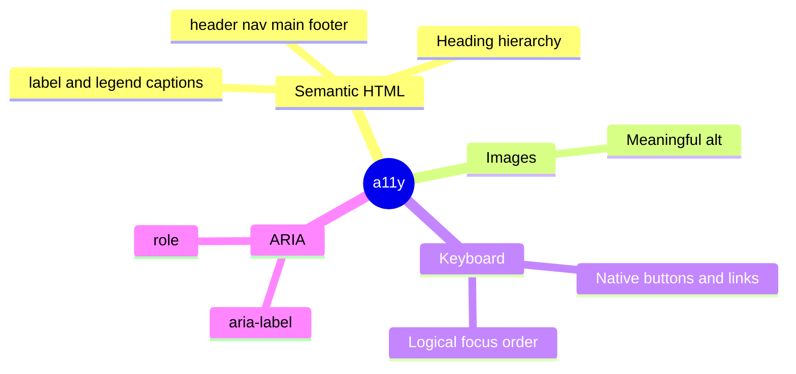
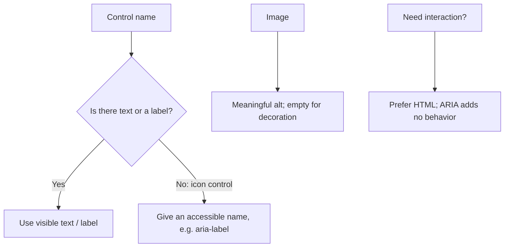

# Accessibility (a11y)

[Contents](../../README.md) · [← Back](../../Lesson-7/en/Forms%20part%202.md) · [Next →](../../Lesson-9/en/Meta%20tags%2C%20SEO%2C%20linking%20CSS%20and%20JS.md) · [RU](../ru/%D0%94%D0%BE%D1%81%D1%82%D1%83%D0%BF%D0%BD%D0%BE%D1%81%D1%82%D1%8C%20%28a11y%29.md) · [EN](Accessibility%20%28a11y%29.md) · [UZ](../uz/Foydalanish%20qulayligi%20%28a11y%29.md) · [Practice](../practice.html)

> **Link to the previous lesson:** in Lesson 7 you built a participant form. Today we look at it through the eyes of different people: without a mouse, without sight, in bright sunlight. And we fix what gets in their way.

---

## Why you need this

Your classmate broke their right arm. They open your form from Lesson 7 and fill it in using only the keyboard.

- Will they reach the "Submit" button?
- Will they see which field they are in right now?
- And will a blind user hear what kind of field is in front of them?

By the end of the lesson you will answer these questions yourself and be able to check any of your pages in 15 minutes.

---

## What you will learn

- Explain what accessibility (a11y) is and who needs it.
- Give a text-less element a name with `aria-label`.
- Choose a native HTML tag instead of imitating one with `role`.
- Check text contrast and never convey meaning by color alone.
- Walk through a page with the keyboard and use `tabindex` correctly.
- Add a "Skip to main content" link.
- Run a short page audit and record the result in a log.

---

## Review: 3 questions from earlier lessons

1. What `alt` does a decorative image need? (Lesson 4)
2. How do you connect a `<label>` to an input field? (Lesson 6)
3. Why do you need a `<legend>` inside a `<fieldset>`? (Lesson 7)

Answers are at the end of the lesson, in the "Answers" section.

---

## Lesson plan

| Section | What we do |
| --- | --- |
| What accessibility is | People who use the web differently from us |
| You already did this | Collect alt, label, scope, legend together |
| Accessible name and ARIA | How an element "introduces itself" to a screen reader |
| Mini-task 1 | A name for an icon link |
| Contrast and color | Text readability |
| Keyboard and tabindex | Focus order, the "Skip to main content" link |
| Mini-task 2 | Add a link that skips the menu |
| Headings | A page outline for screen readers |
| 15-minute audit | Step-by-step check and a log |
| Independent work | Audit of your form from Lesson 7 |



**How to read the diagram.** The four branches are four directions of the check. We always start with the right HTML tags. ARIA is an extra for when a tag is not enough.

---

## What accessibility is

**In simple terms:** a building has stairs at the entrance but no ramp. A person in a wheelchair cannot get in. The building is not "bad" - it was built without thinking about all its visitors.

**Web accessibility** (shortened to **a11y**: 11 letters between "a" and "y") is the same ramp, only for websites. A site must be usable by:

| Who | How they use the site | What they need |
| --- | --- | --- |
| Blind people | A screen reader reads the page aloud | `alt`, field labels, headings |
| People with low vision | Zoom the page 2–4 times | Good contrast, text instead of images of text |
| People who cannot use a mouse | Keyboard only | Every action via Tab, visible focus |
| Hard-of-hearing people | Watch video without sound | Subtitles |
| Each of us | Bright sun, broken arm, old phone | All of the above |

A **screen reader** is a program that reads the page aloud. Every system has one: VoiceOver on macOS and iOS, TalkBack on Android, free NVDA for Windows.

In many countries site accessibility is a legal requirement, especially for government services. But the main point is different: an accessible site is more convenient for everyone.

### You already did this

Everything you did right in Lessons 1–7 is already accessibility work:

| What | Lesson | How it helps |
| --- | --- | --- |
| `lang="en"` on `<html>` | 1 | The screen reader reads text with the right pronunciation |
| Headings `h1`–`h6` in order | 2 | The screen reader builds a page outline |
| `header`, `nav`, `main`, `footer` | 2 | The user jumps straight to the right part |
| Clear link text | 3 | "Club schedule" instead of "click here" |
| `alt` on `` | 4 | The image is replaced by a description |
| `caption` and `scope` in a table | 5 | A cell is tied to its header |
| `label` + `for`/`id` | 6 | The field is announced as "Email, edit text" |
| `fieldset` + `legend` | 7 | A radio group gets a shared question |

Today we add four new tools: ARIA, contrast, keyboard and audit.

---

## Accessible name and ARIA

**In simple terms:** at a conference every participant wears a name badge. Every button, link and field on a page also has a "badge" - its **accessible name**. The screen reader says the name and the role: "Submit, button".

Where the browser takes the name from:

| Element | Name source | Example |
| --- | --- | --- |
| Button, link | Text inside | `<button>Submit</button>` → "Submit" |
| Form field | The connected `<label>` | "Email" |
| Image link | The `alt` of the image inside | `<a href="/"></a>` → "Home page" |
| Element without text | `aria-label` | see below |

### `aria-label` - a name for an element without text

**ARIA** (Accessible Rich Internet Applications) is a set of attributes for screen readers. It complements HTML but does not replace it.

A button with a cross instead of a word:

```html
<button type="button" aria-label="Close window">×</button>
```

**What you will see:** just "×" on the page.
**What a blind user hears:** "Close window, button". Without `aria-label` they would hear "multiplication sign, button".

An icon link to a social network:

```html
<a href="https://t.me/example" aria-label="Our Telegram channel">
    
</a>
```

Here the image has an empty `alt=""` (it is decoration, Lesson 4), and `aria-label` gives the name to the whole link.

**Rule:** `aria-label` is needed only where there is no visible text. If the button says "Submit", do not add `aria-label`.

### `role` and the first rule of ARIA

The `role` attribute tells the screen reader the element's role. But **the first rule of ARIA: if a suitable HTML tag exists, do not use ARIA.**

```html
<!-- Bad: a div pretends to be a button -->
<div role="button">Submit</div>

<!-- Good: a real button -->
<button type="submit">Submit</button>
```

Why:

| What it can do | `<div role="button">` | `<button>` |
| --- | --- | --- |
| Screen reader says "button" | Yes | Yes |
| Gets focus with Tab | No | Yes |
| Responds to Enter and Space | No | Yes |
| Submits the form | No | Yes |

`role` changes only **what the element is called**. It does not add behavior.

One more role you may come across: `role="alert"`. It is put on messages that appear while the page is in use, for example "File not saved". When such a block appears, the screen reader reads it immediately. Such messages are added by JavaScript, so in our course it is enough to know the role exists.

### A native example: `<details>` and `<summary>`

Need a "Question - answer" block that opens on click? Do not build it from `div` and ARIA. HTML has a ready tag:

```html
<details>
    <summary>How much does the club cost?</summary>
    <p>Participation is free.</p>
</details>
```

**What you will see:** a line with a triangle. A click, Enter or Space - and the answer opens. Tab focus, announcing "collapsed / expanded" - it all works without a single line of ARIA.



**How to read the diagram.** Three separate questions to ask yourself: how to name a control, what `alt` to give an image, and which tag to use for an interactive element.

### How to see the accessible name

1. Open the page in Chrome and press F12.
2. On the **Elements** tab, select a button or field.
3. On the right, open the **Accessibility** tab (if it is not visible, click `»`).
4. In the **Computed Properties** section find **Name** and **Role**.

### Try to break it

1. Remove `aria-label` from the "×" button. Look at Name in DevTools. What is there now?
2. Replace `<button>` with `<div role="button">`. Press Tab. Does focus land on the "button"?

### Typical beginner mistakes

| Mistake | How to fix |
| --- | --- |
| `<div role="button">` instead of a button | Use `<button>` |
| `aria-label` on top of visible text | Remove it: the name already comes from the text |
| `aria-label` instead of `alt` on an image | Always `alt` for `` |
| Icon link without a name | `aria-label` on the link or `alt` on the image inside |

---

## Mini-task 1

A GitHub link is shown only as an icon. Make the screen reader announce "My GitHub profile, link". The icon is in `images/github-icon.svg`.

Check the result in DevTools: Name must match the text you wrote. Solution is in the "Answers" section.

---

## Contrast and color

**In simple terms:** light gray text on a white background is a sign in the fog. The designer finds it pretty, while a person with low vision, or with a phone in the sun, cannot read a thing.

**Contrast** is the difference in brightness between text and background. It is written as a ratio: from 1:1 (no difference) to 21:1 (black on white).

### Rule 1: minimum contrast

The **WCAG** standard requires:

- **4.5:1** - for normal text;
- **3:1** - for large text (roughly from 24 px, or from 19 px bold).

| Text on white background | Contrast | Normal text |
| --- | --- | --- |
| `#000000` black | 21:1 | ✅ Passes |
| `#1d4ed8` blue | 6.7:1 | ✅ Passes |
| `#767676` gray | 4.54:1 | ✅ Passes (borderline) |
| `#999999` light gray | 2.85:1 | ❌ Fails |
| `#cccccc` very light | 1.61:1 | ❌ Fails |

**How to check:**

1. Open [WebAIM Contrast Checker](https://webaim.org/resources/contrastchecker/).
2. Enter the text color in **Foreground** and the background color in **Background**.
3. Look at **Contrast Ratio** and the **WCAG AA: Normal Text** line - it must say **Pass**.

You will set colors in the CSS course. For now your pages have black text on white - that is 21:1, the best result.

### Rule 2: do not convey meaning by color alone

About 8% of men have trouble telling red from green. A blind user does not see color at all.

```html
<!-- Bad: what does the red dot mean? -->
<p><span style="color: #b00020;">●</span> Email</p>

<!-- Good: the meaning is clear from the text, color only helps -->
<p style="color: #b00020;"><strong>Error:</strong> email is filled in incorrectly</p>
```

**Check:** imagine the page in black and white. If no meaning is lost, all is well.

### Try to break it

In Chrome open DevTools → `⋮` → **More tools** → **Rendering**. Find **Emulate vision deficiencies** and pick **Achromatopsia** (complete color blindness). Is the page clear without color?

---

## Keyboard and `tabindex`

**In simple terms:** Tab leads you through the page like a guide through museum halls. The route is set by the order of elements in the HTML code: from top to bottom.

**Try it right now:** open your form from Lesson 7 and, without touching the mouse, press Tab. The frame jumping between fields is the **focus**.

### Main keys

| Key | What it does |
| --- | --- |
| Tab | Next interactive element |
| Shift+Tab | Previous element |
| Enter | Open a link, press a button |
| Space | Press a button, tick a checkbox |
| Arrows | Pick a radio in a group, an option in a select |

Headings and paragraphs do not get focus - that is how it should be. Tab only goes through things you can act on: links, buttons and fields.

### `tabindex` values

Links, buttons and form fields get focus by themselves. `tabindex` is rarely needed:

| Value | What it does | When to use |
| --- | --- | --- |
| `tabindex="0"` | Adds the element to the Tab route | Very rarely: better take a native tag |
| `tabindex="-1"` | Removes it from the route, but focus can be set from JavaScript | Heading of a pop-up window |
| `tabindex="1"`, `"2"`... | Puts the element at the start of the route | **Never** |

```html
<!-- DO NOT DO THIS -->
<input type="text" tabindex="2">
<input type="text" tabindex="1">
```

Positive numbers break the route: focus first jumps through the numbered elements, then through everything else. The user gets lost.

**Rule:** need a different order - change the order of elements in the code.

Remember: `tabindex` adds **only focus**. A `div` with `tabindex="0"` still does not respond to Enter. That is why a button needs `<button>`.

### The "Skip to main content" link

Imagine a menu with 10 links. A keyboard user presses Tab 10 times on **every** page to reach the text. The solution is an anchor link from Lesson 3, the first line in `<body>`:

```html
<body>
    <a href="#main">Skip to main content</a>
    <header>
        <nav>
            <!-- 10 menu links -->
        </nav>
    </header>
    <main id="main">
        <h1>Participant form</h1>
        <!-- form -->
    </main>
</body>
```

**What you will see:** the first Tab on the page - focus is on this link. Enter - and you are immediately in `<main>`. The next Tab takes you not to the menu but to the first field of the form.

On real sites such a link is hidden with CSS until it gets focus. You will do that in the CSS course. For now leave it visible.

### Try to break it

Put `tabindex="1"` on the **last** field of the form. Reload the page and press Tab. Where did the focus jump? Is it convenient?

### Typical beginner mistakes

| Mistake | How to fix |
| --- | --- |
| Positive `tabindex` to "fix" the order | Swap the elements in the code |
| `tabindex` on a link, button or field | Remove it: they get focus by themselves |
| `div` with `tabindex="0"` instead of a button | Use `<button>` |
| No way to skip a long menu | Add a "Skip to main content" link |

---

## Mini-task 2

Add a "Skip to main content" link to your form from Lesson 7.

Check: reload the page → Tab (focus on the link) → Enter → Tab. Focus must land on the first field of the form. Solution is in the "Answers" section.

---

## Headings - an outline for the screen reader

**In simple terms:** headings are a book's table of contents. A sighted person scans the page in a second. A blind user opens the list of headings (VoiceOver and NVDA have a dedicated key) and jumps to the one they need.

```html
<h1>Plov recipe</h1>
<h2>Ingredients</h2>
<h2>Cooking</h2>
<h3>Preparing the rice</h3>
<h3>Frying the meat and vegetables</h3>
<h3>Final steaming</h3>
<h2>Serving tips</h2>
```

The user hears a 7-line outline, picks "Preparing the rice" and lands right there.

Two different mistakes:

| Mistake | What happens | How to fix |
| --- | --- | --- |
| Heading via `<p><strong>...</strong></p>` | It is not in the outline: the screen reader cannot find it | Use `h2`–`h6` |
| Skipped level: `h2`, then right away `h4` | The heading exists, but the structure is confusing: where is `h3`? | Go in order: `h2` → `h3` |

**How to check:** write all headings of the page in a column, indenting each level to the right. If you get a tidy outline, all is well.

---

## 15-minute audit

The order for checking any page. Record the result in an **audit log**.

| Step | What we check | How | Norm |
| --- | --- | --- | --- |
| 1 | Keyboard | Tab and Shift+Tab through the whole page | You reach every field and button, focus is visible, you never "get stuck" |
| 2 | Buttons | Reach a button and press Enter | The button works |
| 3 | Names | DevTools → Accessibility → Name | Every field's name matches its caption |
| 4 | Images | Go through every `` | Meaningful ones have a description, decorative ones `alt=""` |
| 5 | Headings | Write them in a column | One `h1`, no levels skipped |
| 6 | Contrast | WebAIM | Not lower than 4.5:1 |

### Log template

| № | What I checked | Expected | Got | Fix |
| --- | --- | --- | --- | --- |
| 1 | Tab through the form | All 6 fields and the button | All 6 fields and the button | Not needed |
| 2 | Name of the "Phone" field | "Phone" | Empty | Added `<label for="phone">` |
| 3 | ... | ... | ... | ... |

**Log rule:** if you did not do a step, write "not checked". Do not write "no errors".

---

## Lesson summary: cheat sheet

| Task | Tool | Remember |
| --- | --- | --- |
| Name for a button or link without text | `aria-label="..."` | Only if there is no visible text |
| Make a button | `<button>` | Not `<div role="button">` |
| Expandable block | `<details>` + `<summary>` | A ready native tag |
| Readable text | Contrast ≥ 4.5:1 | Check in WebAIM |
| Error message | Text + color | Not by color alone |
| Tab order | Order in the HTML code | Positive `tabindex` - never |
| Skip the menu | `<a href="#main">` | First line in `<body>` |
| Page outline | `h1`–`h6` in order | Without skipping levels |

---

## Independent work: form audit

### Part 1. IDE task (graded by the platform)

The editor contains a form page with **six accessibility errors**. Find and fix them all:

1. The submit button is made from `<div role="button">`.
2. The email field has no connected label.
3. The Telegram icon link has no name.
4. One field has a positive `tabindex`.
5. There is no "Skip to main content" link and no `id` on `<main>`.
6. The "Frequently asked questions" section is made with paragraphs instead of `<details>` and `<summary>`.

What the platform checks: no `role="button"` and no positive `tabindex`, a `<button type="submit">` is present, every label is connected to a field, `aria-label` on the icon link, a `#main` link and `id="main"`, `<details>` with `<summary>`, exactly one `h1`.

### Part 2. Audit of your own form on your computer

Take your participant form from Lesson 7. Work on a copy of the file.

**Basic level (required)**

1. Run the audit using steps 1–6 from the "15-minute audit" section.
2. Fill in the log: at least 5 rows.
3. Fix everything you found and re-check the fixed places.
4. If you found no errors, write that in the log: "checked, no violations". That is also a result.

**Standard level**

5. Add a "Skip to main content" link.
6. Below the form add a "Frequently asked questions" block: 2–3 questions using `<details>` and `<summary>`.

**Star level ★**

7. Turn on a screen reader (macOS: Cmd+F5; Windows: free [NVDA](https://www.nvaccess.org/download/)). Go through the form with your eyes closed. Write down 3 observations: what was clear and what was not.

### Acceptance criteria

- [ ] The IDE task is accepted.
- [ ] Tab and Shift+Tab go through every field and button in a logical order, focus is visible.
- [ ] The submit button works from the keyboard.
- [ ] For every field, Name in DevTools matches the visible caption.
- [ ] The page has one `h1`, no heading levels are skipped.
- [ ] No positive `tabindex` and no `div` instead of buttons.
- [ ] The log has at least 5 rows: what I checked, expected, got, fix.
- [ ] (Standard) The skip-menu link moves focus to `<main>`.
- [ ] (Standard) `<details>` blocks open with Enter and Space.

---

## Self-check questions

1. What does "11" in the abbreviation a11y mean?
2. Where does the browser take the accessible name for the button `<button>Submit</button>` from?
3. When is `aria-label` needed and when is it redundant?
4. Why is `<button>` better than `<div role="button">`? Name three differences.
5. What does `tabindex="0"` add, and what does it **not** add?
6. Why must you not use `tabindex="3"`?
7. What minimum contrast does normal text need?
8. Why must you not report an error with red color alone?
9. What is the "Skip to main content" link for?
10. How do the mistakes "heading via `<p>`" and "`h2`, then `h4`" differ?

After the questions, take the **lesson test** on the platform: 12 questions, pass threshold 70%.

---

## What's next

Your page has become clear to people. In Lesson 9 we make it clear to **search engines and browsers**: meta tags, a description for Google, correct display on phones, connecting CSS and JavaScript.

---

## Answers

**Review**

1. Empty: `alt=""`. Then the screen reader skips the image.
2. The `for` attribute on `<label>` matches the `id` on the field: `<label for="email">` and `<input id="email">`.
3. `<legend>` gives a shared question to a group of fields. The screen reader reads "Skill level, group" before the radio options.

**Mini-task 1**

```html
<a href="https://github.com/Saydullayev017" aria-label="My GitHub profile">
    
</a>
```

There is a second correct option - give the name via the image's `alt`: ``. The main thing is that the name is given once.

**Mini-task 2**

```html
<body>
    <a href="#main">Skip to main content</a>
    <header>...</header>
    <main id="main">
        <h1>Participant form</h1>
        <form>...</form>
    </main>
</body>
```

**Self-check questions**

1. The number of letters between "a" and "y" in the word accessibility.
2. From the text inside the button: "Submit".
3. Needed when the element has no visible text (an icon, "×"). Redundant if there is text.
4. `<button>` gets focus with Tab, responds to Enter and Space, submits the form. A `div` with `role` can only be called a button.
5. It adds the element to the Tab route. It does not add a response to Enter and Space and does not make the element a button.
6. Positive numbers pull the element to the start of the route. The Tab order stops matching the order on screen.
7. 4.5:1. For large text - 3:1.
8. Some people cannot tell colors apart, and blind users do not see them. The meaning must be clear from the text.
9. So that a keyboard user does not have to Tab through the whole menu on every page.
10. A heading via `<p>` does not get into the screen-reader outline at all. With a skipped level the heading is in the outline, but the structure is confusing.

---

[Contents](../../README.md) · [← Back](../../Lesson-7/en/Forms%20part%202.md) · [Next →](../../Lesson-9/en/Meta%20tags%2C%20SEO%2C%20linking%20CSS%20and%20JS.md) · [RU](../ru/%D0%94%D0%BE%D1%81%D1%82%D1%83%D0%BF%D0%BD%D0%BE%D1%81%D1%82%D1%8C%20%28a11y%29.md) · [EN](Accessibility%20%28a11y%29.md) · [UZ](../uz/Foydalanish%20qulayligi%20%28a11y%29.md) · [Practice](../practice.html)
