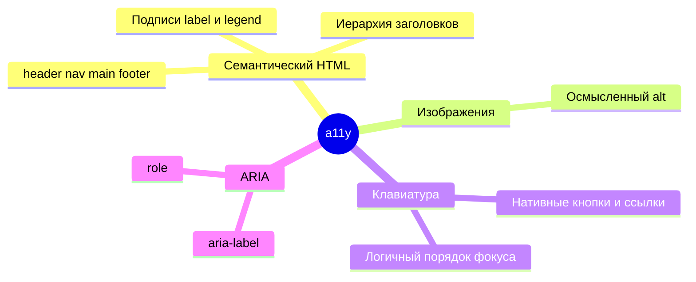
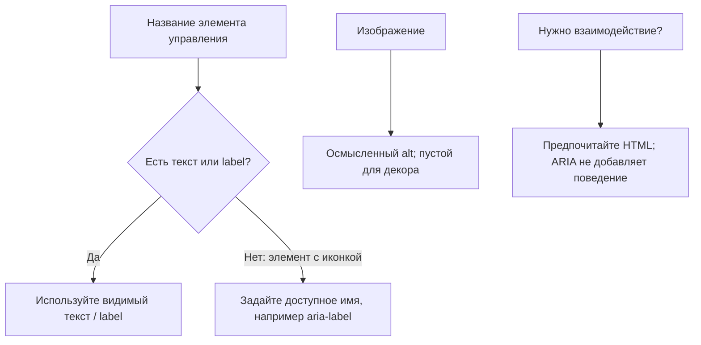

# Доступность (a11y)

[Содержание](../../README.md) · [Назад](../../Lesson-7/ru/%D0%A4%D0%BE%D1%80%D0%BC%D1%8B%20%D1%87-2.md) · [Вперёд](../../Lesson-9/ru/%D0%9C%D0%B5%D1%82%D0%B0-%D1%82%D0%B5%D0%B3%D0%B8%2C%20SEO%2C%20%D1%81%D0%B2%D1%8F%D0%B7%D1%8C%20%D1%81%20CSS%2C%20JS.md) · [Практика](../practice.html) · [RU](../ru/%D0%94%D0%BE%D1%81%D1%82%D1%83%D0%BF%D0%BD%D0%BE%D1%81%D1%82%D1%8C%20%28a11y%29.md) · [EN](../en/Accessibility%20%28a11y%29.md) · [UZ](../uz/Foydalanish%20qulayligi%20%28a11y%29.md)

> **Связь с прошлым уроком:** в уроке 7 вы собрали анкету участника. Сегодня проверим её глазами разных людей: без мыши, без зрения, на ярком солнце. И исправим то, что им мешает.

---

## Зачем это вам

Ваш одногруппник сломал правую руку. Он открывает вашу анкету из урока 7 и заполняет её только клавиатурой.

- Дойдёт ли он до кнопки «Отправить»?
- Увидит ли, в каком поле сейчас находится?
- А незрячий пользователь - услышит ли, что за поле перед ним?

К концу урока вы ответите на эти вопросы сами и сможете проверить любую свою страницу за 15 минут.

---

## Чему вы научитесь

- Объяснять, что такое доступность (a11y) и кому она нужна.
- Давать имя элементу без текста с помощью `aria-label`.
- Выбирать нативный HTML-тег вместо имитации через `role`.
- Проверять контраст текста и не передавать смысл только цветом.
- Проходить страницу клавиатурой и правильно использовать `tabindex`.
- Добавлять ссылку «Перейти к основному содержимому».
- Проводить мини-аудит страницы и записывать результат в журнал.

---

## Повторение: 3 вопроса из прошлых уроков

1. Какой `alt` нужен декоративной картинке? (урок 4)
2. Как связать `<label>` с полем ввода? (урок 6)
3. Зачем нужен `<legend>` внутри `<fieldset>`? (урок 7)

Ответы - в конце урока, в разделе «Ответы».

---

## План урока

| Раздел | Что делаем |
| --- | --- |
| Что такое доступность | Кто пользуется сайтом иначе, чем мы |
| Вы уже это делали | Собираем вместе alt, label, scope, legend |
| Доступное имя и ARIA | Как элемент «представляется» скринридеру |
| Мини-задание 1 | Имя для ссылки-иконки |
| Контраст и цвет | Читаемость текста |
| Клавиатура и tabindex | Порядок фокуса, ссылка «Перейти к содержимому» |
| Мини-задание 2 | Добавить ссылку пропуска меню |
| Заголовки | Оглавление страницы для скринридера |
| Аудит за 15 минут | Пошаговая проверка и журнал |
| Самостоятельная работа | Аудит своей анкеты из урока 7 |



**Как читать схему.** Четыре ветви - четыре направления проверки. Начинаем всегда с правильных HTML-тегов. ARIA - дополнение на тот случай, когда тега не хватает.

---

## Что такое доступность

**Простыми словами:** у здания лестница на входе, но нет пандуса. Человек на коляске не попадёт внутрь. Здание не «плохое» - его просто строили, не подумав обо всех посетителях.

**Веб-доступность** (accessibility, сокращённо **a11y**: между «a» и «y» 11 букв) - тот же пандус, только для сайтов. Сайтом должны пользоваться:

| Кто | Как пользуется сайтом | Что ему нужно |
| --- | --- | --- |
| Незрячие | Скринридер читает страницу вслух | `alt`, подписи полей, заголовки |
| Слабовидящие | Увеличивают масштаб в 2–4 раза | Хороший контраст, текст вместо картинок с текстом |
| Не могут пользоваться мышью | Только клавиатура | Все действия доступны по Tab, виден фокус |
| Слабослышащие | Смотрят видео без звука | Субтитры |
| Любой из нас | Яркое солнце, сломанная рука, старый телефон | Всё перечисленное выше |

**Скринридер** - программа, которая читает страницу вслух. Она есть в каждой системе: VoiceOver в macOS и iOS, TalkBack в Android, бесплатная NVDA для Windows.

Во многих странах доступность сайтов - требование закона, особенно для государственных сервисов. Но главное другое: доступный сайт удобнее для всех.

### Вы уже это делали

Всё, что вы делали правильно в уроках 1–7, - это уже работа над доступностью:

| Что | Урок | Чем помогает |
| --- | --- | --- |
| `lang="ru"` у `<html>` | 1 | Скринридер читает текст с правильным произношением |
| Заголовки `h1`–`h6` по порядку | 2 | Скринридер строит оглавление страницы |
| `header`, `nav`, `main`, `footer` | 2 | Пользователь прыгает сразу к нужной области |
| Понятный текст ссылки | 3 | «Расписание кружка» вместо «нажмите здесь» |
| `alt` у `` | 4 | Картинка заменяется описанием |
| `caption` и `scope` в таблице | 5 | Ячейка связывается со своим заголовком |
| `label` + `for`/`id` | 6 | Поле произносится как «Email, поле ввода» |
| `fieldset` + `legend` | 7 | Группа radio получает общий вопрос |

Сегодня добавим четыре новых инструмента: ARIA, контраст, клавиатуру и аудит.

---

## Доступное имя и ARIA

**Простыми словами:** на конференции у каждого участника бейдж с именем. На странице у каждой кнопки, ссылки и поля тоже есть «бейдж» - **доступное имя**. Скринридер произносит имя и роль: «Отправить, кнопка».

Откуда браузер берёт имя:

| Элемент | Источник имени | Пример |
| --- | --- | --- |
| Кнопка, ссылка | Текст внутри | `<button>Отправить</button>` → «Отправить» |
| Поле формы | Связанный `<label>` | «Email» |
| Ссылка-картинка | `alt` картинки внутри | `<a href="/"></a>` → «Главная» |
| Элемент без текста | `aria-label` | см. ниже |

### `aria-label` - имя для элемента без текста

**ARIA** (Accessible Rich Internet Applications) - набор атрибутов для скринридеров. Он дополняет HTML, но не заменяет его.

Кнопка с крестиком вместо слова:

```html
<button type="button" aria-label="Закрыть окно">×</button>
```

**Что увидите:** на странице просто «×».
**Что услышит незрячий:** «Закрыть окно, кнопка». Без `aria-label` он услышал бы «умножить, кнопка».

Ссылка-иконка на соцсеть:

```html
<a href="https://t.me/example" aria-label="Наш Telegram-канал">
    
</a>
```

Здесь у картинки пустой `alt=""` (она декоративная, урок 4), а имя всей ссылке даёт `aria-label`.

**Правило:** `aria-label` нужен только там, где нет видимого текста. Если на кнопке написано «Отправить», `aria-label` не добавляйте.

### `role` и первое правило ARIA

Атрибут `role` сообщает скринридеру роль элемента. Но **первое правило ARIA: не используйте ARIA, если есть подходящий HTML-тег.**

```html
<!-- Плохо: div притворяется кнопкой -->
<div role="button">Отправить</div>

<!-- Хорошо: настоящая кнопка -->
<button type="submit">Отправить</button>
```

Почему так:

| Что умеет | `<div role="button">` | `<button>` |
| --- | --- | --- |
| Скринридер называет «кнопка» | Да | Да |
| Попадает в фокус по Tab | Нет | Да |
| Срабатывает на Enter и Space | Нет | Да |
| Отправляет форму | Нет | Да |

`role` меняет только то, **как элемент называется**. Поведение он не добавляет.

Ещё одна роль, которую вы встретите: `role="alert"`. Её ставят на сообщения, которые появляются во время работы страницы, например «Файл не сохранён». Когда такой блок появляется, скринридер сразу его зачитывает. Сами такие сообщения добавляет JavaScript, поэтому в нашем курсе достаточно знать, что такая роль есть.

### Нативный пример: `<details>` и `<summary>`

Нужен блок «Вопрос - ответ», который раскрывается по клику? Не собирайте его из `div` и ARIA. В HTML есть готовый тег:

```html
<details>
    <summary>Сколько стоит участие в кружке?</summary>
    <p>Участие бесплатное.</p>
</details>
```

**Что увидите:** строку с треугольником. Клик, Enter или Space - и ответ раскрывается. Фокус по Tab, озвучка «свёрнуто / развёрнуто» - всё работает без единой строки ARIA.



**Как читать схему.** Три отдельных вопроса, которые вы задаёте себе: как назвать элемент управления, какой `alt` дать картинке и каким тегом сделать интерактивный элемент.

### Как посмотреть доступное имя

1. Откройте страницу в Chrome и нажмите F12.
2. Во вкладке **Elements** выберите кнопку или поле.
3. Справа откройте вкладку **Accessibility** (если её не видно - нажмите `»`).
4. В разделе **Computed Properties** найдите **Name** (имя) и **Role** (роль).

### Попробуйте сломать

1. Удалите `aria-label` у кнопки «×». Посмотрите Name в DevTools. Что там теперь?
2. Замените `<button>` на `<div role="button">`. Нажмите Tab. Попадает ли фокус на «кнопку»?

### Частые ошибки новичков

| Ошибка | Как исправить |
| --- | --- |
| `<div role="button">` вместо кнопки | Используйте `<button>` |
| `aria-label` поверх видимого текста | Удалите: имя уже берётся из текста |
| `aria-label` у картинки вместо `alt` | Для `` всегда `alt` |
| Ссылка-иконка без имени | `aria-label` у ссылки или `alt` у картинки внутри |

---

## Мини-задание 1

Ссылка на GitHub показана только иконкой. Сделайте так, чтобы скринридер произнёс «Мой профиль на GitHub, ссылка». Иконка лежит в `images/github-icon.svg`.

Проверьте результат в DevTools: Name должно совпадать с вашим текстом. Решение - в разделе «Ответы».

---

## Контраст и цвет

**Простыми словами:** светло-серый текст на белом фоне - как вывеска в тумане. Дизайнеру кажется стильно, а человек со слабым зрением или с телефоном на солнце ничего не прочитает.

**Контраст** - разница яркости текста и фона. Его записывают как отношение: от 1:1 (нет разницы) до 21:1 (чёрное на белом).

### Правило 1: минимальный контраст

Стандарт **WCAG** требует:

- **4.5:1** - для обычного текста;
- **3:1** - для крупного текста (примерно от 24 px, или от 19 px жирным).

| Текст на белом фоне | Контраст | Обычный текст |
| --- | --- | --- |
| `#000000` чёрный | 21:1 | ✅ Проходит |
| `#1d4ed8` синий | 6.7:1 | ✅ Проходит |
| `#767676` серый | 4.54:1 | ✅ Проходит (на грани) |
| `#999999` светло-серый | 2.85:1 | ❌ Не проходит |
| `#cccccc` очень светлый | 1.61:1 | ❌ Не проходит |

**Как проверить:**

1. Откройте [WebAIM Contrast Checker](https://webaim.org/resources/contrastchecker/).
2. В **Foreground** введите цвет текста, в **Background** - цвет фона.
3. Посмотрите **Contrast Ratio** и строку **WCAG AA: Normal Text** - должно быть **Pass**.

Цвета вы будете задавать в курсе CSS. Пока на ваших страницах чёрный текст на белом фоне - это 21:1, лучший результат.

### Правило 2: не передавайте смысл только цветом

Около 8% мужчин плохо различают красный и зелёный. Незрячий цвет не видит вовсе.

```html
<!-- Плохо: что значит красная точка? -->
<p><span style="color: #b00020;">●</span> Email</p>

<!-- Хорошо: смысл понятен из текста, цвет только помогает -->
<p style="color: #b00020;"><strong>Ошибка:</strong> email заполнен неверно</p>
```

**Проверка:** мысленно сделайте страницу чёрно-белой. Если смысл не потерялся - всё в порядке.

### Попробуйте сломать

В Chrome откройте DevTools → `⋮` → **More tools** → **Rendering**. Найдите **Emulate vision deficiencies** и выберите **Achromatopsia** (полная цветовая слепота). Понятна ли страница без цвета?

---

## Клавиатура и `tabindex`

**Простыми словами:** Tab ведёт по странице, как экскурсовод по залам музея. Маршрут задаёт порядок элементов в HTML-коде: сверху вниз.

**Попробуйте прямо сейчас:** откройте свою анкету из урока 7 и нажимайте Tab, не трогая мышь. Рамка, которая прыгает по полям, - это **фокус**.

### Главные клавиши

| Клавиша | Что делает |
| --- | --- |
| Tab | Следующий интерактивный элемент |
| Shift+Tab | Предыдущий элемент |
| Enter | Открыть ссылку, нажать кнопку |
| Space | Нажать кнопку, отметить checkbox |
| Стрелки | Выбрать radio в группе, вариант в select |

Заголовки и абзацы фокус не получают - так и должно быть. Tab ходит только по тому, с чем можно взаимодействовать: ссылкам, кнопкам и полям.

### Значения `tabindex`

Ссылки, кнопки и поля формы попадают в фокус сами. `tabindex` нужен редко:

| Значение | Что делает | Когда использовать |
| --- | --- | --- |
| `tabindex="0"` | Добавляет элемент в маршрут Tab | Очень редко: лучше взять нативный тег |
| `tabindex="-1"` | Убирает из маршрута, но фокус можно поставить из JavaScript | Заголовок всплывающего окна |
| `tabindex="1"`, `"2"`... | Ставит элемент в начало маршрута | **Никогда** |

```html
<!-- НЕ делайте так -->
<input type="text" tabindex="2">
<input type="text" tabindex="1">
```

Положительные числа ломают маршрут: фокус сначала прыгает по пронумерованным элементам, а потом по всем остальным. Пользователь теряется.

**Правило:** нужен другой порядок - поменяйте порядок элементов в коде.

Запомните: `tabindex` добавляет **только фокус**. На Enter `div` с `tabindex="0"` всё равно не реагирует. Поэтому для кнопки нужен `<button>`.

### Ссылка «Перейти к основному содержимому»

Представьте меню из 10 ссылок. Пользователь клавиатуры на **каждой** странице нажимает Tab 10 раз, чтобы добраться до текста. Решение - якорная ссылка из урока 3, первой строкой в `<body>`:

```html
<body>
    <a href="#main">Перейти к основному содержимому</a>
    <header>
        <nav>
            <!-- 10 ссылок меню -->
        </nav>
    </header>
    <main id="main">
        <h1>Анкета участника</h1>
        <!-- форма -->
    </main>
</body>
```

**Что увидите:** первый Tab на странице - фокус на этой ссылке. Enter - и вы сразу в `<main>`. Следующий Tab приведёт к первому полю формы, а не к меню.

На настоящих сайтах такую ссылку прячут через CSS, пока она не получит фокус. Это вы сделаете в курсе CSS. Пока оставьте её видимой.

### Попробуйте сломать

Поставьте `tabindex="1"` на **последнее** поле анкеты. Обновите страницу и нажмите Tab. Куда прыгнул фокус? Удобно ли это?

### Частые ошибки новичков

| Ошибка | Как исправить |
| --- | --- |
| Положительный `tabindex` для «исправления» порядка | Переставьте элементы в коде |
| `tabindex` на ссылке, кнопке или поле | Удалите: они фокусируются сами |
| `div` с `tabindex="0"` вместо кнопки | Используйте `<button>` |
| Нет способа пропустить длинное меню | Добавьте ссылку «Перейти к основному содержимому» |

---

## Мини-задание 2

Добавьте в свою анкету из урока 7 ссылку «Перейти к основному содержимому».

Проверка: обновите страницу → Tab (фокус на ссылке) → Enter → Tab. Фокус должен попасть на первое поле формы. Решение - в разделе «Ответы».

---

## Заголовки - оглавление для скринридера

**Простыми словами:** заголовки - это оглавление книги. Зрячий пробегает страницу глазами за секунду. Незрячий открывает список заголовков (в VoiceOver и NVDA есть отдельная клавиша) и прыгает к нужному.

```html
<h1>Рецепт плова</h1>
<h2>Ингредиенты</h2>
<h2>Приготовление</h2>
<h3>Подготовка риса</h3>
<h3>Обжарка мяса и овощей</h3>
<h3>Финальная варка</h3>
<h2>Советы по подаче</h2>
```

Пользователь слышит оглавление из 7 строк, выбирает «Подготовка риса» и сразу попадает туда.

Две разные ошибки:

| Ошибка | Что происходит | Как исправить |
| --- | --- | --- |
| Заголовок сделан через `<p><strong>...</strong></p>` | Его нет в оглавлении: скринридер его не найдёт | Используйте `h2`–`h6` |
| Пропуск уровня: `h2`, а сразу за ним `h4` | Заголовок есть, но структура путает: где `h3`? | Идите по порядку: `h2` → `h3` |

**Как проверить:** выпишите все заголовки страницы столбиком, сдвигая каждый уровень вправо. Получилось аккуратное оглавление - всё в порядке.

---

## Аудит за 15 минут

Порядок проверки любой страницы. Результат записывайте в **журнал аудита**.

| Шаг | Что проверяем | Как | Норма |
| --- | --- | --- | --- |
| 1 | Клавиатура | Tab и Shift+Tab по всей странице | Попадаете на каждое поле и кнопку, фокус виден, нигде не «застреваете» |
| 2 | Кнопки | Дойти до кнопки, нажать Enter | Кнопка срабатывает |
| 3 | Имена | DevTools → Accessibility → Name | У каждого поля имя совпадает с подписью |
| 4 | Картинки | Просмотреть каждый `` | Смысловые - с описанием, декоративные - `alt=""` |
| 5 | Заголовки | Выписать столбиком | Один `h1`, уровни без пропусков |
| 6 | Контраст | WebAIM | Не ниже 4.5:1 |

### Шаблон журнала

| № | Что проверял | Ожидал | Получилось | Исправление |
| --- | --- | --- | --- | --- |
| 1 | Tab по форме | Все 6 полей и кнопка | Все 6 полей и кнопка | Не нужно |
| 2 | Name поля «Телефон» | «Телефон» | Пусто | Добавил `<label for="phone">` |
| 3 | ... | ... | ... | ... |

**Правило журнала:** если шаг не выполняли, пишите «не проверено». Не пишите «ошибок нет».

---

## Итоги урока: шпаргалка

| Задача | Инструмент | Запомнить |
| --- | --- | --- |
| Имя кнопке или ссылке без текста | `aria-label="..."` | Только если нет видимого текста |
| Сделать кнопку | `<button>` | Не `<div role="button">` |
| Раскрывающийся блок | `<details>` + `<summary>` | Готовый нативный тег |
| Читаемый текст | Контраст ≥ 4.5:1 | Проверять в WebAIM |
| Сообщить об ошибке | Текст + цвет | Не только цветом |
| Порядок Tab | Порядок в HTML-коде | Положительный `tabindex` - никогда |
| Пропустить меню | `<a href="#main">` | Первой строкой в `<body>` |
| Оглавление страницы | `h1`–`h6` по порядку | Без пропусков уровней |

---

## Самостоятельная работа: аудит анкеты

### Часть 1. Задание в IDE (засчитывается платформой)

В редакторе уже лежит страница анкеты **с шестью ошибками доступности**. Найдите и исправьте все:

1. Кнопка отправки сделана из `<div role="button">`.
2. У поля почты нет связанной подписи.
3. Ссылка-иконка на Telegram не имеет имени.
4. У одного поля стоит положительный `tabindex`.
5. Нет ссылки «Перейти к основному содержимому» и `id` у `<main>`.
6. Раздел «Частые вопросы» сделан абзацами вместо `<details>` и `<summary>`.

Что проверяет платформа: нет `role="button"` и положительных `tabindex`, есть `<button type="submit">`, каждая подпись связана с полем, у ссылки-иконки есть `aria-label`, есть ссылка `#main` и `id="main"`, есть `<details>` с `<summary>`, один `h1`.

### Часть 2. Аудит своей анкеты на компьютере

Возьмите свою анкету участника из урока 7. Работайте с копией файла.

**Базовый уровень (обязательно)**

1. Проведите аудит по шагам 1–6 из раздела «Аудит за 15 минут».
2. Заполните журнал: не меньше 5 строк.
3. Исправьте всё, что нашли, и проверьте исправленные места ещё раз.
4. Если ошибок не нашлось - так и запишите в журнал: «проверено, нарушений нет». Это тоже результат.

**Стандартный уровень**

5. Добавьте ссылку «Перейти к основному содержимому».
6. Добавьте под формой блок «Частые вопросы»: 2–3 вопроса через `<details>` и `<summary>`.

**Уровень со звёздочкой ★**

7. Включите скринридер (macOS: Cmd+F5; Windows: бесплатная [NVDA](https://www.nvaccess.org/download/)). Пройдите анкету с закрытыми глазами. Запишите 3 наблюдения: что было понятно и что нет.

### Критерии готовности

- [ ] Задание в IDE засчитано.
- [ ] Tab и Shift+Tab проходят все поля и кнопку в логичном порядке, фокус виден.
- [ ] Кнопка отправки срабатывает с клавиатуры.
- [ ] У каждого поля Name в DevTools совпадает с видимой подписью.
- [ ] На странице один `h1`, уровни заголовков без пропусков.
- [ ] Нет положительных `tabindex` и нет `div` вместо кнопок.
- [ ] Журнал содержит не меньше 5 строк: что проверял, ожидал, получилось, исправление.
- [ ] (Стандартный) Ссылка пропуска меню переводит фокус в `<main>`.
- [ ] (Стандартный) Блоки `<details>` раскрываются клавишами Enter и Space.

---

## Вопросы для самопроверки

1. Что означает «11» в сокращении a11y?
2. Откуда браузер берёт доступное имя для кнопки `<button>Отправить</button>`?
3. Когда нужен `aria-label`, а когда он лишний?
4. Чем `<button>` лучше, чем `<div role="button">`? Назовите три отличия.
5. Что добавляет `tabindex="0"` и чего он **не** добавляет?
6. Почему нельзя использовать `tabindex="3"`?
7. Какой минимальный контраст нужен обычному тексту?
8. Почему нельзя сообщать об ошибке только красным цветом?
9. Зачем нужна ссылка «Перейти к основному содержимому»?
10. Чем отличаются две ошибки: «заголовок через `<p>`» и «`h2`, затем `h4`»?

После вопросов пройдите **тест урока** на платформе: 12 вопросов, порог 70%.

---

## Что дальше

Ваша страница уже понятна людям. В уроке 9 сделаем её понятной **поисковикам и браузерам**: мета-теги, описание для Google, правильное отображение на телефоне, подключение CSS и JavaScript.

---

## Ответы

**Повторение**

1. Пустой: `alt=""`. Тогда скринридер пропускает картинку.
2. Атрибут `for` у `<label>` совпадает с `id` поля: `<label for="email">` и `<input id="email">`.
3. `<legend>` даёт общий вопрос группе полей. Скринридер прочитает «Уровень подготовки, группа» перед вариантами radio.

**Мини-задание 1**

```html
<a href="https://github.com/Saydullayev017" aria-label="Мой профиль на GitHub">
    
</a>
```

Есть второй правильный вариант - дать имя через `alt` картинки: ``. Главное, чтобы имя было указано один раз.

**Мини-задание 2**

```html
<body>
    <a href="#main">Перейти к основному содержимому</a>
    <header>...</header>
    <main id="main">
        <h1>Анкета участника</h1>
        <form>...</form>
    </main>
</body>
```

**Вопросы для самопроверки**

1. Количество букв между «a» и «y» в слове accessibility.
2. Из текста внутри кнопки: «Отправить».
3. Нужен, когда у элемента нет видимого текста (иконка, «×»). Лишний, когда текст уже есть.
4. `<button>` попадает в фокус по Tab, срабатывает на Enter и Space, отправляет форму. `div` с `role` умеет только называться кнопкой.
5. Добавляет элемент в маршрут Tab. Не добавляет реакцию на Enter и Space и не делает элемент кнопкой.
6. Положительные числа выдёргивают элемент в начало маршрута. Порядок Tab перестаёт совпадать с порядком на экране.
7. 4.5:1. Для крупного текста - 3:1.
8. Часть людей не различает цвета, а незрячие их не видят. Смысл должен быть понятен из текста.
9. Чтобы пользователь клавиатуры не проходил всё меню по Tab на каждой странице.
10. Заголовок через `<p>` не попадает в оглавление скринридера вовсе. При пропуске уровня заголовок в оглавлении есть, но структура сбивает с толку.

---

[Содержание](../../README.md) · [Назад](../../Lesson-7/ru/%D0%A4%D0%BE%D1%80%D0%BC%D1%8B%20%D1%87-2.md) · [Вперёд](../../Lesson-9/ru/%D0%9C%D0%B5%D1%82%D0%B0-%D1%82%D0%B5%D0%B3%D0%B8%2C%20SEO%2C%20%D1%81%D0%B2%D1%8F%D0%B7%D1%8C%20%D1%81%20CSS%2C%20JS.md) · [Практика](../practice.html) · [RU](../ru/%D0%94%D0%BE%D1%81%D1%82%D1%83%D0%BF%D0%BD%D0%BE%D1%81%D1%82%D1%8C%20%28a11y%29.md) · [EN](../en/Accessibility%20%28a11y%29.md) · [UZ](../uz/Foydalanish%20qulayligi%20%28a11y%29.md)
