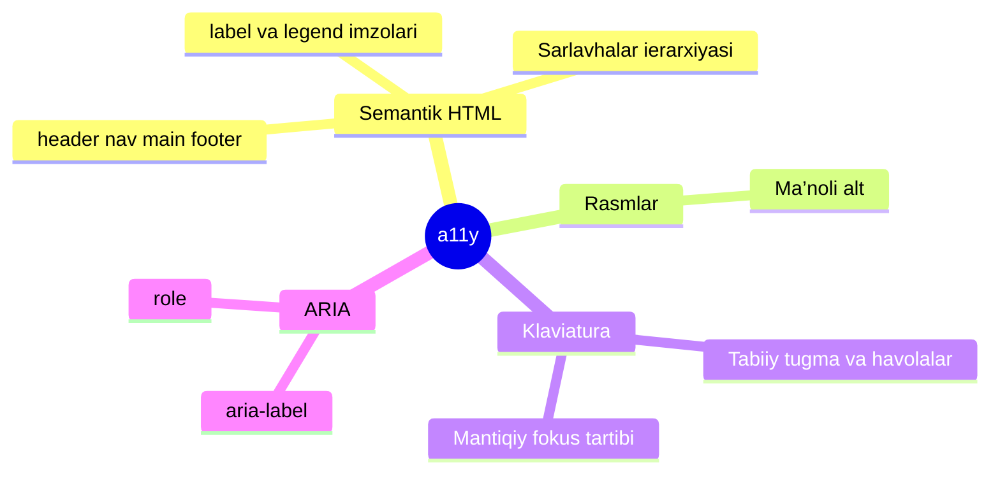
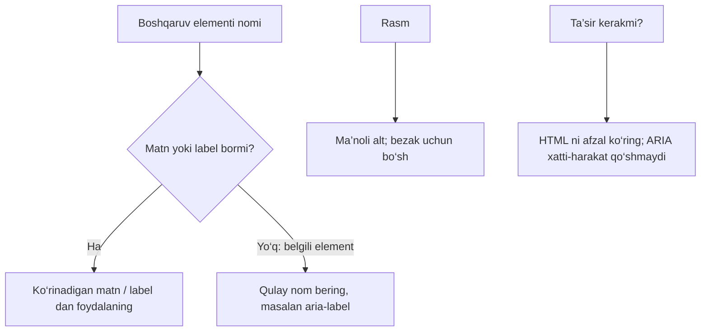

# Foydalanish qulayligi (a11y)

[Mundarija](../../README.md) · [← Orqaga](../../Lesson-7/uz/Formalar%20qism-2.md) · [Keyingi →](../../Lesson-9/uz/Meta-teglar%2C%20SEO%2C%20CSS%20va%20JS%20bilan%20bog%27lanish.md) · [RU](../ru/%D0%94%D0%BE%D1%81%D1%82%D1%83%D0%BF%D0%BD%D0%BE%D1%81%D1%82%D1%8C%20%28a11y%29.md) · [EN](../en/Accessibility%20%28a11y%29.md) · [UZ](Foydalanish%20qulayligi%20%28a11y%29.md) · [Amaliyot](../practice.html)

> **Oldingi dars bilan bog‘liqlik:** 7-darsda ishtirokchi anketasini yig‘dingiz. Bugun uni turli odamlar ko‘zi bilan tekshiramiz: sichqonchasiz, ko‘rmasdan, yorqin quyoshda. Va ularga xalaqit beradigan narsalarni tuzatamiz.

---

## Bu sizga nima uchun kerak

Guruhdoshingiz o‘ng qo‘lini sindirib oldi. U 7-darsdagi anketangizni ochib, faqat klaviatura bilan to‘ldiradi.

- U «Yuborish» tugmasigacha yeta oladimi?
- Hozir qaysi maydonda turganini ko‘radimi?
- Ko‘zi ojiz foydalanuvchi esa oldida qanday maydon borligini eshitadimi?

Dars oxirida bu savollarga o‘zingiz javob berasiz va istalgan sahifangizni 15 daqiqada tekshira olasiz.

---

## Nimani o‘rganasiz

- Foydalanish qulayligi (a11y) nima va u kimga kerakligini tushuntirish.
- Matnsiz elementga `aria-label` orqali nom berish.
- `role` orqali taqlid o‘rniga tabiiy HTML tegini tanlash.
- Matn kontrastini tekshirish va ma’noni faqat rang bilan bermaslik.
- Sahifani klaviatura bilan o‘tish va `tabindex` ni to‘g‘ri ishlatish.
- «Asosiy mazmunga o‘tish» havolasini qo‘shish.
- Sahifaning kichik auditini o‘tkazish va natijani jurnalga yozish.

---

## Takrorlash: oldingi darslardan 3 savol

1. Bezak rasmiga qanday `alt` kerak? (4-dars)
2. `<label>` ni kiritish maydoni bilan qanday bog‘lash mumkin? (6-dars)
3. `<fieldset>` ichida `<legend>` nima uchun kerak? (7-dars)

Javoblar - dars oxirida, «Javoblar» bo‘limida.

---

## Reja

| Bo‘lim | Nima qilamiz |
| --- | --- |
| Foydalanish qulayligi nima | Bizdan boshqacha foydalanadiganlar |
| Siz buni allaqachon qilgansiz | alt, label, scope, legend ni jamlaymiz |
| Qulay nom va ARIA | Element ekran o‘quvchiga qanday «tanishtiriladi» |
| Mini-topshiriq 1 | Belgi-havola uchun nom |
| Kontrast va rang | Matn o‘qilishi |
| Klaviatura va tabindex | Fokus tartibi, «Asosiy mazmunga o‘tish» havolasi |
| Mini-topshiriq 2 | Menyuni o‘tkazib yuborish havolasini qo‘shish |
| Sarlavhalar | Ekran o‘quvchi uchun sahifa mundarijasi |
| 15 daqiqalik audit | Qadamma-qadam tekshiruv va jurnal |
| Mustaqil ish | 7-darsdagi anketangiz auditi |



**Sxemani qanday o‘qish kerak.** To‘rtta shox - tekshiruvning to‘rt yo‘nalishi. Doim to‘g‘ri HTML teglaridan boshlaymiz. ARIA - teg yetmagan holat uchun qo‘shimcha.

---

## Foydalanish qulayligi nima

**Oddiy qilib aytganda:** binoning kirish qismida zina bor, lekin pandus yo‘q. Aravachadagi odam ichkariga kira olmaydi. Bino «yomon» emas - uni barcha tashrif buyuruvchilar haqida o‘ylamasdan qurishgan.

**Veb-qulaylik** (accessibility, qisqacha **a11y**: «a» va «y» orasida 11 ta harf) - xuddi shu pandus, faqat saytlar uchun. Saytdan foydalanishi kerak:

| Kim | Saytdan qanday foydalanadi | Unga nima kerak |
| --- | --- | --- |
| Ko‘zi ojizlar | Ekran o‘quvchi sahifani ovoz chiqarib o‘qiydi | `alt`, maydon imzolari, sarlavhalar |
| Ko‘zi zaiflar | Masshtabni 2–4 marta kattalashtiradi | Yaxshi kontrast, matnli rasm o‘rniga matn |
| Sichqonchadan foydalana olmaydiganlar | Faqat klaviatura | Barcha harakatlar Tab orqali, fokus ko‘rinadi |
| Eshitishi zaiflar | Videoni ovozsiz ko‘radi | Subtitrlar |
| Har birimiz | Yorqin quyosh, singan qo‘l, eski telefon | Yuqoridagilarning hammasi |

**Ekran o‘quvchi** - sahifani ovoz chiqarib o‘qiydigan dastur. U har bir tizimda bor: macOS va iOS da VoiceOver, Android da TalkBack, Windows uchun bepul NVDA.

Ko‘plab mamlakatlarda saytlar qulayligi - qonun talabi, ayniqsa davlat xizmatlari uchun. Lekin asosiysi boshqa: qulay sayt hamma uchun qulayroq.

### Siz buni allaqachon qilgansiz

1–7-darslarda to‘g‘ri qilgan hamma narsangiz - bu allaqachon qulaylik ustidagi ish:

| Nima | Dars | Nimaga yordam beradi |
| --- | --- | --- |
| `<html>` dagi `lang="uz"` | 1 | Ekran o‘quvchi matnni to‘g‘ri talaffuz bilan o‘qiydi |
| Tartib bilan `h1`–`h6` sarlavhalar | 2 | Ekran o‘quvchi sahifa mundarijasini quradi |
| `header`, `nav`, `main`, `footer` | 2 | Foydalanuvchi to‘g‘ri kerakli qismga sakraydi |
| Tushunarli havola matni | 3 | «Bu yerni bosing» o‘rniga «To‘garak jadvali» |
| `` dagi `alt` | 4 | Rasm tavsif bilan almashadi |
| Jadvaldagi `caption` va `scope` | 5 | Katak o‘z sarlavhasi bilan bog‘lanadi |
| `label` + `for`/`id` | 6 | Maydon «Email, kiritish maydoni» deb aytiladi |
| `fieldset` + `legend` | 7 | radio guruhi umumiy savolga ega bo‘ladi |

Bugun to‘rtta yangi vosita qo‘shamiz: ARIA, kontrast, klaviatura va audit.

---

## Qulay nom va ARIA

**Oddiy qilib aytganda:** konferensiyada har bir ishtirokchining ismli beyji bor. Sahifada har bir tugma, havola va maydonning ham «beyji» bor - **qulay nom**. Ekran o‘quvchi nom va rolni aytadi: «Yuborish, tugma».

Brauzer nomni qayerdan oladi:

| Element | Nom manbai | Misol |
| --- | --- | --- |
| Tugma, havola | Ichidagi matn | `<button>Yuborish</button>` → «Yuborish» |
| Forma maydoni | Bog‘langan `<label>` | «Email» |
| Rasm-havola | Ichidagi rasmning `alt` i | `<a href="/"></a>` → «Bosh sahifa» |
| Matnsiz element | `aria-label` | quyida qarang |

### `aria-label` - matnsiz element uchun nom

**ARIA** (Accessible Rich Internet Applications) - ekran o‘quvchilar uchun atributlar to‘plami. U HTML ni to‘ldiradi, lekin almashtirmaydi.

So‘z o‘rniga xochcha bilan tugma:

```html
<button type="button" aria-label="Oynani yopish">×</button>
```

**Nimani ko‘rasiz:** sahifada shunchaki «×».
**Ko‘zi ojiz nimani eshitadi:** «Oynani yopish, tugma». `aria-label` siz u «ko‘paytirish, tugma» ni eshitardi.

Ijtimoiy tarmoqqa belgi-havola:

```html
<a href="https://t.me/example" aria-label="Telegram kanalimiz">
    
</a>
```

Bu yerda rasmning `alt=""` i bo‘sh (u bezak, 4-dars), butun havolaga esa nomni `aria-label` beradi.

**Qoida:** `aria-label` faqat ko‘rinadigan matn yo‘q joyda kerak. Tugmada «Yuborish» deb yozilgan bo‘lsa, `aria-label` qo‘shmang.

### `role` va ARIA ning birinchi qoidasi

`role` atributi ekran o‘quvchiga element rolini aytadi. Lekin **ARIA ning birinchi qoidasi: mos HTML tegi bo‘lsa, ARIA ishlatmang.**

```html
<!-- Yomon: div tugma bo‘lib ko‘rinadi -->
<div role="button">Yuborish</div>

<!-- Yaxshi: haqiqiy tugma -->
<button type="submit">Yuborish</button>
```

Nega shunday:

| Nima qila oladi | `<div role="button">` | `<button>` |
| --- | --- | --- |
| Ekran o‘quvchi «tugma» deydi | Ha | Ha |
| Tab bilan fokusga tushadi | Yo‘q | Ha |
| Enter va Space ga javob beradi | Yo‘q | Ha |
| Formani yuboradi | Yo‘q | Ha |

`role` faqat element **qanday nomlanishini** o‘zgartiradi. U xatti-harakat qo‘shmaydi.

Uchrab qoladigan yana bir rol: `role="alert"`. U sahifa ishlayotganda paydo bo‘ladigan xabarlarga qo‘yiladi, masalan «Fayl saqlanmadi». Bunday blok paydo bo‘lganda ekran o‘quvchi uni darhol o‘qiydi. Bunday xabarlarni JavaScript qo‘shadi, shuning uchun kursimizda bunday rol borligini bilish yetarli.

### Tabiiy misol: `<details>` va `<summary>`

Bosilganda ochiladigan «Savol - javob» bloki kerakmi? Uni `div` va ARIA dan yig‘mang. HTML da tayyor teg bor:

```html
<details>
    <summary>To‘garakda qatnashish qancha turadi?</summary>
    <p>Qatnashish bepul.</p>
</details>
```

**Nimani ko‘rasiz:** uchburchakli qator. Bosish, Enter yoki Space - va javob ochiladi. Tab bilan fokus, «yopiq / ochiq» deb aytish - hammasi bitta ham ARIA qatorisiz ishlaydi.



**Sxemani qanday o‘qish kerak.** O‘zingizga beradigan uchta alohida savol: boshqaruv elementini qanday nomlash, rasmga qanday `alt` berish va interaktiv elementni qaysi teg bilan qilish.

### Qulay nomni qanday ko‘rish

1. Sahifani Chrome da ochib, F12 ni bosing.
2. **Elements** yorlig‘ida tugma yoki maydonni tanlang.
3. O‘ngda **Accessibility** yorlig‘ini oching (ko‘rinmasa - `»` ni bosing).
4. **Computed Properties** bo‘limida **Name** (nom) va **Role** (rol) ni toping.

### Buzib ko‘ring

1. «×» tugmasidan `aria-label` ni o‘chiring. DevTools dagi Name ga qarang. Endi u yerda nima?
2. `<button>` ni `<div role="button">` ga almashtiring. Tab ni bosing. Fokus «tugma»ga tushadimi?

### Yangi o‘rganuvchilarning tipik xatolari

| Xato | Qanday tuzatish |
| --- | --- |
| Tugma o‘rniga `<div role="button">` | `<button>` ishlating |
| Ko‘rinadigan matn ustidan `aria-label` | O‘chiring: nom allaqachon matndan olinadi |
| Rasmda `alt` o‘rniga `aria-label` | `` uchun doim `alt` |
| Nomsiz belgi-havola | Havolada `aria-label` yoki ichidagi rasmda `alt` |

---

## Mini-topshiriq 1

GitHub havolasi faqat belgi bilan ko‘rsatilgan. Ekran o‘quvchi «GitHub dagi profilim, havola» deb aytadigan qiling. Belgi `images/github-icon.svg` da.

Natijani DevTools da tekshiring: Name siz yozgan matn bilan mos bo‘lishi kerak. Yechim - «Javoblar» bo‘limida.

---

## Kontrast va rang

**Oddiy qilib aytganda:** oq fonda och kulrang matn - tumandagi peshlavha. Dizaynerga chiroyli ko‘rinadi, ko‘zi zaif odam yoki quyoshda telefonli odam esa hech narsani o‘qiy olmaydi.

**Kontrast** - matn va fon yorqinligi farqi. U nisbat sifatida yoziladi: 1:1 (farq yo‘q) dan 21:1 gacha (oqda qora).

### 1-qoida: minimal kontrast

**WCAG** standarti talab qiladi:

- **4.5:1** - oddiy matn uchun;
- **3:1** - yirik matn uchun (taxminan 24 px dan, yoki qalin 19 px dan).

| Oq fondagi matn | Kontrast | Oddiy matn |
| --- | --- | --- |
| `#000000` qora | 21:1 | ✅ O‘tadi |
| `#1d4ed8` ko‘k | 6.7:1 | ✅ O‘tadi |
| `#767676` kulrang | 4.54:1 | ✅ O‘tadi (chegarada) |
| `#999999` och kulrang | 2.85:1 | ❌ O‘tmaydi |
| `#cccccc` juda och | 1.61:1 | ❌ O‘tmaydi |

**Qanday tekshirish:**

1. [WebAIM Contrast Checker](https://webaim.org/resources/contrastchecker/) ni oching.
2. **Foreground** ga matn rangini, **Background** ga fon rangini kiriting.
3. **Contrast Ratio** ga va **WCAG AA: Normal Text** qatoriga qarang - **Pass** bo‘lishi kerak.

Ranglarni CSS kursida berasiz. Hozircha sahifalaringizda oq fonda qora matn - bu 21:1, eng yaxshi natija.

### 2-qoida: ma’noni faqat rang bilan bermang

Erkaklarning taxminan 8% i qizil va yashilni yomon ajratadi. Ko‘zi ojiz esa rangni umuman ko‘rmaydi.

```html
<!-- Yomon: qizil nuqta nimani bildiradi? -->
<p><span style="color: #b00020;">●</span> Email</p>

<!-- Yaxshi: ma’no matndan tushunarli, rang faqat yordam beradi -->
<p style="color: #b00020;"><strong>Xato:</strong> email noto‘g‘ri to‘ldirilgan</p>
```

**Tekshiruv:** sahifani xayolan oq-qora qiling. Ma’no yo‘qolmagan bo‘lsa - hammasi joyida.

### Buzib ko‘ring

Chrome da DevTools → `⋮` → **More tools** → **Rendering** ni oching. **Emulate vision deficiencies** ni toping va **Achromatopsia** (to‘liq rang ko‘rlik) ni tanlang. Sahifa rangsiz tushunarlimi?

---

## Klaviatura va `tabindex`

**Oddiy qilib aytganda:** Tab sahifa bo‘ylab muzey zallari bo‘ylab ekskursovod kabi olib boradi. Marshrutni HTML koddagi elementlar tartibi belgilaydi: yuqoridan pastga.

**Hozir sinab ko‘ring:** 7-darsdagi anketangizni oching va sichqonchaga tegmasdan Tab ni bosing. Maydonlar bo‘ylab sakrayotgan ramka - bu **fokus**.

### Asosiy tugmalar

| Tugma | Nima qiladi |
| --- | --- |
| Tab | Keyingi interaktiv element |
| Shift+Tab | Oldingi element |
| Enter | Havolani ochish, tugmani bosish |
| Space | Tugmani bosish, checkbox ni belgilash |
| Strelkalar | Guruhda radio, select da variant tanlash |

Sarlavhalar va abzatslar fokus olmaydi - shunday bo‘lishi kerak. Tab faqat ta’sir qilish mumkin bo‘lgan narsalar bo‘ylab yuradi: havolalar, tugmalar va maydonlar.

### `tabindex` qiymatlari

Havolalar, tugmalar va forma maydonlari fokusga o‘zi tushadi. `tabindex` kamdan-kam kerak:

| Qiymat | Nima qiladi | Qachon ishlatish |
| --- | --- | --- |
| `tabindex="0"` | Elementni Tab marshrutiga qo‘shadi | Juda kam: tabiiy tegni olgan ma’qul |
| `tabindex="-1"` | Marshrutdan chiqaradi, lekin fokusni JavaScript dan qo‘yish mumkin | Qalqib chiquvchi oyna sarlavhasi |
| `tabindex="1"`, `"2"`... | Elementni marshrut boshiga qo‘yadi | **Hech qachon** |

```html
<!-- BUNDAY QILMANG -->
<input type="text" tabindex="2">
<input type="text" tabindex="1">
```

Musbat sonlar marshrutni buzadi: fokus avval raqamlangan elementlar, keyin qolgan hammasi bo‘ylab sakraydi. Foydalanuvchi adashadi.

**Qoida:** boshqa tartib kerakmi - koddagi elementlar tartibini o‘zgartiring.

Eslab qoling: `tabindex` **faqat fokus** qo‘shadi. `tabindex="0"` li `div` baribir Enter ga javob bermaydi. Shuning uchun tugmaga `<button>` kerak.

### «Asosiy mazmunga o‘tish» havolasi

10 ta havolali menyuni tasavvur qiling. Klaviatura foydalanuvchisi **har bir** sahifada matnga yetib borish uchun Tab ni 10 marta bosadi. Yechim - 3-darsdagi langar-havola, `<body>` dagi birinchi qator:

```html
<body>
    <a href="#main">Asosiy mazmunga o‘tish</a>
    <header>
        <nav>
            <!-- 10 ta menyu havolasi -->
        </nav>
    </header>
    <main id="main">
        <h1>Ishtirokchi anketasi</h1>
        <!-- forma -->
    </main>
</body>
```

**Nimani ko‘rasiz:** sahifadagi birinchi Tab - fokus shu havolada. Enter - va siz darhol `<main>` dasiz. Keyingi Tab menyuga emas, formaning birinchi maydoniga olib boradi.

Haqiqiy saytlarda bunday havolani fokus olmaguncha CSS orqali yashirishadi. Buni CSS kursida qilasiz. Hozircha uni ko‘rinadigan qoldiring.

### Buzib ko‘ring

Anketaning **oxirgi** maydoniga `tabindex="1"` qo‘ying. Sahifani yangilab, Tab ni bosing. Fokus qayerga sakradi? Qulaymi?

### Yangi o‘rganuvchilarning tipik xatolari

| Xato | Qanday tuzatish |
| --- | --- |
| Tartibni «tuzatish» uchun musbat `tabindex` | Elementlarni kodda joyini almashtiring |
| Havola, tugma yoki maydonda `tabindex` | O‘chiring: ular o‘zi fokuslanadi |
| Tugma o‘rniga `tabindex="0"` li `div` | `<button>` ishlating |
| Uzun menyuni o‘tkazib yuborish usuli yo‘q | «Asosiy mazmunga o‘tish» havolasini qo‘shing |

---

## Mini-topshiriq 2

7-darsdagi anketangizga «Asosiy mazmunga o‘tish» havolasini qo‘shing.

Tekshiruv: sahifani yangilang → Tab (fokus havolada) → Enter → Tab. Fokus formaning birinchi maydoniga tushishi kerak. Yechim - «Javoblar» bo‘limida.

---

## Sarlavhalar - ekran o‘quvchi uchun mundarija

**Oddiy qilib aytganda:** sarlavhalar - kitob mundarijasi. Ko‘radigan odam sahifani bir soniyada ko‘z bilan kezib chiqadi. Ko‘zi ojiz sarlavhalar ro‘yxatini ochadi (VoiceOver va NVDA da alohida tugma bor) va keraklisiga sakraydi.

```html
<h1>Palov retsepti</h1>
<h2>Masalliqlar</h2>
<h2>Tayyorlash</h2>
<h3>Guruchni tayyorlash</h3>
<h3>Go‘sht va sabzavotni qovurish</h3>
<h3>Yakuniy damlash</h3>
<h2>Dasturxonga tortish maslahatlari</h2>
```

Foydalanuvchi 7 qatorli mundarijani eshitadi, «Guruchni tayyorlash» ni tanlaydi va darhol o‘sha yerga tushadi.

Ikki turli xato:

| Xato | Nima bo‘ladi | Qanday tuzatish |
| --- | --- | --- |
| Sarlavha `<p><strong>...</strong></p>` orqali | U mundarijada yo‘q: ekran o‘quvchi uni topa olmaydi | `h2`–`h6` ishlating |
| Daraja o‘tkazilgan: `h2`, darhol keyin `h4` | Sarlavha bor, lekin tuzilma chalkash: `h3` qayerda? | Tartib bilan boring: `h2` → `h3` |

**Qanday tekshirish:** sahifaning barcha sarlavhalarini ustun qilib yozing, har bir darajani o‘ngga surib. Tartibli mundarija chiqdi - hammasi joyida.

---

## 15 daqiqalik audit

Istalgan sahifani tekshirish tartibi. Natijani **audit jurnaliga** yozing.

| Qadam | Nimani tekshiramiz | Qanday | Me’yor |
| --- | --- | --- | --- |
| 1 | Klaviatura | Butun sahifa bo‘ylab Tab va Shift+Tab | Har bir maydon va tugmaga yetasiz, fokus ko‘rinadi, hech qayerda «qotib qolmaysiz» |
| 2 | Tugmalar | Tugmaga yetib, Enter ni bosish | Tugma ishlaydi |
| 3 | Nomlar | DevTools → Accessibility → Name | Har bir maydonda nom imzo bilan mos |
| 4 | Rasmlar | Har bir `` ni ko‘rib chiqish | Ma’nolilari - tavsif bilan, bezaklari - `alt=""` |
| 5 | Sarlavhalar | Ustun qilib yozish | Bitta `h1`, darajalar o‘tkazilmagan |
| 6 | Kontrast | WebAIM | 4.5:1 dan past emas |

### Jurnal shabloni

| № | Nimani tekshirdim | Kutdim | Bo‘ldi | Tuzatish |
| --- | --- | --- | --- | --- |
| 1 | Forma bo‘ylab Tab | Barcha 6 maydon va tugma | Barcha 6 maydon va tugma | Kerak emas |
| 2 | «Telefon» maydonining Name i | «Telefon» | Bo‘sh | `<label for="phone">` qo‘shdim |
| 3 | ... | ... | ... | ... |

**Jurnal qoidasi:** qadamni bajarmagan bo‘lsangiz, «tekshirilmadi» deb yozing. «Xato yo‘q» deb yozmang.

---

## Dars yakuni: shpargalka

| Vazifa | Vosita | Eslab qoling |
| --- | --- | --- |
| Matnsiz tugma yoki havolaga nom | `aria-label="..."` | Faqat ko‘rinadigan matn bo‘lmasa |
| Tugma yasash | `<button>` | `<div role="button">` emas |
| Ochiluvchi blok | `<details>` + `<summary>` | Tayyor tabiiy teg |
| O‘qiladigan matn | Kontrast ≥ 4.5:1 | WebAIM da tekshirish |
| Xato haqida xabar | Matn + rang | Faqat rang bilan emas |
| Tab tartibi | HTML koddagi tartib | Musbat `tabindex` - hech qachon |
| Menyuni o‘tkazib yuborish | `<a href="#main">` | `<body>` dagi birinchi qator |
| Sahifa mundarijasi | Tartib bilan `h1`–`h6` | Darajalarni o‘tkazmasdan |

---

## Mustaqil ish: anketa auditi

### 1-qism. IDE topshirig‘i (platforma hisoblaydi)

Muharrirda **oltita qulaylik xatosi bor** anketa sahifasi turibdi. Hammasini toping va tuzating:

1. Yuborish tugmasi `<div role="button">` dan qilingan.
2. Pochta maydonida bog‘langan imzo yo‘q.
3. Telegram belgi-havolasining nomi yo‘q.
4. Bitta maydonda musbat `tabindex` turibdi.
5. «Asosiy mazmunga o‘tish» havolasi va `<main>` da `id` yo‘q.
6. «Ko‘p beriladigan savollar» bo‘limi `<details>` va `<summary>` o‘rniga abzatslar bilan qilingan.

Platforma nimani tekshiradi: `role="button"` va musbat `tabindex` yo‘qligi, `<button type="submit">` borligi, har bir imzoning maydon bilan bog‘lanishi, belgi-havolada `aria-label`, `#main` havolasi va `id="main"`, `<summary>` li `<details>`, bitta `h1`.

### 2-qism. Kompyuterda o‘z anketangiz auditi

7-darsdagi ishtirokchi anketangizni oling. Fayl nusxasi bilan ishlang.

**Asosiy daraja (majburiy)**

1. «15 daqiqalik audit» bo‘limidagi 1–6-qadamlar bo‘yicha audit o‘tkazing.
2. Jurnalni to‘ldiring: kamida 5 qator.
3. Topgan hamma narsani tuzating va tuzatilgan joylarni yana tekshiring.
4. Xato topilmasa - jurnalga shunday yozing: «tekshirildi, buzilish yo‘q». Bu ham natija.

**Standart daraja**

5. «Asosiy mazmunga o‘tish» havolasini qo‘shing.
6. Forma ostiga «Ko‘p beriladigan savollar» blokini qo‘shing: `<details>` va `<summary>` orqali 2–3 savol.

**Yulduzchali daraja ★**

7. Ekran o‘quvchini yoqing (macOS: Cmd+F5; Windows: bepul [NVDA](https://www.nvaccess.org/download/)). Anketani ko‘zingizni yumib o‘ting. 3 ta kuzatishni yozing: nima tushunarli edi va nima yo‘q.

### Tayyorlik mezonlari

- [ ] IDE topshirig‘i qabul qilingan.
- [ ] Tab va Shift+Tab barcha maydon va tugmani mantiqiy tartibda o‘tadi, fokus ko‘rinadi.
- [ ] Yuborish tugmasi klaviaturadan ishlaydi.
- [ ] Har bir maydonda DevTools dagi Name ko‘rinadigan imzo bilan mos.
- [ ] Sahifada bitta `h1`, sarlavha darajalari o‘tkazilmagan.
- [ ] Musbat `tabindex` va tugmalar o‘rniga `div` yo‘q.
- [ ] Jurnalda kamida 5 qator: nimani tekshirdim, kutdim, bo‘ldi, tuzatish.
- [ ] (Standart) Menyuni o‘tkazib yuborish havolasi fokusni `<main>` ga o‘tkazadi.
- [ ] (Standart) `<details>` bloklari Enter va Space bilan ochiladi.

---

## O‘zini tekshirish uchun savollar

1. a11y qisqartmasidagi «11» nimani bildiradi?
2. `<button>Yuborish</button>` tugmasi uchun brauzer qulay nomni qayerdan oladi?
3. `aria-label` qachon kerak, qachon ortiqcha?
4. `<button>` `<div role="button">` dan nimasi bilan yaxshiroq? Uchta farqni ayting.
5. `tabindex="0"` nima qo‘shadi va nimani **qo‘shmaydi**?
6. Nega `tabindex="3"` ishlatib bo‘lmaydi?
7. Oddiy matnga qanday minimal kontrast kerak?
8. Nega xato haqida faqat qizil rang bilan xabar berib bo‘lmaydi?
9. «Asosiy mazmunga o‘tish» havolasi nima uchun?
10. «`<p>` orqali sarlavha» va «`h2`, keyin `h4`» xatolari nimasi bilan farq qiladi?

Savollardan keyin platformada **dars testini** topshiring: 12 ta savol, o‘tish chegarasi 70%.

---

## Keyin nima

Sahifangiz odamlar uchun tushunarli bo‘ldi. 9-darsda uni **qidiruv tizimlari va brauzerlar** uchun tushunarli qilamiz: meta-teglar, Google uchun tavsif, telefonda to‘g‘ri ko‘rinish, CSS va JavaScript ulash.

---

## Javoblar

**Takrorlash**

1. Bo‘sh: `alt=""`. Shunda ekran o‘quvchi rasmni o‘tkazib yuboradi.
2. `<label>` dagi `for` atributi maydondagi `id` bilan mos: `<label for="email">` va `<input id="email">`.
3. `<legend>` maydonlar guruhiga umumiy savol beradi. Ekran o‘quvchi radio variantlaridan oldin «Tayyorgarlik darajasi, guruh» deb o‘qiydi.

**Mini-topshiriq 1**

```html
<a href="https://github.com/Saydullayev017" aria-label="GitHub dagi profilim">
    
</a>
```

Ikkinchi to‘g‘ri variant bor - nomni rasmning `alt` i orqali berish: ``. Asosiysi, nom bir marta ko‘rsatilsin.

**Mini-topshiriq 2**

```html
<body>
    <a href="#main">Asosiy mazmunga o‘tish</a>
    <header>...</header>
    <main id="main">
        <h1>Ishtirokchi anketasi</h1>
        <form>...</form>
    </main>
</body>
```

**O‘zini tekshirish uchun savollar**

1. accessibility so‘zida «a» va «y» orasidagi harflar soni.
2. Tugma ichidagi matndan: «Yuborish».
3. Elementda ko‘rinadigan matn bo‘lmaganda kerak (belgi, «×»). Matn bor bo‘lsa ortiqcha.
4. `<button>` Tab bilan fokusga tushadi, Enter va Space ga javob beradi, formani yuboradi. `role` li `div` faqat tugma deb atala oladi.
5. Elementni Tab marshrutiga qo‘shadi. Enter va Space ga javobni qo‘shmaydi va elementni tugma qilmaydi.
6. Musbat sonlar elementni marshrut boshiga sug‘urib oladi. Tab tartibi ekrandagi tartibga mos kelmay qoladi.
7. 4.5:1. Yirik matn uchun - 3:1.
8. Ba’zi odamlar ranglarni ajrata olmaydi, ko‘zi ojizlar esa ularni ko‘rmaydi. Ma’no matndan tushunarli bo‘lishi kerak.
9. Klaviatura foydalanuvchisi har bir sahifada butun menyuni Tab bilan o‘tmasligi uchun.
10. `<p>` orqali sarlavha ekran o‘quvchi mundarijasiga umuman tushmaydi. Daraja o‘tkazilganda sarlavha mundarijada bor, lekin tuzilma chalkashtiradi.

---

[Mundarija](../../README.md) · [← Orqaga](../../Lesson-7/uz/Formalar%20qism-2.md) · [Keyingi →](../../Lesson-9/uz/Meta-teglar%2C%20SEO%2C%20CSS%20va%20JS%20bilan%20bog%27lanish.md) · [RU](../ru/%D0%94%D0%BE%D1%81%D1%82%D1%83%D0%BF%D0%BD%D0%BE%D1%81%D1%82%D1%8C%20%28a11y%29.md) · [EN](../en/Accessibility%20%28a11y%29.md) · [UZ](Foydalanish%20qulayligi%20%28a11y%29.md) · [Amaliyot](../practice.html)
