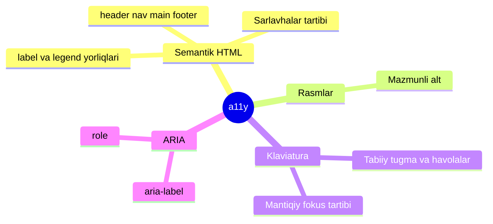
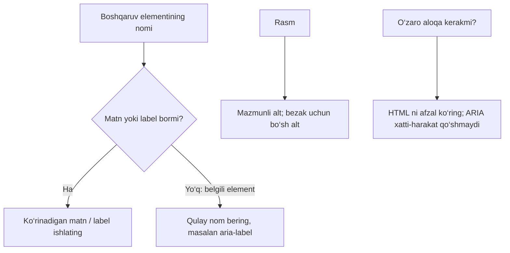

# Vebdan hamma foydalana olishi (a11y)

[Mundarija](../../README.md) · [Oldingi dars](../../Lesson-7/uz/Formatlar%20qism-2.md) · [Keyingi dars](../../Lesson-9/uz/Meta-teglar%2C%20SEO%2C%20CSS%20va%20JS%20bilan%20bog%27lanish.md) · [Amaliyot](../practice.html) · [RU](../ru/%D0%94%D0%BE%D1%81%D1%82%D1%83%D0%BF%D0%BD%D0%BE%D1%81%D1%82%D1%8C%20%28a11y%29.md) · [EN](../en/Accessibility%20%28a11y%29.md) · [UZ](../uz/Mavjudlik%20%28a11y%29.md)

> **Oldingi dars bilan bog'lanish:** o'tgan darslarda biz ko'p marta "ekran o'quvchisi buni to'g'ri eshitadi" degan edik - `alt`, `label`, `scope`, `legend` haqida gaplashganda. Bugun barcha tarqalgan eslatmalarni bitta mavzuga - foydalanish qulayligiga - birlashtiramiz va yangi vositalar qo'shamiz: ARIA, kontrast, `tabindex`.



**Chizmani qanday o‘qish kerak:** A11y bir atributdan iborat emas: semantika, rasmlar, klaviatura va kerakli ARIA birgalikda ishlaydi. Har bir shox sahifani ko‘rish yoki boshqarish usullaridan birini tekshirishni eslatadi.

---

## Dars oxiriga qadar nimalarni o'rganasiz

- Nima uchun foydalanish qulayligi (a11y) kerakligini va kim foydalanishini tushunish.
- Asosiy ARIA atributlarini ishlatish: `aria-label`, `role`.
- Matn va fon kontrastining muhimligini tushunish.
- `tabindex` orqali klaviatura bilan fokus tartibini boshqarish.
- Sarlavhalar ierarxiyasi ekran o'quvchisi uchun sahifaning "skeleti" sifatida qanday ishlashini tushunish.

---

## Dars rejasi

| Bo‘lim                                            | Mazmuni                                          |
| ------------------------------------------- | ---------------------------------------------- |
| Nima uchun foydalanish qulayligi kerak                  | Kim va qanday foydalanadi, "ko'rinmaydigan" foydalanuvchilar |
| Takrorlash: biz nima to'g'ri qildik         | alt, label, scope, legend - tizimlashtirish     |
| ARIA: aria-label va role                    | HTML semantikasi yetarli bo'lmaganda           |
| Kontrast                                  | Matning o'qilishi, tekshiruv vositalari        |
| Mini-vazifa                                | aria-label mustaqil qo'shish                   |
| tabindex                                  | Klaviatura bilan fokus tartibi va boshqarish   |
| Sarlavhalar ierarxiyasi sifatida skelet    | Printsi ning yakuniy umumlashtirishi           |
| Xulosalar va amaliy vazifa                 | O'z saytini audit qilish                       |

---

## Nima uchun vebdan hamma foydalana olishi muhim


**Oddiy qilib aytganda:** kirishda zinapoya bor, lekin pandus yo'q bino ni tasavvur qiling. Nogironlik aravachasidagi odam fizik jihatdan ichkariga kira olmaydi - binoning o'zi "yomon" degani uchun emas, balki barcha mehmonlarning xarakatlanishi bir xil emasligini hisobga olmaganligi uchun.

Vebdan turli imkoniyatlarga ega odamlarning foydalana olishi (**accessibility**, qisqartirilgan **a11y** - 11 raqami "a" va "y" orasidagi o'tkazilgan harflar sonini bildiradi) - bu saytlar uchun xuddi shu tamoyil. Sayt quyidagilar uchun bir xil darajada mos bo'lishi kerak:

- **Ko'rmaydigan va zaif ko'ruvchi foydalanuvchilar**, ekran o'quvchilaridan (ekran mazmunini ovoz chiqarib o'qiydigan dasturlar) foydalanuvchi yoki sahifa masshtabini juda kattalashtiruvchi;
- **Sichqoncha bilan ishlay olmaydigan odamlar** (motor buzilishi tufayli) va sahifani faqat klaviatura bilan boshqaruvchi;
- **Zaif eshituvchi foydalanuvchilar**, video uchun subtitrlar kerak bo'lganlar;
- **Kognitiv xususiyatlarga ega odamlar**, oddiy, bashorat qilinadigan tuzilmadan foyda ko'radiganlar;
- hatto **noqulay sharoitlardagi oddiy foydalanuvchilar** - masalan, vaqtincha singan qo'li bilan faqat klaviaturadan foydalanayotgan odam, yoki yorqin quyosh ostida yomon kontrastli ekran bilan saytni o'qiyotgan odam.

**Tushunishga arziydigan muhim fakt:** biz o'tgan darslarda to'g'ri qilgan hamma narsa (ma'noli `alt`, `label`/`for` bog'lanishi, jadvallarda `scope`, maydon guruhlarida `legend`) - bu allaqachon foydalanish qulayligi ustida ishlash edi, biz uni faqat boshqacha chaqirardik. Bugungi dars bilimlarni tizimlashtiradi va bir nechta yangi vosita qo'shadi.

**Nima uchun bu "ixtiyoriy emas" va professional belgilashning bir qismi:** ko'p mamlakatlarda saytlarning mavjudligiga yuridik talablar mavjud (ayniqsa davlat va tijorat saytlari). Lekin yuridik tomonini hisobga olmasdan ham - mavjud sayt oddiygina **ko'proq odamlar** uchun yaxshiroq ishlaydi va bu sifatli, o'ylangan belgilashning belgisi.

---

## Biz nima to'g'ri qildik (tizimlashtirish)

Davom etishdan oldin, o'tgan darslarda foydalanish qulayligiga bog'liq bo'lgan hamma narsani eslab, bir joyga to'playmiz:

|Nima|Dars|Foydalanish qulayligika qanday yordam beradi|
|---|---|---|
|`` da `alt`|4-dars|Ekran o'quvchisi rasm o'rniga tavsifni ovoz chiqaradi|
|Darajalarni o'tkazib yubormasdan `<h1>`–`<h6>` ierarxiyasi|2-dars|Ekran o'quvchisi tez yo'l topish uchun sarlavhalar bo'yicha sahifa "xaritasini" quradi|
|Semantik teglar (`header`, `nav`, `main`, `footer` va hokazo)|2-dars|Ekran o'quvchisi sahifaning har bir yirik blokining maqsadini tushunadi|
|`label` + `for`/`id`|6-dars|Ekran o'quvchisi forma maydonining maqsadini ovoz chiqaradi, "matn maydoni" emas|
|Jadvallarda `<th>` da `scope`|5-dars|Ekran o'quvchisi ma'lumot katakchasi kerakli qator/ustun sarlavhasiga bog'laydi|
|`fieldset` + `legend`|7-dars|Ekran o'quvchisi maydon guruhiga kontekst beradi (radio guruhlari uchun juda muhim)|
|`<strong>` va `<em>`|2-dars|Muhimlik va ma’no urg‘usini bildiradi; `<b>` va `<i>` boshqa vazifalarda ishlatiladi. O‘qilish ekran o‘quvchisiga bog‘liq|

Ko'rib turganingizdek, foydalanish qulayligi bu oddiy belgilashning ustidagi alohida "qo'shma" emas, balki kursning boshidan beri HTML ning **to'g'ri, semantik** ishlatilishining natijasi.

---

## ARIA: `aria-label` va `role`

Ba'zan standart HTML semantikasi elementning maqsadini to'liq tasvirlash uchun yetarli bo'lmaydi - ayniqsa vizual jihatdan tushunarli (masalan, oynani yopish uchun "×" belgisi bilan ko'rsatilgan ikonka), lekin ekran o'quvchisi o'qiy oladigan matni ichida bo'lmagan interaktiv elementlar uchun.

Bunday holatlar uchun **ARIA** (Accessible Rich Internet Applications) mavjud - oddiy HTML semantikasini to'ldiruvchi (lekin o'rnini bermaydigan!) maxsus atributlar to'plami.

### `aria-label` - ekran o'quvchisi uchun matnli tavsif

Elementda ko'rinadigan matn bo'lmaganida, lekin uning maqsadini ekran o'quvchisiga aytish kerak bo'lganda ishlatiladi.

**Misol: faqat ikonka bilan, ko'rinadigan matnsiz yopish tugmasi ("×" belgisi bilan shartli ko'rsatilgan):**

```html
<button type="button" aria-label="Oynani yopish">×</button>
```

Vizual foydalanuvchi oddiy "×" belgini ko'radi, lekin ekran o'quvchisi "Oynani yopish, tugma" deb ovoz chiqaradi - ya'ni mazmunli tavsif beradi, ma'nosiz belgi emas.

**Misol: matnsiz ijtimoiy tarmoqqa ikonka-havola:**

```html
<a href="https://t.me/example" aria-label="Bizning Telegram kanalimiz">
    
</a>
```

Diqqat qiling: bu yerda rasmdagi `alt=""` bo'sh (dekorativ ikonka, 4-darsda tushuntirgandek), va butun havolaning tavsifini to'liq `<a>` tegidagi `aria-label` beradi.

**Muhim qoida:** `aria-label` **faqat boshqa usul bo'lmaganda** ishlatiladi. Agar elementda allaqachon ko'rinadigan matn bo'lsa (masalan, "Yuborish" tugmasi), `aria-label` kerak emas - oddiy mazmundan ekran o'quvchisiga allaqachon mavjud narsani takrorlamang.

### `role` - element rolini aniqlash

`role` atributi ekran o'quvchisiga element qanday funksional rol o'ynashini aniq aytadi - ayniqsa ma'lum sabablarga ko'ra eng mos teg ishlatilmagan bo'lsa foydali.

```html
<div role="alert">
    Diqqat: fayl saqlanmadi.
</div>
```

`role="alert"` muhim dinamik xabarlar uchun. Statik misol yuklanishda darhol o‘qilishini kafolatlamaydi; haqiqiy xatti-harakatni ekran o‘quvchisi bilan tekshiring.

**Eslab qolish kerak bo'lgan ARIA ning oltin qoidasi:** _"ARIA ning birinchi qoidasi - agar mos tabiiy HTML teg bo'lsa, ARIA ishlatma."_ Boshqa qilib aytganda, agar `<button>` o'rniga `<div role="button">` ishlatish mumkin bo'lsa - `<button>` ishlating, chunki tabiiy teg "qutidan chiqqan holda" barcha kerakli xulqqa ega (Tab bo'yicha fokus, Enter/Space ga reaktsiya, to'g'ri ovoz chiqarish), va `<div>` da ARIA bilan bu xulqni taqlid qilish qo'shimcha ish talab qiladi va xatolarga ko'proq moyil.

```html
<!-- Yomon: div orqali tugmani taqlid qilish -->
<div role="button" aria-label="Formani yuborish">Yuborish</div>

<!-- Yaxshi: tabiiy button ishlatamiz -->
<button type="submit">Yuborish</button>
```



**Chizmani qanday o‘qish kerak:** Matn yoki label allaqachon nom berayotgan bo‘lsa, undan foydalaning. Matnsiz belgili boshqaruvga tushunarli nom kerak; rasm uchun esa mazmuniga mos alt tanlanadi. ARIA nom yoki rol beradi, ammo tugmani ishlaydigan qilib qo‘ymaydi.

---

### Yangi boshlovchilarning ko'p uchraydigan xatolari

|Xato|Tuzatish|
|---|---|
|Tabiiy HTML teglar o'rniga ARIA ishlatish|Doimo semantik HTML tegni ARIA taqlidiga afzal ko'ring: `<button>`, `<div role="button">` emas|
|Elementda allaqachon ko'rinadigan matn bo'lganda `aria-label` ni takrorlash|`aria-label` ni faqat ko'rinadigan matn mazmuni bo'lmaganda ishlating|
|Rasmlarda `alt` o'rniga `aria-label` qo'yish|Rasmlar uchun doimo `alt` ishlating - bu uning to'g'ridan-to'g'ri maqsadi; `aria-label` - matnsiz boshqa elementlar uchun (tugmalar, ikonka-havolalar)|

---

### Elementning foydalanish uchun berilgan nomini tekshirish

Chrome yoki Edge brauzerida tugma, havola yoki maydon ustida o‘ng tugma → Inspect ni tanlang. Elements panelida aynan o‘sha elementni belgilang; yon paneldagi Accessibility bo‘limini oching (yashirilgan bo‘lsa » menyusidan toping). Computed Properties ichidagi Name va Role qiymatlarini ko‘ring: masalan, “Yuborish” va “button”. Name bo‘sh yoki maqsadga mos bo‘lmasa, avval label yoki ko‘rinadigan matnni tuzating. Bu tekshiruv ekranni o‘qish dasturi bilan to‘liq sinovni almashtirmaydi.

## Kontrast

**Oddiy qilib aytganda:** kontrast - bu matn va uning orasidagi fon orasidagi yorqinlik farqi. Oq fon ustidagi och kulrang matn dizaynerga zamonaviy ko'rinishi mumkin, lekin zaif ko'ruvchi odam uchun deyarli o'qimsiz - hatto oddiy ko'ruvchi odam uchun yorqin quyosh ostida yoki arzon monitor'da.

Haqiqiy rang sozlash CSS ga bog'liq (kelajak darslar mavzusi) bo'lsa ham, hozir tamoyilni tushunish muhim, chunki kontent haqidagi qarorlar (masalan, axborotni uzatishda faqat rangga ishonib ishonmaslik) kontent tuzilishida qabul qilinadi.

### Amaliy qoida: faqat rangga ishonmang

Quyidagi `span` va `style` yozilgan parcha faqat tayyor ko‘rgazmali misol: rang bilan berilgan xabarni tushunish uchun keltirilgan. Hozir CSS yozish yoki bu sintaksisni yodlash talab qilinmaydi; maqsadni matnda ham aytish kerak.

Ko'p uchraydigan xato - muhim axborotni **faqat** rang orqali uzatish, matnli takrorlamasdan. Masalan:

```html
<!-- Yomon: rang ma’nosi matn bilan tushuntirilmagan -->
<p><span style="color: #b00020;">●</span> Email</p>

<!-- Yaxshi: matn o'zi ma'noni uzatadi, rang - faqat qo'shimcha -->
<p style="color: #b00020;"><strong>Xato:</strong> maydon noto'g'ri to'ldirilgan</p>
```

CSS ni batafsil bilmasdan ham, tamoyilni eslab qolish muhim: **matn mazmuni mustaqil bo'lishi kerak** va barcha rangli bezaklarni olib tashlasangiz ma'noni yo'qotmasligi kerak - chunki foydalanuvchilarning bir qismi uchun (ko'rmaydiganlar, daltonglar, qora-oq ekran foydalanuvchilari) rang umuman mavjud emas.

### Tavsiya etilgan minimal kontrast darajasi

WCAG (Web Content Accessibility Guidelines) standarti mavjud bo'lib, oddiy matn uchun minimal kontrast nisbatini **4.5:1** (va katta matn, masalan sarlavhalar uchun biroz kamroq - 3:1) tavsiya etadi. Rang juftligining kontrastini bepul onlayn vositalar (masalan, WebAIM Contrast Checker) yordamida tekshirish mumkin - CSS ni keyinchalik o'rganganda, sayt rang palitrasini tanlashda bu juda muhim bo'ladi.

---

## Mini-vazifa

Matnsiz GitHub ikonka-havolasiga `aria-label` qo'shing, shunda ekran o'quvchisi uning maqsadini ovoz chiqaradi.

**Yechim:**

```html
<a href="https://github.com/Saydullayev017" aria-label="Mening GitHub profilim" target="_blank" rel="noopener noreferrer">
    
</a>
```

---

## `tabindex` - klaviatura bilan fokusni boshqarish

**Oddiy qilib aytganda:** sichqonchaga tegmasdan, hozir har qanday veb-sahifada **Tab** tugmasini bosib ko'ring - fokus ramkasi boshqa havola/tugma/forma maydoniga ma'lum tartibda "sakrab o'tishini" ko'rasiz. Bu klaviatura bilan yo'l topish - sichqoncha bilan ishlay olmaydigan (yoki noqulay foydalanadigan) odamlar uchun juda muhim.

Odatda Tab o'tish tartibi **HTML kodidagi elementlar tartibiga** amal qiladi - interaktiv elementlar (havolalar, tugmalar, forma maydonlari) qo'shimcha kodga muhtoj bo'lmasdan avtomatik "fokuslanadi". Bu HTML ni mantiqiy tartibda yozishning yana bir sababi - vizual tartibni CSS orqali o'zgartirish mumkin, lekin Tab navigatsiyasi odatda kod tartibiga amal qiladi.

### `tabindex="0"` - elementni fokuslanadigan qilish

`tabindex="0"` faqat fokus qo‘shadi; Enter/Space amalini yaratmaydi. Tabiiy button klaviaturani qo‘llaydi; ARIA o‘zi xatti-harakat yaratmaydi.

Ba'zan defaultda fokuslanmaydigan elementni fokuslanadigan qilish kerak bo'ladi (masalan, JavaScript orqali interaktiv xulqga ega `<div>` - lekin, 3-blokda tushuntirgandek, imkon qadar tabiiy interaktiv teglarni ishlatgan yaxshi).

```html
<button type="button">Batafsil ▼</button>
```

Namunada tabiiy button ishlatilgan: u Tab tartibiga kiradi va klaviaturani qo‘llaydi. Oddiy div da tabindex="0" faqat fokus qo‘shadi; amal yaratmaydi.

### `tabindex="-1"` - elementni Tab navigatsiyasidan olib tashlash

```html
<div tabindex="-1" id="modal-title">
    Modall oynaning sarlavhasi
</div>
```

Dastur tomonidan fokus olishi kerak bo'lgan (masalan, JavaScript orqali suzuvchi oyna ochilganda), lekin oddiy Tab ketma-ketligiga tushishi kerak bo'lmagan elementlar uchun ishlatiladi.

### Musbat `tabindex` qiymatlari - nima uchun ulardan qochish kerak

Texnik jihatdan `tabindex="1"`, `tabindex="2"` va hokazo yozish mumkin, kod tartibidan farqli o'ziga xos o'tish tartibini belgilash uchun:

```html
<!-- Tavsiya etilmaydi -->
<input type="text" tabindex="2">
<input type="text" tabindex="1">
```

**Nima uchun bu yomon amaliyot:** bunday yondashuvni sahifa tuzilmasidagi istalgan o'zgarish bilan "buzish" juda oson - `tabindex` qo'shilmagan yangi element ketma-ketlikda kutilmagan joyda bo'ladi va foydalanuvchi sahifada bashorat qilinmagan tarzda "sakrab yuradi". **To'g'ri yondashuv** - elementlarni mantiqiy tartibda to'g'ridan-to'g'ri HTML kodida joylashtirish, shunda odatdagi sahifalarda maxsus `tabindex` umuman kerak bo'lmaydi.

**Bu kurs uchun amaliy qoida:** `tabindex="0"` va `tabindex="-1"` ni faqat haqiqatdan kerak bo'lganda (nodavom interaktiv elementlar) ishlating, musbat sonlardan qoching va birinchi navbatda HTML kodining mantiqiy tartibiga e'tibor bering.

---

### Yangi boshlovchilarning ko'p uchraydigan xatolari

|Xato|Tuzatish|
|---|---|
|Navigatsiya tartibini "tuzatish" uchun musbat `tabindex` qiymatlarini ishlatish|Buning o'rniga HTML kodidagi elementlar tartibining o'zini o'zgartiring|
|Allaqachon fokuslanadigan elementlarga (havolalar, tugmalar, forma maydonlari) `tabindex` qo'yish|Tabiiy interaktiv elementlar defaultda allaqachon fokuslanadi - ularga `tabindex` kerak emas|
|Vizual tartib (kelajakda CSS orqali belgilanadi) HTML kodidagi tartibdan farqli bo'lishi va Tab navigatsiyasini chalkashtirishi mumkinligini unutish|HTML dagi mantiqiy tartib sahifadagi vizual tartib bilan mos kelishiga harakat qiling|

---

## Sarlavhalar ierarxiyasi sifatida sahifaning "skeleti"

2-darsda boshlangan mavzuga qaytaylik va uni aynan foydalanish qulayligi nuqtai nazaridan ko'raylik - chunki bu, balki, boshlovchilar tomonidan yetarli baholanmagan a11y vositasi.

**Tasavvur qiling, siz ko'rmaydigan foydalanuvchisiz**, va hozirgina uzoq sahifani (masalan, 2000 so'zlik retsept maqolasini) ochdingiz. Ko'ruvchi foydalanuvchi bir necha soniyada vizual ravishda tuzilmanini ko'rib chiqishi mumkin, sizda esa "ko'z bilan yugurish" imkoniyati yo'q. Nima qilasiz? Ko'pchilik ekran o'quvchilari butun matnni ketma-ket eshitmasdan, bitta tugma bilan **sarlavadan sarlavhaga o'tishga** imkon beradi.

Sahifa to'g'ri qurilgan bo'lsa:

```html
<h1>Palov retsepti</h1>
<h2>Kerakli masalliqlar</h2>
<h2>Qadam-baqadam tayyorlash</h2>
<h3>Guruchni tayyorlash</h3>
<h3>Go'sht va sabzavotlarni qovurish</h3>
<h3>Yakuniy qaynatish</h3>
<h2>Dasturxonga tortish bo‘yicha maslahatlar</h2>
```

- ko'rmaydigan foydalanuvchi bir necha soniyada sarlavhalar orqali tuzilmanini "skanerlashi" mumkin (faqat h1, h2, h2, h3, h3, h3, h2 ni eshitib), "Guruchni tayyorlash" unga qiziqlisini tushunib, darhol u yerga o'tishi, qolganini to'liq o'tkazib yuborishi - xuddi ko'ruvchi foydalanuvchi kerakli bo'limni qidirib vizual yurgandek.

**Sarlavha o‘rniga qalin `<p>` ishlatilsa**, sarlavhalar bo‘yicha o‘tish uchun kerakli ma’no yo‘qoladi. `h2` dan bevosita `h4` ga sakrash esa bu o‘tishni o‘chirib qo‘ymaydi, lekin bo‘limlar orasidagi darajani tushunishni qiyinlashtiradi. Darajani ko‘rinishga emas, mavzu tuzilishiga qarab tanlang.

Tegni ma’nosiga qarab tanlang: strong muhimlik, em ma’no urg‘usi, nav navigatsiya, th jadval sarlavhasi uchun. b va i ham to‘g‘ri elementlar, ammo boshqa ma’noviy vazifalarda ishlatiladi. Teg tanlovi ekran o‘quvchisining muayyan ohangini kafolatlamaydi.

---

## Dars xulosalari

Bugun siz quyidagilarni bilib oldingiz:

- Foydalanish qulayligi (a11y) - turli qabul qilish va o'zaro munosabat qobiliyatiga ega odamlar saytdan foydalanishi mumkinligiga g'amxo'rlik: ko'rmaydiganlar, zaif eshituvchilar, faqat klaviatura foydalanuvchilari.
- Biz oldin to'g'ri qilgan hamma narsa (`alt`, `label`/`for`, `scope`, `legend`, semantika) - bu allaqachon foydalanish qulayligi ustida ishlash edi.
- `aria-label` ko'rinadigan matnsiz elementlarni tavsiflaydi, `role` funksional rolni aniqlaydi - lekin doimo tabiiy HTML tegni ARIA taqlidiga afzal ko'ring.
- Matn va fon kontrasti o'qilishi uchun juda muhim - va axborotni uzatishda faqat rangga ishonmaslik kerak.
- `tabindex="0"`/`"-1"` elementning Tab navigatsiyasiga kirishini boshqaradi - lekin musbat sonlardan qochish kerak, kodning mantiqiy tartibiga ishonish lozim.
- `h1`–`h6` sarlavhalar ierarxiyasi sahifaning "skeleti" sifatida ishlaydi, ekran o'quvchisi (va har qanday foydalanuvchi) mazmun tezda yo'l topadi.


## Mustaqil mashq

Brauzerning select ro‘yxati uchun: Tab bilan unga o‘ting → Space bilan oching → strelka bilan tanlang → Enter bilan tasdiqlang. Brauzerga qarab bitta strelka faqat menyuni ochishi yoki belgilangan qatorni siljitishi mumkin; yakuniy tanlangan qiymatni tekshiring.

O‘z ranglaringiz hali belgilanmagan bo‘lsa, oq fondagi qora matnni tekshiring: #000000 va #ffffff. WebAIM Contrast Checker da Foreground va Background maydonlariga kiriting; Bu juftlik 21:1 natija beradi, ammo barcha boshqaruv elementlari ranglari tekshirilganini isbotlamaydi. Boshqa haqiqiy juftliklarni bilish uchun Elements → Computed da matnning color va fonning background-color qiymatlarini ko‘ring; shaffof fon bo‘lsa, rangli fonli tashqi elementni ham tekshiring. Faqat sahifada ishlatilgan juftliklarni baholang.

Tab faqat fokuslanadigan elementlar orasida yuradi; oddiy sarlavha va abzatslarning hammasida to‘xtashi shart emas. Tugmada Enter va Space ni, select ichida esa yo‘nalish strelkalarini sinang.

7-dars sahifangizdagi yorliqlar, sarlavhalar, muqobil matn va Tab tartibini tekshiring. Xatolarni tuzatib, oldingi va keyingi holatni yozing.

### Tayyorlik mezonlari

- [ ] Butun sahifani Tab va Shift+Tab bilan aylaning: tartib mantiqiy, fokus ko‘rinadi, tuzoq yo‘q.
- [ ] Brauzerning o‘z tugmasini Enter va Space bilan ishlating; select da strelkalar bilan tanlang. Elements → Accessibility dagi Name/Role ni tekshiring.
- [ ] Muallif belgilagan har bir matn/fon juftligini tekshiring: oddiy matn kamida 4.5:1. O‘z ranglaringiz bo‘lmasa, qora/oq hisobini brauzer boshqaruvlari ranglaridan alohida qayd eting.
- [ ] Kamida uchta tekshiruvni yozing: amal, kutilgan natija, amaldagi natija va, muammo topilsa, tuzatish. Muammo topilmasa, “muammo topilmadi” deb yozing.

### O‘zini tekshirish savollari

tabindex nimani qo‘shadi va nimani qo‘shmaydi? Nega tabiiy button afzal? Alt qachon bo‘sh bo‘lishi kerak?

---

[Mundarija](../../README.md) · [Oldingi dars](../../Lesson-7/uz/Formatlar%20qism-2.md) · [Keyingi dars](../../Lesson-9/uz/Meta-teglar%2C%20SEO%2C%20CSS%20va%20JS%20bilan%20bog%27lanish.md) · [Amaliyot](../practice.html) · [RU](../ru/%D0%94%D0%BE%D1%81%D1%82%D1%83%D0%BF%D0%BD%D0%BE%D1%81%D1%82%D1%8C%20%28a11y%29.md) · [EN](../en/Accessibility%20%28a11y%29.md) · [UZ](../uz/Mavjudlik%20%28a11y%29.md)
