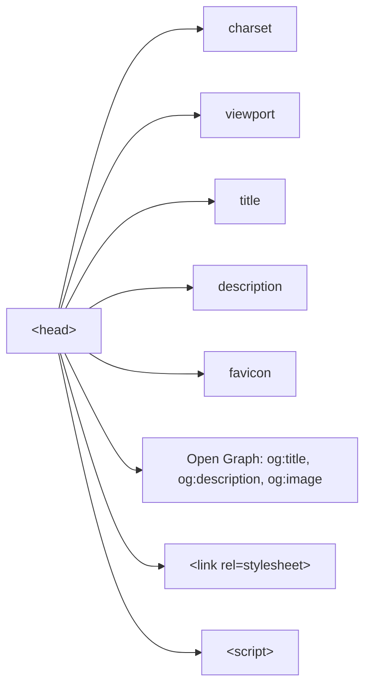
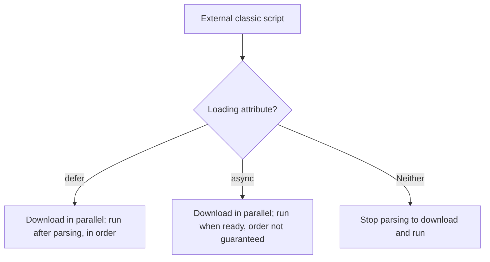

# Meta tags, SEO, linking CSS and JS

[Contents](../../README.md) · [← Back](../../Lesson-8/en/Accessibility%20%28a11y%29.md) · [Next →](../../Lesson-10/en/Final%20project%20from%20planning%20to%20publication.md) · [RU](../ru/%D0%9C%D0%B5%D1%82%D0%B0-%D1%82%D0%B5%D0%B3%D0%B8%2C%20SEO%2C%20%D1%81%D0%B2%D1%8F%D0%B7%D1%8C%20%D1%81%20CSS%2C%20JS.md) · [EN](Meta%20tags%2C%20SEO%2C%20linking%20CSS%20and%20JS.md) · [UZ](../uz/Meta-teglar%2C%20SEO%2C%20CSS%20va%20JS%20bilan%20bog%27lanish.md) · [Practice](../practice.html)

> **Link to the previous lesson:** in Lesson 8 you made the page clear to people. Today we make it clear to **search engines, phones and social networks**, connect ready-made style and script files, and check the code with a validator.

---

## Why you need this

You sent a link to your site to a friend on Telegram. What will they see: a bare link, or a card with a title, description and picture? Your site showed up in Google - what is written under the title? On a phone the page opened tiny and you have to zoom in with your fingers?

All of this is solved by a few lines in `<head>`. Today you will finish the page's "technical passport".

---

## What you will learn

- Write a page description for search engines: `meta name="description"`.
- Turn on a normal view on phones: `meta name="viewport"`.
- Make a card for social networks: Open Graph.
- Connect a ready style file: `<link rel="stylesheet">`.
- Connect a ready script: `<script src defer>`.
- Arrange project files into folders.
- Check code with a validator and Lighthouse.

---

## Review: 3 questions from Lessons 1, 3 and 4

1. What goes in `<head>`: visible content or service information?
2. How do you link to `style.css` in the `css` folder if the HTML sits next to that folder?
3. Which tag did we use to connect the site icon?

Answers are at the end of the lesson.

---

## Lesson plan

| Section | What we do |
| --- | --- |
| Meta tags | The page's technical passport |
| Description and viewport | For Google and phones |
| Open Graph | A card in messengers |
| Connecting CSS | Clothes for the frame |
| Connecting JS | Wiring, `defer` and `async` |
| Mini-task 1 | A complete `<head>` |
| Project folders | Order in your files |
| Checking code | Validator and Lighthouse |
| Mini-task 2 | Find errors with the validator |
| Independent work | IDE task and two pages |

---

## Meta tags

**In simple terms:** in Lesson 1 we called `<head>` the house's technical passport. Meta tags are the lines of this passport: encoding, description, display rules.

A meta tag is an empty `<meta>` element in `<head>`. It is not visible on the page.

### Encoding (review)

```html
<meta charset="UTF-8">
```

It is the first line in `<head>`.

### Description: `description`

```html
<meta name="description" content="Web development club in Almalyk: we teach HTML from scratch, classes on Wednesdays.">
```

**Where you see it:** in search results under the blue title. The search engine may take your text or write its own, but a good description raises the chance yours is used.

**How to write it:**
- 1–2 sentences, up to about 160 characters;
- **its own** for every page;
- what the page is about and why to visit it.

### Phone screen: `viewport`

```html
<meta name="viewport" content="width=device-width, initial-scale=1.0">
```

**In simple terms:** without this line the phone thinks the page was made for a computer and shows it as a shrunken copy. With it, the page says: "Page width = screen width, scale 1:1".

**Try it:** open the page in DevTools → the phone icon (Toggle device toolbar). Remove `viewport` and reload. The text became tiny. Put the line back.

`viewport` does not make the layout responsive by itself - that needs CSS. But without `viewport`, responsive CSS will not work on a phone.

### Typical beginner mistakes

| Mistake | How to fix |
| --- | --- |
| The same `description` on all pages | Its own description for each |
| A 500-character description | 1–2 sentences |
| No `viewport` | Add it to every document |
| `<meta>` in `<body>` | Only in `<head>` |

---

## Open Graph: a card for social networks

When a link is pasted into Telegram or Facebook, they look for special Open Graph meta tags:

```html
<meta property="og:title" content="Web development club">
<meta property="og:description" content="We teach HTML from scratch. Classes on Wednesdays.">
<meta property="og:image" content="https://example.com/images/preview.jpg">
```

| Tag | What is in the card |
| --- | --- |
| `og:title` | Title |
| `og:description` | Description |
| `og:image` | Picture. Needs a **full** address with `https://` |

**Note:** here it is `property`, not `name`.



**How to read the diagram.** Everything that can live in `<head>`. `charset`, `viewport`, `title` and `description` are required. The rest depends on the task.

---

## Connecting CSS

**In simple terms:** HTML is the frame, CSS is the clothes. The clothes are sewn separately and "put on" the frame with one line:

```html
<link rel="stylesheet" href="css/style.css">
```

| Attribute | What it means |
| --- | --- |
| `rel="stylesheet"` | "This is a style file" |
| `href` | Path to the file - by the rules from Lesson 3 |

It goes in `<head>`.

**What you will see:** the page immediately changes font, spacing and width - as written in the file. **You do not need to write CSS in this course:** the file `Lesson-9/css/style.css` is ready, just copy it.

---

## Connecting JavaScript

**In simple terms:** JavaScript is the house's wiring. It is connected with the `<script>` tag:

```html
<script src="js/main.js" defer></script>
```

`<script>` is a **paired** tag, even if it is empty inside. Write `</script>`.

### Where to put it and why `defer`

The browser reads HTML from top to bottom. When it meets a plain `<script>`, it **stops**, downloads and runs the script, and only then reads on. The page appears with a delay.

| Notation | How it works | When to use |
| --- | --- | --- |
| `<script src>` | Stop reading the page, download, run | The old way |
| `<script src defer>` | Download in parallel, run after the whole page is read, in order | **Almost always** |
| `<script src async>` | Download in parallel, run as soon as it is ready | Independent scripts: counters, analytics |

**Course rule:** `<script src="..." defer>` in `<head>`.



**How to read the diagram.** Three ways to connect a script. `defer` does not slow down the page and keeps the order of scripts.

**How to check the script ran:** the ready `main.js` writes a message to the console. Open DevTools → **Console** tab. You will see "Lesson 9: the deferred script loaded." - the script is connected.

### Typical beginner mistakes

| Mistake | How to fix |
| --- | --- |
| `<script src="..." />` without a closing tag | Always `</script>` |
| Path `../css/style.css` for a file next to the page | Path from the HTML file: `css/style.css` |
| `<link>` for styles in `<body>` | In `<head>` |
| `rel="style"` | Correct: `rel="stylesheet"` |

---

## Mini-task 1

Without peeking, write the full `<head>` of the "Club contacts" page: encoding, viewport, tab title, description, icon, styles `css/style.css`, script `js/main.js` with `defer`. Solution is in the "Answers" section.

---

## Project folders

**In simple terms:** in a wardrobe clothes are sorted onto shelves: shirts separately, socks separately. A project works the same way.

```
my-website/
├── index.html
├── about.html
├── contact.html
├── css/
│   └── style.css
├── js/
│   └── main.js
├── images/
│   ├── logo.png
│   ├── hero-photo.jpg
│   └── icons/
│       └── github.svg
└── favicon.ico
```

| Where | What |
| --- | --- |
| Root | HTML pages and the site icon |
| `css/` | Style files |
| `js/` | Scripts |
| `images/` | Images |

**File names:** Latin letters, lowercase, no spaces, words joined by hyphens: `hero-photo.jpg`, not `My Photo 1.JPG`.

### How to check the files are connected

1. Open the page via Live Server.
2. DevTools → **Network** tab → reload the page.
3. Find `style.css` and `main.js` in the **Status** column:

| Status | Meaning |
| --- | --- |
| 200 | Loaded |
| 304 | Taken from cache - also fine |
| 404 | **Not found** - check the path and file name |

### Typical beginner mistakes

| Mistake | How to fix |
| --- | --- |
| All files in one folder | Sort them: `css/`, `js/`, `images/` |
| Spaces and non-Latin letters in names | `my-photo.jpg` |
| Renamed a folder, forgot the paths | Update all `href` and `src` |

---

## Checking code

### Nu HTML Checker validator

The browser "forgives" errors and guesses what you meant. Another browser or a screen reader may guess differently. The validator finds errors you cannot see.

1. Open [validator.w3.org/nu](https://validator.w3.org/nu/).
2. Choose **Text Input** (paste code) or **File Upload** (upload a file).
3. Click **Check**.

**What it finds:** unclosed tags, duplicate `id`s, `` without `alt`, `<p>` inside `<p>`, non-existent attributes.

**Goal:** the message "Document checking completed. No errors or warnings to show."

### Lighthouse - an overall page score

Lighthouse is built into Chrome:

1. Open the page via Live Server.
2. DevTools → **Lighthouse** tab.
3. Tick **Accessibility** and **SEO**, click **Analyze page load**.

In a few seconds you get a score from 0 to 100 and a list of what to improve: no `description`, low contrast, no `alt`.

**The validator and Lighthouse do not replace a manual check.** Go through the page with the keyboard, as in Lesson 8.

### Try to break it

1. In `<link>`, change the path to `css/styles.css` (one extra letter). Reload the page: the styling is gone. On the **Network** tab the file has status `404`.
2. Do the same with the script: `js/mian.js` instead of `js/main.js`. The **Console** has no "Lesson 9: the deferred script loaded." line, but it has a red one: `Failed to load resource: the server responded with a status of 404 (Not Found)`.
3. Replace `<script src="js/main.js" defer></script>` with `<script src="js/main.js" defer />`. Reload the page: all the content has disappeared. The browser does not treat `/>` as the end of `script` and takes the rest of the document as script text. The validator shows an error that starts with `Self-closing syntax`.
4. Remove the `lang` attribute from `<html>` and check the code in the validator. You will see the warning `Consider adding a lang attribute to the html start tag to declare the language of this document.`
5. Remove `<meta name="description">` and run Lighthouse with **SEO** checked. The list of problems will include `Document does not have a meta description`.

After each experiment, put the code back.

---

## Mini-task 2

Check this code in the validator. How many errors will it find, and which?

```html
<!DOCTYPE html>
<html lang="en">
<head>
    <meta charset="UTF-8">
    <title>Check</title>
</head>
<body>
    <h1 id="top">Heading</h1>
    <p id="top">Paragraph <p>nested paragraph</p></p>
    
</body>
</html>
```

The answer is in the "Answers" section.

---

## Lesson summary: cheat sheet

```html
<head>
    <meta charset="UTF-8">
    <meta name="viewport" content="width=device-width, initial-scale=1.0">
    <title>Page title - Site name</title>
    <meta name="description" content="1–2 sentences about the page.">
    <meta property="og:title" content="Title for the card">
    <meta property="og:description" content="Description for the card">
    <link rel="icon" href="favicon.ico">
    <link rel="stylesheet" href="css/style.css">
    <script src="js/main.js" defer></script>
</head>
```

| Task | Notation |
| --- | --- |
| Description for search | `<meta name="description" content="...">` |
| Normal view on phones | `<meta name="viewport" content="width=device-width, initial-scale=1.0">` |
| Card in messengers | `<meta property="og:...">` |
| Styles | `<link rel="stylesheet" href="css/style.css">` |
| Script | `<script src="js/main.js" defer></script>` |
| Checking | Nu HTML Checker, Lighthouse |

---

## Independent work

### Part 1. IDE task (graded by the platform)

Make the **club home page** with a complete `<head>`:

1. `charset`, `viewport` and `title`.
2. `description` - the page's own description.
3. `og:title` and `og:description`.
4. A site icon `<link rel="icon">`.
5. Styles: `<link rel="stylesheet" href="css/style.css">`.
6. Script: `<script src="js/main.js" defer></script>`.
7. In `<body>` - `header`, `main` with one `h1` and a paragraph, `footer`.

Add styles and scripts only by connecting files: do not use the `<style>` tag.

What the platform checks: the document skeleton, `viewport` with `width=device-width`, `description`, `og:title`, the icon, connection of `css/style.css` and `js/main.js` with `defer`, a closed `</script>`, one `h1`, no `<style>`.

### Part 2. Project on your computer

1. Copy `Lesson-9/css/style.css` and `Lesson-9/js/main.js` into the `css` and `js` folders of your project.
2. Make two pages - `index.html` and `about.html` - each with its own `title` and `description`.
3. Open them via Live Server. Check in Network: both files are 200 or 304.
4. Check both pages in Nu HTML Checker - no errors.
5. Run Lighthouse and write down the Accessibility and SEO scores.

### Acceptance criteria

- [ ] The IDE task is accepted.
- [ ] Each page has its own `title` and `description`.
- [ ] Both pages have `viewport`.
- [ ] CSS and JS load without 404.
- [ ] The script message is visible in the console.
- [ ] The validator found no errors.
- [ ] Files are sorted into folders, names in Latin letters without spaces.

---

## Self-check questions

1. Where is `description` visible?
2. Why does every page have its own description?
3. What happens on a phone without `viewport`?
4. How does `og:title` differ from `<title>`?
5. Why does `og:image` need a full address?
6. How do you connect a style file?
7. Why is `<script>` always written with a closing tag?
8. How does `defer` differ from `async`?
9. What does status 404 in Network mean?
10. Why use a validator if the page already looks fine?

After the questions, take the **lesson test** on the platform: 12 questions, pass threshold 70%.

---

## What's next

You know everything you need to build a real website. In Lesson 10 you will put it together from plan to publication on the internet, and your site will get an address you can send to friends.

---

## Answers

**Review**

1. Service information.
2. `css/style.css`.
3. `<link rel="icon" href="favicon.png">`.

**Mini-task 1**

```html
<head>
    <meta charset="UTF-8">
    <meta name="viewport" content="width=device-width, initial-scale=1.0">
    <title>Contacts - Web development club</title>
    <meta name="description" content="How to contact the web development club: email, phone and sign-up form.">
    <link rel="icon" href="favicon.ico">
    <link rel="stylesheet" href="css/style.css">
    <script src="js/main.js" defer></script>
</head>
```

**Mini-task 2.** The validator will find:
1. A duplicate `id="top"`.
2. A paragraph inside a paragraph: the browser closes the first `<p>` early, and the extra `</p>` is left without a pair.
3. `` has no `alt`.

**Self-check questions**

1. In search results under the title.
2. Otherwise the search engine shows the same thing for different pages, and a person cannot tell them apart.
3. The page appears as a shrunken copy of the desktop version.
4. `og:title` is the card title in social networks, `<title>` is the name of the tab and of the search result.
5. The social network downloads the picture from its own server; a relative path means nothing to it.
6. `<link rel="stylesheet" href="css/style.css">` in `<head>`.
7. It is a paired tag: without `</script>` the browser treats all the code below as script.
8. `defer` runs scripts after the page is read and in order; `async` runs each as soon as it is ready, without order.
9. The file was not found: an error in the path or the name.
10. Another browser or a screen reader may interpret broken code differently.

---

[Contents](../../README.md) · [← Back](../../Lesson-8/en/Accessibility%20%28a11y%29.md) · [Next →](../../Lesson-10/en/Final%20project%20from%20planning%20to%20publication.md) · [RU](../ru/%D0%9C%D0%B5%D1%82%D0%B0-%D1%82%D0%B5%D0%B3%D0%B8%2C%20SEO%2C%20%D1%81%D0%B2%D1%8F%D0%B7%D1%8C%20%D1%81%20CSS%2C%20JS.md) · [EN](Meta%20tags%2C%20SEO%2C%20linking%20CSS%20and%20JS.md) · [UZ](../uz/Meta-teglar%2C%20SEO%2C%20CSS%20va%20JS%20bilan%20bog%27lanish.md) · [Practice](../practice.html)
