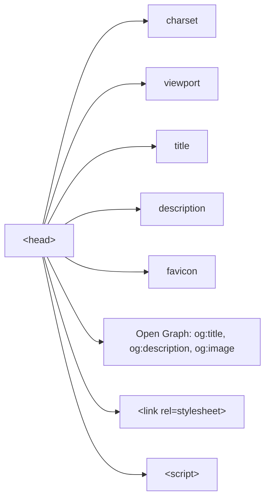
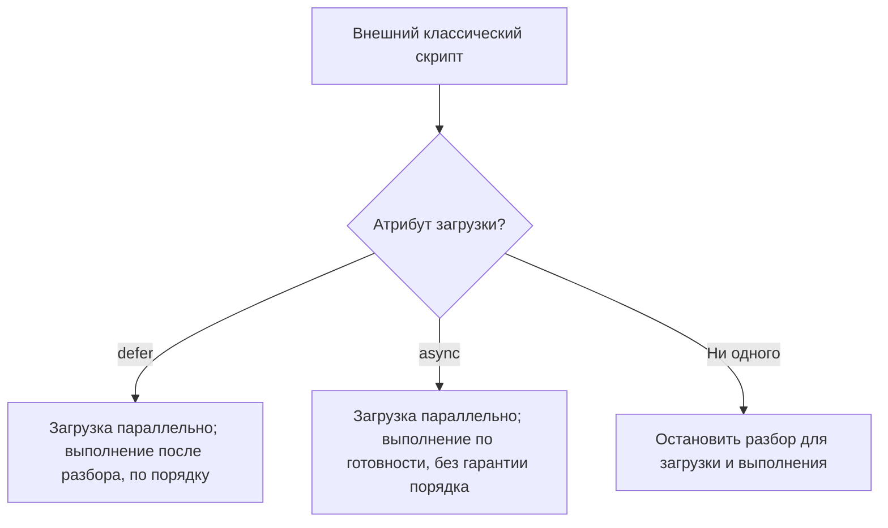

# Мета-теги, SEO, связь с CSS, JS

[Содержание](../../README.md) · [Назад](../../Lesson-8/ru/%D0%94%D0%BE%D1%81%D1%82%D1%83%D0%BF%D0%BD%D0%BE%D1%81%D1%82%D1%8C%20%28a11y%29.md) · [Вперёд](../../Lesson-10/ru/%D0%98%D1%82%D0%BE%D0%B3%D0%BE%D0%B2%D1%8B%D0%B9%20%D0%BF%D1%80%D0%BE%D0%B5%D0%BA%D1%82%20%D0%BE%D1%82%20%D0%BF%D0%BB%D0%B0%D0%BD%D0%B8%D1%80%D0%BE%D0%B2%D0%B0%D0%BD%D0%B8%D1%8F%20%D0%B4%D0%BE%20%D0%BF%D1%83%D0%B1%D0%BB%D0%B8%D0%BA%D0%B0%D1%86%D0%B8%D0%B8.md) · [Практика](../practice.html) · [RU](../ru/%D0%9C%D0%B5%D1%82%D0%B0-%D1%82%D0%B5%D0%B3%D0%B8%2C%20SEO%2C%20%D1%81%D0%B2%D1%8F%D0%B7%D1%8C%20%D1%81%20CSS%2C%20JS.md) · [EN](../en/Meta%20tags%2C%20SEO%2C%20linking%20CSS%20and%20JS.md) · [UZ](../uz/Meta-teglar%2C%20SEO%2C%20CSS%20va%20JS%20bilan%20bog%27lanish.md)

> **Связь с прошлым уроком:** в уроке 8 вы сделали страницу понятной людям. Сегодня сделаем её понятной **поисковикам, телефонам и соцсетям**, подключим готовые файлы оформления и скрипта и проверим код валидатором.

---

## Зачем это вам

Вы отправили ссылку на свой сайт другу в Telegram. Что он увидит: голую ссылку или карточку с названием, описанием и картинкой? Ваш сайт нашёлся в Google - что написано под заголовком? На телефоне страница открылась крошечной, и её приходится увеличивать пальцами?

Всё это решают несколько строк в `<head>`. Сегодня вы допишете «техпаспорт» страницы до конца.

---

## Чему вы научитесь

- Писать описание страницы для поисковиков: `meta name="description"`.
- Включать нормальный вид на телефоне: `meta name="viewport"`.
- Делать карточку для соцсетей: Open Graph.
- Подключать готовый файл стилей: `<link rel="stylesheet">`.
- Подключать готовый скрипт: `<script src defer>`.
- Раскладывать файлы проекта по папкам.
- Проверять код валидатором и Lighthouse.

---

## Повторение: 3 вопроса из уроков 1, 3 и 4

1. Что находится в `<head>`: видимое или служебное?
2. Как сослаться на файл `style.css` в папке `css`, если HTML лежит рядом с этой папкой?
3. Каким тегом подключали иконку сайта?

Ответы - в конце урока.

---

## План урока

| Раздел | Что делаем |
| --- | --- |
| Метатеги | Техпаспорт страницы |
| Описание и viewport | Для Google и телефонов |
| Open Graph | Карточка в мессенджерах |
| Подключение CSS | Одежда для каркаса |
| Подключение JS | Электрика, `defer` и `async` |
| Мини-задание 1 | Полный `<head>` |
| Папки проекта | Порядок в файлах |
| Проверка кода | Валидатор и Lighthouse |
| Мини-задание 2 | Найти ошибки валидатором |
| Самостоятельная работа | Задание в IDE и две страницы |

---

## Метатеги

**Простыми словами:** в уроке 1 мы назвали `<head>` техпаспортом дома. Метатеги - строки этого паспорта: кодировка, описание, правила показа на экране.

Метатег - пустой элемент `<meta>` в `<head>`. На странице он не виден.

### Кодировка (повторение)

```html
<meta charset="UTF-8">
```

Пишется первой строкой в `<head>`.

### Описание: `description`

```html
<meta name="description" content="Кружок веб-разработки в Алмалыке: учим HTML с нуля, занятия по средам.">
```

**Где его видно:** в результатах поиска под синим заголовком. Поисковик может взять ваш текст или составить свой, но хорошее описание повышает шанс, что возьмут ваше.

**Как писать:**
- 1–2 предложения, примерно до 160 символов;
- **своё** для каждой страницы;
- о чём страница и зачем на неё переходить.

### Экран телефона: `viewport`

```html
<meta name="viewport" content="width=device-width, initial-scale=1.0">
```

**Простыми словами:** без этой строки телефон думает, что страница сделана для компьютера, и показывает её уменьшенной копией. С ней - говорит: «Ширина страницы = ширине экрана, масштаб 1:1».

**Попробуйте:** откройте страницу в DevTools → значок телефона (Toggle device toolbar). Удалите `viewport` и обновите. Текст стал мелким. Верните строку.

`viewport` не делает вёрстку адаптивной сам по себе - для этого нужен CSS. Но без `viewport` адаптивный CSS на телефоне не заработает.

### Частые ошибки новичков

| Ошибка | Как исправить |
| --- | --- |
| Одинаковый `description` на всех страницах | Своё описание для каждой |
| Описание на 500 символов | 1–2 предложения |
| Нет `viewport` | Добавляйте в каждый документ |
| `<meta>` в `<body>` | Только в `<head>` |

---

## Open Graph: карточка для соцсетей

Когда ссылку вставляют в Telegram или Facebook, они ищут специальные метатеги Open Graph:

```html
<meta property="og:title" content="Кружок веб-разработки">
<meta property="og:description" content="Учим HTML с нуля. Занятия по средам.">
<meta property="og:image" content="https://example.com/images/preview.jpg">
```

| Тег | Что в карточке |
| --- | --- |
| `og:title` | Заголовок |
| `og:description` | Описание |
| `og:image` | Картинка. Нужен **полный** адрес с `https://` |

**Обратите внимание:** здесь `property`, а не `name`.



**Как читать схему.** Всё, что может лежать в `<head>`. Обязательны `charset`, `viewport`, `title` и `description`. Остальное - по задаче.

---

## Подключение CSS

**Простыми словами:** HTML - каркас, CSS - одежда. Одежду шьют отдельно и «надевают» на каркас одной строкой:

```html
<link rel="stylesheet" href="css/style.css">
```

| Атрибут | Что значит |
| --- | --- |
| `rel="stylesheet"` | «Это файл стилей» |
| `href` | Путь к файлу - по правилам из урока 3 |

Пишется в `<head>`.

**Что увидите:** страница сразу меняет шрифт, отступы и ширину - так, как написано в файле. **Писать CSS в этом курсе не нужно:** файл `Lesson-9/css/style.css` уже готов, его достаточно скопировать.

---

## Подключение JavaScript

**Простыми словами:** JavaScript - электрика дома. Подключается тегом `<script>`:

```html
<script src="js/main.js" defer></script>
```

`<script>` - **парный** тег, даже если внутри пусто. Пишите `</script>`.

### Где ставить и зачем `defer`

Браузер читает HTML сверху вниз. Встретив обычный `<script>`, он **останавливается**, загружает и выполняет скрипт, и только потом читает дальше. Страница появляется с задержкой.

| Запись | Как работает | Когда использовать |
| --- | --- | --- |
| `<script src>` | Остановить чтение страницы, загрузить, выполнить | Старый способ |
| `<script src defer>` | Загружать параллельно, выполнить после чтения всей страницы, по порядку | **Почти всегда** |
| `<script src async>` | Загружать параллельно, выполнить сразу по готовности | Независимые скрипты: счётчики, аналитика |

**Правило курса:** `<script src="..." defer>` в `<head>`.



**Как читать схему.** Три варианта подключения скрипта. `defer` не тормозит страницу и сохраняет порядок скриптов.

**Как проверить, что скрипт сработал:** готовый `main.js` пишет сообщение в консоль. Откройте DevTools → вкладка **Console**. Увидите «Lesson 9: the deferred script loaded.» - скрипт подключён.

### Частые ошибки новичков

| Ошибка | Как исправить |
| --- | --- |
| `<script src="..." />` без закрывающего тега | Всегда `</script>` |
| Путь `../css/style.css` для файла рядом | Путь от HTML-файла: `css/style.css` |
| `<link>` для стилей в `<body>` | В `<head>` |
| `rel="style"` | Правильно: `rel="stylesheet"` |

---

## Мини-задание 1

Без подглядывания напишите полный `<head>` страницы «Контакты кружка»: кодировка, viewport, название вкладки, описание, иконка, стили `css/style.css`, скрипт `js/main.js` с `defer`. Решение - в разделе «Ответы».

---

## Папки проекта

**Простыми словами:** в шкафу одежда разложена по полкам: рубашки отдельно, носки отдельно. В проекте так же.

```
my-website/
├── index.html
├── about.html
├── contact.html
├── css/
│   └── style.css
├── js/
│   └── main.js
├── images/
│   ├── logo.png
│   ├── hero-photo.jpg
│   └── icons/
│       └── github.svg
└── favicon.ico
```

| Где | Что |
| --- | --- |
| Корень | HTML-страницы и иконка сайта |
| `css/` | Файлы стилей |
| `js/` | Скрипты |
| `images/` | Картинки |

**Имена файлов:** латиница, строчные буквы, без пробелов, слова через дефис: `hero-photo.jpg`, а не `Моё фото 1.JPG`.

### Как проверить, что файлы подключились

1. Откройте страницу через Live Server.
2. DevTools → вкладка **Network** → обновите страницу.
3. Найдите `style.css` и `main.js` в столбце **Status**:

| Статус | Значит |
| --- | --- |
| 200 | Загружен |
| 304 | Взят из кэша - тоже нормально |
| 404 | **Не найден** - проверьте путь и имя файла |

### Частые ошибки новичков

| Ошибка | Как исправить |
| --- | --- |
| Все файлы в одной папке | Разложите: `css/`, `js/`, `images/` |
| Пробелы и кириллица в именах | `my-photo.jpg` |
| Переименовали папку, забыли пути | Обновите все `href` и `src` |

---

## Проверка кода

### Валидатор Nu HTML Checker

Браузер «прощает» ошибки и угадывает, что вы имели в виду. Другой браузер или скринридер может угадать иначе. Валидатор находит ошибки, которые глазом не видно.

1. Откройте [validator.w3.org/nu](https://validator.w3.org/nu/).
2. Выберите **Text Input** (вставить код) или **File Upload** (загрузить файл).
3. Нажмите **Check**.

**Что он находит:** незакрытые теги, повторяющиеся `id`, `` без `alt`, `<p>` внутри `<p>`, несуществующие атрибуты.

**Цель:** надпись «Document checking completed. No errors or warnings to show.»

### Lighthouse - общая оценка страницы

Lighthouse встроен в Chrome:

1. Откройте страницу через Live Server.
2. DevTools → вкладка **Lighthouse**.
3. Отметьте **Accessibility** и **SEO**, нажмите **Analyze page load**.

Через несколько секунд получите оценку от 0 до 100 и список того, что улучшить: нет `description`, мало контраста, нет `alt`.

**Валидатор и Lighthouse не заменяют проверку руками.** Пройдите страницу клавиатурой, как в уроке 8.

---

## Мини-задание 2

Проверьте в валидаторе этот код. Сколько ошибок он найдёт и каких?

```html
<!DOCTYPE html>
<html lang="ru">
<head>
    <meta charset="UTF-8">
    <title>Проверка</title>
</head>
<body>
    <h1 id="top">Заголовок</h1>
    <p id="top">Абзац <p>вложенный абзац</p></p>
    
</body>
</html>
```

Ответ - в разделе «Ответы».

---

## Итоги урока: шпаргалка

```html
<head>
    <meta charset="UTF-8">
    <meta name="viewport" content="width=device-width, initial-scale=1.0">
    <title>Название страницы - Название сайта</title>
    <meta name="description" content="1–2 предложения о странице.">
    <meta property="og:title" content="Название для карточки">
    <meta property="og:description" content="Описание для карточки">
    <link rel="icon" href="favicon.ico">
    <link rel="stylesheet" href="css/style.css">
    <script src="js/main.js" defer></script>
</head>
```

| Задача | Запись |
| --- | --- |
| Описание для поиска | `<meta name="description" content="...">` |
| Нормальный вид на телефоне | `<meta name="viewport" content="width=device-width, initial-scale=1.0">` |
| Карточка в мессенджерах | `<meta property="og:...">` |
| Стили | `<link rel="stylesheet" href="css/style.css">` |
| Скрипт | `<script src="js/main.js" defer></script>` |
| Проверка | Nu HTML Checker, Lighthouse |

---

## Самостоятельная работа

### Часть 1. Задание в IDE (засчитывается платформой)

Сделайте **главную страницу кружка** с полным `<head>`:

1. `charset`, `viewport` и `title`.
2. `description` - своё описание страницы.
3. `og:title` и `og:description`.
4. Иконка сайта `<link rel="icon">`.
5. Стили: `<link rel="stylesheet" href="css/style.css">`.
6. Скрипт: `<script src="js/main.js" defer></script>`.
7. В `<body>` - `header`, `main` с одним `h1` и абзацем, `footer`.

Стили и скрипты пишите только подключением файлов: тег `<style>` не используйте.

Что проверяет платформа: скелет документа, `viewport` с `width=device-width`, `description`, `og:title`, иконку, подключение `css/style.css` и `js/main.js` с `defer`, закрытый `</script>`, один `h1`, отсутствие `<style>`.

### Часть 2. Проект на компьютере

1. Скопируйте `Lesson-9/css/style.css` и `Lesson-9/js/main.js` в папки `css` и `js` своего проекта.
2. Сделайте две страницы - `index.html` и `about.html` - со своими `title` и `description`.
3. Откройте через Live Server. Проверьте в Network: оба файла - 200 или 304.
4. Проверьте обе страницы в Nu HTML Checker - без ошибок.
5. Запустите Lighthouse и запишите оценки Accessibility и SEO.

### Критерии готовности

- [ ] Задание в IDE засчитано.
- [ ] У каждой страницы свои `title` и `description`.
- [ ] `viewport` есть на обеих страницах.
- [ ] CSS и JS загружаются без 404.
- [ ] В консоли видно сообщение скрипта.
- [ ] Валидатор не нашёл ошибок.
- [ ] Файлы разложены по папкам, имена латиницей без пробелов.

---

## Вопросы для самопроверки

1. Где виден `description`?
2. Почему у каждой страницы своё описание?
3. Что будет на телефоне без `viewport`?
4. Чем `og:title` отличается от `<title>`?
5. Почему у `og:image` нужен полный адрес?
6. Как подключить файл стилей?
7. Почему у `<script>` всегда пишут закрывающий тег?
8. Чем `defer` отличается от `async`?
9. Что значит статус 404 в Network?
10. Зачем валидатор, если страница и так нормально выглядит?

После вопросов пройдите **тест урока** на платформе: 12 вопросов, порог 70%.

---

## Что дальше

Вы знаете всё, чтобы сделать настоящий сайт. В уроке 10 соберёте его от плана до публикации в интернете, и у сайта появится адрес, который можно отправить друзьям.

---

## Ответы

**Повторение**

1. Служебное.
2. `css/style.css`.
3. `<link rel="icon" href="favicon.png">`.

**Мини-задание 1**

```html
<head>
    <meta charset="UTF-8">
    <meta name="viewport" content="width=device-width, initial-scale=1.0">
    <title>Контакты - Кружок веб-разработки</title>
    <meta name="description" content="Как связаться с кружком веб-разработки: почта, телефон и форма записи.">
    <link rel="icon" href="favicon.ico">
    <link rel="stylesheet" href="css/style.css">
    <script src="js/main.js" defer></script>
</head>
```

**Мини-задание 2.** Валидатор найдёт:
1. Повторяющийся `id="top"`.
2. Абзац внутри абзаца: браузер закроет первый `<p>` раньше, а лишний `</p>` останется без пары.
3. У `` нет `alt`.

**Вопросы для самопроверки**

1. В результатах поиска под заголовком.
2. Иначе поисковик покажет одно и то же для разных страниц, и человек не поймёт разницу.
3. Страница покажется уменьшенной копией компьютерной версии.
4. `og:title` - заголовок карточки в соцсетях, `<title>` - название вкладки и результата поиска.
5. Соцсеть загружает картинку со своего сервера, относительный путь ей ничего не скажет.
6. `<link rel="stylesheet" href="css/style.css">` в `<head>`.
7. Это парный тег: без `</script>` браузер посчитает скриптом весь код ниже.
8. `defer` выполняет скрипты после чтения страницы и по порядку, `async` - сразу по готовности, без порядка.
9. Файл не найден: ошибка в пути или имени.
10. Другой браузер или скринридер может понять ошибочный код иначе.

---

[Содержание](../../README.md) · [Назад](../../Lesson-8/ru/%D0%94%D0%BE%D1%81%D1%82%D1%83%D0%BF%D0%BD%D0%BE%D1%81%D1%82%D1%8C%20%28a11y%29.md) · [Вперёд](../../Lesson-10/ru/%D0%98%D1%82%D0%BE%D0%B3%D0%BE%D0%B2%D1%8B%D0%B9%20%D0%BF%D1%80%D0%BE%D0%B5%D0%BA%D1%82%20%D0%BE%D1%82%20%D0%BF%D0%BB%D0%B0%D0%BD%D0%B8%D1%80%D0%BE%D0%B2%D0%B0%D0%BD%D0%B8%D1%8F%20%D0%B4%D0%BE%20%D0%BF%D1%83%D0%B1%D0%BB%D0%B8%D0%BA%D0%B0%D1%86%D0%B8%D0%B8.md) · [Практика](../practice.html) · [RU](../ru/%D0%9C%D0%B5%D1%82%D0%B0-%D1%82%D0%B5%D0%B3%D0%B8%2C%20SEO%2C%20%D1%81%D0%B2%D1%8F%D0%B7%D1%8C%20%D1%81%20CSS%2C%20JS.md) · [EN](../en/Meta%20tags%2C%20SEO%2C%20linking%20CSS%20and%20JS.md) · [UZ](../uz/Meta-teglar%2C%20SEO%2C%20CSS%20va%20JS%20bilan%20bog%27lanish.md)
