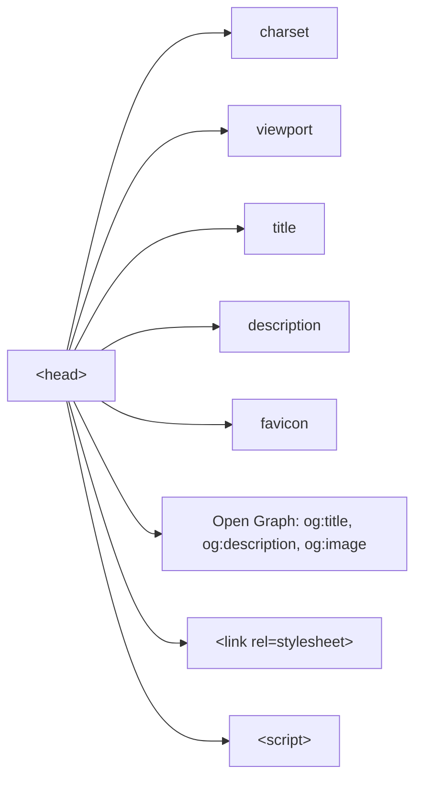
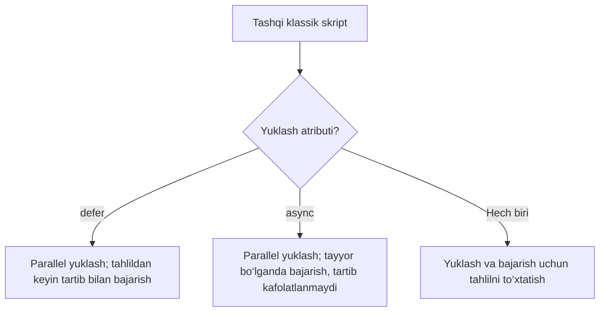

# Meta-teglar, SEO, CSS va JS bilan bog‘lash

[Mundarija](../../README.md) · [← Orqaga](../../Lesson-8/uz/Foydalanish%20qulayligi%20%28a11y%29.md) · [Keyingi →](../../Lesson-10/uz/Yakuniy%20loyiha%20rejalashtirishdan%20nashr%20etishgacha.md) · [RU](../ru/%D0%9C%D0%B5%D1%82%D0%B0-%D1%82%D0%B5%D0%B3%D0%B8%2C%20SEO%2C%20%D1%81%D0%B2%D1%8F%D0%B7%D1%8C%20%D1%81%20CSS%2C%20JS.md) · [EN](../en/Meta%20tags%2C%20SEO%2C%20linking%20CSS%20and%20JS.md) · [UZ](Meta-teglar%2C%20SEO%2C%20CSS%20va%20JS%20bilan%20bog%27lanish.md) · [Amaliyot](../practice.html)

> **Oldingi dars bilan bog‘liqlik:** 8-darsda sahifani odamlar uchun tushunarli qildingiz. Bugun uni **qidiruv tizimlari, telefonlar va ijtimoiy tarmoqlar** uchun tushunarli qilamiz, tayyor bezak va skript fayllarini ulaymiz va kodni validator bilan tekshiramiz.

---

## Bu sizga nima uchun kerak

Saytingiz havolasini do‘stingizga Telegram da yubordingiz. U nimani ko‘radi: yalang‘och havolanimi yoki nom, tavsif va rasmli kartochkanimi? Saytingiz Google da topildi - sarlavha ostida nima yozilgan? Telefonda sahifa juda kichik ochildi va uni barmoqlar bilan kattalashtirishga to‘g‘ri keladimi?

Bularning hammasini `<head>` dagi bir necha qator hal qiladi. Bugun sahifaning «texnik pasporti»ni oxirigacha yozasiz.

---

## Nimani o‘rganasiz

- Qidiruv tizimlari uchun sahifa tavsifini yozish: `meta name="description"`.
- Telefonda normal ko‘rinishni yoqish: `meta name="viewport"`.
- Ijtimoiy tarmoqlar uchun kartochka yasash: Open Graph.
- Tayyor uslublar faylini ulash: `<link rel="stylesheet">`.
- Tayyor skriptni ulash: `<script src defer>`.
- Loyiha fayllarini papkalarga joylash.
- Kodni validator va Lighthouse bilan tekshirish.

---

## Takrorlash: 1, 3 va 4-darslardan 3 savol

1. `<head>` da nima turadi: ko‘rinadigan yoki xizmat ma’lumotlarimi?
2. HTML `css` papkasi yonida tursa, shu papkadagi `style.css` fayliga qanday havola beriladi?
3. Sayt belgisini qaysi teg bilan ulagan edik?

Javoblar - dars oxirida.

---

## Reja

| Bo‘lim | Nima qilamiz |
| --- | --- |
| Meta-teglar | Sahifaning texnik pasporti |
| Tavsif va viewport | Google va telefonlar uchun |
| Open Graph | Messenjerlardagi kartochka |
| CSS ni ulash | Karkas uchun kiyim |
| JS ni ulash | Elektr tarmog‘i, `defer` va `async` |
| Mini-topshiriq 1 | To‘liq `<head>` |
| Loyiha papkalari | Fayllarda tartib |
| Kodni tekshirish | Validator va Lighthouse |
| Mini-topshiriq 2 | Validator bilan xatolarni topish |
| Mustaqil ish | IDE topshirig‘i va ikki sahifa |

---

## Meta-teglar

**Oddiy qilib aytganda:** 1-darsda `<head>` ni uyning texnik pasporti deb atadik. Meta-teglar - shu pasportning qatorlari: kodirovka, tavsif, ekranda ko‘rsatish qoidalari.

Meta-teg - `<head>` dagi bo‘sh `<meta>` elementi. Sahifada u ko‘rinmaydi.

### Kodirovka (takrorlash)

```html
<meta charset="UTF-8">
```

`<head>` da birinchi qator bo‘lib yoziladi.

### Tavsif: `description`

```html
<meta name="description" content="Olmaliqdagi veb-dasturlash to‘garagi: HTML ni noldan o‘rgatamiz, mashg‘ulotlar chorshanba kunlari.">
```

**Qayerda ko‘rinadi:** qidiruv natijalarida ko‘k sarlavha ostida. Qidiruv tizimi sizning matningizni olishi yoki o‘zinikini tuzishi mumkin, lekin yaxshi tavsif sizniki olinish ehtimolini oshiradi.

**Qanday yozish:**
- 1–2 gap, taxminan 160 belgigacha;
- har bir sahifa uchun **o‘zinikini**;
- sahifa nima haqida va unga nega o‘tish kerak.

### Telefon ekrani: `viewport`

```html
<meta name="viewport" content="width=device-width, initial-scale=1.0">
```

**Oddiy qilib aytganda:** bu qatorsiz telefon sahifani kompyuter uchun qilingan deb o‘ylaydi va uni kichraytirilgan nusxa qilib ko‘rsatadi. Qator bilan esa unga aytiladi: «Sahifa kengligi = ekran kengligi, masshtab 1:1».

**Sinab ko‘ring:** sahifani DevTools da oching → telefon belgisi (Toggle device toolbar). `viewport` ni o‘chirib, yangilang. Matn maydalashdi. Qatorni qaytaring.

`viewport` o‘zi sahifani moslashuvchan qilmaydi - buning uchun CSS kerak. Lekin `viewport` siz moslashuvchan CSS telefonda ishlamaydi.

### Yangi o‘rganuvchilarning tipik xatolari

| Xato | Qanday tuzatish |
| --- | --- |
| Barcha sahifalarda bir xil `description` | Har biriga o‘z tavsifi |
| 500 belgili tavsif | 1–2 gap |
| `viewport` yo‘q | Har bir hujjatga qo‘shing |
| `<body>` da `<meta>` | Faqat `<head>` da |

---

## Open Graph: ijtimoiy tarmoqlar uchun kartochka

Havola Telegram yoki Facebook ga qo‘yilganda, ular maxsus Open Graph meta-teglarini qidiradi:

```html
<meta property="og:title" content="Veb-dasturlash to‘garagi">
<meta property="og:description" content="HTML ni noldan o‘rgatamiz. Mashg‘ulotlar chorshanba kunlari.">
<meta property="og:image" content="https://example.com/images/preview.jpg">
```

| Teg | Kartochkada nima |
| --- | --- |
| `og:title` | Sarlavha |
| `og:description` | Tavsif |
| `og:image` | Rasm. `https://` bilan **to‘liq** manzil kerak |

**E’tibor bering:** bu yerda `name` emas, `property`.



**Sxemani qanday o‘qish kerak.** `<head>` da turishi mumkin bo‘lgan hamma narsa. `charset`, `viewport`, `title` va `description` majburiy. Qolgani - vazifaga qarab.

---

## CSS ni ulash

**Oddiy qilib aytganda:** HTML - karkas, CSS - kiyim. Kiyim alohida tikiladi va karkasga bitta qator bilan «kiydiriladi»:

```html
<link rel="stylesheet" href="css/style.css">
```

| Atribut | Nimani bildiradi |
| --- | --- |
| `rel="stylesheet"` | «Bu uslublar fayli» |
| `href` | Faylga yo‘l - 3-darsdagi qoidalar bo‘yicha |

`<head>` da yoziladi.

**Nimani ko‘rasiz:** sahifa darhol shriftni, chekinishlarni va kenglikni faylda yozilganidek o‘zgartiradi. **Bu kursda CSS yozish shart emas:** `Lesson-9/css/style.css` fayli allaqachon tayyor, uni nusxalash kifoya.

---

## JavaScript ni ulash

**Oddiy qilib aytganda:** JavaScript - uyning elektr tarmog‘i. U `<script>` tegi bilan ulanadi:

```html
<script src="js/main.js" defer></script>
```

`<script>` - ichi bo‘sh bo‘lsa ham **juft** teg. `</script>` ni yozing.

### Qayerga qo‘yish va `defer` nima uchun

Brauzer HTML ni yuqoridan pastga o‘qiydi. Oddiy `<script>` ga duch kelganda u **to‘xtaydi**, skriptni yuklab bajaradi va shundan keyingina davom etadi. Sahifa kechikib paydo bo‘ladi.

| Yozuv | Qanday ishlaydi | Qachon ishlatish |
| --- | --- | --- |
| `<script src>` | Sahifani o‘qishni to‘xtatish, yuklash, bajarish | Eski usul |
| `<script src defer>` | Parallel yuklash, butun sahifa o‘qilgach tartib bilan bajarish | **Deyarli doim** |
| `<script src async>` | Parallel yuklash, tayyor bo‘lishi bilan darhol bajarish | Mustaqil skriptlar: hisoblagichlar, analitika |

**Kurs qoidasi:** `<head>` da `<script src="..." defer>`.



**Sxemani qanday o‘qish kerak.** Skriptni ulashning uch varianti. `defer` sahifani sekinlashtirmaydi va skriptlar tartibini saqlaydi.

**Skript ishlaganini qanday tekshirish:** tayyor `main.js` konsolga xabar yozadi. DevTools → **Console** yorlig‘ini oching. «Lesson 9: the deferred script loaded.» ni ko‘rasiz - skript ulangan.

### Yangi o‘rganuvchilarning tipik xatolari

| Xato | Qanday tuzatish |
| --- | --- |
| Yopuvchi tegsiz `<script src="..." />` | Doim `</script>` |
| Yonidagi fayl uchun `../css/style.css` yo‘li | HTML fayldan yo‘l: `css/style.css` |
| Uslublar uchun `<link>` `<body>` da | `<head>` da |
| `rel="style"` | To‘g‘risi: `rel="stylesheet"` |

---

## Mini-topshiriq 1

Qaramasdan «To‘garak kontaktlari» sahifasining to‘liq `<head>` ini yozing: kodirovka, viewport, yorliq nomi, tavsif, belgi, `css/style.css` uslublari, `defer` bilan `js/main.js` skripti. Yechim - «Javoblar» bo‘limida.

---

## Loyiha papkalari

**Oddiy qilib aytganda:** shkafda kiyimlar javonlarga taxlangan: ko‘ylaklar alohida, paypoqlar alohida. Loyihada ham shunday.

```
my-website/
├── index.html
├── about.html
├── contact.html
├── css/
│   └── style.css
├── js/
│   └── main.js
├── images/
│   ├── logo.png
│   ├── hero-photo.jpg
│   └── icons/
│       └── github.svg
└── favicon.ico
```

| Qayerda | Nima |
| --- | --- |
| Ildiz | HTML sahifalar va sayt belgisi |
| `css/` | Uslub fayllari |
| `js/` | Skriptlar |
| `images/` | Rasmlar |

**Fayl nomlari:** lotin harflari, kichik harflar, bo‘shliqsiz, so‘zlar defis bilan: `Mening rasmim 1.JPG` emas, `hero-photo.jpg`.

### Fayllar ulanganini qanday tekshirish

1. Sahifani Live Server orqali oching.
2. DevTools → **Network** yorlig‘i → sahifani yangilang.
3. **Status** ustunida `style.css` va `main.js` ni toping:

| Status | Ma’nosi |
| --- | --- |
| 200 | Yuklandi |
| 304 | Keshdan olindi - bu ham normal |
| 404 | **Topilmadi** - yo‘l va fayl nomini tekshiring |

### Yangi o‘rganuvchilarning tipik xatolari

| Xato | Qanday tuzatish |
| --- | --- |
| Barcha fayllar bitta papkada | Joylang: `css/`, `js/`, `images/` |
| Nomlarda bo‘shliq va kirill harflari | `my-photo.jpg` |
| Papka nomini o‘zgartirib, yo‘llarni unutdingiz | Barcha `href` va `src` ni yangilang |

---

## Kodni tekshirish

### Nu HTML Checker validatori

Brauzer xatolarni «kechiradi» va siz nimani nazarda tutganingizni taxmin qiladi. Boshqa brauzer yoki ekran o‘quvchi boshqacha taxmin qilishi mumkin. Validator ko‘z bilan ko‘rinmaydigan xatolarni topadi.

1. [validator.w3.org/nu](https://validator.w3.org/nu/) ni oching.
2. **Text Input** (kodni qo‘yish) yoki **File Upload** (faylni yuklash) ni tanlang.
3. **Check** ni bosing.

**U nimani topadi:** yopilmagan teglar, takrorlanuvchi `id`, `alt` siz ``, `<p>` ichida `<p>`, mavjud bo‘lmagan atributlar.

**Maqsad:** «Document checking completed. No errors or warnings to show.» yozuvi.

### Lighthouse - sahifaning umumiy bahosi

Lighthouse Chrome ga o‘rnatilgan:

1. Sahifani Live Server orqali oching.
2. DevTools → **Lighthouse** yorlig‘i.
3. **Accessibility** va **SEO** ni belgilang, **Analyze page load** ni bosing.

Bir necha soniyadan keyin 0 dan 100 gacha baho va nimani yaxshilash ro‘yxatini olasiz: `description` yo‘q, kontrast kam, `alt` yo‘q.

**Validator va Lighthouse qo‘lda tekshiruvni almashtirmaydi.** 8-darsdagidek sahifani klaviatura bilan o‘ting.

### Buzib ko‘ring

1. `<link>` da yo‘lni `css/styles.css` ga almashtiring (bitta ortiqcha harf). Sahifani yangilang: bezak yo‘qoldi. **Network** yorlig‘ida faylning holati `404`.
2. Skript bilan ham shunday qiling: `js/main.js` o‘rniga `js/mian.js`. **Console** da «Lesson 9: the deferred script loaded.» qatori yo‘q, lekin qizil qator bor: `Failed to load resource: the server responded with a status of 404 (Not Found)`.
3. `<script src="js/main.js" defer></script>` ni `<script src="js/main.js" defer />` ga almashtiring. Sahifani yangilang: butun mazmun g‘oyib bo‘ldi. Brauzer `/>` ni `script` ning yopilishi deb hisoblamaydi va hujjatning qolgan qismini skript matni deb qabul qiladi. Validator `Self-closing syntax` so‘zlari bilan boshlanadigan xatoni ko‘rsatadi.
4. `<html>` dan `lang` atributini o‘chiring va kodni validatorda tekshiring. `Consider adding a lang attribute to the html start tag to declare the language of this document.` ogohlantirishi paydo bo‘ladi.
5. `<meta name="description">` ni o‘chiring va Lighthouse ni **SEO** belgisi bilan ishga tushiring. Muammolar ro‘yxatida `Document does not have a meta description` paydo bo‘ladi.

Har bir tajribadan keyin kodni avvalgi holiga qaytaring.

---

## Mini-topshiriq 2

Bu kodni validatorda tekshiring. U nechta va qanday xatolarni topadi?

```html
<!DOCTYPE html>
<html lang="uz">
<head>
    <meta charset="UTF-8">
    <title>Tekshiruv</title>
</head>
<body>
    <h1 id="top">Sarlavha</h1>
    <p id="top">Abzats <p>ichma-ich abzats</p></p>
    
</body>
</html>
```

Javob - «Javoblar» bo‘limida.

---

## Dars yakuni: shpargalka

```html
<head>
    <meta charset="UTF-8">
    <meta name="viewport" content="width=device-width, initial-scale=1.0">
    <title>Sahifa nomi - Sayt nomi</title>
    <meta name="description" content="Sahifa haqida 1–2 gap.">
    <meta property="og:title" content="Kartochka uchun nom">
    <meta property="og:description" content="Kartochka uchun tavsif">
    <link rel="icon" href="favicon.ico">
    <link rel="stylesheet" href="css/style.css">
    <script src="js/main.js" defer></script>
</head>
```

| Vazifa | Yozuv |
| --- | --- |
| Qidiruv uchun tavsif | `<meta name="description" content="...">` |
| Telefonda normal ko‘rinish | `<meta name="viewport" content="width=device-width, initial-scale=1.0">` |
| Messenjerlardagi kartochka | `<meta property="og:...">` |
| Uslublar | `<link rel="stylesheet" href="css/style.css">` |
| Skript | `<script src="js/main.js" defer></script>` |
| Tekshiruv | Nu HTML Checker, Lighthouse |

---

## Mustaqil ish

### 1-qism. IDE topshirig‘i (platforma hisoblaydi)

To‘liq `<head>` bilan **to‘garakning bosh sahifasini** yasang:

1. `charset`, `viewport` va `title`.
2. `description` - sahifaning o‘z tavsifi.
3. `og:title` va `og:description`.
4. Sayt belgisi `<link rel="icon">`.
5. Uslublar: `<link rel="stylesheet" href="css/style.css">`.
6. Skript: `<script src="js/main.js" defer></script>`.
7. `<body>` da - `header`, bitta `h1` va abzatsli `main`, `footer`.

Uslub va skriptlarni faqat fayllarni ulash orqali yozing: `<style>` tegini ishlatmang.

Platforma nimani tekshiradi: hujjat skeleti, `width=device-width` li `viewport`, `description`, `og:title`, belgi, `css/style.css` va `defer` li `js/main.js` ulanishi, yopilgan `</script>`, bitta `h1`, `<style>` yo‘qligi.

### 2-qism. Kompyuterdagi loyiha

1. `Lesson-9/css/style.css` va `Lesson-9/js/main.js` ni loyihangizning `css` va `js` papkalariga nusxalang.
2. O‘z `title` va `description` lari bilan ikki sahifa yasang - `index.html` va `about.html`.
3. Live Server orqali oching. Network da tekshiring: ikkala fayl - 200 yoki 304.
4. Ikkala sahifani Nu HTML Checker da tekshiring - xatosiz.
5. Lighthouse ni ishga tushiring va Accessibility va SEO baholarini yozib qo‘ying.

### Tayyorlik mezonlari

- [ ] IDE topshirig‘i qabul qilingan.
- [ ] Har bir sahifaning o‘z `title` va `description` i bor.
- [ ] Ikkala sahifada `viewport` bor.
- [ ] CSS va JS 404 siz yuklanadi.
- [ ] Konsolda skript xabari ko‘rinadi.
- [ ] Validator xato topmadi.
- [ ] Fayllar papkalarga joylangan, nomlar lotincha va bo‘shliqsiz.

---

## O‘zini tekshirish uchun savollar

1. `description` qayerda ko‘rinadi?
2. Nega har bir sahifaning o‘z tavsifi bo‘ladi?
3. `viewport` siz telefonda nima bo‘ladi?
4. `og:title` `<title>` dan nimasi bilan farq qiladi?
5. Nega `og:image` ga to‘liq manzil kerak?
6. Uslublar faylini qanday ulash mumkin?
7. Nega `<script>` ga doim yopuvchi teg yoziladi?
8. `defer` `async` dan nimasi bilan farq qiladi?
9. Network dagi 404 statusi nimani bildiradi?
10. Sahifa shundoq ham normal ko‘rinsa, validator nimaga kerak?

Savollardan keyin platformada **dars testini** topshiring: 12 ta savol, o‘tish chegarasi 70%.

---

## Keyin nima

Haqiqiy sayt yasash uchun hamma narsani bilasiz. 10-darsda uni rejadan internetda nashr qilishgacha yig‘asiz va saytda do‘stlaringizga yuborsa bo‘ladigan manzil paydo bo‘ladi.

---

## Javoblar

**Takrorlash**

1. Xizmat ma’lumotlari.
2. `css/style.css`.
3. `<link rel="icon" href="favicon.png">`.

**Mini-topshiriq 1**

```html
<head>
    <meta charset="UTF-8">
    <meta name="viewport" content="width=device-width, initial-scale=1.0">
    <title>Kontaktlar - Veb-dasturlash to‘garagi</title>
    <meta name="description" content="Veb-dasturlash to‘garagi bilan qanday bog‘lanish: pochta, telefon va yozilish formasi.">
    <link rel="icon" href="favicon.ico">
    <link rel="stylesheet" href="css/style.css">
    <script src="js/main.js" defer></script>
</head>
```

**Mini-topshiriq 2.** Validator topadi:
1. Takrorlanuvchi `id="top"`.
2. Abzats ichida abzats: brauzer birinchi `<p>` ni oldinroq yopadi, ortiqcha `</p>` esa juftsiz qoladi.
3. `` da `alt` yo‘q.

**O‘zini tekshirish uchun savollar**

1. Qidiruv natijalarida sarlavha ostida.
2. Aks holda qidiruv tizimi turli sahifalar uchun bir xil narsani ko‘rsatadi va odam farqni tushunmaydi.
3. Sahifa kompyuter versiyasining kichraytirilgan nusxasi bo‘lib ko‘rinadi.
4. `og:title` - ijtimoiy tarmoqlardagi kartochka sarlavhasi, `<title>` - yorliq va qidiruv natijasi nomi.
5. Ijtimoiy tarmoq rasmni o‘z serveridan yuklaydi, nisbiy yo‘l unga hech narsa demaydi.
6. `<head>` da `<link rel="stylesheet" href="css/style.css">`.
7. Bu juft teg: `</script>` siz brauzer pastdagi butun kodni skript deb hisoblaydi.
8. `defer` skriptlarni sahifa o‘qilgandan keyin va tartib bilan bajaradi, `async` - tayyor bo‘lishi bilan, tartibsiz.
9. Fayl topilmadi: yo‘lda yoki nomda xato.
10. Boshqa brauzer yoki ekran o‘quvchi xato kodni boshqacha tushunishi mumkin.

---

[Mundarija](../../README.md) · [← Orqaga](../../Lesson-8/uz/Foydalanish%20qulayligi%20%28a11y%29.md) · [Keyingi →](../../Lesson-10/uz/Yakuniy%20loyiha%20rejalashtirishdan%20nashr%20etishgacha.md) · [RU](../ru/%D0%9C%D0%B5%D1%82%D0%B0-%D1%82%D0%B5%D0%B3%D0%B8%2C%20SEO%2C%20%D1%81%D0%B2%D1%8F%D0%B7%D1%8C%20%D1%81%20CSS%2C%20JS.md) · [EN](../en/Meta%20tags%2C%20SEO%2C%20linking%20CSS%20and%20JS.md) · [UZ](Meta-teglar%2C%20SEO%2C%20CSS%20va%20JS%20bilan%20bog%27lanish.md) · [Amaliyot](../practice.html)
