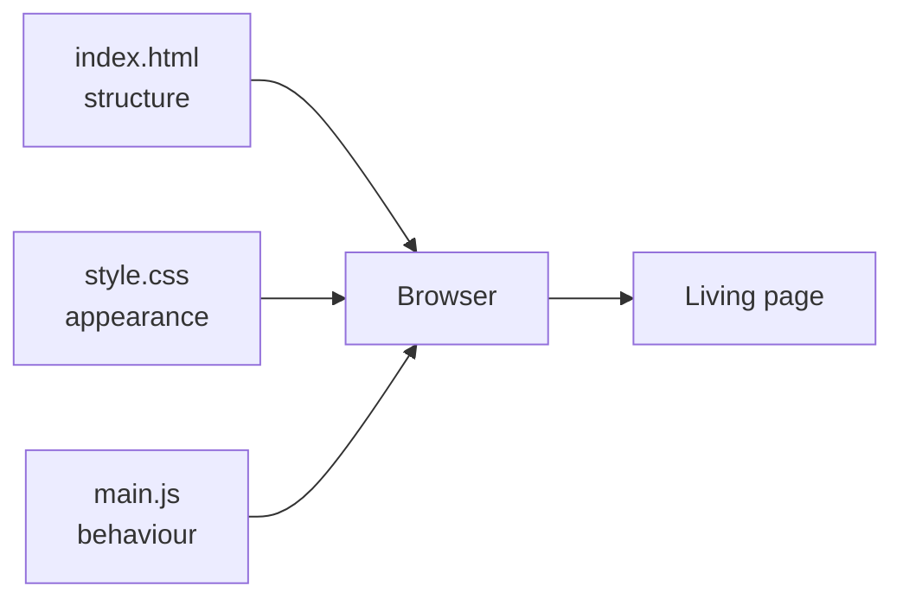
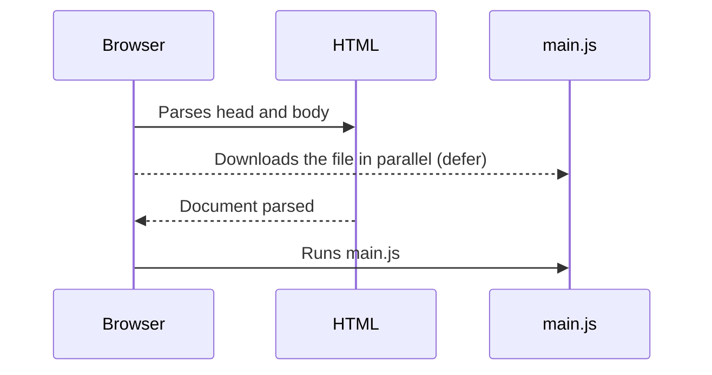

# Introduction to JavaScript. First program

[Contents](../../README.md) · [← CSS course](https://github.com/JLearn-space/css) · [Next →](../../Lesson-2/en/Data%20types%20and%20operators.md) · [RU](../ru/%D0%92%D0%B2%D0%B5%D0%B4%D0%B5%D0%BD%D0%B8%D0%B5%20%D0%B2%20JavaScript.%20%D0%9F%D0%B5%D1%80%D0%B2%D0%B0%D1%8F%20%D0%BF%D1%80%D0%BE%D0%B3%D1%80%D0%B0%D0%BC%D0%BC%D0%B0.md) · [EN](Introduction%20to%20JavaScript.%20First%20program.md) · [UZ](../uz/JavaScript%20ga%20kirish.%20Birinchi%20dastur.md)

> **Link to the HTML and CSS courses:** you built a website and dressed it in styles. But it does not move yet: the button does nothing, the menu does not open, the form does not point out mistakes. Today you will write your first JavaScript program and connect it to your page.

---

## Why you need this

Open any website and press something: a like, a "Show more" button, a dark theme switch. The page responds without reloading. That is JavaScript at work - the only programming language that every browser understands.

HTML and CSS describe *what* is on the page and *how* it looks. JavaScript is a **program**: a sequence of commands that the browser runs one after another. By the end of the course you will make your website interactive. Today is the first step: learn to give the browser commands and store data.

---

## What you will learn

- Explain how JavaScript differs from HTML and CSS.
- Run code in the DevTools console.
- Connect a JavaScript file to a page with `<script src="..." defer>`.
- Print messages with `console.log`.
- Declare variables with `const` and `let` and change a variable's value.
- Read error messages in the console.

---

## Review: 3 questions from the HTML and CSS courses

1. Which tag connects a JavaScript file to an HTML page?
2. How do you reference `main.js` inside the `js` folder if the HTML file sits next to that folder?
3. Which DevTools tab shows whether a file loaded and where a 404 error appears?

Answers are at the end of the lesson.

---

## Lesson plan

| Section | What we do |
| --- | --- |
| What JavaScript is | Body, clothes and movement |
| DevTools console | The first command |
| Connecting to a page | The `main.js` file and the `defer` attribute |
| Statements and comments | How the browser reads a program |
| Mini-task 1 | Three messages in the console |
| Variables | Labelled boxes: `const` and `let` |
| Mini-task 2 | A visit counter |
| Errors in the console | A red line is a hint, not a disaster |
| Independent work | IDE task and your own website |

---

## What JavaScript is

**In simple words:** if HTML is the body and CSS is the clothes, JavaScript is movement. It decides what happens when a person presses a button, types text or scrolls the page.

| Technology | Answers the question | Example |
| --- | --- | --- |
| **HTML** | **What** is on the page? | "This is a button", "this is a list" |
| **CSS** | **How** does it look? | "The button is blue with rounded corners" |
| **JavaScript** | **What happens**? | "Pressing the button expands the list" |

HTML and CSS are *description* languages: you list what exists and how it looks. JavaScript is a *programming* language: you write commands that run in order, can remember data, make decisions and repeat.



> **Do not confuse:** JavaScript and Java are different languages. The similar name was a marketing decision in 1995, not a family relation.

---

## DevTools console

The console is where you can talk to the browser directly: type a command and see the result immediately.

1. Open any page, for example your website from the HTML course.
2. Open DevTools: **F12** or **Ctrl+Shift+J** (on Mac - **Cmd+Option+J**).
3. Go to the **Console** tab.
4. Type and press **Enter**:

```js
console.log("Hello, JavaScript!");
```

The console shows the line `Hello, JavaScript!`. You have just run your first program.

Let us take the line apart:

| Part | What it is |
| --- | --- |
| `console` | The "console" object - a built-in browser tool |
| `.log` | Its "write to the log" command |
| `( ... )` | Parentheses: you pass in what should be printed |
| `"Hello, JavaScript!"` | A string - text in quotes |
| `;` | End of the statement |

The console can calculate too:

```js
console.log(2 + 3);
console.log("Lessons in the course:", 10);
```

The first line prints `5`, the second - `Lessons in the course: 10`. You can pass several values separated by commas; the console shows them separated by spaces.

> **Important:** code typed in the console lives until the page reloads. Like CSS edits in DevTools, it is not saved to a file. The console is a scratchpad; the program is written in a file.

### Try to break it

Remove the closing quote: `console.log("Hello);` and press Enter. The console shows a red `SyntaxError` line. That is normal: the browser says it did not understand the code. We will come back to errors at the end of the lesson.

---

## Connecting to a page

Website code is kept in an external file - just like styles in `style.css`. Project structure:

```text
my-site/
├── index.html
├── css/
│   └── style.css
└── js/
    └── main.js
```

The `js/main.js` file:

```js
console.log("main.js is connected");
```

Connecting it in `index.html` - in `<head>`, next to the styles:

```html
<head>
    <meta charset="UTF-8">
    <title>My website</title>
    <link rel="stylesheet" href="css/style.css">
    <script src="js/main.js" defer></script>
</head>
```

Open the page and the console: you will see `main.js is connected`.

### Why `defer`

The browser reads HTML from top to bottom. When it meets a plain `<script>`, it **stops**, downloads and runs the script, and only then continues parsing the page. If a script in `<head>` tries to find a button, the button does not exist yet - it is further down in the code.

The `defer` attribute says: "download the file in parallel, but run it once the whole HTML is parsed". That is why in this course the script is always connected like this:

```html
<script src="js/main.js" defer></script>
```



### Typical beginner mistakes

| Mistake | What happens | How to fix |
| --- | --- | --- |
| `<script href="...">` | The file does not load | A script uses `src`, not `href` |
| `<script src="..." />` | Following HTML may "disappear" | `<script>` is always closed with `</script>` |
| Path `main.js` instead of `js/main.js` | 404 in Network | The path is relative to the HTML file, like for images |
| Code and `src` in one tag | The code inside the tag is ignored | Either `src` or code inside - not both |

> **Where else can code go:** inside `<script>...</script>` without `src`. That is how IDE tasks on the platform work, where everything is in one file. In your project, use an external file: it is easier to maintain and works on all pages at once.

---

## Statements and comments

A program is a sequence of **statements**. The browser runs them strictly from top to bottom:

```js
console.log("One");
console.log("Two");
console.log("Three");
```

The console shows `One`, `Two`, `Three` - exactly in this order.

### The semicolon

In this course every statement ends with `;`. JavaScript often forgives a missing one, but sometimes it "glues" lines together in unexpected ways. The habit of writing `;` removes a whole class of errors - and that is how the IDE checks code.

### Comments

A comment is text for humans; the browser skips it.

```js
// Single-line comment: until the end of the line

/*
   Multi-line comment.
   Handy for explaining a block of code.
*/

console.log("This code will run");
// console.log("This one won't: it is commented out");
```

Commenting out is a handy way to switch a line off temporarily - just like a declaration in CSS. In VS Code it is **Ctrl+/** (on Mac - **Cmd+/**).

> **Compare with CSS and HTML:** in HTML a comment is `<!-- -->`, in CSS only `/* */`, and JavaScript has both kinds: `//` and `/* */`.

---

## Mini-task 1

In your `main.js` print three lines: your name, your city and your favourite subject. Then comment out the second line and check that after reloading the page only two remain in the console. The solution is in the "Answers" section.

---

## Variables

A program needs to remember data: the user's name, a game score, the number of items in a cart. That is what **variables** are for.

**In simple words:** a variable is a box with a label. The label holds the name, the box holds the value. By the name you can take the value out or put a new one in.

```js
const studentName = "Anna";
let score = 0;

console.log(studentName); // Anna
console.log(score);       // 0
```

Let us take apart `let score = 0;`:

| Part | What it is |
| --- | --- |
| `let` | Keyword: "create a variable" |
| `score` | Variable name |
| `=` | Assignment operator: "put into the box" |
| `0` | Value |
| `;` | End of the statement |

> **Important:** in programming `=` does not mean "equals", it means "assign". `score = 5;` reads as "put 5 into score".

### `const` and `let`

| Keyword | Can the value change? | When to use |
| --- | --- | --- |
| `const` | No | The value does not change: a name, a title, a reference to a button |
| `let` | Yes | The value changes: a counter, points, the current theme |

```js
let score = 0;
score = 10;          // assignment: no let
score = score + 5;   // take the old value, add 5
console.log(score);  // 15

const city = "Tashkent";
city = "Samarkand";  // TypeError: Assignment to constant variable.
```

Course rule: **`const` by default**, and `let` only if the value really will change. This way you can see which data is "alive" and which is constant.

> **What about `var`?** It is the old way of declaring from the 1990s. It has unintuitive scope rules, so modern code and this course do not use `var`. You will meet it in old articles - replace it with `let` or `const`.

### A declaration is written once

```js
let lessonsDone = 0;
lessonsDone = 1;      // correct: assignment

let lessonsDone = 2;  // SyntaxError: Identifier 'lessonsDone' has already been declared
```

`let` and `const` mean "create a box". You cannot create a second box with the same label, but you can put a new value into the existing one (if it is `let`).

### Naming rules

| Rule | Allowed | Not allowed |
| --- | --- | --- |
| Letters, digits, `_`, `$` | `user1`, `total_sum` | `user-name` (a hyphen is minus) |
| Do not start with a digit | `step2` | `2step` |
| Do not use keywords | `letter` | `let`, `const`, `class` |
| Case matters | `userName` and `username` are **different** variables | |

The course style is **camelCase**: the first word in lower case, each next one starting with a capital letter: `studentName`, `lessonsDone`, `isDarkTheme`. The name should explain the content: `score` is better than `s`, and `lessonsDone` is better than `x`.

> **English words:** variable names are written in English. Other alphabets are technically allowed, but no team does that.

---

## Mini-task 2

Create a visit counter:

1. Declare `const siteName` with your website's name.
2. Declare `let visits` with the value `0`.
3. Increase `visits` by 1 twice with `visits = visits + 1;`.
4. Print `siteName` and `visits` with a single `console.log`.

You should get `Name 2`. The solution is in the "Answers" section.

---

## Errors in the console

A red line in the console is not a disaster but a hint. The browser tells you **what** is wrong and **where**: the file and line number are on the right, and the link takes you straight to that line.

| Error | What it means | Typical cause |
| --- | --- | --- |
| `SyntaxError` | The browser did not understand the code | A missing quote or bracket; a second `let` with the same name |
| `ReferenceError: x is not defined` | There is no variable with that name | A typo: `scor` instead of `score`, a different case |
| `TypeError: Assignment to constant variable.` | Trying to change a `const` | You need `let` |

How to read an error:

```text
Uncaught ReferenceError: scor is not defined    main.js:4
```

1. **Type** - `ReferenceError`: a problem with a name.
2. **Message** - `scor is not defined`: there is no name `scor`.
3. **Location** - `main.js:4`: file and line.

> **Important:** after the first error the browser stops running the file. If none of your messages appeared in the console, look for an error above, and if the file did not load at all, check the Network tab and the path in `src`.

---

## Lesson summary: cheat sheet

| Task | Code |
| --- | --- |
| Connect a file | `<script src="js/main.js" defer></script>` in `<head>` |
| Print to the console | `console.log("text", value);` |
| Comment | `// line` or `/* block */` |
| Constant value | `const name = "Anna";` |
| Changing value | `let score = 0;` |
| Change a value | `score = 10;` (no `let`) |
| Naming style | `camelCase`: `lessonsDone` |
| Open the console | F12 → Console, or Ctrl+Shift+J |

---

## Independent work

### Part 1. IDE task (graded by the platform)

Create a "student card":

1. Constant `studentName` - your name.
2. Constant `courseName` with the value `"JavaScript"`.
3. Variable `lessonsDone` with `let` and the value `0`.
4. On a separate line assign `lessonsDone` the value `1` - the first lesson is done.
5. Print the name, the course name and the number of finished lessons to the console.

Follow the course style: `;` at the end of statements, no `var`.

What the platform checks: `studentName` is a non-empty string declared with `const`; `courseName` equals `"JavaScript"`; `lessonsDone` is declared with `let` and the value `0` and later changed to `1`; the console contains the name, the course and the number `1`; the program runs without errors.

### Part 2. Project on your computer

1. In the folder of your website from the HTML and CSS courses create a `js` folder and a `main.js` file.
2. Connect it to **all** pages of the website with `<script src="..." defer>`.
3. In `main.js` declare `const siteName` and `let pageViews = 0;`, increase `pageViews` and print a greeting to the console.
4. Open every page: the console shows the greeting, and in Network `main.js` loads without a 404.
5. Make a typo in a variable name on purpose, read the error in the console, follow the link to the line and fix it.

### Acceptance criteria

- [ ] The IDE task is accepted.
- [ ] The code is in an external `js/main.js` file connected with `defer`.
- [ ] Every page of the website shows the greeting in the console with no errors.
- [ ] Constant values use `const`, changing ones use `let`; there is no `var`.
- [ ] Names are in `camelCase` and are clear without a comment.
- [ ] You can explain what each of the three parts of an error message means.

---

## Self-check questions

1. How does JavaScript differ from HTML and CSS?
2. How do you open the console and run a command in it?
3. Is code typed in the console kept after the page reloads?
4. How do you connect `js/main.js`, and why `defer`?
5. In what order are statements run?
6. What two kinds of comments does JavaScript have?
7. How do `const` and `let` differ? Which one do you choose by default?
8. What does `=` mean in `score = 10;`?
9. Why is `user-name` not a valid variable name?
10. What does `ReferenceError: total is not defined` mean, and how do you find the place of the error?

After the questions, take the **lesson test** on the platform: 12 questions, pass mark 70%.

---

## What's next

So far the variables hold text and numbers, but we have not thought about how they differ. In lesson 2 we will look at **data types** - strings, numbers, booleans - and learn to calculate, join text and compare values.

---

## Answers

**Review**

1. `<script src="..."></script>`.
2. `js/main.js`.
3. Network.

**Mini-task 1**

```js
console.log("Anna");
// console.log("Tashkent");
console.log("Maths");
```

**Mini-task 2**

```js
const siteName = "Web Development Club";
let visits = 0;

visits = visits + 1;
visits = visits + 1;

console.log(siteName, visits); // Web Development Club 2
```

**Self-check questions**

1. HTML describes structure, CSS - appearance, JavaScript - behaviour: it is a programming language whose commands run in order.
2. F12 or Ctrl+Shift+J → the Console tab, type the command and press Enter.
3. No: the console is a scratchpad, the program is stored in a file.
4. `<script src="js/main.js" defer></script>` in `<head>`; `defer` runs the code after the whole HTML is parsed, when all page elements already exist.
5. From top to bottom, one after another.
6. `//` - until the end of the line, `/* */` - a block.
7. `const` cannot be reassigned, `let` can. `const` by default.
8. Assign: put the value 10 into the `score` variable.
9. A hyphen is read as minus: `user - name`.
10. There is no `total` variable - most likely a typo, or it was not declared. The file and line number are shown to the right of the message, and the link takes you there.

---

[Contents](../../README.md) · [← CSS course](https://github.com/JLearn-space/css) · [Next →](../../Lesson-2/en/Data%20types%20and%20operators.md) · [RU](../ru/%D0%92%D0%B2%D0%B5%D0%B4%D0%B5%D0%BD%D0%B8%D0%B5%20%D0%B2%20JavaScript.%20%D0%9F%D0%B5%D1%80%D0%B2%D0%B0%D1%8F%20%D0%BF%D1%80%D0%BE%D0%B3%D1%80%D0%B0%D0%BC%D0%BC%D0%B0.md) · [EN](Introduction%20to%20JavaScript.%20First%20program.md) · [UZ](../uz/JavaScript%20ga%20kirish.%20Birinchi%20dastur.md)
