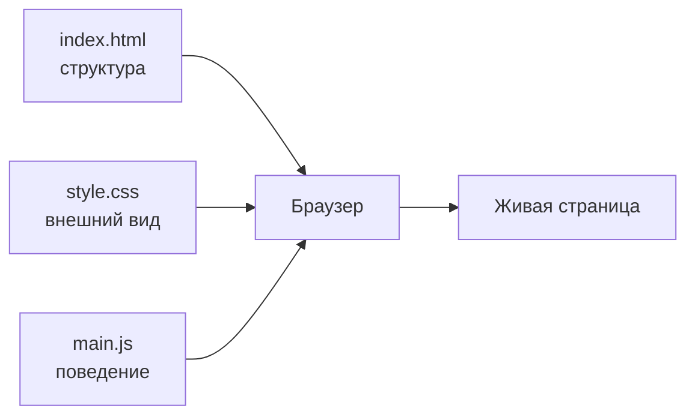
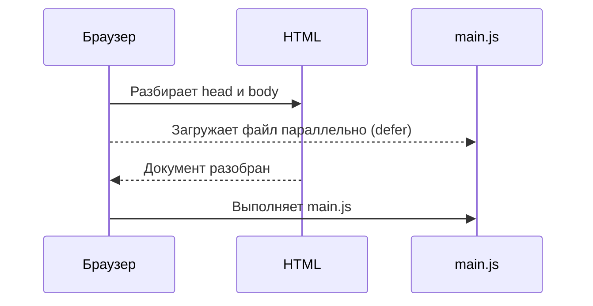

# Введение в JavaScript. Первая программа

[Содержание](../../README.md) · [← Курс CSS](https://github.com/JLearn-space/css) · [Вперёд →](../../Lesson-2/ru/Типы%20данных%20и%20операторы.md) · [RU](%D0%92%D0%B2%D0%B5%D0%B4%D0%B5%D0%BD%D0%B8%D0%B5%20%D0%B2%20JavaScript.%20%D0%9F%D0%B5%D1%80%D0%B2%D0%B0%D1%8F%20%D0%BF%D1%80%D0%BE%D0%B3%D1%80%D0%B0%D0%BC%D0%BC%D0%B0.md) · [EN](../en/Introduction%20to%20JavaScript.%20First%20program.md) · [UZ](../uz/JavaScript%20ga%20kirish.%20Birinchi%20dastur.md)

> **Связь с курсами HTML и CSS:** вы построили сайт и одели его в стили. Но он пока неподвижен: кнопка ничего не делает, меню не открывается, форма не подсказывает об ошибке. Сегодня вы напишете первую программу на JavaScript и подключите её к своей странице.

---

## Зачем это вам

Откройте любой сайт и нажмите что-нибудь: лайк, кнопку «Показать ещё», переключатель тёмной темы. Страница отвечает, не перезагружаясь. Это работает JavaScript - единственный язык программирования, который понимают все браузеры.

HTML и CSS описывают, *что* на странице и *как* это выглядит. JavaScript - это **программа**: последовательность команд, которую браузер выполняет одну за другой. К концу курса вы сделаете свой сайт интерактивным. Сегодня - первый шаг: научитесь давать браузеру команды и запоминать данные.

---

## Чему вы научитесь

- Объяснять, чем JavaScript отличается от HTML и CSS.
- Выполнять код в консоли DevTools.
- Подключать JavaScript-файл к странице через `<script src="..." defer>`.
- Выводить сообщения командой `console.log`.
- Объявлять переменные через `const` и `let` и менять значение переменной.
- Читать сообщения об ошибках в консоли.

---

## Повторение: 3 вопроса из курсов HTML и CSS

1. Каким тегом к HTML-странице подключают JavaScript-файл?
2. Как сослаться на файл `main.js` в папке `js`, если HTML лежит рядом с этой папкой?
3. Какая вкладка DevTools показывает, загрузился ли файл, и где видна ошибка 404?

Ответы - в конце урока.

---

## План урока

| Раздел | Что делаем |
| --- | --- |
| Что такое JavaScript | Тело, одежда и движение |
| Консоль DevTools | Первая команда |
| Подключение к странице | Файл `main.js` и атрибут `defer` |
| Инструкции и комментарии | Как браузер читает программу |
| Мини-задание 1 | Три сообщения в консоли |
| Переменные | Коробки с наклейками: `const` и `let` |
| Мини-задание 2 | Счётчик посещений |
| Ошибки в консоли | Красная строка - подсказка, а не катастрофа |
| Самостоятельная работа | Задание в IDE и свой сайт |

---

## Что такое JavaScript

**Простыми словами:** если HTML - тело, а CSS - одежда, то JavaScript - движение. Он решает, что произойдёт, когда человек нажмёт кнопку, введёт текст или прокрутит страницу.

| Технология | Отвечает на вопрос | Пример |
| --- | --- | --- |
| **HTML** | **Что** на странице? | «Это кнопка», «это список» |
| **CSS** | **Как** это выглядит? | «Кнопка синяя, со скруглёнными углами» |
| **JavaScript** | **Что происходит**? | «По нажатию кнопки список раскрывается» |

HTML и CSS - языки *описания*: вы перечисляете, что есть и как выглядит. JavaScript - язык *программирования*: вы пишете команды, которые выполняются по порядку, могут запоминать данные, принимать решения и повторяться.



> **Не путайте:** JavaScript и Java - разные языки. Похожее название - маркетинговое решение 1995 года, а не родство.

---

## Консоль DevTools

Консоль - это место, где можно поговорить с браузером напрямую: написать команду и сразу увидеть результат.

1. Откройте любую страницу, например свой сайт из курса HTML.
2. Откройте DevTools: **F12** или **Ctrl+Shift+J** (на Mac - **Cmd+Option+J**).
3. Перейдите на вкладку **Console**.
4. Введите и нажмите **Enter**:

```js
console.log("Привет, JavaScript!");
```

В консоли появится строка `Привет, JavaScript!`. Вы только что выполнили первую программу.

Разберём запись:

| Часть | Что это |
| --- | --- |
| `console` | Объект «консоль» - встроенный инструмент браузера |
| `.log` | Его команда «записать в журнал» |
| `( ... )` | Скобки: внутрь передают то, что нужно вывести |
| `"Привет, JavaScript!"` | Строка - текст в кавычках |
| `;` | Конец инструкции |

Консоль умеет и считать:

```js
console.log(2 + 3);
console.log("Уроков в курсе:", 10);
```

Первая строка выведет `5`, вторая - `Уроков в курсе: 10`. Через запятую можно передать несколько значений, консоль покажет их через пробел.

> **Важно:** код, набранный в консоли, живёт до перезагрузки страницы. Как и правки CSS в DevTools, он не сохраняется в файл. Консоль - черновик, а программа пишется в файле.

### Попробуйте сломать

Уберите закрывающую кавычку: `console.log("Привет);` и нажмите Enter. Консоль покажет красную строку `SyntaxError`. Это нормально: браузер сообщает, что не понял запись. К ошибкам вернёмся в конце урока.

---

## Подключение к странице

Код для сайта хранят во внешнем файле - так же, как стили в `style.css`. Структура проекта:

```text
my-site/
├── index.html
├── css/
│   └── style.css
└── js/
    └── main.js
```

Файл `js/main.js`:

```js
console.log("Файл main.js подключён");
```

Подключение в `index.html` - в `<head>`, рядом со стилями:

```html
<head>
    <meta charset="UTF-8">
    <title>Мой сайт</title>
    <link rel="stylesheet" href="css/style.css">
    <script src="js/main.js" defer></script>
</head>
```

Откройте страницу и консоль: там будет `Файл main.js подключён`.

### Зачем `defer`

Браузер читает HTML сверху вниз. Встретив обычный `<script>`, он **останавливается**, загружает и выполняет скрипт и только потом продолжает разбирать страницу. Если скрипт в `<head>` попытается найти кнопку, её ещё нет - она ниже по коду.

Атрибут `defer` (англ. «отложить») говорит: «загружай файл параллельно, а выполни, когда весь HTML разобран». Поэтому в курсе скрипт всегда подключается так:

```html
<script src="js/main.js" defer></script>
```



### Частые ошибки новичков

| Ошибка | Что происходит | Как исправить |
| --- | --- | --- |
| `<script href="...">` | Файл не загружается | У скрипта атрибут `src`, а не `href` |
| `<script src="..." />` | Следующий HTML может «пропасть» | `<script>` всегда закрывается тегом `</script>` |
| Путь `main.js` вместо `js/main.js` | В Network - 404 | Путь считается от HTML-файла, как у картинок |
| Код и `src` в одном теге | Код внутри тега игнорируется | Или `src`, или код внутри - не вместе |

> **Где ещё можно писать код:** внутри `<script>...</script>` без `src`. Так сделано в заданиях IDE на платформе, где всё в одном файле. В своём проекте используйте внешний файл: его проще поддерживать, и он работает на всех страницах сразу.

---

## Инструкции и комментарии

Программа - это последовательность **инструкций**. Браузер выполняет их строго сверху вниз:

```js
console.log("Раз");
console.log("Два");
console.log("Три");
```

В консоли будет `Раз`, `Два`, `Три` - именно в таком порядке.

### Точка с запятой

Каждую инструкцию в курсе завершаем `;`. JavaScript часто прощает её отсутствие, но иногда «склеивает» строки неожиданным образом. Привычка ставить `;` убирает целый класс ошибок - и так код проверяет IDE.

### Комментарии

Комментарий - текст для человека, браузер его пропускает.

```js
// Однострочный комментарий: до конца строки

/*
   Многострочный комментарий.
   Удобен для пояснения к блоку кода.
*/

console.log("Этот код выполнится");
// console.log("А этот - нет: он закомментирован");
```

Комментарием удобно временно выключить строку - так же, как объявление в CSS. В VS Code это **Ctrl+/** (на Mac - **Cmd+/**).

> **Сравните с CSS и HTML:** в HTML комментарий - `<!-- -->`, в CSS - только `/* */`, а в JavaScript есть оба вида: `//` и `/* */`.

---

## Мини-задание 1

В своём `main.js` выведите три строки: ваше имя, город и любимый предмет. Затем закомментируйте вторую строку и убедитесь, что после обновления страницы в консоли остались две. Решение - в разделе «Ответы».

---

## Переменные

Программе нужно запоминать данные: имя пользователя, счёт в игре, число товаров в корзине. Для этого есть **переменные**.

**Простыми словами:** переменная - коробка с наклейкой. На наклейке - имя, внутри - значение. По имени можно достать значение или положить новое.

```js
const studentName = "Анна";
let score = 0;

console.log(studentName); // Анна
console.log(score);       // 0
```

Разберём строку `let score = 0;`:

| Часть | Что это |
| --- | --- |
| `let` | Ключевое слово: «создай переменную» |
| `score` | Имя переменной |
| `=` | Оператор присваивания: «положи в коробку» |
| `0` | Значение |
| `;` | Конец инструкции |

> **Важно:** `=` в программировании - не «равно», а «присвоить». Запись `score = 5;` читается «положи 5 в score».

### `const` и `let`

| Ключевое слово | Можно поменять значение? | Когда использовать |
| --- | --- | --- |
| `const` | Нет | Значение не меняется: имя, название, ссылка на кнопку |
| `let` | Да | Значение меняется: счётчик, баллы, текущая тема |

```js
let score = 0;
score = 10;          // присваивание: без let
score = score + 5;   // берём старое значение, прибавляем 5
console.log(score);  // 15

const city = "Ташкент";
city = "Самарканд";  // TypeError: Assignment to constant variable.
```

Правило курса: **по умолчанию `const`**, а `let` - только если значение действительно будет меняться. Так видно, какие данные «живые», а какие постоянные.

> **А `var`?** Это старый способ объявления из 1990-х. У него неочевидные правила видимости, поэтому в современном коде и в этом курсе `var` не используется. Вы встретите его в старых статьях - заменяйте на `let` или `const`.

### Объявление пишется один раз

```js
let lessonsDone = 0;
lessonsDone = 1;      // правильно: присваивание

let lessonsDone = 2;  // SyntaxError: Identifier 'lessonsDone' has already been declared
```

`let` и `const` - это «создать коробку». Вторую коробку с той же наклейкой создать нельзя, а положить в существующую новое значение - можно (если это `let`).

### Правила имён

| Правило | Можно | Нельзя |
| --- | --- | --- |
| Буквы, цифры, `_`, `$` | `user1`, `total_sum` | `user-name` (дефис - это минус) |
| Не начинать с цифры | `step2` | `2step` |
| Не использовать ключевые слова | `letter` | `let`, `const`, `class` |
| Регистр важен | `userName` и `username` - **разные** переменные | |

Стиль курса - **camelCase** («верблюжий регистр»): первое слово с маленькой буквы, каждое следующее - с большой: `studentName`, `lessonsDone`, `isDarkTheme`. Имя должно объяснять содержимое: `score` лучше, чем `s`, а `lessonsDone` лучше, чем `x`.

> **Латиница:** имена переменных пишутся английскими словами. Кириллица технически допустима, но так не принято ни в одной команде.

---

## Мини-задание 2

Создайте счётчик посещений:

1. Объявите `const siteName` с названием вашего сайта.
2. Объявите `let visits` со значением `0`.
3. Дважды увеличьте `visits` на 1 записью `visits = visits + 1;`.
4. Выведите в консоль `siteName` и `visits` одной командой `console.log`.

Должно получиться `Название 2`. Решение - в разделе «Ответы».

---

## Ошибки в консоли

Красная строка в консоли - не катастрофа, а подсказка. Браузер говорит, **что** не так и **где**: справа указан файл и номер строки, по ссылке можно перейти прямо к ней.

| Ошибка | Что значит | Типичная причина |
| --- | --- | --- |
| `SyntaxError` | Браузер не понял запись | Забыта кавычка или скобка; повторное `let` с тем же именем |
| `ReferenceError: x is not defined` | Нет переменной с таким именем | Опечатка: `scor` вместо `score`, другой регистр |
| `TypeError: Assignment to constant variable.` | Попытка изменить `const` | Нужна `let` |

Как читать ошибку:

```text
Uncaught ReferenceError: scor is not defined    main.js:4
```

1. **Тип** - `ReferenceError`: проблема с именем.
2. **Сообщение** - `scor is not defined`: имени `scor` нет.
3. **Место** - `main.js:4`: файл и строка.

> **Важно:** после первой ошибки браузер прекращает выполнять файл. Если в консоли не появилось ни одного вашего сообщения, ищите ошибку выше, а если файл не загрузился вовсе - проверьте вкладку Network и путь в `src`.

---

## Итоги урока: шпаргалка

| Задача | Запись |
| --- | --- |
| Подключить файл | `<script src="js/main.js" defer></script>` в `<head>` |
| Вывести в консоль | `console.log("текст", значение);` |
| Комментарий | `// строка` или `/* блок */` |
| Постоянное значение | `const name = "Анна";` |
| Изменяемое значение | `let score = 0;` |
| Изменить значение | `score = 10;` (без `let`) |
| Стиль имён | `camelCase`: `lessonsDone` |
| Открыть консоль | F12 → Console, или Ctrl+Shift+J |

---

## Самостоятельная работа

### Часть 1. Задание в IDE (засчитывается платформой)

Создайте «карточку ученика»:

1. Константа `studentName` - ваше имя.
2. Константа `courseName` со значением `"JavaScript"`.
3. Переменная `lessonsDone` через `let` со значением `0`.
4. На отдельной строке присвойте `lessonsDone` значение `1` - первый урок пройден.
5. Выведите в консоль имя, название курса и число пройденных уроков.

Пишите в стиле курса: `;` в конце инструкций, `var` не используйте.

Что проверяет платформа: `studentName` - непустая строка, объявленная через `const`; `courseName` равна `"JavaScript"`; `lessonsDone` объявлена через `let` со значением `0` и потом изменена на `1`; в консоли есть имя, курс и число `1`; программа выполняется без ошибок.

### Часть 2. Проект на компьютере

1. В папке сайта из курсов HTML и CSS создайте папку `js` и файл `main.js`.
2. Подключите его ко **всем** страницам сайта через `<script src="..." defer>`.
3. В `main.js` объявите `const siteName` и `let pageViews = 0;`, увеличьте `pageViews` и выведите приветствие в консоль.
4. Откройте каждую страницу: в консоли есть приветствие, в Network файл `main.js` загружается без 404.
5. Намеренно сделайте опечатку в имени переменной, прочитайте ошибку в консоли, перейдите по ссылке на строку и исправьте.

### Критерии готовности

- [ ] Задание в IDE засчитано.
- [ ] Код во внешнем файле `js/main.js`, подключённом с `defer`.
- [ ] На всех страницах сайта в консоли видно приветствие, ошибок нет.
- [ ] Постоянные значения объявлены через `const`, изменяемые - через `let`; `var` нет.
- [ ] Имена в `camelCase` и понятны без комментария.
- [ ] Вы можете объяснить, что значит каждая из трёх частей сообщения об ошибке.

---

## Вопросы для самопроверки

1. Чем JavaScript отличается от HTML и CSS?
2. Как открыть консоль и выполнить в ней команду?
3. Сохранится ли код, набранный в консоли, после перезагрузки страницы?
4. Как подключить `js/main.js` и зачем атрибут `defer`?
5. В каком порядке выполняются инструкции?
6. Какие два вида комментариев есть в JavaScript?
7. Чем отличаются `const` и `let`? Какое слово выбирать по умолчанию?
8. Что значит `=` в записи `score = 10;`?
9. Почему `user-name` - недопустимое имя переменной?
10. Что значит `ReferenceError: total is not defined` и как найти место ошибки?

После вопросов пройдите **тест урока** на платформе: 12 вопросов, порог 70%.

---

## Что дальше

Пока в переменных лежат текст и числа, но мы не задумывались, чем они отличаются. В уроке 2 разберём **типы данных** - строки, числа, логические значения - и научимся считать, склеивать текст и сравнивать значения.

---

## Ответы

**Повторение**

1. `<script src="..."></script>`.
2. `js/main.js`.
3. Network.

**Мини-задание 1**

```js
console.log("Анна");
// console.log("Ташкент");
console.log("Математика");
```

**Мини-задание 2**

```js
const siteName = "Кружок веб-разработки";
let visits = 0;

visits = visits + 1;
visits = visits + 1;

console.log(siteName, visits); // Кружок веб-разработки 2
```

**Вопросы для самопроверки**

1. HTML описывает структуру, CSS - внешний вид, JavaScript - поведение: это язык программирования, команды выполняются по порядку.
2. F12 или Ctrl+Shift+J → вкладка Console, ввести команду и нажать Enter.
3. Нет: консоль - черновик, программа хранится в файле.
4. `<script src="js/main.js" defer></script>` в `<head>`; `defer` выполняет код после разбора всего HTML, когда все элементы страницы уже есть.
5. Сверху вниз, одна за другой.
6. `//` - до конца строки, `/* */` - блок.
7. `const` нельзя переназначить, `let` - можно. По умолчанию `const`.
8. Присвоить: положить значение 10 в переменную `score`.
9. Дефис читается как минус: `user - name`.
10. Переменной `total` нет - скорее всего, опечатка или она не объявлена. Справа от сообщения указаны файл и номер строки, по ссылке можно перейти к ней.

---

[Содержание](../../README.md) · [← Курс CSS](https://github.com/JLearn-space/css) · [Вперёд →](../../Lesson-2/ru/Типы%20данных%20и%20операторы.md) · [RU](%D0%92%D0%B2%D0%B5%D0%B4%D0%B5%D0%BD%D0%B8%D0%B5%20%D0%B2%20JavaScript.%20%D0%9F%D0%B5%D1%80%D0%B2%D0%B0%D1%8F%20%D0%BF%D1%80%D0%BE%D0%B3%D1%80%D0%B0%D0%BC%D0%BC%D0%B0.md) · [EN](../en/Introduction%20to%20JavaScript.%20First%20program.md) · [UZ](../uz/JavaScript%20ga%20kirish.%20Birinchi%20dastur.md)
