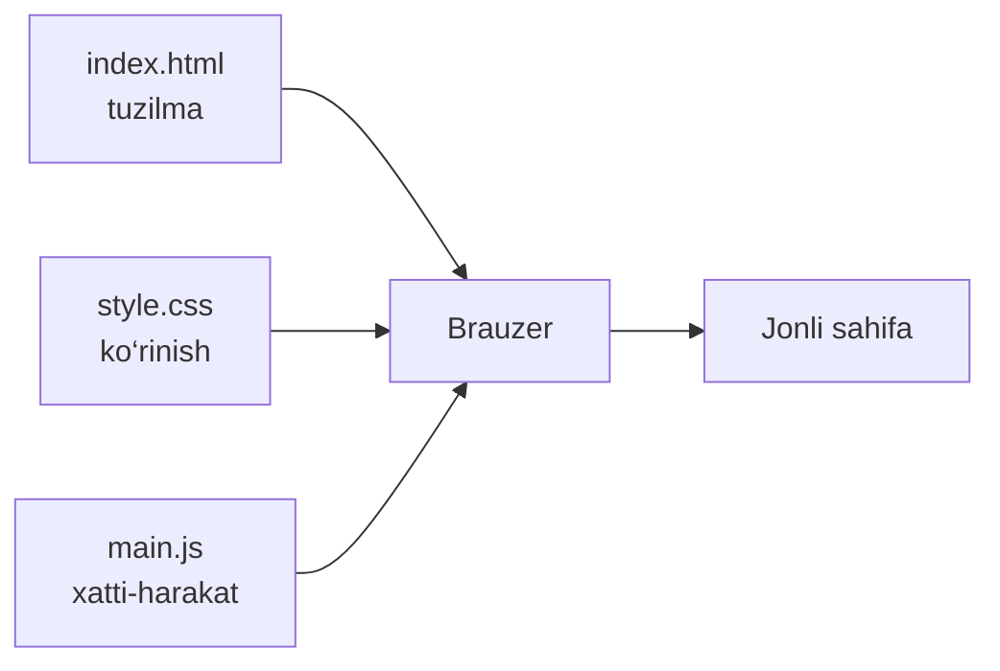
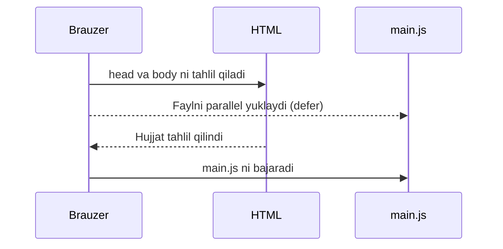

# JavaScript ga kirish. Birinchi dastur

[Mundarija](../../README.md) · [← CSS kursi](https://github.com/JLearn-space/css) · [Keyingi →](../../Lesson-2/uz/Ma'lumot%20turlari%20va%20operatorlar.md) · [RU](../ru/%D0%92%D0%B2%D0%B5%D0%B4%D0%B5%D0%BD%D0%B8%D0%B5%20%D0%B2%20JavaScript.%20%D0%9F%D0%B5%D1%80%D0%B2%D0%B0%D1%8F%20%D0%BF%D1%80%D0%BE%D0%B3%D1%80%D0%B0%D0%BC%D0%BC%D0%B0.md) · [EN](../en/Introduction%20to%20JavaScript.%20First%20program.md) · [UZ](JavaScript%20ga%20kirish.%20Birinchi%20dastur.md)

> **HTML va CSS kurslari bilan bog‘liqlik:** siz sayt qurdingiz va uni stillar bilan kiyintirdingiz. Lekin u hali harakatsiz: tugma hech narsa qilmaydi, menyu ochilmaydi, forma xatoni ko‘rsatmaydi. Bugun JavaScript’da birinchi dasturingizni yozasiz va uni sahifangizga ulaysiz.

---

## Bu sizga nima uchun kerak

Istalgan saytni oching va biror narsani bosing: layk, «Yana ko‘rsatish» tugmasi, qorong‘i mavzu almashtirgichi. Sahifa qayta yuklanmasdan javob beradi. Bu JavaScript ishi - barcha brauzerlar tushunadigan yagona dasturlash tili.

HTML va CSS sahifada *nima* borligini va u *qanday* ko‘rinishini tasvirlaydi. JavaScript esa **dastur**: brauzer birin-ketin bajaradigan buyruqlar ketma-ketligi. Kurs oxirida saytingizni interaktiv qilasiz. Bugun - birinchi qadam: brauzerga buyruq berish va ma’lumotlarni eslab qolishni o‘rganasiz.

---

## Nimani o‘rganasiz

- JavaScript HTML va CSS dan nimasi bilan farq qilishini tushuntirish.
- DevTools konsolida kod bajarish.
- JavaScript faylini sahifaga `<script src="..." defer>` orqali ulash.
- `console.log` buyrug‘i bilan xabar chiqarish.
- `const` va `let` orqali o‘zgaruvchi e’lon qilish va qiymatini o‘zgartirish.
- Konsoldagi xato xabarlarini o‘qish.

---

## Takrorlash: HTML va CSS kurslaridan 3 savol

1. HTML sahifaga JavaScript faylini qaysi teg ulaydi?
2. HTML fayl `js` papkasi yonida tursa, shu papkadagi `main.js` fayliga qanday murojaat qilinadi?
3. DevTools’ning qaysi bo‘limi fayl yuklanganini va 404 xatosini ko‘rsatadi?

Javoblar - dars oxirida.

---

## Reja

| Bo‘lim | Nima qilamiz |
| --- | --- |
| JavaScript nima | Tana, kiyim va harakat |
| DevTools konsoli | Birinchi buyruq |
| Sahifaga ulash | `main.js` fayli va `defer` atributi |
| Ko‘rsatmalar va izohlar | Brauzer dasturni qanday o‘qiydi |
| Mini-topshiriq 1 | Konsolda uchta xabar |
| O‘zgaruvchilar | Yorliqli qutilar: `const` va `let` |
| Mini-topshiriq 2 | Tashriflar hisoblagichi |
| Konsoldagi xatolar | Qizil qator - falokat emas, maslahat |
| Mustaqil ish | IDE topshirig‘i va o‘z saytingiz |

---

## JavaScript nima

**Oddiy so‘z bilan:** agar HTML - tana, CSS - kiyim bo‘lsa, JavaScript - harakat. Odam tugmani bossa, matn kiritsa yoki sahifani aylantirsa nima bo‘lishini u hal qiladi.

| Texnologiya | Qaysi savolga javob beradi | Misol |
| --- | --- | --- |
| **HTML** | Sahifada **nima** bor? | «Bu tugma», «bu ro‘yxat» |
| **CSS** | U **qanday** ko‘rinadi? | «Tugma ko‘k, burchaklari yumaloq» |
| **JavaScript** | **Nima sodir bo‘ladi**? | «Tugma bosilsa, ro‘yxat ochiladi» |

HTML va CSS - *tasvirlash* tillari: nima borligini va qanday ko‘rinishini sanab o‘tasiz. JavaScript - *dasturlash* tili: tartib bilan bajariladigan, ma’lumotni eslab qoladigan, qaror qabul qiladigan va takrorlanadigan buyruqlar yozasiz.



> **Adashtirmang:** JavaScript va Java - turli tillar. O‘xshash nom 1995-yildagi marketing qarori, qarindoshlik emas.

---

## DevTools konsoli

Konsol - brauzer bilan to‘g‘ridan-to‘g‘ri gaplashish joyi: buyruq yozasiz va natijani darhol ko‘rasiz.

1. Istalgan sahifani oching, masalan HTML kursidagi saytingizni.
2. DevTools’ni oching: **F12** yoki **Ctrl+Shift+J** (Mac’da - **Cmd+Option+J**).
3. **Console** bo‘limiga o‘ting.
4. Yozing va **Enter** ni bosing:

```js
console.log("Salom, JavaScript!");
```

Konsolda `Salom, JavaScript!` qatori paydo bo‘ladi. Siz hozirgina birinchi dasturni bajardingiz.

Yozuvni qismlarga ajratamiz:

| Qism | Bu nima |
| --- | --- |
| `console` | «Konsol» obyekti - brauzerning ichki vositasi |
| `.log` | Uning «jurnalga yozish» buyrug‘i |
| `( ... )` | Qavslar: ichiga chiqarilishi kerak bo‘lgan narsa beriladi |
| `"Salom, JavaScript!"` | Satr - qo‘shtirnoq ichidagi matn |
| `;` | Ko‘rsatma oxiri |

Konsol hisoblay ham oladi:

```js
console.log(2 + 3);
console.log("Kursdagi darslar:", 10);
```

Birinchi qator `5` ni, ikkinchisi - `Kursdagi darslar: 10` ni chiqaradi. Vergul bilan bir nechta qiymat berish mumkin, konsol ularni bo‘sh joy bilan ajratib ko‘rsatadi.

> **Muhim:** konsolda yozilgan kod sahifa qayta yuklanguncha yashaydi. DevTools’dagi CSS tahrirlari kabi u faylga saqlanmaydi. Konsol - qoralama, dastur esa faylda yoziladi.

### Buzib ko‘ring

Yopuvchi qo‘shtirnoqni olib tashlang: `console.log("Salom);` va Enter ni bosing. Konsol qizil `SyntaxError` qatorini ko‘rsatadi. Bu normal holat: brauzer yozuvni tushunmaganini aytmoqda. Xatolarga dars oxirida qaytamiz.

---

## Sahifaga ulash

Sayt kodi tashqi faylda saqlanadi - xuddi `style.css` dagi stillar kabi. Loyiha tuzilmasi:

```text
my-site/
├── index.html
├── css/
│   └── style.css
└── js/
    └── main.js
```

`js/main.js` fayli:

```js
console.log("main.js fayli ulandi");
```

`index.html` da ulash - `<head>` ichida, stillar yonida:

```html
<head>
    <meta charset="UTF-8">
    <title>Mening saytim</title>
    <link rel="stylesheet" href="css/style.css">
    <script src="js/main.js" defer></script>
</head>
```

Sahifa va konsolni oching: u yerda `main.js fayli ulandi` bo‘ladi.

### `defer` nima uchun

Brauzer HTML ni yuqoridan pastga o‘qiydi. Oddiy `<script>` ga duch kelsa, u **to‘xtaydi**, skriptni yuklab bajaradi va shundan keyingina sahifani tahlil qilishni davom ettiradi. Agar `<head>` dagi skript tugmani topmoqchi bo‘lsa, tugma hali yo‘q - u kodda pastroqda.

`defer` atributi (ingl. «kechiktirish») aytadi: «faylni parallel yukla, lekin butun HTML tahlil qilingach bajar». Shuning uchun kursda skript doim shunday ulanadi:

```html
<script src="js/main.js" defer></script>
```



### Yangi o‘rganuvchilarning tipik xatolari

| Xato | Nima bo‘ladi | Qanday tuzatiladi |
| --- | --- | --- |
| `<script href="...">` | Fayl yuklanmaydi | Skriptda `href` emas, `src` atributi |
| `<script src="..." />` | Keyingi HTML «yo‘qolishi» mumkin | `<script>` doim `</script>` bilan yopiladi |
| `js/main.js` o‘rniga `main.js` yo‘li | Network’da 404 | Yo‘l rasmlardagi kabi HTML fayldan hisoblanadi |
| Bitta tegda kod va `src` | Teg ichidagi kod e’tiborsiz qoladi | Yo `src`, yo ichida kod - birga emas |

> **Kodni yana qayerda yozish mumkin:** `src` siz `<script>...</script>` ichida. Platformadagi IDE topshiriqlari shunday tuzilgan - hammasi bitta faylda. O‘z loyihangizda tashqi fayldan foydalaning: uni qo‘llab-quvvatlash osonroq va u barcha sahifalarda birdaniga ishlaydi.

---

## Ko‘rsatmalar va izohlar

Dastur - **ko‘rsatmalar** ketma-ketligi. Brauzer ularni qat’iy yuqoridan pastga bajaradi:

```js
console.log("Bir");
console.log("Ikki");
console.log("Uch");
```

Konsolda `Bir`, `Ikki`, `Uch` - aynan shu tartibda.

### Nuqtali vergul

Kursda har bir ko‘rsatmani `;` bilan tugatamiz. JavaScript ko‘pincha uning yo‘qligini kechiradi, lekin ba’zan qatorlarni kutilmagan tarzda «yopishtiradi». `;` qo‘yish odati butun bir xatolar sinfini yo‘qotadi - IDE ham kodni shunday tekshiradi.

### Izohlar

Izoh - inson uchun matn, brauzer uni o‘tkazib yuboradi.

```js
// Bir qatorli izoh: qator oxirigacha

/*
   Ko‘p qatorli izoh.
   Kod blokini tushuntirish uchun qulay.
*/

console.log("Bu kod bajariladi");
// console.log("Bu esa yo‘q: u izohga olingan");
```

Izoh bilan qatorni vaqtincha o‘chirish qulay - xuddi CSS dagi e’lon kabi. VS Code’da bu **Ctrl+/** (Mac’da - **Cmd+/**).

> **HTML va CSS bilan solishtiring:** HTML da izoh - `<!-- -->`, CSS da faqat `/* */`, JavaScript’da esa ikkala turi bor: `//` va `/* */`.

---

## Mini-topshiriq 1

`main.js` faylingizda uchta qator chiqaring: ismingiz, shahringiz va sevimli faningiz. Keyin ikkinchi qatorni izohga oling va sahifa yangilangach konsolda ikkitasi qolganiga ishonch hosil qiling. Yechim - «Javoblar» bo‘limida.

---

## O‘zgaruvchilar

Dastur ma’lumotlarni eslab qolishi kerak: foydalanuvchi ismi, o‘yindagi hisob, savatdagi mahsulotlar soni. Buning uchun **o‘zgaruvchilar** bor.

**Oddiy so‘z bilan:** o‘zgaruvchi - yorliqli quti. Yorliqda - nom, ichida - qiymat. Nom orqali qiymatni olish yoki yangisini solish mumkin.

```js
const studentName = "Anna";
let score = 0;

console.log(studentName); // Anna
console.log(score);       // 0
```

`let score = 0;` qatorini ajratamiz:

| Qism | Bu nima |
| --- | --- |
| `let` | Kalit so‘z: «o‘zgaruvchi yarat» |
| `score` | O‘zgaruvchi nomi |
| `=` | Qiymat berish operatori: «qutiga sol» |
| `0` | Qiymat |
| `;` | Ko‘rsatma oxiri |

> **Muhim:** dasturlashda `=` «teng» emas, «qiymat ber» degani. `score = 5;` yozuvi «score ga 5 ni sol» deb o‘qiladi.

### `const` va `let`

| Kalit so‘z | Qiymatni o‘zgartirish mumkinmi? | Qachon ishlatiladi |
| --- | --- | --- |
| `const` | Yo‘q | Qiymat o‘zgarmaydi: ism, nom, tugmaga havola |
| `let` | Ha | Qiymat o‘zgaradi: hisoblagich, ball, joriy mavzu |

```js
let score = 0;
score = 10;          // qiymat berish: let siz
score = score + 5;   // eski qiymatni olib, 5 qo‘shamiz
console.log(score);  // 15

const city = "Toshkent";
city = "Samarqand";  // TypeError: Assignment to constant variable.
```

Kurs qoidasi: **odatda `const`**, `let` esa faqat qiymat haqiqatan o‘zgarsa. Shunda qaysi ma’lumot «tirik», qaysi biri doimiy ekani ko‘rinib turadi.

> **`var` chi?** Bu 1990-yillardagi eski e’lon usuli. Uning ko‘rinish qoidalari tushunarsiz, shuning uchun zamonaviy kodda va bu kursda `var` ishlatilmaydi. Eski maqolalarda uchratsangiz - `let` yoki `const` ga almashtiring.

### E’lon bir marta yoziladi

```js
let lessonsDone = 0;
lessonsDone = 1;      // to‘g‘ri: qiymat berish

let lessonsDone = 2;  // SyntaxError: Identifier 'lessonsDone' has already been declared
```

`let` va `const` - bu «quti yaratish». Bir xil yorliqli ikkinchi qutini yaratib bo‘lmaydi, mavjudiga esa yangi qiymat solish mumkin (agar u `let` bo‘lsa).

### Nomlash qoidalari

| Qoida | Mumkin | Mumkin emas |
| --- | --- | --- |
| Harflar, raqamlar, `_`, `$` | `user1`, `total_sum` | `user-name` (chiziqcha - bu minus) |
| Raqam bilan boshlanmaydi | `step2` | `2step` |
| Kalit so‘zlar ishlatilmaydi | `letter` | `let`, `const`, `class` |
| Registr muhim | `userName` va `username` - **turli** o‘zgaruvchilar | |

Kurs uslubi - **camelCase** («tuya registri»): birinchi so‘z kichik harf bilan, keyingi har biri - katta harf bilan: `studentName`, `lessonsDone`, `isDarkTheme`. Nom ichidagi narsani tushuntirishi kerak: `s` dan `score` yaxshiroq, `x` dan esa `lessonsDone`.

> **Ingliz so‘zlari:** o‘zgaruvchi nomlari inglizcha so‘zlar bilan yoziladi. Boshqa alifbolar texnik jihatdan mumkin, lekin hech bir jamoada bunday qilinmaydi.

---

## Mini-topshiriq 2

Tashriflar hisoblagichini yarating:

1. Saytingiz nomi bilan `const siteName` e’lon qiling.
2. `0` qiymatli `let visits` e’lon qiling.
3. `visits = visits + 1;` yozuvi bilan `visits` ni ikki marta 1 ga oshiring.
4. `siteName` va `visits` ni bitta `console.log` bilan chiqaring.

`Nom 2` chiqishi kerak. Yechim - «Javoblar» bo‘limida.

---

## Konsoldagi xatolar

Konsoldagi qizil qator - falokat emas, maslahat. Brauzer **nima** noto‘g‘ri va **qayerda** ekanini aytadi: o‘ngda fayl va qator raqami ko‘rsatilgan, havola orqali to‘g‘ridan-to‘g‘ri unga o‘tish mumkin.

| Xato | Ma’nosi | Odatiy sababi |
| --- | --- | --- |
| `SyntaxError` | Brauzer yozuvni tushunmadi | Qo‘shtirnoq yoki qavs unutilgan; bir xil nom bilan takroriy `let` |
| `ReferenceError: x is not defined` | Bunday nomli o‘zgaruvchi yo‘q | Xato yozilgan: `score` o‘rniga `scor`, boshqa registr |
| `TypeError: Assignment to constant variable.` | `const` ni o‘zgartirishga urinish | `let` kerak |

Xatoni qanday o‘qish kerak:

```text
Uncaught ReferenceError: scor is not defined    main.js:4
```

1. **Turi** - `ReferenceError`: nom bilan muammo.
2. **Xabar** - `scor is not defined`: `scor` nomi yo‘q.
3. **Joyi** - `main.js:4`: fayl va qator.

> **Muhim:** birinchi xatodan keyin brauzer faylni bajarishni to‘xtatadi. Agar konsolda xabarlaringizdan birortasi ham chiqmagan bo‘lsa, xatoni yuqoriroqdan qidiring, fayl umuman yuklanmagan bo‘lsa - Network bo‘limini va `src` dagi yo‘lni tekshiring.

---

## Dars yakuni: shpargalka

| Vazifa | Yozuv |
| --- | --- |
| Faylni ulash | `<head>` da `<script src="js/main.js" defer></script>` |
| Konsolga chiqarish | `console.log("matn", qiymat);` |
| Izoh | `// qator` yoki `/* blok */` |
| Doimiy qiymat | `const name = "Anna";` |
| O‘zgaruvchan qiymat | `let score = 0;` |
| Qiymatni o‘zgartirish | `score = 10;` (`let` siz) |
| Nomlash uslubi | `camelCase`: `lessonsDone` |
| Konsolni ochish | F12 → Console yoki Ctrl+Shift+J |

---

## Mustaqil ish

### 1-qism. IDE topshirig‘i (platforma hisoblaydi)

«O‘quvchi kartochkasi»ni yarating:

1. `studentName` konstantasi - ismingiz.
2. `"JavaScript"` qiymatli `courseName` konstantasi.
3. `let` orqali `0` qiymatli `lessonsDone` o‘zgaruvchisi.
4. Alohida qatorda `lessonsDone` ga `1` qiymatini bering - birinchi dars o‘tildi.
5. Konsolga ism, kurs nomi va o‘tilgan darslar sonini chiqaring.

Kurs uslubida yozing: ko‘rsatmalar oxirida `;`, `var` ishlatmang.

Platforma nimani tekshiradi: `studentName` - `const` orqali e’lon qilingan bo‘sh bo‘lmagan satr; `courseName` `"JavaScript"` ga teng; `lessonsDone` `let` orqali `0` qiymat bilan e’lon qilingan va keyin `1` ga o‘zgartirilgan; konsolda ism, kurs va `1` soni bor; dastur xatosiz bajariladi.

### 2-qism. Kompyuterdagi loyiha

1. HTML va CSS kurslaridagi sayt papkasida `js` papkasini va `main.js` faylini yarating.
2. Uni saytning **barcha** sahifalariga `<script src="..." defer>` orqali ulang.
3. `main.js` da `const siteName` va `let pageViews = 0;` e’lon qiling, `pageViews` ni oshiring va konsolga salomlashuv chiqaring.
4. Har bir sahifani oching: konsolda salomlashuv bor, Network’da `main.js` 404 siz yuklanadi.
5. O‘zgaruvchi nomida ataylab xato qiling, konsoldagi xatoni o‘qing, havola orqali qatorga o‘ting va tuzating.

### Tayyorlik mezonlari

- [ ] IDE topshirig‘i qabul qilindi.
- [ ] Kod `defer` bilan ulangan tashqi `js/main.js` faylida.
- [ ] Saytning barcha sahifalarida konsolda salomlashuv ko‘rinadi, xatolar yo‘q.
- [ ] Doimiy qiymatlar `const`, o‘zgaruvchanlari - `let` orqali e’lon qilingan; `var` yo‘q.
- [ ] Nomlar `camelCase` da va izohsiz ham tushunarli.
- [ ] Xato xabarining uchala qismi nimani anglatishini tushuntira olasiz.

---

## O‘zini tekshirish uchun savollar

1. JavaScript HTML va CSS dan nimasi bilan farq qiladi?
2. Konsolni qanday ochish va unda buyruq bajarish mumkin?
3. Konsolda yozilgan kod sahifa qayta yuklangach saqlanadimi?
4. `js/main.js` qanday ulanadi va `defer` nima uchun kerak?
5. Ko‘rsatmalar qanday tartibda bajariladi?
6. JavaScript’da izohlarning qaysi ikki turi bor?
7. `const` va `let` qanday farq qiladi? Odatda qaysi birini tanlaysiz?
8. `score = 10;` yozuvida `=` nimani anglatadi?
9. Nima uchun `user-name` - noto‘g‘ri o‘zgaruvchi nomi?
10. `ReferenceError: total is not defined` nimani anglatadi va xato joyini qanday topish mumkin?

Savollardan keyin platformada **dars testini** topshiring: 12 ta savol, o‘tish chegarasi 70%.

---

## Keyin nima

Hozircha o‘zgaruvchilarda matn va sonlar turibdi, lekin ular nimasi bilan farq qilishi haqida o‘ylamadik. 2-darsda **ma’lumot turlarini** - satrlar, sonlar, mantiqiy qiymatlarni ko‘rib chiqamiz va hisoblash, matnni birlashtirish va qiymatlarni solishtirishni o‘rganamiz.

---

## Javoblar

**Takrorlash**

1. `<script src="..."></script>`.
2. `js/main.js`.
3. Network.

**Mini-topshiriq 1**

```js
console.log("Anna");
// console.log("Toshkent");
console.log("Matematika");
```

**Mini-topshiriq 2**

```js
const siteName = "Veb-dasturlash to‘garagi";
let visits = 0;

visits = visits + 1;
visits = visits + 1;

console.log(siteName, visits); // Veb-dasturlash to‘garagi 2
```

**O‘zini tekshirish uchun savollar**

1. HTML tuzilmani, CSS - ko‘rinishni, JavaScript - xatti-harakatni tasvirlaydi: bu dasturlash tili, buyruqlar tartib bilan bajariladi.
2. F12 yoki Ctrl+Shift+J → Console bo‘limi, buyruqni yozib Enter ni bosish.
3. Yo‘q: konsol - qoralama, dastur faylda saqlanadi.
4. `<head>` da `<script src="js/main.js" defer></script>`; `defer` kodni butun HTML tahlil qilingach, sahifaning barcha elementlari mavjud bo‘lganda bajaradi.
5. Yuqoridan pastga, birin-ketin.
6. `//` - qator oxirigacha, `/* */` - blok.
7. `const` ni qayta tayinlab bo‘lmaydi, `let` ni - mumkin. Odatda `const`.
8. Qiymat berish: `score` o‘zgaruvchisiga 10 qiymatini solish.
9. Chiziqcha minus sifatida o‘qiladi: `user - name`.
10. `total` o‘zgaruvchisi yo‘q - ehtimol nom xato yozilgan yoki e’lon qilinmagan. Xabarning o‘ng tomonida fayl va qator raqami ko‘rsatilgan, havola orqali unga o‘tish mumkin.

---

[Mundarija](../../README.md) · [← CSS kursi](https://github.com/JLearn-space/css) · [Keyingi →](../../Lesson-2/uz/Ma'lumot%20turlari%20va%20operatorlar.md) · [RU](../ru/%D0%92%D0%B2%D0%B5%D0%B4%D0%B5%D0%BD%D0%B8%D0%B5%20%D0%B2%20JavaScript.%20%D0%9F%D0%B5%D1%80%D0%B2%D0%B0%D1%8F%20%D0%BF%D1%80%D0%BE%D0%B3%D1%80%D0%B0%D0%BC%D0%BC%D0%B0.md) · [EN](../en/Introduction%20to%20JavaScript.%20First%20program.md) · [UZ](JavaScript%20ga%20kirish.%20Birinchi%20dastur.md)
